# 《数字电路与逻辑设计B》第7章 555定时器课后习题解答

原件经识别和整理；“参考解答”是我们补的。

## 一、习题解答

### 习题 7.1

在图 P7.1 555定时器构成的多谐振荡器中设 $R_{A}=R_{B}=5k\Omega$ ，C=960pF。试求输出波形的振荡频率f及占空比q。

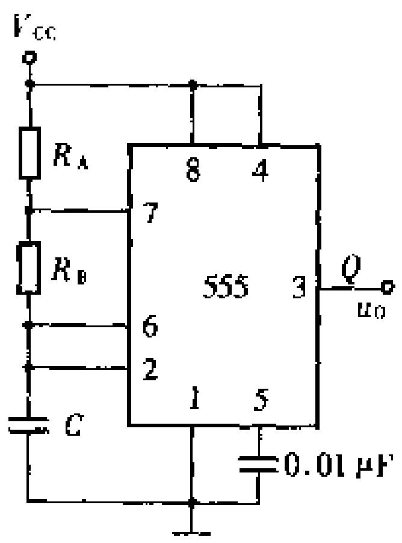

答案：
解：输出波形的振荡周期为：

$$
\begin{array}{r l} & T = T _ {P H} + T _ {P L} = 0. 7 (R _ {A} + 2 R _ {B}) \cdot C \\ & = 0. 7 \times 1 5 \times 1 0 ^ {3} \times 9 6 0 \times 1 0 ^ {- 1 2} \\ & = 1. 0 0 8 \times 1 0 ^ {- 5} s \end{array}
$$

振荡频率为

$$
\begin{array}{l} {f = \frac {1}{T} = \frac {1}{1 . 0 0 8 \times 1 0 ^ {- 5}}} \\ {= 9. 9 \times 1 0 ^ {4} \mathrm{Hz}} \\ {= 9 9 \mathrm{KHz}} \end{array}
$$

占空比:

$$
q = \frac {t _ {W}}{T} = \frac {T _ {P H}}{T _ {P H} + T _ {P L}} = \frac {R _ {A} + R _ {B}}{R _ {A} + 2 R _ {B}}
$$

$$
q = \frac {1 0}{1 5} = 66.7 \%
$$

### 习题 7.2

对于图P7.2占空比可调的多谐振荡器：

(1)试计算其q最大值 $q_{max}$ 和最小值 $q_{min}$ ;

(2)说明该电路在改变占空比时振荡频率f是否发生变化，原因何在？

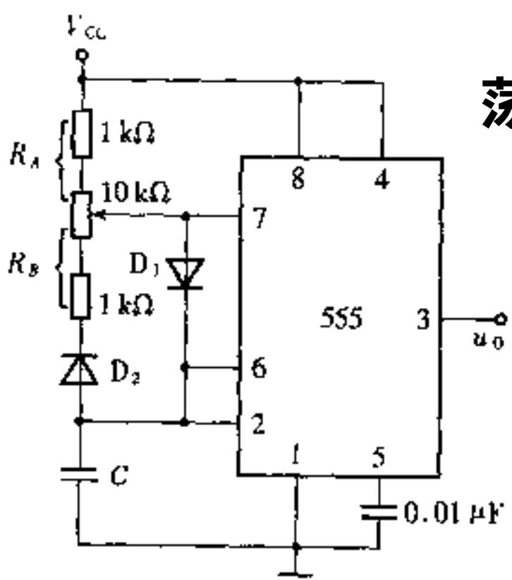

答案：
解：(1)

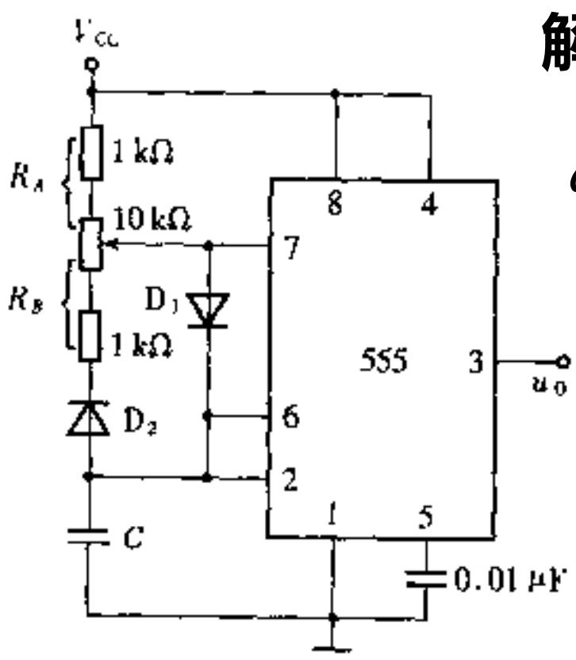

$$
q = \frac {t _ {W}}{T} = \frac {T _ {P H}}{T _ {P H} + T _ {P L}} = \frac {R _ {A}}{R _ {A} + R _ {B}}
$$

$$
q _ {\mathrm{max}} = \frac {1 1}{1 2} = 91.7\%
$$

$$
q _ {\mathrm{min}} = \frac {1}{1 2} = 8.3 \%
$$

(2) 该电路在改变占空比时振荡频率 $f$ 不发生变化。

因为

$$
T = T _ {P H} + T _ {P L} = 0. 7 (R _ {A} + R _ {B}) \cdot C
$$

而 $(R_{A} + R_{B})$ 为常数。

知识点：[数字系统的基本模型（数据处理器与控制器）及对最小时钟周期、异步信号同步化的约定](../../../topics/数字逻辑电路/数字系统模型.md)

### 习题 7.5

已知施密特反相器的输入信号如图P7.4所示．试作出对应的输出波形Uo。

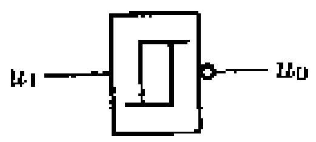

答案：
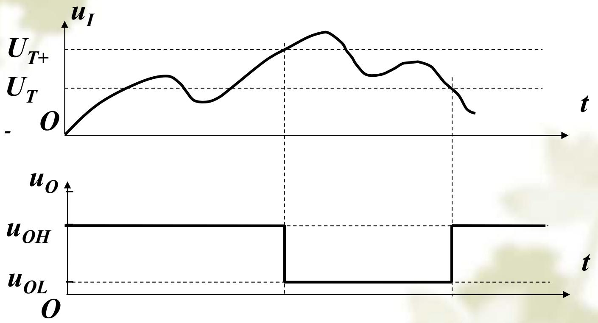

知识点：[数字系统的基本模型（数据处理器与控制器）及对最小时钟周期、异步信号同步化的约定](../../../topics/数字逻辑电路/数字系统模型.md)

### 习题 8.1

有一个DAC电路，n=8，其分辨率是多少？

答案：
解：分辨率=$1/(2^{n}-1)=1/(2^{8}-1)=0.392\%$

知识点：[数字系统的基本模型（数据处理器与控制器）及对最小时钟周期、异步信号同步化的约定](../../../topics/数字逻辑电路/数字系统模型.md)

### 习题 8.3

若倒T型DAC电路中R=R $_{F}$ =10KΩ,U $_{REF}$ =5V,求对应输入011,101,110这3种情况下的输出电压。

答案：
解：

$$
u _ {o} = - \frac {U _ {R E F} R _ {F}}{2 ^ {n} R} \sum_ {i = 0} ^ {n - 1} 2 ^ {i} D _ {i}
$$

当输入数字量为011时，输出电压 $u_{0}$ 为：

$$
u _ {o} = - \frac {U _ {R E F} R _ {F}}{2 ^ {n} R} \sum_ {i = 0} ^ {n - 1} 2 ^ {i} D _ {i} = - \frac {5}{2 ^ {3}} \times 3 = - \frac {1 5}{8} V
$$

*(注：原文仅给出了011的计算过程，未给出101和110的具体数值结果)*

知识点：[数字系统的基本模型（数据处理器与控制器）及对最小时钟周期、异步信号同步化的约定](../../../topics/数字逻辑电路/数字系统模型.md)

### 习题 8.4

一个8位逐次逼近式ADC要求转换时间小于200ns，则时钟周期 $T_{CP}$ 应为多少？

答案：
解：逐次逼近式ADC转换器完成一次转换所需要的节拍数为 $(n+1)$ ，其中n为二进制代码的个数，完成一次转换所需的时间为 $(n+1)T_{CP}$ ，其中 $T_{CP}$ 为时钟脉冲周期。

因此： $(n+1)T_{CP}\leq200ns$

$T_{CP}\leq200/9=22.2ns$

知识点：[数字系统的基本模型（数据处理器与控制器）及对最小时钟周期、异步信号同步化的约定](../../../topics/数字逻辑电路/数字系统模型.md)

### 习题 8.5

有一个ADC电路， $U_{I}=10V$ ，n=4，试分别求出舍尾量化和四舍五入量化方式时的量化单位△。如果 $U_{I}=6.28V$ ，则转换后的数字量分别为什么？

答案：
**舍尾法**

| | 编码 | 量化电平 | 量化单位 | 最大量化误差 |
|---|---|---|---|---|
| **分析** | | | $\Delta = U_I / 2^n = 10/16 = 0.625V$ | $\Delta$ |
| **计算** | | 6.28V 在 $10\Delta \sim 11\Delta$ 之间 | | 量化成 $10\Delta$ (即数字量10) |

**四舍五入法**

| | 编码 | 量化电平 | 量化单位 | 最大量化误差 |
|---|---|---|---|---|
| **分析** | | | $\Delta = U_I / (2^n - 1) = 10/15 \approx 0.667V$ | $\Delta/2$ |
| **计算** | | 6.28V 在 $9.5\Delta \sim 10.5\Delta$ 之间 | | 量化成 $10\Delta$ (即数字量10) |

*(注：原文此处包含了一个例题“例: 有一个ADC电路...”，内容与本题类似但参数不同，以下为原文提供的参考例题解答)*

> **例:** 有一个ADC电路, $U_{\mathrm{REF}} = 5 \mathrm{~V}, \mathrm{n} = 4$ , 试分别求出采用四舍五入量化和舍尾量化方式时的量化单位。如果 $u_{I} = 3.9 \mathrm{~V}$ , 则转换后的数字量分别为多少? 若用自然二进制码表示转换后的数字量, 则对应的代码分别是什么?
>
> **解：**
> 1. **采用四舍五入量化方式：**
>    量化单位 $\Delta=\frac{2}{2^{n+1}-1}U_{REF}=\frac{2}{31}\times5\approx0.323(V)$
>    $u_{I}$ 在 $(11.5\Delta\sim12.5\Delta)$ 之间，被量化为 $(12)_{10}$ ，相应的自然二进制码为 $(1100)_{自然二进制码}$
>
> 2. **采用舍尾量化方式：**
>    量化单位 $\Delta=\frac{1}{2^{n}}U_{REF}=\frac{1}{16}\times5\approx0.313(V)$
>    $u_{I}$ 在 $(12\Delta\sim13\Delta)$ 之间，被量化为 $(12)_{10}$ *(注：原文写为$(2)_{10}$，根据上下文及二进制码1100推断应为12)*，相应的自然二进制码为 $(1100)_{自然二进制码}$

知识点：[数字系统的基本模型（数据处理器与控制器）及对最小时钟周期、异步信号同步化的约定](../../../topics/数字逻辑电路/数字系统模型.md)

### 习题 9.2

试用ROM阵列图实现下列一组多输出逻辑函数

$$
\left\{ \begin{array}{l} F _ {1} (A, B, C) = \overline {{A}} B + A \overline {{B}} + B C \\ F _ {2} (A, B, C) = \sum m (3, 4, 5, 7) \\ F _ {3} (A, B, C) = \overline {{A}} \overline {{B}} \overline {{C}} + \overline {{A}} \overline {{B}} C + \overline {{A}} B C + A B \overline {{C}} + A B C \end{array} \right.
$$

答案：
解:

首先应将以上三个逻辑函数化成由最小项组成的标准“与-或”式,即

$$
\left\{ \begin{array}{l} F _ {1} (A, B, C) = \sum m (2, 3, 4, 5, 7) \\ F _ {2} (A, B, C) = \sum m (3, 4, 5, 7) \\ F _ {3} (A, B, C) = \sum m (0, 1, 3, 6, 7) \end{array} \right.
$$

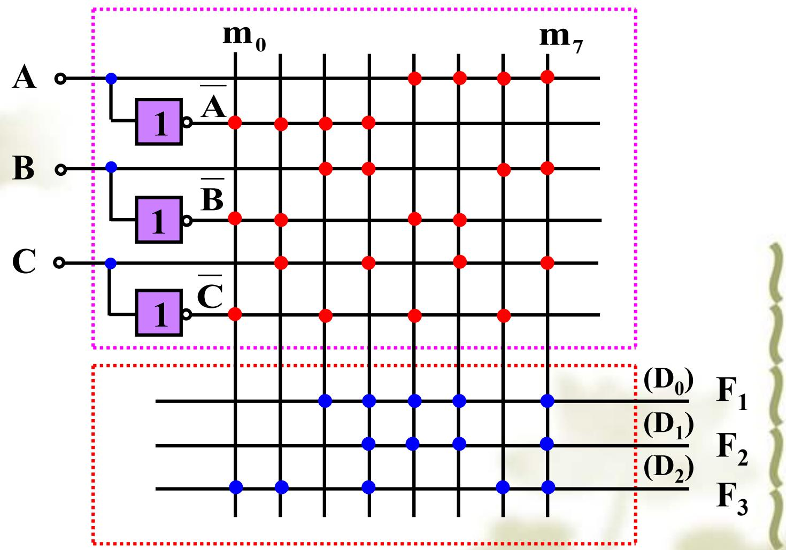

知识点：[完整数字系统设计流程实例（如乘法器、交通灯管理系统的算法规律、处理器设计与控制器实现）](../../../topics/数字逻辑电路/数字系统设计实例.md)

### 习题 9.7

有容量为 $256 \times 4, 64 \mathrm{~K} \times 1, 1 \mathrm{M} \times 8, 128 \mathrm{~K} \times 16$ 为的 ROM,试分别回答:

这些ROM有多少个基本存储单元？

这些ROM每次访问几个基本存储单元？

这些ROM各有多少个地址线？

答案：
答:
(1) 分别有1024个, $1024 \times 64$ 个, $1M \times 8$ 个, $128K \times 16$ 个。
(2) 分别为4个,1个,8个,16个。
(3) 分别有8,16,20,17条地址线。

知识点：[数字系统的基本模型（数据处理器与控制器）及对最小时钟周期、异步信号同步化的约定](../../../topics/数字逻辑电路/数字系统模型.md)

### 习题 9.7 (续/另一题)

试用位扩展方法，将2片 $256 \times 4$ 位的RAM组成一个 $256 \times 8$ 位的RAM，画出电路图。

答案：
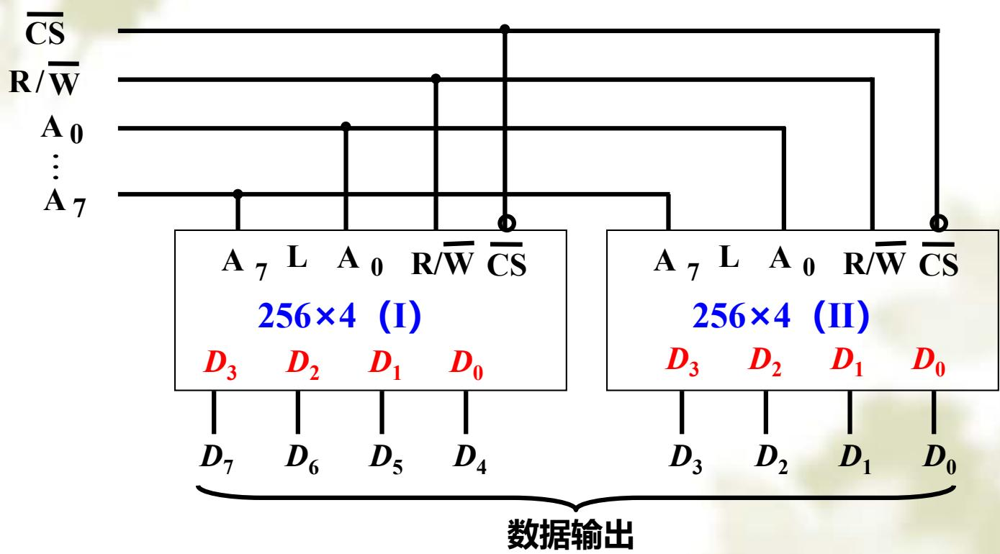

知识点：[数字系统的基本模型（数据处理器与控制器）及对最小时钟周期、异步信号同步化的约定](../../../topics/数字逻辑电路/数字系统模型.md)、[控制器的四种硬件实现方法：每态一触发器法(SSI)、MSI法(MUX+寄存器+译码器)、PLA法(LSI)及对比](../../../topics/数字逻辑电路/控制器实现方法.md)

### 习题 9.10

用2114构成 $2 \mathrm{~K} \times 8$ 的静态存储器，画出逻辑图

答案：
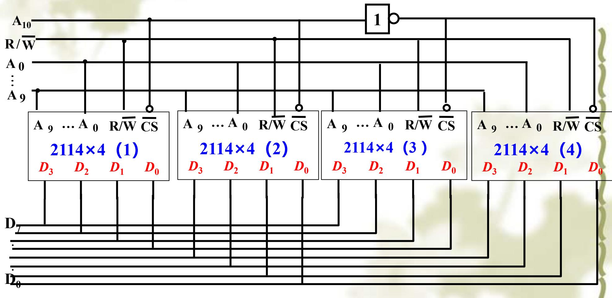

知识点：[完整数字系统设计流程实例（如乘法器、交通灯管理系统的算法规律、处理器设计与控制器实现）](../../../topics/数字逻辑电路/数字系统设计实例.md)

### 练习

试画出下图所示算法流程图的ASM图。要求状态数最少。

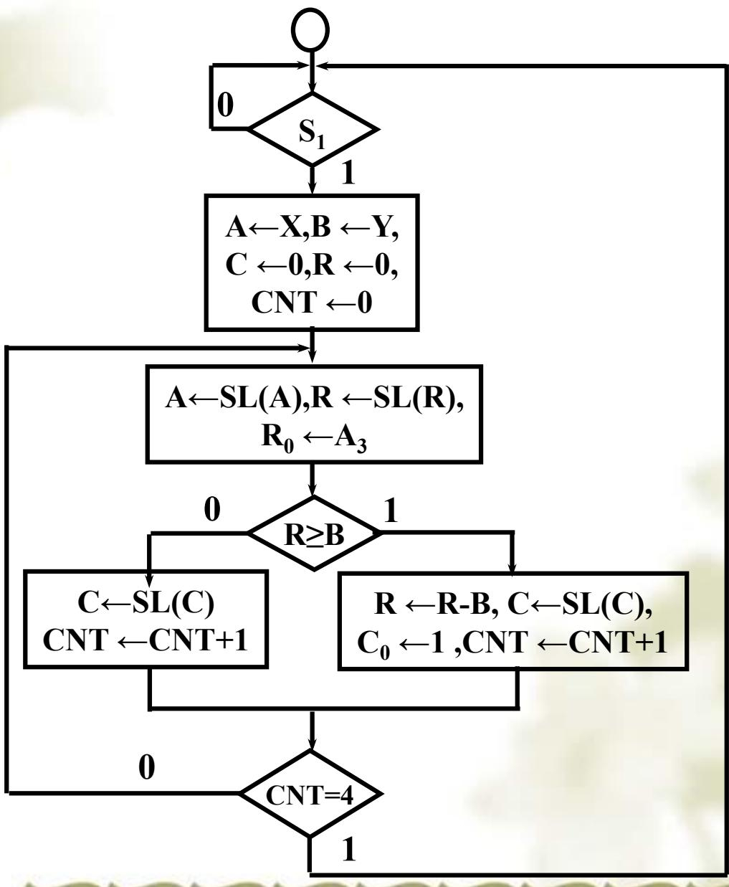

答案：
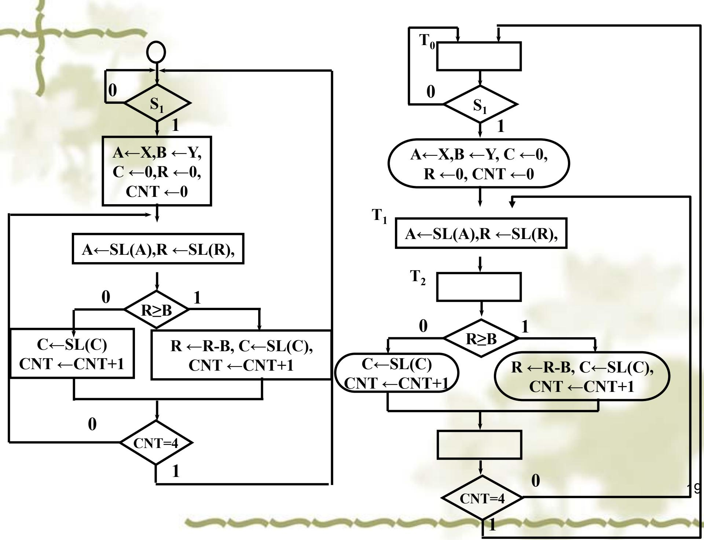

知识点：[算法状态机(ASM)图的状态框、判断框、条件输出框及ASM块的构成规则](../../../topics/数字逻辑电路/ASM图基础.md)、[根据文字描述建立ASM图的原则，以及从ASM图推导处理器明细表和控制器状态转移图](../../../topics/数字逻辑电路/ASM图建立与分析.md)

### 习题 12.2

在 $\mathrm{T}_{1}$ 状态下,如果控制输入Y和Z等于1和0,系统实现条件操作,寄存器增1,并转换到状态 $\mathrm{T}_{2}$ 。试按上述条件画出一个部分ASM图。

答案：
解: Y和Z优先权相同。

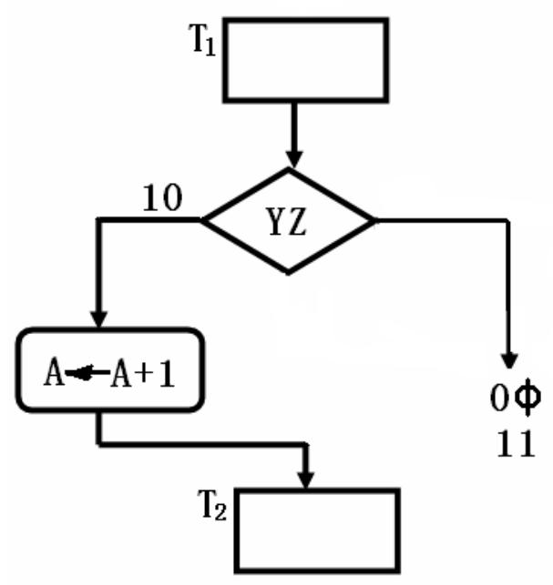

## 习题 12.2

在 $T_1$ 状态下，如果控制输入 $Y$ 和 $Z$ 分别等于 1 和 0，系统实现条件操作，寄存器增 1，并转换到状态 $T_2$。试按上述条件画出一个部分 ASM 图。

答案：
$Y$ 和 $Z$ 具有优先权。

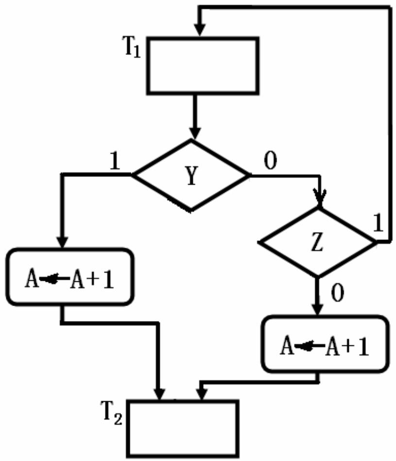

## 习题 12.3

试分别画出满足下列状态要求的数字系统的 ASM 图。

(1) 如果 $X=0$，控制器从状态 $T_1$ 变到状态 $T_2$；如果 $X=1$，产生一个条件操作，并从状态 $T_1$ 变到状态 $T_2$。

答案：

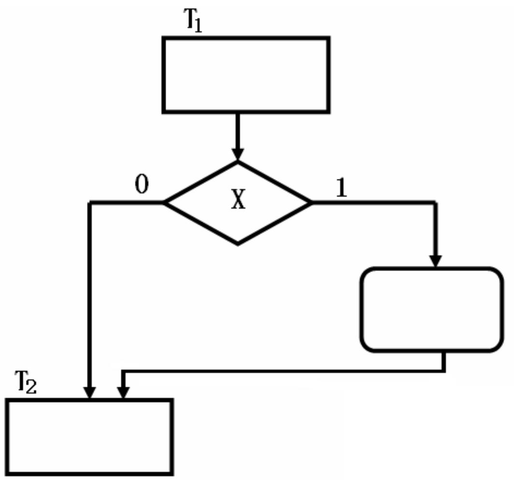

(2) 如果 $X=1$，控制器从状态 $T_1$ 变到状态 $T_2$；然后变到状态 $T_3$；如果 $X=0$，控制器从状态 $T_1$ 变到状态 $T_3$。

答案：

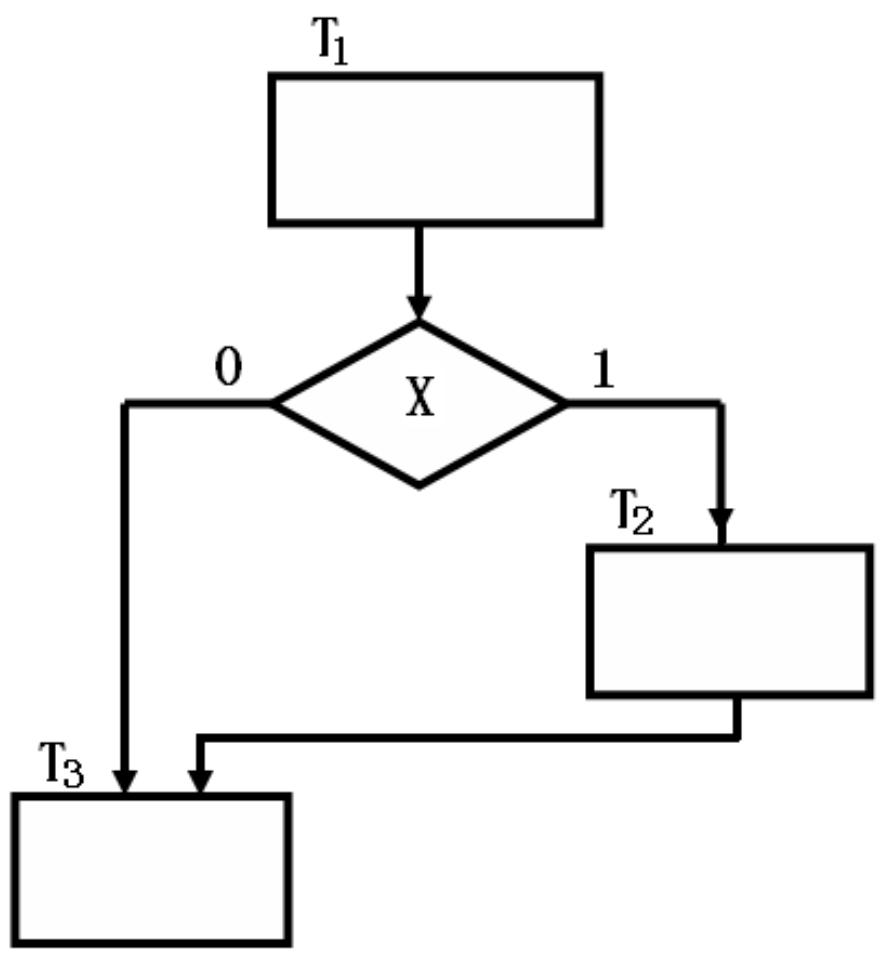

(3) 在 $T_1$ 状态下，若 $XY = 00$，变到状态 $T_2$；若 $XY = 01$，变到状态 $T_3$；若 $XY = 10$，变到状态 $T_1$；否则变到状态 $T_4$。

答案：

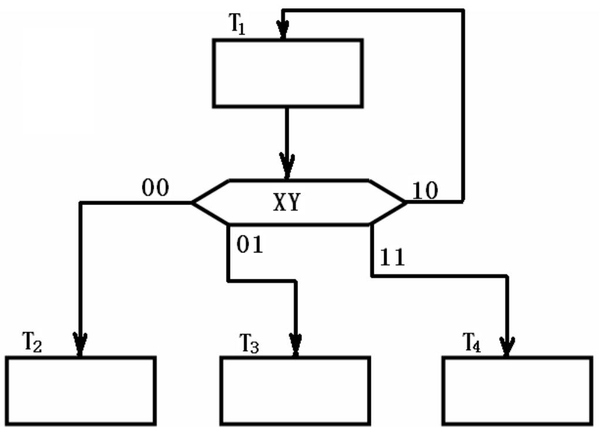

## 习题 12.4

数字系统的 ASM 图表示于图 P12.4。试用每态一个触发器的方法实现系统控制器。

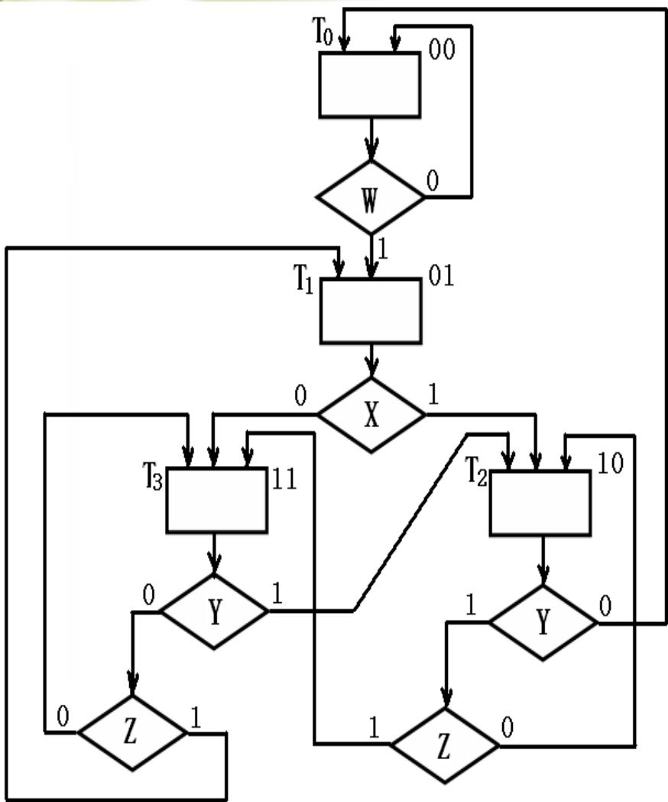

答案：

$$
\mathbf {D _ {0}} = \mathbf {T _ {0}} \cdot \overline {{\mathbf {W}}} + \mathbf {T _ {2}} \cdot \overline {{\mathbf {Y}}}
$$

$$
\mathbf {D} _ {1} = \mathbf {T} _ {0} \cdot \mathbf {W} + \mathbf {T} _ {3} \cdot \overline {{\mathbf {Y}}} \cdot \mathbf {Z}
$$

$$
\mathbf {D} _ {2} = \mathbf {T} _ {1} \cdot \mathbf {X} + \mathbf {T} _ {2} \cdot \mathbf {Y} \cdot \overline {{\mathbf {Z}}} + \mathbf {T} _ {3} \cdot \mathbf {Y}
$$

$$
\begin{array}{l} \mathbf {D} _ {3} = \mathbf {T} _ {1} \cdot \overline {{\mathbf {X}}} + \mathbf {T} _ {2} \cdot \mathbf {Y} \cdot \mathbf {Z} + \mathbf {T} _ {3} \cdot \overline {{\mathbf {Y}}} \cdot \\ \mathbf {Z} \end{array}
$$

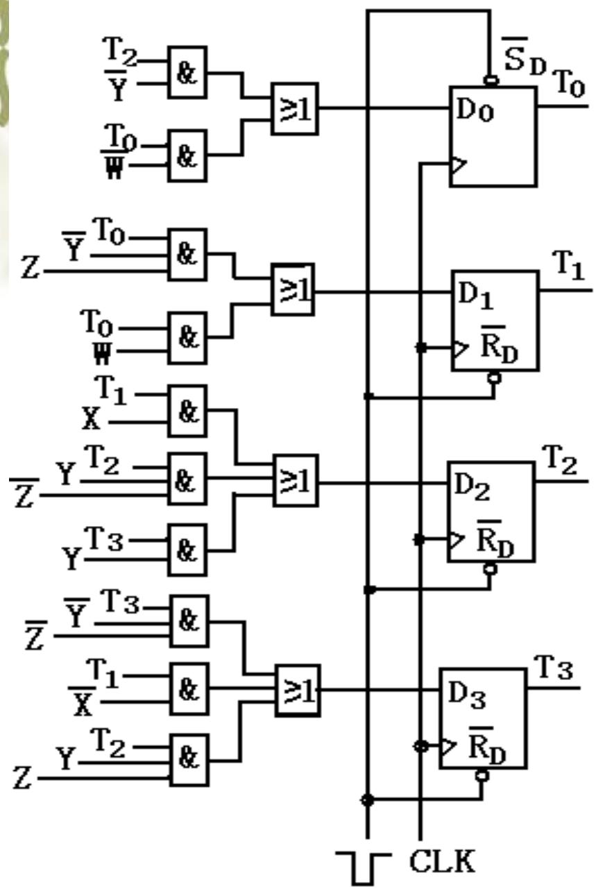

$$
\begin{array}{r l} & {\mathbf {D} _ {0} = \mathbf {T} _ {0} \cdot \overline {{\mathbf {W}}} + \mathbf {T} _ {2} \cdot \overline {{\mathbf {Y}}}} \\ & {\mathbf {D} _ {1} = \mathbf {T} _ {0} \cdot \mathbf {W} + \mathbf {T} _ {3} \cdot \overline {{\mathbf {Y}}} \cdot \mathbf {Z}} \\ & {\mathbf {D} _ {2} = \mathbf {T} _ {1} \cdot \mathbf {X} + \mathbf {T} _ {2} \cdot \mathbf {Y} \cdot \overline {{\mathbf {Z}}} + \mathbf {T} _ {3} \cdot \mathbf {Y}} \\ & {\mathbf {D} _ {3} = \mathbf {T} _ {1} \cdot \overline {{\mathbf {X}}} + \mathbf {T} _ {2} \cdot \mathbf {Y} \cdot \mathbf {Z} + \mathbf {T} _ {3} \cdot \overline {{\mathbf {Y}}} \cdot \overline {{\mathbf {Z}}}} \end{array}
$$

## 习题 12.5

控制器的状态转移表题图如图 P12.5 所示，它有 4 个状态和 2 个输入端。请完成下列问题：

(1) 试画出等效的 ASM 图（状态框是空的）；
(2) 用数据选择器和译码器实现控制器。

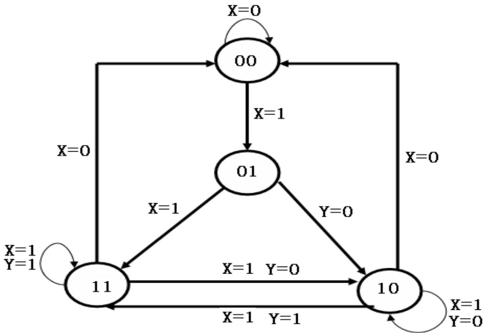

图 P12.5 控制器的状态转移图

答案：

(1) 等效的 ASM 图：

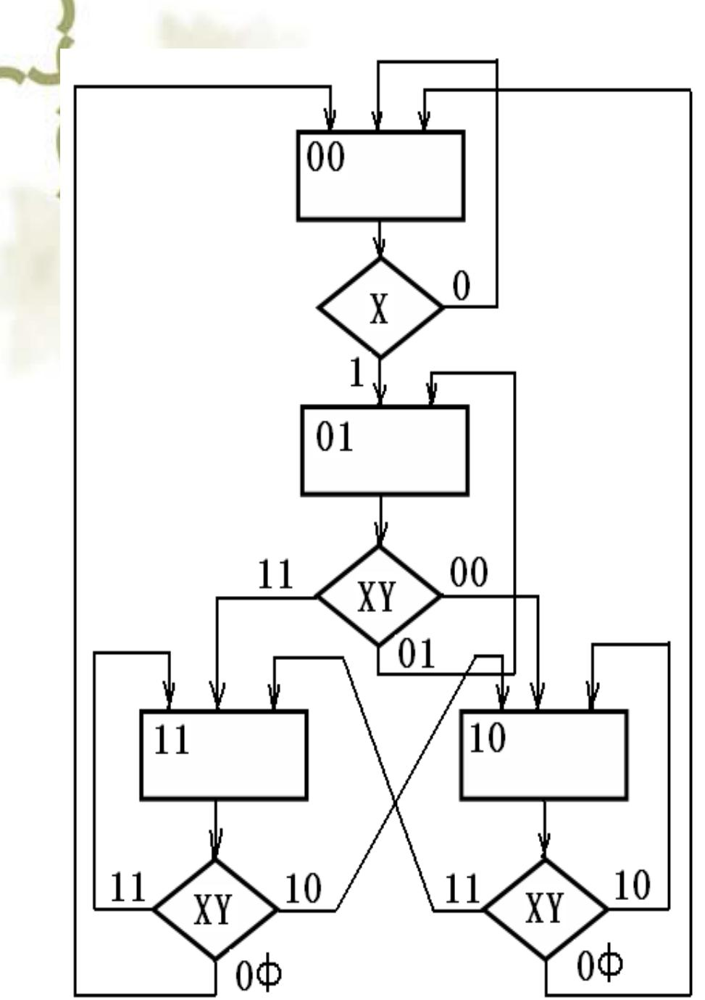

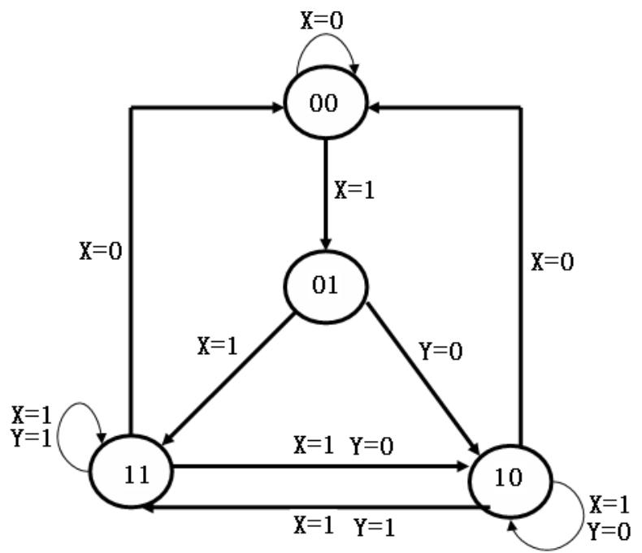

(2) 用数据选择器和译码器实现控制器：

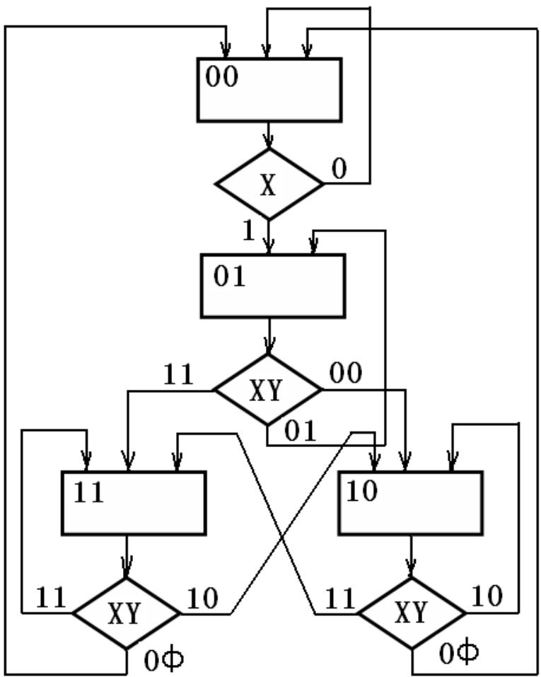

知识点：[算法状态机(ASM)图的状态框、判断框、条件输出框及ASM块的构成规则](../../../topics/数字逻辑电路/ASM图基础.md)、[根据文字描述建立ASM图的原则，以及从ASM图推导处理器明细表和控制器状态转移图](../../../topics/数字逻辑电路/ASM图建立与分析.md)、[控制器的四种硬件实现方法：每态一触发器法(SSI)、MSI法(MUX+寄存器+译码器)、PLA法(LSI)及对比](../../../topics/数字逻辑电路/控制器实现方法.md)

### 建立状态转移表

| $Q_1^n$ | $Q_0^n$ | X | Y | $Q_1^{n+1}$ | $Q_0^{n+1}$ |
| :---: | :---: | :---: | :---: | :---: | :---: |
| 0 | 0 | 0 | $\phi$ | 0 | 0 |
| 0 | 0 | 1 | $\phi$ | 0 | 1 |
| 0 | 1 | 0 | 0 | 1 | 0 |
| 0 | 1 | 0 | 1 | 0 | 1 |
| 0 | 1 | 1 | 0 | $\phi$ | $\phi$ |
| 0 | 1 | 1 | 1 | 1 | 1 |
| 1 | 0 | 0 | 0 | 0 | 0 |
| 1 | 0 | 0 | 1 | 0 | 0 |
| 1 | 0 | 1 | 0 | 1 | 0 |
| 1 | 0 | 1 | 1 | 1 | 1 |
| 1 | 1 | 0 | 0 | 0 | 0 |
| 1 | 1 | 0 | 1 | 0 | 0 |
| 1 | 1 | 1 | 0 | 1 | 0 |
| 1 | 1 | 1 | 1 | 1 | 1 |

*注：原文表格中后几行与前半部分重复，此处仅保留唯一的有效状态组合行。*

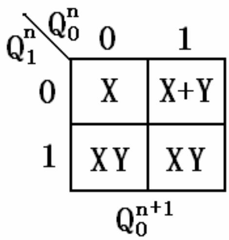

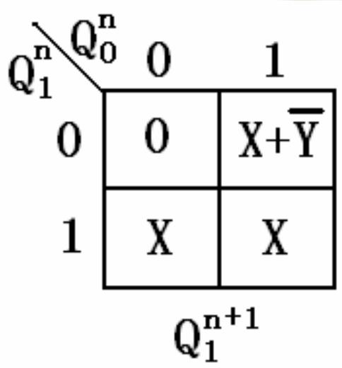

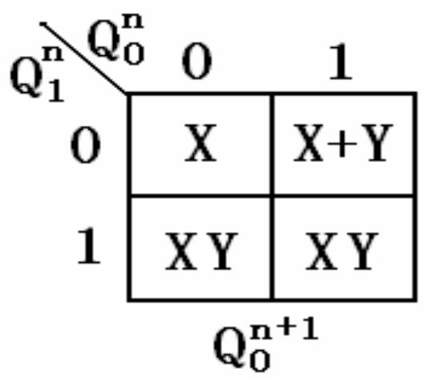

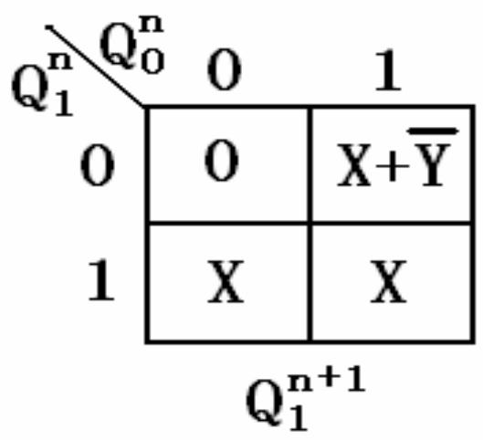

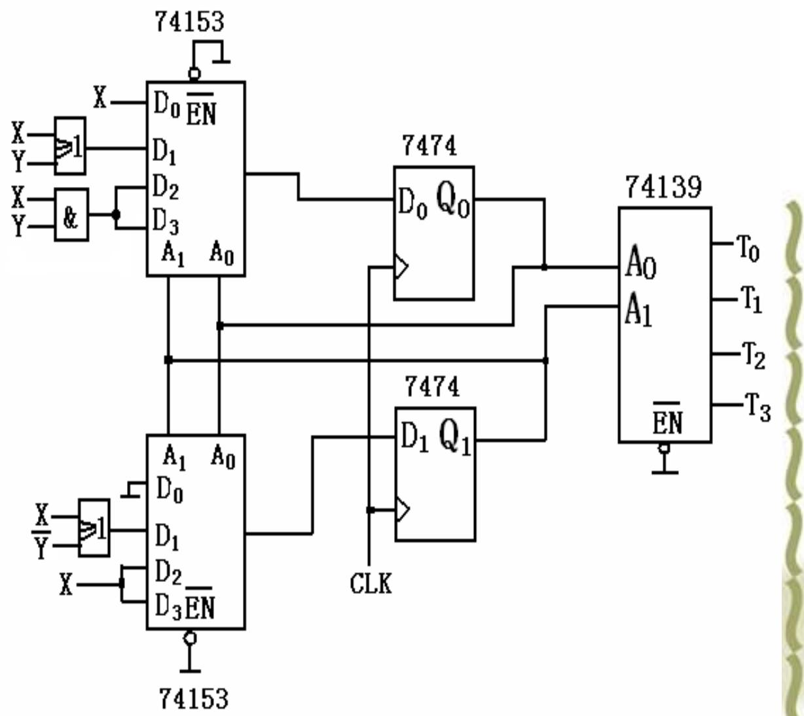

## 习题 12.6

设计一个数字系统，它有 3 个四位寄存器 A、B 和 C，并实现下列操作：

(1) 启动信号出现，传送两个二进制数给 A 和 B；
(2) 如果 $A<B$，左移 A 的内容，结果传送给 C；
(3) 如果 $A>B$，右移 B 的内容，结果传送给 C；
(4) 如果 $A=B$，将数传送给 C。

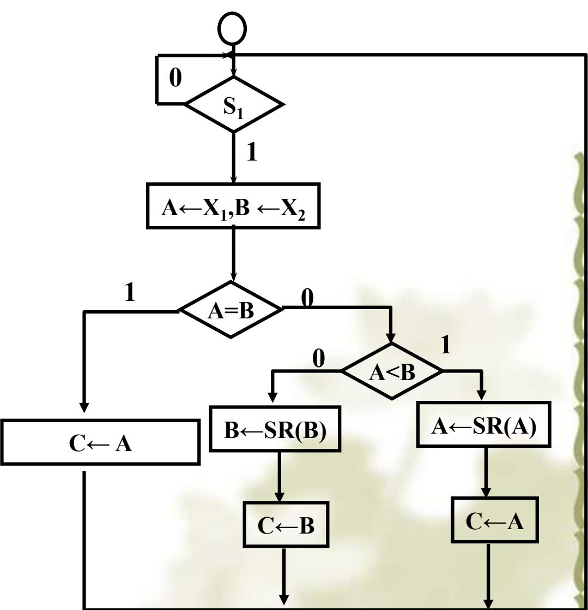

答案：

1. 根据题意，画出算法流程图

2. ASM 图

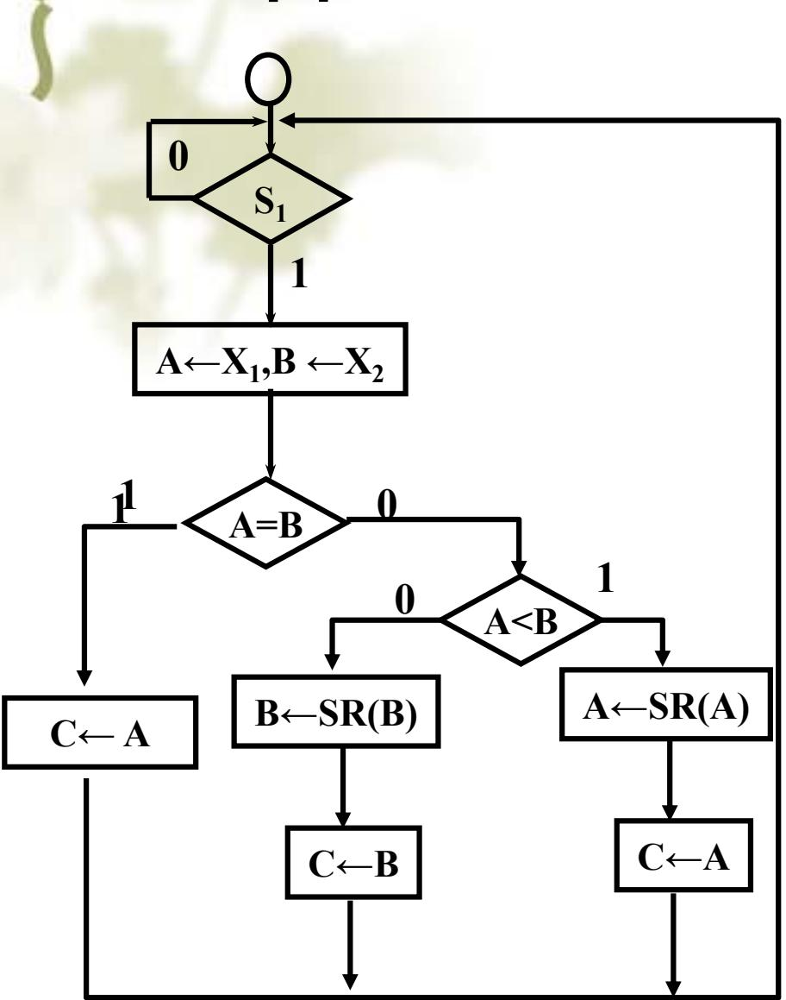

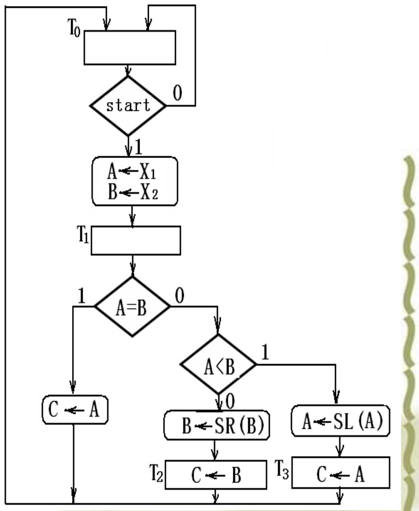

## 习题 3

知识点：[根据文字描述建立ASM图的原则，以及从ASM图推导处理器明细表和控制器状态转移图](../../../topics/数字逻辑电路/ASM图建立与分析.md)、[完整数字系统设计流程实例（如乘法器、交通灯管理系统的算法规律、处理器设计与控制器实现）](../../../topics/数字逻辑电路/数字系统设计实例.md)、[控制器的四种硬件实现方法：每态一触发器法(SSI)、MSI法(MUX+寄存器+译码器)、PLA法(LSI)及对比](../../../topics/数字逻辑电路/控制器实现方法.md)

### 简答 3

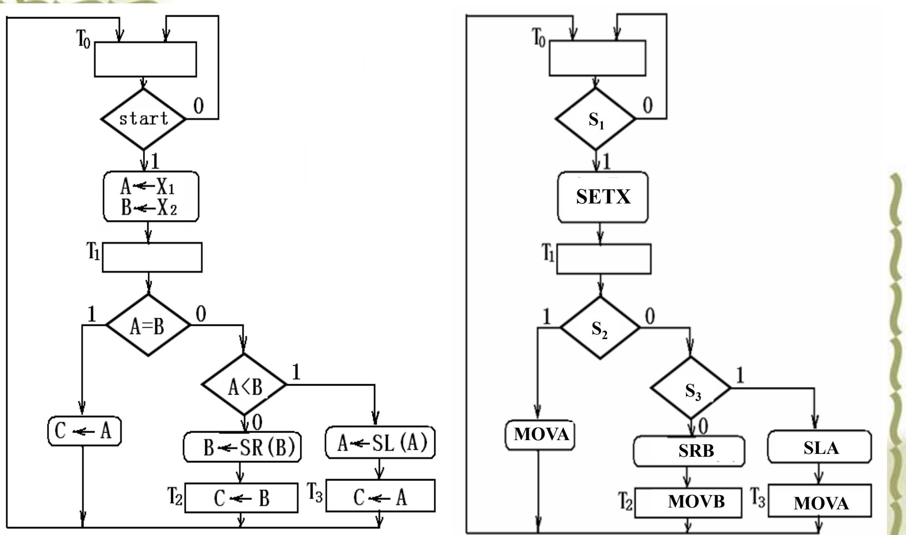

SET X

知识点：[算法状态机(ASM)图的状态框、判断框、条件输出框及ASM块的构成规则](../../../topics/数字逻辑电路/ASM图基础.md)

### 3. 初始结构图

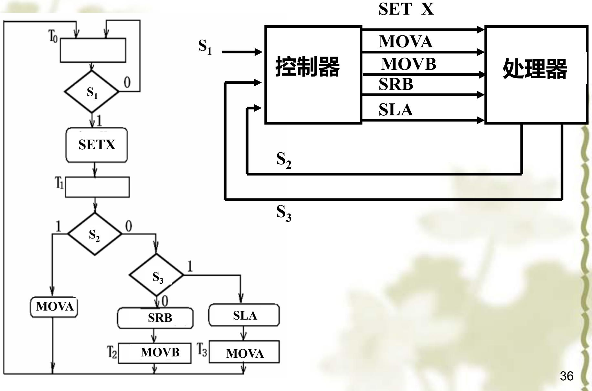

知识点：[完整数字系统设计流程实例（如乘法器、交通灯管理系统的算法规律、处理器设计与控制器实现）](../../../topics/数字逻辑电路/数字系统设计实例.md)、[数字系统的基本模型（数据处理器与控制器）及对最小时钟周期、异步信号同步化的约定](../../../topics/数字逻辑电路/数字系统模型.md)

### 4. 列明细表

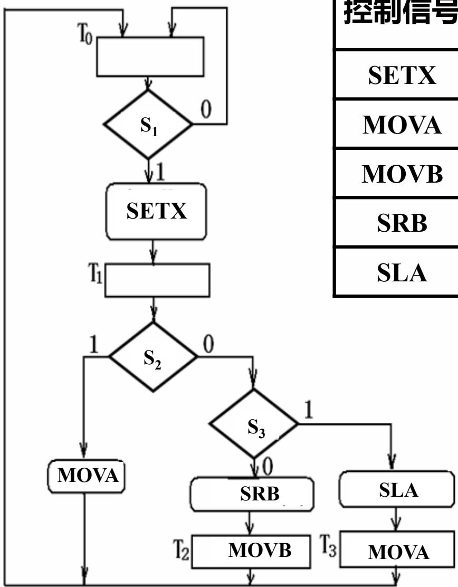

| 控制信号 | 操作 | 状态变量 | 定义 |
| --- | --- | --- | --- |
| SETX | $A \leftarrow X_1, B \leftarrow X_2$ | $S_1$ | START |
| MOVA | $C \leftarrow A$ | $S_1$ | START |
| MOVB | $C \leftarrow B$ | $S_2$ | A=B |
| SRB | $B \leftarrow SR(B)$ | $S_3$ | A<B |
| SLA | $A \leftarrow SL(A)$ | | |

知识点：[根据文字描述建立ASM图的原则，以及从ASM图推导处理器明细表和控制器状态转移图](../../../topics/数字逻辑电路/ASM图建立与分析.md)、[控制器的四种硬件实现方法：每态一触发器法(SSI)、MSI法(MUX+寄存器+译码器)、PLA法(LSI)及对比](../../../topics/数字逻辑电路/控制器实现方法.md)、[寄存器传输语言(RTL)描述的传输操作、算术操作、逻辑操作、移位操作及条件控制语句](../../../topics/数字逻辑电路/RTL语言.md)

### 5. 处理器的设计

| 控制信号 | 操作 | 状态变量 | 定义 |
| --- | --- | --- | --- |
| SETX | $A \leftarrow X_1, B \leftarrow X_2$ | $S_1$ | START |
| MOVA | $C \leftarrow A$ | $S_1$ | START |
| MOVB | $C \leftarrow B$ | $S_2$ | A=B |
| SRB | $B \leftarrow SR(B)$ | $S_3$ | A<B |
| SLA | $A \leftarrow SL(A)$ | | |

A、B、C 三个寄存器都采用 74194 芯片实现。下面分别讨论它们的工作情况：

A：控制信号 $M_1$ $M_0$

| 控制信号 | $M_1$ | $M_0$ |
| --- | --- | --- |
| SETX | 1 | 1 |
| SLA | 1 | 0 |

$$\Rightarrow \begin{cases} M_1 = SETX + SLA \\ M_0 = SETX \end{cases}$$

B：控制信号 $M_1$ $M_0$

| 控制信号 | $M_1$ | $M_0$ |
| --- | --- | --- |
| SETX | 1 | 1 |
| SRB | 0 | 1 |

$$M_1 = SETX \qquad M_0 = SETX + SRB$$

| 控制信号 | 操作 | 状态变量 | 定义 |
| --- | --- | --- | --- |
| SETX | $A \leftarrow X_1, B \leftarrow X_2$ | $S_1$ | START |
| MOVA | $C \leftarrow A$ | $S_1$ | START |
| MOVB | $C \leftarrow B$ | $S_2$ | A=B |
| SRB | $B \leftarrow SR(B)$ | $S_3$ | A<B |
| SLA | $A \leftarrow SL(A)$ | | |

C：控制信号 $M_1$ $M_0$

| 控制信号 | $M_1$ | $M_0$ |
| --- | --- | --- |
| MOVA | 1 | 1 |
| MOVB | 1 | 1 |

$$M_1 = M_0 = MOVA + MOVB \qquad D_C = MOVA \cdot D_A + \overline{MOVA} \cdot D_B$$

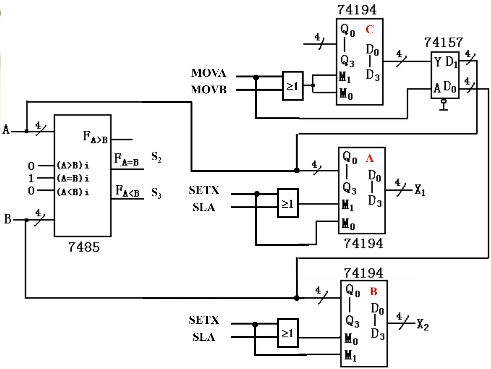

知识点：[控制器的四种硬件实现方法：每态一触发器法(SSI)、MSI法(MUX+寄存器+译码器)、PLA法(LSI)及对比](../../../topics/数字逻辑电路/控制器实现方法.md)、[完整数字系统设计流程实例（如乘法器、交通灯管理系统的算法规律、处理器设计与控制器实现）](../../../topics/数字逻辑电路/数字系统设计实例.md)、[寄存器传输语言(RTL)描述的传输操作、算术操作、逻辑操作、移位操作及条件控制语句](../../../topics/数字逻辑电路/RTL语言.md)

### 6. 控制器设计

采用每态一个触发器设计，需要 4 个 DFF。

$$D_0 = T_0 \overline{S_1} + T_1 S_2 + T_2 + T_3$$

$$D_1 = T_0 S_1$$

$$D_2 = T_1 \overline{S_2} \overline{S_3}$$

$$D_3 = T_1 \overline{S_2} S_3$$

$$SETX = T_0 S_1$$

$$MOVA = T_1 S_2 + T_3$$

$$MOVB = T_2$$

$$SRB = T_1 \overline{S_2} \overline{S_3} \qquad SLA = T_1 \overline{S_2} S_3$$

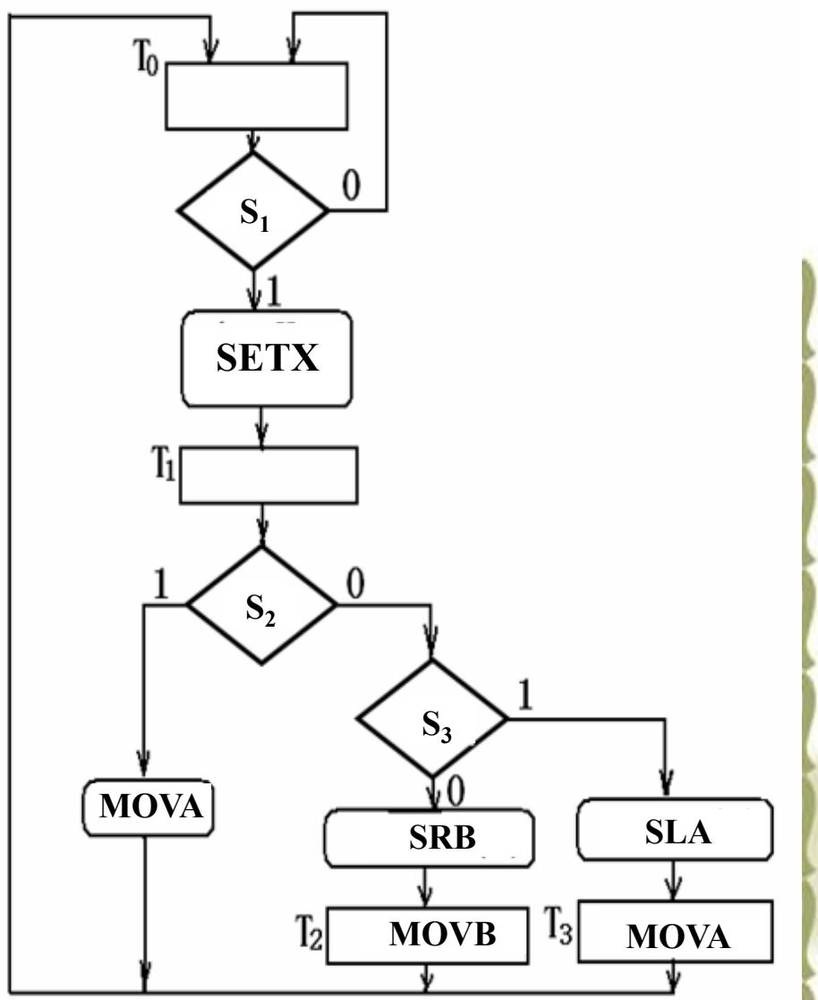

知识点：[控制器的四种硬件实现方法：每态一触发器法(SSI)、MSI法(MUX+寄存器+译码器)、PLA法(LSI)及对比](../../../topics/数字逻辑电路/控制器实现方法.md)、[寄存器传输语言(RTL)描述的传输操作、算术操作、逻辑操作、移位操作及条件控制语句](../../../topics/数字逻辑电路/RTL语言.md)、[根据文字描述建立ASM图的原则，以及从ASM图推导处理器明细表和控制器状态转移图](../../../topics/数字逻辑电路/ASM图建立与分析.md)

### 简答 4

12.7 根据 P12.7 所示 ASM 图，写出控制器状态转移图，画出控制器电路。

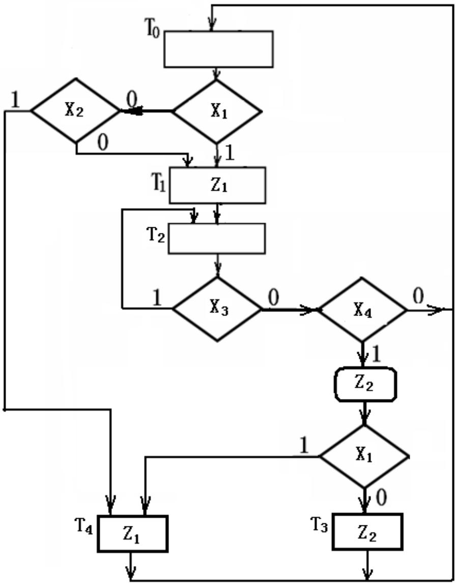

解：

$$X_1 X_2 X_3 X_4 / Z_1 Z_2$$

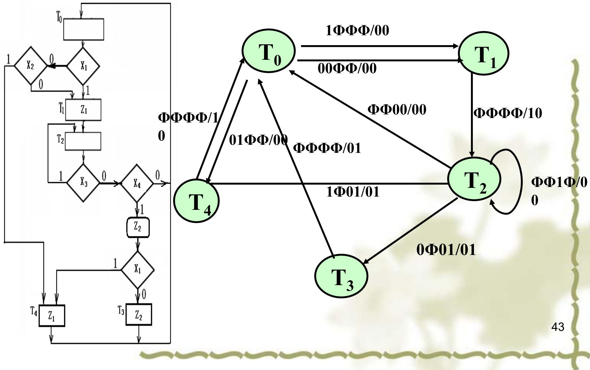

知识点：[根据文字描述建立ASM图的原则，以及从ASM图推导处理器明细表和控制器状态转移图](../../../topics/数字逻辑电路/ASM图建立与分析.md)、[控制器的四种硬件实现方法：每态一触发器法(SSI)、MSI法(MUX+寄存器+译码器)、PLA法(LSI)及对比](../../../topics/数字逻辑电路/控制器实现方法.md)
