# 《数字电路与逻辑设计B》第7章 数字系统设计基础（课件）

原件的每一页，下面附识别出的文字。

### 第7章 数字系统设计基础

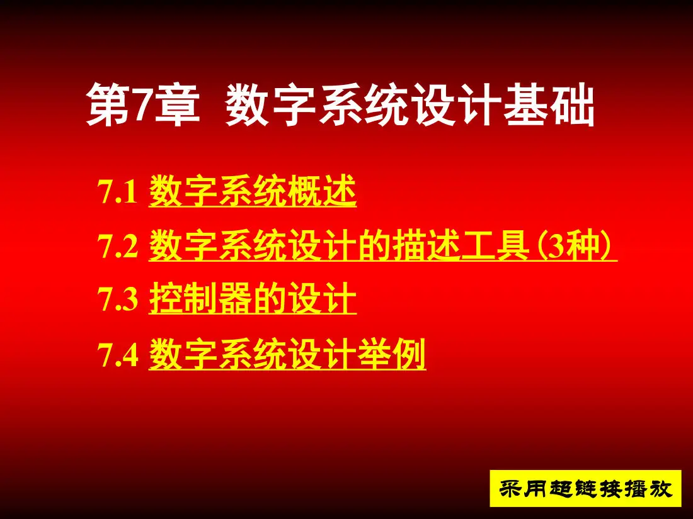

原文：

第7章 数字系统设计基础

7.1 数字系统概述

7.2 数字系统设计的描述工具(3种)

7.3 控制器的设计

7.4 数字系统设计举例

采用超链接播放

### 本章知识点及要求（8学时）

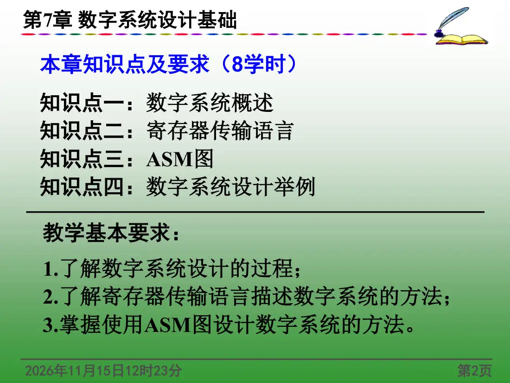

原文：

本章知识点及要求（8学时）

知识点一：数字系统概述

知识点二：寄存器传输语言

知识点三：ASM图

知识点四：数字系统设计举例

教学基本要求：

1.了解数字系统设计的过程；

2.了解寄存器传输语言描述数字系统的方法；

3.掌握使用ASM图设计数字系统的方法。

第7章 数字系统设计基础

く

2026年11月15日12时23分

第2页

### 7.1 概 述

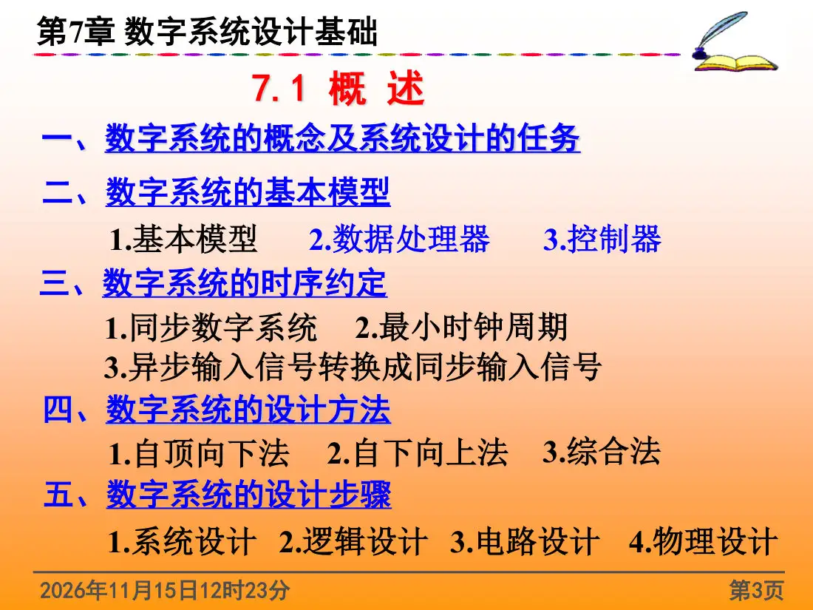

原文：

7.1 概 述

一、数字系统的概念及系统设计的任务

二、数字系统的基本模型

1.基本模型 2.数据处理器 3.控制器

三、数字系统的时序约定

1.同步数字系统 2.最小时钟周期

3.异步输入信号转换成同步输入信号

四、数字系统的设计方法

1.自顶向下法 2.自下向上法 3.综合法

五、数字系统的设计步骤

2.逻辑设计 3.电路设计1.系统设计 4.物理设计

第7章 数字系统设计基础

く

2026年11月15日12时23分

第3页

### 7.2 数字系统的描述工具

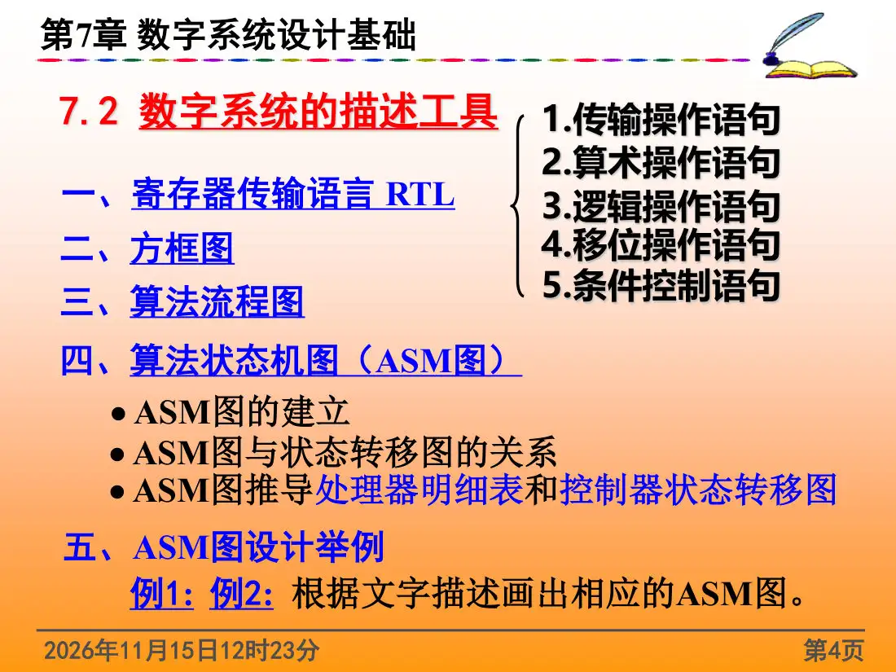

原文：

7.2 数字系统的描述工具

一、寄存器传输语言 RTL

二、方框图

三、算法流程图

四、算法状态机图（ASM图）

•ASM图的建立

•ASM图与状态转移图的关系

1.传输操作语句

2.算术操作语句

3.逻辑操作语句

4.移位操作语句

5.条件控制语句

•ASM图推导处理器明细表和控制器状态转移图

五、ASM图设计举例

例2: 根据文字描述画出相应的ASM图。例1:

第7章 数字系统设计基础

2026年11月15日12时23分

第4页

### 7.3 控制器的设计

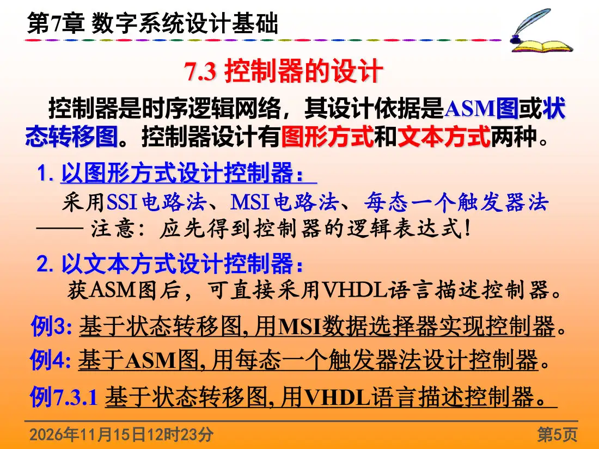

原文：

7.3 控制器的设计

控制器是时序逻辑网络，其设计依据是ASM图或状态转移图。控制器设计有图形方式和文本方式两种。

1.以图形方式设计控制器：

采用SSI电路法、MSI电路法、每态一个触发器法注意：应先得到控制器的逻辑表达式！

2.以文本方式设计控制器：

获ASM图后，可直接采用VHDL语言描述控制器。

例3: 基于状态转移图, 用MSI数据选择器实现控制器。

例4: 基于ASM图, 用每态一个触发器法设计控制器。

例7.3.1 基于状态转移图, 用VHDL语言描述控制器。

第7章 数字系统设计基础

2026年11月15日12时23分

第5页

### 7.4 数字系统设计及VHDL的应用

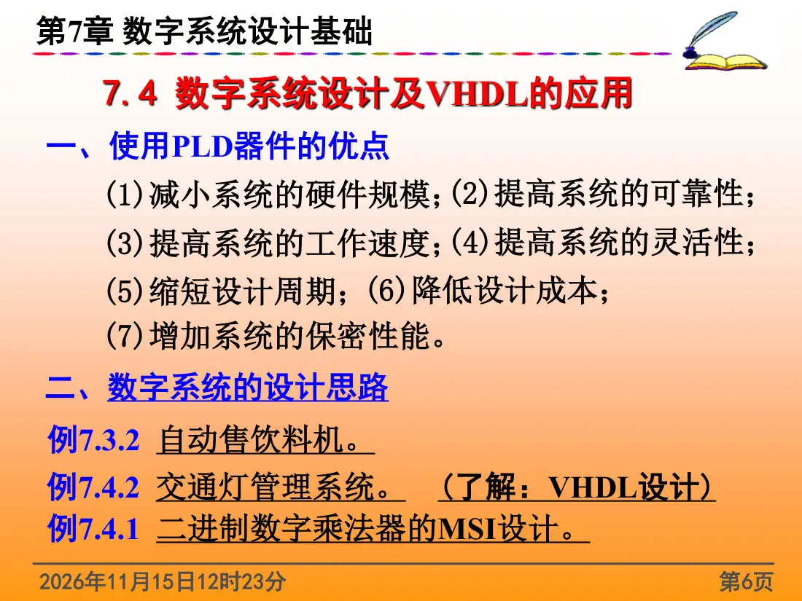

原文：

7.4 数字系统设计及VHDL的应用

一、使用PLD器件的优点

(1)减小系统的硬件规模；(2)提高系统的可靠性；

(3)提高系统的工作速度；(4)提高系统的灵活性；

(6)降低设计成本；(5)缩短设计周期；

(7)增加系统的保密性能。

二、数字系统的设计思路

例7.3.2 自动售饮料机。

例7.4.2 交通灯管理系统。 (了解：VHDL设计)

例7.4.1 二进制数字乘法器的MSI设计。

第7章 数字系统设计基础

2026年11月15日12时23分

第6页

### 第7章 数字系统设计基础

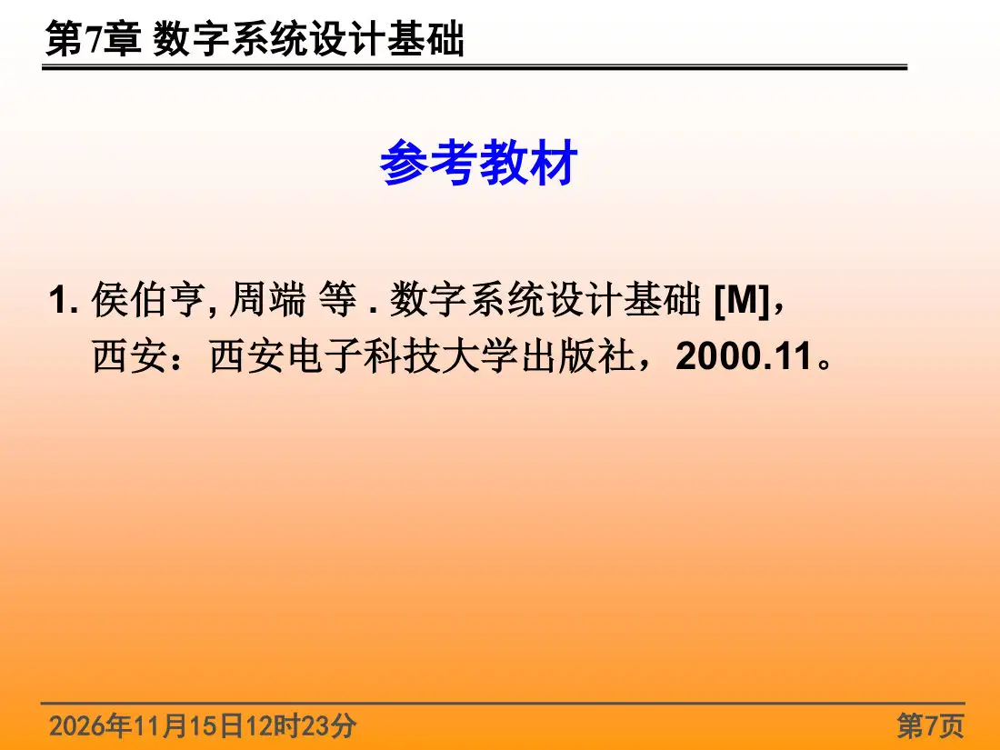

原文：

第7章 数字系统设计基础

参考教材

1. 侯伯亨, 周端 等 . 数字系统设计基础 [M]，西安：西安电子科技大学出版社，2000.11。

2026年11月15日12时23分

第7页

### 望同学们：

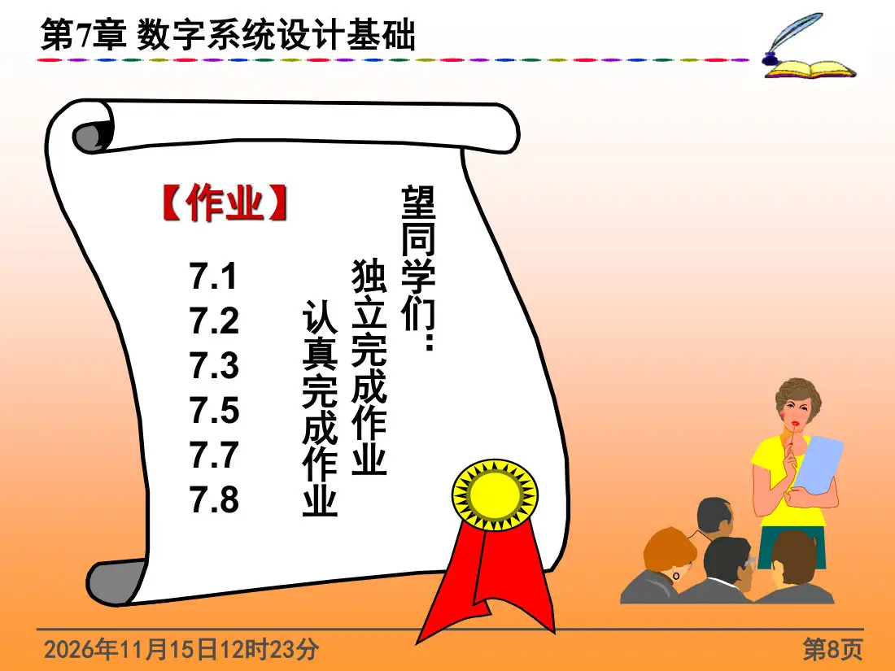

原文：

望同学们：

【作业】

独立完成作业

认真完成作业

7 1 7 ■ 2 7 ■ .3 7 .5 7 7 7. ■ 8

第7章 数字系统设计基础

2026年11月15日12时23分

第8页

### 第7章 数字系统设计基础

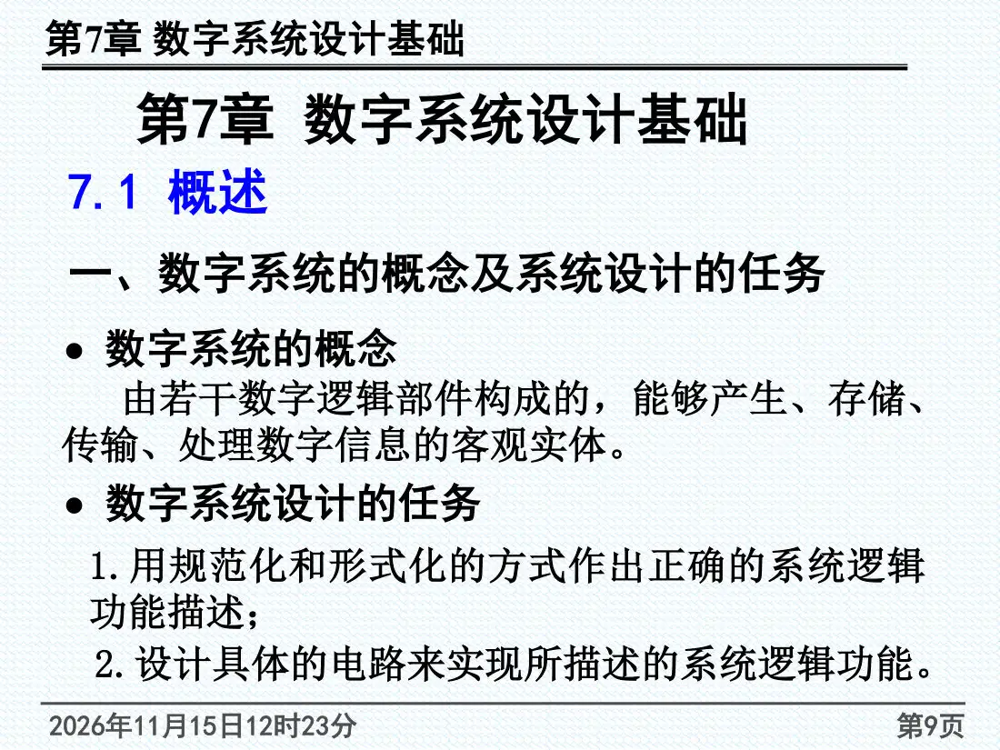

原文：

第7章 数字系统设计基础

7.1 概述

一、数字系统的概念及系统设计的任务

数字系统的概念

由若干数字逻辑部件构成的，能够产生、存储、传输、处理数字信息的客观实体。

数字系统设计的任务

1.用规范化和形式化的方式作出正确的系统逻辑功能描述；

2.设计具体的电路来实现所描述的系统逻辑功能。

第7章 数字系统设计基础

2026年11月15日12时23分

第9页

### 第7章 数字系统设计基础 ——7.1 概述

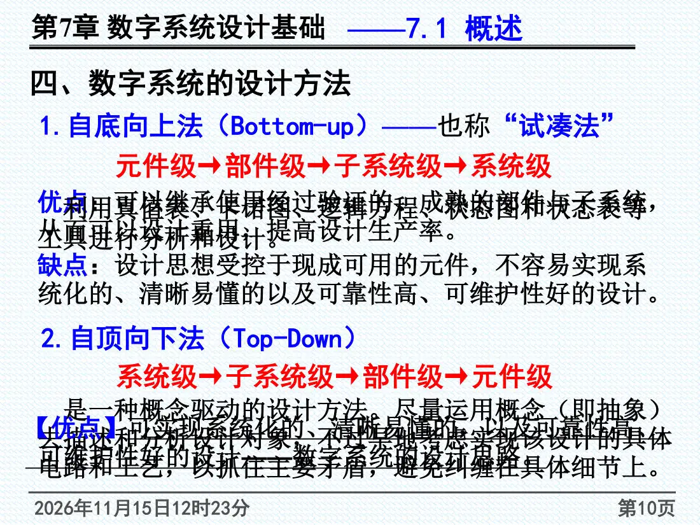

原文：

第7章 数字系统设计基础 ——7.1 概述

四、数字系统的设计方法

1.自底向上法（Bottom-up）——也称“试凑法”

元件级→部件级→子系统级→系统级

优点：可以继承使用经过验证的、成熟的部件与子系统，利用真值表、卡诺图、逻辑方程、状态图和状态表等从而可以设计重用，提高设计生产率。工具进行分析和设计。

缺点：设计思想受控于现成可用的元件，不容易实现系统化的、清晰易懂的以及可靠性高、可维护性好的设计。

2.自顶向下法（Top-Down）

系统级→子系统级→部件级→元件级

是一种概念驱动的设计方法。尽量运用概念（即抽象）去描述和分析设计对象，不过早地考虑实现该设计的具体性高 、【优点】可实现系统化的、清晰易懂的，以及可靠性高、电路和工艺，以抓住主要矛盾，避免纠缠在具体细节上。 可维护性好的设计——数字系统的设计思路。

2026年11月15日12时23分

第10页

### 四、数字系统的设计方法

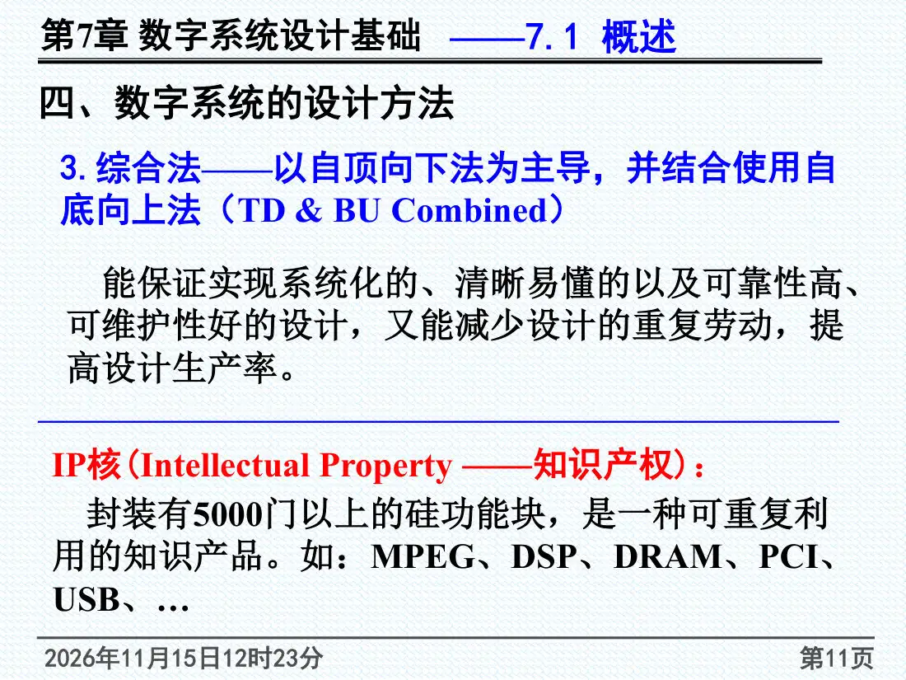

原文：

四、数字系统的设计方法

3.综合法— 以自顶向下法为主导，并结合使用自底向上法（TD & BU Combined）

能保证实现系统化的、清晰易懂的以及可靠性高、可维护性好的设计，又能减少设计的重复劳动，提高设计生产率。

IP核(Intellectual Property 知识产权)：

封装有5000门以上的硅功能块，是一种可重复利用的知识产品。如：MPEG、DSP、DRAM、PCI、USB、

第7章 数字系统设计基础 ——7.1 概述

2026年11月15日12时23分

第11页

### 第7章 数字系统设计基础 ——7.1 概述

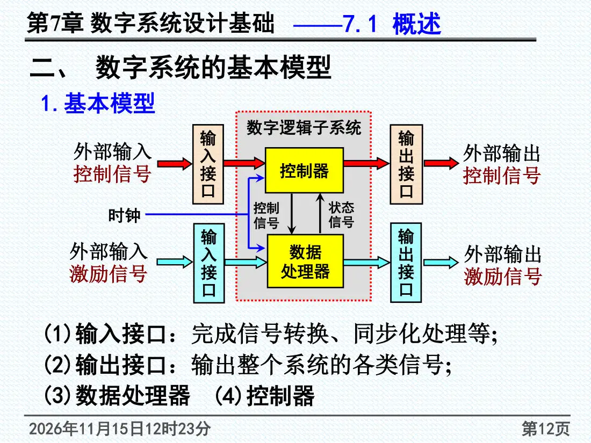

原文：

第7章 数字系统设计基础 ——7.1 概述

二、 数字系统的基本模型

1.基本模型

(1)输入接口：完成信号转换、同步化处理等;

(2)输出接口：输出整个系统的各类信号;

(3)数据处理器 (4)控制器

2026年11月15日12时23分

第12页

### 2.数据处理器 ——按不同的次序执行相应的操作。

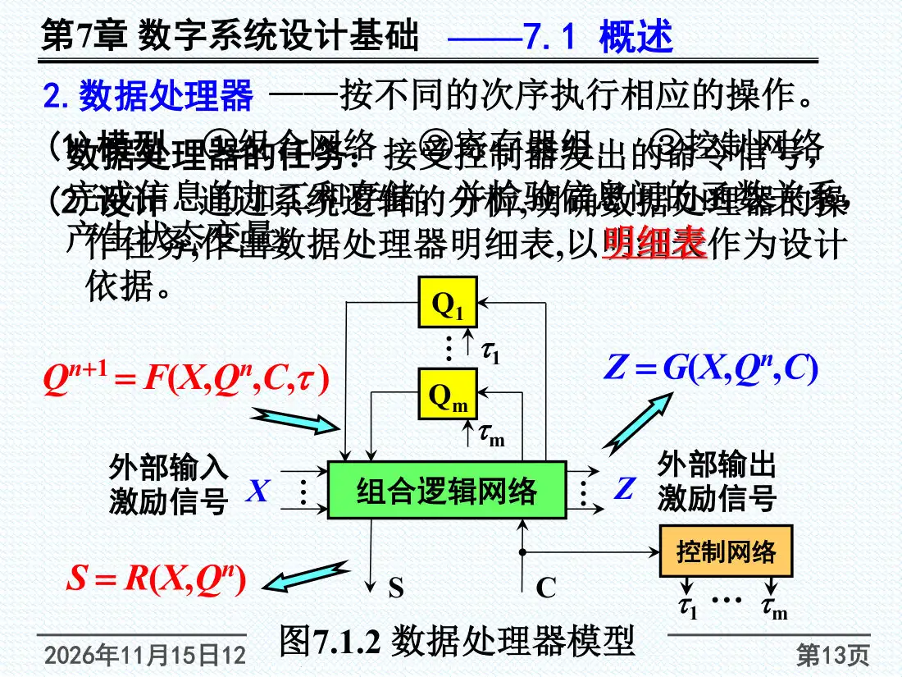

原文：

2.数据处理器 ——按不同的次序执行相应的操作。

(1)模型 ①组合网络 ②寄存器组 ③控制网络数据处理器的任务：接受控制器发出的命令信号，

(2)设计 通过系统逻辑的分析,明确数据处理器的操明细表完成信息的加工和存储，并检验信息间的函数关系，作任务,作出数据处理器明细表,以明细表作为设计明细表产生状态变量。

依据。

第7章 数字系统设计基础 ——7.1 概述

第13页

### 3.控制器 生成和发送控制信号序列， 以便控制数据处理器完成特定的操作。

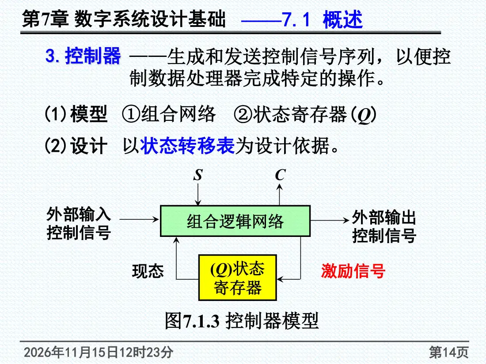

原文：

3.控制器 生成和发送控制信号序列， 以便控制数据处理器完成特定的操作。

(1)模型 ①组合网络 ②状态寄存器(Q)

(2)设计 以状态转移表为设计依据。

第7章 数字系统设计基础 ——7.1 概述

2026年11月15日12时23分

第14页

### 三、数字系统的时序约定

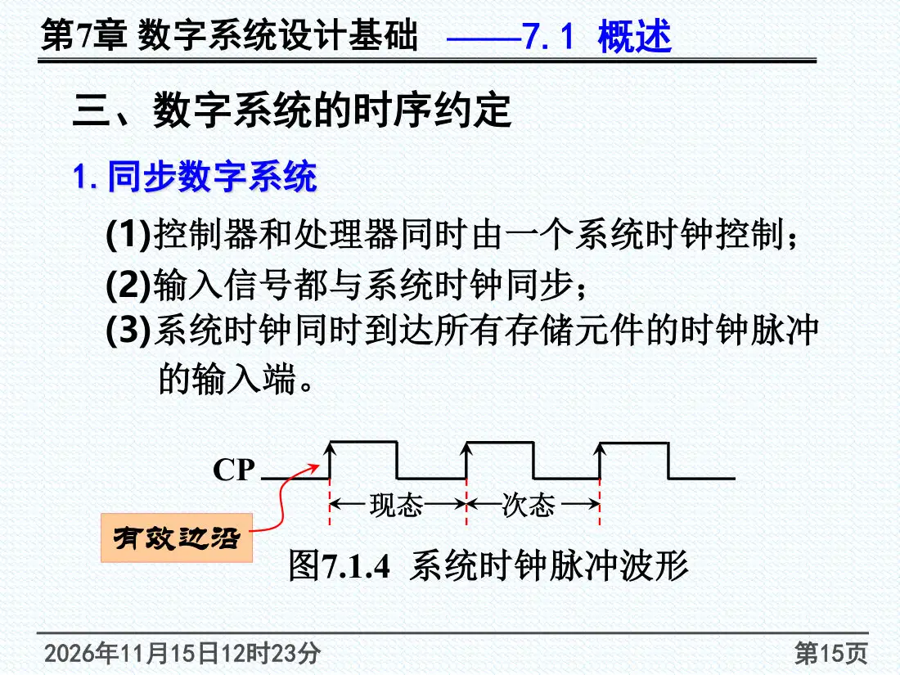

原文：

三、数字系统的时序约定

1.同步数字系统

(1)控制器和处理器同时由一个系统时钟控制；

(2)输入信号都与系统时钟同步；

(3)系统时钟同时到达所有存储元件的时钟脉冲的输入端。

第7章 数字系统设计基础 ——7.1 概述

2026年11月15日12时23分

第15页

### 第7章 数字系统设计基础 ——7.1 概述

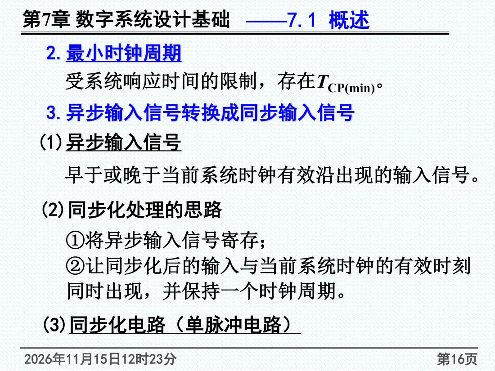

原文：

第7章 数字系统设计基础 ——7.1 概述

2.最小时钟周期

受系统响应时间的限制，存在 $T _ { \mathrm { C P ( m i n ) } ^ { \circ } }$

3.异步输入信号转换成同步输入信号

(1)异步输入信号

早于或晚于当前系统时钟有效沿出现的输入信号。

(2)同步化处理的思路

①将异步输入信号寄存；

②让同步化后的输入与当前系统时钟的有效时刻同时出现，并保持一个时钟周期。

(3)同步化电路（单脉冲电路）

2026年11月15日12时23分

第16页

### 第7章 数字系统设计基础 ——7.1 概述

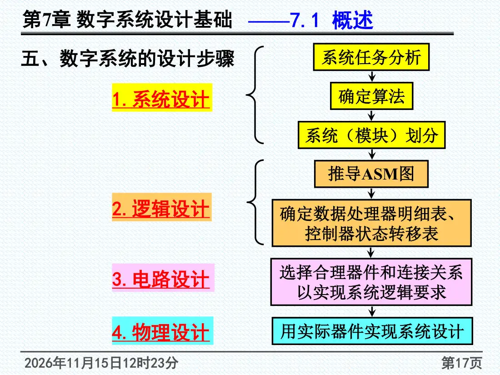

原文：

第7章 数字系统设计基础 ——7.1 概述

五、数字系统的设计步骤

1.系统设计

2.逻辑设计

3.电路设计

4.物理设计

系统任务分析

确定算法

系统（模块）划分

推导ASM图

确定数据处理器明细表、控制器状态转移表

选择合理器件和连接关系以实现系统逻辑要求

用实际器件实现系统设计

2026年11月15日12时23分

第17页

### 7.2 数字系统的描述工具

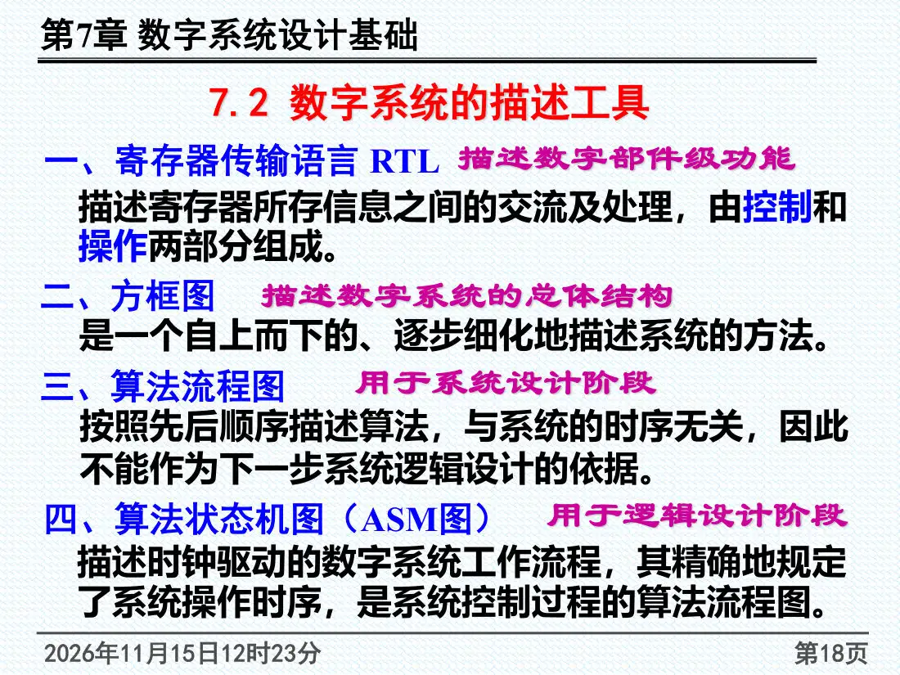

原文：

7.2 数字系统的描述工具

寄存器传输语言 RTL 描述数字部件级功能描述寄存器所存信息之间的交流及处理，由控制和操作两部分组成。

二、方框图 描述数字系统的总体结构是一个自上而下的、逐步细化地描述系统的方法。

三、算法流程图 用于系统设计阶段

按照先后顺序描述算法，与系统的时序无关，因此不能作为下一步系统逻辑设计的依据。

四、算法状态机图（ASM图） 用于逻辑设计阶段描述时钟驱动的数字系统工作流程，其精确地规定了系统操作时序，是系统控制过程的算法流程图。

第7章 数字系统设计基础

2026年11月15日12时23分

第18页

### 第7章 数字系统设计基础 ——7.2 描述工具

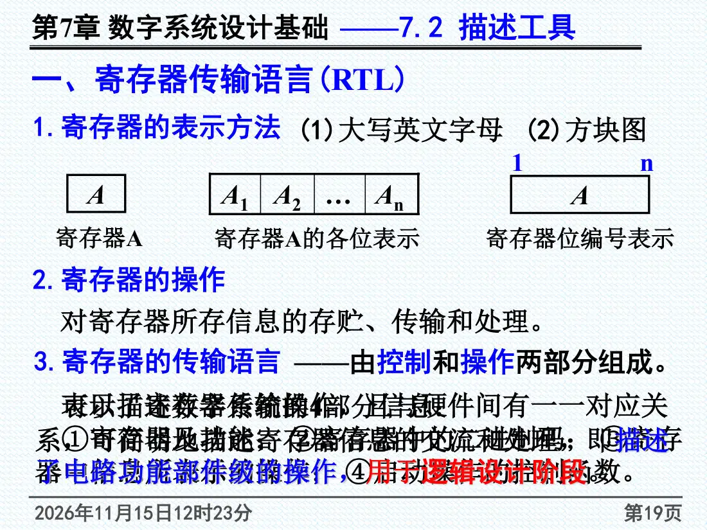

原文：

第7章 数字系统设计基础 ——7.2 描述工具

寄存器传输语言(RTL)

1.寄存器的表示方法 (1)大写英文字母 (2)方块图

寄存器A

寄存器A的各位表示

2.寄存器的操作

对寄存器所存信息的存贮、传输和处理。

3.寄存器的传输语言 ——由控制和操作两部分组成。

可以描述数字系统的4部分信息：表示了寄存器传输操作，且与硬件间有一一对应关①寄存器及功能； ②寄存器中的二进制码； ③寄存系，可简明地描述寄存器信息的交流和处理，即描述器中信息所表示的操作； ④启动操作的控制函数。了电路功能部件级的操作，用于逻辑设计阶段。

2026年11月15日12时23分

第19页

### 第7章 数字系统设计基础 ——7.2 描述工具

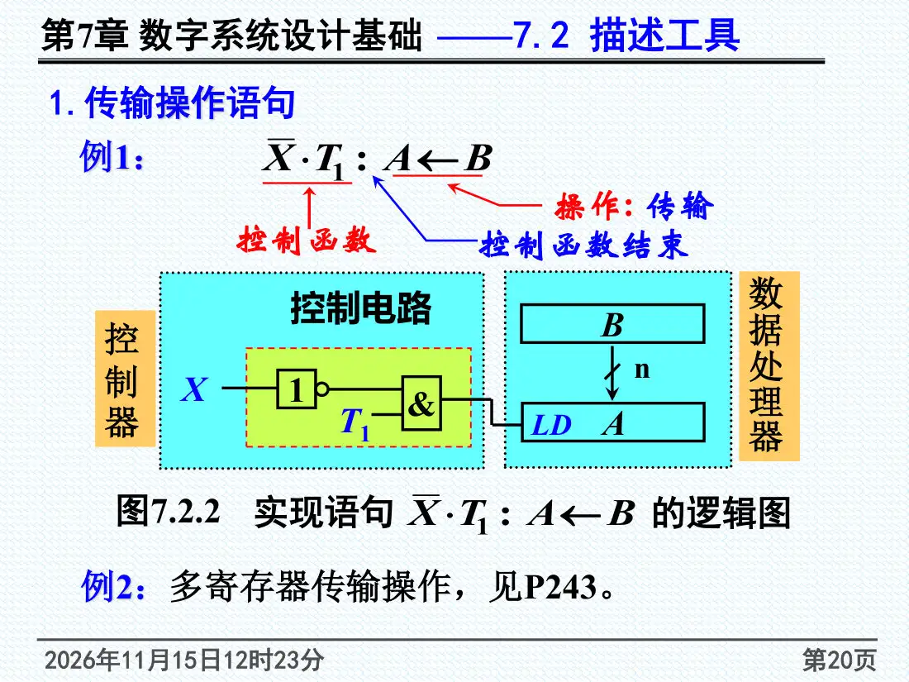

原文：

第7章 数字系统设计基础 ——7.2 描述工具

1.传输操作语句

例2：多寄存器传输操作，见P243。

2026年11月15日12时23分

第20页

### 第7章 数字系统设计基础 ——7.2 描述工具

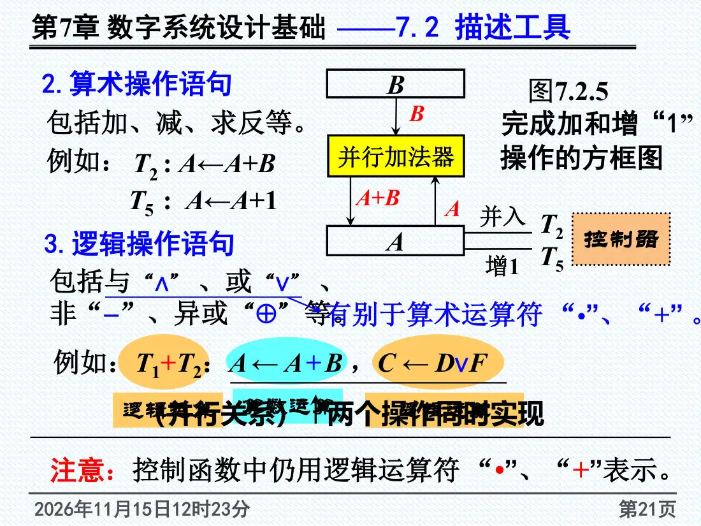

原文：

第7章 数字系统设计基础 ——7.2 描述工具

2.算术操作语句

包括加、减、求反等。

例如： $T _ { 2 } \colon A \gets A + B$

$$
T _ {5}: A \leftarrow A + 1
$$

3.逻辑操作语句

包括与 $^ { \prime \prime } { } _ { \Lambda } ^ { \prime \prime }$ 、或 $^ { \prime \prime } \nabla ^ { \prime \prime }$ ”、

并行加法器

图7.2.5

完成加和增 $^ { 6 6 } 1 ^ { , 9 9 }$ 操作的方框图

$\frac { \sqrt { 1 + B } } { A } = \frac { \frac { 3 + \lambda } { 4 \lambda } T _ { 2 } } { \frac { 1 + \lambda } { \frac { 3 + \lambda } { 4 \lambda } T _ { 5 } } } = 1$ 控制器

非“−”、异或“”等。有别于算术运算符 $^ { 6 6 } \cdot ^ { 5 9 } 、 ^ { 6 6 } + ^ { 3 9 } 。$

例如： $T _ { 1 } { + } T _ { 2 } \colon A {  } A { + } B , C {  } D { \vee } F$

逻辑运算 算数运算 逻辑运算（并行关系） 两个操作同时实现

注意：控制函数中仍用逻辑运算符 “•”、“+”表示。

2026年11月15日12时23分

第21页

### 4.移位操作语句

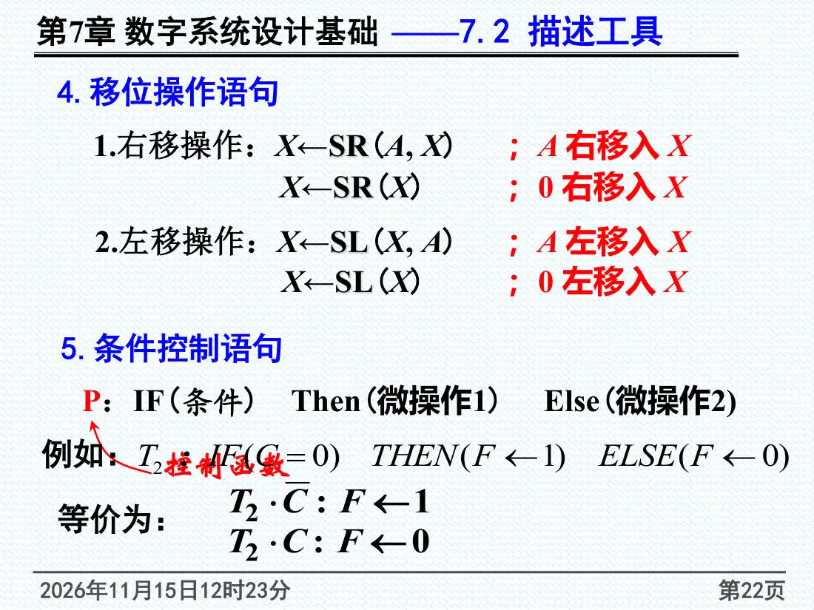

原文：

4.移位操作语句

1.右移操作： $X  \operatorname { S R } ( A , X )$ ；A 右移入 X$X {  } \mathbf { S } \mathbf { R } ( X )$ ；0 右移入 X

2.左移操作： $X  \mathbf { S L } ( X , A )$ ；A 左移入X$X {  } \mathbf { S } \mathbf { L } ( X )$ 0 左移入 X

5.条件控制语句

P：IF(条件) Then(微操作1) Else(微操作2)例如： $\underline { { T } } _ { 2 }$ 控 $\therefore \angle 1 = \angle C D C = 0 )$ $T H E N ( F < 1 )$ $E L S E ( F \gets 0 )$ 等价为： $\begin{array} { l } { T _ { 2 } \cdot C : F  1 } \\ { T _ { 2 } \cdot C : F  0 } \end{array}$

第7章 数字系统设计基础 ——7.2 描述工具

2026年11月15日12时23分

第22页

### 第7章 数字系统设计基础 ——7.2 描述工具

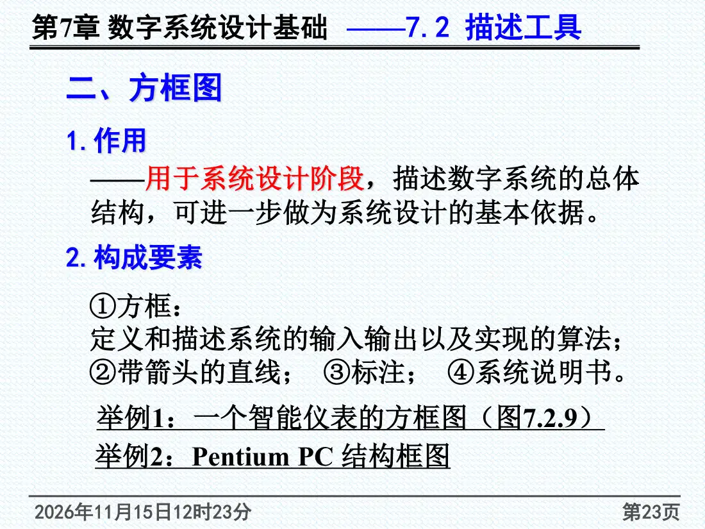

原文：

第7章 数字系统设计基础 ——7.2 描述工具

二、方框图

1.作用

用于系统设计阶段，描述数字系统的总体结构，可进一步做为系统设计的基本依据。

2.构成要素

①方框：

定义和描述系统的输入输出以及实现的算法；

②带箭头的直线； ③标注； ④系统说明书。

举例1：一个智能仪表的方框图（图7.2.9）

举例2：Pentium PC 结构框图

2026年11月15日12时23分

第23页

### 三、算法流程图

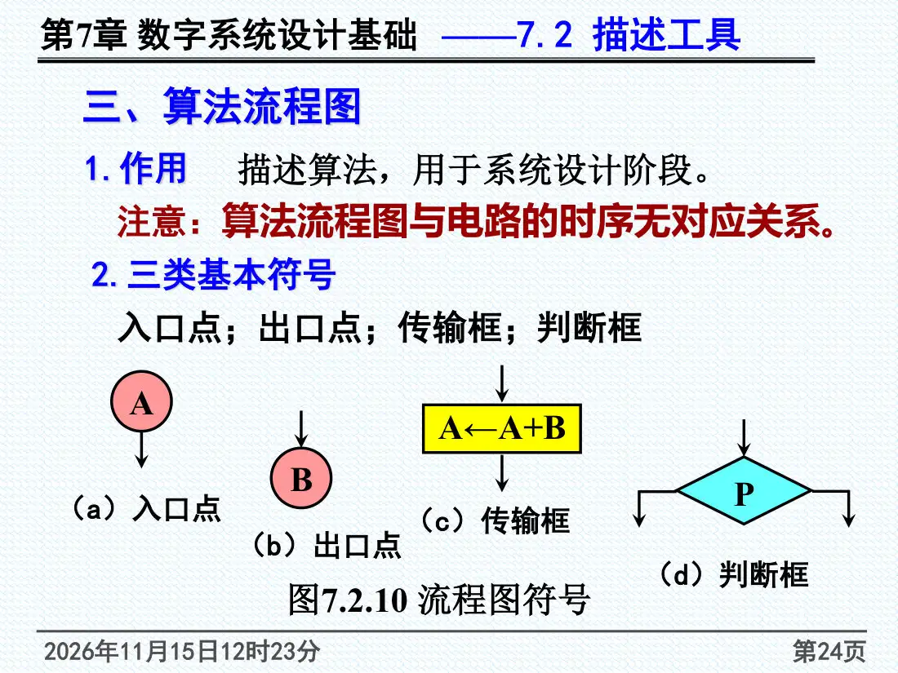

原文：

三、算法流程图

1.作用 描述算法，用于系统设计阶段。注意：算法流程图与电路的时序无对应关系。

2.三类基本符号

入口点；出口点；传输框；判断框

（a）入口点

（b）出口点

（c）传输框

（d）判断框

图7.2.10 流程图符号

第7章 数字系统设计基础 ——7.2 描述工具

2026年11月15日12时23分

第24页

### 第7章 数字系统设计基础 ——7.2 描述工具

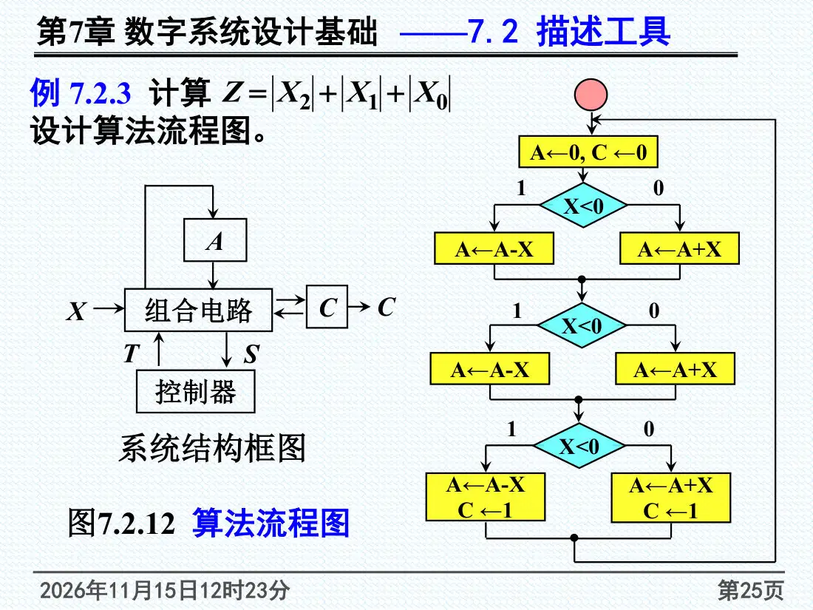

原文：

第7章 数字系统设计基础 ——7.2 描述工具

例 7.2.3 计算 $Z = \left| X _ { 2 } \right| + \left| X _ { 1 } \right| + \left| X _ { 0 } \right|$ 设计算法流程图。

2026年11月15日12时23分

第25页

### 四、算法状态机图 （ASM图）

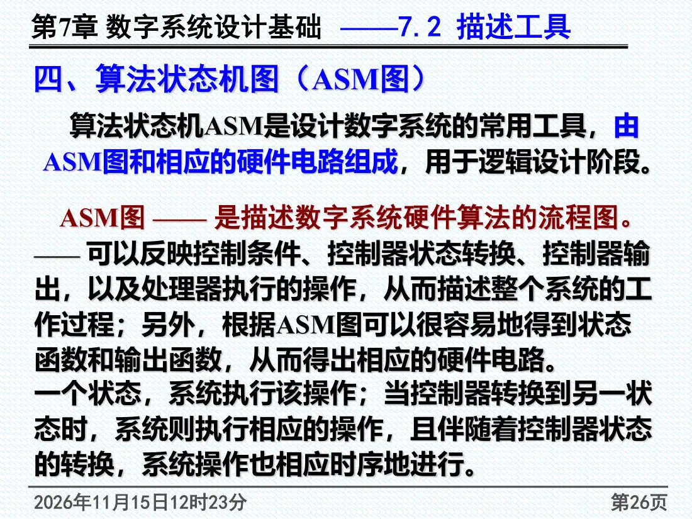

原文：

四、算法状态机图 （ASM图）

算法状态机ASM是设计数字系统的常用工具，由ASM图和相应的硬件电路组成，用于逻辑设计阶段。

ASM图 是描述数字系统硬件算法的流程图。可以反映控制条件、控制器状态转换、控制器输出，以及处理器执行的操作，从而描述整个系统的工ASM图与算法流程图的区别: 作过程；另外，根据ASM图可以很容易地得到状态ASM图严格规定了系统时钟时序——若控函数和输出函数，从而得出相应的硬件电路。

一个状态，系统执行该操作；当控制器转换到另一状态时，系统则执行相应的操作，且伴随着控制器状态的转换，系统操作也相应时序地进行。

第7章 数字系统设计基础 ——7.2 描述工具

2026年11月15日12时23分

第26页

### 四、算法状态机图（ASM图）

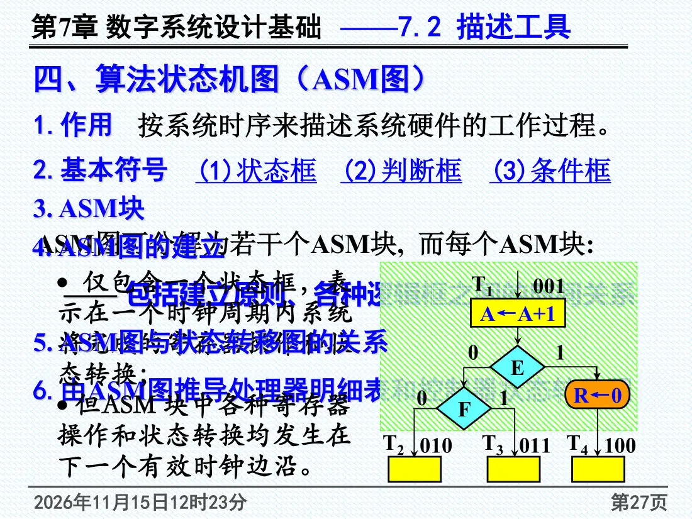

原文：

四、算法状态机图（ASM图）

1.作用 按系统时序来描述系统硬件的工作过程。

2.基本符号 (1)状态框 (2)判断框 (3)条件框

3. ASM块

ASM图可分解为若干个ASM块, 而每个ASM块:4. ASM图的建立

— 包括建立原则、仅包含一个状态框， 各种逻表示在 个时钟周期内系统

将完成的寄存器操作和状5. ASM图与状态转移图的关系

态转换；图推导处理器明细表但ASM 种寄存器操作和状态转换均发生在下一个有效时钟边沿。

第7章 数字系统设计基础 ——7.2 描述工具

2026年11月15日12时23分

第27页

### 第7章 数字系统设计基础 ——7.2 描述工具

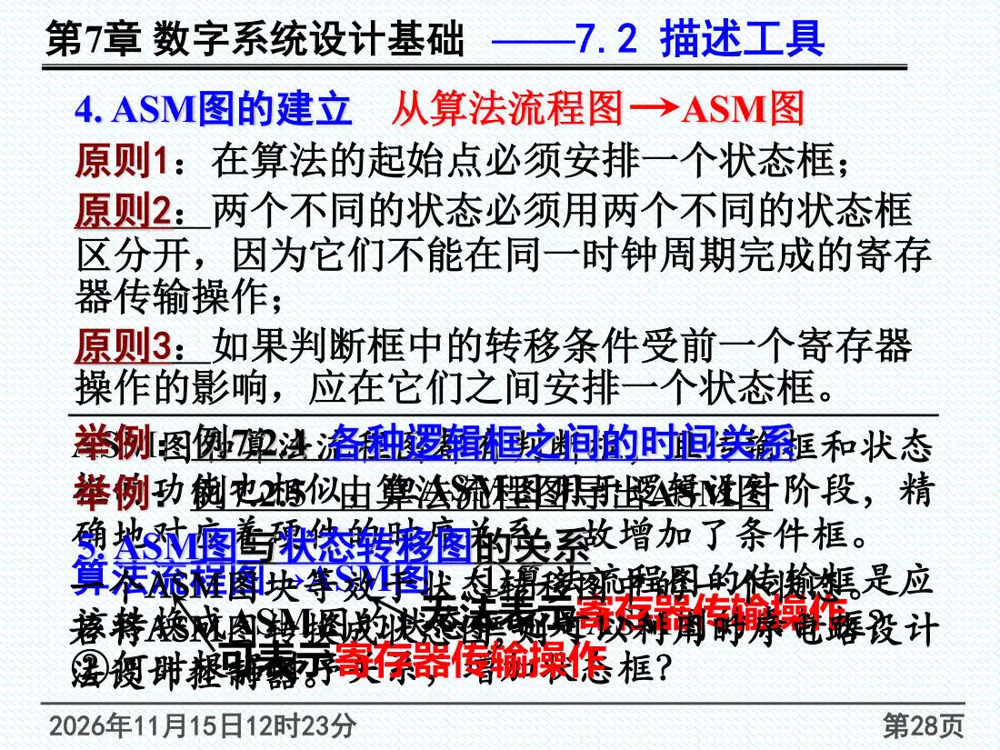

原文：

第7章 数字系统设计基础 ——7.2 描述工具

4. ASM图的建立 从算法流程图 ASM图

原则1：在算法的起始点必须安排一个状态框；

原则2：两个不同的状态必须用两个不同的状态框区分开，因为它们不能在同一时钟周期完成的寄存前 一个 寄 存器操 作 的影响 器传输操作；， 应在 它们 之间安 排一个 状态 框 。

原则3：如果判断框中的转移条件受前一个寄存器操作的影响，应在它们之间安排一个状态框。

ASM图和算法流程图都有判断框，且传输框和状态举例：例7.2.4 各种逻辑框之间的时间关系框的功能也相似，但ASM图用于逻辑设计阶段，精举例：例7.2.5 由算法流程图导出ASM图确地对应着硬件的时序关系，故增加了条件框。图与状态转移图的关系

算法流程图→ASM图：①算法流程图的传输框是应一个ASM图块等效于状态转移图中的一个状态。该转换成ASM图的状态框还是ASM图的条件框？ 无法表示寄存器传输操作若将ASM图转换成状态图, 则可以利用时序电路设计②何时根据时序关系，增加状态框？可表示寄存器传输操作法设计控制器。

2026年11月15日12时23分

第28页

### 第7章 数字系统设计基础 ——7.2 描述工具

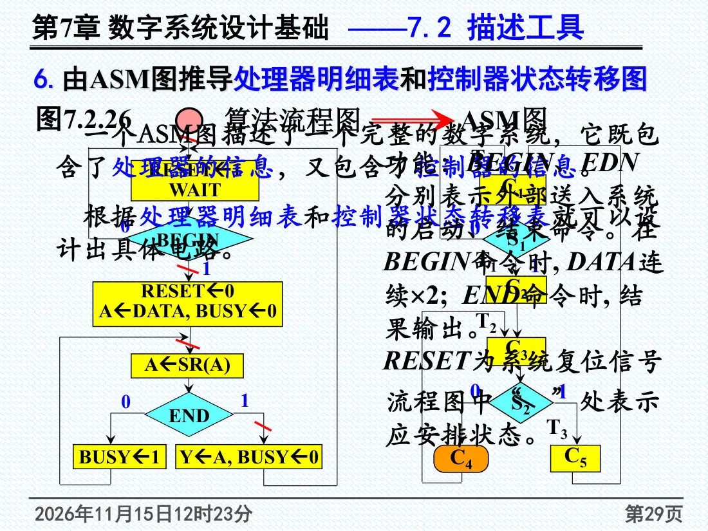

原文：

第7章 数字系统设计基础 ——7.2 描述工具

6.由ASM图推导处理器明细表和控制器状态转移图

2026年11月15日12时23分

第29页

### 第7章 数字系统设计基础 —7.2 描述工具 接上例

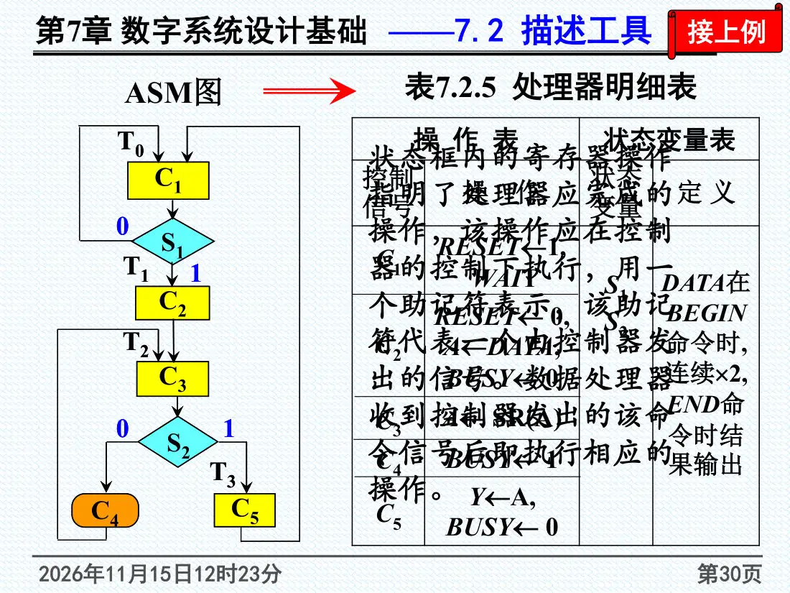

原文：

第7章 数字系统设计基础 —7.2 描述工具 接上例

表7.2.5 处理器明细表

操 作 表 态框内的寄存 状态变量表1操作 ，该操作应在控制C1 WAIT DATA在器的控制下执行，用一RESET 0, 1 BEGIN个助记符表示，该助记C ADATA, 2 命令时,符代表一个由控制器发出的信号SY<数据处理器车续×2,C A SR(A) END命收到控制器发出的该命 令时结C4 BUSY 1 果输出令信号后即执行相应的YA,操作。BUSY 0

2026年11月15日12时23分

第30页

### 第7章 数字系统设计基础 7.2 描述工具 接上例

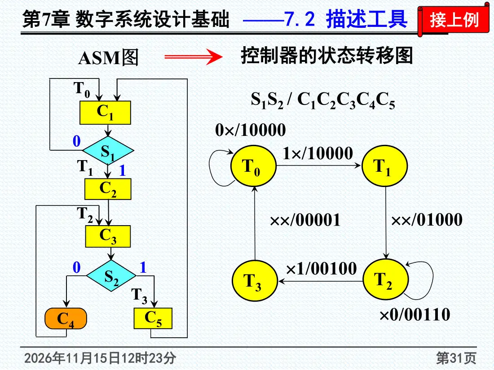

原文：

第7章 数字系统设计基础 7.2 描述工具 接上例

ASM图

控制器的状态转移图

$$
\mathrm{S} _ {1} \mathrm{S} _ {2} / \mathrm{C} _ {1} \mathrm{C} _ {2} \mathrm{C} _ {3} \mathrm{C} _ {4} \mathrm{C} _ {5}
$$

0×/10000

2026年11月15日12时23分

第31页

### 第7章 数字系统设计基础 ——ASM图设计举例

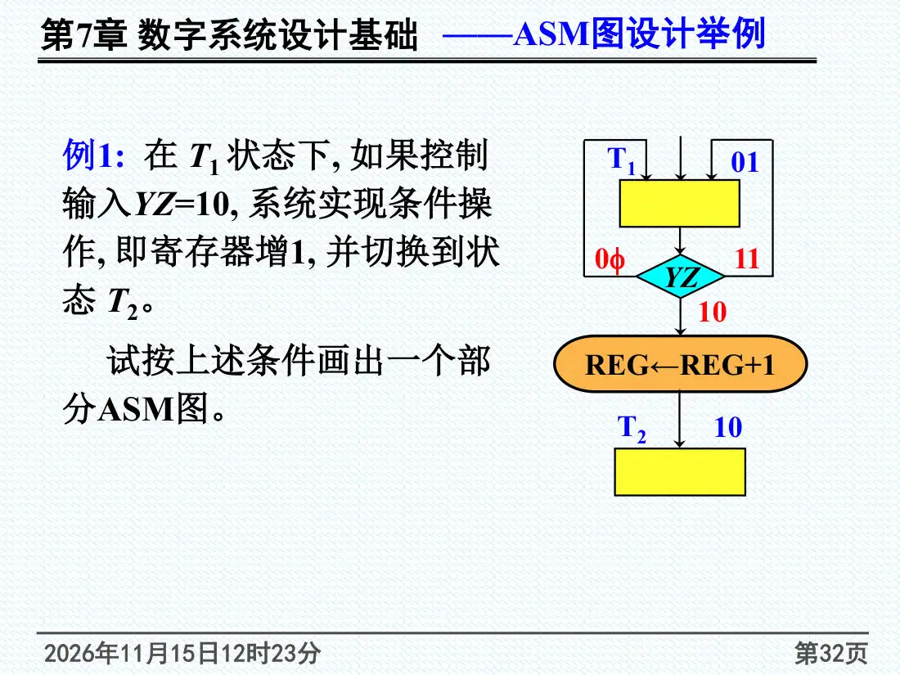

原文：

第7章 数字系统设计基础 ——ASM图设计举例

例1: 在 $T _ { 1 }$ 状态下, 如果控制输入YZ=10, 系统实现条件操作, 即寄存器增1, 并切换到状态 $T _ { 2 }$

试按上述条件画出一个部分ASM图。

2026年11月15日12时23分

第32页

### 第7章 数字系统设计基础 ——ASM图设计举例

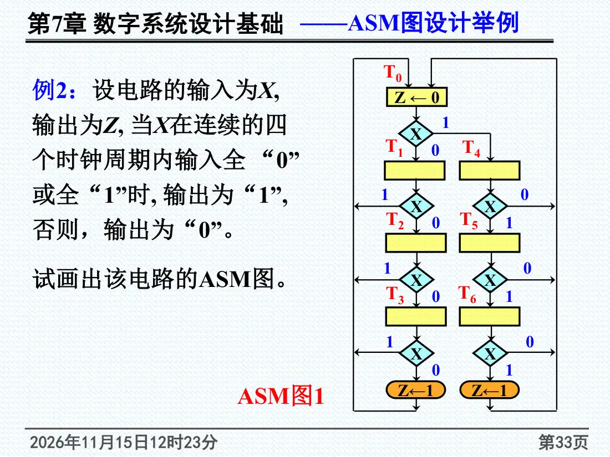

原文：

第7章 数字系统设计基础 ——ASM图设计举例

例2：设电路的输入为X,输出为Z, 当X在连续的四个时钟周期内输入全 “0”或全“1”时, 输出为“1”,否则，输出为“0”。

试画出该电路的ASM图

ASM图1

2026年11月15日12时23分

第33页

### 第7章 数字系统设计基础 ——ASM图设计举例 接上例

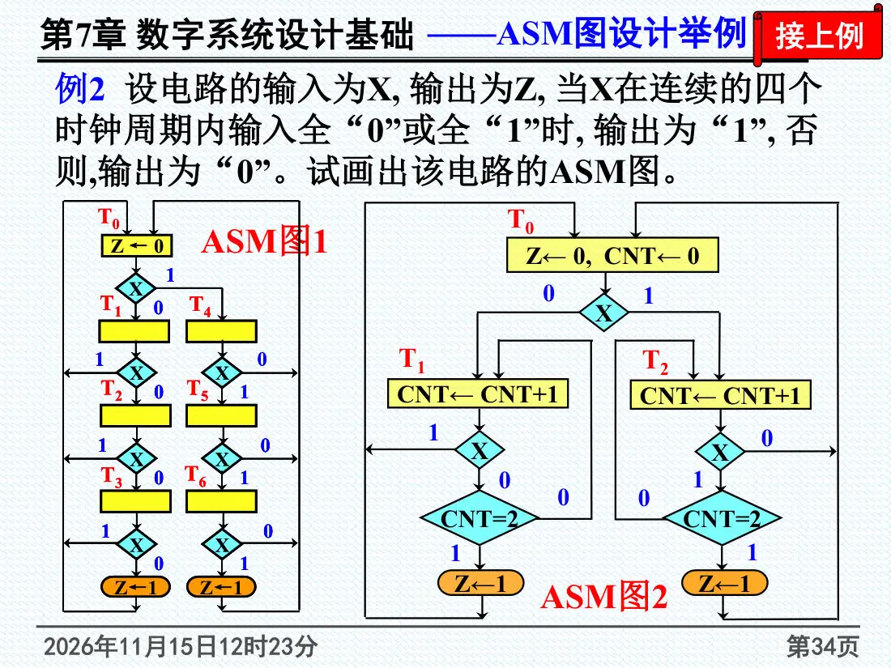

原文：

第7章 数字系统设计基础 ——ASM图设计举例 接上例

例2 设电路的输入为X, 输出为Z, 当X在连续的四个时钟周期内输入全“0”或全“1”时, 输出为“1”, 否则,输出为“0”。试画出该电路的ASM图。

2026年11月15日12时23分

第34页

### 第7章 数字系统设计基础 ——控制器设计举例

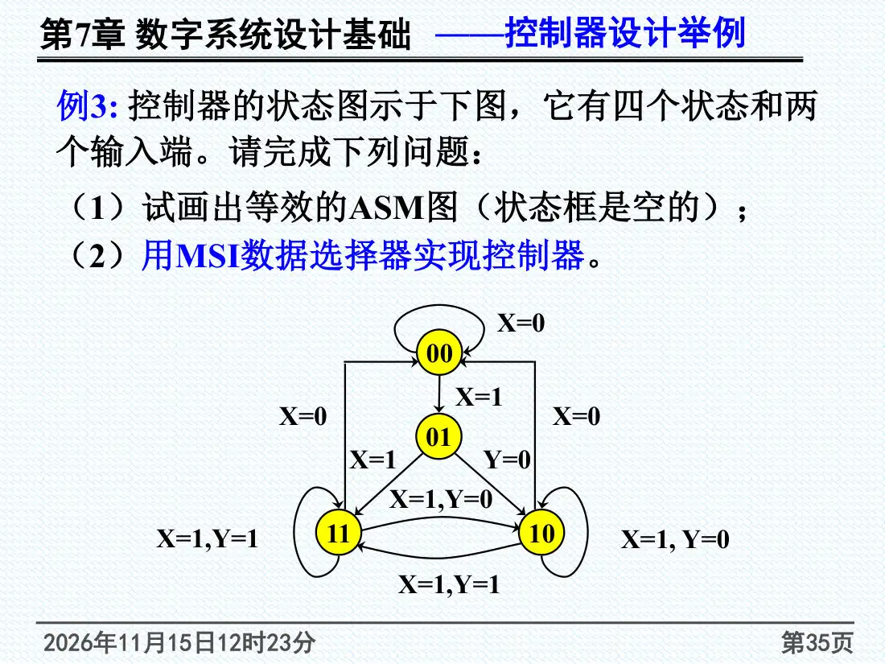

原文：

第7章 数字系统设计基础 ——控制器设计举例

例3: 控制器的状态图示于下图，它有四个状态和两个输入端。请完成下列问题：

（1）试画出等效的ASM图（状态框是空的）；

（2）用MSI数据选择器实现控制器。

2026年11月15日12时23分

第35页

### 第7章 数字系统设计基础 ——控制器设计举例 接上例

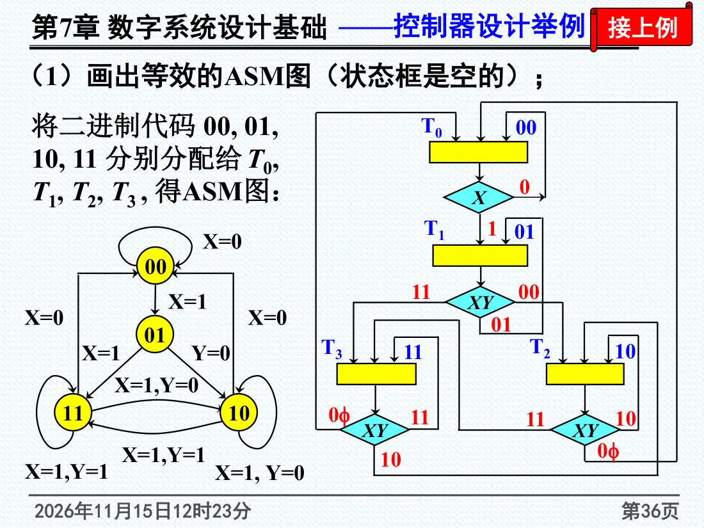

原文：

第7章 数字系统设计基础 ——控制器设计举例 接上例

（1）画出等效的ASM图（状态框是空的）；

将二进制代码 00, 01,10, 11 分别分配给 $T _ { 0 } ,$ $T _ { 1 } , T _ { 2 } , T _ { 3 }$ 得ASM图：

2026年11月15日12时23分

第36页

### 第7章 数字系统设计基础 ——控制器设计举例 接上例

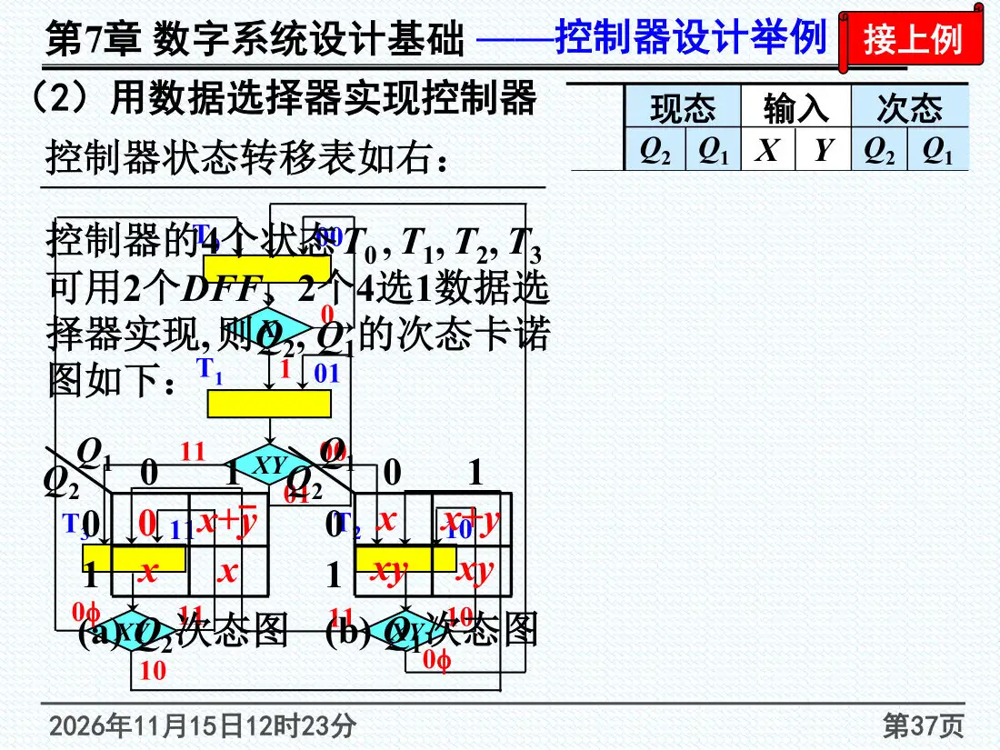

原文：

第7章 数字系统设计基础 ——控制器设计举例 接上例

（2）用数据选择器实现控制器控制器状态转移表如右：

<table><tr><td rowspan="2"></td><td colspan="2">现态</td><td colspan="2">输入</td><td colspan="2">次态</td></tr><tr><td> $Q_2$ </td><td> $Q_1$ </td><td>X</td><td>Y</td><td> $Q_2$ </td><td> $Q_1$ </td></tr></table>

2026年11月15日12时23分

第37页

### 第7章 数字系统设计基础——控制器设计举例

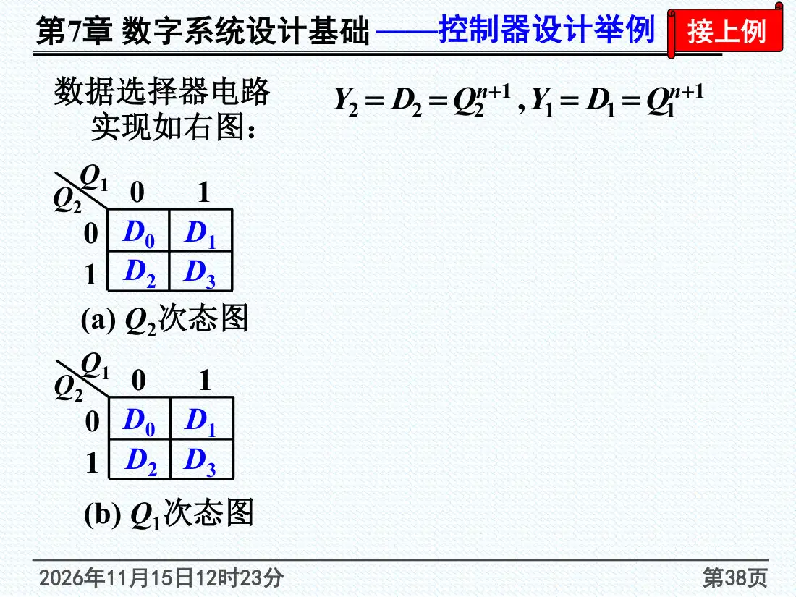

原文：

第7章 数字系统设计基础——控制器设计举例

数据选择器电路实现如右图：

$$
Y _ {2} = D _ {2} = Q _ {2} ^ {n + 1}, Y _ {1} = D _ {1} = Q _ {1} ^ {n + 1}
$$

$$
\begin{array}{c c c} Q _ {1} & 0 & 1 \\ \hline Q _ {2} & 0 & D _ {0} \\ 0 & D _ {0} & D _ {1} \\ 1 & D _ {2} & D _ {3} \end{array}
$$

(a) $Q _ { 2 }$ 次态图

$$
\begin{array}{c c c} \hline Q _ {1} & 0 & 1 \\ Q _ {2} & 0 & D _ {0} \\ 0 & D _ {0} & D _ {1} \\ 1 & D _ {2} & D _ {3} \end{array}
$$

(b) $Q _ { 1 }$ 次态图

接上例

2026年11月15日12时23分

第38页

### 第7章 数字系统设计基础 ——控制器设计举例

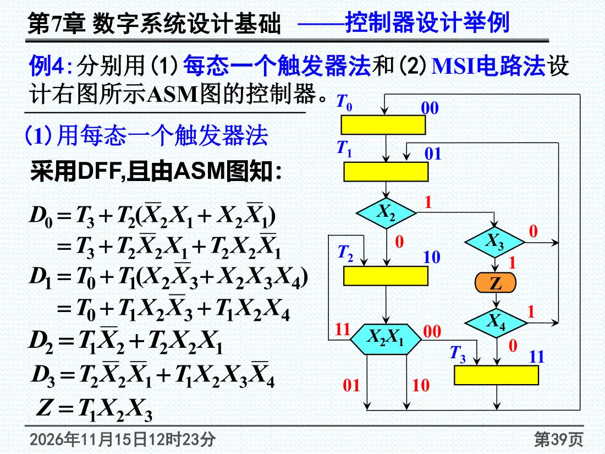

原文：

第7章 数字系统设计基础 ——控制器设计举例

例4:分别用(1)每态一个触发器法和(2)MSI电路法设计右图所示ASM图的控制器。 00

(1)用每态一个触发器法采用DFF,且由ASM图知：

$$
\begin{array}{r l} & D _ {0} = T _ {3} + T _ {2} (\overline {{X}} _ {2} X _ {1} + X _ {2} \overline {{X}} _ {1}) \\ & \qquad = T _ {3} + T _ {2} \overline {{X}} _ {2} X _ {1} + T _ {2} X _ {2} \overline {{X}} _ {1} \\ & D _ {1} = T _ {0} + T _ {1} (X _ {2} \overline {{X}} _ {3} + X _ {2} X _ {3} X _ {4}) \\ & \qquad = T _ {0} + T _ {1} X _ {2} \overline {{X}} _ {3} + T _ {1} X _ {2} X _ {4} \\ & D _ {2} = T _ {1} \overline {{X}} _ {2} + T _ {2} X _ {2} X _ {1} \\ & D _ {3} = T _ {2} \overline {{X}} _ {2} \overline {{X}} _ {1} + T _ {1} X _ {2} X _ {3} \overline {{X}} _ {4} \\ & Z = T _ {1} X _ {2} X _ {3} \end{array}
$$

2026年11月15日12时23分

第39页

### 第7章 数字系统设计基础——控制器设计举例 接上例

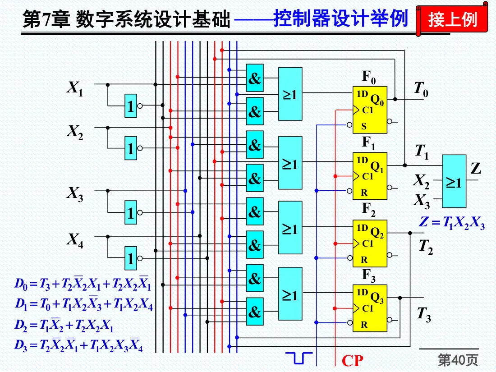

原文：

第7章 数字系统设计基础——控制器设计举例 接上例

第40页

### 第7章 数字系统设计基础 ——控制器设计举例 接上例

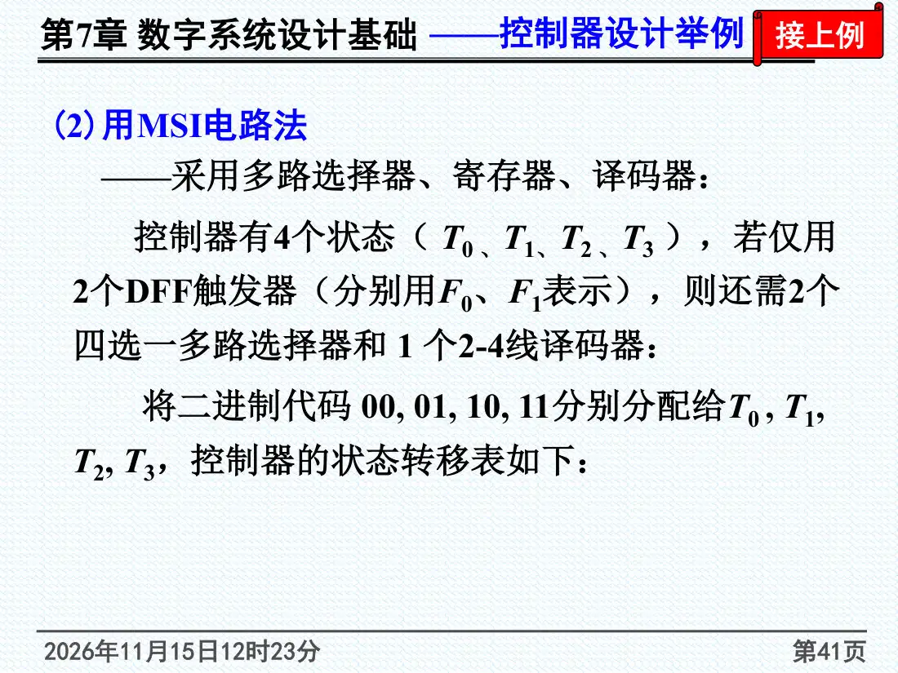

原文：

第7章 数字系统设计基础 ——控制器设计举例 接上例

(2)用MSI电路法

——采用多路选择器、寄存器、译码器：

控制器有4个状态 $\left( \begin{array} { l l l l } { T _ { 0 } } & { T _ { 1 } , } & { T _ { 2 } , } & { T _ { 3 } } \end{array} \right)$ 若仅用2个DFF触发器（分别用 $F _ { \mathbf { 0 } } . F _ { 1 }$ 表示），则还需2个四选一多路选择器和 1 个2-4线译码器：

将二进制代码 00, 01, 10, 11分别分配给 $T _ { 0 } , T _ { 1 } ,$ $T _ { 2 } , T _ { 3 } ,$ 控制器的状态转移表如下：

2026年11月15日12时23分

第41页

### 第7章 数字系统设计基础 ——控制器设计举例 接上例

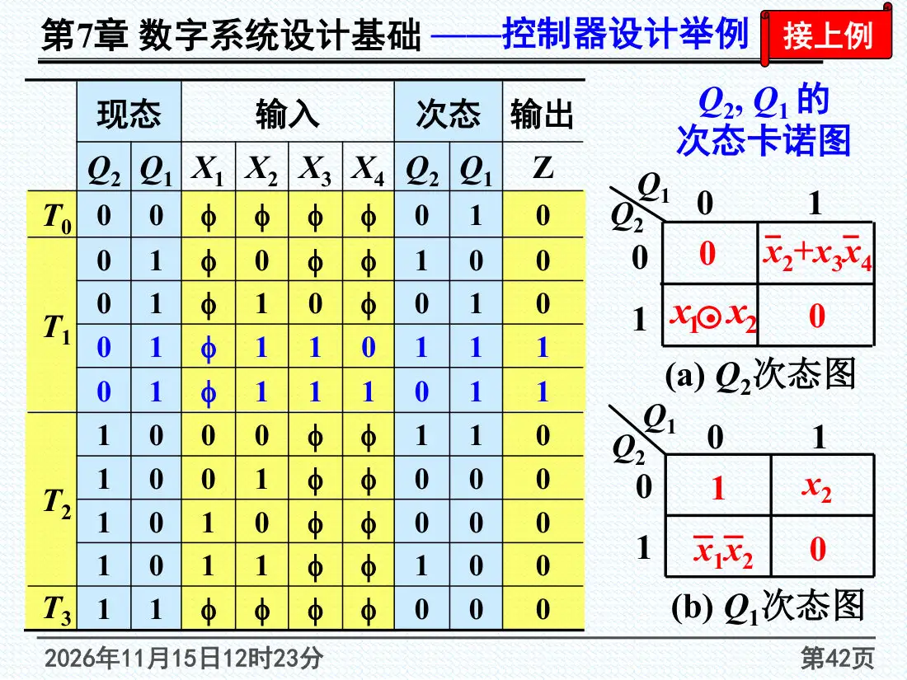

原文：

第7章 数字系统设计基础 ——控制器设计举例 接上例

<table><tr><td rowspan="2"></td><td colspan="2">现态</td><td colspan="4">输入</td><td colspan="2">次态</td><td>输出</td></tr><tr><td> $Q_2$ </td><td> $Q_1$ </td><td> $X_1$ </td><td> $X_2$ </td><td> $X_3$ </td><td> $X_4$ </td><td> $Q_2$ </td><td> $Q_1$ </td><td>Z</td></tr><tr><td> $T_0$ </td><td>0</td><td>0</td><td>φ</td><td>φ</td><td>φ</td><td>φ</td><td>0</td><td>1</td><td>0</td></tr><tr><td rowspan="4"> $T_1$ </td><td>0</td><td>1</td><td>φ</td><td>0</td><td>φ</td><td>φ</td><td>1</td><td>0</td><td>0</td></tr><tr><td>0</td><td>1</td><td>φ</td><td>1</td><td>0</td><td>φ</td><td>0</td><td>1</td><td>0</td></tr><tr><td>0</td><td>1</td><td>φ</td><td>1</td><td>1</td><td>0</td><td>1</td><td>1</td><td>1</td></tr><tr><td>0</td><td>1</td><td>φ</td><td>1</td><td>1</td><td>1</td><td>0</td><td>1</td><td>1</td></tr><tr><td rowspan="4"> $T_2$ </td><td>1</td><td>0</td><td>0</td><td>0</td><td>φ</td><td>φ</td><td>1</td><td>1</td><td>0</td></tr><tr><td>1</td><td>0</td><td>0</td><td>1</td><td>φ</td><td>φ</td><td>0</td><td>0</td><td>0</td></tr><tr><td>1</td><td>0</td><td>1</td><td>0</td><td>φ</td><td>φ</td><td>0</td><td>0</td><td>0</td></tr><tr><td>1</td><td>0</td><td>1</td><td>1</td><td>φ</td><td>φ</td><td>1</td><td>0</td><td>0</td></tr><tr><td> $T_3$ </td><td>1</td><td>1</td><td>φ</td><td>φ</td><td>φ</td><td>φ</td><td>0</td><td>0</td><td>0</td></tr></table>

$\mathcal { Q } _ { 2 } , \mathcal { Q } _ { 1 }$ 的次态卡诺图

(a) $Q _ { 2 }$ 次态图

2026年11月15日12时23分

第42页

### 第7章 数字系统设计基础——控制器设计举例 接上例

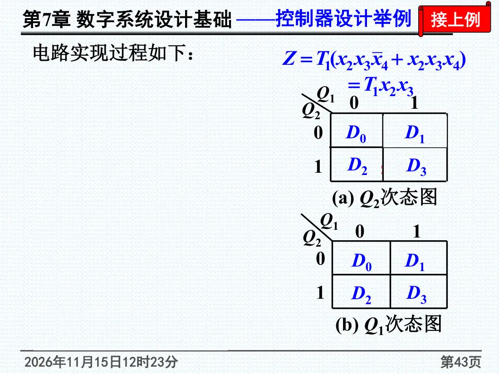

原文：

第7章 数字系统设计基础——控制器设计举例 接上例

电路实现过程如下：

$$
\begin{array}{c c c} Z = T _ {1} (x _ {2} x _ {3} \overline {{x}} _ {4} + x _ {2} x _ {3} x _ {4}) \\ \frac {Q _ {1}}{Q _ {2}} & = T _ {1} x _ {2} x _ {3} \\ 0 & D _ {0} & D _ {1} \\ 1 & D _ {2} & D _ {3} \end{array}
$$

Y 1(a) $Q _ { 2 }$ 次态图

<table><tr><td>Q1/Q2</td><td>0</td><td>1</td></tr><tr><td>0</td><td>D0</td><td>D1</td></tr><tr><td>1</td><td>D2</td><td>D3</td></tr></table>

R(b) $Q _ { 1 }$ 次态图

2026年11月15日12时23分

第43页

### 第7章 数字系统设计基础 ——二进制乘法器设计

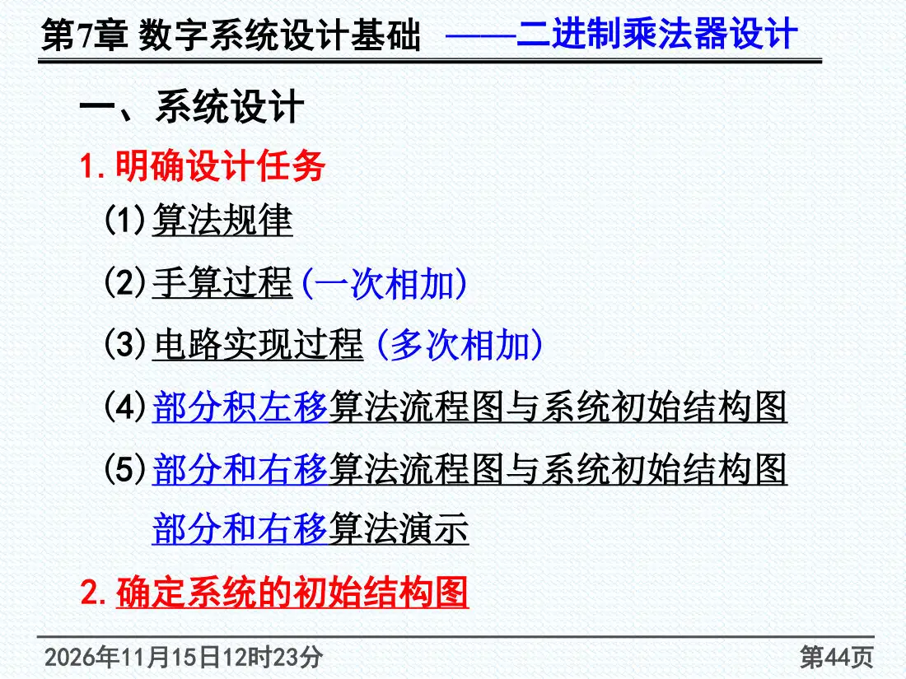

原文：

第7章 数字系统设计基础 ——二进制乘法器设计

一、 系统设计

1.明确设计任务

(1)算法规律

(2)手算过程(一次相加)

(3)电路实现过程(多次相加)

(4)部分积左移算法流程图与系统初始结构图

(5)部分和右移算法流程图与系统初始结构图部分和右移算法演示

2.确定系统的初始结构图

2026年11月15日12时23分

第44页

### 第7章 数字系统设计基础 ——二进制乘法器设计

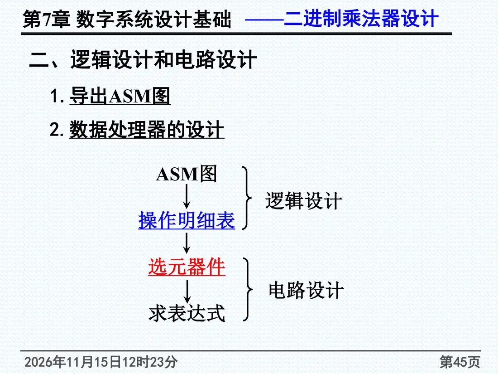

原文：

第7章 数字系统设计基础 ——二进制乘法器设计

二、逻辑设计和电路设计

1.导出ASM图

2.数据处理器的设计

2026年11月15日12时23分

第45页

### 第7章 数字系统设计基础 ——控制器设计方法

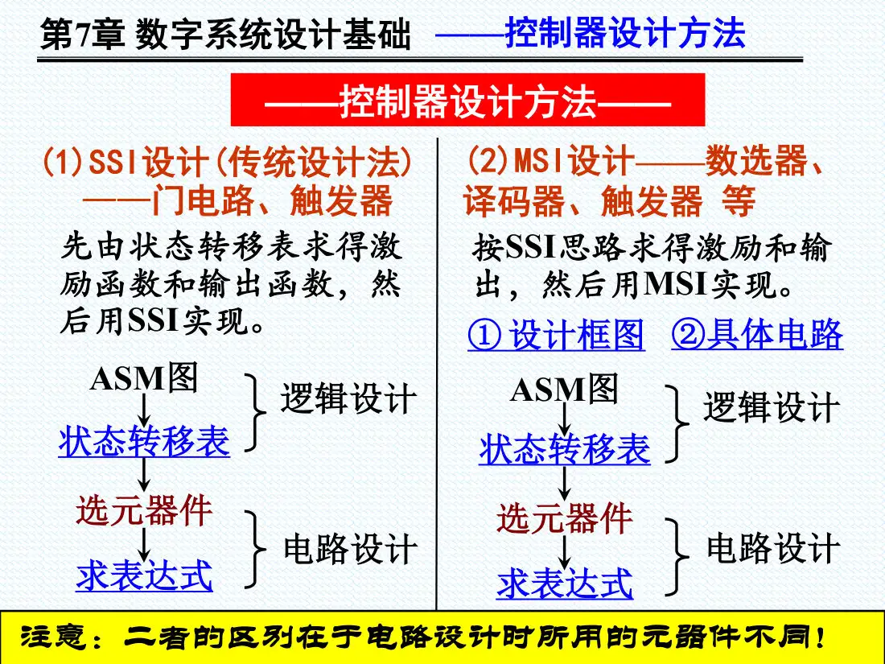

原文：

第7章 数字系统设计基础 ——控制器设计方法

控制器设计方法—

(1)SSI设计(传统设计法)门电路、触发器先由状态转移表求得激励函数和输出函数，然后用SSI实现。

ASM图逻辑设计状态转移表选元器件电路设计求表达式

(2)MSI设计— 数选器、译码器、触发器 等按SSI思路求得激励和输出，然后用MSI实现。

①设计框图 ②具体电路ASM图逻辑设计状态转移表选元器件电路设计求表达式

2026年11月15日12时23分 第46注意：二者的区别在于电路设计时所用的元器件不同！

### 第7章 数字系统设计基础 ——控制器设计方法

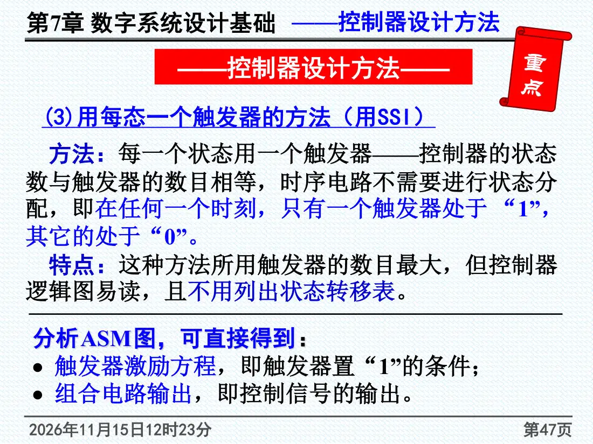

原文：

第7章 数字系统设计基础 ——控制器设计方法

控制器设计方法—

重点

(3)用每态一个触发器的方法（用SSI）

方法：每一个状态用一个触发器 控制器的状态数与触发器的数目相等，时序电路不需要进行状态分配，即在任何一个时刻，只有一个触发器处于 “1”，其它的处于“0”。

特点：这种方法所用触发器的数目最大，但控制器逻辑图易读，且不用列出状态转移表。

分析ASM图，可直接得到：

• 触发器激励方程，即触发器置“1”的条件；

• 组合电路输出，即控制信号的输出。

2026年11月15日12时23分

第47页

### 控制器设计方法—

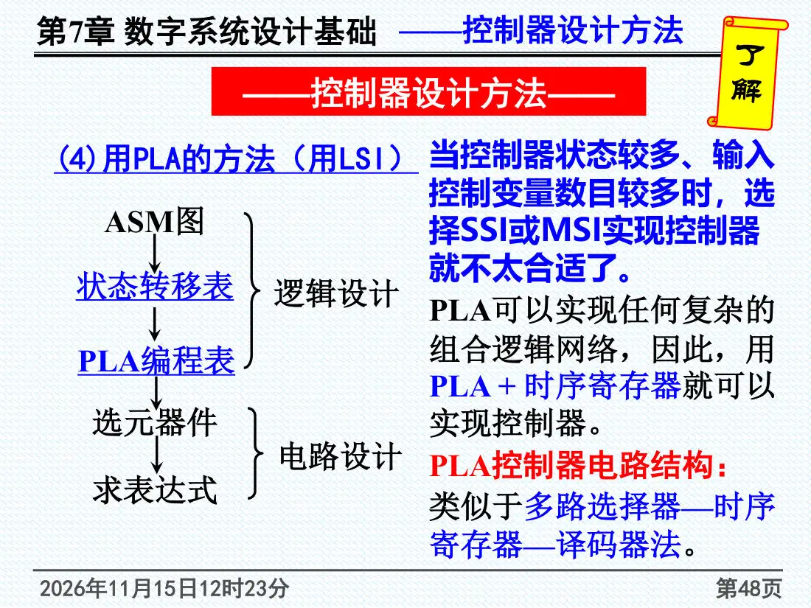

原文：

控制器设计方法—

了解

(4)用PLA的方法（用LSI）

ASM图

状态转移表

PLA编程表

选元器件

逻辑设计

求表达式

电路设计

当控制器状态较多、输入控制变量数目较多时，选择SSI或MSI实现控制器就不太合适了。

PLA可以实现任何复杂的组合逻辑网络，因此，用PLA + 时序寄存器就可以实现控制器。

PLA控制器电路结构：类似于多路选择器—时序寄存器—译码器法。

第7章 数字系统设计基础 ——控制器设计方法

2026年11月15日12时23分

第48页

### 第7章 数字系统设计基础 ——数字系统的设计思路

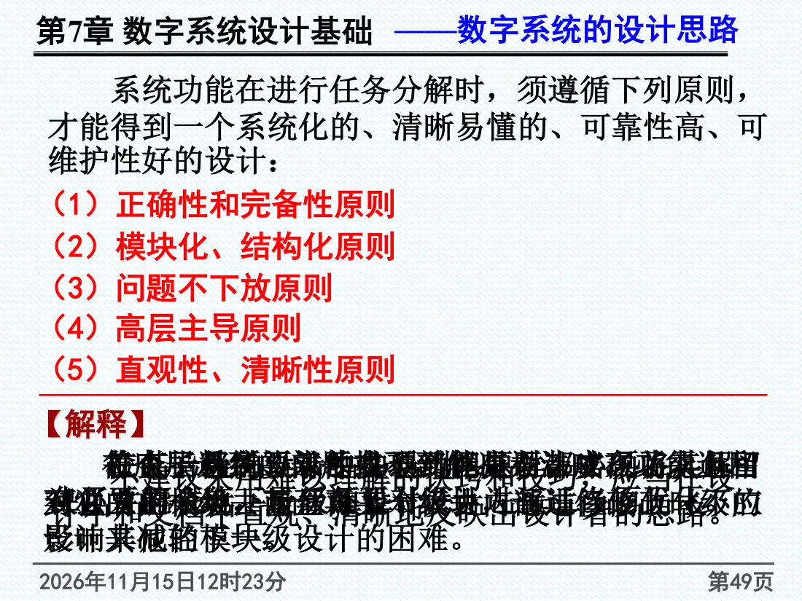

原文：

第7章 数字系统设计基础 ——数字系统的设计思路

系统功能在进行任务分解时，须遵循下列原则，才能得到一个系统化的、清晰易懂的、可靠性高、可维护性好的设计：

（1）正确性和完备性原则

（2）模块化、结构化原则

（3）问题不下放原则

（4）高层主导原则

（5）直观性、清晰性原则

【解释】

影响其他的模块。设计来减轻下一级设计的困难。

2026年11月15日12时23分

第49页

### 第7章 数字系统设计基础—— 方框图举例2

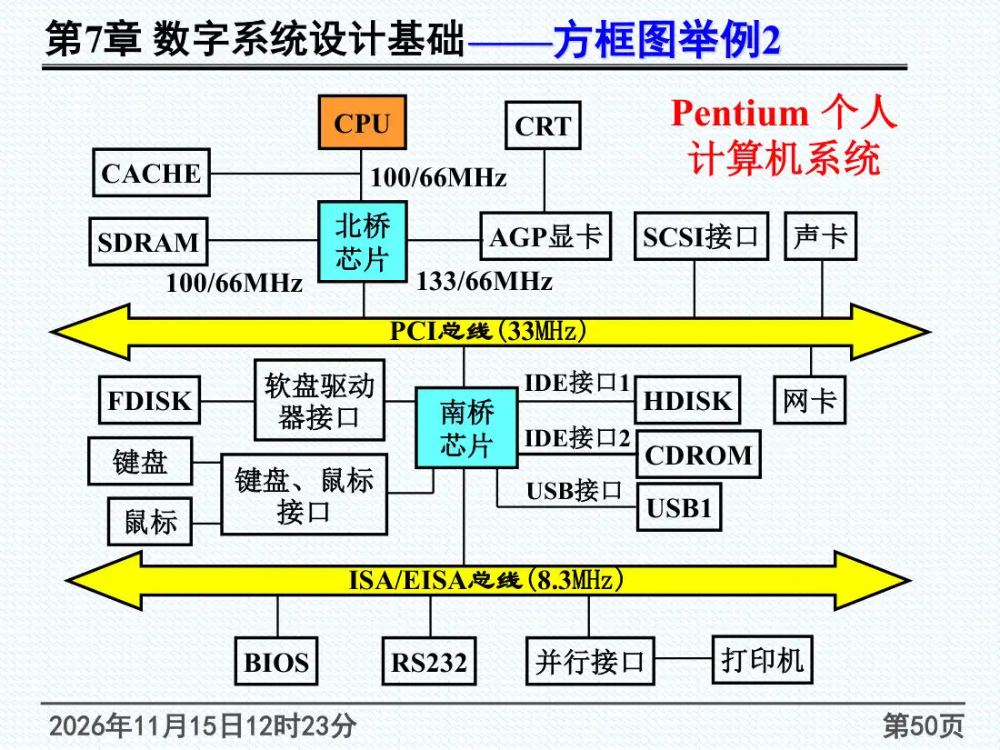

原文：

第7章 数字系统设计基础—— 方框图举例2

第50页

### 第7章 数字系统设计基础 二进制数字乘法器

原文：

第7章 数字系统设计基础 二进制数字乘法器

<table><tr><td></td><td>1010</td><td>M</td></tr><tr><td>×</td><td>1101</td><td>Q</td></tr><tr><td>A</td><td>00000</td><td>1101</td></tr><tr><td>+</td><td>1010</td><td></td></tr><tr><td>相加结果</td><td>01010</td><td>1101</td></tr><tr><td>右移一位</td><td>00101</td><td>0110</td></tr><tr><td>+</td><td>0000</td><td></td></tr><tr><td>相加结果</td><td>00101</td><td>0110</td></tr><tr><td>右移一位</td><td>00010</td><td>1011</td></tr></table>
2026年11月15日12时23分

第51页

### 第7章 数字系统设计基础 ——二进制数字乘法器

原文：

第7章 数字系统设计基础 ——二进制数字乘法器

<table><tr><td rowspan="7">A</td><td>运算过程</td><td>算式说明</td></tr><tr><td>1 0 1 0× 1 1 0 1</td><td>被乘数M乘数Q累加器A初始内容</td></tr><tr><td>0 0 0 0 0 0 0 0+ 1 0 1 0</td><td>第一部分积</td></tr><tr><td>0 0 0 0 1 0 1 0+ 0 0 0 0 0</td><td>第一部分和第二部分积</td></tr><tr><td>0 0 0 0 1 0 1 0+ 1 0 1 0 0 0</td><td>第二部分和第三部分积</td></tr><tr><td>0 0 1 1 0 0 1 0+ 1 0 1 0 0 0 0</td><td>第三部分和第四部分积</td></tr><tr><td>1 0 0 0 0 0 1 0</td><td>乘积=第四部分和</td></tr></table>

2026年11月15日12时23分

第52页

### 第7章 数字系统设计基础 ——数据处理器明细表举例

原文：

第7章 数字系统设计基础 ——数据处理器明细表举例

表7.1.1 数据处理器明细表
<table><tr><td colspan="2">操作表</td><td colspan="2">状态变量表</td></tr><tr><td>控制信号</td><td>操作</td><td>状态变量</td><td>定义</td></tr><tr><td>NOP</td><td>无操作</td><td> $S_1$ </td><td>X&gt;0</td></tr><tr><td>ADDA</td><td>A←A+X</td><td> $S_2$ </td><td>X&lt;0</td></tr><tr><td>ADDB</td><td>B←B+X</td><td rowspan="2" colspan="2">输出Z=A</td></tr><tr><td>CLAB</td><td>A←0,B←0</td></tr></table>

【注】数据处理器明细表起说明作用, 不作任何操作。

2026年11月15日12时23分

第53页

### 第7章 数字系统设计基础 ——异步输入信号

原文：

第7章 数字系统设计基础 ——异步输入信号

当前系统时钟有效沿

异步输入 a

异步输入 b

同步化后的输入 A

同步化后的输入B

2026年11月15日12时23分

第54页

### 第7章 数字系统设计基础 ——同步化电路

原文：

第7章 数字系统设计基础 ——同步化电路

(b)波形图

2026年11月15日12时23分

第55页

### 第7章 数字系统设计基础 ——同步化电路

原文：

第7章 数字系统设计基础 ——同步化电路

例：一种同步化电路。

2026年11月15日12时23分

第56页

### 第7章 数字系统设计基础—— 方框图举例1

原文：

第7章 数字系统设计基础—— 方框图举例1

图7.2.9 个智能仪表的方框图

（a） 般方框图

（b）系统分解图

2026年11月15日12时23分

第57页

### 第7章 数字系统设计基础— 方框图举例1 接上例

原文：

第7章 数字系统设计基础— 方框图举例1 接上例

（C）进一步细化方案

（d）数据处理模块的细化

图7.2.9 个智能仪表的方框图

2026年11月15日12时23分

第58页

### 第7章 数字系统设计基础 ASM图

原文：

第7章 数字系统设计基础 ASM图

状态框

2026年11月15日12时23分

第59页

### 第7章 数字系统设计基础 ASM图

原文：

第7章 数字系统设计基础 ASM图

判断框

（a）真值表图解分支表示

（b）变量优先级分支表示

2026年11月15日12时23分

第60页

### 第7章 数字系统设计基础 ASM图

原文：

第7章 数字系统设计基础 ASM图

条件框

注意：与算法流程图、方框图不同，条件框是ASM图所特有的，其常置于ASM图中判断框之后。

2026年11月15日12时23分

第61页

### 第7章 数字系统设计基础—— ASM图与状态图的关系

原文：

第7章 数字系统设计基础—— ASM图与状态图的关系

注意：每个ASM块必须包含一个状态框， 可能还有几个与它相连的判断框和条件框。

2026年11月15日12时23分

第62页

### 第7章 数字系统设计基础— —各种逻辑框的关系

原文：

第7章 数字系统设计基础— —各种逻辑框的关系

每个ASM块中的所有操作均在一个时钟周期内完成。

每个ASM块中所规定的各种寄存器操作，以及状态的转换均发生在下个时钟的同一个有效边沿。

例7.2.4 一个数字系统的数据处理器有2个触发器E和 F ，以及1个4位二进制计数器A $( A _ { 3 } A _ { 2 } A _ { 1 } A _ { 0 } )$

启动信号S 使计数器A 和触发器F 清“0”，从下个时钟脉冲开始，计数器增1，一直到系统停止工作为止。系统的操作序列由 $A _ { 2 }$ 和 $A _ { 3 }$ 之值决定，即：

① $A _ { 3 } { = } \mathbf { 0 }$ , 触发器E清 $^ { 6 6 } \textcircled { \mathbf { 0 } } ^ { 9 }$ 并继续计数。

$A _ { 2 } ^ { - 1 }$ 触发器E置“1”，并检验 $A _ { 3 }$ 若 $A _ { 3 } { = } \mathbf { 0 }$ 继续计数; 若 $A _ { 3 } { = } 1$ , 触发器F置“1”, 且计数器增1,然后, 系统停止计数。

2026年11月15日12时23分

第63页

### 第7章 数字系统设计基础——各种逻辑框的关系接上例

原文：

第7章 数字系统设计基础——各种逻辑框的关系接上例

系统的操作序列由 $A _ { 2 }$ 和 $A _ { 3 }$ 之值决定:

① $A _ { 2 } = \mathbf { 0 }$ , 触发器E清 ${ } ^ { 6 6 } \mathbf { 0 } ^ { 9 9 }$ 并继续计数。

② $A _ { 2 } { = } 1$ 触发器E置$^ { 6 6 } 1 ^ { 9 9 }$ ,并检验 $A _ { 3 }$ $A _ { 3 } { = } \mathbf { 0 }$ , 继续计数；$A _ { 3 } { = } 1$ 触发器F置“1”, 且计数器增1, 然后, 系统停止计数。

2026年11月15日12时23分

第64页

### 第7章 数字系统设计基础——各种逻辑框的关系接上例

原文：

第7章 数字系统设计基础——各种逻辑框的关系接上例

<table><tr><td rowspan="5">表7.2.4 ASM图的操作序列</td><td> $A_{3}A_{2}A_{1}A_{0}$ </td><td> $EF$ </td><td>条件</td><td>状态</td></tr><tr><td>0 0 0 00 0 0 0 10 0 1 00 0 1 1</td><td>1 00 000 00</td><td> $A_{2}=0$  $A_{3}=0$ </td><td> $T_{1}$ </td></tr><tr><td>0 1 0 00 1 0 10 1 1 00 1 1 1</td><td>0 01 01 01 01 0</td><td> $A_{2}=1$  $A_{3}=0$ </td><td> $T_{1}$ </td></tr><tr><td>1 0 0 01 0 0 11 0 1 01 0 1 1</td><td>1 00 000 00</td><td> $A_{2}=0$  $A_{3}=1$ </td><td> $T_{1}$ </td></tr><tr><td>1 0 0 01 1 0 1</td><td>0 01 1</td><td> $A_{2}=1$  $A_{3}=1$ </td><td> $T_{1}$  $T_{0}$ </td></tr></table>

2026年11月15日12时23分

第65页

### 第7章 数字系统设计基础— 各种逻辑框的关系

原文：

第7章 数字系统设计基础— 各种逻辑框的关系

两个不同的状态必须用两个不同的状态框区分开，因为它们不能在同一时钟周期内同时完成两个寄存器传输操作。

2026年11月15日12时23分

第66页

### 第7章 数字系统设计基础——各种逻辑框的关系

原文：

第7章 数字系统设计基础——各种逻辑框的关系

如果判断框中的转移条件受前一个寄存器操作的影响，应在它们之间安排一个状态框。

2026年11月15日12时23分

第67页

### 第7章 数字系统设计基础——算法流程图→ASM图

原文：

第7章 数字系统设计基础——算法流程图→ASM图

例7.2.5 某数据处理器有2个触发器E和F及 1 个二进制计数器 $\textit { \textbf { A } } ( \textit { \textbf { A } } _ { 3 } \textit { \textbf { A } } _ { 2 } \textit { \textbf { A } } _ { 1 } \textit { \textbf { A } } _ { 0 } )$

2026年11月15日12时23分

第68页

### 第7章 数字系统设计基础 算法流程图→ASM图

原文：

第7章 数字系统设计基础 算法流程图→ASM图

2026年11月15日12时23分

第69页

### 第7章 数字系统设计基础 ——二进制数字乘法器

原文：

第7章 数字系统设计基础 ——二进制数字乘法器

<算法规律>

（1）两个 r位的二进制数相乘，乘积为 2r 位。

（2）乘数的第 i 位为 0时，第 i 位的部分积为0；乘数的第 i位为 1时，第 i位的部分积是被乘数。

（3）第 i 位的部分积相对于第 i-1 位的部分积求和时左移1位。

$$
\frac {2 ^ {r - 1} 2 ^ {r - 1}}{2 r - 1 \text {位}} <   \frac {(2 ^ {r} - 1) (2 ^ {r} - 1)}{2 r \text {位}} <   \frac {2 ^ {r} 2 ^ {r}}{2 r + 1 \text {位}}
$$

2026年11月15日12时23分

第70页

### 第7章 数字系统设计基础 ——二进制数字乘法器

原文：

第7章 数字系统设计基础 ——二进制数字乘法器

表7.4.1 乘法的手算过程
<table><tr><td colspan="2">运算过程</td><td>算式说明</td></tr><tr><td rowspan="2">×</td><td>1010</td><td>被乘数</td></tr><tr><td>1101</td><td>乘数</td></tr><tr><td rowspan="4">+</td><td>1010</td><td>第一部分积</td></tr><tr><td>00000</td><td>第二部分积</td></tr><tr><td>101000</td><td>第三部分积</td></tr><tr><td>1010000</td><td>第四部分积</td></tr><tr><td colspan="2">10000010</td><td>乘积=部分积之和</td></tr></table>

2026年11月15日12时23分

第71页

### 第7章 数字系统设计基础 ——二进制数字乘法器

原文：

第7章 数字系统设计基础 ——二进制数字乘法器

表7.4.2 累计部分积的乘法过程
<table><tr><td colspan="2">运算过程</td><td>算式说明</td></tr><tr><td></td><td>1 0 1 0</td><td>被乘数</td></tr><tr><td></td><td>× 1 1 0 1</td><td>乘数</td></tr><tr><td rowspan="2">+</td><td>0 0 0 0 0 0 0 0</td><td>累加器初始内容</td></tr><tr><td>1 0 1 0</td><td>第一部分积</td></tr><tr><td rowspan="2">+</td><td>0 0 0 0 1 0 1 0</td><td>第一部分和</td></tr><tr><td>0 0 0 0 0 0</td><td>第二部分积</td></tr><tr><td rowspan="2">+</td><td>0 0 0 0 1 0 1 0</td><td>第二部分和</td></tr><tr><td>1 0 1 0 0 0 0</td><td>第三部分积</td></tr><tr><td rowspan="2">+</td><td>0 0 1 1 0 0 1 0</td><td>第三部分和</td></tr><tr><td>1 0 1 0 0 0 0</td><td>第四部分积</td></tr><tr><td colspan="2">1 0 0 0 0 0 1 0</td><td>乘积 = 第四部分和</td></tr></table>

2026年11月15日12时23分

第72页

### 第7章 数字系统设计基础 ——二进制数字乘法器

原文：

第7章 数字系统设计基础 ——二进制数字乘法器

(a)算法流程图

2026年11月15日12时23分

第73页

### 第7章 数字系统设计基础 ——二进制数字乘法器

原文：

第7章 数字系统设计基础 ——二进制数字乘法器

2026年11月15日12时23分

第74页

### 第7章 数字系统设计基础 ——二进制数字乘法器

原文：

第7章 数字系统设计基础 ——二进制数字乘法器

2026年11月15日12时23分

第75页

### 第7章 数字系统设计基础 ——二进制数字乘法器

原文：

第7章 数字系统设计基础 ——二进制数字乘法器

乘法器的算法与结构

(b)算法流程图

2026年11月15日12时23分

第76页

### 第7章 数字系统设计基础 ——二进制数字乘法器

原文：

第7章 数字系统设计基础 ——二进制数字乘法器

(a)控制器

2026年11月15日12时23分

第77页

### 第7章 数字系统设计基础 ——二进制数字乘法器

原文：

第7章 数字系统设计基础 ——二进制数字乘法器

### 第7章 数字系统设计基础 ——二进制数字乘法器

原文：

第7章 数字系统设计基础 ——二进制数字乘法器

表 7.4.3 乘法器明细表
<table><tr><td colspan="2">操作表</td><td colspan="2">状态变量表</td></tr><tr><td>控制信号</td><td>操作</td><td>状态变量</td><td>定义</td></tr><tr><td>CLR</td><td>A←0,CNT←0</td><td rowspan="2"> $S_1$ </td><td rowspan="2">START</td></tr><tr><td>ADD</td><td>A←A+M</td></tr><tr><td rowspan="2">SHIFT</td><td rowspan="2">A←SR(A),Q←SR(Ar,Q),CNT←CNT+1</td><td> $S_2$ </td><td> $Q_r$ </td></tr><tr><td> $S_3$ </td><td>CNT=3</td></tr></table>

2026年11月15日12时23分

第79页

### 第7章 数字系统设计基础 ——二进制数字乘法器

原文：

第7章 数字系统设计基础 ——二进制数字乘法器

<table><tr><td> $M_1$ </td><td> $M_0$ </td><td>功能</td></tr><tr><td>0</td><td>0</td><td>保持</td></tr><tr><td>0</td><td>1</td><td>右移</td></tr><tr><td>1</td><td>0</td><td>左移</td></tr><tr><td>1</td><td>1</td><td>置数</td></tr></table>

74194功能表$\bf { M } _ { 1 } , \bf { M } _ { 0 }$ 真值表

<table><tr><td colspan="2">操作表</td></tr><tr><td>控制信号</td><td>操作</td></tr><tr><td>CLR</td><td> $A \leftarrow 0, CNT \leftarrow 0$ </td></tr><tr><td>ADD</td><td> $A \leftarrow A + M$ </td></tr><tr><td>SHIFT</td><td> $A \leftarrow SR(A)$  $Q \leftarrow SR(A_r, Q)$  $CNT \leftarrow CNT + 1$ </td></tr></table>
2026年11月15日12时23分

<table><tr><td>控制信号</td><td> $M_1$ </td><td> $M_0$ </td></tr><tr><td>CLR</td><td>1</td><td>1</td></tr><tr><td>ADD</td><td>1</td><td>1</td></tr><tr><td>SHIFT</td><td>0</td><td>1</td></tr></table>

<table><tr><td colspan="3">CLR ADD SHIFT</td><td colspan="2"> $M_{1}$   $M_{0}$ </td></tr><tr><td>0</td><td>0</td><td>0</td><td>0</td><td>0</td></tr><tr><td>1</td><td> $\phi$ </td><td> $\phi$ </td><td>1</td><td>1</td></tr><tr><td> $\phi$ </td><td>1</td><td> $\phi$ </td><td>1</td><td>1</td></tr><tr><td> $\phi$ </td><td> $\phi$ </td><td>1</td><td>0</td><td>1</td></tr></table>

$$
M _ {1} = C L R + A D D
$$

$$
M _ {0} = C L R + A D D + S H I F T
$$

寄存器A控制端设计

第80页

### 第7章 数字系统设计基础 ——二进制数字乘法器

原文：

第7章 数字系统设计基础 ——二进制数字乘法器

表 7.4.4 74163功能表

<table><tr><td> $\overline{CR}$ </td><td> $\overline{L}_{D}$ </td><td>P</td><td>T</td><td>CP</td><td>功能</td></tr><tr><td>0</td><td> $\phi$ </td><td> $\phi$ </td><td> $\phi$ </td><td>↑</td><td>清0</td></tr><tr><td>1</td><td>0</td><td> $\phi$ </td><td> $\phi$ </td><td>↑</td><td>并入</td></tr><tr><td>1</td><td>1</td><td>0</td><td> $\phi$ </td><td> $\phi$ </td><td>保持</td></tr><tr><td>1</td><td>1</td><td> $\phi$ </td><td>0</td><td> $\phi$ </td><td>保持</td></tr><tr><td>1</td><td>1</td><td>1</td><td>1</td><td>↑</td><td>计数</td></tr></table>

<table><tr><td colspan="2">操作表</td></tr><tr><td>控制信号</td><td>操作</td></tr><tr><td>CLR</td><td>A←0, CNT←0</td></tr><tr><td>ADD</td><td>A←A+M</td></tr><tr><td>SHIFT</td><td>A←SR(A)Q←SR(Ar,Q)CNT←CNT+1</td></tr></table>

<table><tr><td>控制信号</td><td>P</td><td>T</td></tr><tr><td>CLR</td><td>0</td><td>0</td></tr><tr><td>ADD</td><td>0</td><td>0</td></tr><tr><td>SHIFT</td><td>1</td><td>1</td></tr></table>

<table><tr><td>控制信号</td><td> $\overline{CLR}$ </td></tr><tr><td>CLR</td><td>0</td></tr><tr><td>ADD</td><td>1</td></tr><tr><td>SHIFT</td><td>1</td></tr></table>

2026年11月15日12时23分

第81页

### 第7章 数字系统设计基础 ——二进制数字乘法器

原文：

第7章 数字系统设计基础 ——二进制数字乘法器

2026年11月15日12时23分

第82页

### 第7章 数字系统设计基础 ——SSI设计控制器

原文：

第7章 数字系统设计基础 ——SSI设计控制器

$$
S H I F T = Q _ {1} ^ {n} \overline {{Q}} _ {0} ^ {n}
$$

第83页

### 第7章 数字系统设计基础 ——SSI设计控制器

原文：

第7章 数字系统设计基础 ——SSI设计控制器

表7.3.1 控制器状态转移表
<table><tr><td rowspan="2"></td><td colspan="2">现态</td><td colspan="3">输入</td><td colspan="2">次态</td><td rowspan="2">输出</td></tr><tr><td> $Q_1$ </td><td> $Q_0$ </td><td> $V_0$ </td><td> $V_1$ </td><td> $V_2$ </td><td> $Q_1$ </td><td> $Q_0$ </td></tr><tr><td rowspan="2"> $T_0$ </td><td>0</td><td>0</td><td>0</td><td> $\phi$ </td><td> $\phi$ </td><td>0</td><td>0</td><td rowspan="2">INI</td></tr><tr><td>0</td><td>0</td><td>1</td><td> $\phi$ </td><td> $\phi$ </td><td>0</td><td>1</td></tr><tr><td rowspan="2"> $T_1$ </td><td>0</td><td>1</td><td> $\phi$ </td><td>0</td><td> $\phi$ </td><td>1</td><td>0</td><td></td></tr><tr><td>0</td><td>1</td><td> $\phi$ </td><td>1</td><td> $\phi$ </td><td>1</td><td>0</td><td>ADD</td></tr><tr><td rowspan="2"> $T_2$ </td><td>1</td><td>0</td><td> $\phi$ </td><td> $\phi$ </td><td>0</td><td>0</td><td>1</td><td rowspan="2">SHIFT</td></tr><tr><td>1</td><td>0</td><td> $\phi$ </td><td> $\phi$ </td><td>1</td><td>1</td><td>1</td></tr><tr><td> $T_3$ </td><td>1</td><td>1</td><td> $\phi$ </td><td> $\phi$ </td><td> $\phi$ </td><td>0</td><td>0</td><td>ASSIGN</td></tr></table>

$$
D _ {1} = Q _ {1} ^ {n + 1} = \overline {{Q}} _ {1} ^ {n} Q _ {0} ^ {n} + Q _ {1} ^ {n} \overline {{Q}} _ {0} ^ {n} V _ {2}
$$

$$
D _ {0} = Q _ {0} ^ {n + 1} = \overline {{Q}} _ {1} ^ {n} \overline {{Q}} _ {0} ^ {n} V _ {0} + Q _ {1} ^ {n} \overline {{Q}} _ {0}
$$

2026年11月15日12时23分

第84页

### 第7章 数字系统设计基础 ——MSI设计控制器

原文：

第7章 数字系统设计基础 ——MSI设计控制器

2026年11月15日12时23分

第85页

### 第7章 数字系统设计基础 ——MSI设计控制器

原文：

第7章 数字系统设计基础 ——MSI设计控制器

2026年11月15日12时23分

第86页

### 第7章 数字系统设计基础 ——每态一触发设计控制器

原文：

第7章 数字系统设计基础 ——每态一触发设计控制器

### 第7章 数字系统设计基础

原文：

第7章 数字系统设计基础

2026年11月15日12时23分

第88页

### 第7章 数字系统设计基础 ——二进制数字乘法器

原文：

第7章 数字系统设计基础 ——二进制数字乘法器

乘法器状态转移表
<table><tr><td rowspan="2"></td><td colspan="2">现态</td><td colspan="3">输入</td><td colspan="2">次态</td><td colspan="5">输出</td></tr><tr><td> $Q_{2}$ </td><td> $Q_{1}$ </td><td> $S_{1}$ </td><td> $S_{2}$ </td><td> $S_{3}$ </td><td> $Q_{2}$ </td><td> $Q_{1}$ </td><td> $T_{0}$ </td><td> $T_{1}$ </td><td> $T_{2} (SHIFT)$ </td><td>CLR</td><td>ADD</td></tr><tr><td rowspan="2"> $T_{0}$ </td><td>0</td><td>0</td><td>0</td><td>φ</td><td>φ</td><td>0</td><td>0</td><td>1</td><td>0</td><td>0</td><td>0</td><td>0</td></tr><tr><td>0</td><td>0</td><td>1</td><td>φ</td><td>φ</td><td>0</td><td>1</td><td>1</td><td>0</td><td>0</td><td>1</td><td>0</td></tr><tr><td rowspan="2"> $T_{1}$ </td><td>0</td><td>1</td><td>φ</td><td>0</td><td>φ</td><td>1</td><td>0</td><td>0</td><td>1</td><td>0</td><td>0</td><td>0</td></tr><tr><td>0</td><td>1</td><td>φ</td><td>1</td><td>φ</td><td>1</td><td>0</td><td>0</td><td>1</td><td>0</td><td>0</td><td>1</td></tr><tr><td rowspan="2"> $T_{2}$ </td><td>1</td><td>0</td><td>φ</td><td>φ</td><td>0</td><td>0</td><td>1</td><td>0</td><td>0</td><td>1</td><td>0</td><td>0</td></tr><tr><td>1</td><td>0</td><td>φ</td><td>φ</td><td>1</td><td>0</td><td>0</td><td>0</td><td>0</td><td>1</td><td>0</td><td>0</td></tr></table>

2026年11月15日12时23分

第89页

### 第7章 数字系统设计基础

原文：

第7章 数字系统设计基础

PLA编码表
<table><tr><td rowspan="2">乘积项</td><td colspan="5">输入</td><td colspan="7">输出</td></tr><tr><td> $Q_2$ </td><td> $Q_1$ </td><td> $S_1$ </td><td> $S_2$ </td><td> $S_3$ </td><td> $D_2$ </td><td> $D_1$ </td><td> $T_0$ </td><td> $T_1$ </td><td> $\begin{array}{c}T_2\\(SHIFT)\end{array}$ </td><td>CLR</td><td>ADD</td></tr><tr><td> $P_1$ </td><td>0</td><td>0</td><td>0</td><td>-</td><td>-</td><td>-</td><td>-</td><td>1</td><td>-</td><td>-</td><td>-</td><td>-</td></tr><tr><td> $P_2$ </td><td>0</td><td>0</td><td>1</td><td>-</td><td>-</td><td>-</td><td>1</td><td>1</td><td>-</td><td>-</td><td>1</td><td>-</td></tr><tr><td> $P_3$ </td><td>0</td><td>1</td><td>-</td><td>0</td><td>-</td><td>1</td><td>-</td><td>-</td><td>1</td><td>-</td><td>-</td><td>-</td></tr><tr><td> $P_4$ </td><td>0</td><td>1</td><td>-</td><td>1</td><td>-</td><td>1</td><td>-</td><td>-</td><td>1</td><td>-</td><td>-</td><td>1</td></tr><tr><td> $P_5$ </td><td>1</td><td>0</td><td>-</td><td>-</td><td>0</td><td>-</td><td>1</td><td>-</td><td>-</td><td>1</td><td>-</td><td>-</td></tr><tr><td> $P_6$ </td><td>1</td><td>0</td><td>-</td><td>-</td><td>1</td><td>-</td><td>-</td><td>-</td><td>-</td><td>1</td><td>-</td><td>-</td></tr></table>

2026年11月15日12时23分

第90页

### 第7章 数字系统设计基础——最小时钟周期

原文：

第7章 数字系统设计基础——最小时钟周期

CP↑→S 稳定→C 稳定→τ, Z, W等稳定→下一个CP↑

2026年11月15日12时23分

第91页

### 第7章 数字系统设计基础 ——二进制数字乘法器

原文：

第7章 数字系统设计基础 ——二进制数字乘法器

1 1 0 10 0 0 0 0 0 0 01 1 1 1 0 0

<table><tr><td rowspan="12">M</td><td>1</td><td>0</td><td>1</td><td>0</td><td colspan="11">运算过程</td><td>算式说明</td></tr><tr><td></td><td></td><td></td><td></td><td></td><td>1</td><td>0</td><td>1</td><td>0</td><td></td><td></td><td></td><td></td><td></td><td></td><td>被乘数M</td></tr><tr><td></td><td></td><td></td><td></td><td></td><td>×</td><td>1</td><td>1</td><td>0</td><td>1</td><td></td><td></td><td></td><td></td><td></td><td>乘数Q</td></tr><tr><td></td><td></td><td></td><td></td><td>0</td><td>0</td><td>0</td><td>0</td><td>0</td><td>0</td><td>0</td><td>0</td><td></td><td></td><td></td><td>累加器初始内容</td></tr><tr><td>+</td><td></td><td></td><td></td><td></td><td></td><td></td><td>1</td><td>0</td><td>1</td><td>0</td><td></td><td></td><td></td><td></td><td>第一部分积</td></tr><tr><td></td><td></td><td></td><td></td><td>0</td><td>0</td><td>0</td><td>0</td><td>1</td><td>0</td><td>1</td><td>0</td><td></td><td></td><td></td><td>第一部分和</td></tr><tr><td>+</td><td></td><td></td><td></td><td></td><td></td><td></td><td>0</td><td>0</td><td>0</td><td>0</td><td>0</td><td></td><td></td><td></td><td>第二部分积</td></tr><tr><td></td><td></td><td></td><td></td><td>0</td><td>0</td><td>0</td><td>0</td><td>1</td><td>0</td><td>1</td><td>0</td><td></td><td></td><td></td><td>第二部分和</td></tr><tr><td>+</td><td></td><td></td><td></td><td></td><td></td><td>1</td><td>0</td><td>1</td><td>0</td><td>0</td><td>0</td><td></td><td></td><td></td><td>第三部分积</td></tr><tr><td></td><td></td><td></td><td></td><td>0</td><td>0</td><td>1</td><td>1</td><td>0</td><td>0</td><td>1</td><td>0</td><td></td><td></td><td></td><td>第三部分和</td></tr><tr><td>+</td><td></td><td></td><td></td><td></td><td>1</td><td>0</td><td>1</td><td>0</td><td>0</td><td>0</td><td>0</td><td></td><td></td><td></td><td>第四部分积</td></tr><tr><td></td><td></td><td></td><td></td><td>1</td><td>0</td><td>0</td><td>0</td><td>0</td><td>0</td><td>1</td><td>0</td><td></td><td></td><td></td><td>乘积=第四部分和</td></tr></table>

2026年11月15日12时23分

第92页

### 第7章 数字系统设计基础

原文：

第7章 数字系统设计基础

1.系统设计

明确设计任务 设计算法 确定初始结构

确定输出和输入之间的关系，找到实现数字系统的设计原理和方法，有时还要考虑设计者的习惯和要遵循的规则、技术规范;

建立算法流程图，表示解决问题的步骤;

划分系统的控制单元和受控单元，确定初始结构框图。

2.逻辑设计

采用比较规范的形式来描述系统的逻辑功能。

(1)数据处理器设计 导出ASM图，建立明细表。

(2)控制器设计 导出ASM图，建立状态转移表。

2026年11月15日12时23分

第93页

### 第7章 数字系统设计基础

原文：

第7章 数字系统设计基础

3.电路设计

选择合理的器件和连接关系，实现系统逻辑要求。电路设计的结果常采用两种方式来表达：电路图方式、硬件描述语言方式 。

4.物理设计

(1)用通用集成电路和印刷电路板实现；

(2)用掩模ASIC实现(即在硅片上制作专用集成电路)；

(3)用MCM实现（Multichip Module ：多芯片模块，即用多片未封装的硅电路片，在陶瓷片经二次集成后的模块。）；

(4)用PLD实现；

2026年11月15日12时23分

第94页

### 第7章 数字系统设计基础 ——数字系统设计

原文：

第7章 数字系统设计基础 ——数字系统设计

例7.4.2 设计一个交通灯管理系统。其功能如下：

(1)无车时, 主道绿灯亮,次道红灯亮；

(2)次干道有车时, 其传感器输出SEN=1, 且主干道通车时间超过最短时间时, 主道交通灯绿→黄→红, 次道交通灯红→绿；

(3)次干道无车或有车,且通车时间超过最长时间时,主干道交通灯红→绿,次干道交通灯绿→黄→红；

假设: 次干道绿灯亮的最长时间等于主干道绿灯亮的最短时间, 都为16秒, 计时到, SS=1; 黄灯亮的时间设为4秒,计时到, FS=1。当启动信号CLR=1, 且下一时钟有效沿到时, 定时器清零, 并重新开始计时。

2026年11月15日12时23分

第95页

### 第7章 数字系统设计基础 数字系统设计

原文：

第7章 数字系统设计基础 数字系统设计

一、系统设计 交通灯管理系统初始结构图

二、逻辑设计和电路设计

1.导出ASM图

2.数据处理器的设计

(1)指示灯驱动电路的设计

(2)定时电路的设计 (3)定时电路的改进

3.控制器的设计

(1)用每态一个触发器的方法(用SSI)

(2)用数据选择器、寄存器、译码器的方法(MSI)

三、物理设计 用GAL16V8实现的电路图

2026年11月15日12时23分

第96页

### 第7章 数字系统设计基础 ——交通灯系统设计

原文：

第7章 数字系统设计基础 ——交通灯系统设计

PR 主干道红灯亮

MG 次干道绿灯亮

SS :16s定时信号

2026年11月15日12时23分

第97页

### 第7章 数字系统设计基础 ——交通灯系统设计

原文：

第7章 数字系统设计基础 ——交通灯系统设计

2026年11月15日12时23分

第98页

### 第7章 数字系统设计基础 交通灯系统设计

原文：

第7章 数字系统设计基础 交通灯系统设计
<table><tr><td rowspan="8">表7.4.8数据处理器明细表</td><td colspan="3">操作表</td><td colspan="3">状态变量表</td><td></td></tr><tr><td>控制信号</td><td colspan="2">寄存器操作</td><td>状态变量</td><td colspan="2">定义</td><td></td></tr><tr><td>PP</td><td colspan="2">PG=1, PR=1</td><td rowspan="2">SS</td><td rowspan="2" colspan="2">CNT=15</td><td></td></tr><tr><td>PW</td><td colspan="2">MY=1, MR=1</td><td></td></tr><tr><td>MP</td><td colspan="2">PR=1, MG=1</td><td rowspan="4">FS</td><td rowspan="4" colspan="2">CNT=3</td><td></td></tr><tr><td>MW</td><td colspan="2">PR=1, MY=1</td><td></td></tr><tr><td>CLR</td><td colspan="2">CNT←0</td><td></td></tr><tr><td>ADD</td><td colspan="2">CNT←CNT+1</td><td></td></tr><tr><td rowspan="6">图7.4.9驱动电路真值表</td><td rowspan="2">输入</td><td colspan="5">指示灯状态</td><td></td></tr><tr><td>PG</td><td>PY</td><td>PR</td><td>PG</td><td>MY</td><td>MR</td></tr><tr><td>PP</td><td>1</td><td>0</td><td>0</td><td>0</td><td>0</td><td>1</td></tr><tr><td>PW</td><td>0</td><td>1</td><td>0</td><td>0</td><td>0</td><td>1</td></tr><tr><td>MP</td><td>0</td><td>0</td><td>1</td><td>1</td><td>0</td><td>0</td></tr><tr><td>MW</td><td>0</td><td>0</td><td>1</td><td>0</td><td>1</td><td>0</td></tr></table>

2026年11月15日12时23分

第99页

### 第7章 数字系统设计基础 ——交通灯系统设计

原文：

第7章 数字系统设计基础 ——交通灯系统设计

定时器的设计：

SS 和FS的定时长度分别为16s和4s, 定时器设计采用74163。

<table><tr><td rowspan="2">输入</td><td colspan="6">指示灯状态</td></tr><tr><td>PG</td><td>PY</td><td>PR</td><td>PG</td><td>MY</td><td>MR</td></tr><tr><td>PP</td><td>1</td><td>0</td><td>0</td><td>0</td><td>0</td><td>1</td></tr><tr><td>PW</td><td>0</td><td>1</td><td>0</td><td>0</td><td>0</td><td>1</td></tr><tr><td>MP</td><td>0</td><td>0</td><td>1</td><td>1</td><td>0</td><td>0</td></tr><tr><td>MW</td><td>0</td><td>0</td><td>1</td><td>0</td><td>1</td><td>0</td></tr></table>

2026年11月15日12时23分

第100页

### 第7章 数字系统设计基础 ——交通灯系统设计

原文：

第7章 数字系统设计基础 ——交通灯系统设计

(1)根据每态一触发器法设计控制器

根据ASM图可知，系统有4个状态 $T _ { 0 } , T _ { 1 } , T _ { 2 } , T _ { 3 }$ (选择DFF), 1000,0100,0010,0001, 可直接利用 $\mathbf { A S M }$ 图得到4个激励信号、6个控制信号为：

$$
\begin{array}{r} P P = T _ {0} \\ P W = T _ {1} \\ M P = T _ {2} \\ M W = T _ {3} \end{array}
$$

$$
\begin{array}{r l} & D _ {0} = \overline {{S E N}} \cdot T _ {0} + S E N \cdot \overline {{S S}} \cdot T _ {0} + F S \cdot T _ {3} \\ & \quad = (\overline {{S S}} + \overline {{S E N}}) \cdot T _ {0} + F S \cdot T _ {3} \\ & D _ {1} = S S \cdot S E N \cdot T _ {0} + \overline {{F S}} \cdot T _ {1} \\ & D _ {2} = F S \cdot T _ {1} + \overline {{S S}} \cdot S E N \cdot T _ {2} \\ & D _ {3} = S S \cdot T _ {2} + \overline {{S S}} \cdot \overline {{S E N}} \cdot T _ {2} + \overline {{F S}} \cdot T _ {3} \\ & \quad = (S S + \overline {{S E N}}) \cdot T _ {2} + \overline {{F S}} \cdot T _ {3} \end{array}
$$

$$
\begin{array}{l} C L R = (\underline {{S S}} + S E N) \cdot T _ {0} + \underline {{F S}} \cdot T _ {1} + (\underline {{S S}} + S E N) T _ {2} + \underline {{F S}} \cdot T _ {3} \\ A D D = \overline {{S S}} \cdot S E N \cdot T _ {0} + \overline {{F S}} \cdot T _ {1} + \overline {{S S}} \cdot S E N \cdot T _ {2} + \overline {{F S}} \cdot T _ {3} \end{array}
$$

2026年11月15日12时23分

第101页

### 第7章 数字系统设计基础 交通灯控制器逻辑图（1）

原文：

第7章 数字系统设计基础 交通灯控制器逻辑图（1）

$$
\begin{array}{r} P P = T _ {0} \\ P W = T _ {1} \\ M P = T _ {2} \\ M W = T _ {3} \end{array}
$$

$$
\begin{array}{r l} & D _ {0} = (\overline {{S S}} + \overline {{S E N}}) \cdot T _ {0} \\ & \qquad + F S \cdot T _ {3} \\ & D _ {1} = S S \cdot S E N \cdot T _ {0} \\ & \qquad + \overline {{F S}} \cdot T _ {1} \\ & D _ {2} = F S \cdot T _ {1} \\ & \qquad + \overline {{S S}} \cdot S E N \cdot T _ {2} \\ & D _ {3} = (S S + \overline {{S E N}}) \cdot T _ {2} \\ & \qquad + \overline {{F S}} \cdot T _ {3} \end{array}
$$

2026年11月15日12时23分

第102页

### 第7章 数字系统设计基础 交通灯控制器逻辑图（2）

原文：

第7章 数字系统设计基础 交通灯控制器逻辑图（2）

接上图

ADD

2026年11月15日12时23分

第103页

### 第7章 数字系统设计基础 ——用MSI实现交通灯控制器

原文：

第7章 数字系统设计基础 ——用MSI实现交通灯控制器

(2)用数据选择器、寄存器、译码器的方法(用MSI)

控制器状态转移简表
<table><tr><td rowspan="2">输入(状态)</td><td colspan="2">现态</td><td colspan="2">次态</td><td rowspan="2">转换条件</td></tr><tr><td> $Q_1$ </td><td> $Q_0$ </td><td> $Q_1$ </td><td> $Q_0$ </td></tr><tr><td rowspan="2"> $PP(T_0)$ </td><td>0</td><td>0</td><td>0</td><td>0</td><td> $\overline{SEN\cdot SS}$ </td></tr><tr><td>0</td><td>0</td><td>0</td><td>1</td><td> $SEN\cdot SS$ </td></tr><tr><td rowspan="2"> $PW(T_1)$ </td><td>0</td><td>1</td><td>0</td><td>1</td><td> $\overline{FS}$ </td></tr><tr><td>0</td><td>1</td><td>1</td><td>0</td><td> $FS$ </td></tr><tr><td rowspan="2"> $MP(T_2)$ </td><td>1</td><td>0</td><td>1</td><td>0</td><td> $\overline{SS\cdot SEN}$ </td></tr><tr><td>1</td><td>0</td><td>1</td><td>1</td><td> $SS+\overline{SEN}$ </td></tr><tr><td rowspan="2"> $MW(T_3)$ </td><td>1</td><td>1</td><td>1</td><td>1</td><td> $\overline{FS}$ </td></tr><tr><td>1</td><td>1</td><td>0</td><td>0</td><td> $FS$ </td></tr></table>

根据 $\mathbf { A S M }$ 图, 控制器有4个状态,Q Q0 $\mathbf { \Delta } _ { 0 } ^ { T _ { 0 } , T _ { 1 } , T _ { 2 } _ { 3 } }$ 编码 00, 01, 10, 10 0 可选用FS2个D 触发器, 由此可推导出控制器状1

2026年11月15日12时23分

第104页

### 第7章 数字系统设计基础 ——用MSI实现交通灯控制器

原文：

第7章 数字系统设计基础 ——用MSI实现交通灯控制器

½74153

$$
\begin{array}{c c} \mathbf {D _ {0}} & (\mathbf {I}) \\ \mathbf {D _ {1}} & \\ \mathbf {D _ {2}} & \mathbf {Y} \\ \mathbf {D _ {3}} & \\ \mathbf {A _ {1}} & \mathbf {A _ {0}} \end{array}
$$

$$
\begin{array}{c c c} Q _ {0} & 0 & 1 \\ Q _ {1} & 0 & D _ {0} \\ 0 & D _ {2} & D _ {3} \end{array}
$$

$$
\begin{array}{c c} \text { A } _ {1} & \text { A } _ {0} \\ \text { D } _ {0} & \\ \text { D } _ {1} & \text { Y } \\ \text { D } _ {2} & \\ \text { D } _ {3} & (\text { II }) \end{array}
$$

(a) $\varrho _ { 1 }$ 1 1次态图

½74153

$$
\begin{array}{c c c} Q _ {0} & 0 & 1 \\ Q _ {1} & 0 & D _ {0} \\ 0 & D _ {2} & D _ {3} \end{array}
$$

R(b) $Q _ { 0 }$ 次态图

MSI设计法—— 控制器逻辑电路

2026年11月15日12时23分

第105页

### 控制器CLR信号产生电路

原文：

控制器CLR信号产生电路

第7章 数字系统设计基础

2026年11月15日12时23分

第106页

### 第7章 数字系统设计基础 ——用MSI实现交通灯定时器

原文：

第7章 数字系统设计基础 ——用MSI实现交通灯定时器

改进的定时器逻辑图

定时器电路图——消除电路的冒险现象

2026年11月15日12时23分

第107页

### 第7章 数字系统设计基础

原文：

第7章 数字系统设计基础

2026年11月15日12时23分

第108页

### 第7章 数字系统设计基础——用GAL实现交通灯定时器

原文：

第7章 数字系统设计基础——用GAL实现交通灯定时器

初始化结构框图

2026年11月15日12时23分

第109页

### 用GAL实现数字系统

原文：

用GAL实现数字系统

E: 触发器输出16s到指示信号;

ASYE: 组合输出15s到指示信号, 与E 相差一个时钟周期。

F: 触发器输出4s到指示信号;

ASYF: 组合输出3s到指示信号,与F 相差一个时钟周期。

$$
\begin{array}{r l} E ^ {n + 1} & = T _ {0} \cdot C \cdot \overline {{E ^ {n}}} \cdot A S Y E \\ & + T _ {2} \cdot C \cdot \overline {{E ^ {n}}} \cdot A S Y E \\ & = (T _ {0} + T _ {2}) \cdot C \cdot A S Y E \cdot \overline {{E ^ {n}}} \end{array}
$$

$$
\begin{array}{r l} & F ^ {n + 1} = T _ {1} \cdot \overline {{F ^ {n}}} \cdot A S Y F + T _ {3} \cdot \overline {{F ^ {n}}} \cdot A S Y F \\ & = (T _ {1} + T _ {3}) \cdot A S Y F \cdot \overline {{F ^ {n}}} \end{array}
$$

第110页

### 第7章 数字系统设计基础

原文：

第7章 数字系统设计基础

2026年11月15日12时23分

第111页

### 与ASM图类似，状态图也是实现控制器的重要依据

原文：

与ASM图类似，状态图也是实现控制器的重要依据

第7章 数字系统设计基础

2026年11月15日12时23分

第112页

### 第7章 数字系统设计基础 数字系统设计

原文：

第7章 数字系统设计基础 数字系统设计

例7.3.2 自动售饮料机

某饮料机出售的某种饮料价格为2元, 机器只接收1元和5角的硬币(其它类型的硬币将被饮料机拒绝)。

旦机器接受的钱币共计2元, 则售出该饮料。若收到的硬币超过2元，则退回所有钱币。

饮料机有两个指示灯：一个灯只是等待下一次交易操作，另一个灯提示等待接收剩下的钱币。

2026年11月15日12时23分

第113页

### 第7章 数字系统设计基础 ——自动售饮料机设计

原文：

第7章 数字系统设计基础 ——自动售饮料机设计

1.导出自动售饮料机的ASM图图7.3.11-1 饮料机原始ASM图和隐含表图7.3.11 状态简化后饮料机ASM图饮料机控制器 原始状态转移表饮料机控制器 简化的状态转移表

2.根据ASM图,直接用VHDL语言描述该控制器3.在 XINLINX ISE9.1i 环境中进行仿真（步骤2#、步骤3# 请参见教材P269-273）

2026年11月15日12时23分

第114页

### 第7章 数字系统设计基础 ——自动售饮料机设计

原文：

第7章 数字系统设计基础 ——自动售饮料机设计

假设 出售的某种 机器5角的硬他类型的硬币将被饮料机拒绝）

一旦机器接受的钱币共隐含表计2元, 则售出该饮料。若收到的硬币超过2元,则退回所有钱币。

饮料机有两个指示灯:一个灯只是等待下一次交易操作, 另一个灯提示等待接收剩下的钱币.

图7.3.11-1 饮料机原始ASM图

2026年11月15日12时23分

第115页

### 第7章 数字系统设计基础 ——自动售饮料机设计

原文：

第7章 数字系统设计基础 ——自动售饮料机设计

[A]-[a]; [B]-[b];采用每态一触发方式设计[C]-[c]; [D,E]-[d];电路,由ASM图可直接得[F,G,H]-[f]; 到各DFF的激励方程为：DEe机PiBens处DF=1-0.50+Toin5=0DG19O+1C.0.5器文H=1c·0+1c.0.5c.0+1c:0.5ci fD c Q= 1图7.3 1 状 态简化后 饮 料机ASM

图7.3.11 状态简化后 饮料机ASM图 coin

2026年11月15日12时23分

第116页

### 第7章 数字系统设计基础 ——自动售饮料机设计

原文：

第7章 数字系统设计基础 ——自动售饮料机设计

假设某饮料机出售的某种[A]-[a]; [B]-[b]; [C]-[c]; [D,E]-[d]; [F,E,G]-[f]; [I]-[i]也可直接得到ASM图。

饮料价格为2元, 机器只能接收1元和5角的硬币（其他类型的硬币将被饮料机拒绝） D

一 旦机器接受的钱币共计2元, 则售出该饮料。若收 coin到的硬币超过2元, 则退回所有钱币。 coin

饮料机有两个指示灯:灯只是等待下一次交易操作, 另一个灯提示等待接收剩下的钱币

2026年11月15日12时23分

第117页

### 第7章 数字系统设计基础 ——自动售饮料机设计

原文：

第7章 数字系统设计基础 ——自动售饮料机设计

饮料机控制器 原始状态转移表
<table><tr><td rowspan="2">现态</td><td colspan="3">次态</td><td colspan="4">输出</td></tr><tr><td>1c</td><td>0.5c</td><td>other</td><td>ready</td><td>dispense</td><td>return</td><td>coin</td></tr><tr><td>A</td><td>D</td><td>C</td><td>A</td><td>1</td><td>0</td><td>0</td><td>0</td></tr><tr><td>B</td><td>A</td><td>A</td><td>A</td><td>0</td><td>1</td><td>0</td><td>0</td></tr><tr><td>C</td><td>H</td><td>E</td><td>C</td><td>0</td><td>0</td><td>0</td><td>1</td></tr><tr><td>D</td><td>B</td><td>F</td><td>D</td><td>0</td><td>0</td><td>0</td><td>1</td></tr><tr><td>E</td><td>B</td><td>G</td><td>E</td><td>0</td><td>0</td><td>0</td><td>1</td></tr><tr><td>F</td><td>I</td><td>B</td><td>F</td><td>0</td><td>0</td><td>0</td><td>1</td></tr><tr><td>G</td><td>I</td><td>B</td><td>G</td><td>0</td><td>0</td><td>0</td><td>1</td></tr><tr><td>H</td><td>I</td><td>B</td><td>H</td><td>0</td><td>0</td><td>0</td><td>1</td></tr><tr><td>I</td><td>A</td><td>A</td><td>A</td><td>0</td><td>0</td><td>1</td><td>0</td></tr></table>

2026年11月15日12时23分

第118页

### 第7章 数字系统设计基础 ——自动售饮料机设计

原文：

第7章 数字系统设计基础 ——自动售饮料机设计

饮料机控制器 简化的状态转移表
<table><tr><td rowspan="2">现态</td><td colspan="3">次态</td><td colspan="4">输出</td></tr><tr><td>1c</td><td>0.5c</td><td>other</td><td>ready</td><td>dispense</td><td>return</td><td>coin</td></tr><tr><td>a</td><td>d</td><td>c</td><td>a</td><td>1</td><td>0</td><td>0</td><td>0</td></tr><tr><td>b</td><td>a</td><td>a</td><td>a</td><td>0</td><td>1</td><td>0</td><td>0</td></tr><tr><td>c</td><td>f</td><td>d</td><td>c</td><td>0</td><td>0</td><td>0</td><td>1</td></tr><tr><td>d</td><td>b</td><td>f</td><td>d</td><td>0</td><td>0</td><td>0</td><td>1</td></tr><tr><td>f</td><td>i</td><td>b</td><td>f</td><td>0</td><td>0</td><td>0</td><td>1</td></tr><tr><td>i</td><td>a</td><td>a</td><td>a</td><td>0</td><td>0</td><td>1</td><td>0</td></tr></table>

2026年11月15日12时23分

第119页

### 第7章 数字系统设计基础

原文：

第7章 数字系统设计基础

交通灯VHDL源程序

$\mathbf { M A X + p l u s I I }$ 仿真结果

MAX+plusⅡ编译后产生的顶层图形符号

2026年11月15日12时23分

第120页

### 第7章 数字系统设计基础

原文：

第7章 数字系统设计基础

2026年11月15日12时23分

第121页

### end trafficcontrol\_top;

原文：

end trafficcontrol\_top;

第7章 数字系统设计基础

2026年11月15日12时23分

第122页

### 第7章 数字系统设计基础

原文：

architecture traffic\_top\_rtl of trafficcontrol\_top is

第7章 数字系统设计基础

2026年11月15日12时23分

第123页

### 第7章 数字系统设计基础

原文：

第7章 数字系统设计基础

2026年11月15日12时23分

第124页

### 第7章 数字系统设计基础

原文：

第7章 数字系统设计基础

2026年11月15日12时23分

第125页

### 第 126 页

### 第 127 页

### 第7章 数字系统设计基础

原文：

第7章 数字系统设计基础

--驱动信号输出及控制器状态指示信号输出

2026年11月15日12时23分

第128页

### 第7章 数字系统设计基础

原文：

第7章 数字系统设计基础

--模4计数器模块源程序

library ieee;

use ieee.std\_logic\_1164.all;

use ieee.std\_logic\_arith.all;

entity count4 is

port (ck:in std\_logic; s:in std\_logic; clr:in std\_logic; f:out std\_logic); end count4;

2026年11月15日12时23分

第129页

### 第7章 数字系统设计基础

原文：

第7章 数字系统设计基础

2026年11月15日12时23分

第130页

### 模16计数器模块源程序

原文：

模16计数器模块源程序

library ieee; use ieee.std\_logic\_1164.all; use ieee.std\_logic\_arith.all; entity count16 is port (ck:in std\_logic; s:in std\_logic; clr:in std\_logic; e:out std\_logic); end count16;

第7章 数字系统设计基础

2026年11月15日12时23分

第131页

### 第7章 数字系统设计基础

原文：

第7章 数字系统设计基础

2026年11月15日12时23分

第132页

### 第 133 页

