# 《数字电路与逻辑设计B》第8章 A/D和D/A变换（课件）

原件的每一页，下面附识别出的文字。

### 第8章 A/D和D/A变换

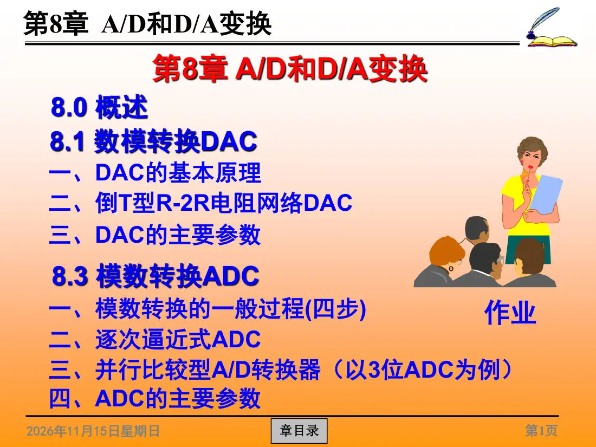

原文：

第8章 A/D和D/A变换

8.0 概述

8.1 数模转换DAC

一、DAC的基本原理

二、倒T型R-2R电阻网络DAC

三、DAC的主要参数

8.3 模数转换ADC

一、模数转换的一般过程(四步)

二、逐次逼近式ADC

作业

三、并行比较型A/D转换器（以3位ADC为例）

四、ADC的主要参数

第8章 A/D和D/A变换

The quick brown fox jumps over the lazy dog.

2026年11月15日星期日

章目录

第1页

### 第8章 A/D和D/A变换

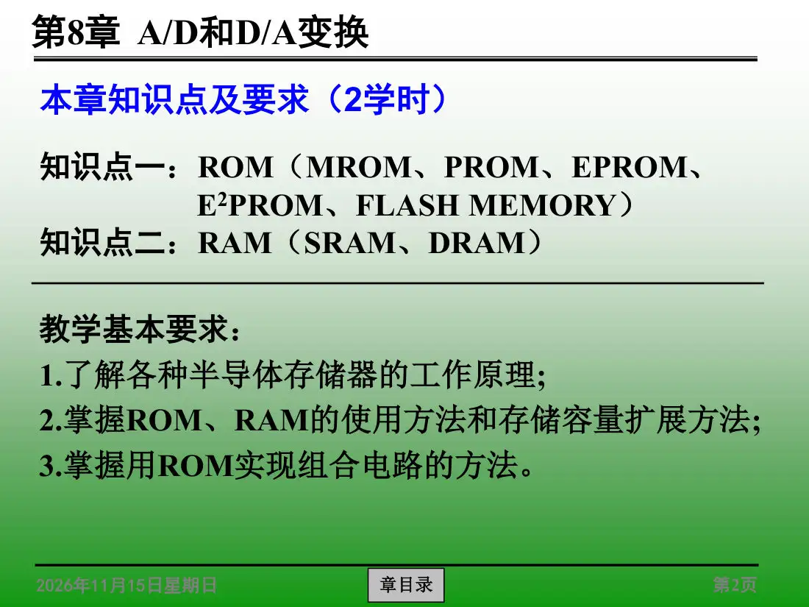

原文：

第8章 A/D和D/A变换

本章知识点及要求（2学时）

知识点一：ROM（MROM、PROM、EPROM、E²PROM、FLASH MEMORY） 知识点二：RAM（SRAM、DRAM）

教学基本要求:

1. 了解各种半导体存储器的工作原理;

2. 掌握ROM、RAM的使用方法和存储容量扩展方法;

3. 掌握用ROM实现组合电路的方法。

2026年11月15日星期日

章目录

第2页

### 计算机进行数字处理（如计算、滤波）、数据保存等

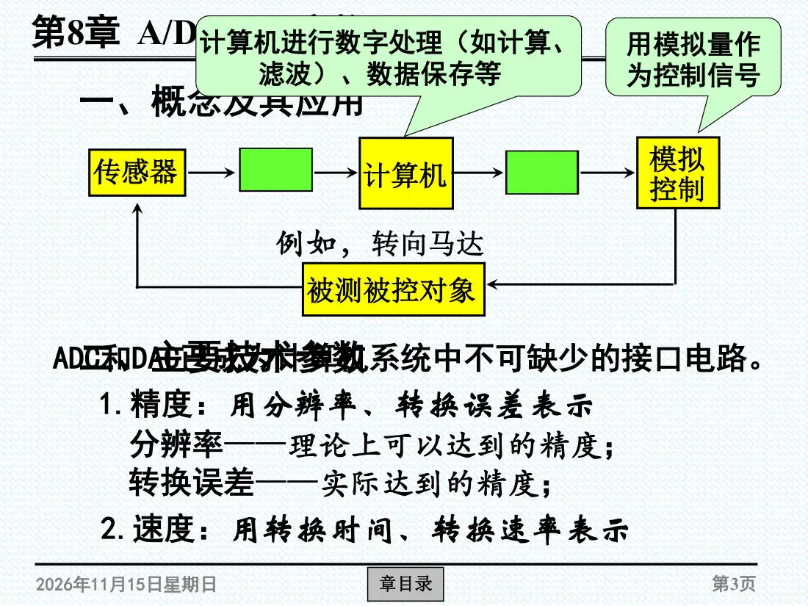

原文：

计算机进行数字处理（如计算、滤波）、数据保存等

一、概念及其应用用模拟量作为控制信号

ADC和DA主要技术参数系统中不可缺少的接口电路。

1. 精度：用分辨率、转换误差表示

分辨率——理论上可以达到的精度；

转换误差——实际达到的精度；

2. 速度：用转换时间、转换速率表示

2026年11月15日星期日

章目录

第3页

### 第一节 数模转换DAC

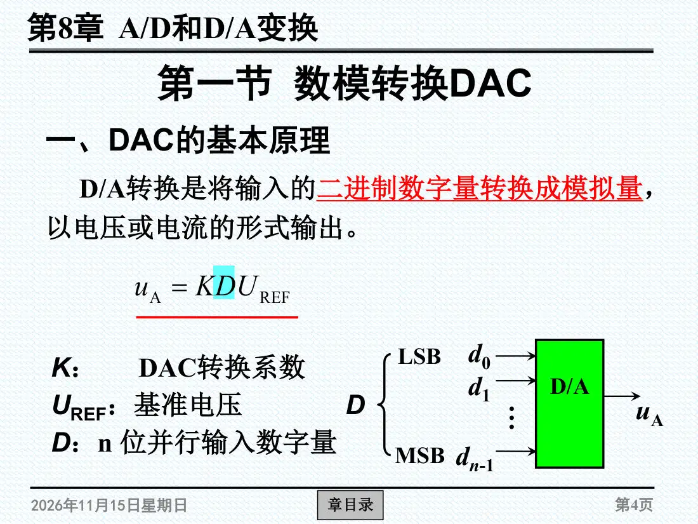

原文：

第一节 数模转换DAC

一、DAC的基本原理

D/A转换是将输入的二进制数字量转换成模拟量，以电压或电流的形式输出。

$$
u _ {\mathrm{A}} = K D U _ {\mathrm{REF}}
$$

K: DAC转换系数 $U_{\mathrm{REF}}$ : 基准电压
D: n 位并行输入数字量

$$
\left\{ \begin{array}{l} \text { LSB } \quad d _ {0} \longrightarrow \text { D/A } \\ \text { MSB } \quad d _ {n - 1} \longrightarrow \text { uA } \end{array} \right.
$$

第8章 A/D和D/A变换

2026年11月15日星期日

章目录

第4页

### 第8章 A/D和D/A变换 —— DAC

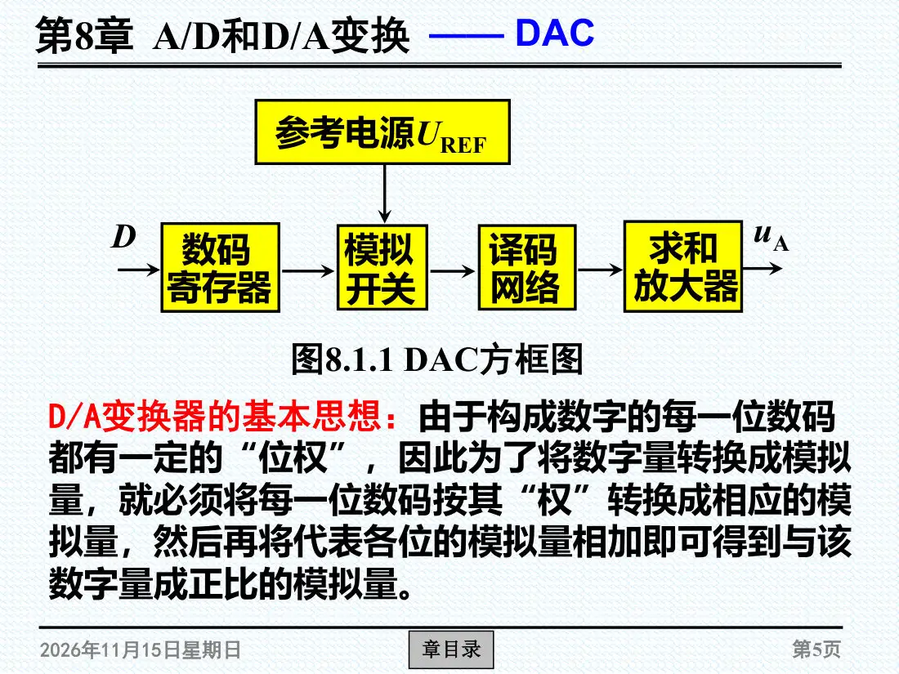

原文：

第8章 A/D和D/A变换 —— DAC

D/A变换器的基本思想：由于构成数字的每一位数码都有一定的“位权”，因此为了将数字量转换成模拟量，就必须将每一位数码按其“权”转换成相应的模拟量，然后再将代表各位的模拟量相加即可得到与该数字量成正比的模拟量。

2026年11月15日星期日

章目录

第5页

### 第8章 A/D和D/A变换 —— DAC

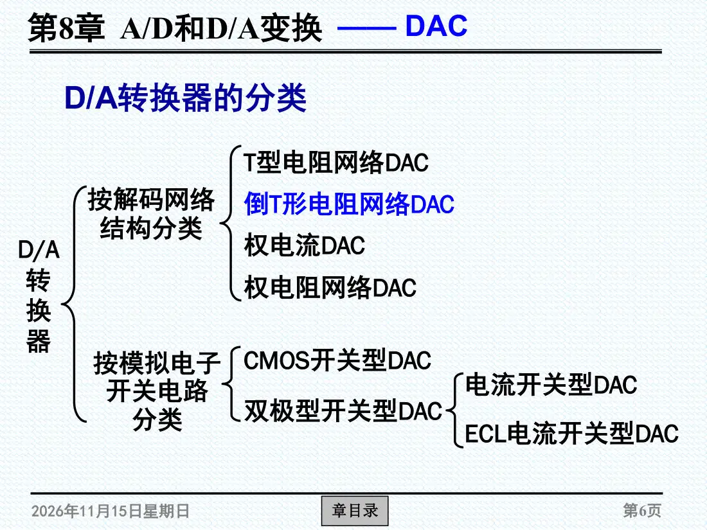

原文：

第8章 A/D和D/A变换 —— DAC

D/A转换器的分类

D/A
转换器

按解码网络结构分类

按模拟电子

开关电路

分类

T型电阻网络DAC

倒T形电阻网络DAC

权电流DAC

权电阻网络DAC

CMOS开关型DAC

双极型开关型DAC

电流开关型DAC

ECL电流开关型DAC

2026年11月15日星期日

章目录

第6页

### $$

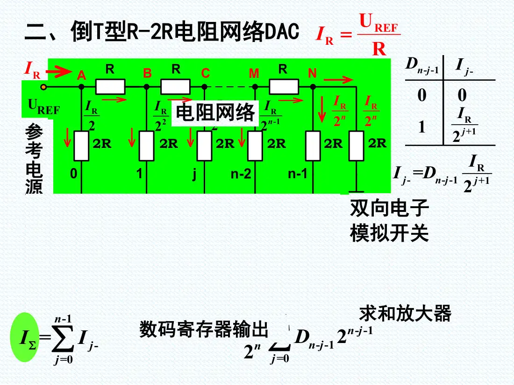

原文：

二、倒T型R-2R电阻网络DAC $I_{R}=\frac{U_{REF}}{R}$

<table><tr><td> $D_{n-j-1}$ </td><td> $I_{j-}$ </td></tr><tr><td>0</td><td>0</td></tr><tr><td>1</td><td> $\frac{I_{\text{R}}}{2^{j+1}}$ </td></tr></table>

$$
I _ {\Sigma} = \sum_ {j = 0} ^ {n - 1} I _ {j -}
$$

双向电子模拟开关

求和放大器

数码寄存器输出 $2^{n} \sum_{j=0}^{1} D_{n-j-1} 2^{n-j-1}$

### 第8章 A/D和D/A变换 —— DAC

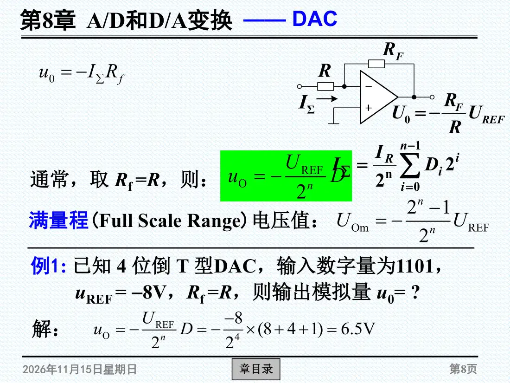

原文：

第8章 A/D和D/A变换 —— DAC

$u_{0}=-I_{\Sigma}R_{f}$ 通常，取 $R_{f}=R$ ，则： $u_{O}=-\frac{U_{REF}}{2^{n}}D=\frac{I_{R}}{2^{n}}\sum_{i=0}^{n-1}D_{i}2^{i}$ 满量程 (Full Scale Range) 电压值： $U_{Om}=-\frac{2^{n}-1}{2^{n}}U_{REF}$ 例1: 已知 4 位倒 T 型DAC，输入数字量为1101， $u_{REF}=-8V$ ， $R_{f}=R$ ，则输出模拟量 $u_{0}=$ ？

解： $u_{O}=-\frac{U_{REF}}{2^{n}}D=-\frac{-8}{2^{4}}\times(8+4+1)=6.5V$

2026年11月15日星期日

章目录

第8页

### 第8章 A/D和D/A变换 —— DAC

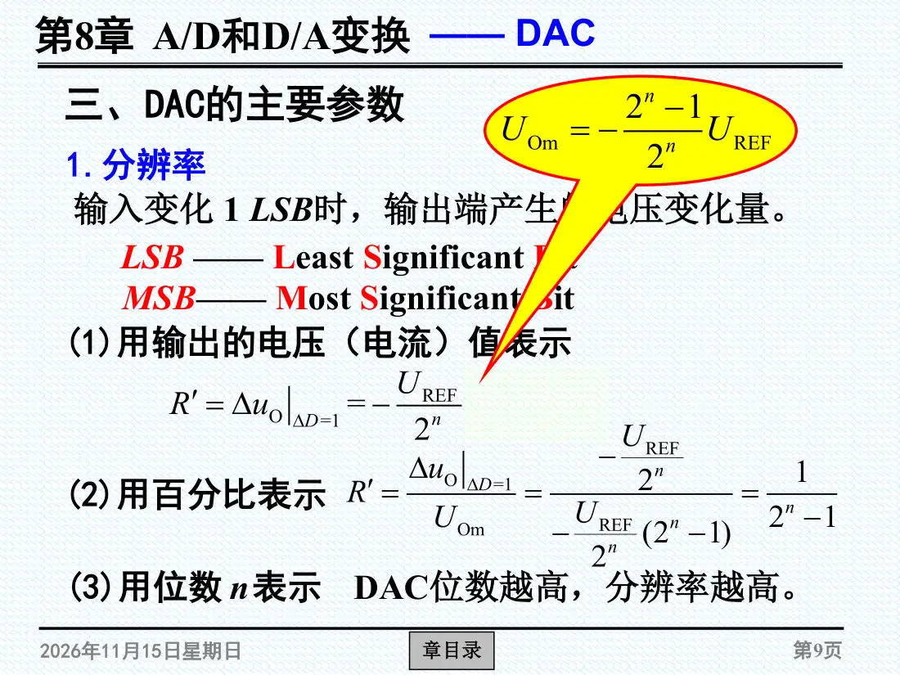

原文：

第8章 A/D和D/A变换 —— DAC

三、DAC的主要参数

1. 分辨率

$$
U _ {\mathrm{Om}} = - \frac {2 ^ {n} - 1}{2 ^ {n}} U _ {\mathrm{REF}}
$$

输入变化 1 LSB时，输出端产生电压变化量。

LSB — Least Significant

MSB—Most Significant Bit

(1) 用输出的电压（电流）值表示

$$
R ^ {\prime} = \Delta u _ {\mathrm{O}} \big | _ {\Delta D = 1} = - \frac {U _ {\mathrm{REF}}}{2 ^ {n}}
$$

(2)用百分比表示 $R^{\prime} = \frac{\Delta u_{\mathrm{O}}\big|_{\Delta D = 1}}{U_{\mathrm{Om}}} = \frac{-\frac{\Delta u_{\mathrm{REF}}}{2^{n}}}{-\frac{U_{\mathrm{REF}}}{2^{n}}(2^{n} - 1)} = \frac{1}{2^{n} - 1}$

(3) 用位数 n 表示 DAC 位数越高，分辨率越高。

2026年11月15日星期日

章目录

第9页

### 第8章 A/D和D/A变换 —— DAC

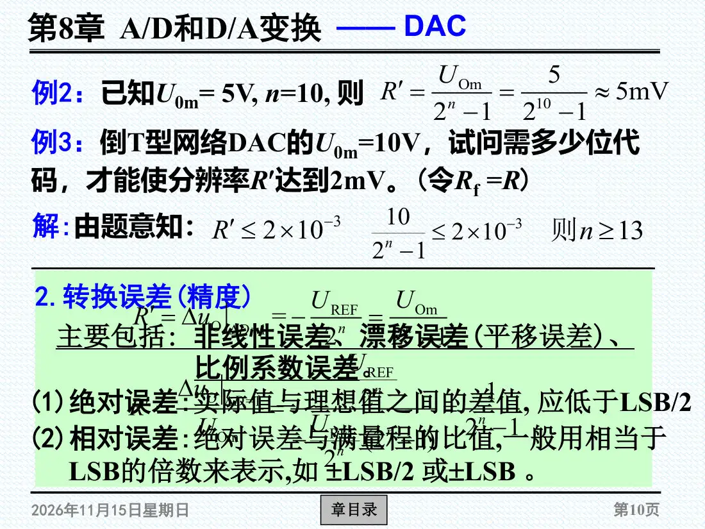

原文：

第8章 A/D和D/A变换 —— DAC

例2: 已知 $U_{0m}=5V, n=10$ , 则 $R'=\frac{U_{Om}}{2^{n}-1}=\frac{5}{2^{10}-1}\approx5mV$

例3: 倒T型网络DAC的 $U_{0 \mathrm{~m}} = 10 \mathrm{~V}$ , 试问需多少位代码, 才能使分辨率 $R'$ 达到 $2 \mathrm{~mV}$ 。(令 $R_{\mathrm{f}} = R$ )

解:由题意知: $R' \leq 2 \times 10^{-3}$ $\frac{10}{2^{n}-1} \leq 2 \times 10^{-3}$ 则 $n \geq 13$

2. 转换误差(精度) $R' = \Delta u_{0} \bigg|_{n} = -\frac{U_{REF}}{U_{OM}} = \frac{U_{Om}}{U_{OM}}$ 主要包括：非线性误差、漂移误差(平移误差)、比例系数误差 $J_{REF}$

(1) 绝对误差: 实际值与理想值之间的差值, 应低于LSB/2(2) 相对误差: 绝对误差与满量程的比值, 一般用相当于 LSB 的倍数来表示, 如 ±LSB/2 或 ±LSB。

2026年11月15日星期日

章目录

第10页

### 第8章 A/D和D/A变换 —— DAC

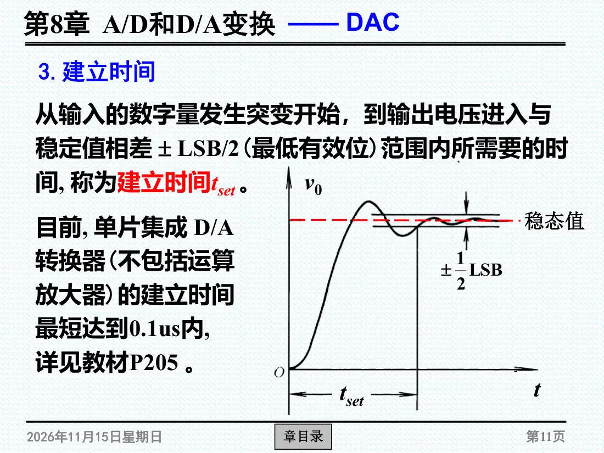

原文：

第8章 A/D和D/A变换 —— DAC

3. 建立时间

从输入的数字量发生突变开始，到输出电压进入与稳定值相差 ± LSB/2 (最低有效位) 范围内所需要的时

间, 称为建立时间 $t_{set}$ 。
目前, 单片集成 D/A 转换器 (不包括运算放大器) 的建立时间最短达到0.1us内, 详见教材P205。

2026年11月15日星期日

章目录

第11页

### 第8章 A/D和D/A变换 —— DAC应用举例

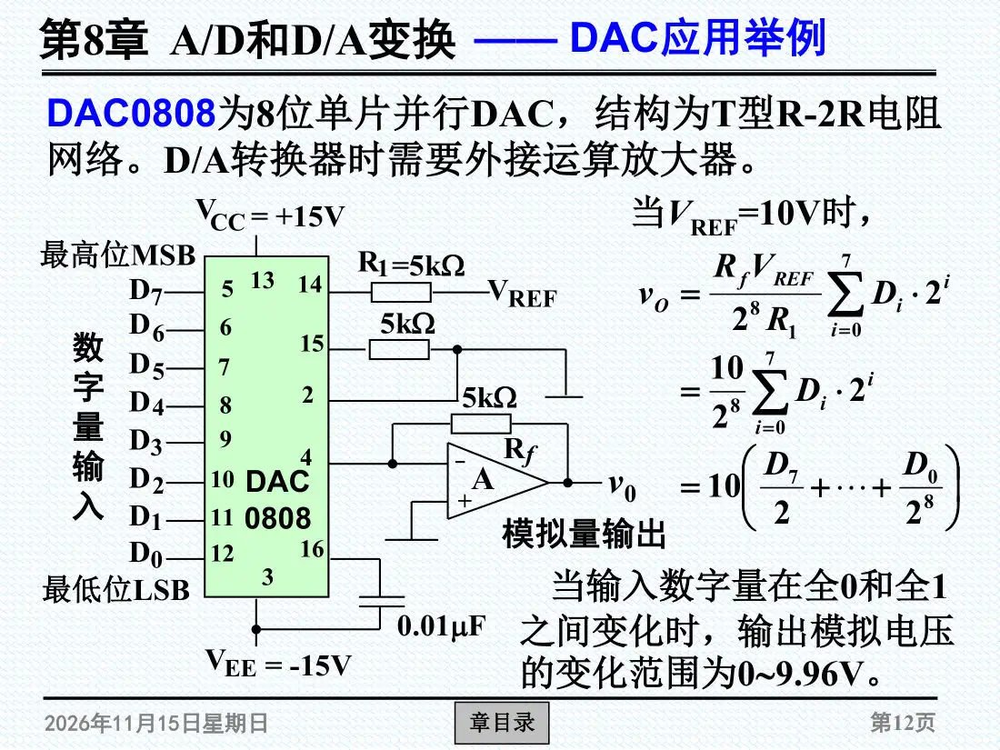

原文：

第8章 A/D和D/A变换 —— DAC应用举例

DAC0808为8位单片并行DAC，结构为T型R-2R电阻网络。D/A转换器时需要外接运算放大器。

$$
\mathbf {V} _ {\mathrm{CC}} = + 1 5 \mathbf {V}
$$

最高位MSB

最低位LSB

$$
\mathbf {V _ {E E}} = - 1 5 \mathbf {V}
$$

当 $V_{REF}=10V$ 时，

$$
v _ {0} = 1 0 \left(\frac {D _ {7}}{2} + \dots + \frac {D _ {0}}{2 ^ {8}}\right)
$$

模拟量输出

当输入数字量在全0和全1之间变化时，输出模拟电压的变化范围为0\~9.96V。

2026年11月15日星期日

章目录

第12页

### 第8章 A/D和D/A变换

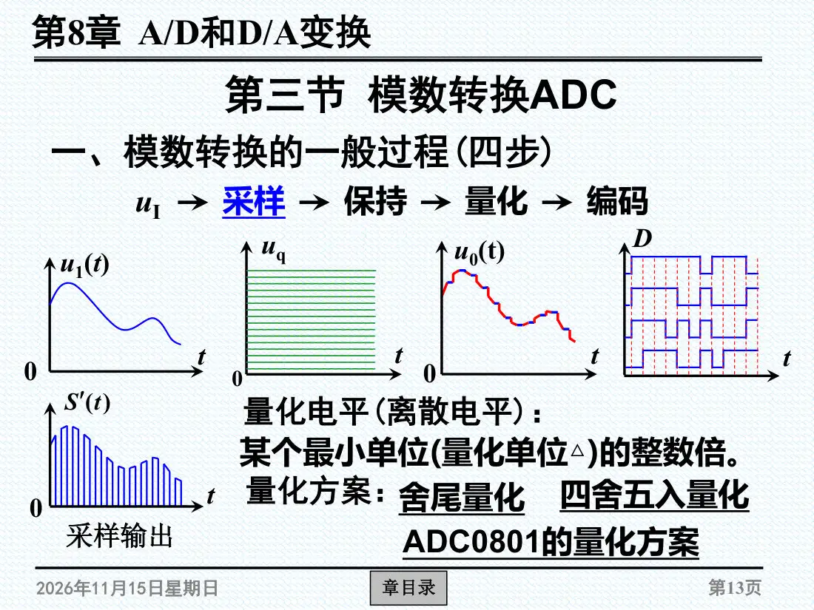

原文：

第8章 A/D和D/A变换

第三节 模数转换ADC

一、模数转换的一般过程(四步)

$u_{I} \rightarrow$ 采样 $\rightarrow$ 保持 $\rightarrow$ 量化 $\rightarrow$ 编码

采样输出

量化电平(离散电平): 某个最小单位(量化单位△)的整数倍。量化方案: 舍尾量化 四舍五入量化 ADC0801的量化方案

2026年11月15日星期日

章目录

第13页

### 第8章 A/D和D/A变换 —— ADC

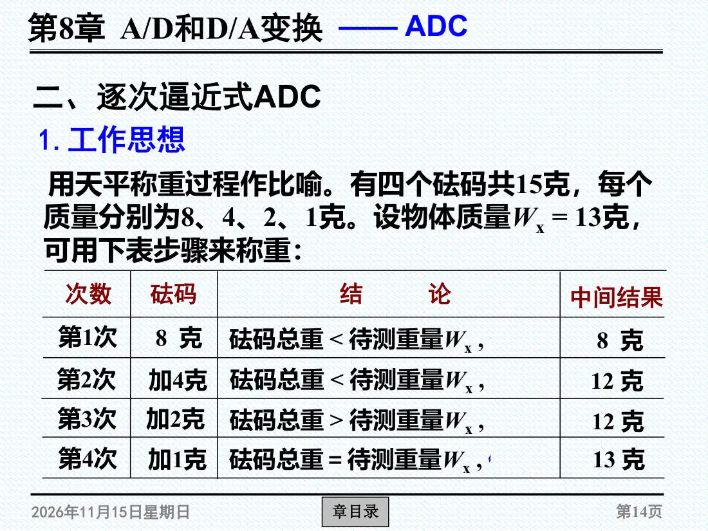

原文：

第8章 A/D和D/A变换 —— ADC

二、逐次逼近式ADC

1. 工作思想

用天平称重过程作比喻。有四个砝码共15克，每个质量分别为8、4、2、1克。设物体质量 $W_{x}=13$ 克，可用下表步骤来称重：

<table><tr><td>次数</td><td>砝码</td><td>结论</td><td>中间结果</td></tr><tr><td>第1次</td><td>8克</td><td>砝码总重&lt;待测重量 $W_x$ ,</td><td>8克</td></tr><tr><td>第2次</td><td>加4克</td><td>砝码总重&lt;待测重量 $W_x$ ,</td><td>12克</td></tr><tr><td>第3次</td><td>加2克</td><td>砝码总重&gt;待测重量 $W_x$ ,</td><td>12克</td></tr><tr><td>第4次</td><td>加1克</td><td>砝码总重=待测重量 $W_x$ ,</td><td>13克</td></tr></table>

2026年11月15日星期日

章目录

第14页

### 第8章 A/D和D/A变换 ——逐次逼近式ADC

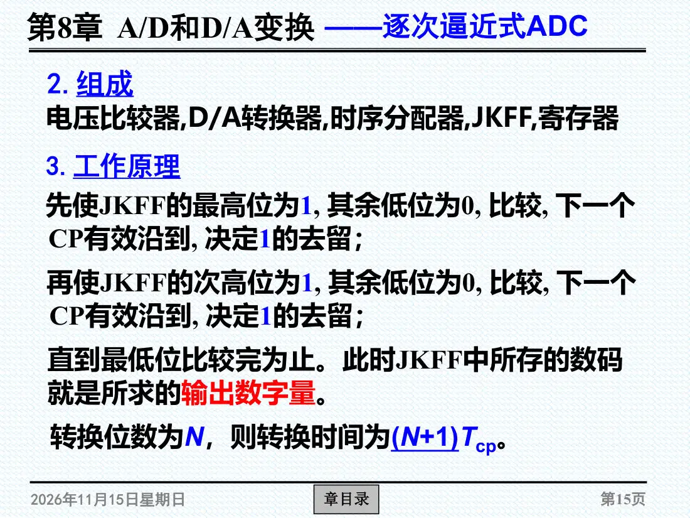

原文：

第8章 A/D和D/A变换 ——逐次逼近式ADC

2. 组成

电压比较器,D/A转换器,时序分配器,JKFF,寄存器

3. 工作原理

先使JKFF的最高位为1, 其余低位为0, 比较, 下一个CP有效沿到, 决定1的去留;

再使JKFF的次高位为1, 其余低位为0, 比较, 下一个CP有效沿到, 决定1的去留;

直到最低位比较完为止。此时JKFF中所存的数码就是所求的输出数字量。

转换位数为N，则转换时间为 $(N+1)T_{cp}$ 。

2026年11月15日星期日

章目录

第15页

### 三、并行比较型A/D转换器（以3位ADC为例）

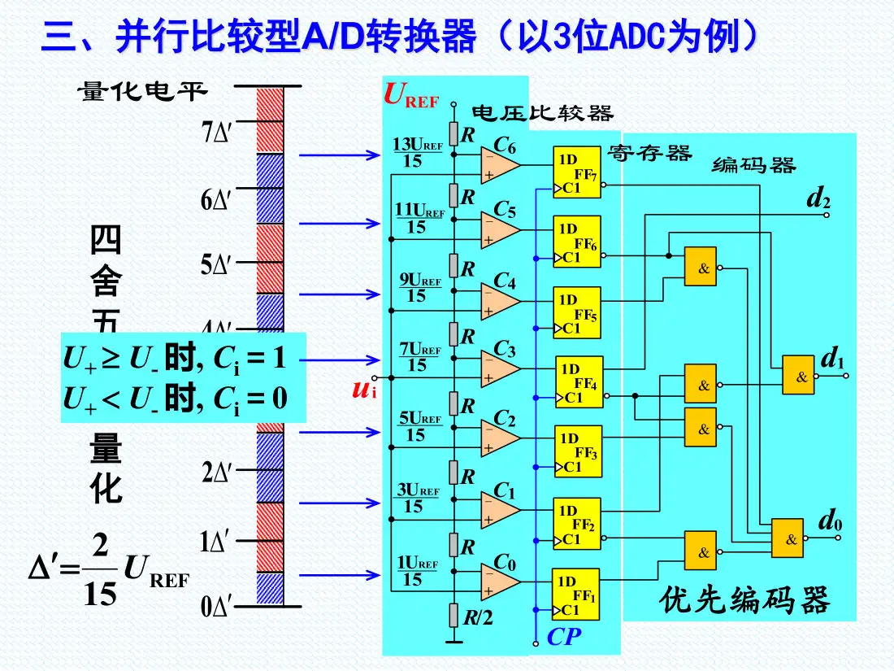

原文：

三、并行比较型A/D转换器（以3位ADC为例）

量化电平

$U_{+} \geq U_{-}$ 时, $C_{\mathrm{i}} = 1$ $U_{+} < U_{-}$ 时, $C_{\mathrm{i}} = 0$

$$
\Delta^ {\prime} = \frac {2}{1 5} U _ {\mathrm{REF}}
$$

### 第8章 A/D和D/A变换——并行比较型ADC真值表

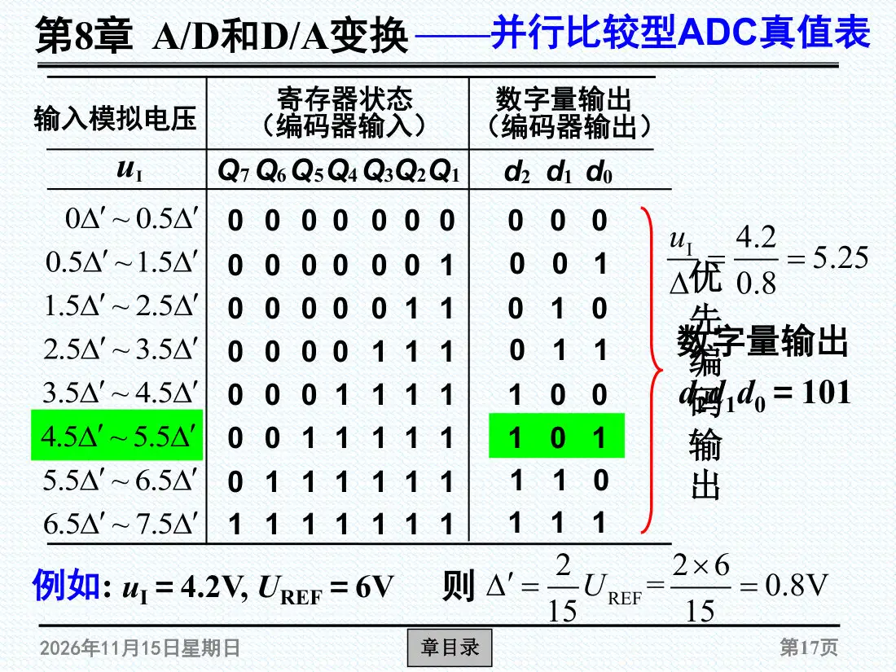

原文：

第8章 A/D和D/A变换——并行比较型ADC真值表

<table><tr><td>输入模拟电压</td><td>寄存器状态(编码器输入)</td><td>数字量输出(编码器输出)</td></tr><tr><td> $u_I$ </td><td> $Q_7$   $Q_6$   $Q_5$   $Q_4$   $Q_3$   $Q_2$   $Q_1$ </td><td> $d_2$   $d_1$   $d_0$ </td></tr><tr><td> $0\Delta' \sim 0.5\Delta'$ </td><td>0 0 0 0 0 0 0</td><td>0 0 0</td></tr><tr><td> $0.5\Delta' \sim 1.5\Delta'$ </td><td>0 0 0 0 0 0 1</td><td>0 0 1</td></tr><tr><td> $1.5\Delta' \sim 2.5\Delta'$ </td><td>0 0 0 0 0 1 1</td><td>0 1 0</td></tr><tr><td> $2.5\Delta' \sim 3.5\Delta'$ </td><td>0 0 0 0 1 1 1</td><td>0 1 1</td></tr><tr><td> $3.5\Delta' \sim 4.5\Delta'$ </td><td>0 0 0 1 1 1 1</td><td>1 0 0</td></tr><tr><td> $4.5\Delta' \sim 5.5\Delta'$ </td><td>0 0 1 1 1 1 1</td><td>1 0 1</td></tr><tr><td> $5.5\Delta' \sim 6.5\Delta'$ </td><td>0 1 1 1 1 1 1</td><td>1 1 0</td></tr><tr><td> $6.5\Delta' \sim 7.5\Delta'$ </td><td>1 1 1 1 1 1 1</td><td>1 1 1</td></tr></table>

例如: $u_{\mathrm{I}} = 4.2 \mathrm{~V}, U_{\mathrm{REF}} = 6 \mathrm{~V}$ 则 $\Delta' = \frac{2}{15} U_{\mathrm{REF}} = \frac{2 \times 6}{15} = 0.8 \mathrm{~V}$

2026年11月15日星期日

章目录

第17页

### 第8章 A/D和D/A变换 ——并行比较型A/D转换器

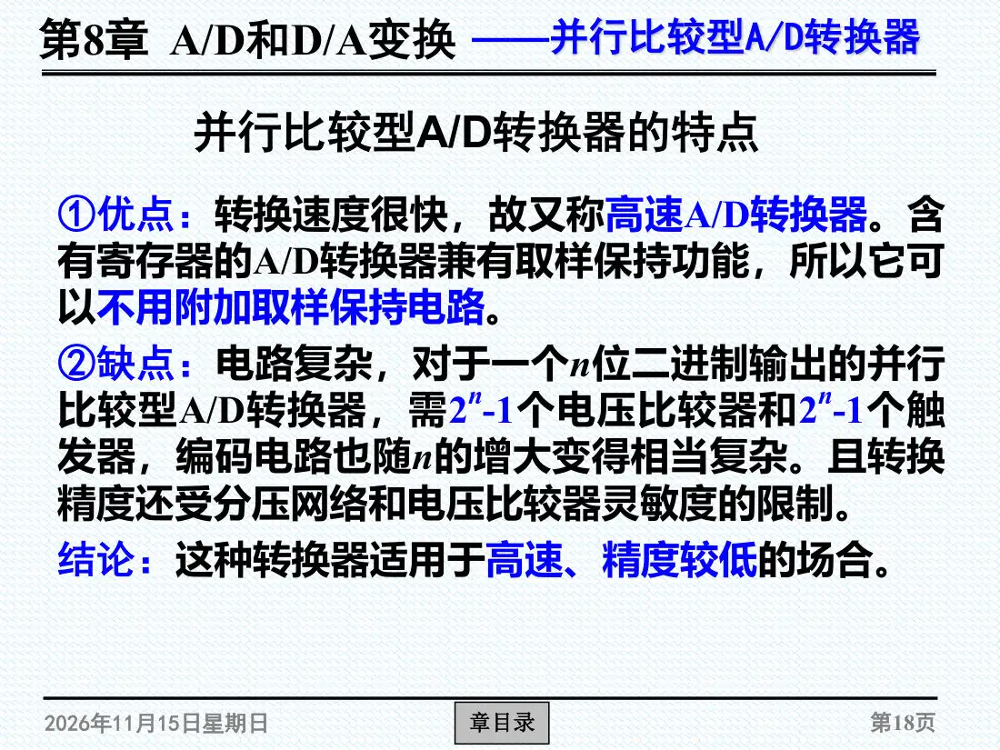

原文：

第8章 A/D和D/A变换 ——并行比较型A/D转换器

并行比较型A/D转换器的特点

①优点：转换速度很快，故又称高速A/D转换器。含有寄存器的A/D转换器兼有取样保持功能，所以它可以不用附加取样保持电路。

②缺点：电路复杂，对于一个n位二进制输出的并行比较型A/D转换器，需 $2^{n}-1$ 个电压比较器和 $2^{n}-1$ 个触发器，编码电路也随n的增大变得相当复杂。且转换精度还受分压网络和电压比较器灵敏度的限制。

结论：这种转换器适用于高速、精度较低的场合。

2026年11月15日星期日

章目录

第18页

### 第8章 A/D和D/A变换——ADC的主要参数

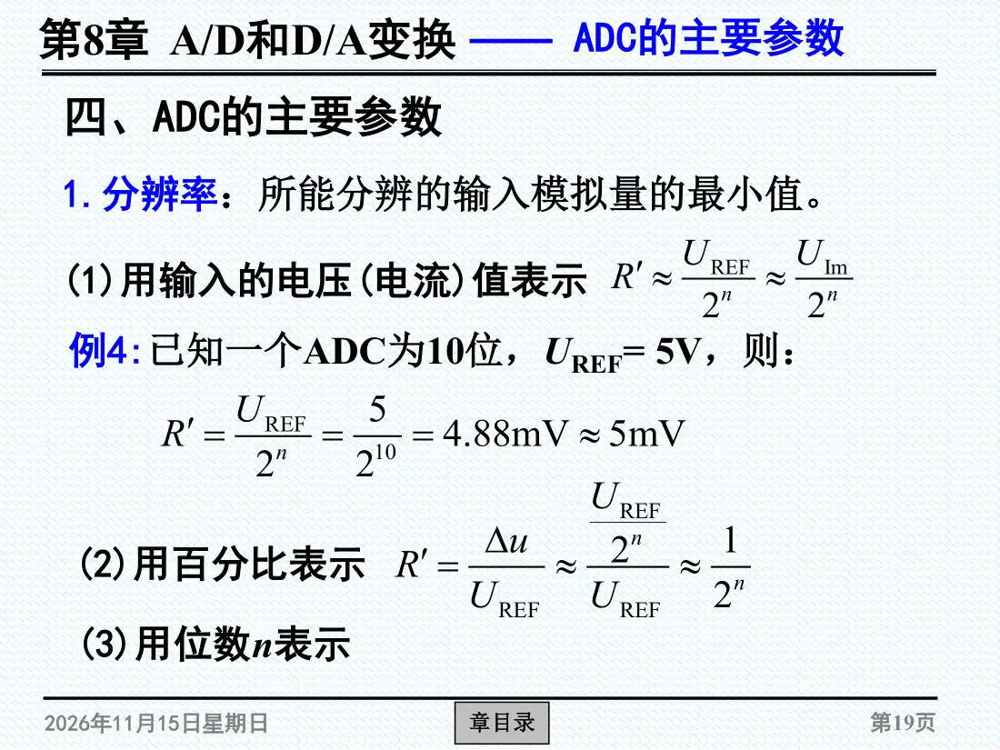

原文：

第8章 A/D和D/A变换——ADC的主要参数

四、ADC的主要参数

1. 分辨率：所能分辨的输入模拟量的最小值。

(1) 用输入的电压 (电流) 值表示 $R' \approx \frac{U_{\mathrm{REF}}}{2^n} \approx \frac{U_{\mathrm{Im}}}{2^n}$

例4: 已知一个ADC为10位， $U_{REF}=5V$ ，则：

$$
R ^ {\prime} = \frac {U _ {\mathrm{REF}}}{2 ^ {n}} = \frac {5}{2 ^ {1 0}} = 4. 8 8 \mathrm{mV} \approx 5 \mathrm{mV}
$$

(2) 用百分比表示 $R' = \frac{\Delta u}{U_{\mathrm{REF}}} \approx \frac{\overline{2^n}}{U_{\mathrm{REF}}} \approx \frac{1}{2^n}$

(3) 用位数 $n$ 表示

2026年11月15日星期日

章目录

第19页

### 第8章 A/D和D/A变换——ADC的主要参数

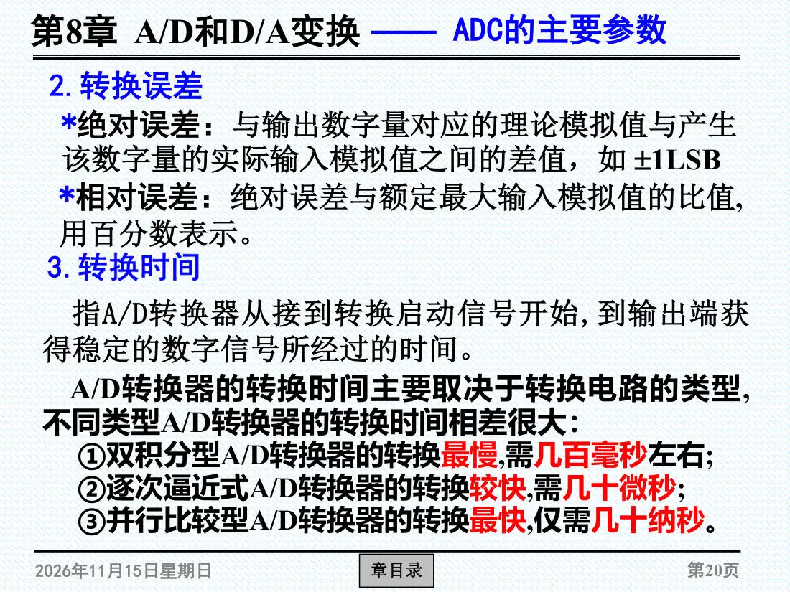

原文：

第8章 A/D和D/A变换——ADC的主要参数

2. 转换误差

\*绝对误差：与输出数字量对应的理论模拟值与产生该数字量的实际输入模拟值之间的差值，如 ±1LSB
\*相对误差：绝对误差与额定最大输入模拟值的比值,用百分数表示。

3. 转换时间

指A/D转换器从接到转换启动信号开始, 到输出端获得稳定的数字信号所经过的时间。

A/D转换器的转换时间主要取决于转换电路的类型,不同类型A/D转换器的转换时间相差很大:

①双积分型A/D转换器的转换最慢,需几百毫秒左右;

②逐次逼近式A/D转换器的转换较快,需几十微秒;

③并行比较型A/D转换器的转换最快,仅需几十纳秒。

2026年11月15日星期日

章目录

第20页

### 第8章 A/D和D/A变换 ——ADC应用举例

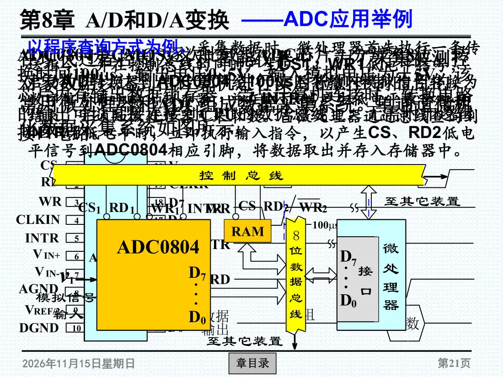

原文：

第8章 A/D和D/A变换 ——ADC应用举例

以程序查询方式为例。采集数据时，微处理器首先执行一条传
送指令过年在软制态线的局部产生DS1，WR1低电平感测控
换时间100μs，输出出电压100μS，输入填扎电压大于5V，云
对数或转换器到ADC0804线的模拟信号转换为
小数字传输中的输出有源，海王INT电源发生瞬时电平转换电路
的输出中通知接连接到ICU数据。数据接收流程器通道测试器控制
按电路低电平时，立即执行输入指令，以产生CS、RD2低电
平信号到ADC0804相应引脚，将数据取出并存入存储器中。

2026年11月15日星期日

章目录

第21页

### 第8章 A/D和D/A变换——DAC/ADC总结

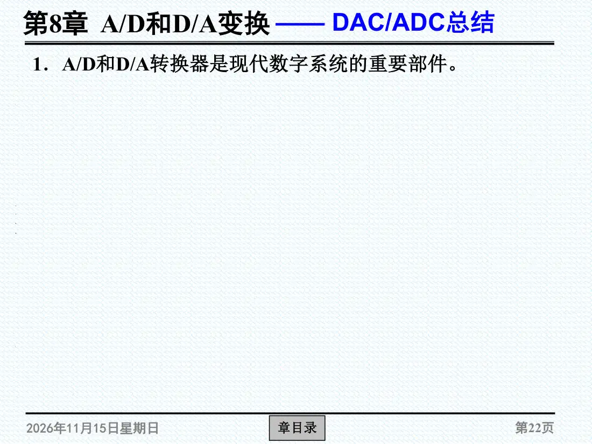

原文：

第8章 A/D和D/A变换——DAC/ADC总结

1. A/D和D/A转换器是现代数字系统的重要部件。

2026年11月15日星期日

章目录

第22页

### 第8章 A/D和D/A变换

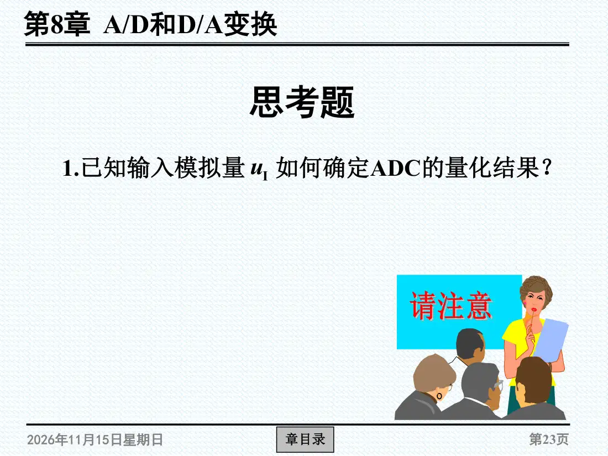

原文：

第8章 A/D和D/A变换

思考题

1. 已知输入模拟量 $u_{\mathrm{I}}$ 如何确定ADC的量化结果？

请注意

2026年11月15日星期日

章目录

第23页

### 第8章 A/D和D/A变换

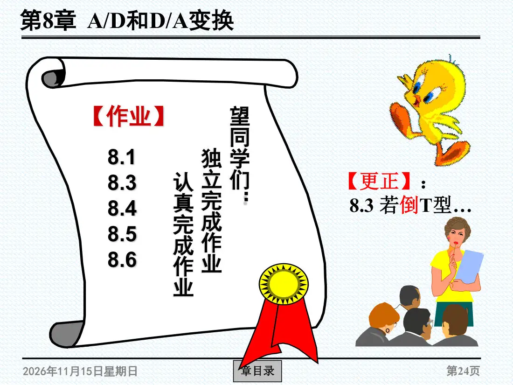

原文：

第8章 A/D和D/A变换

望同学们：

【作业】

独立完成作业

【更正】:
8.3 若倒T型...

8.1
8.3
8.4
8.5
8.6认真完成作业

2026年11月15日星期日

章目录

第24页

### 第8章 A/D和D/A变换

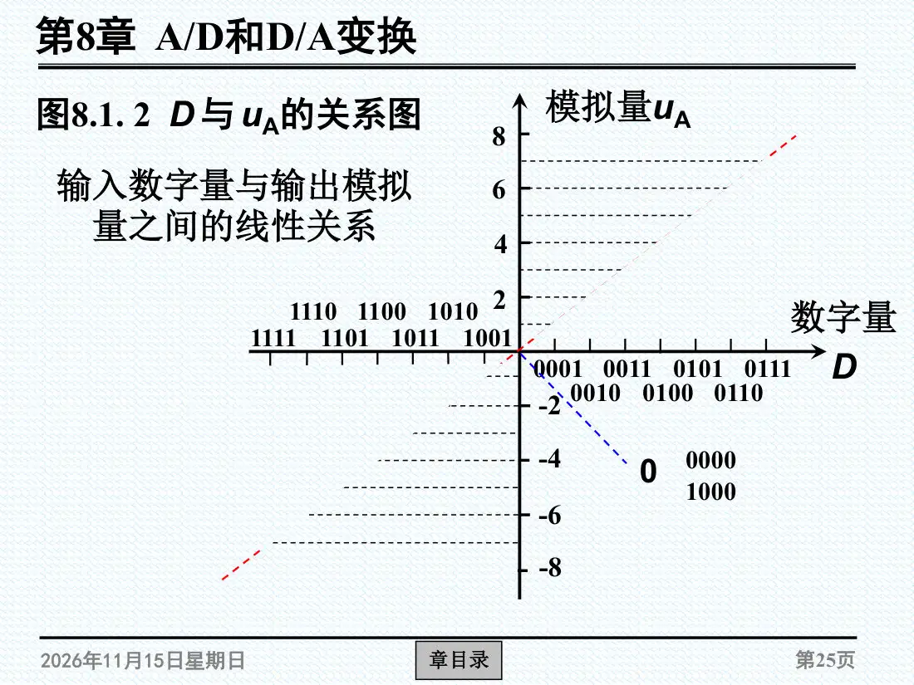

原文：

第8章 A/D和D/A变换

2026年11月15日星期日

章目录

第25页

### 第8章 A/D和D/A变换

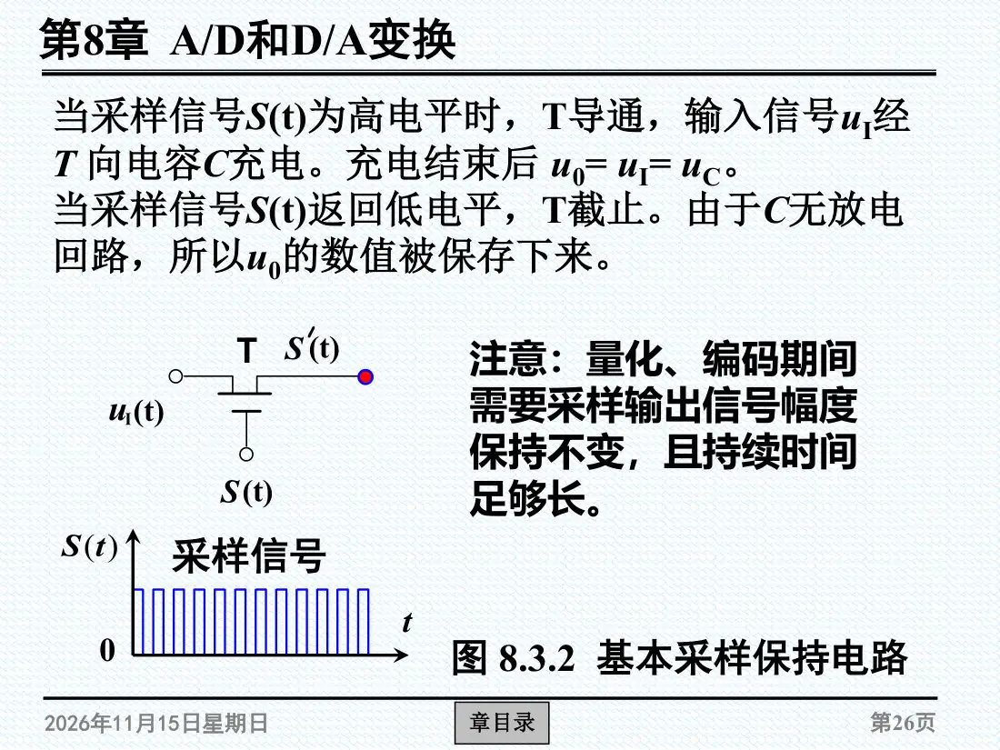

原文：

第8章 A/D和D/A变换

当采样信号 $S(t)$ 为高电平时，T导通，输入信号 $u_{I}$ 经T向电容C充电。充电结束后 $u_{0}=u_{I}=u_{C}$ 。当采样信号 $S(t)$ 返回低电平，T截止。由于C无放电回路，所以 $u_{0}$ 的数值被保存下来。

注意：量化、编码期间需要采样输出信号幅度保持不变，且持续时间足够长。

2026年11月15日星期日

章目录

第26页

### 第8章 A/D和D/A变换 ——舍尾量化

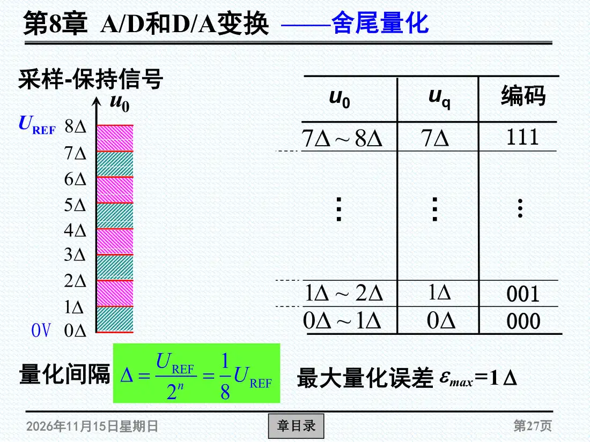

原文：

第8章 A/D和D/A变换 ——舍尾量化

量化间隔 $\Delta=\frac{U_{REF}}{2^{n}}=\frac{1}{8}U_{REF}$

<table><tr><td> $u_0$ </td><td> $u_q$ </td><td>编码</td></tr><tr><td>7Δ~8Δ</td><td>7Δ</td><td>111</td></tr><tr><td>⋮</td><td>⋮</td><td>⋮</td></tr><tr><td>1Δ~2Δ</td><td>1Δ</td><td>001</td></tr><tr><td>0Δ~1Δ</td><td>0Δ</td><td>000</td></tr></table>

最大量化误差 $\varepsilon_{max} = 1\Delta$

2026年11月15日星期日

章目录

第27页

### 第8章 A/D和D/A变换 ——四舍五入量化

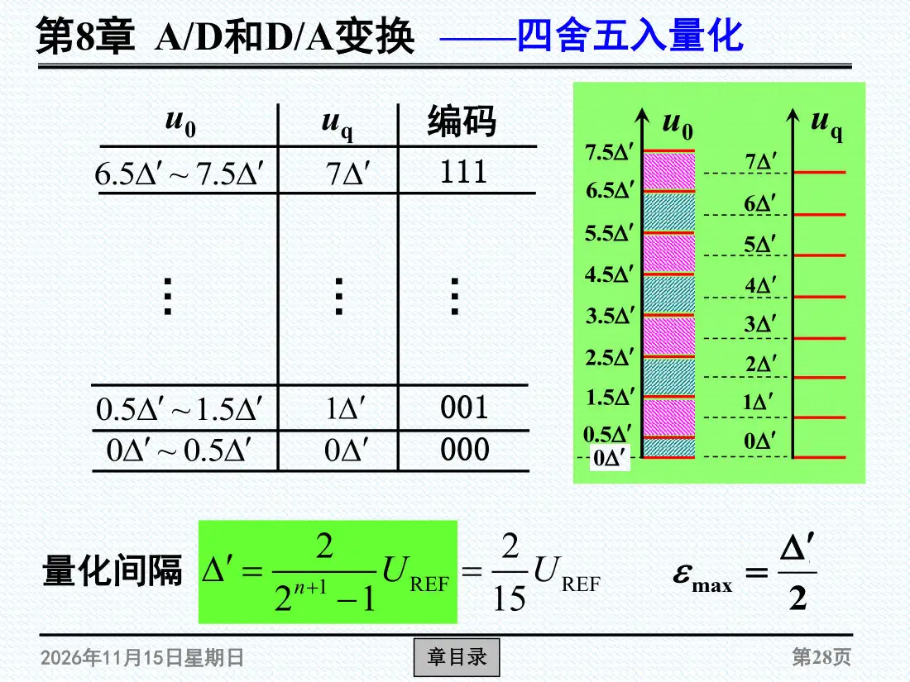

原文：

第8章 A/D和D/A变换 ——四舍五入量化

<table><tr><td> $u_0$ </td><td> $u_q$ </td><td>编码</td></tr><tr><td> $6.5\Delta' \sim 7.5\Delta'$ </td><td> $7\Delta'$ </td><td>111</td></tr><tr><td>⋮</td><td>⋮</td><td>⋮</td></tr><tr><td> $0.5\Delta' \sim 1.5\Delta'$ </td><td> $1\Delta'$ </td><td>001</td></tr><tr><td> $0\Delta' \sim 0.5\Delta'$ </td><td> $0\Delta'$ </td><td>000</td></tr></table>

量化间隔 $\Delta^{\prime} = \frac{2}{2^{n + 1} - 1} U_{\mathrm{REF}} = \frac{2}{15} U_{\mathrm{REF}}$ $\varepsilon_{\max} = \frac{\Delta^{\prime}}{2}$

2026年11月15日星期日

章目录

第28页

### 第8章 A/D和D/A变换——4位逐次逼近型ADC

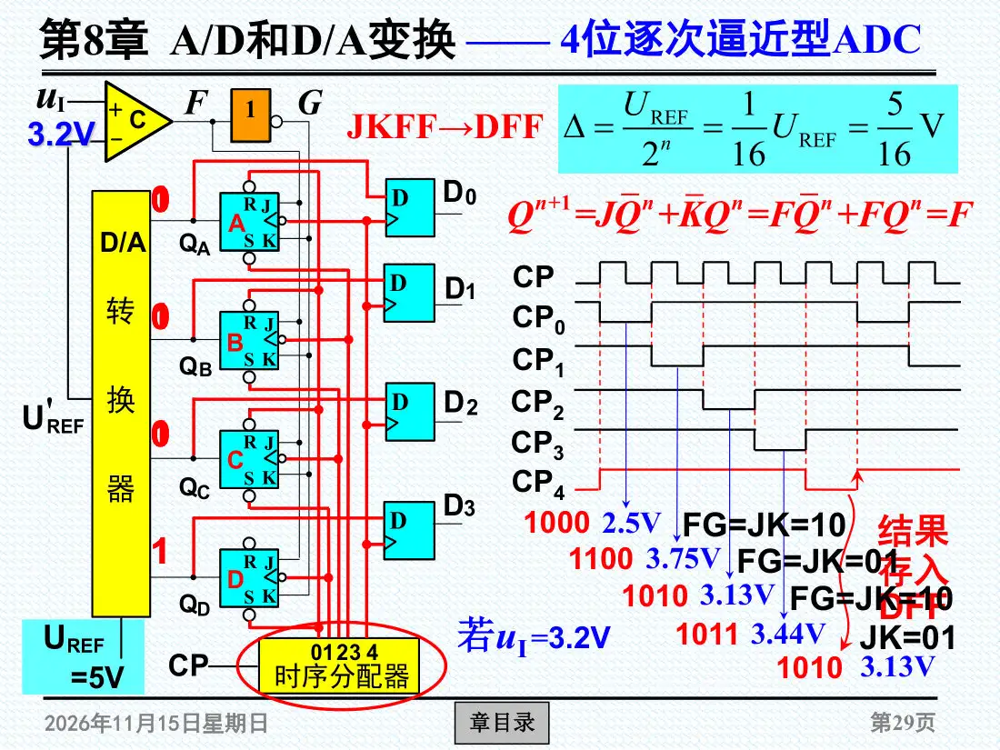

原文：

第8章 A/D和D/A变换——4位逐次逼近型ADC

$$
\Delta = \frac {U _ {\mathrm{REF}}}{2 ^ {n}} = \frac {1}{1 6} U _ {\mathrm{REF}} = \frac {5}{1 6} \mathrm{V}
$$

$$
Q ^ {n + 1} = J \bar {Q} ^ {n} + \bar {K} Q ^ {n} = F \bar {Q} ^ {n} + F Q ^ {n} = F
$$

1000 2.5V ↓ FG=JK=10 结果
1100 3.75V ↓ FG=JK=01 存入
1010 3.13V ↓ FG=JK=10 DFF 若 $u_{I}=3.2V$ 1011 3.44V ↓ JK=01

1010 3.13V

2026年11月15日星期日

章目录

第29页

### 第8章 A/D和D/A变换

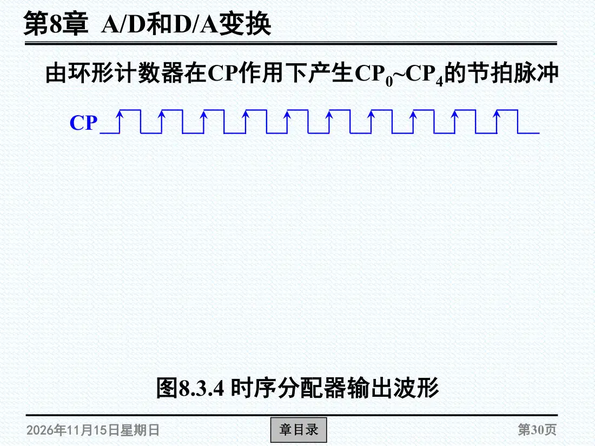

原文：

第8章 A/D和D/A变换

由环形计数器在CP作用下产生 $\mathrm{CP_0\sim CP_4}$ 的节拍脉冲

图8.3.4 时序分配器输出波形

章目录

2026年11月15日星期日

第30页

### 第8章 A/D和D/A变换

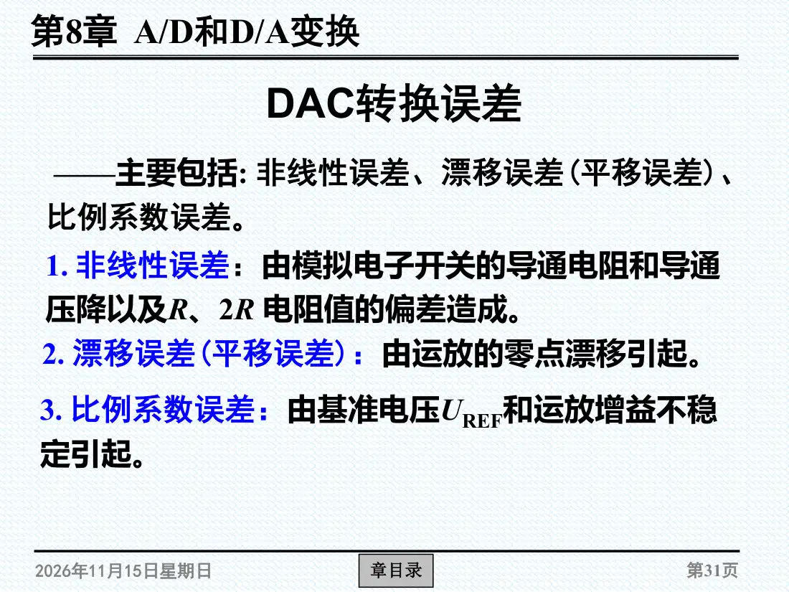

原文：

第8章 A/D和D/A变换

DAC转换误差

——主要包括: 非线性误差、漂移误差(平移误差)、比例系数误差。

1. 非线性误差：由模拟电子开关的导通电阻和导通压降以及 $R 、 2 R$ 电阻值的偏差造成。

2. 漂移误差(平移误差): 由运放的零点漂移引起。

3. 比例系数误差：由基准电压 $U_{REF}$ 和运放增益不稳定引起。

2026年11月15日星期日

章目录

第31页

### 第8章 A/D和D/A变换

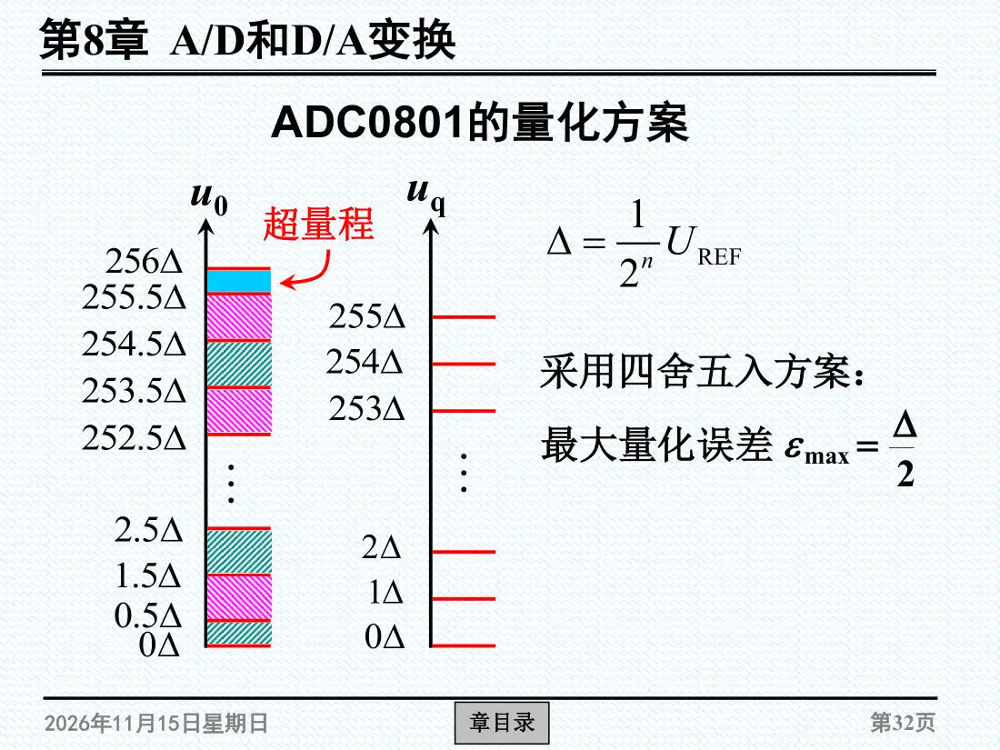

原文：

第8章 A/D和D/A变换

ADC0801的量化方案

$$
\Delta = \frac {1}{2 ^ {n}} U _ {\mathrm{REF}}
$$

采用四舍五入方案:

最大量化误差 $\varepsilon_{max}=\frac{\Delta}{2}$

2026年11月15日星期日

章目录

第32页

### $$

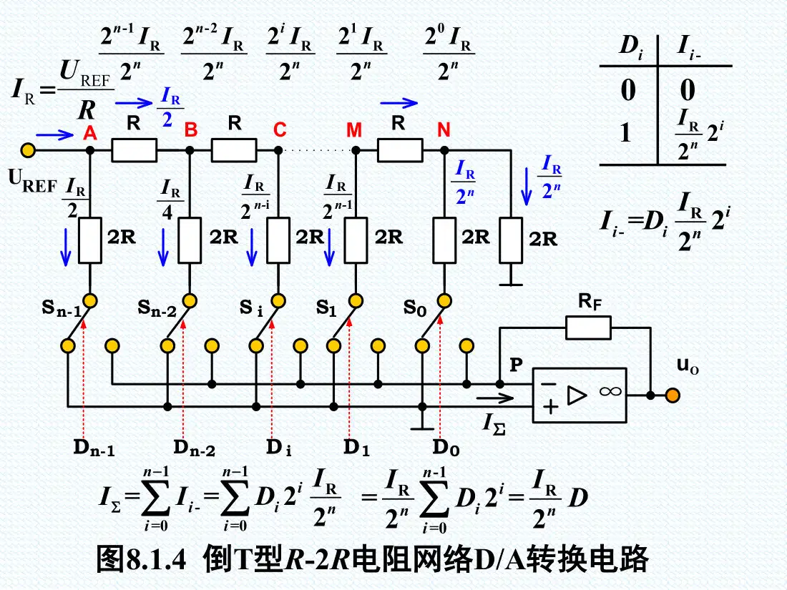

原文：

$$
I _ {\Sigma} = \sum_ {i = 0} ^ {n - 1} I _ {i -} = \sum_ {i = 0} ^ {n - 1} D _ {i} 2 ^ {i} \frac {I _ {\mathrm{R}}}{2 ^ {n}} = \frac {I _ {\mathrm{R}}}{2 ^ {n}} \sum_ {i = 0} ^ {n - 1} D _ {i} 2 ^ {i} = \frac {I _ {\mathrm{R}}}{2 ^ {n}} D
$$

图8.1.4 倒T型R-2R电阻网络D/A转换电路

### 第8章 A/D和D/A变换 三、并行比较型A/D转换器

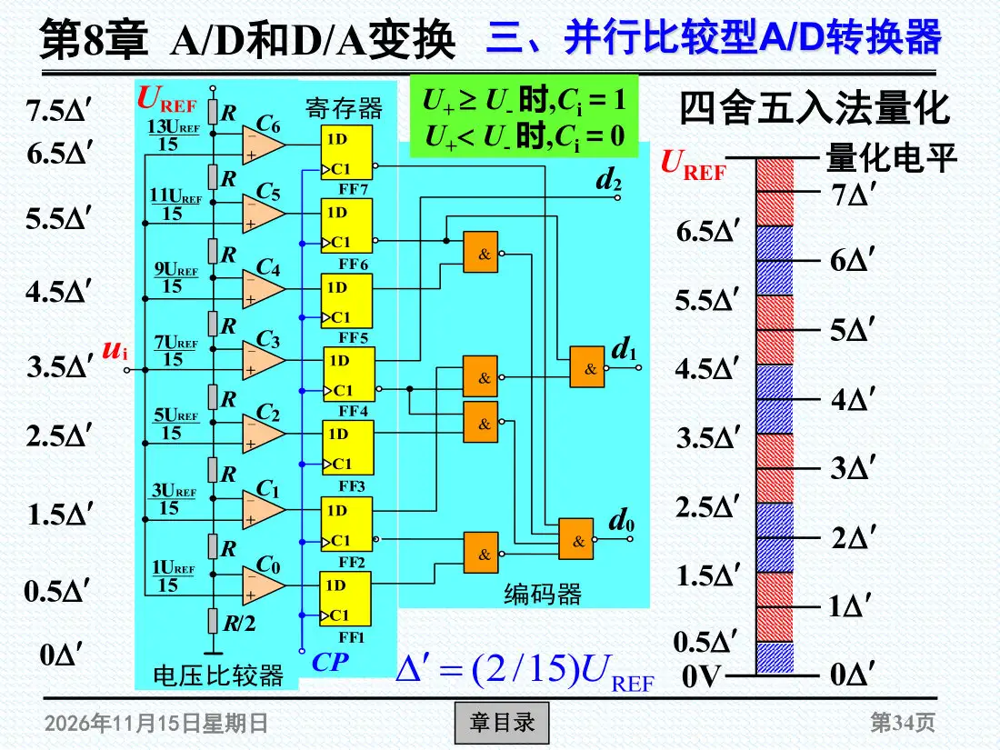

原文：

第8章 A/D和D/A变换 三、并行比较型A/D转换器

2026年11月15日星期日

章目录

第34页
