# 《数字电路与逻辑设计B》第9章 半导体存储器（课件）

原件的每一页，下面附识别出的文字。

### 第9章 半导体存储器

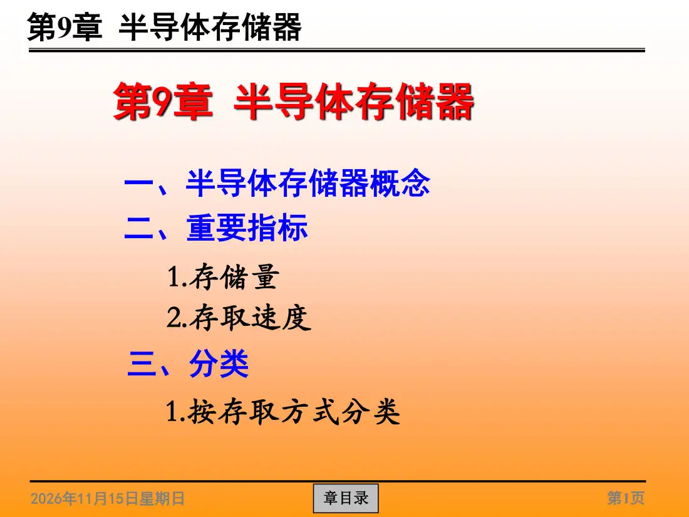

原文：

第9章 半导体存储器
一、半导体存储器概念
二、重要指标
1. 存储量
2. 存取速度
三、分类
1. 按存取方式分类

第9章 半导体存储器

2026年11月15日星期日

章目录

第1页

### 第9章 半导体存储器

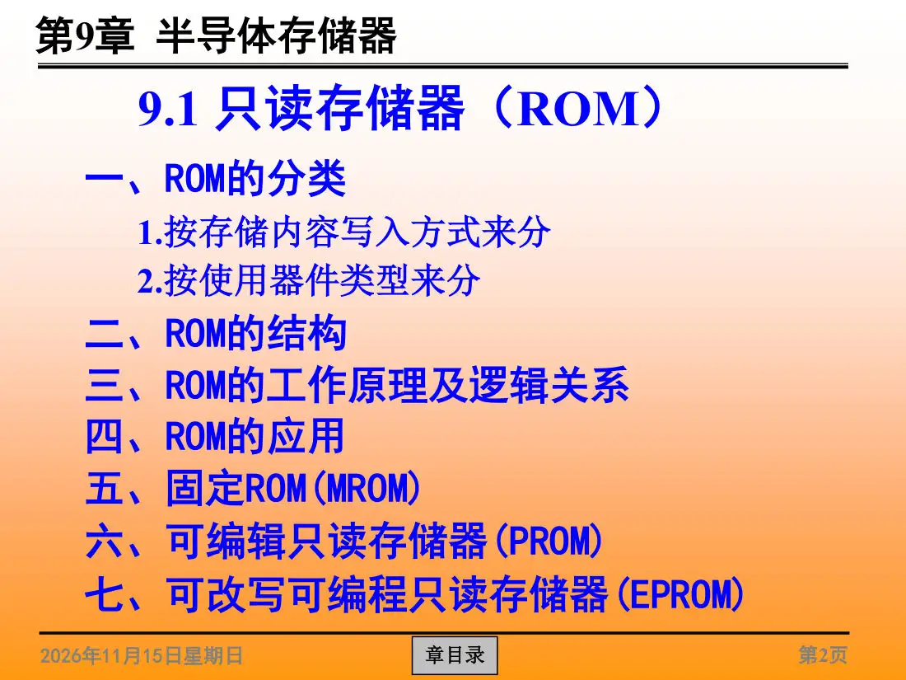

原文：

第9章 半导体存储器

9.1 只读存储器（ROM）

一、ROM的分类

1.按存储内容写入方式来分

2.按使用器件类型来分

二、ROM的结构

三、ROM的工作原理及逻辑关系

四、ROM的应用

五、固定ROM(MROM)

六、可编辑只读存储器(PROM)

七、可改写可编程只读存储器(EPROM)

2026年11月15日星期日

章目录

第2页

### 第9章 半导体存储器

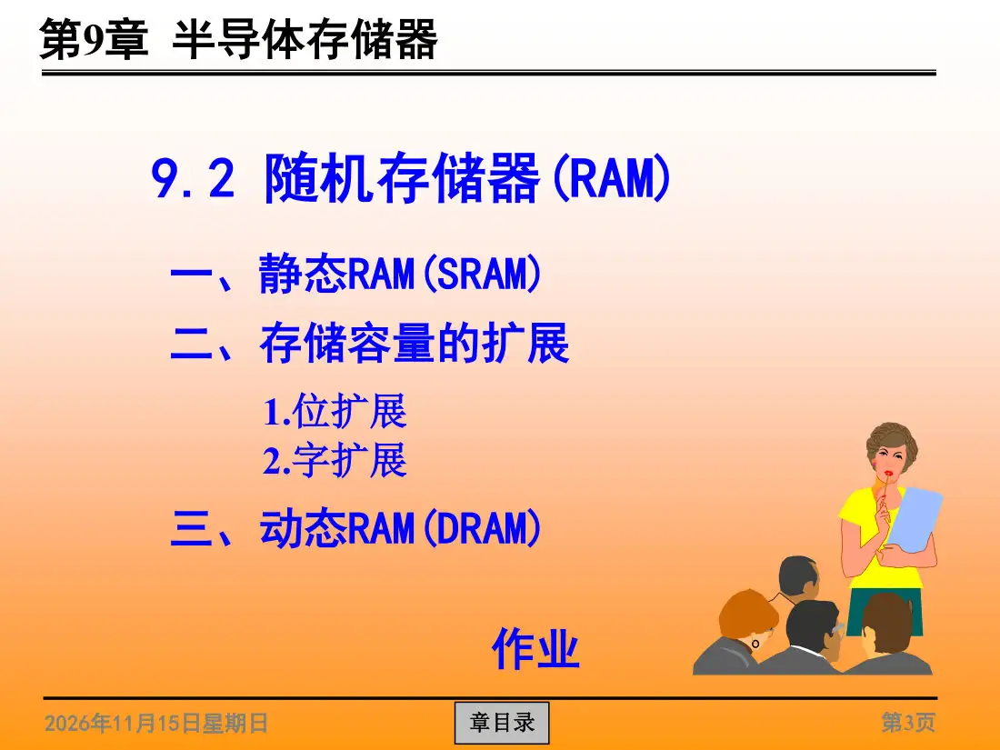

原文：

第9章 半导体存储器

9.2 随机存储器 (RAM)
一、静态RAM (SRAM)
二、存储容量的扩展
1. 位扩展
2. 字扩展
三、动态RAM (DRAM)
作业

2026年11月15日星期日

章目录

第3页

### 本章知识点及要求（2学时）

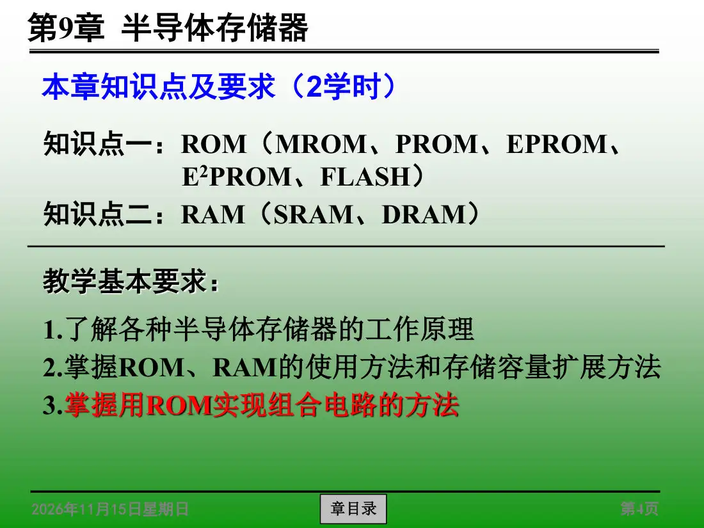

原文：

本章知识点及要求（2学时）

知识点一：ROM（MROM、PROM、EPROM、E2PROM、FLASH）

知识点二：RAM（SRAM、DRAM）

教学基本要求：

1.了解各种半导体存储器的工作原理

2.掌握ROM、RAM的使用方法和存储容量扩展方法

3.掌握用ROM实现组合电路的方法

第9章 半导体存储器

2026年11月15日星期日

章目录

第4页

### 第9章 半导体存储器

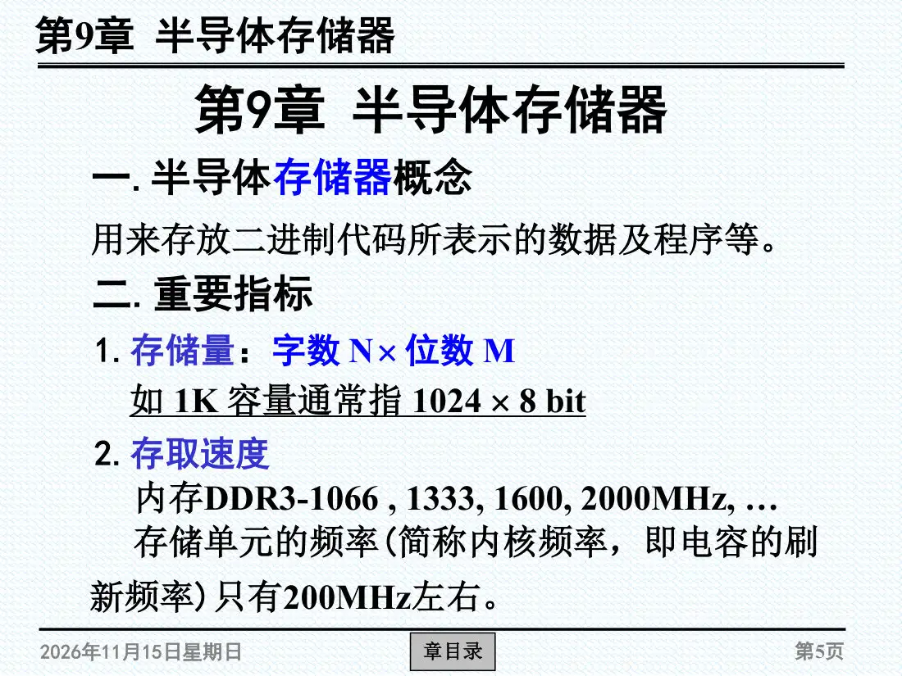

原文：

第9章 半导体存储器

第9章 半导体存储器

一.半导体存储器概念

用来存放二进制代码所表示的数据及程序等。

二.重要指标

1.存储量：字数 N位数 M

如 1K 容量通常指 $1 0 2 4 \times 8 ~ \mathrm { b i t }$

2.存取速度

内存DDR3-1066 , 1333, 1600, 2000MHz, …

存储单元的频率(简称内核频率，即电容的刷新频率)只有200MHz左右。

2026年11月15日星期日

章目录

第5页

### 第9章 半导体存储器

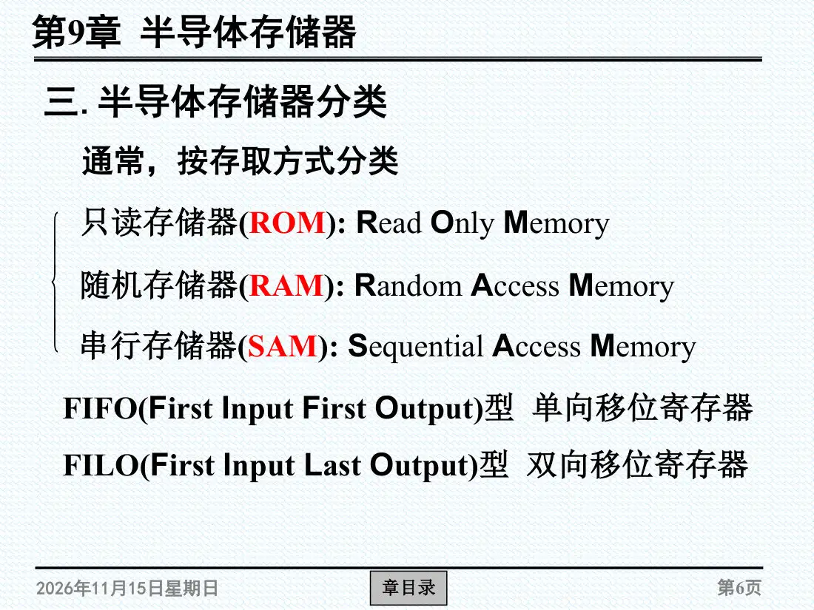

原文：

第9章 半导体存储器

三.半导体存储器分类

通常，按存取方式分类

只读存储器(ROM): Read Only Memory

随机存储器(RAM): Random Access Memory

串行存储器(SAM): Sequential Access Memory

2026年11月15日星期日

章目录

第6页

### 第9章 半导体存储器 ——ROM Wーントー

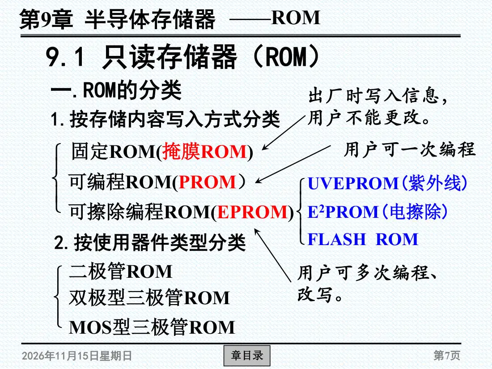

原文：

第9章 半导体存储器 ——ROM Wーントー

9.1 只读存储器（ROM）

.ROM的分类

1.按存储内容写入方式分类

固定ROM(掩膜ROM)

可编程ROM(PROM）

可擦除编程ROM(EPROM)

2.按使用器件类型分类

二极管ROM

双极型三极管ROM

MOS型三极管ROM出厂时写入信息用户不能更改。

用户可一次编程

UVEPROM(紫外线)

E2PROM(电擦除)

FLASH ROM

用户可多次编程、改写。

2026年11月15日星期日

章目录

第7页

### 第9章 半导体存储器 ——ROM w

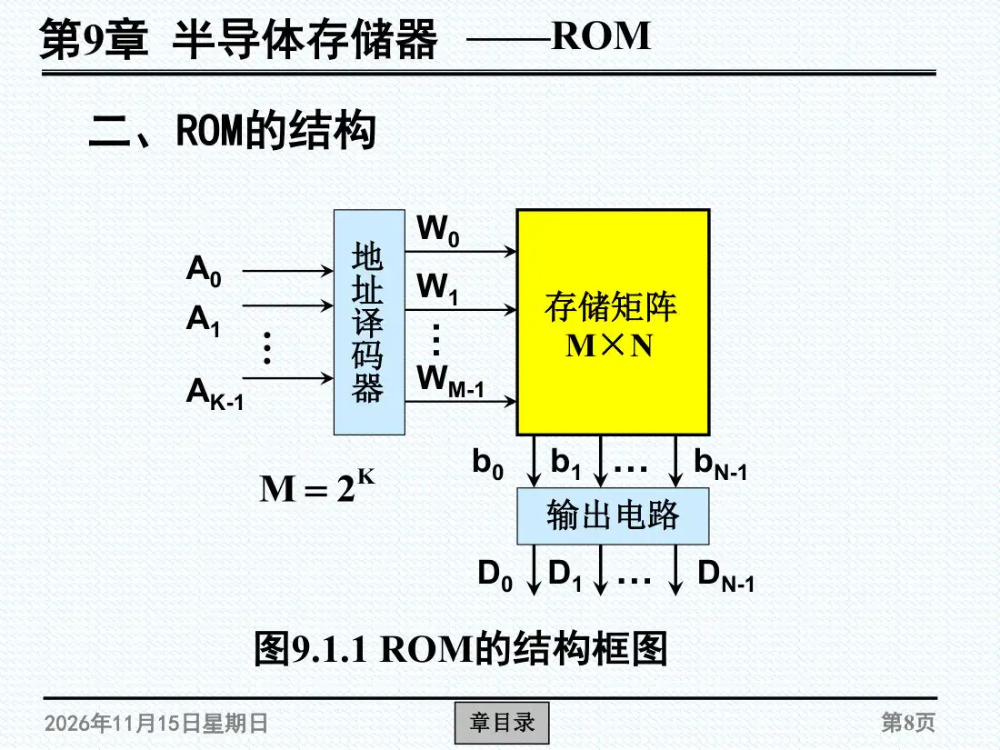

原文：

第9章 半导体存储器 ——ROM w

二、ROM的结构

2026年11月15日星期日

章目录

第8页

### 第9章 半导体存储器 ——ROM

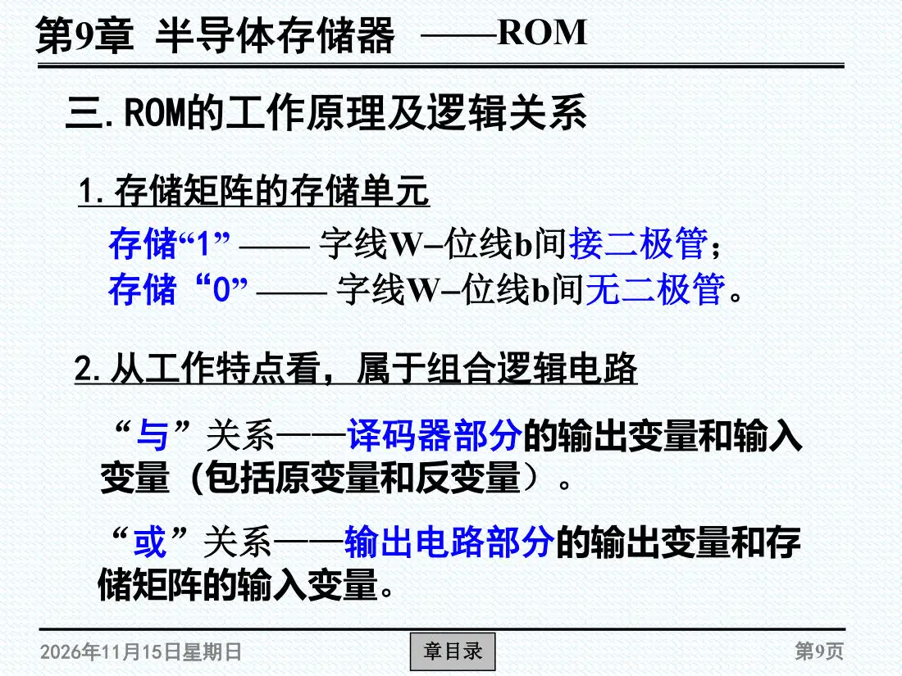

原文：

第9章 半导体存储器 ——ROM

三.ROM的工作原理及逻辑关系

1.存储矩阵的存储单元

存储“1”—— 字线W−位线b间接二极管；存储“0” 字线W−位线b间无二极管。

2.从工作特点看，属于组合逻辑电路

“与”关系— 译码器部分的输出变量和输入变量（包括原变量和反变量）

“或”关系— 输出电路部分的输出变量和存储矩阵的输入变量。

2026年11月15日星期日

章目录

第9页

### 第9章 半导体存储器 ——ROM

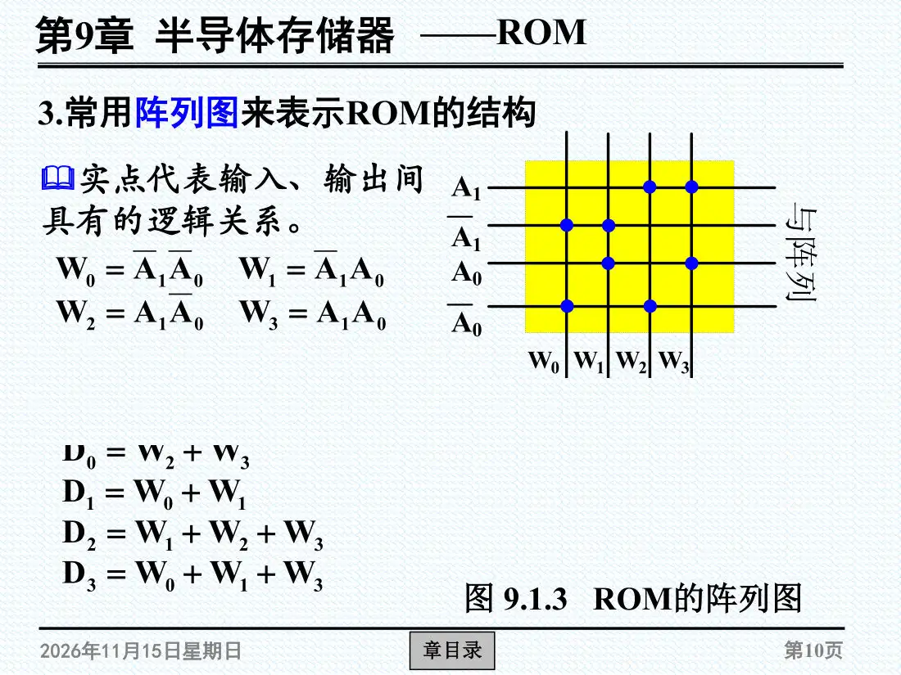

原文：

第9章 半导体存储器 ——ROM

3.常用阵列图来表示ROM的结构

实点代表输入、输出间具有的逻辑关系。

$$
\begin{array}{l l} \mathbf {W _ {0}} = \overline {{\mathbf {A}}} _ {1} \overline {{\mathbf {A}}} _ {0} & \mathbf {W _ {1}} = \overline {{\mathbf {A}}} _ {1} \mathbf {A} _ {0} \\ \mathbf {W _ {2}} = \mathbf {A} _ {1} \overline {{\mathbf {A}}} _ {0} & \mathbf {W _ {3}} = \mathbf {A} _ {1} \mathbf {A} _ {0} \end{array}
$$

$$
\begin{array}{l} \mathbf {D _ {0}} = \mathbf {W _ {2}} + \mathbf {W _ {3}} \\ \mathbf {D _ {1}} = \mathbf {W _ {0}} + \mathbf {W _ {1}} \\ \mathbf {D _ {2}} = \mathbf {W _ {1}} + \mathbf {W _ {2}} + \mathbf {W _ {3}} \\ \mathbf {D _ {3}} = \mathbf {W _ {0}} + \mathbf {W _ {1}} + \mathbf {W _ {3}} \end{array}
$$

2026年11月15日星期日

章目录

第10页

### 第9章 半导体存储器 ——ROM

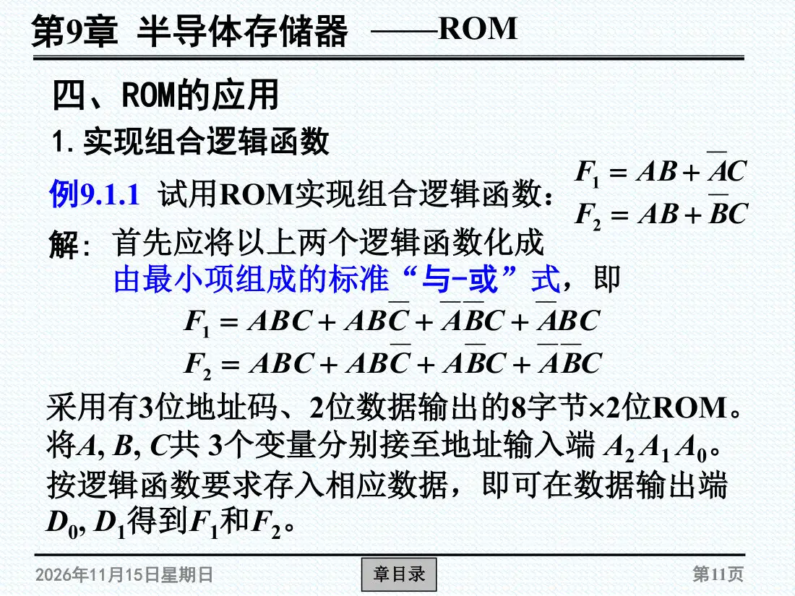

原文：

第9章 半导体存储器 ——ROM

四、ROM的应用

1.实现组合逻辑函数

例9.1.1 试用ROM实现组合逻辑函数：

$$
\begin{array}{l} F _ {1} = A B + A C \\ F _ {2} = A B + \overline {{B}} C \end{array}
$$

首先应将以上两个逻辑函数化成解:

由最小项组成的标准“与-或”式，即

$$
F _ {1} = A B C + A B \overline {{C}} + \overline {{A}} \overline {{B}} C + \overline {{A}} B C
$$

$$
F _ {2} = A B C + A B \overline {{C}} + A \overline {{B}} C + \overline {{A}} \overline {{B}} C
$$

采用有3位地址码、2位数据输出的8字节2位ROM。将A, B, C共 3个变量分别接至地址输入端 $A _ { 2 } A _ { 1 } A _ { 0 } { \circ }$ 按逻辑函数要求存入相应数据，即可在数据输出端$D _ { 0 } , D _ { 1 }$ 得到 $F _ { 1 }$ 和 $F _ { 2 }$

2026年11月15日星期日

章目录

第11页

### 第9章 半导体存储器 ——ROM

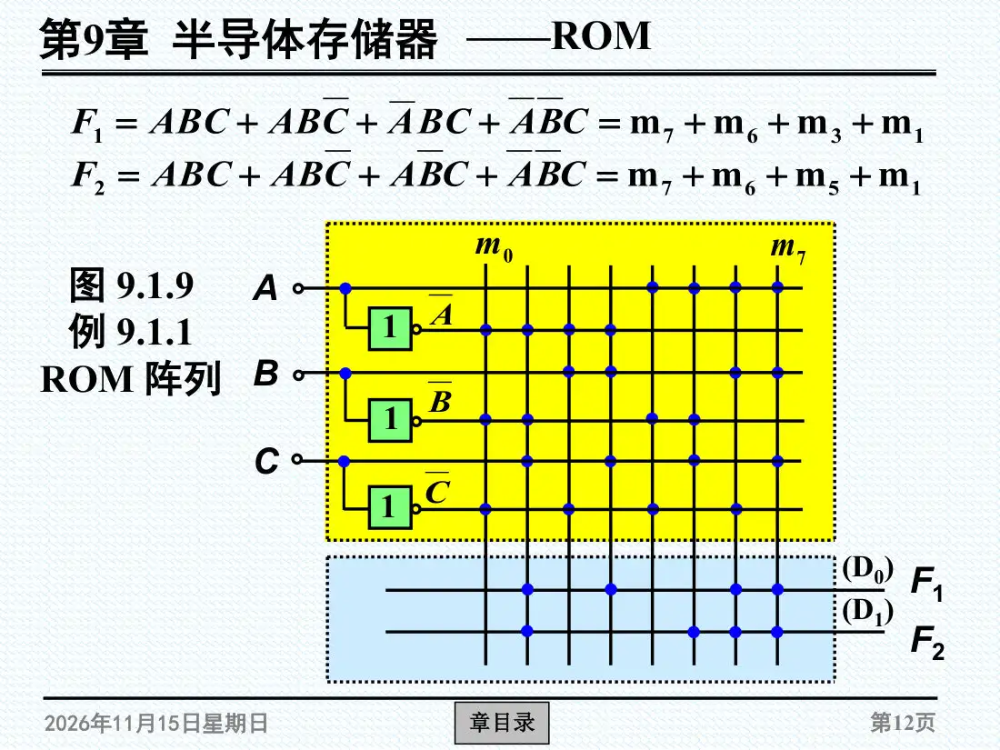

原文：

第9章 半导体存储器 ——ROM

$$
\begin{array}{l} F _ {1} = A B C + A B \overline {{C}} + \overline {{A}} B C + \overline {{A}} \overline {{B}} C = \mathbf {m} _ {7} + \mathbf {m} _ {6} + \mathbf {m} _ {3} + \mathbf {m} _ {1} \\ F _ {2} = A B C + A B \overline {{C}} + A \overline {{B}} C + \overline {{A}} \overline {{B}} C = \mathbf {m} _ {7} + \mathbf {m} _ {6} + \mathbf {m} _ {5} + \mathbf {m} _ {1} \end{array}
$$

2026年11月15日星期日

章目录

第12页

### 第9章 半导体存储器 ——ROM wwwwk

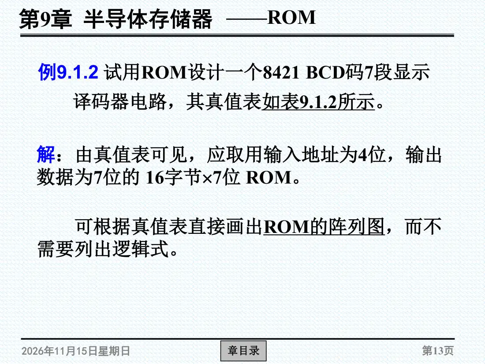

原文：

第9章 半导体存储器 ——ROM wwwwk

例9.1.2 试用ROM设计一个8421 BCD码7段显示译码器电路，其真值表如表9.1.2所示。

解：由真值表可见，应取用输入地址为4位，输出数据为7位的 16字节7位ROM。

可根据真值表直接画出ROM的阵列图，而不需要列出逻辑式。

2026年11月15日星期日

章目录

第13页

### 第9章 半导体存储器 ——ROM

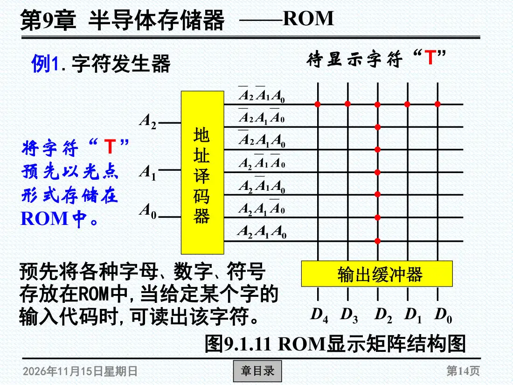

原文：

第9章 半导体存储器 ——ROM

例1.字符发生器

将字符“T”预先以光点形式存储在ROM中。

地
址
译
码
器

预先将各种字母、数字、符号存放在ROM中,当给定某个字的输入代码时,可读出该字符。

图9.1.11 ROM显示矩阵结构图

2026年11月15日星期日

章目录

第14页

### 第9章 半导体存储器 ——ROM

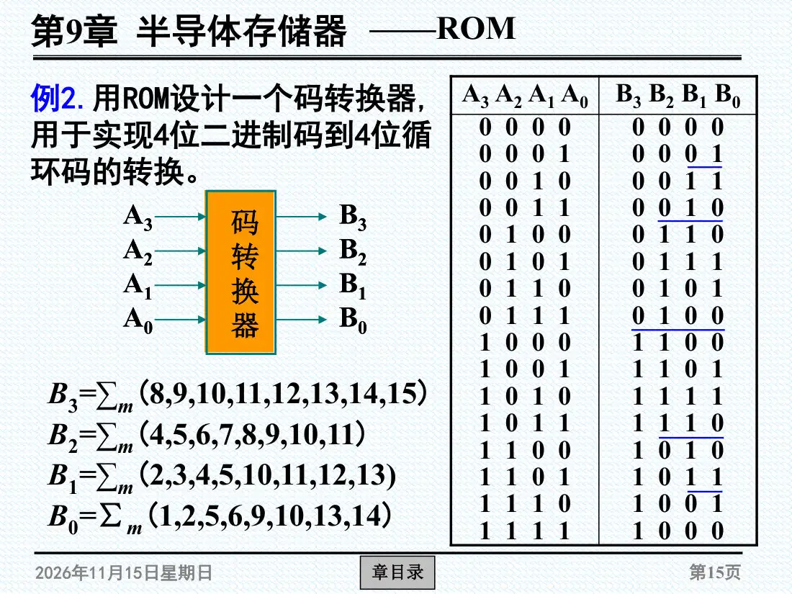

原文：

第9章 半导体存储器 ——ROM

例2.用ROM设计一个码转换器,用于实现4位二进制码到4位循环码的转换。

$$
\begin{array}{c} \mathbf {A} _ {3} \\ \mathbf {A} _ {2} \\ \mathbf {A} _ {1} \\ \mathbf {A} _ {0} \end{array}
$$

$$
\begin{array}{c} \text { B } _ {3} \\ \text { B } _ {2} \\ \text { B } _ {1} \\ \text { B } _ {0} \end{array}
$$

$$
\begin{array}{l} B _ {3} = \sum_ {m} (8, 9, 1 0, 1 1, 1 2, 1 3, 1 4, 1 5) \\ B _ {2} = \sum_ {m} (4, 5, 6, 7, 8, 9, 1 0, 1 1) \\ B _ {1} = \sum_ {m} (2, 3, 4, 5, 1 0, 1 1, 1 2, 1 3) \\ B _ {0} = \sum_ {m} (1, 2, 5, 6, 9, 1 0, 1 3, 1 4) \end{array}
$$

<table><tr><td> $A_3$   $A_2$   $A_1$   $A_0$ </td><td> $B_3$   $B_2$   $B_1$   $B_0$ </td></tr><tr><td>0 0 0 0</td><td>0 0 0 0</td></tr><tr><td>0 0 0 1</td><td>0 0 0 1</td></tr><tr><td>0 0 1 0</td><td>0 0 1 1</td></tr><tr><td>0 0 1 1</td><td>0 0 1 0</td></tr><tr><td>0 1 0 0</td><td>0 1 1 0</td></tr><tr><td>0 1 0 1</td><td>0 1 1 1</td></tr><tr><td>0 1 1 0</td><td>0 1 0 1</td></tr><tr><td>0 1 1 1</td><td>0 1 0 0</td></tr><tr><td>1 0 0 0</td><td>1 1 0 0</td></tr><tr><td>1 0 0 1</td><td>1 1 0 1</td></tr><tr><td>1 0 1 0</td><td>1 1 1 1</td></tr><tr><td>1 0 1 1</td><td>1 1 1 0</td></tr><tr><td>1 1 0 0</td><td>1 0 1 0</td></tr><tr><td>1 1 0 1</td><td>1 0 1 1</td></tr><tr><td>1 1 1 0</td><td>1 0 0 1</td></tr><tr><td>1 1 1 1</td><td>1 0 0 0</td></tr></table>

2026年11月15日星期日

章目录

第15页

### 第9章 半导体存储器 ROMwwk

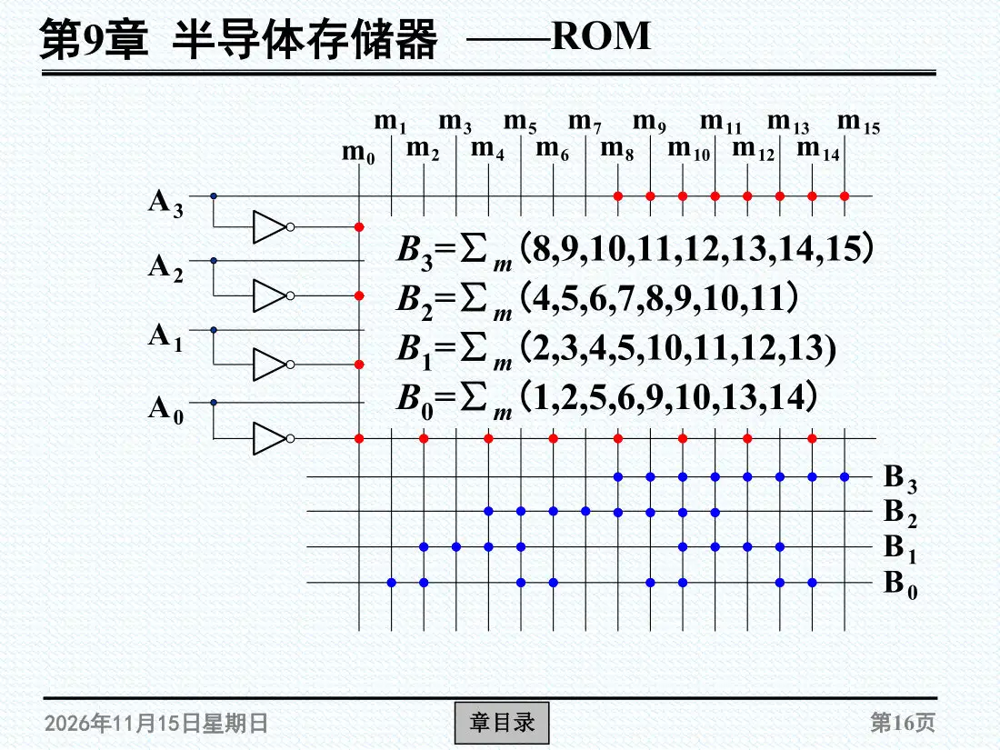

原文：

第9章 半导体存储器 ROMwwk

<table><tr><td rowspan="2">m0</td><td rowspan="2">m1</td><td rowspan="2">m2</td><td rowspan="2">m3</td><td rowspan="2">m4</td><td rowspan="2">m5</td><td rowspan="2">m6</td><td rowspan="2">m7</td><td rowspan="2">m8</td><td rowspan="2">m9</td><td rowspan="2">m10</td><td rowspan="2">m11</td><td rowspan="2">m12</td><td rowspan="2">m13</td><td rowspan="2">m14</td><td rowspan="2">m15</td></tr><tr></tr><tr><td colspan="16"></td></tr><tr><td colspan="16"></td></tr><tr><td colspan="16"></td></tr><tr><td colspan="16"></td></tr><tr><td colspan="16"></td></tr><tr><td colspan="16"></td></tr></table>

2026年11月15日星期日

章目录

第16页

### 第9章 半导体存储器 ——ROM wwwwk

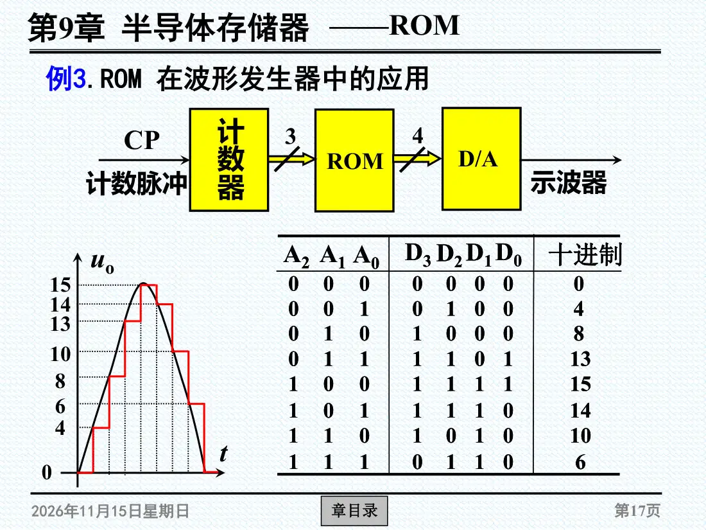

原文：

第9章 半导体存储器 ——ROM wwwwk

例3.ROM 在波形发生器中的应用

CP 计数脉冲

计
数
器

示波器

<table><tr><td> $A_2$ </td><td> $A_1$ </td><td> $A_0$ </td><td> $D_3$ </td><td> $D_2$ </td><td> $D_1$ </td><td> $D_0$ </td><td>十进制</td></tr><tr><td>0</td><td>0</td><td>0</td><td>0</td><td>0</td><td>0</td><td>0</td><td>0</td></tr><tr><td>0</td><td>0</td><td>1</td><td>0</td><td>1</td><td>0</td><td>0</td><td>4</td></tr><tr><td>0</td><td>1</td><td>0</td><td>1</td><td>0</td><td>0</td><td>0</td><td>8</td></tr><tr><td>0</td><td>1</td><td>1</td><td>1</td><td>1</td><td>0</td><td>1</td><td>13</td></tr><tr><td>1</td><td>0</td><td>0</td><td>1</td><td>1</td><td>1</td><td>1</td><td>15</td></tr><tr><td>1</td><td>0</td><td>1</td><td>1</td><td>1</td><td>1</td><td>0</td><td>14</td></tr><tr><td>1</td><td>1</td><td>0</td><td>1</td><td>0</td><td>1</td><td>0</td><td>10</td></tr><tr><td>1</td><td>1</td><td>1</td><td>0</td><td>1</td><td>1</td><td>0</td><td>6</td></tr></table>

2026年11月15日星期日

章目录

第17页

### 第9章 半导体存储器 ——ROM

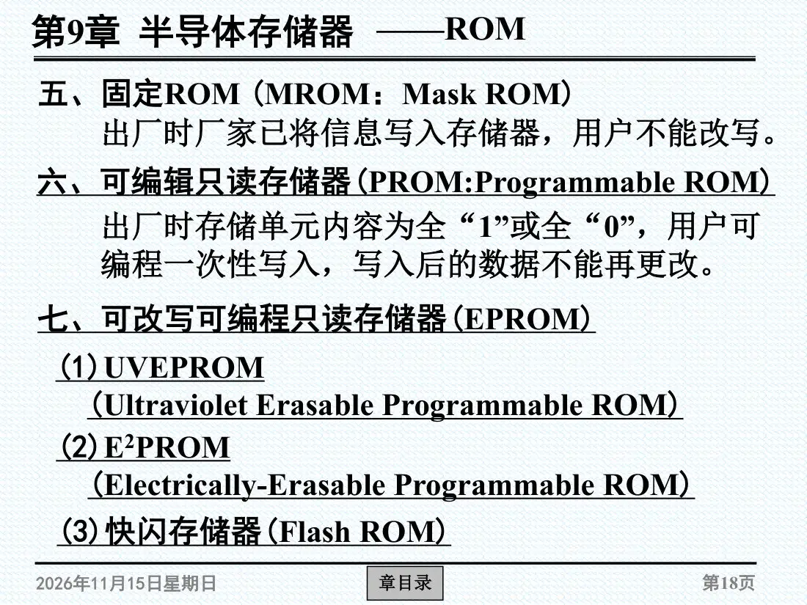

原文：

第9章 半导体存储器 ——ROM

五、固定ROM (MROM：Mask ROM)

出厂时厂家已将信息写入存储器，用户不能改写。

六、可编辑只读存储器(PROM:Programmable ROM)

出厂时存储单元内容为全“1”或全“0”，用户可编程一次性写入，写入后的数据不能再更改。

七、可改写可编程只读存储器(EPROM)

(1)UVEPROM (Ultraviolet Erasable Programmable ROM)

(2)E2PROM (Electrically-Erasable Programmable ROM)

(3)快闪存储器(Flash ROM)

2026年11月15日星期日

章目录

第18页

### 第9章 半导体存储器

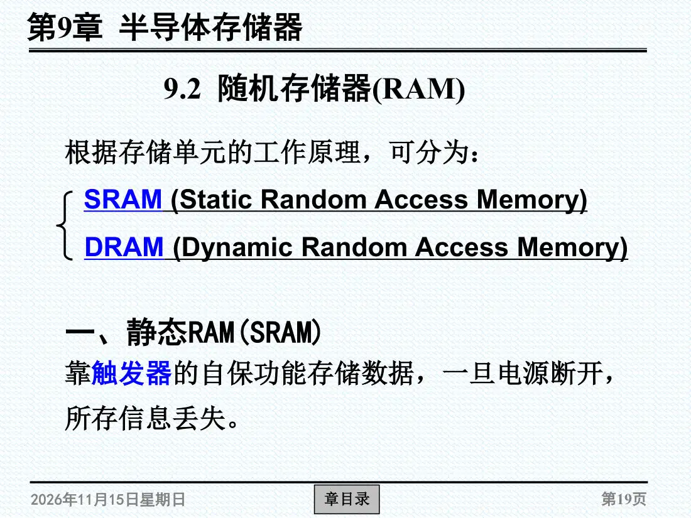

原文：

第9章 半导体存储器

9.2 随机存储器(RAM)

根据存储单元的工作原理，可分为：

SRAM (Static Random Access Memory) DRAM (Dynamic Random Access Memory)

静态RAM(SRAM)

靠触发器的自保功能存储数据，一旦电源断开，所存信息丢失。

2026年11月15日星期日

章目录

第19页

### 第9章 半导体存储器 RA 23=8

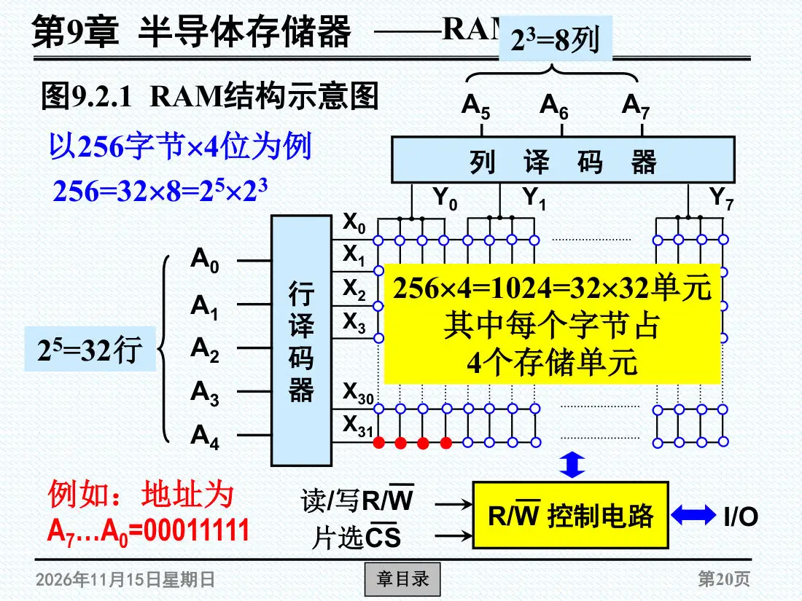

原文：

第9章 半导体存储器 RA 23=8

图9.2.1 RAM结构示意图以256字节4位为例$2 5 6 { = } 3 2 { \times } 8 { = } 2 ^ { 5 } { \times } 2 ^ { 3 }$

$2 ^ { 5 } { = } 3 2$ 行

行
译
码
器

$$
\left\{ \begin{array}{c} A _ {0} \\ A _ {1} \\ A _ {2} \\ A _ {3} \\ A _ {4} \end{array} \right.
$$

$2 5 6 \times 4 = 1 0 2 4 = 3 2 \times 3 2$ 单元其中每个字节占4个存储单元

例如：地址为$\mathsf { A } _ { 7 } \ldots \mathsf { A } _ { 0 } = 0 0 0 1 1 1 1 1 1 1$ 读/写R/W片选CS

R/W 控制电路

2026年11月15日星期日

章目录

第20页

### 第9章 半导体存储器 ——RAM

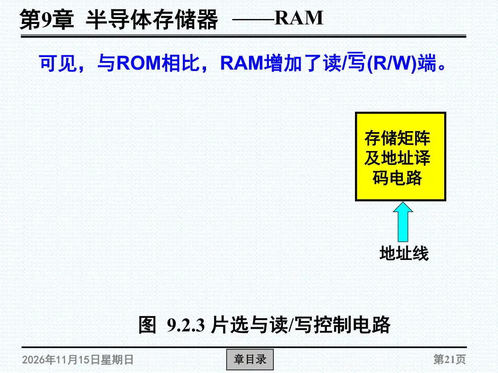

原文：

第9章 半导体存储器 ——RAM

可见，与ROM相比，RAM增加了读/写(R/W)端。

2026年11月15日星期日

第21页

### 第9章 半导体存储器 RAM

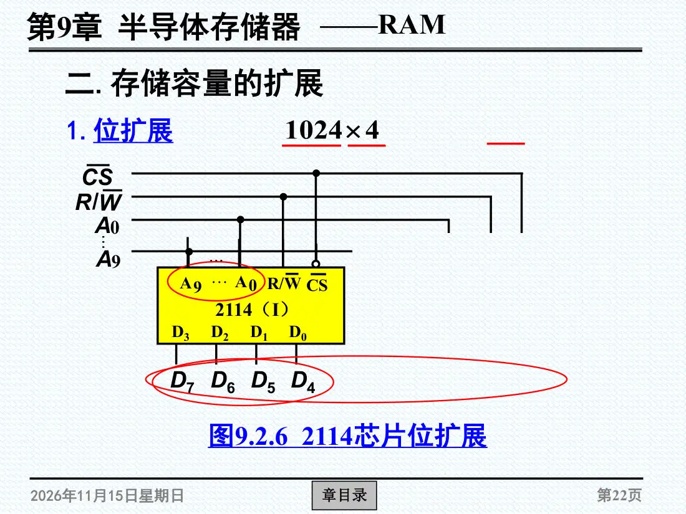

原文：

第9章 半导体存储器 RAM

二.存储容量的扩展

1.位扩展

2026年11月15日星期日

章目录

第22页

### 第9章 半导体存储器 ——RAM

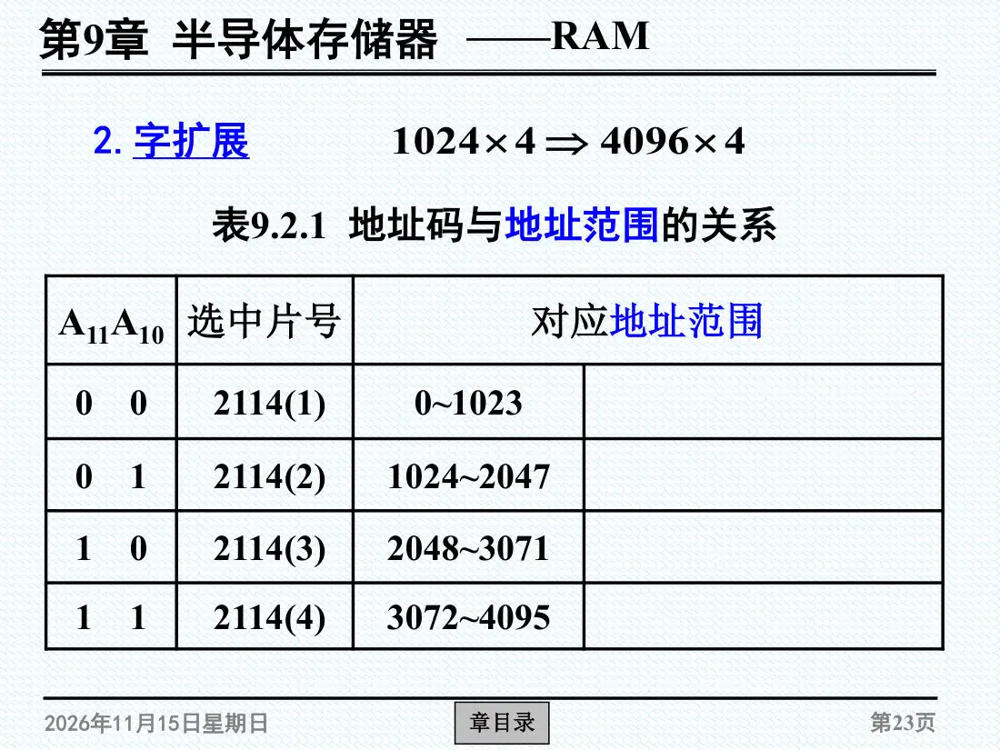

原文：

第9章 半导体存储器 ——RAM

2.字扩展

$$
1 0 2 4 \times 4 \Rightarrow 4 0 9 6 \times 4
$$

表9.2.1 地址码与地址范围的关系
<table><tr><td> $A_{11}A_{10}$ </td><td>选中片号</td><td colspan="2">对应地址范围</td></tr><tr><td>0 0</td><td>2114(1)</td><td>0~1023</td><td></td></tr><tr><td>0 1</td><td>2114(2)</td><td>1024~2047</td><td></td></tr><tr><td>1 0</td><td>2114(3)</td><td>2048~3071</td><td></td></tr><tr><td>1 1</td><td>2114(4)</td><td>3072~4095</td><td></td></tr></table>

2026年11月15日星期日

章目录

第23页

### 第9章 半导体存储器 ——RAM

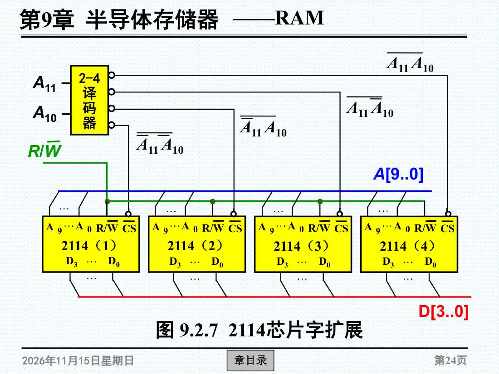

原文：

第9章 半导体存储器 ——RAM

2026年11月15日星期日

第24页

### 第9章 半导体存储器 ——RAM

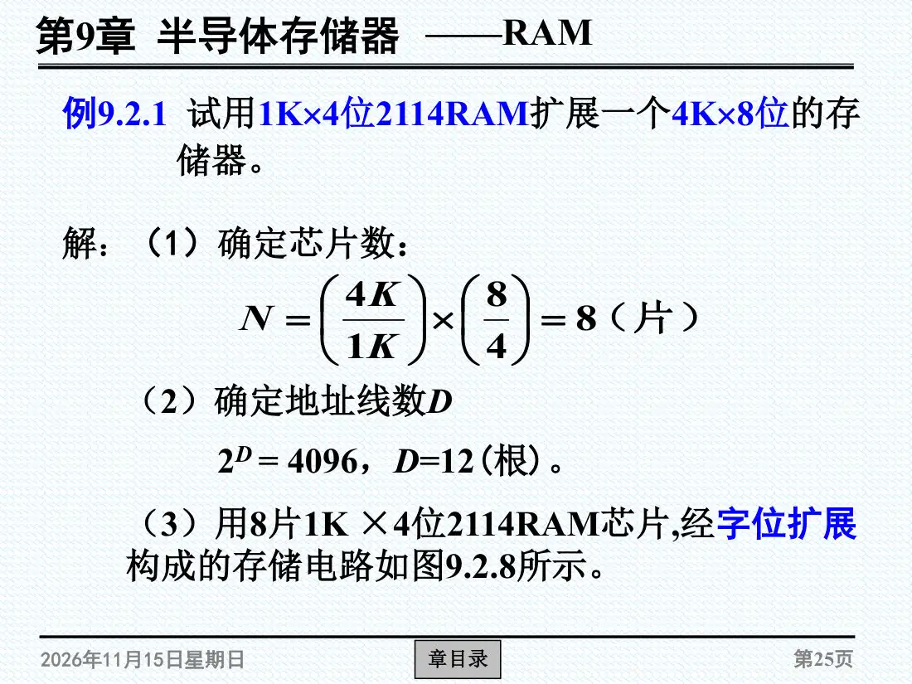

原文：

第9章 半导体存储器 ——RAM

例9.2.1 试用1K×4位2114RAM扩展一个4K×8位的存储器。

解：（1）确定芯片数：

$$
N = \left(\frac {4 K}{1 K}\right) \times \left(\frac {8}{4}\right) = 8 (\text {片})
$$

（2）确定地址线数D

2D = 4096，D=12(根)。

（3）用8片1K ×4位2114RAM芯片,经字位扩展构成的存储电路如图9.2.8所示。

2026年11月15日星期日

章目录

第25页

### 第9章 半导体存储器 RAM

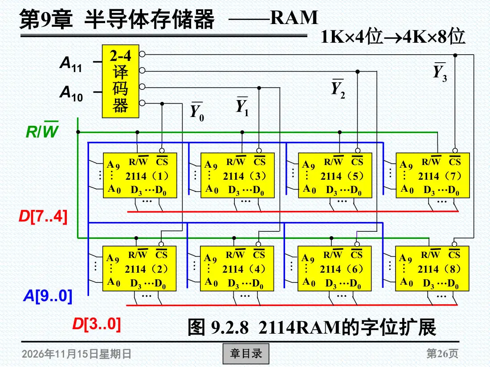

原文：

第9章 半导体存储器 RAM

2026年11月15日星期日

章目录

第26页

### 第9章 半导体存储器 ——RAM

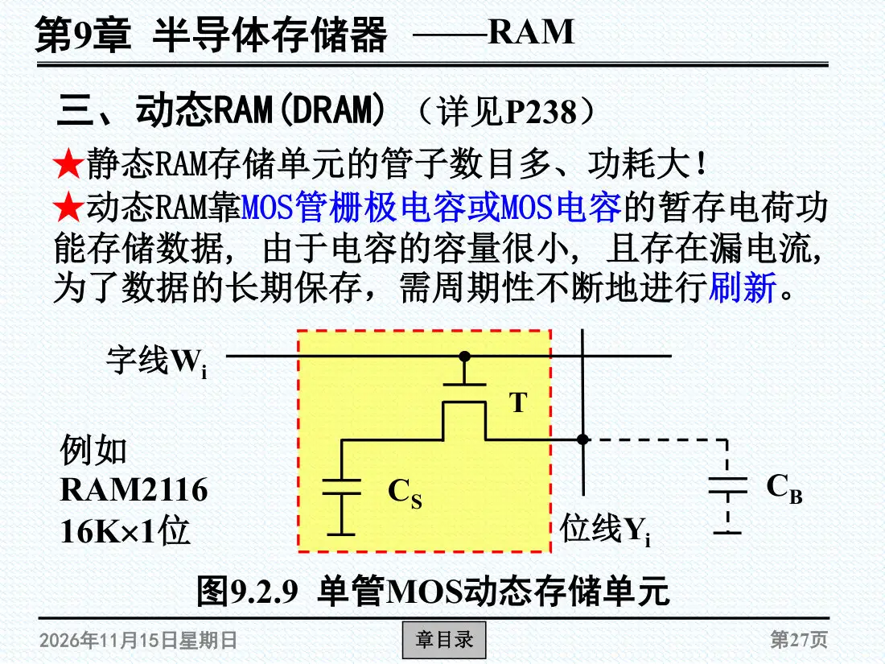

原文：

第9章 半导体存储器 ——RAM

三、动态RAM(DRAM) （详见P238）

★静态RAM存储单元的管子数目多、功耗大！

★动态RAM靠MOS管栅极电容或MOS电容的暂存电荷功能存储数据, 由于电容的容量很小, 且存在漏电流,为了数据的长期保存，需周期性不断地进行刷新。

2026年11月15日星期日

章目录

第27页

### 第9章 半导体存储器

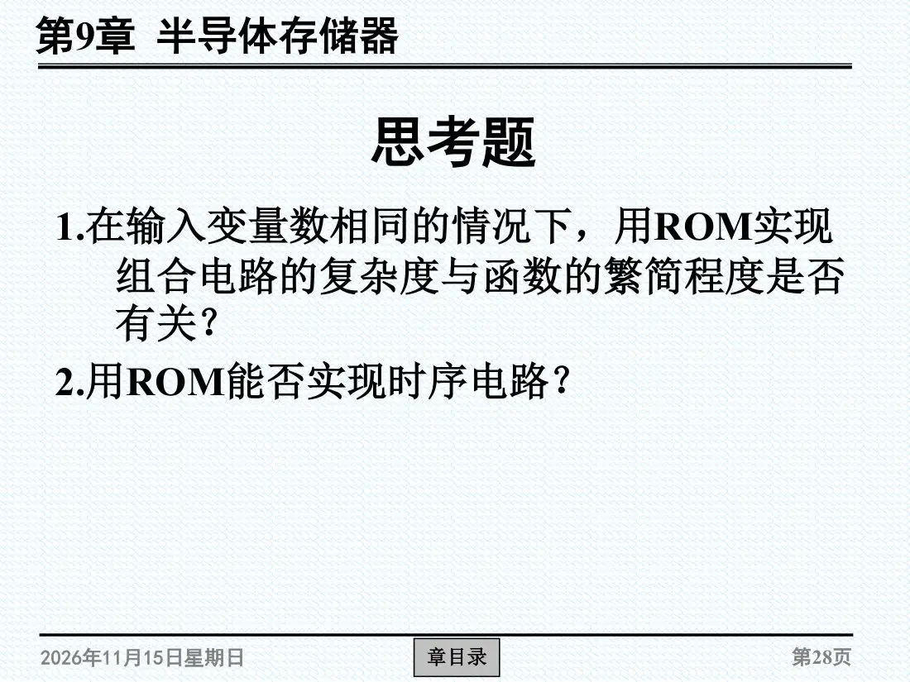

原文：

第9章 半导体存储器

思考题

1.在输入变量数相同的情况下，用ROM实现组合电路的复杂度与函数的繁简程度是否有关？

2.用ROM能否实现时序电路？

2026年11月15日星期日

章目录

第28页

### 第9章 半导体存储器

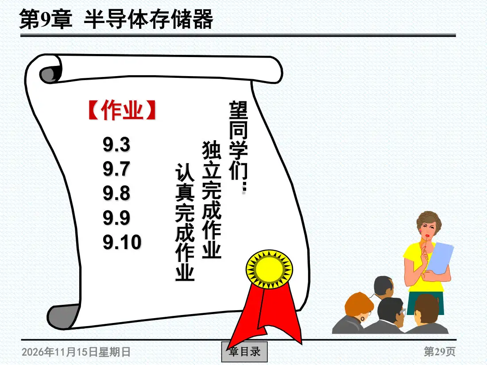

原文：

第9章 半导体存储器

望同学们：

独立完成作业

认真完成作业

2026年11月15日星期日

章目录

第29页

### 第9章 半导体存储器

原文：

第9章 半导体存储器

只读存储器（ROM）的应用

主板BIOS ，也称系统BIOS。

电脑主板BIOS主要有Award BIOS、AMI BIOS和 Phoenix BIOS三种，包含加电自检程序POST（Power On Self Test）、CMOS Setup程序和中断服务子程序。

486及以前电脑的BIOS使用EPROM芯片。

现在的主板BIOS几乎都采用Flash ROM

2026年11月15日星期日

章目录

第30页

### 第9章 半导体存储器

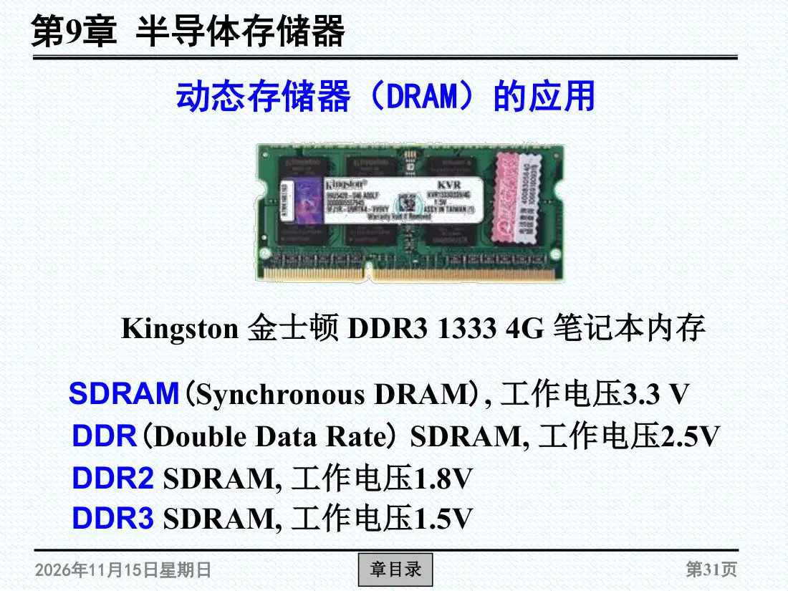

原文：

第9章 半导体存储器

动态存储器（DRAM）的应用

SDRAM(Synchronous DRAM), 工作电压3.3 VDDR(Double Data Rate) SDRAM, 工作电压2.5VDDR2 SDRAM, 工作电压1.8VDDR3 SDRAM, 工作电压1.5V

2026年11月15日星期日

章目录

第31页

### 第9章 半导体存储器

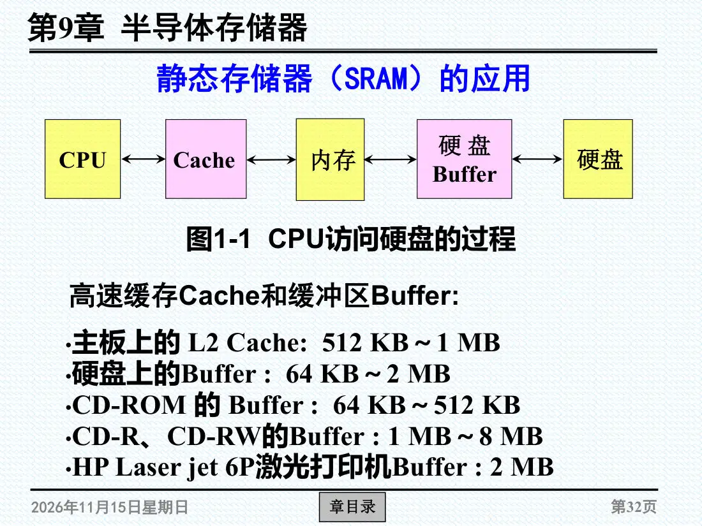

原文：

第9章 半导体存储器

高速缓存Cache和缓冲区Buffer:

•主板上的 L2 Cache: 512 KB～1 MB•硬盘上的Buffer : 64 KB～2 MB•CD-ROM 的 Buffer : 64 KB～512 KB•CD-R、CD-RW的Buffer : 1 MB～8 MB•HP Laser jet 6P激光打印机Buffer : 2 MB

2026年11月15日星期日

章目录

第32页

### 第9章 半导体存储器

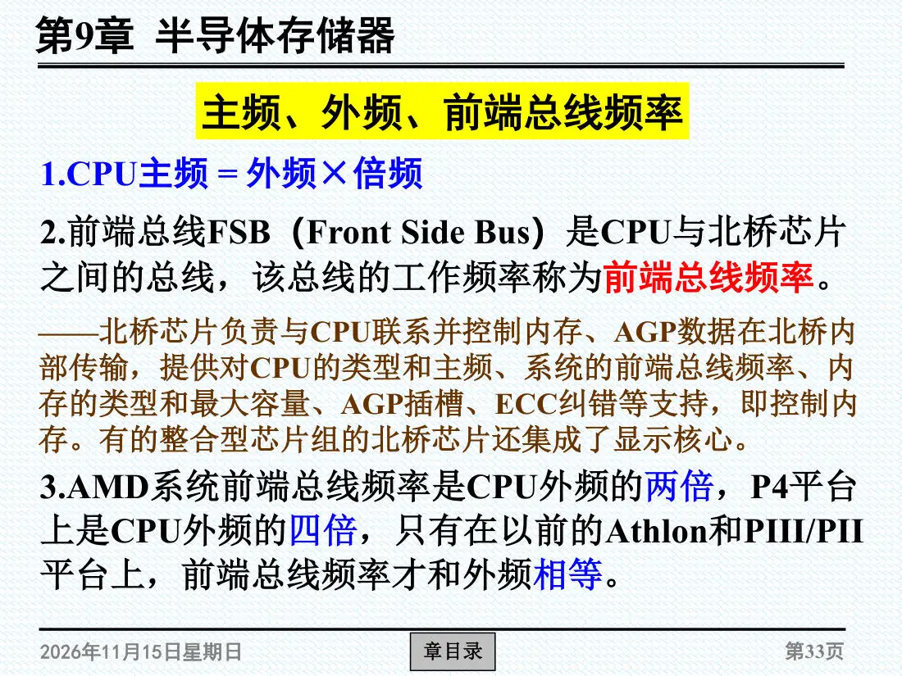

原文：

第9章 半导体存储器

主频、外频、前端总线频率

1.CPU主频 = 外频×倍频

2.前端总线FSB（Front Side Bus）是CPU与北桥芯片之间的总线，该总线的工作频率称为前端总线频率。

北桥芯片负责与CPU联系并控制内存、AGP数据在北桥内部传输，提供对CPU的类型和主频、系统的前端总线频率、内存的类型和最大容量、AGP插槽、ECC纠错等支持，即控制内存。有的整合型芯片组的北桥芯片还集成了显示核心。

3.AMD系统前端总线频率是CPU外频的两倍，P4平台上是CPU外频的四倍，只有在以前的Athlon和PIII/PII平台上，前端总线频率才和外频相等。

2026年11月15日星期日

章目录

第33页

### 第9章 半导体存储器 ——ROM

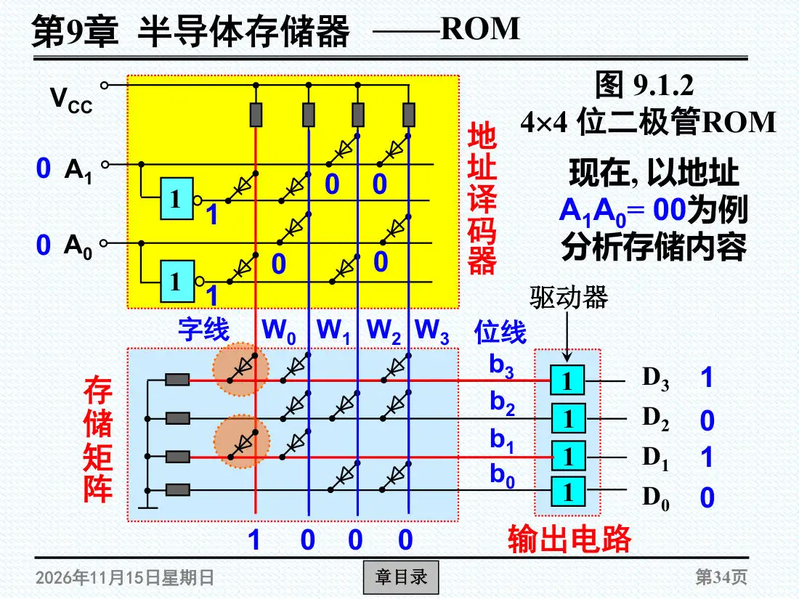

原文：

第9章 半导体存储器 ——ROM

图 9.1.2

44 位二极管ROM现在, 以地址A A = 00为例分析存储内容

驱动器

2026年11月15日星期日

章目录

第34页

### 第9章 半导体存储器 ——ROM wwwwk

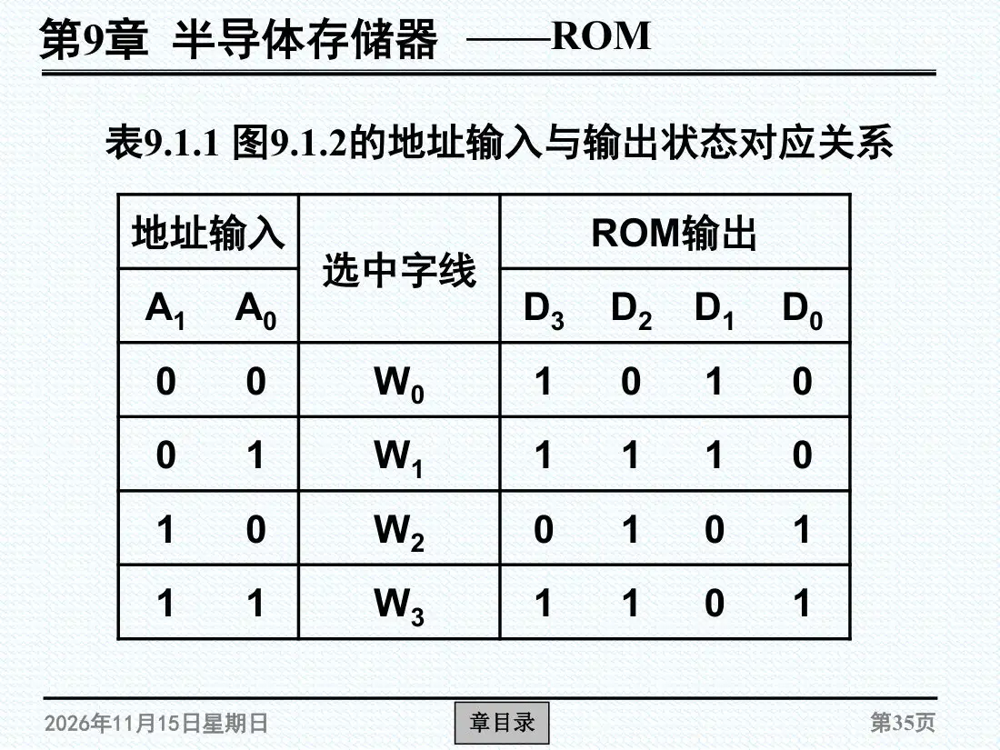

原文：

第9章 半导体存储器 ——ROM wwwwk

表9.1.1 图9.1.2的地址输入与输出状态对应关系
<table><tr><td colspan="2">地址输入</td><td rowspan="2">选中字线</td><td colspan="4">ROM输出</td></tr><tr><td> $A_1$ </td><td> $A_0$ </td><td> $D_3$ </td><td> $D_2$ </td><td> $D_1$ </td><td> $D_0$ </td></tr><tr><td>0</td><td>0</td><td> $W_0$ </td><td>1</td><td>0</td><td>1</td><td>0</td></tr><tr><td>0</td><td>1</td><td> $W_1$ </td><td>1</td><td>1</td><td>1</td><td>0</td></tr><tr><td>1</td><td>0</td><td> $W_2$ </td><td>0</td><td>1</td><td>0</td><td>1</td></tr><tr><td>1</td><td>1</td><td> $W_3$ </td><td>1</td><td>1</td><td>0</td><td>1</td></tr></table>

2026年11月15日星期日

章目录

第35页

### 第9章 半导体存储器 ——ROM

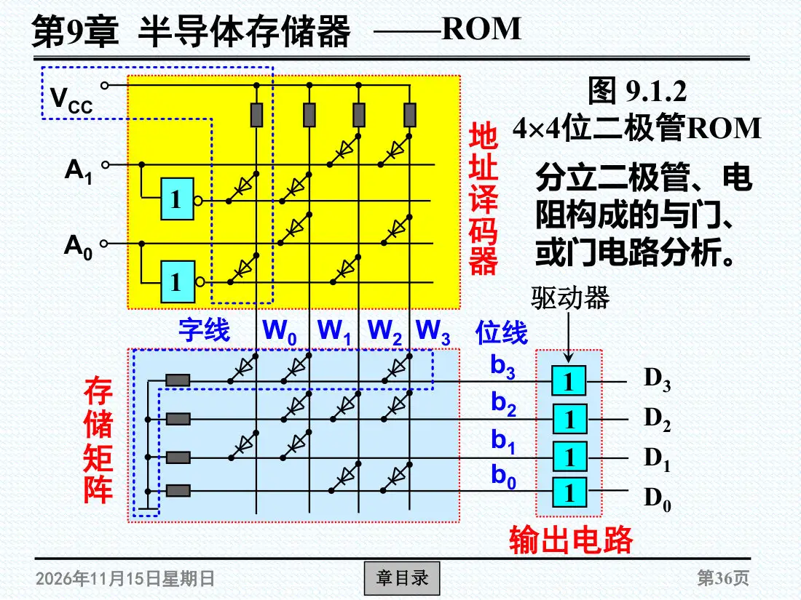

原文：

第9章 半导体存储器 ——ROM

44位二极管ROM分立二极管、电阻构成的与门、或门电路分析。

驱动器

输出电路

2026年11月15日星期日

章目录

第36页

### 第9章 半导体存储器 ——ROM

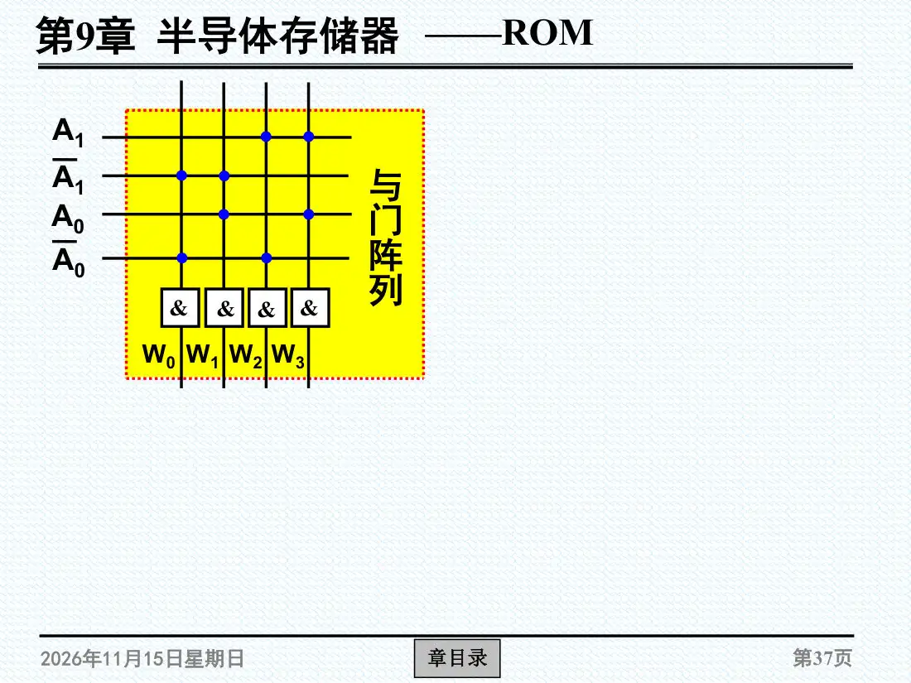

原文：

第9章 半导体存储器 ——ROM

2026年11月15日星期日

章目录

第37页

### 第9章 半导体存储器 ——ROM

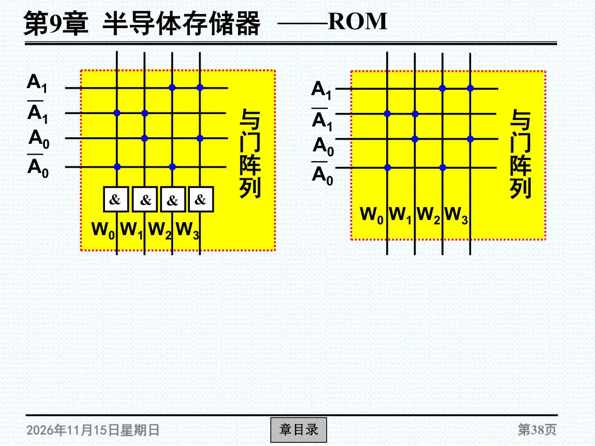

原文：

第9章 半导体存储器 ——ROM

2026年11月15日星期日

章目录

第38页

### 第9章 半导体存储器 ——ROM wwww

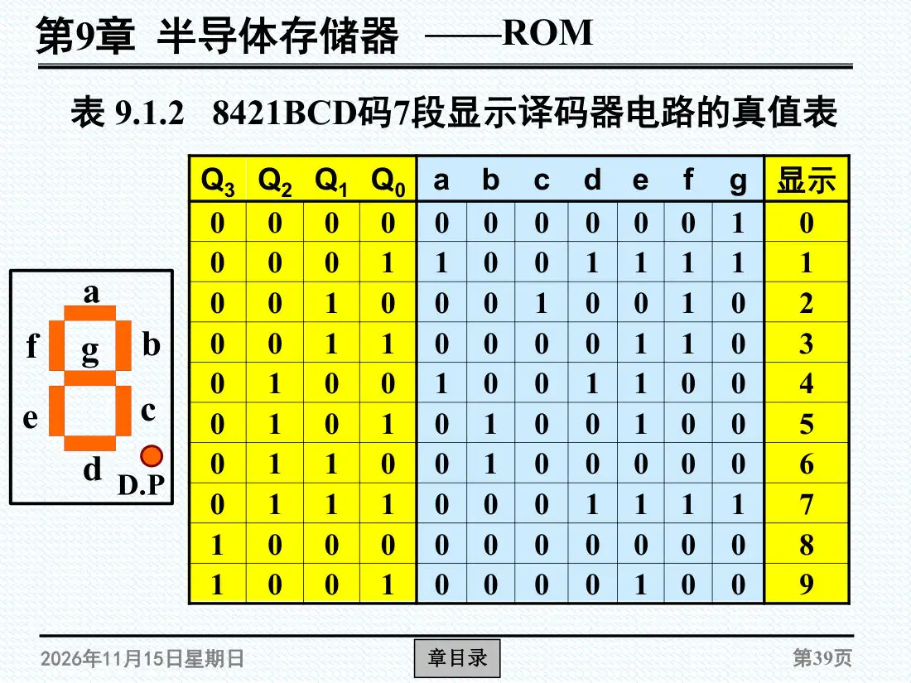

原文：

第9章 半导体存储器 ——ROM wwww

表 9.1.2 8421BCD码7段显示译码器电路的真值表
<table><tr><td>Q3</td><td>Q2</td><td>Q1</td><td>Q0</td><td>a</td><td>b</td><td>c</td><td>d</td><td>e</td><td>f</td><td>g</td><td>显示</td></tr><tr><td>0</td><td>0</td><td>0</td><td>0</td><td>0</td><td>0</td><td>0</td><td>0</td><td>0</td><td>0</td><td>1</td><td>0</td></tr><tr><td>0</td><td>0</td><td>0</td><td>1</td><td>1</td><td>0</td><td>0</td><td>1</td><td>1</td><td>1</td><td>1</td><td>1</td></tr><tr><td>0</td><td>0</td><td>1</td><td>0</td><td>0</td><td>0</td><td>1</td><td>0</td><td>0</td><td>1</td><td>0</td><td>2</td></tr><tr><td>0</td><td>0</td><td>1</td><td>1</td><td>0</td><td>0</td><td>0</td><td>0</td><td>1</td><td>1</td><td>0</td><td>3</td></tr><tr><td>0</td><td>1</td><td>0</td><td>0</td><td>1</td><td>0</td><td>0</td><td>1</td><td>1</td><td>0</td><td>0</td><td>4</td></tr><tr><td>0</td><td>1</td><td>0</td><td>1</td><td>0</td><td>1</td><td>0</td><td>0</td><td>1</td><td>0</td><td>0</td><td>5</td></tr><tr><td>0</td><td>1</td><td>1</td><td>0</td><td>0</td><td>1</td><td>0</td><td>0</td><td>0</td><td>0</td><td>0</td><td>6</td></tr><tr><td>0</td><td>1</td><td>1</td><td>1</td><td>0</td><td>0</td><td>0</td><td>1</td><td>1</td><td>1</td><td>1</td><td>7</td></tr><tr><td>1</td><td>0</td><td>0</td><td>0</td><td>0</td><td>0</td><td>0</td><td>0</td><td>0</td><td>0</td><td>0</td><td>8</td></tr><tr><td>1</td><td>0</td><td>0</td><td>1</td><td>0</td><td>0</td><td>0</td><td>0</td><td>1</td><td>0</td><td>0</td><td>9</td></tr></table>

2026年11月15日星期日

章目录

第39页

### 第9章 半导体存储器 ——ROM

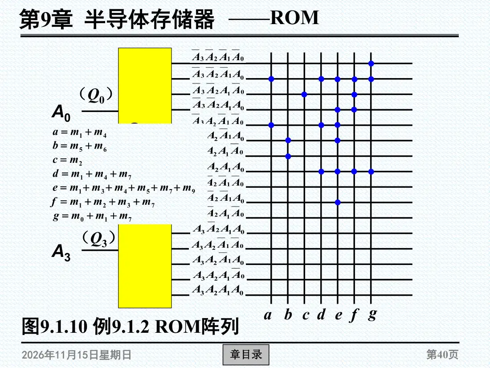

原文：

第9章 半导体存储器 ——ROM

2026年11月15日星期日

章目录

第40页

### 第9章 半导体存储器 ——ROM

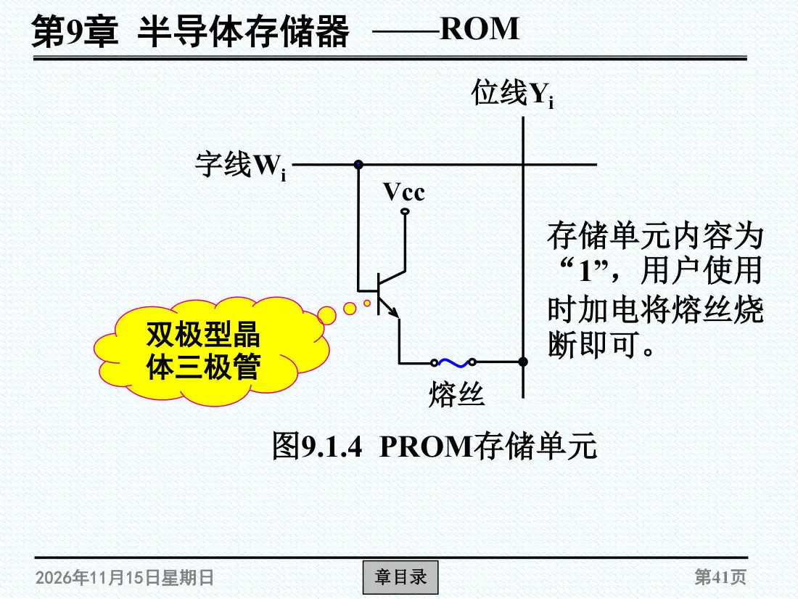

原文：

第9章 半导体存储器 ——ROM

2026年11月15日星期日

章目录

第41页

### 第9章 半导体存储器 ——ROM

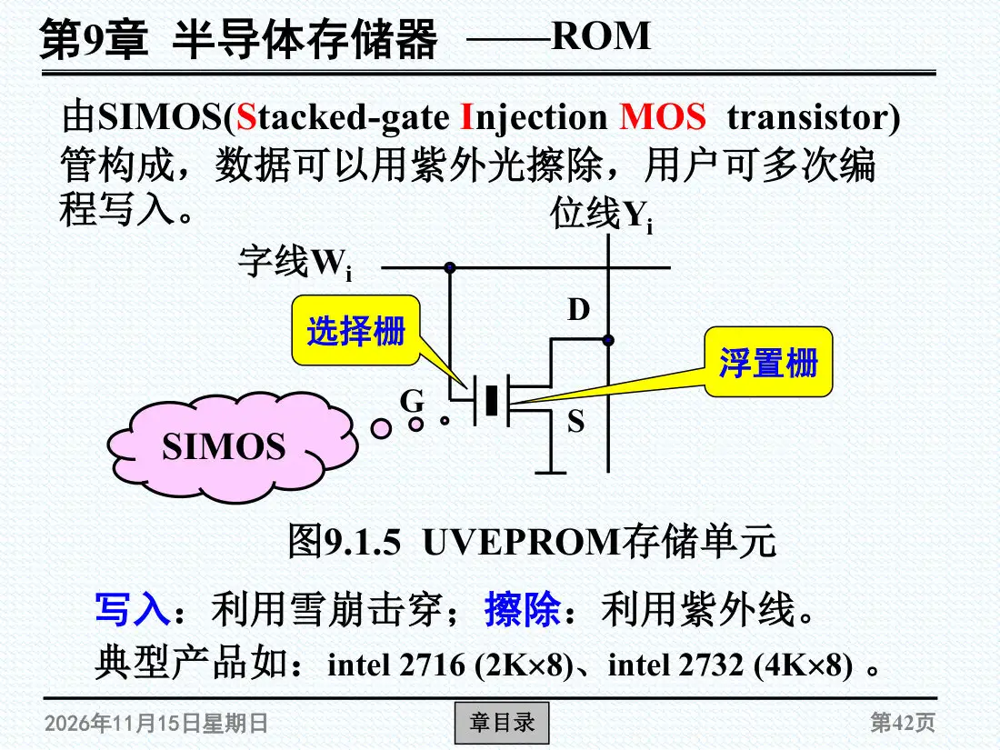

原文：

第9章 半导体存储器 ——ROM

由SIMOS(Stacked-gate Injection MOS transistor)管构成，数据可以用紫外光擦除，用户可多次编程写入。 位线Y

写入：利用雪崩击穿；擦除：利用紫外线。

典型产品如：intel 2716 (2K×8)、intel 2732 (4K×8)。

2026年11月15日星期日

章目录

第42页

### 第9章 半导体存储器 ——ROM

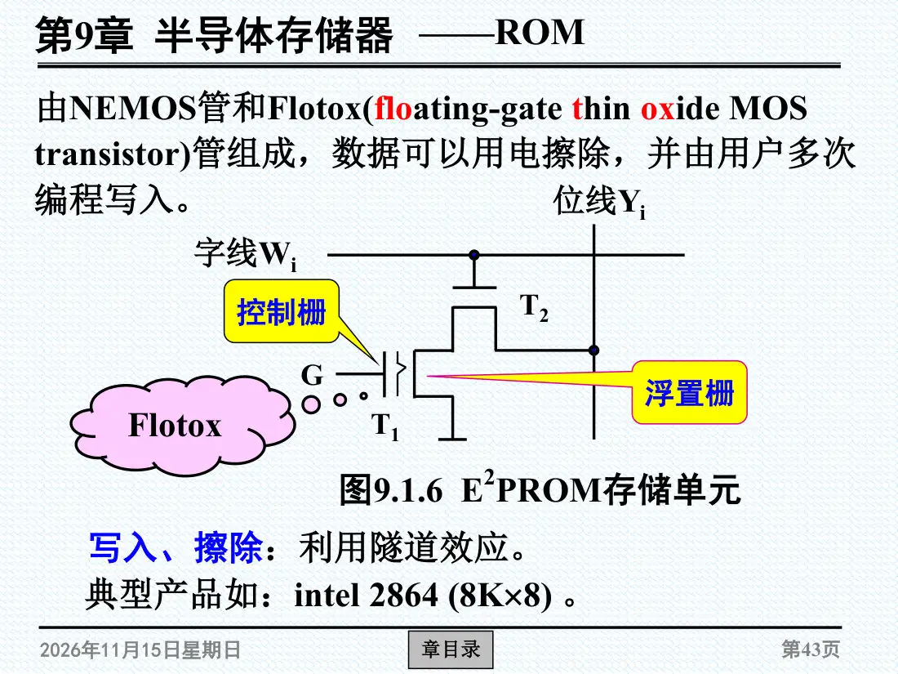

原文：

第9章 半导体存储器 ——ROM

由NEMOS管和Flotox(floating-gate thin oxide MOStransistor)管组成，数据可以用电擦除，并由用户多次编程写入。 位线Y

写入、擦除：利用隧道效应。

典型产品如： $\mathbf { i n t e l } 2 8 6 4 ( 8 \mathsf { K } { \times } 8 )$

2026年11月15日星期日

章目录

第43页

### 字线W

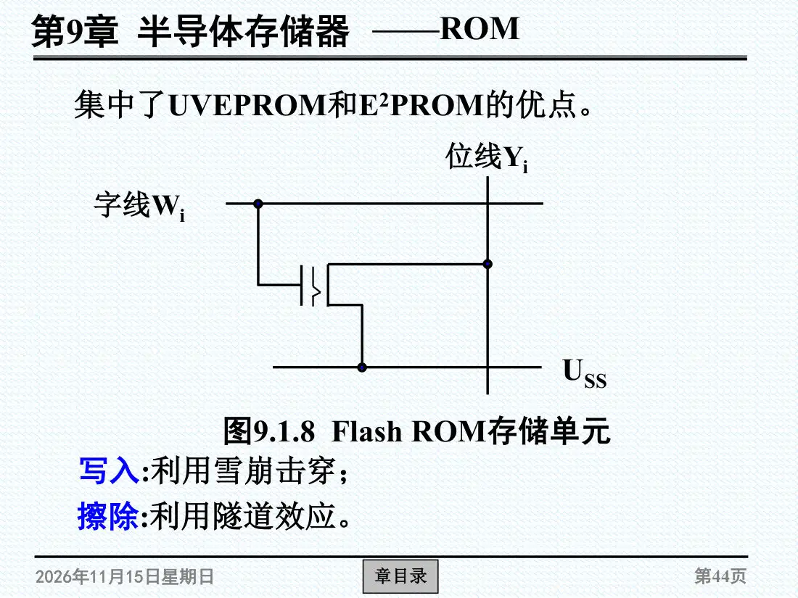

原文：

字线W

第9章 半导体存储器 ——ROM

集中了UVEPROM和E2PROM的优点。

擦除:利用隧道效应。

2026年11月15日星期日

章目录

第44页

### 第9章 半导体存储器

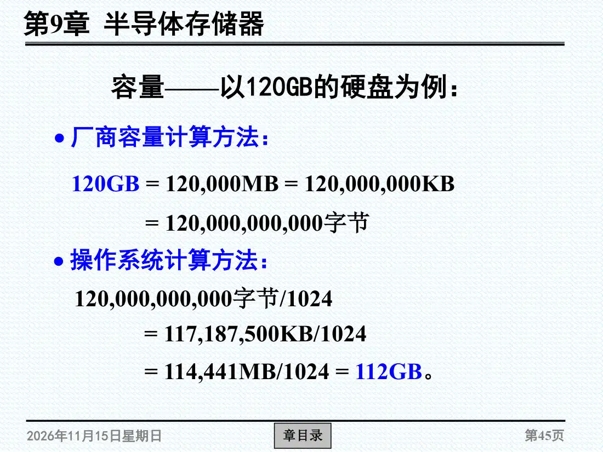

原文：

第9章 半导体存储器

容量——以120GB的硬盘为例：

厂商容量计算方法：

$$
\begin{array}{r l} 1 2 0 \mathrm{GB} & = 1 2 0, 0 0 0 \mathrm{MB} = 1 2 0, 0 0 0, 0 0 0 \mathrm{KB} \\ & = 1 2 0, 0 0 0, 0 0 0, 0 0 0 \text {字节} \end{array}
$$

操作系统计算方法：

120,000,000,000字节/1024 = 117,187,500KB/1024 = 114,441MB/1024 = 112GB。

2026年11月15日星期日

章目录

第45页

### 第9章 半导体存储器图9.2.6 2114芯片位扩展的另两种画法

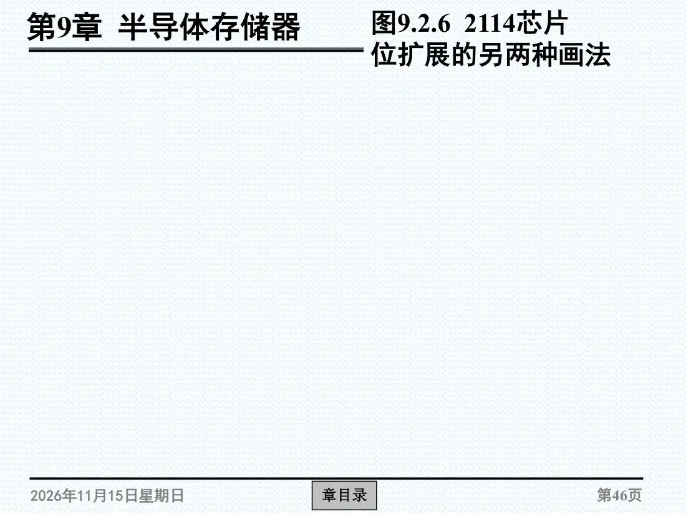

原文：

第9章 半导体存储器图9.2.6 2114芯片位扩展的另两种画法

2026年11月15日星期日

章目录

第46页

### 第9章 半导体存储器 ——RAM

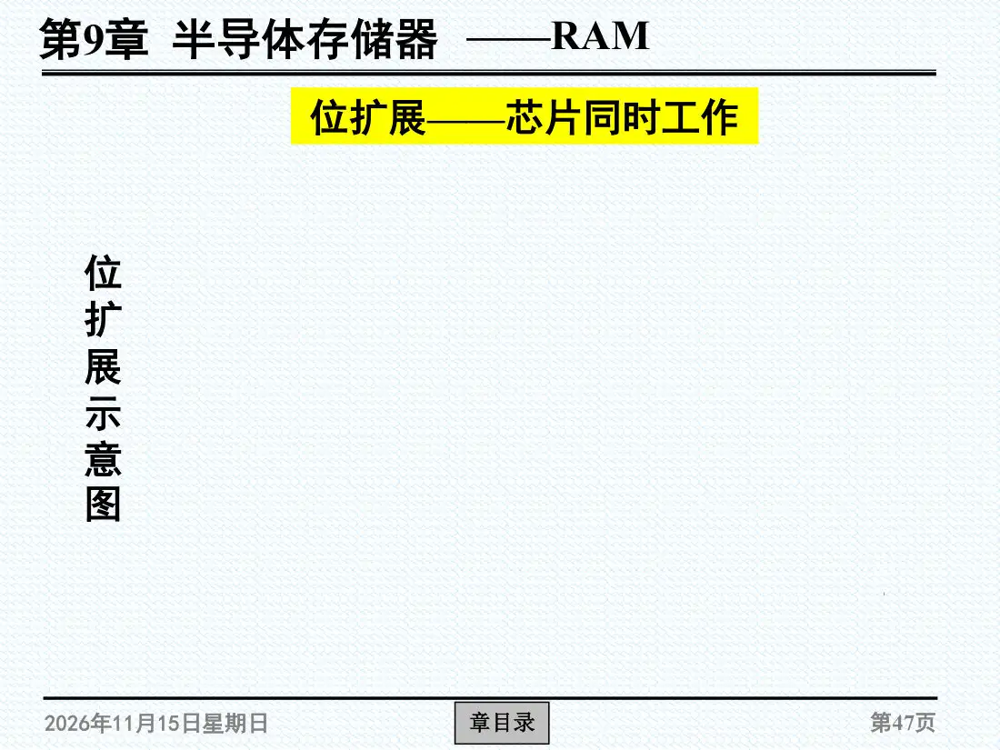

原文：

第9章 半导体存储器 ——RAM

位扩展——芯片同时工作

位
扩
展
示
意
图

2026年11月15日星期日

章目录

第47页

### 第9章 半导体存储器 ——RAM

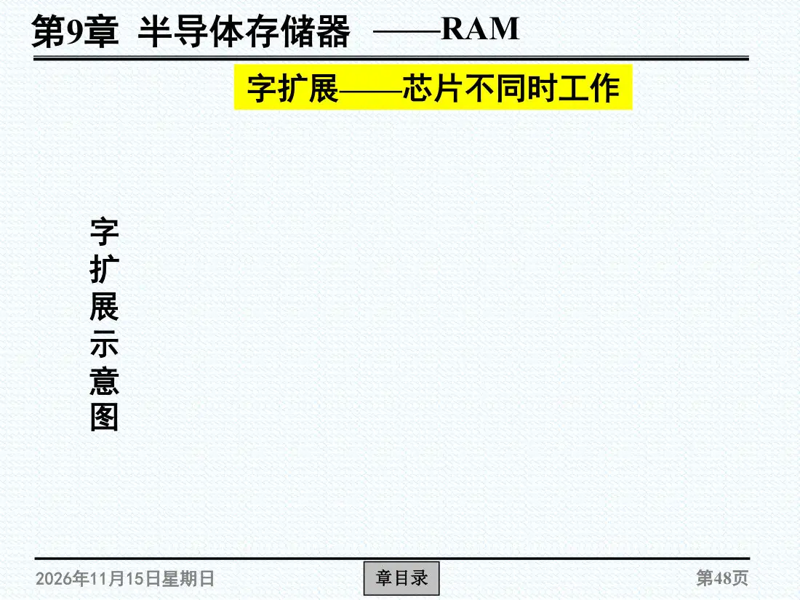

原文：

第9章 半导体存储器 ——RAM

字扩展——芯片不同时工作

字
扩
展
示
意
图

2026年11月15日星期日

章目录

第48页

### 第9章 半导体存储器

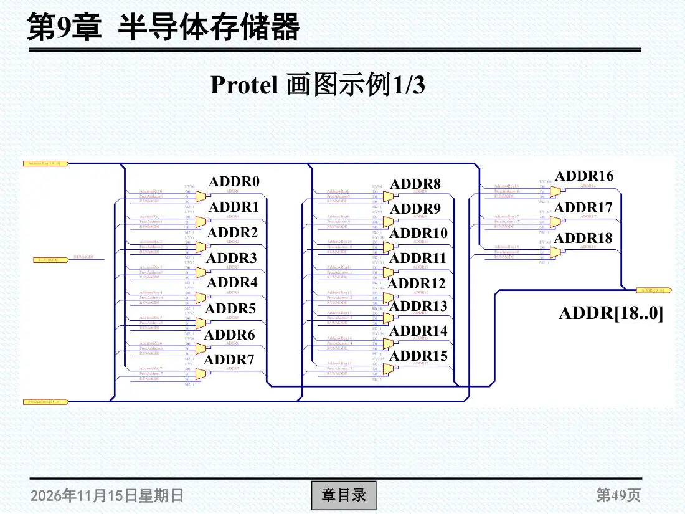

原文：

第9章 半导体存储器

Protel 画图示例1/3

2026年11月15日星期日

章目录

第49页

### 第9章 半导体存储器

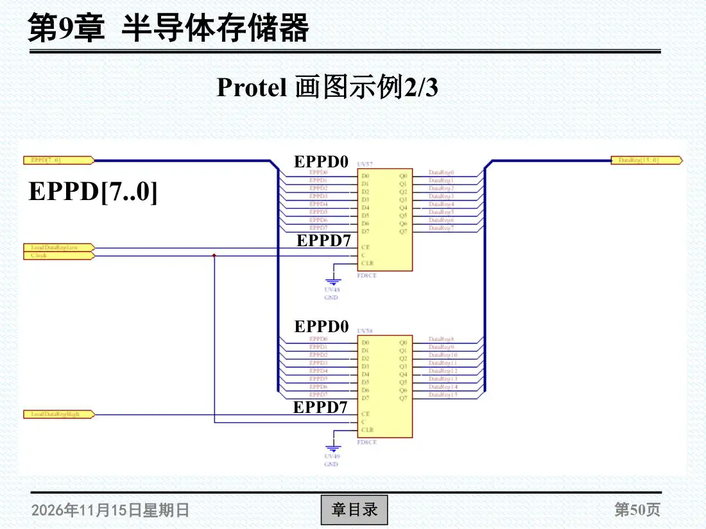

原文：

第9章 半导体存储器

Protel 画图示例2/3

2026年11月15日星期日

章目录

第50页

### Z80ASIO0

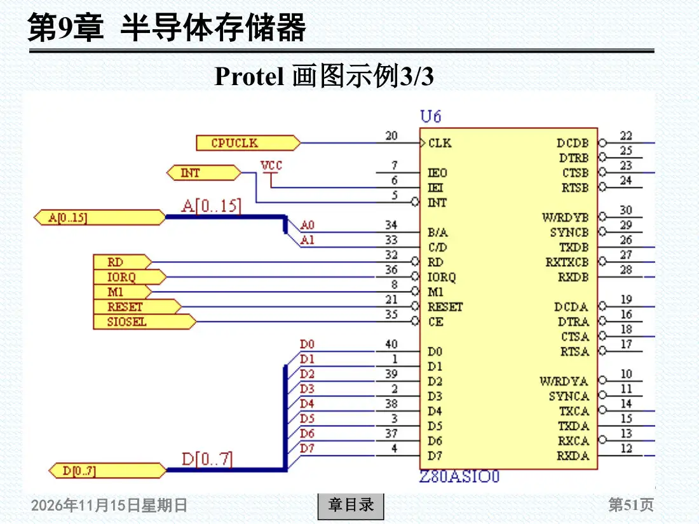

原文：

Z80ASIO0

第9章 半导体存储器

2026年11月15日星期日

章目录

第51页

### 第9章 半导体存储器

原文：

第9章 半导体存储器

北桥、南桥芯片
