# 《数字电路与逻辑设计B》第一章 数制与码制（课件）

原件的每一页，下面附识别出的文字。

### 数字电路与逻辑设计B

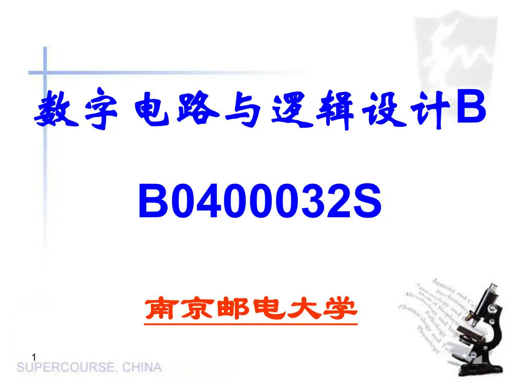

原文：

数字电路与逻辑设计B

B0400032S

南京邮电大学

1
SUPERCOURSE, CHINA

### 施 刚

原文：

施 刚

shig@njupt.edu.cn

2

SUPERCOURSE, CHINA

### 绪论

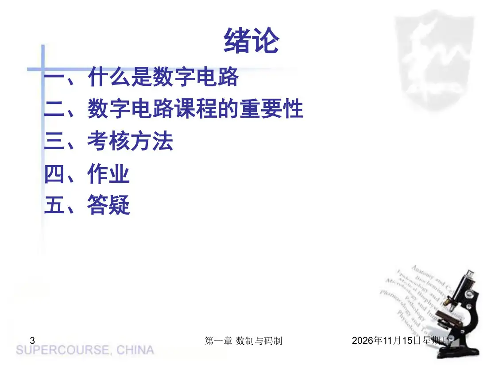

原文：

绪论
一、什么是数字电路
二、数字电路课程的重要性
三、考核方法
四、作业
五、答疑

3

SUPERCOURSE, CHINA

第一章 数制与码制

Anatomy and Cell
biochemistry
Epidemiology and Biotechnology
Medical Biophysics
Microbiology and Immunology
Pathology and Immunology
Pharmacology and Toxicology
Physiology
2026年11月15日星期日

### 一、什么是数字电路？

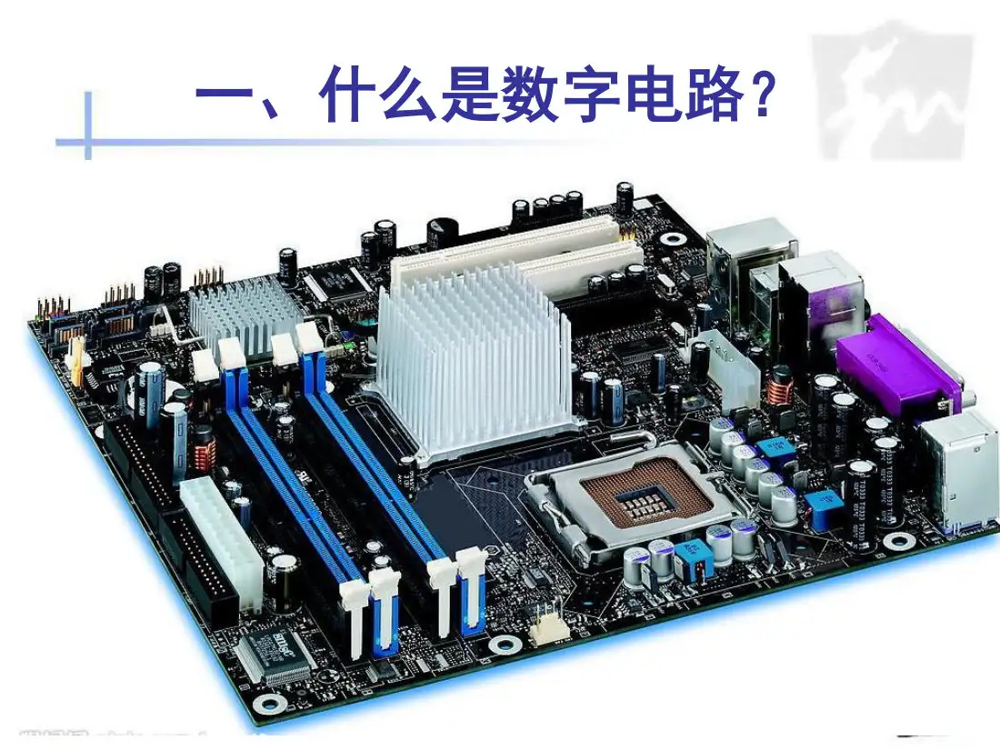

原文：

一、什么是数字电路？

### 一、什么是数字电路？

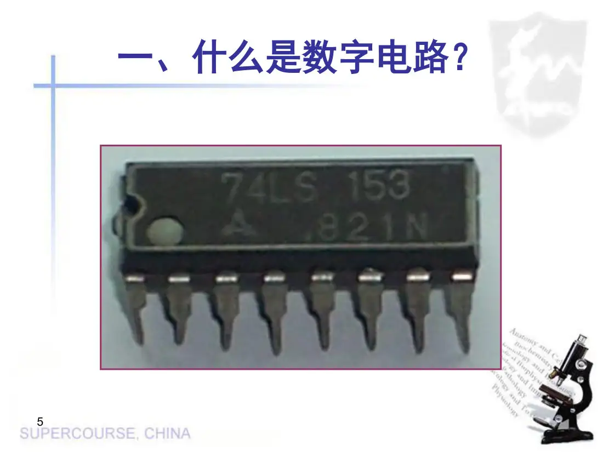

原文：

一、什么是数字电路？

5

SUPERCOURSE, CHINA

### 一、什么是数字电路？

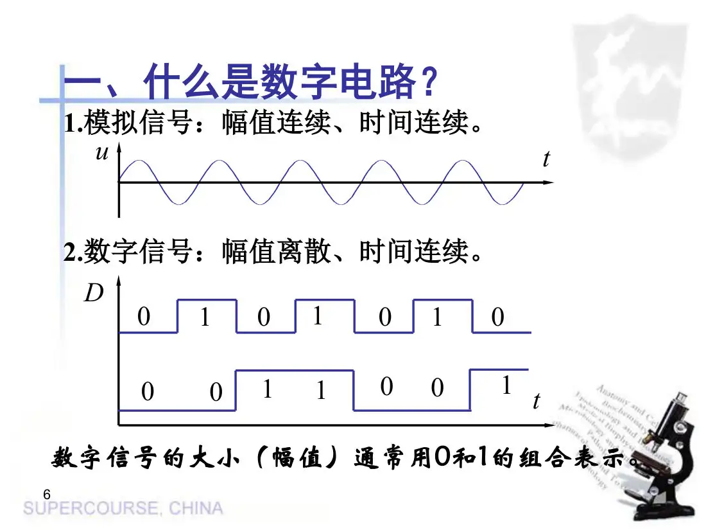

原文：

一、什么是数字电路？

1. 模拟信号：幅值连续、时间连续。

2. 数字信号：幅值离散、时间连续。

$$
\begin{array}{c c c c c c c c} & 0 & 1 & 0 & 1 & 0 & 1 & 0 \\ & 0 & 0 & 1 & 1 & 0 & 0 & 1 \end{array}
$$

数字信号的大小（幅值）通常用0和1的组合表示。

6

SUPERCOURSE, CHINA

### 一、什么是数字电路？

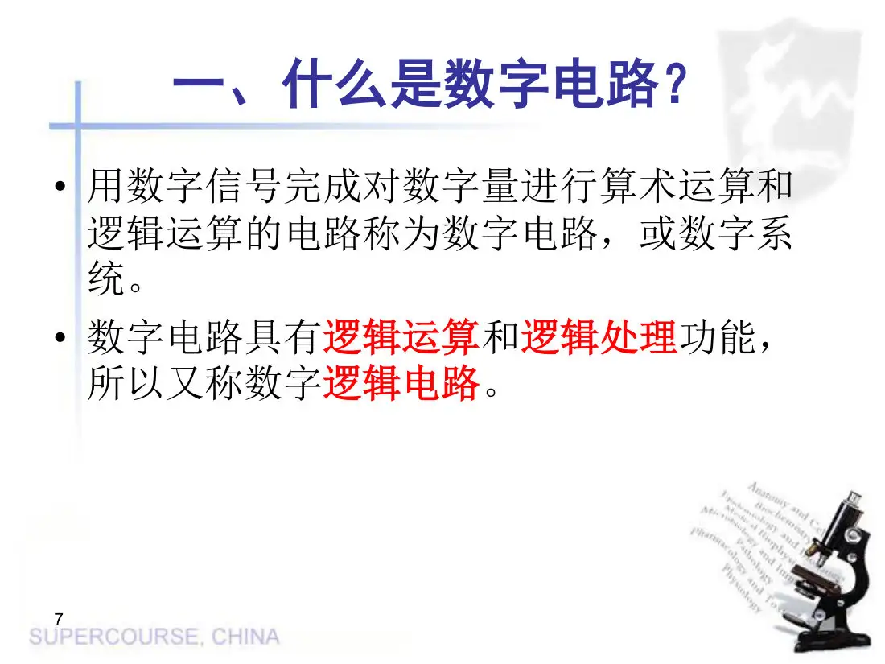

原文：

一、什么是数字电路？

\- 用数字信号完成对数字量进行算术运算和逻辑运算的电路称为数字电路，或数字系统。

\- 数字电路具有逻辑运算和逻辑处理功能，所以又称数字逻辑电路。

7

SUPERCOURSE, CHINA

### 用双向移位寄存器74LS194组成节日彩灯控制电路

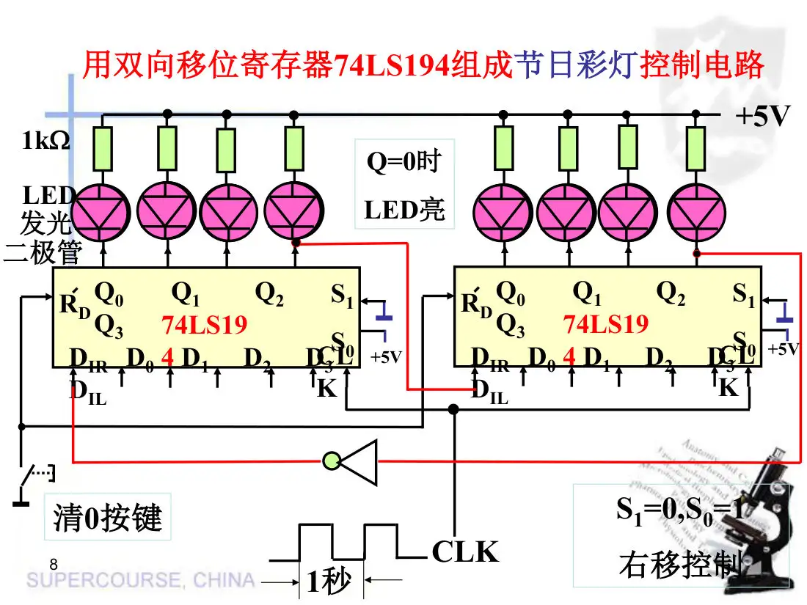

原文：

用双向移位寄存器74LS194组成节日彩灯控制电路

清0按键

右移控制

8

SUPERCOURSE, CHINA

### 二、数字电路课程的重要性

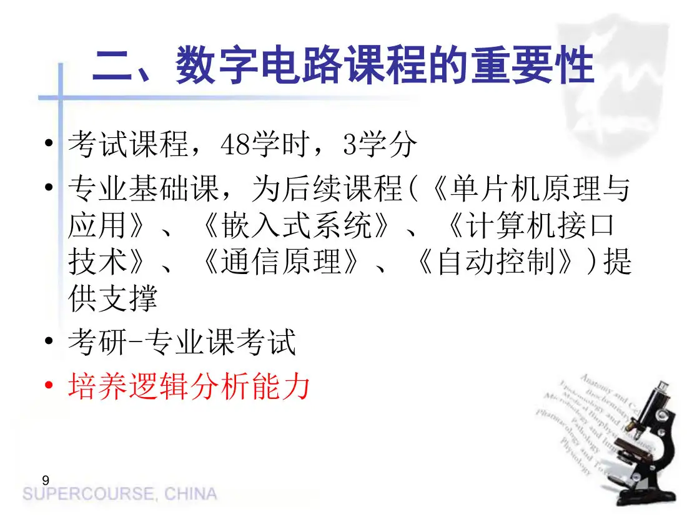

原文：

二、数字电路课程的重要性

\- 考试课程，48学时，3学分

\- 专业基础课，为后续课程(《单片机原理与应用》、《嵌入式系统》、《计算机接口技术》、《通信原理》、《自动控制》)提供支撑

\- 考研-专业课考试

\- 培养逻辑分析能力

9

SUPERCOURSE, CHINA

### 三、考核方法

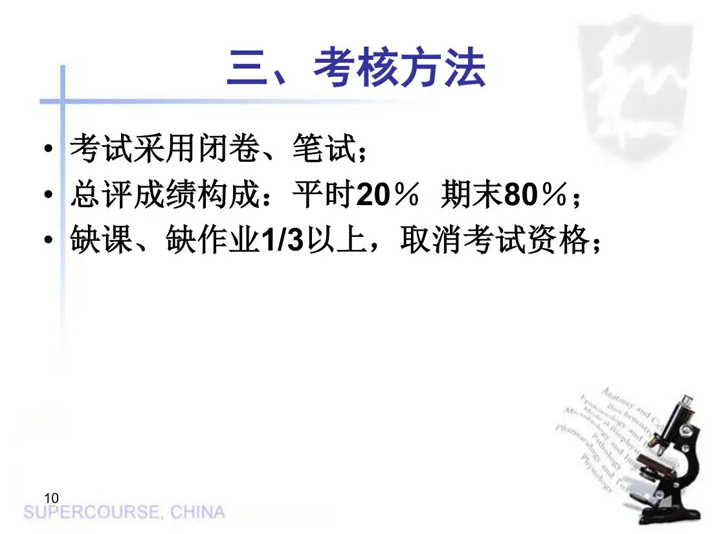

原文：

三、考核方法

\- 考试采用闭卷、笔试;

\- 总评成绩构成：平时20% 期末80%;

\- 缺课、缺作业1/3以上，取消考试资格；

10

SUPERCOURSE, CHINA

Anatomy and Cell
biochemistry
Physiology and Immunology
Medical Biophysics
Microbiology and Life
Pathology
Pharmacology and Toxicology
Physiology

### 学习要求

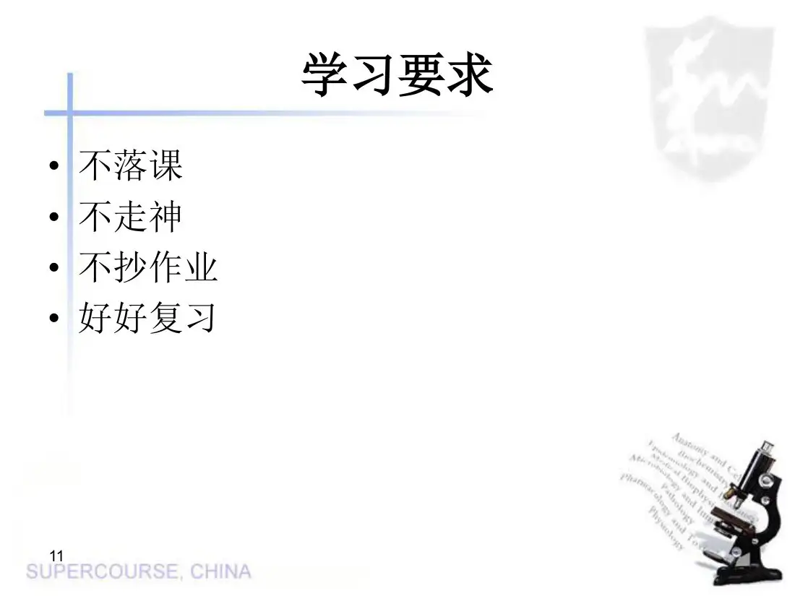

原文：

学习要求

\- 不落课

\- 不走神

\- 不抄作业

\- 好好复习

11

SUPERCOURSE, CHINA

### 四、作业

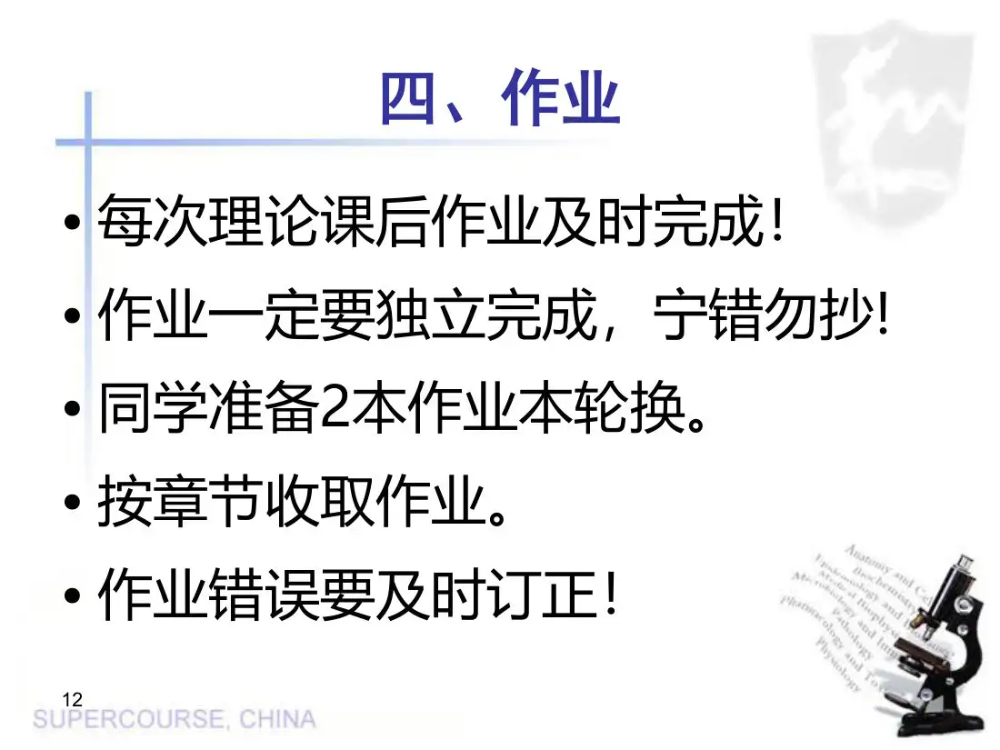

原文：

四、作业

\- 每次理论课后作业及时完成!

\- 作业一定要独立完成，宁错勿抄!

\- 同学准备2本作业本轮换。

\- 按章节收取作业。

\- 作业错误要及时订正！

12

SUPERCOURSE, CHINA

### 五、答疑安排

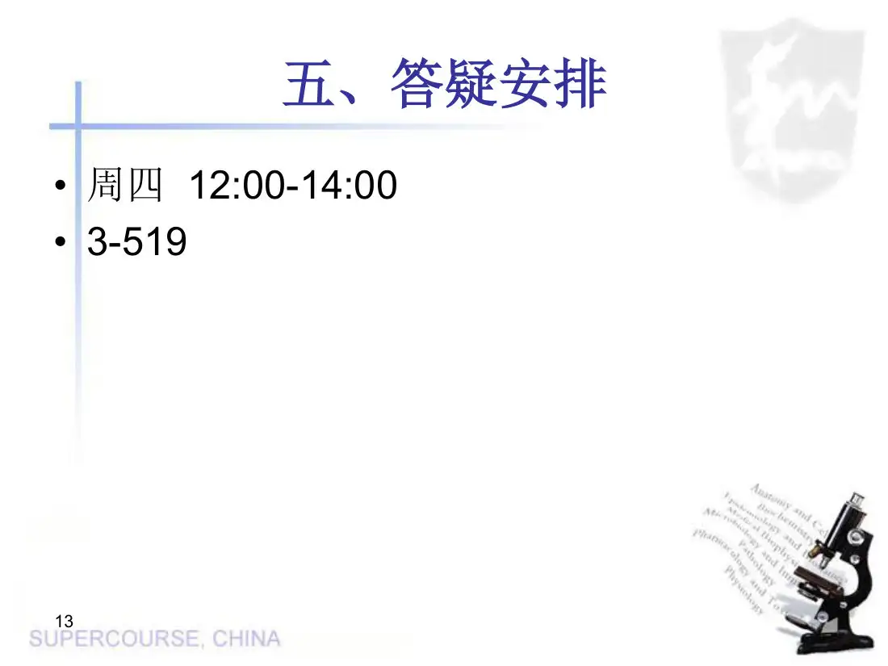

原文：

五、答疑安排

\- 周四 12:00-14:00

• 3-519

13

SUPERCOURSE, CHINA

### 问题

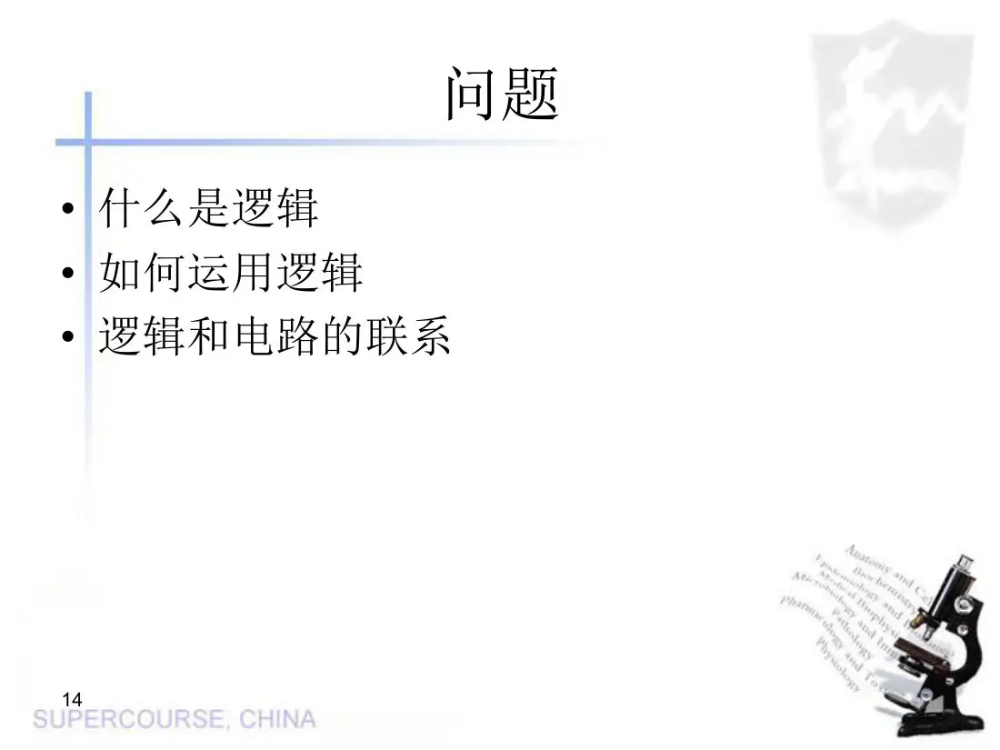

原文：

问题

\- 什么是逻辑

\- 如何运用逻辑

\- 逻辑和电路的联系

14

SUPERCOURSE, CHINA

### 开学赠语

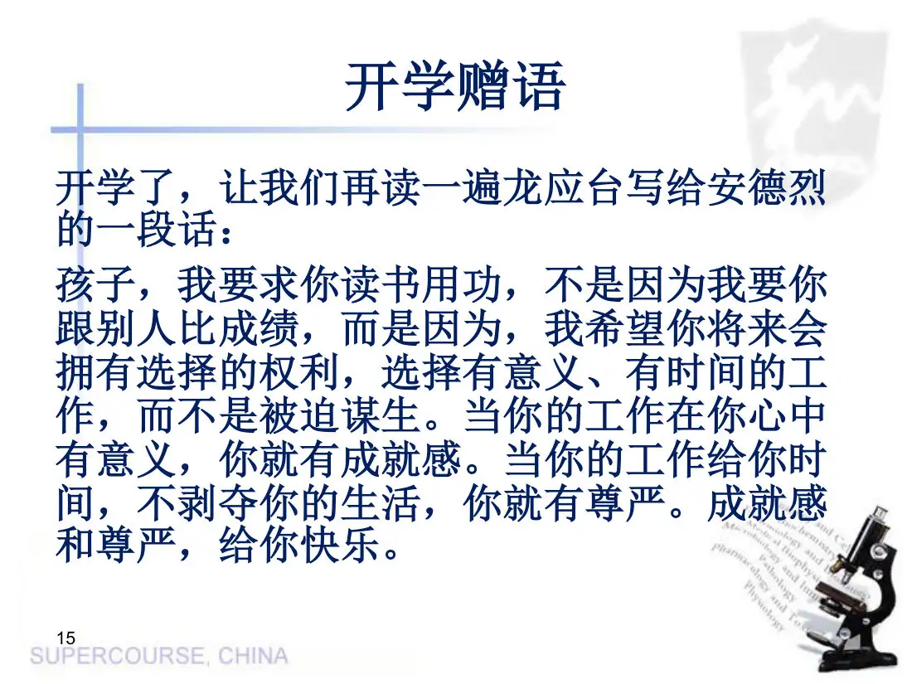

原文：

开学赠语

开学了，让我们再读一遍龙应台写给安德烈的一段话：

孩子，我要求你读书用功，不是因为我要你跟别人比成绩，而是因为，我希望你将来会拥有选择的权利，选择有意义、有时间的工作，而不是被迫谋生。当你的工作在你心中有意义，你就有成就感。当你的工作给你时间，不剥夺你的生活，你就有尊严。成就感和尊严，给你快乐。

15

SUPERCOURSE, CHINA

### 第1章 数制与码制

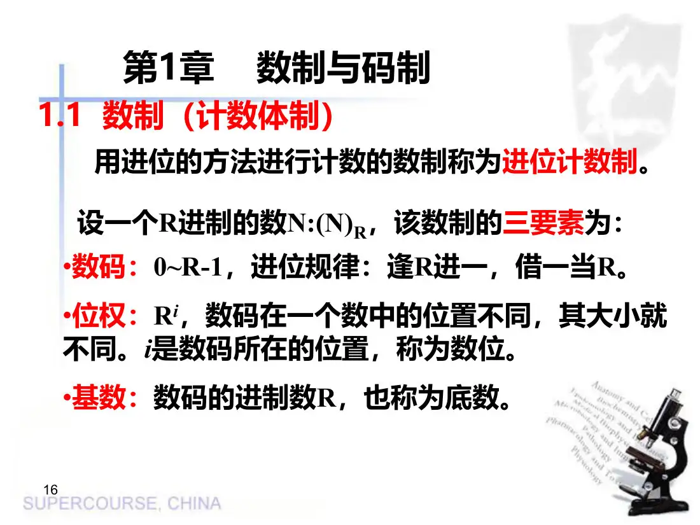

原文：

第1章 数制与码制

1.1 数制（计数体制）

用进位的方法进行计数的数制称为进位计数制。

设一个R进制的数N:(N) $_{R}$ ，该数制的三要素为：

·数码：0\~R-1，进位规律：逢R进一，借一当R。

·位权： $\mathbf{R}^i$ ，数码在一个数中的位置不同，其大小就不同。 $i$ 是数码所在的位置，称为数位。

·基数：数码的进制数R，也称为底数。

16

SUPERCOURSE, CHINA

### 各种计数制的三要素

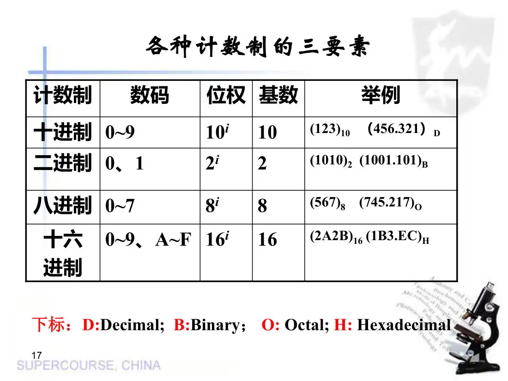

原文：

各种计数制的三要素

<table><tr><td>计数制</td><td>数码</td><td>位权</td><td>基数</td><td>举例</td></tr><tr><td>十进制</td><td>0~9</td><td> $10^i$ </td><td>10</td><td> $(123)_{10}$   $(456.321)_{D}$ </td></tr><tr><td>二进制</td><td>0、1</td><td> $2^i$ </td><td>2</td><td> $(1010)_2$   $(1001.101)_B$ </td></tr><tr><td>八进制</td><td>0~7</td><td> $8^i$ </td><td>8</td><td> $(567)_8$   $(745.217)_O$ </td></tr><tr><td>十六进制</td><td>0~9、A~F</td><td> $16^i$ </td><td>16</td><td> $(2A2B)_{16}$   $(1B3.EC)_H$ </td></tr></table>

下标: D: Decimal; B: Binary; O: Octal; H: Hexadecimal设 $(\mathbf{N})_{\mathrm{R}}$ 有n位小数，m位整数，可以用三种方法表示：

17

SUPERCOURSE, CHINA

### $$

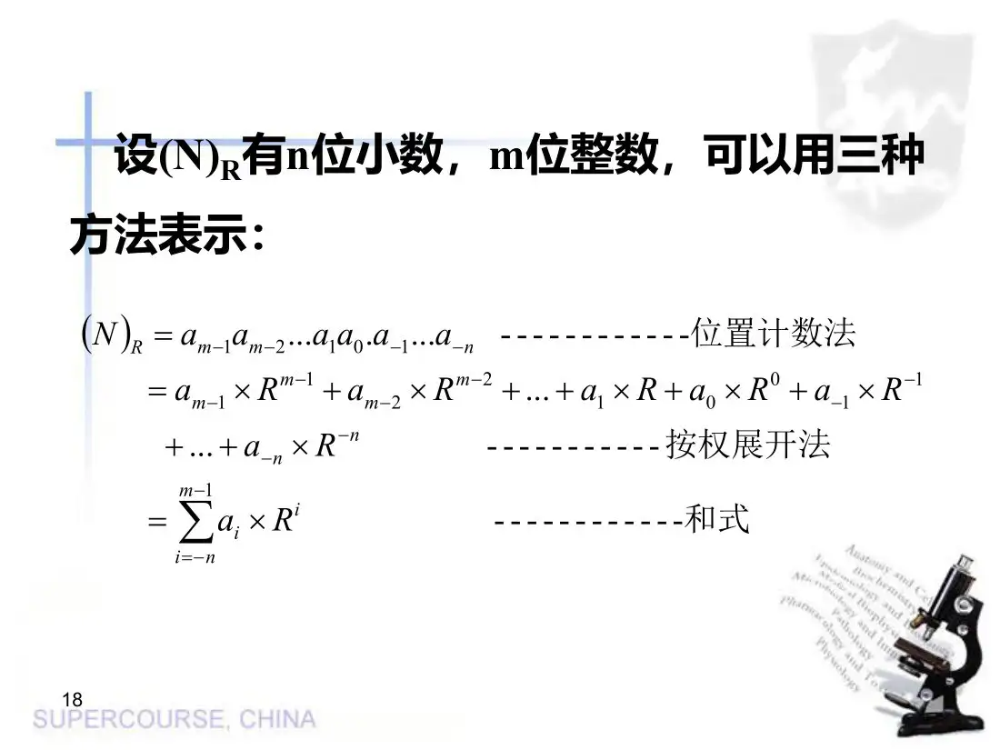

原文：

$$
\begin{array}{r l r} {{\left(N\right) _ {R} = a _ {m - 1} a _ {m - 2}... a _ {1} a _ {0}. a _ {- 1}... a _ {- n}}} & {{- - - - - - - - - - - - - - - - - - - - - - - - - - - - - - - - - - - - - - - - - - - - - - - - - - - - - - - - -}} & {{\mathrm{位置计数法}}} \\ {{= a _ {m - 1} \times R ^ {m - 1} + a _ {m - 2} \times R ^ {m - 2} +... + a _ {1} \times R + a _ {0} \times R ^ {0} + a _ {- 1} \times R ^ {- 1}}} & {} & {} \\ {{+... + a _ {- n} \times R ^ {- n}}} & {{- - - - - - - - - - - - - - - - - - - - - - - - - - - - - - - - - - - - -}} & {{\mathrm{按权展开法}}} \\ {{= \sum_ {i = - n} ^ {m - 1} a _ {i} \times R ^ {i}}} & {{- - - - - - - - - - - - - -}} & {{\mathrm{和式}}} \end{array}
$$

18

SUPERCOURSE, CHINA

### 1.1.3 数制转换：

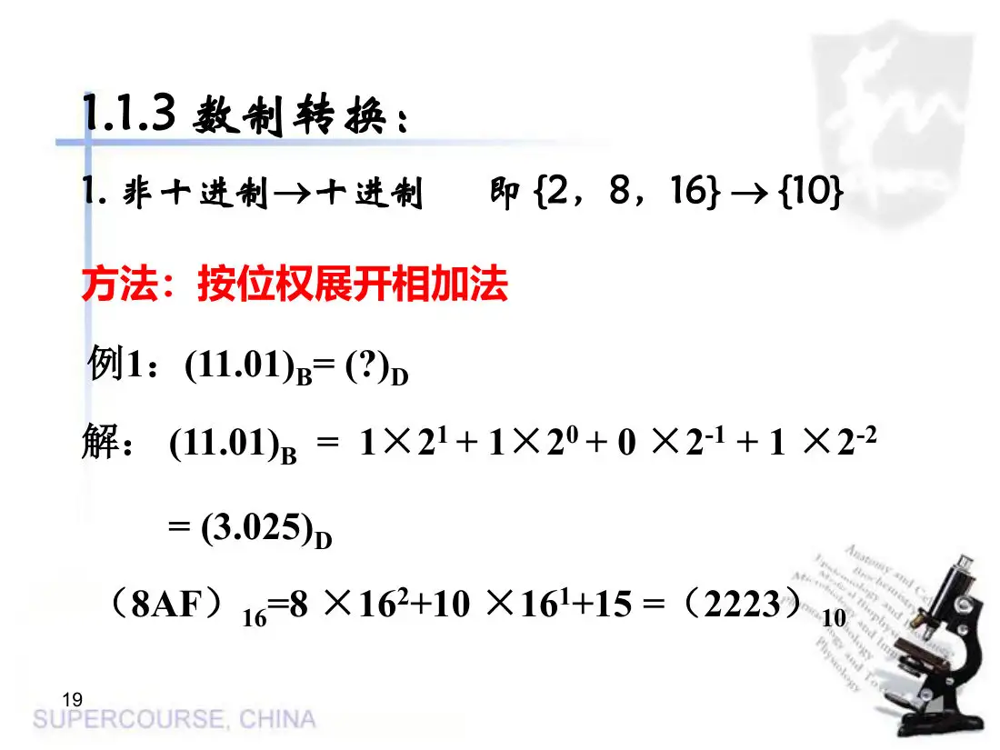

原文：

1.1.3 数制转换：

1. 非十进制 $\rightarrow$ 十进制 即 $\{2, 8, 16\} \rightarrow \{10\}$

方法：按位权展开相加法

例1: $(11.01)_{\mathrm{B}} = (?)_{\mathrm{D}}$

解： $(11.01)_{\mathrm{B}} = 1\times 2^{1} + 1\times 2^{0} + 0\times 2^{-1} + 1\times 2^{-2}$ $= (3.025)_{\mathrm{D}}$

(8AF) $_{16}$ =8 × 16 $^{2}$ +10 × 16 $^{1}$ +15 = (2223) $_{10}$ 练习: 将下列进制数转换成十进制

19

SUPERCOURSE, CHINA

### 20

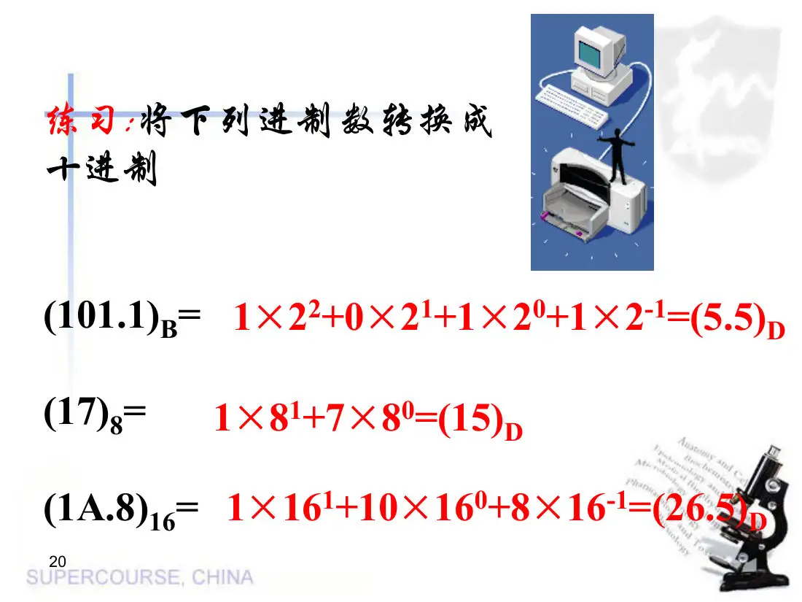

原文：

(101.1) $_{B}=$ $1\times2^{2}+0\times2^{1}+1\times2^{0}+1\times2^{-1}=(5.5)_{D}$

(17) $_{8}=$ $1\times8^{1}+7\times8^{0}=(15)_{D}$

(1A.8) $_{16}=$ $1\times16^{1}+10\times16^{0}+8\times16^{-1}=(26.5)$

20

SUPERCOURSE, CHINA

### 方法：基数乘除法

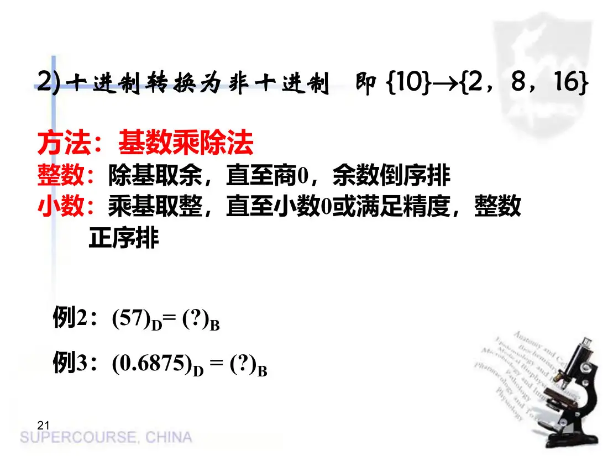

原文：

2)十进制转换为非十进制 即 $\{10\} \rightarrow \{2, 8, 16\}$

方法：基数乘除法

整数：除基取余，直至商0，余数倒序排

小数：乘基取整，直至小数0或满足精度，整数正序排

例2： $(57)_{D}=(?)_{B}$

例3： $(0.6875)_{\mathrm{D}}=(?)_{\mathrm{B}}$

21

SUPERCOURSE, CHINA

### 例2: $(57)_{D} = (?)_{B}$

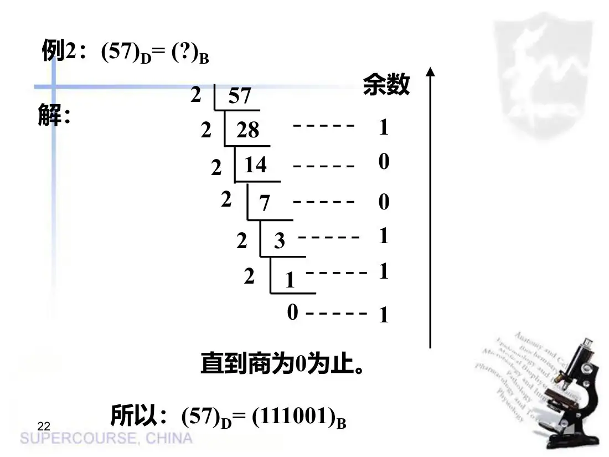

原文：

例2: $(57)_{D} = (?)_{B}$

解：

$$
\begin{array}{r l} & \text {余数} \\ & 2 \boxed {5 7} \\ & 2 \boxed {2 8} \\ & 2 \boxed {1 4} \\ & 2 \boxed {7} \\ & 2 \boxed {3} \\ & 2 \boxed {1} \\ & 0 \end{array}
$$

直到商为0为止。

所以： $(57)_{\mathrm{D}}=(111001)_{\mathrm{B}}$

22

SUPERCOURSE, CHINA

### 解：

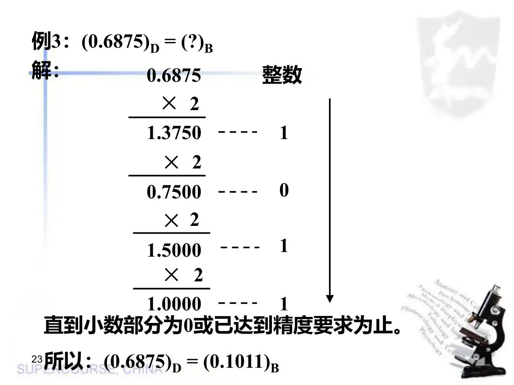

原文：

例3： $(0.6875)_{\mathrm{D}}=(?)_{\mathrm{B}}$

解：

$$
\begin{array}{r l r} {\text {   释:   }} & {0. 6 8 7 5} & {\text {   整数   }} \\ & {\frac {\times 2}{1 . 3 7 5 0}} & {- - - - 1} \\ & {\frac {\times 2}{0 . 7 5 0 0}} & {- - - - 0} \\ & {\frac {\times 2}{1 . 5 0 0 0}} & {- - - - 1} \\ & {\frac {\times 2}{1 . 0 0 0 0}} & {- - - - 1} \end{array}
$$

直到小数部分为0或已达到精度要求为止。

$^{23}$ 所以： $(0.6875)_{\mathrm{D}} = (0.1011)_{\mathrm{B}}$

### 练习：将 $(43.875)_{D}$ 转换成二进制、八进制、十六进制

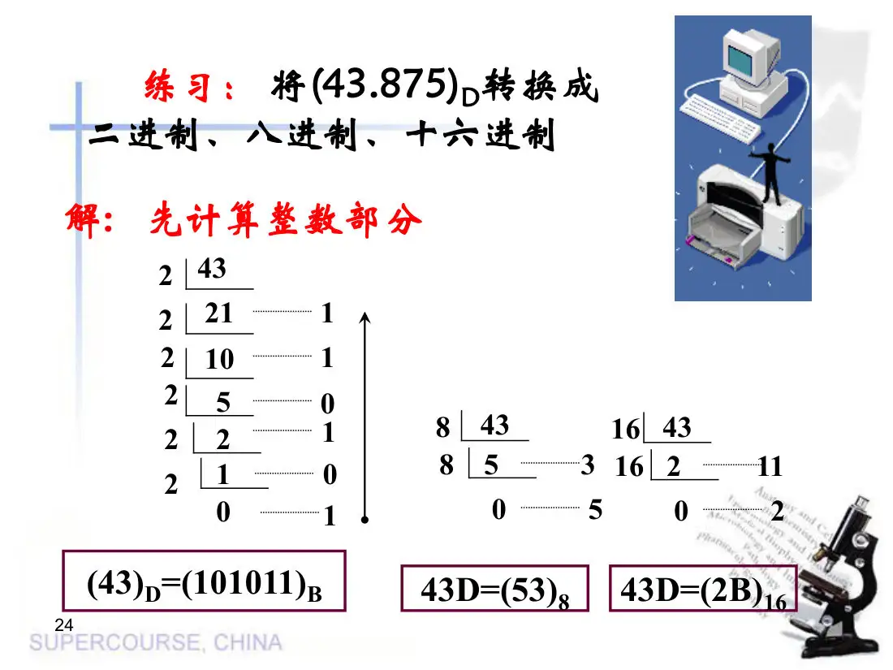

原文：

练习：将 $(43.875)_{D}$ 转换成二进制、八进制、十六进制

解：先计算整数部分

$$
\begin{array}{c c c} 2 & \underline {{4 3}} \\ 2 & \underline {{2 1}} & \dots \dots 1 \\ 2 & \underline {{1 0}} & \dots \dots 1 \\ 2 & \underline {{5}} & \dots \dots 0 \\ 2 & \underline {{2}} & \dots \dots 1 \\ 2 & \underline {{1}} & \dots \dots 0 \\ & 0 & \dots \dots 1 \end{array}
$$

$$
(4 3) _ {\mathrm{D}} = (1 0 1 0 1 1) _ {\mathrm{B}}
$$

$$
\begin{array}{c c c c c} 8 & \underline {{4 3}} & 1 6 & \underline {{4 3}} \\ 8 & \underline {{5}} & 3 & 1 6 & \underline {{2}} & 1 1 \\ & 0 & 5 & 0 & 2 \end{array}
$$

$$
4 3 \mathrm{D} = (5 3) _ {8}
$$

$$
4 3 \mathrm{D} = (2 \mathrm{B}) _ {1 6}
$$

24

SUPERCOURSE, CHINA

### 在计算小数部分: $(0.875)_{D}$ 转换成二进制、八进制、十六进制

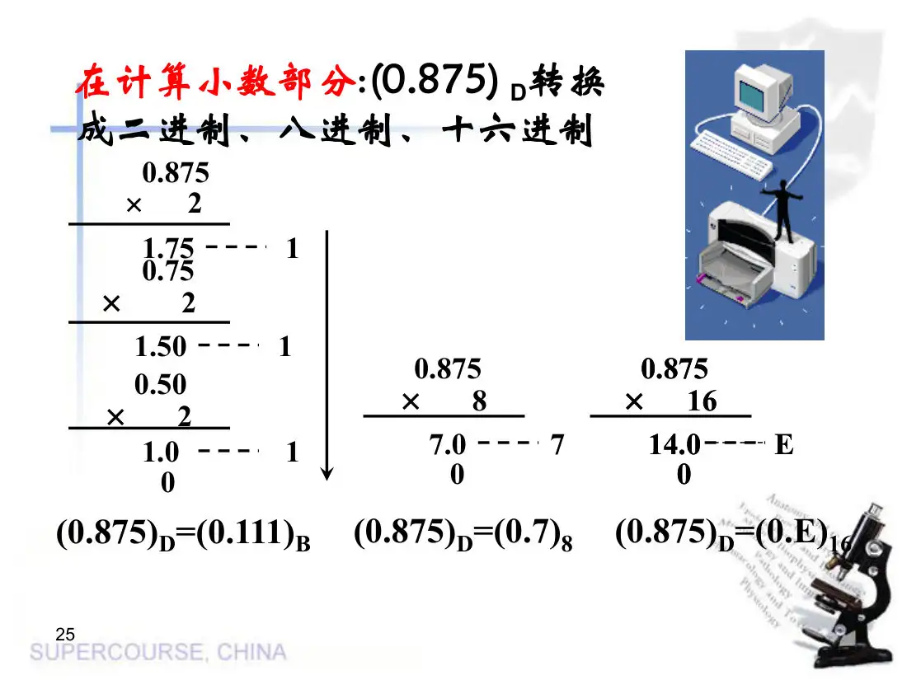

原文：

在计算小数部分: $(0.875)_{D}$ 转换成二进制、八进制、十六进制

$$
\begin{array}{r} 0. 8 7 5 \\ \times \quad 2 \\ \hline 1. 7 5 - - - 1 \\ 0. 7 5 \\ \times \quad 2 \\ \hline 1. 5 0 - - - 1 \\ 0. 5 0 \\ \times \quad 2 \\ \hline 1. 0 - - - 1 \\ 0 \end{array}
$$

$$
(0. 8 7 5) _ {\mathrm{D}} = (0. 1 1 1) _ {\mathrm{B}}
$$

$$
\begin{array}{r} 0. 8 7 5 \\ \times \quad 1 6 \\ \hline 1 4. 0 -- - E \\ 0 \end{array}
$$

$$
(0. 8 7 5) _ {\mathrm{D}} = (0. 7) _ {8}
$$

$$
(0. 8 7 5) _ {\mathrm{D}} = (0. \mathrm{E})
$$

25

SUPERCOURSE, CHINA

### 3)小数的精度及转换位数的确定

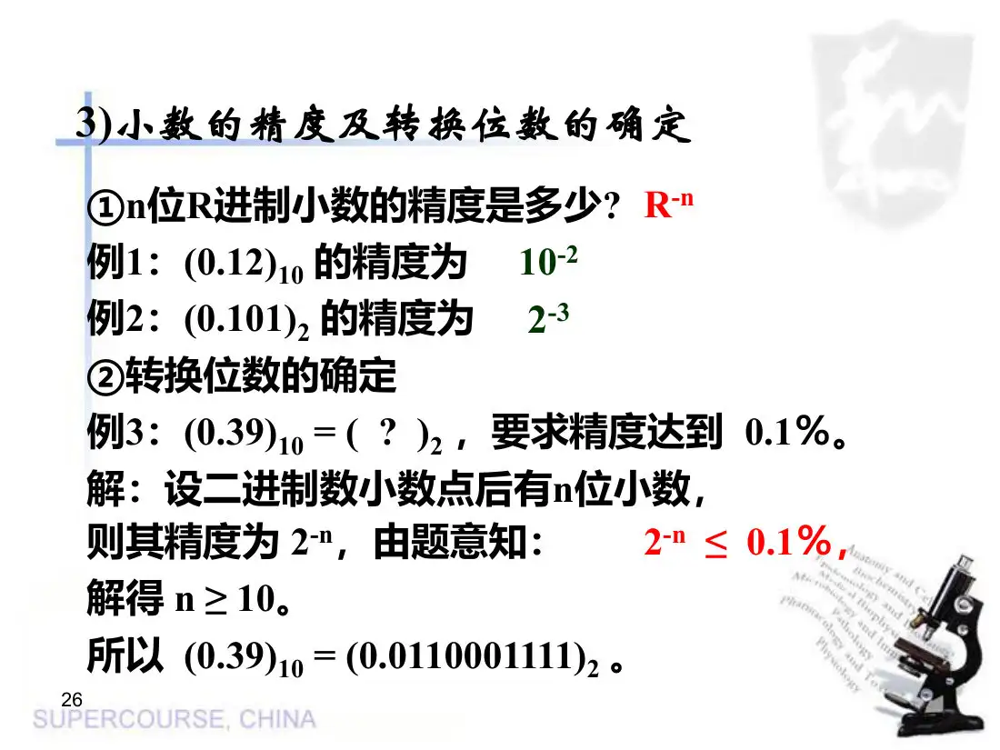

原文：

3)小数的精度及转换位数的确定

①n位R进制小数的精度是多少？R-n

例1: $(0.12)_{10}$ 的精度为 $10^{-2}$

例2: $(0.101)_{2}$ 的精度为 $2^{-3}$

②转换位数的确定

例3： $(0.39)_{10} = (\ ? )_{2}$ ，要求精度达到 $0.1\%$ 。

解：设二进制数小数点后有n位小数，

则其精度为 $2^{-n}$ ，由题意知： $2^{-n} \leq 0.1\%$

解得 $n \geq 10$ 。

所以 $(0.39)_{10} = (0.0110001111)_{2}$ 。

26

SUPERCOURSE, CHINA

### 27

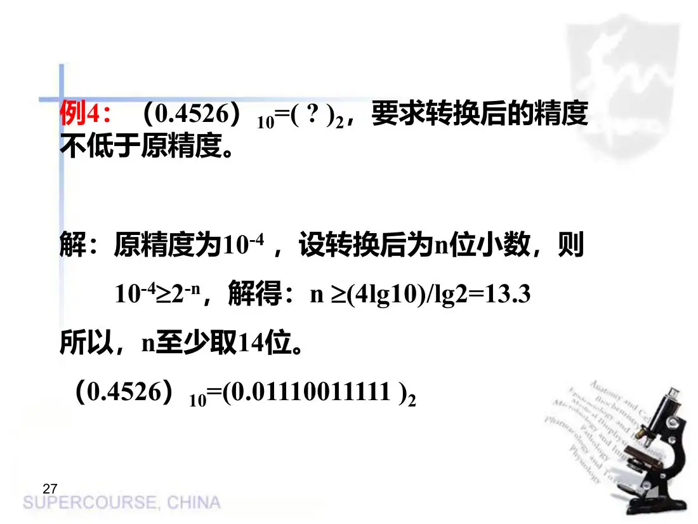

原文：

例4: (0.4526) $_{10}$ =(?) $_{2}$ ，要求转换后的精度不低于原精度。

解：原精度为 $10^{-4}$ ，设转换后为n位小数，则 $10^{-4} \geq 2^{-n}$ ，解得： $n \geq (4\lg 10) / \lg 2 = 13.3$ 所以，n至少取14位。

(0.4526) $_{10}=(0.01110011111)_{2}$ 练习: (0.875) $_{10}$ =(?) $_{2}$ ，要求转换后的精度不低于原精度。

27

SUPERCOURSE, CHINA

### 28

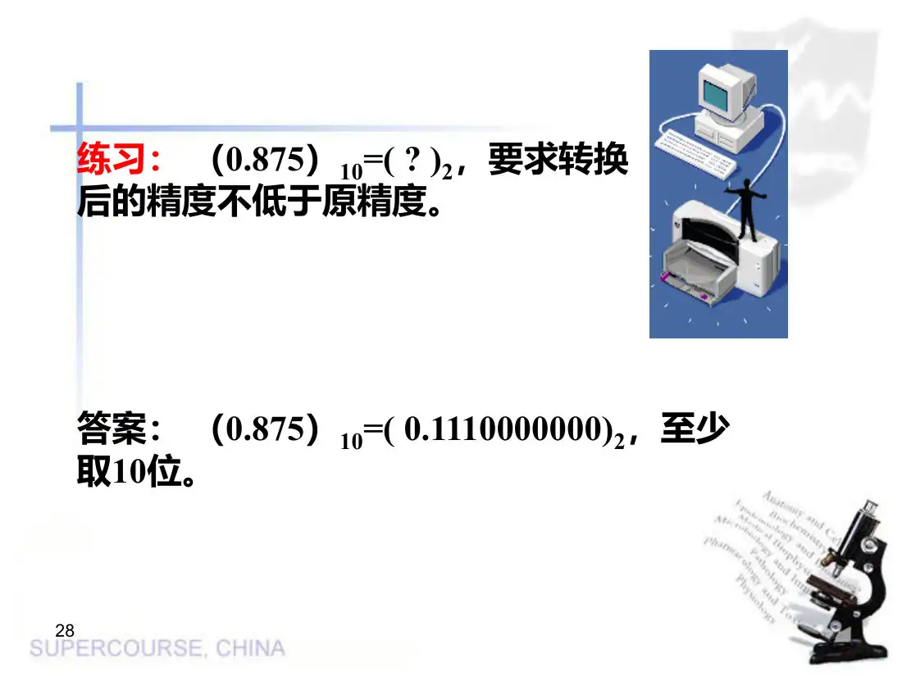

原文：

答案: (0.875) $_{10}$ =(0.1110000000) $_{2}$ ，至少取10位。

28

SUPERCOURSE, CHINA

### (2) 二进制、八进制、十六进制间转换

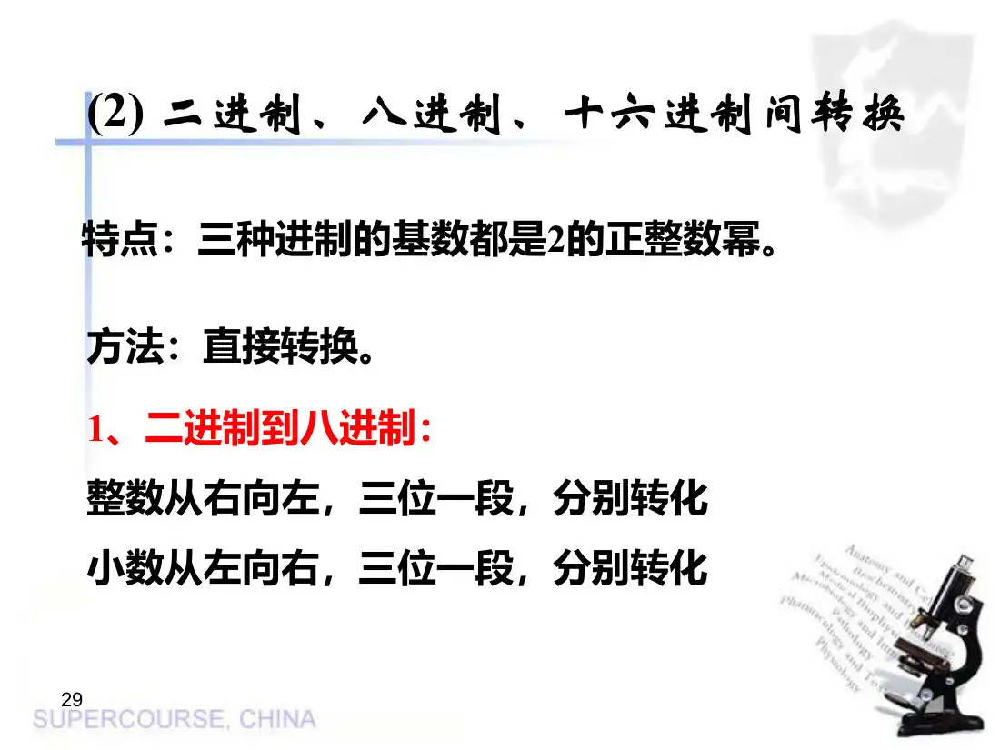

原文：

(2) 二进制、八进制、十六进制间转换

特点：三种进制的基数都是2的正整数幂。

方法：直接转换。

1、二进制到八进制：

整数从右向左，三位一段，分别转化

小数从左向右，三位一段，分别转化

29

SUPERCOURSE, CHINA

### 例（1010101.11011）2

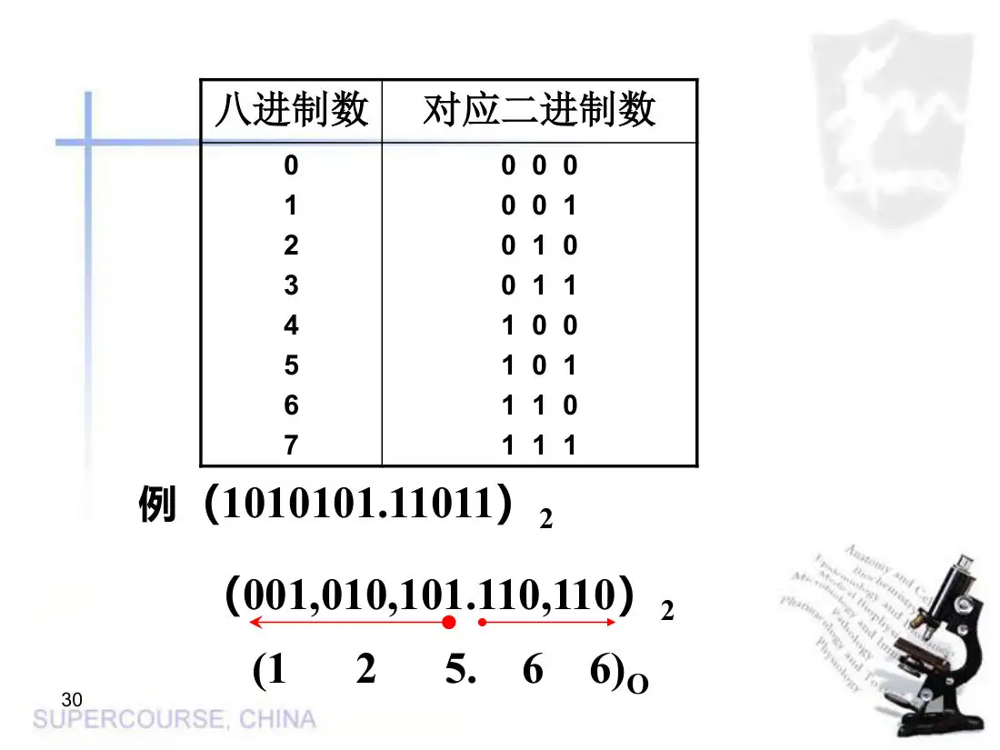

原文：

<table><tr><td>八进制数</td><td>对应二进制数</td></tr><tr><td>0</td><td>0 0 0</td></tr><tr><td>1</td><td>0 0 1</td></tr><tr><td>2</td><td>0 1 0</td></tr><tr><td>3</td><td>0 1 1</td></tr><tr><td>4</td><td>1 0 0</td></tr><tr><td>5</td><td>1 0 1</td></tr><tr><td>6</td><td>1 1 0</td></tr><tr><td>7</td><td>1 1 1</td></tr></table>

例（1010101.11011）2

(001,010,101.110,110) 2
(1 2 5. 6 6)O (10101011110.100000111) $_{B}$ =(?) $_{o}$

30

SUPERCOURSE, CHINA

### $$

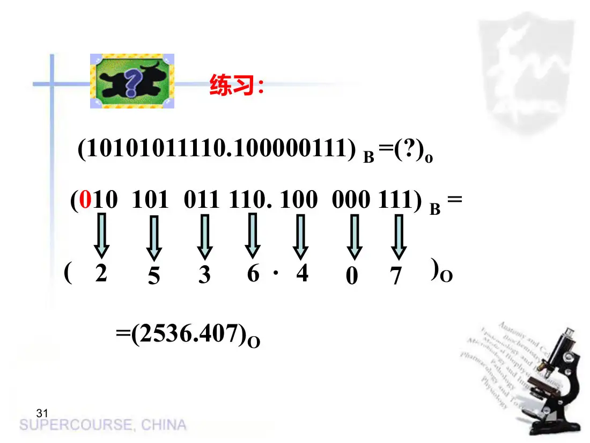

原文：

$$
\begin{array}{c c c c c c c} (0 1 0 & 1 0 1 & 0 1 1 & 1 1 0. 1 0 0 & 0 0 0 & 1 1 1) _ {\mathrm{B}} = \\ \downarrow & \downarrow & \downarrow & \downarrow & \downarrow & \downarrow \\ (\quad 2 & \quad 5 & \quad 3 & \quad 6 \cdot \quad 4 & \quad 0 & \quad 7) _ {\mathrm{O}} \end{array}
$$

$$
= (2 5 3 6. 4 0 7) _ {\mathrm{o}}
$$

?

练习:

31

SUPERCOURSE, CHINA

### 2、二进制到十六进制：

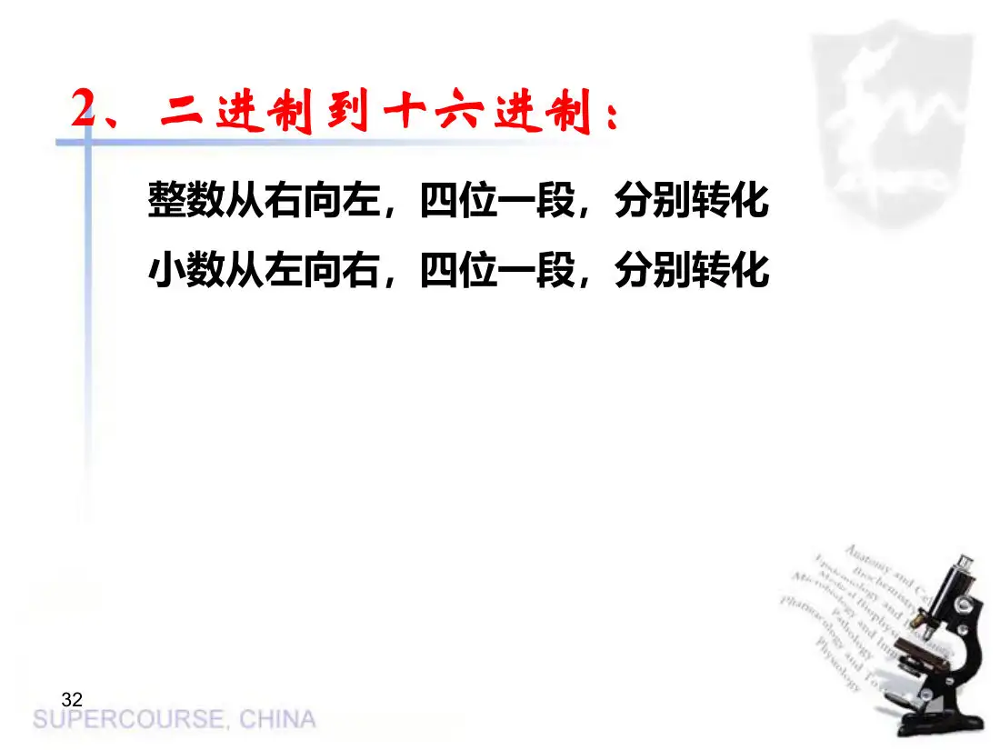

原文：

2、二进制到十六进制：

整数从右向左，四位一段，分别转化小数从左向右，四位一段，分别转化例: $\left(\begin{array}{c}0101,0101,1101,1000\\5\quad5\cdot D\quad8\end{array}\right)_{B}$ $=(55D8)_{8}$

32

SUPERCOURSE, CHINA

### 第 33 页

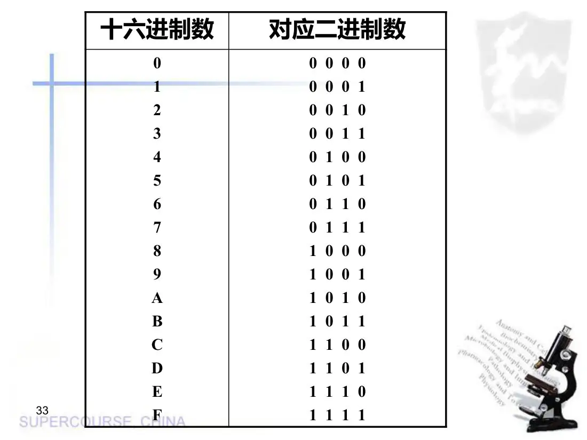

原文：

<table><tr><td>十六进制数</td><td>对应二进制数</td></tr><tr><td>0</td><td>0 0 0 0</td></tr><tr><td>1</td><td>0 0 0 1</td></tr><tr><td>2</td><td>0 0 1 0</td></tr><tr><td>3</td><td>0 0 1 1</td></tr><tr><td>4</td><td>0 1 0 0</td></tr><tr><td>5</td><td>0 1 0 1</td></tr><tr><td>6</td><td>0 1 1 0</td></tr><tr><td>7</td><td>0 1 1 1</td></tr><tr><td>8</td><td>1 0 0 0</td></tr><tr><td>9</td><td>1 0 0 1</td></tr><tr><td>A</td><td>1 0 1 0</td></tr><tr><td>B</td><td>1 0 1 1</td></tr><tr><td>C</td><td>1 1 0 0</td></tr><tr><td>D</td><td>1 1 0 1</td></tr><tr><td>E</td><td>1 1 1 0</td></tr><tr><td>F</td><td>1 1 1 1</td></tr></table>

### 练习：

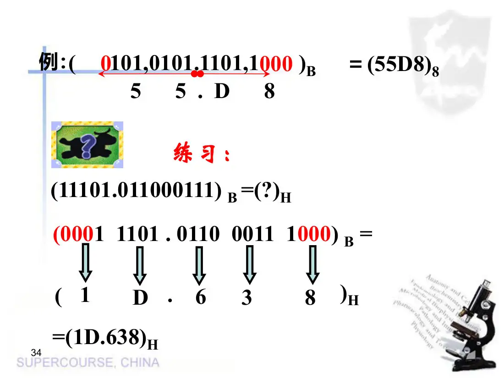

原文：

练习：

(11101.011000111) $_{B}$ =(?) $_{H}$

(0001 1101 . 0110 0011 1000) B =
↓ ↓ ↓ ↓ ↓
( 1 D . 6 3 8 )H

$$
= (1 \mathrm{D}. 6 3 8) _ {\mathrm{H}}
$$

34

SUPERCOURSE, CHINA

### 3、八进制到二进制、十六进制到二进制

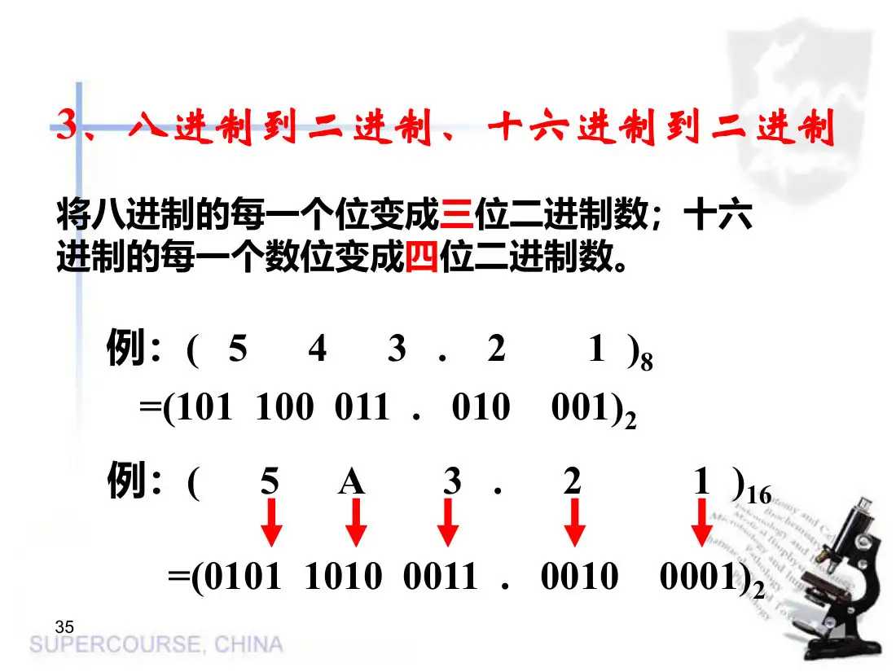

原文：

3、八进制到二进制、十六进制到二进制

将八进制的每一个位变成三位二进制数；十六进制的每一个数位变成四位二进制数。

例：(5 4 3 . 2 1 ) $_{8}$ = (101 100 011 . 010 001) $_{2}$

例：( 5 A 3 . 2 1 ) $_{16}$ =(0101 1010 0011 . 0010 0001) $_{2}$

35

SUPERCOURSE, CHINA

### 4、八进制和十六进制之间转换

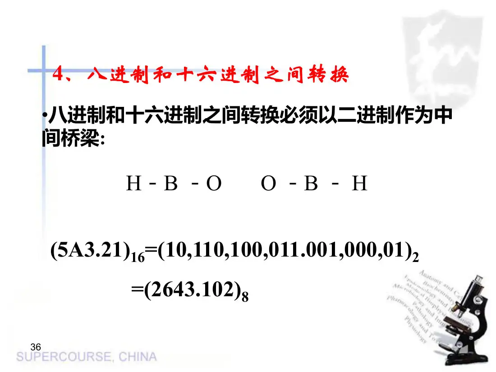

原文：

4、八进制和十六进制之间转换

·八进制和十六进制之间转换必须以二进制作为中间桥梁：

$$
\mathrm{H} - \mathrm{B} - \mathrm{O} \quad \mathrm{O} - \mathrm{B} - \mathrm{H}
$$

(5A3.21) $_{16}$ =(10,110,100,011.001,000,01) $_{2}$ = (2643.102) $_{8}$

36

SUPERCOURSE, CHINA

### 练习

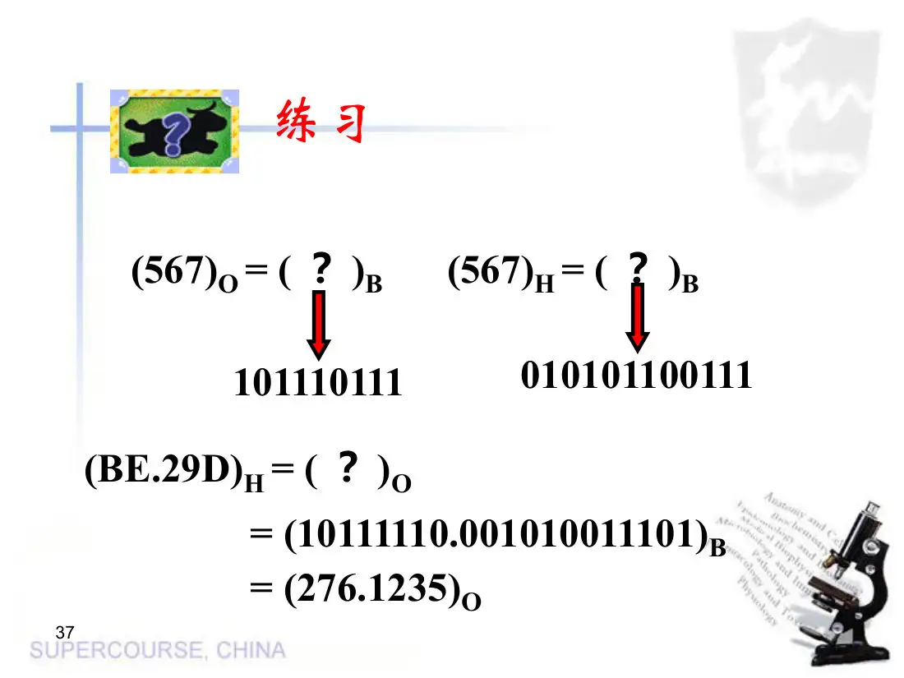

原文：

练习

(567) $_{O}$ = ( ? ) $_{B}$ ↓
101110111 (567) $_{H}$ = ( ? ) $_{B}$ 010101100111

(BE.29D) $_{H}$ = ( ? ) $_{O}$ = (10111110.001010011101) $_{B}$ = (276.1235) $_{O}$

37

SUPERCOURSE, CHINA

### 5、二进制、八进制、十六进制、十进制对应关系：

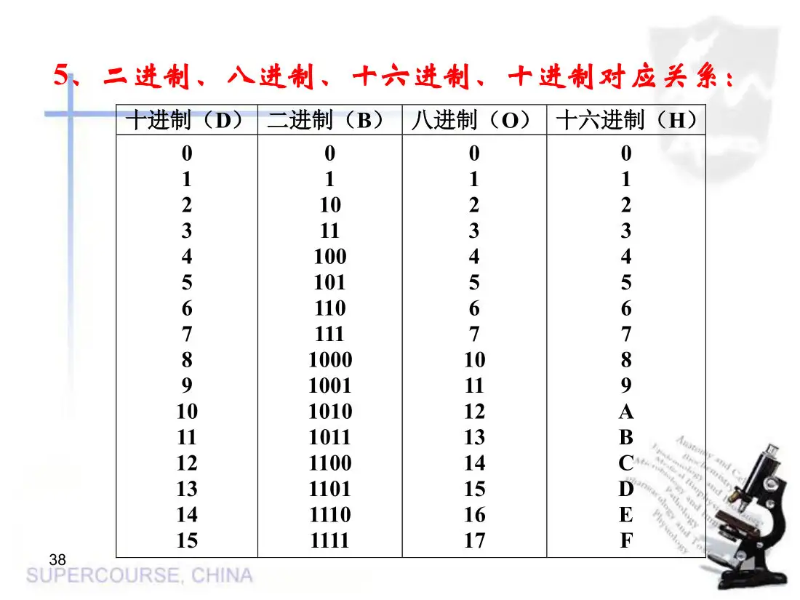

原文：

5、二进制、八进制、十六进制、十进制对应关系：

<table><tr><td>十进制(D)</td><td>二进制(B)</td><td>八进制(O)</td><td>十六进制(H)</td></tr><tr><td>0</td><td>0</td><td>0</td><td>0</td></tr><tr><td>1</td><td>1</td><td>1</td><td>1</td></tr><tr><td>2</td><td>10</td><td>2</td><td>2</td></tr><tr><td>3</td><td>11</td><td>3</td><td>3</td></tr><tr><td>4</td><td>100</td><td>4</td><td>4</td></tr><tr><td>5</td><td>101</td><td>5</td><td>5</td></tr><tr><td>6</td><td>110</td><td>6</td><td>6</td></tr><tr><td>7</td><td>111</td><td>7</td><td>7</td></tr><tr><td>8</td><td>1000</td><td>10</td><td>8</td></tr><tr><td>9</td><td>1001</td><td>11</td><td>9</td></tr><tr><td>10</td><td>1010</td><td>12</td><td>A</td></tr><tr><td>11</td><td>1011</td><td>13</td><td>B</td></tr><tr><td>12</td><td>1100</td><td>14</td><td>C</td></tr><tr><td>13</td><td>1101</td><td>15</td><td>D</td></tr><tr><td>14</td><td>1110</td><td>16</td><td>E</td></tr><tr><td>15</td><td>1111</td><td>17</td><td>F</td></tr></table>

38

SUPERCOURSE, CHINA

### 作业题

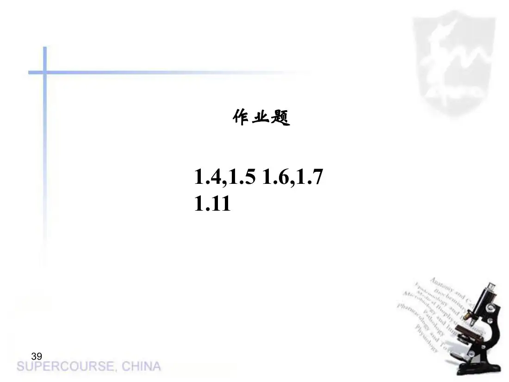

原文：

作业题

1.4,1.5 1.6,1.7
1.11

39

SUPERCOURSE, CHINA

### 1.2 码制（编码的制式）

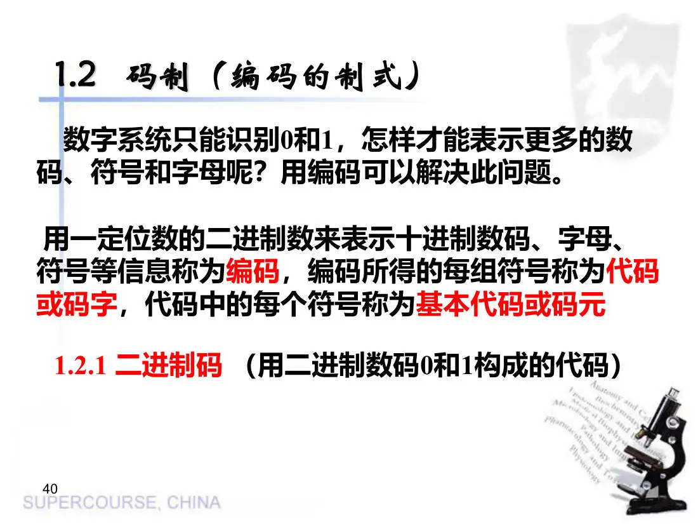

原文：

1.2 码制（编码的制式）

数字系统只能识别0和1，怎样才能表示更多的数码、符号和字母呢？用编码可以解决此问题。

用一定位数的二进制数来表示十进制数码、字母、符号等信息称为编码，编码所得的每组符号称为代码或码字，代码中的每个符号称为基本代码或码元

1.2.1 二进制码 （用二进制数码0和1构成的代码）

40

SUPERCOURSE, CHINA

### 表1.2.1 典型二进制码

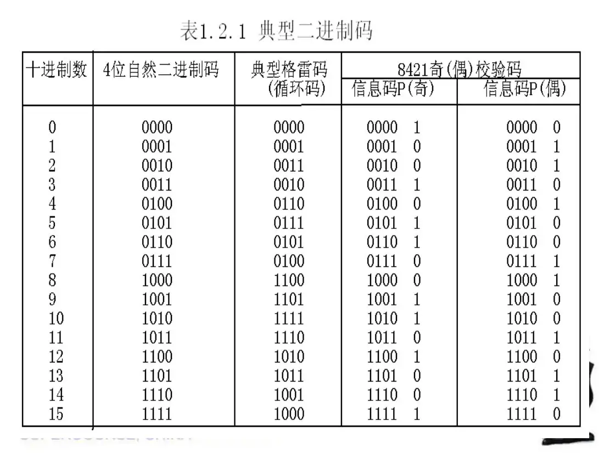

原文：

表1.2.1 典型二进制码
<table><tr><td rowspan="2">十进制数</td><td rowspan="2">4位自然二进制码</td><td rowspan="2">典型格雷码(循环码)</td><td colspan="2">8421奇(偶)校验码</td></tr><tr><td>信息码P(奇)</td><td>信息码P(偶)</td></tr><tr><td>0</td><td>0000</td><td>0000</td><td>0000 1</td><td>0000 0</td></tr><tr><td>1</td><td>0001</td><td>0001</td><td>0001 0</td><td>0001 1</td></tr><tr><td>2</td><td>0010</td><td>0011</td><td>0010 0</td><td>0010 1</td></tr><tr><td>3</td><td>0011</td><td>0010</td><td>0011 1</td><td>0011 0</td></tr><tr><td>4</td><td>0100</td><td>0110</td><td>0100 0</td><td>0100 1</td></tr><tr><td>5</td><td>0101</td><td>0111</td><td>0101 1</td><td>0101 0</td></tr><tr><td>6</td><td>0110</td><td>0101</td><td>0110 1</td><td>0110 0</td></tr><tr><td>7</td><td>0111</td><td>0100</td><td>0111 0</td><td>0111 1</td></tr><tr><td>8</td><td>1000</td><td>1100</td><td>1000 0</td><td>1000 1</td></tr><tr><td>9</td><td>1001</td><td>1101</td><td>1001 1</td><td>1001 0</td></tr><tr><td>10</td><td>1010</td><td>1111</td><td>1010 1</td><td>1010 0</td></tr><tr><td>11</td><td>1011</td><td>1110</td><td>1011 0</td><td>1011 1</td></tr><tr><td>12</td><td>1100</td><td>1010</td><td>1100 1</td><td>1100 0</td></tr><tr><td>13</td><td>1101</td><td>1011</td><td>1101 0</td><td>1101 1</td></tr><tr><td>14</td><td>1110</td><td>1001</td><td>1110 0</td><td>1110 1</td></tr><tr><td>15</td><td>1111</td><td>1000</td><td>1111 1</td><td>1111 0</td></tr></table>

### (1) 自然二进制码

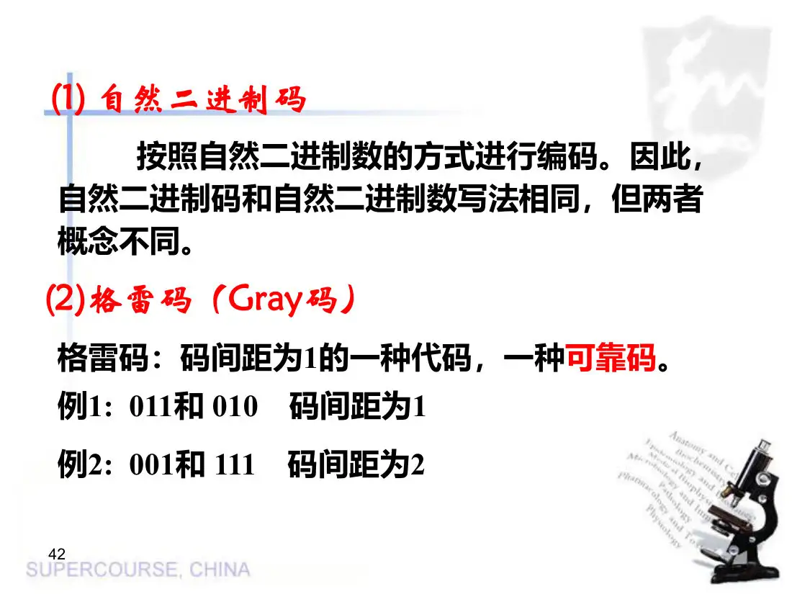

原文：

(1) 自然二进制码

按照自然二进制数的方式进行编码。因此，自然二进制码和自然二进制数写法相同，但两者概念不同。

(2)格雷码 (Gray码)

格雷码：码间距为1的一种代码，一种可靠码。

例1：011和010 码间距为1

例2：001和111 码间距为2

42

SUPERCOURSE, CHINA

### (1) 引入BCD码的原因:

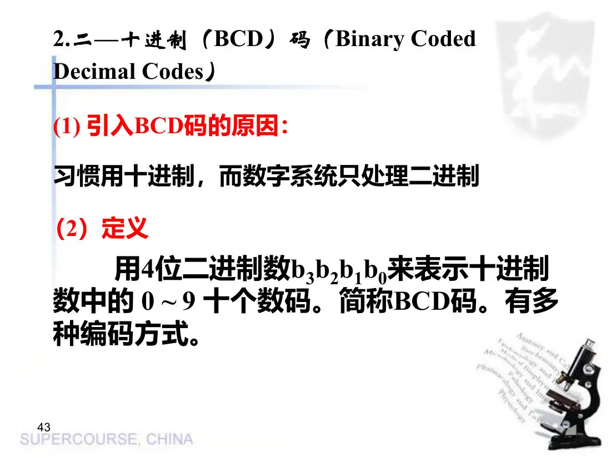

原文：

2.二—十进制（BCD）码（Binary Coded Decimal Codes）

(1) 引入BCD码的原因:

习惯用十进制，而数字系统只处理二进制

(2) 定义

用4位二进制数 $b_{3}b_{2}b_{1}b_{0}$ 来表示十进制数中的0\~9十个数码。简称BCD码。有多种编码方式。

43

SUPERCOURSE, CHINA

### (3)分类

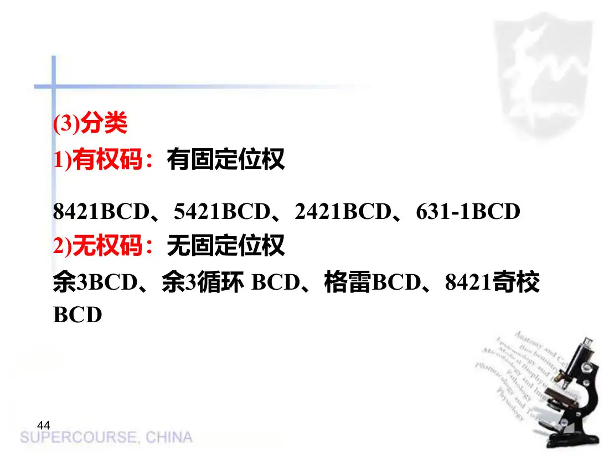

原文：

(3)分类

1)有权码：有固定位权

8421BCD、5421BCD、2421BCD、631-1BCD

2)无权码：无固定位权

余3BCD、余3循环 BCD、格雷BCD、8421奇校
BCD

44

SUPERCOURSE, CHINA

### 表1.2.2 常用BCD码

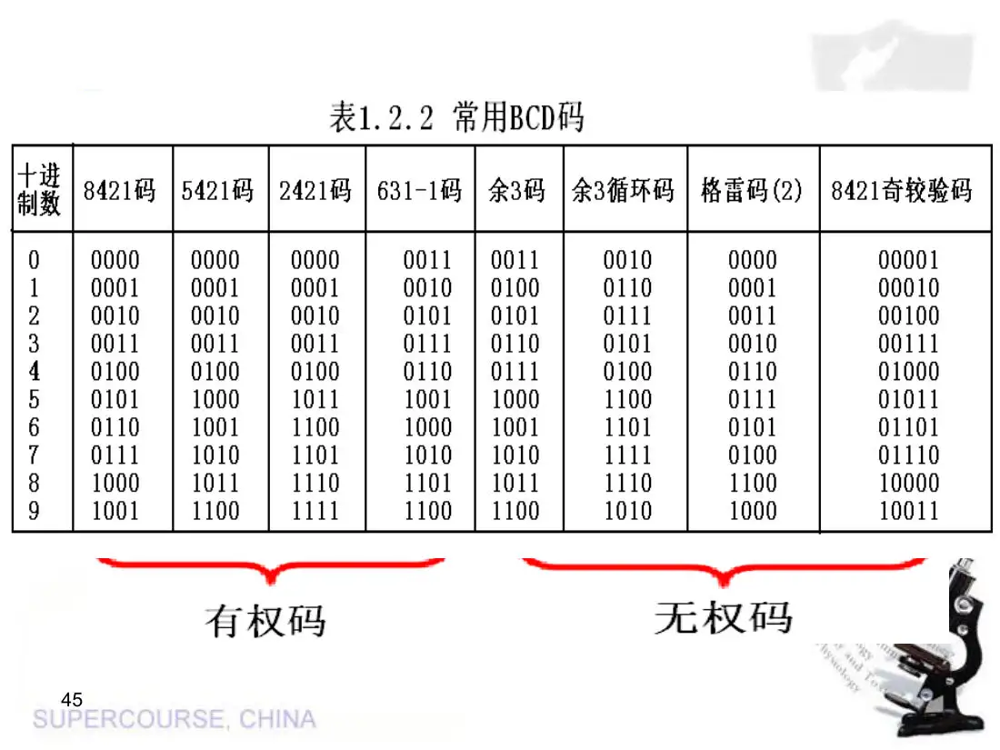

原文：

表1.2.2 常用BCD码
<table><tr><td>十进制数</td><td>8421码</td><td>5421码</td><td>2421码</td><td>631-1码</td><td>余3码</td><td>余3循环码</td><td>格雷码(2)</td><td>8421奇较验码</td></tr><tr><td>0</td><td>0000</td><td>0000</td><td>0000</td><td>0011</td><td>0011</td><td>0010</td><td>0000</td><td>00001</td></tr><tr><td>1</td><td>0001</td><td>0001</td><td>0001</td><td>0010</td><td>0100</td><td>0110</td><td>0001</td><td>00010</td></tr><tr><td>2</td><td>0010</td><td>0010</td><td>0010</td><td>0101</td><td>0101</td><td>0111</td><td>0011</td><td>00100</td></tr><tr><td>3</td><td>0011</td><td>0011</td><td>0011</td><td>0111</td><td>0110</td><td>0101</td><td>0010</td><td>00111</td></tr><tr><td>4</td><td>0100</td><td>0100</td><td>0100</td><td>0110</td><td>0111</td><td>0100</td><td>0110</td><td>01000</td></tr><tr><td>5</td><td>0101</td><td>1000</td><td>1011</td><td>1001</td><td>1000</td><td>1100</td><td>0111</td><td>01011</td></tr><tr><td>6</td><td>0110</td><td>1001</td><td>1100</td><td>1000</td><td>1001</td><td>1101</td><td>0101</td><td>01101</td></tr><tr><td>7</td><td>0111</td><td>1010</td><td>1101</td><td>1010</td><td>1010</td><td>1111</td><td>0100</td><td>01110</td></tr><tr><td>8</td><td>1000</td><td>1011</td><td>1110</td><td>1101</td><td>1011</td><td>1110</td><td>1100</td><td>10000</td></tr><tr><td>9</td><td>1001</td><td>1100</td><td>1111</td><td>1100</td><td>1100</td><td>1010</td><td>1000</td><td>10011</td></tr></table>

45

SUPERCOURSE, CHINA

### 46

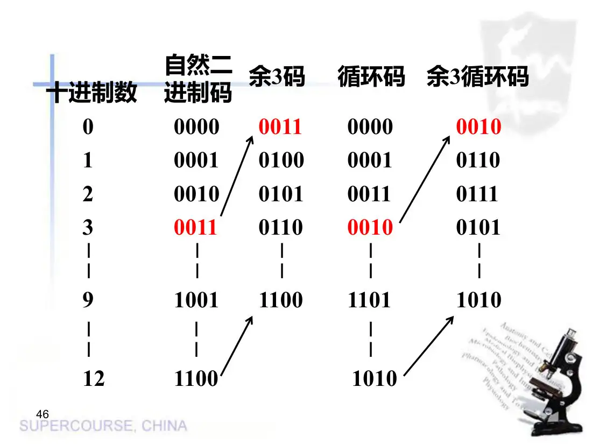

原文：

<table><tr><td>十进制数</td><td>自然二进制码</td><td>余3码</td><td>循环码</td><td>余3循环码</td></tr><tr><td>0</td><td>0000</td><td>0011</td><td>0000</td><td>0010</td></tr><tr><td>1</td><td>0001</td><td>0100</td><td>0001</td><td>0110</td></tr><tr><td>2</td><td>0010</td><td>0101</td><td>0011</td><td>0111</td></tr><tr><td>3</td><td>0011</td><td>0110</td><td>0010</td><td>0101</td></tr><tr><td>|</td><td>|</td><td>|</td><td>|</td><td>|</td></tr><tr><td>9</td><td>1001</td><td>1100</td><td>1101</td><td>1010</td></tr><tr><td>|</td><td>|</td><td></td><td>|</td><td></td></tr><tr><td>12</td><td>1100</td><td></td><td>1010</td><td></td></tr></table>

46

SUPERCOURSE, CHINA

### (3) 多位十进制数的表示

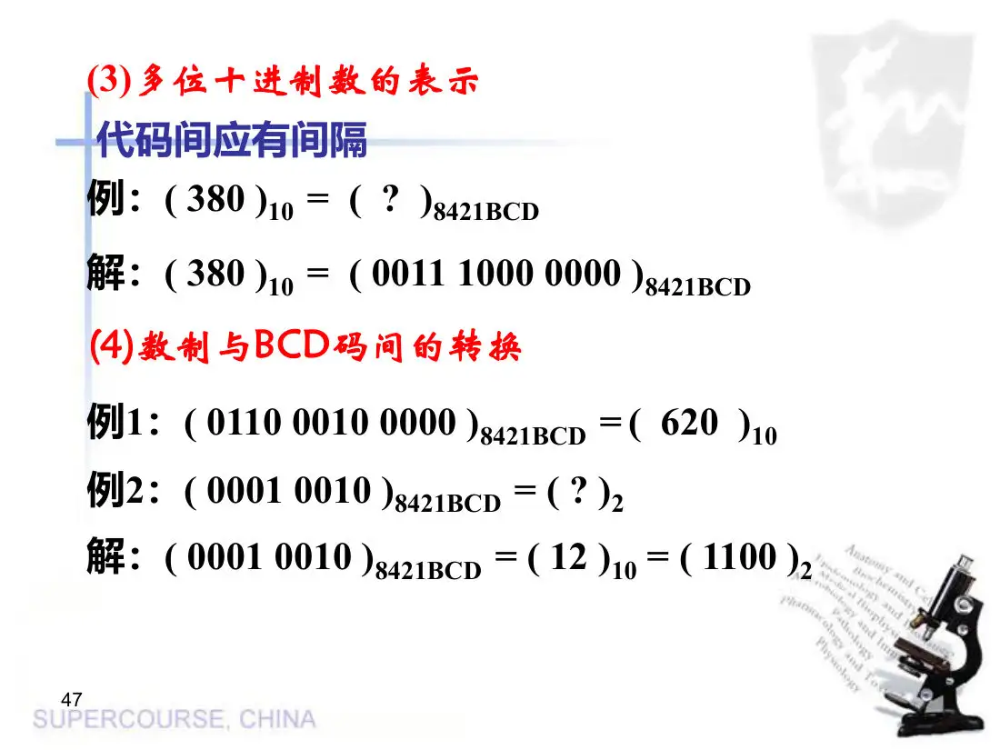

原文：

(3) 多位十进制数的表示

代码间应有间隔

例： $(380)_{10} = (\ ? )_{8421BCD}$

解： $(380)_{10} = (0011\ 1000\ 0000)_{8421BCD}$

(4)数制与BCD码间的转换

例1: (0110 0010 0000) $_{8421BCD}$ = (620) $_{10}$

例2：(0001 0010) $_{8421BCD}$ = ( ? ) $_{2}$

解： $(0001\ 0010)_{8421BCD} = (12)_{10} = (1100)_{2}$

47

SUPERCOURSE, CHINA

### (5) 8421 BCD的加减法运算

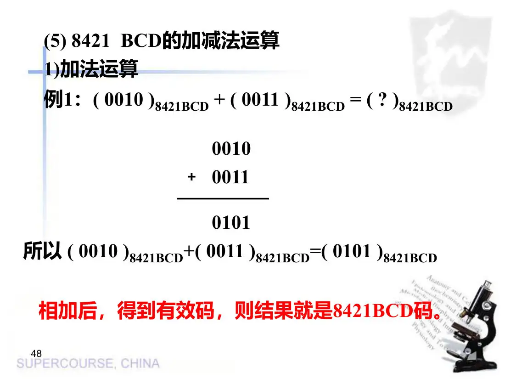

原文：

(5) 8421 BCD的加减法运算

1)加法运算

例1: (0010) $_{8421BCD}$ + (0011) $_{8421BCD}$ = (?) $_{8421BCD}$

所以 $(0010)_{8421\mathrm{BCD}} + (0011)_{8421\mathrm{BCD}} = (0101)_{8421\mathrm{BCD}}$

相加后，得到有效码，则结果就是8421BCD码。

48

SUPERCOURSE, CHINA

### $$

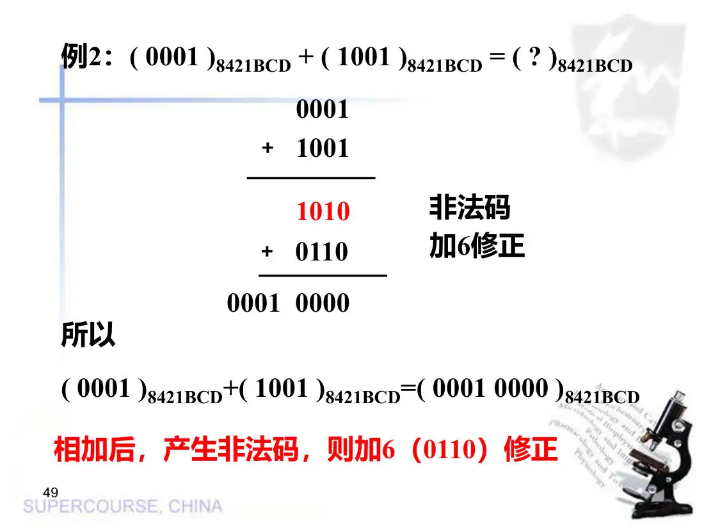

原文：

$$
\begin{array}{r l} & {\text {例2: (0001) _ {8421BCD} +(1001) _ {8421BCD} = (?) _ {8421BCD}}} \\ & {\quad \begin{array}{c c} {0 0 0 1} \\ {+ 1 0 0 1} \\ {\hline 1 0 1 0} \\ {+ 0 1 1 0} \\ {\hline 0 0 0 1 0 0 0 0} \end{array} \quad \text {非法码}} \\ & {\text {加6修正}} \end{array}
$$

所以

$$
(0 0 0 1) _ {8 4 2 1 \mathrm{BCD}} + (1 0 0 1) _ {8 4 2 1 \mathrm{BCD}} = (0 0 0 1 0 0 0 0) _ {8 4 2 1 \mathrm{BCD}}
$$

相加后，产生非法码，则加6（0110）修正

49

SUPERCOURSE, CHINA

### $$

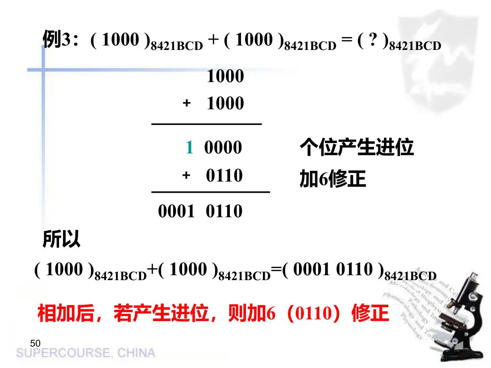

原文：

$$
\begin{array}{r l} & {\text {例3: (1000) _ {8421BCD} +(1000) _ {8421BCD} = (?) _ {8421BCD}}} \\ & {\quad \begin{array}{c c} {1 0 0 0} \\ {+ 1 0 0 0} \\ {\hline 1 0 0 0 0} & {\text {个位产生进位}} \\ {+ 0 1 1 0} & {\text {加6修正}} \\ {\hline 0 0 0 1 0 1 1 0} \end{array} } \end{array}
$$

所以

$$
(1 0 0 0) _ {8 4 2 1 \mathrm{BCD}} + (1 0 0 0) _ {8 4 2 1 \mathrm{BCD}} = (0 0 0 1 0 1 1 0) _ {8 4 2 1 \mathrm{BCD}}
$$

相加后，若产生进位，则加6（0110）修正

50

SUPERCOURSE, CHINA

### 结论：

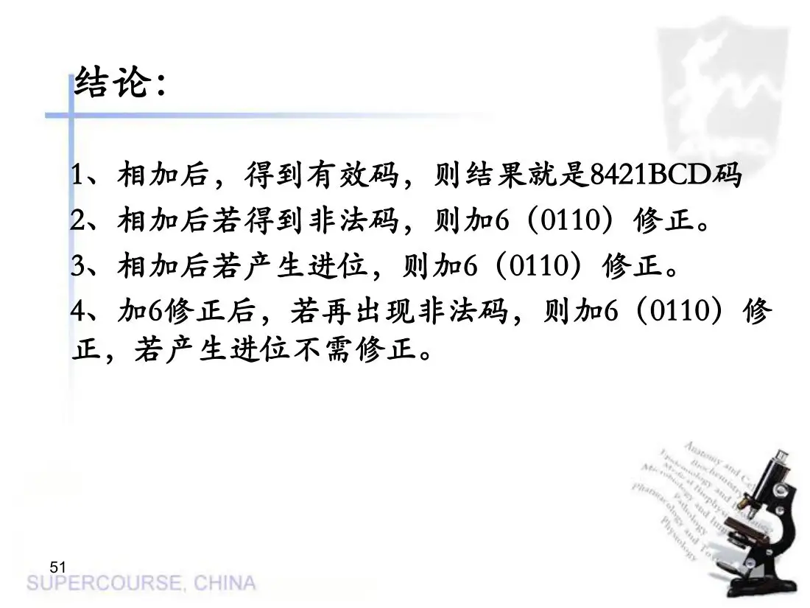

原文：

结论：

1、相加后，得到有效码，则结果就是8421BCD码

2、相加后若得到非法码，则加6（0110）修正。

3、相加后若产生进位，则加6（0110）修正。

4、加6修正后，若再出现非法码，则加6（0110）修正，若产生进位不需修正。

51

SUPERCOURSE, CHINA

### 2)减法运算

原文：

2)减法运算

$$
\begin{array}{r l} \text {例1: (0110) } _ {8 4 2 1 \mathrm{BCD}} - (0 0 0 1) _ {8 4 2 1 \mathrm{BCD}} = (\ref {e q : 1}) _ {8 4 2 1 \mathrm{BCD}} \\ & \quad \begin{array}{c} 0 1 1 0 \\ - 0 0 0 1 \\ \hline 0 1 0 1 \end{array} \end{array}
$$

所以

$$
(0 1 1 0) _ {8 4 2 1 \mathrm{BCD}} - (0 0 0 1) _ {8 4 2 1 \mathrm{BCD}} = (0 1 0 1) _ {8 4 2 1 \mathrm{BCD}}
$$

52

SUPERCOURSE, CHINA

### 例2：

原文：

例2：

$$
(0 0 0 1 0 0 0 0) _ {8 4 2 1 \mathrm{BCD}} - (0 1 0 1) _ {8 4 2 1 \mathrm{BCD}} = (?) _ {8 4 2 1 \mathrm{BCD}}
$$

$$
\begin{array}{r l} & \text {   0001   0000   } \\ & - \quad 0 1 0 1 \\ & \hline 0 0 0 0 1 0 1 1 \quad \text {   个位产生借位   } \\ & - \quad 0 1 1 0 \quad \text {   减6修正   } \\ & \hline 0 0 0 0 0 1 0 1 \end{array}
$$

$$
(0 0 0 1 0 0 0 0) _ {8 4 2 1 \mathrm{BCD}} - (0 1 0 1) _ {8 4 2 1 \mathrm{BCD}} = (0 1 0 1) _ {8 4 2 1 \mathrm{BCD}}
$$

53

SUPERCOURSE, CHINA

### 54

原文：

结论：两个8421BCD码相减，若相减过程中，在BCD数位上出现了向高位的借位，则应对产生借位的代码进行“减6(即二进制数0110)修正”。

54

SUPERCOURSE, CHINA
