# 《数字电路与逻辑设计B》第三章 MSI组合逻辑电路（一）编码器（课件）

原件的每一页，下面附识别出的文字。

### 第二节 中规模集成组合逻辑电路

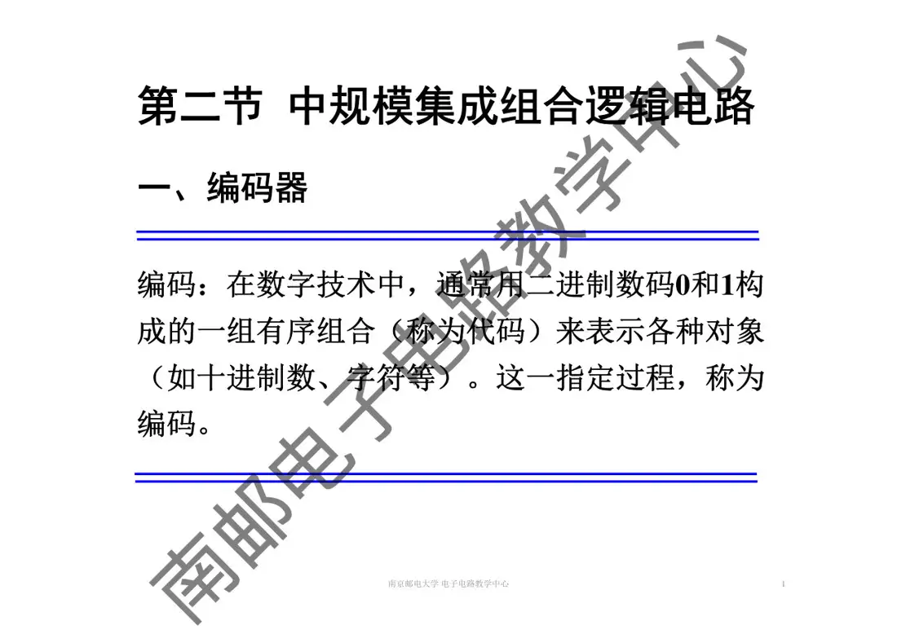

原文：

第二节 中规模集成组合逻辑电路

一、编码器

编码：在数字技术中，通常用二进制数码0和1构成的一组有序组合（称为代码）来表示各种对象（如十进制数、字符等）。这一指定过程，称为编码。

南京邮电大学 电子电路教学中心

1

### 1. 二进制编码器

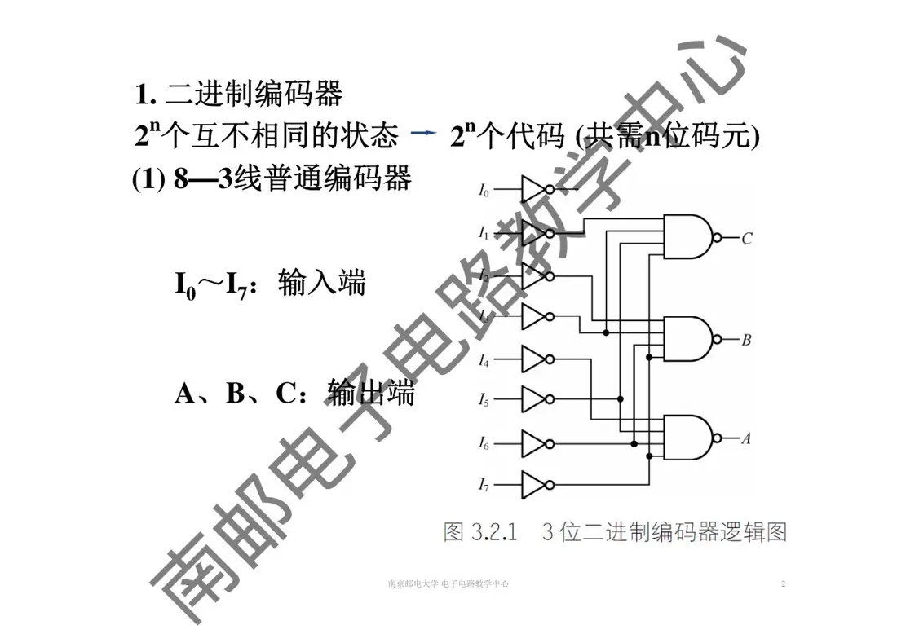

原文：

1. 二进制编码器

$2^{n}$ 个互不相同的状态 → $2^{n}$ 个代码 (共需n位码元)

(1) 8—3线普通编码器

$\mathbf{I}_0 \sim \mathbf{I}_7$ ：输入端

A、B、C: 输出端

南京邮电大学 电子电路教学中心

2

### 真值表

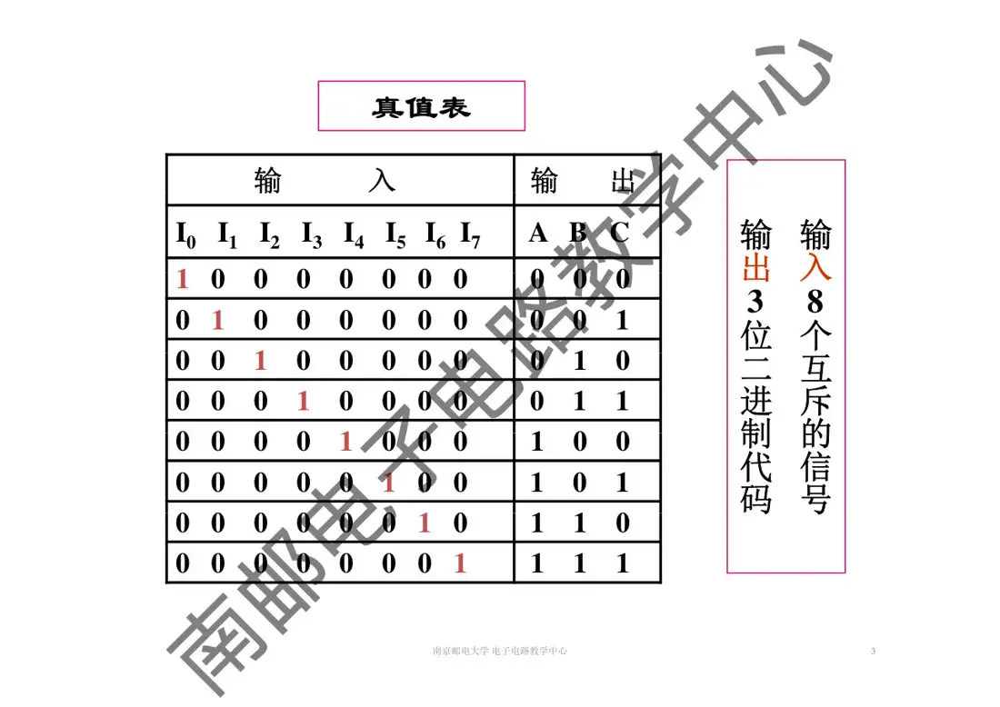

原文：

真值表

<table><tr><td colspan="8">输入</td><td colspan="3">输出</td></tr><tr><td> $I_0$ </td><td> $I_1$ </td><td> $I_2$ </td><td> $I_3$ </td><td> $I_4$ </td><td> $I_5$ </td><td> $I_6$ </td><td> $I_7$ </td><td>A</td><td>B</td><td>C</td></tr><tr><td>1</td><td>0</td><td>0</td><td>0</td><td>0</td><td>0</td><td>0</td><td>0</td><td>0</td><td>0</td><td>0</td></tr><tr><td>0</td><td>1</td><td>0</td><td>0</td><td>0</td><td>0</td><td>0</td><td>0</td><td>0</td><td>0</td><td>1</td></tr><tr><td>0</td><td>0</td><td>1</td><td>0</td><td>0</td><td>0</td><td>0</td><td>0</td><td>0</td><td>1</td><td>0</td></tr><tr><td>0</td><td>0</td><td>0</td><td>1</td><td>0</td><td>0</td><td>0</td><td>0</td><td>0</td><td>1</td><td>1</td></tr><tr><td>0</td><td>0</td><td>0</td><td>0</td><td>1</td><td>0</td><td>0</td><td>0</td><td>1</td><td>0</td><td>0</td></tr><tr><td>0</td><td>0</td><td>0</td><td>0</td><td>0</td><td>1</td><td>0</td><td>0</td><td>1</td><td>0</td><td>1</td></tr><tr><td>0</td><td>0</td><td>0</td><td>0</td><td>0</td><td>0</td><td>1</td><td>0</td><td>1</td><td>1</td><td>0</td></tr><tr><td>0</td><td>0</td><td>0</td><td>0</td><td>0</td><td>0</td><td>0</td><td>1</td><td>1</td><td>1</td><td>1</td></tr></table>

输入8个互斥的信号

南京邮电大学 电子电路教学中心

3

### 逻辑表达式

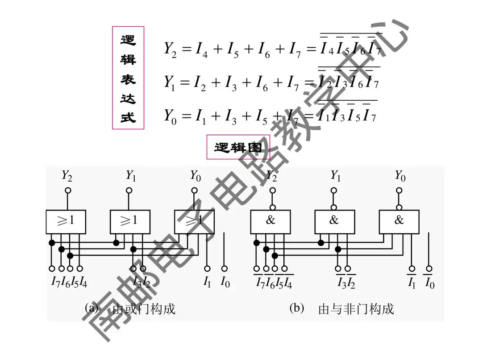

原文：

逻辑表达式

$$
\begin{array}{l} Y _ {2} = I _ {4} + I _ {5} + I _ {6} + I _ {7} = \overline {{I _ {4} I _ {5} I _ {6} I _ {7}}} \\ Y _ {1} = I _ {2} + I _ {3} + I _ {6} + I _ {7} = \overline {{I _ {2} I _ {3} I _ {6} I _ {7}}} \\ Y _ {0} = I _ {1} + I _ {3} + I _ {5} + I _ {7} = \overline {{I _ {1} I _ {3} I _ {5} I _ {7}}} \end{array}
$$

逻辑图

(a) 由或门构成

### (2) 8—3线优先编码器74148

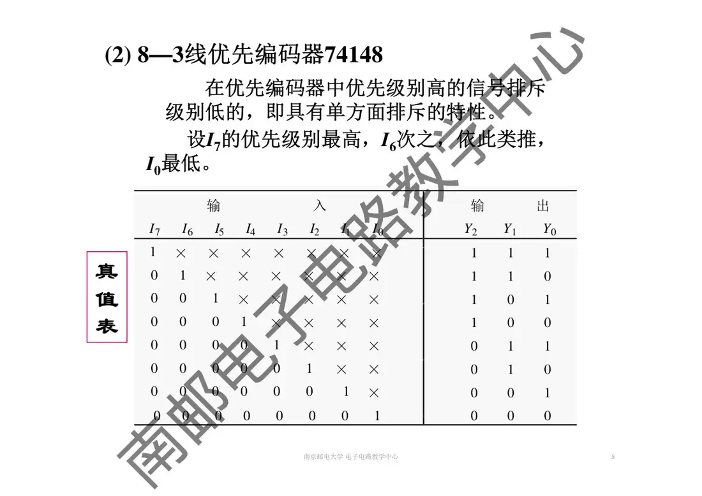

原文：

(2) 8—3线优先编码器74148

在优先编码器中优先级别高的信号排斥级别低的，即具有单方面排斥的特性。

设 $I_{7}$ 的优先级别最高， $I_{6}$ 次之，依此类推， $I_{0}$ 最低。

<table><tr><td colspan="8">输入</td><td colspan="3">输出</td></tr><tr><td> $I_7$ </td><td> $I_6$ </td><td> $I_5$ </td><td> $I_4$ </td><td> $I_3$ </td><td> $I_2$ </td><td> $I_1$ </td><td> $I_0$ </td><td> $Y_2$ </td><td> $Y_1$ </td><td> $Y_0$ </td></tr><tr><td>1</td><td>×</td><td>×</td><td>×</td><td>×</td><td>×</td><td>×</td><td>×</td><td>1</td><td>1</td><td>1</td></tr><tr><td>0</td><td>1</td><td>×</td><td>×</td><td>×</td><td>×</td><td>×</td><td>×</td><td>1</td><td>1</td><td>0</td></tr><tr><td>0</td><td>0</td><td>1</td><td>×</td><td>×</td><td>×</td><td>×</td><td>×</td><td>1</td><td>0</td><td>1</td></tr><tr><td>0</td><td>0</td><td>0</td><td>1</td><td>×</td><td>×</td><td>×</td><td>×</td><td>1</td><td>0</td><td>0</td></tr><tr><td>0</td><td>0</td><td>0</td><td>0</td><td>1</td><td>×</td><td>×</td><td>×</td><td>0</td><td>1</td><td>1</td></tr><tr><td>0</td><td>0</td><td>0</td><td>0</td><td>0</td><td>1</td><td>×</td><td>×</td><td>0</td><td>1</td><td>0</td></tr><tr><td>0</td><td>0</td><td>0</td><td>0</td><td>0</td><td>0</td><td>1</td><td>×</td><td>0</td><td>0</td><td>1</td></tr><tr><td>0</td><td>0</td><td>0</td><td>0</td><td>0</td><td>0</td><td>0</td><td>1</td><td>0</td><td>0</td><td>0</td></tr></table>

南京邮电大学 电子电路教学中心

5

### 逻辑表达式

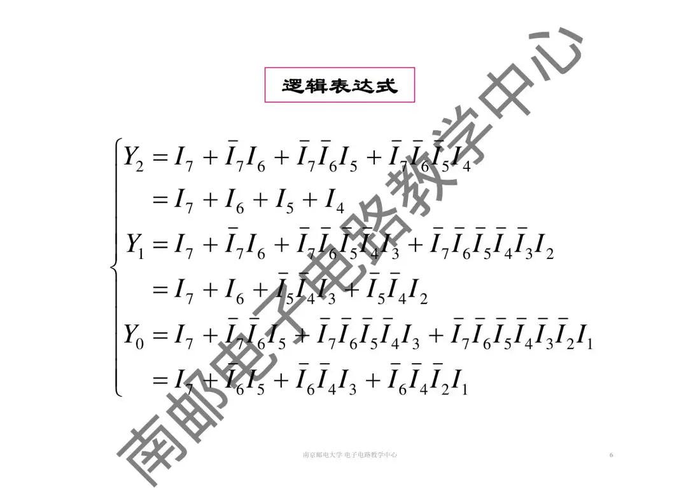

原文：

逻辑表达式

$$
\left\{ \begin{array}{l} Y _ {2} = I _ {7} + \overline {{I}} _ {7} I _ {6} + \overline {{I}} _ {7} \overline {{I}} _ {6} I _ {5} + \overline {{I}} _ {7} \overline {{I}} _ {6} \overline {{I}} _ {5} I _ {4} \\ = I _ {7} + I _ {6} + I _ {5} + I _ {4} \\ Y _ {1} = I _ {7} + \overline {{I}} _ {7} I _ {6} + \overline {{I}} _ {7} \overline {{I}} _ {6} \overline {{I}} _ {5} \overline {{I}} _ {4} I _ {3} + \overline {{I}} _ {7} \overline {{I}} _ {6} \overline {{I}} _ {5} \overline {{I}} _ {4} \overline {{I}} _ {3} I _ {2} \\ = I _ {7} + I _ {6} + \overline {{I}} _ {5} \overline {{I}} _ {4} I _ {3} + \overline {{I}} _ {5} \overline {{I}} _ {4} I _ {2} \\ Y _ {0} = I _ {7} + \overline {{I}} _ {7} \overline {{I}} _ {6} I _ {5} + \overline {{I}} _ {7} \overline {{I}} _ {6} \overline {{I}} _ {5} \overline {{I}} _ {4} I _ {3} + \overline {{I}} _ {7} \overline {{I}} _ {6} \overline {{I}} _ {5} \overline {{I}} _ {4} \overline {{I}} _ {3} \overline {{I}} _ {2} I _ {1} \\ = I _ {7} + \overline {{I}} _ {6} I _ {5} + \overline {{I}} _ {6} \overline {{I}} _ {4} I _ {3} + \overline {{I}} _ {6} \overline {{I}} _ {4} \overline {{I}} _ {2} I _ {1} \end{array} \right.
$$

南京邮电大学 电子电路教学中心

6

### -3

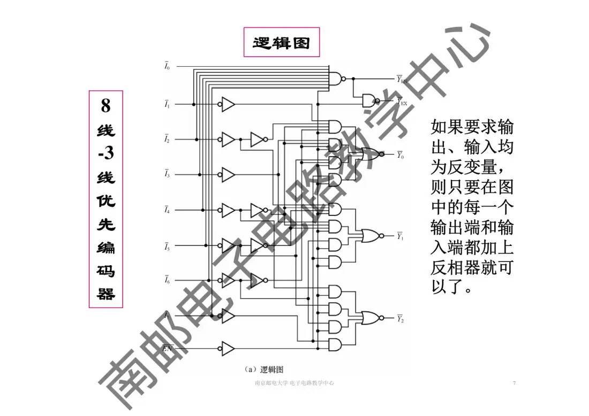

原文：

8
线
-3
线
优
先
编
码
器

如果要求输出、输入均为反变量，则只要在图中的每一个输出端和输入端都加上反相器就可以了。

南京邮电大学 电子电路教学中心

7

### 集成3位二进制优先编码器74LS148

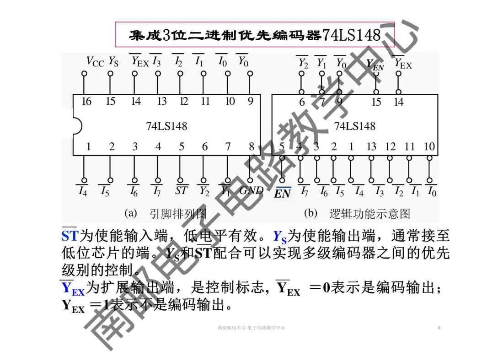

原文：

集成3位二进制优先编码器74LS148

ST为使能输入端，低电平有效。 $Y_{S}$ 为使能输出端，通常接至低位芯片的端。 $Y_{S}$ 和ST配合可以实现多级编码器之间的优先级别的控制。

$\overline{\mathbf{Y}}_{\mathrm{EX}}$ 为扩展输出端，是控制标志， $\overline{\mathbf{Y}}_{\mathrm{EX}} = \mathbf{0}$ 表示是编码输出； $\mathbf{Y}_{\mathrm{EX}} = 1$ 表示不是编码输出。

南京邮电大学 电子电路教学中心

8

### 集成3位二进制优先编码器74LS148的真值表

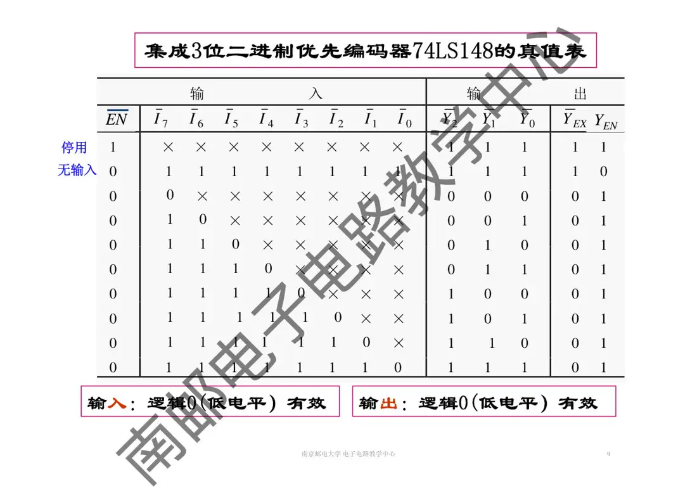

原文：

集成3位二进制优先编码器74LS148的真值表
<table><tr><td></td><td colspan="9">输入</td><td colspan="5">输出</td></tr><tr><td> $\overline{EN}$ </td><td> $\overline{I}_{7}$ </td><td> $\overline{I}_{6}$ </td><td> $\overline{I}_{5}$ </td><td> $\overline{I}_{4}$ </td><td> $\overline{I}_{3}$ </td><td> $\overline{I}_{2}$ </td><td> $\overline{I}_{1}$ </td><td> $\overline{I}_{0}$ </td><td> $\overline{Y}_{2}$ </td><td> $\overline{Y}_{1}$ </td><td> $\overline{Y}_{0}$ </td><td> $\overline{Y}_{EX}$ </td><td> $Y_{EN}$ </td><td></td></tr><tr><td>1</td><td>×</td><td>×</td><td>×</td><td>×</td><td>×</td><td>×</td><td>×</td><td>×</td><td>1</td><td>1</td><td>1</td><td>1</td><td>1</td><td></td></tr><tr><td>0</td><td>1</td><td>1</td><td>1</td><td>1</td><td>1</td><td>1</td><td>1</td><td>1</td><td>1</td><td>1</td><td>1</td><td>1</td><td>0</td><td></td></tr><tr><td>0</td><td>0</td><td>×</td><td>×</td><td>×</td><td>×</td><td>×</td><td>×</td><td>×</td><td>0</td><td>0</td><td>0</td><td>0</td><td>1</td><td></td></tr><tr><td>0</td><td>1</td><td>0</td><td>×</td><td>×</td><td>×</td><td>×</td><td>×</td><td>×</td><td>0</td><td>0</td><td>1</td><td>0</td><td>1</td><td></td></tr><tr><td>0</td><td>1</td><td>1</td><td>0</td><td>×</td><td>×</td><td>×</td><td>×</td><td>×</td><td>0</td><td>1</td><td>0</td><td>0</td><td>1</td><td></td></tr><tr><td>0</td><td>1</td><td>1</td><td>1</td><td>0</td><td>×</td><td>×</td><td>×</td><td>×</td><td>0</td><td>1</td><td>1</td><td>0</td><td>1</td><td></td></tr><tr><td>0</td><td>1</td><td>1</td><td>1</td><td>1</td><td>0</td><td>×</td><td>×</td><td>×</td><td>1</td><td>0</td><td>0</td><td>0</td><td>1</td><td></td></tr><tr><td>0</td><td>1</td><td>1</td><td>1</td><td>1</td><td>1</td><td>0</td><td>×</td><td>×</td><td>1</td><td>0</td><td>1</td><td>0</td><td>1</td><td></td></tr><tr><td>0</td><td>1</td><td>1</td><td>1</td><td>1</td><td>1</td><td>1</td><td>0</td><td>×</td><td>1</td><td>1</td><td>0</td><td>0</td><td>1</td><td></td></tr><tr><td>0</td><td>1</td><td>1</td><td>1</td><td>1</td><td>1</td><td>1</td><td>1</td><td>0</td><td>1</td><td>1</td><td>1</td><td>0</td><td>1</td><td></td></tr></table>
输入：逻辑0（低电平）有效

输出：逻辑0（低电平）有效

南京邮电大学 电子电路教学中心

9

### 集成3位二进制优先编码器74LS148的级联

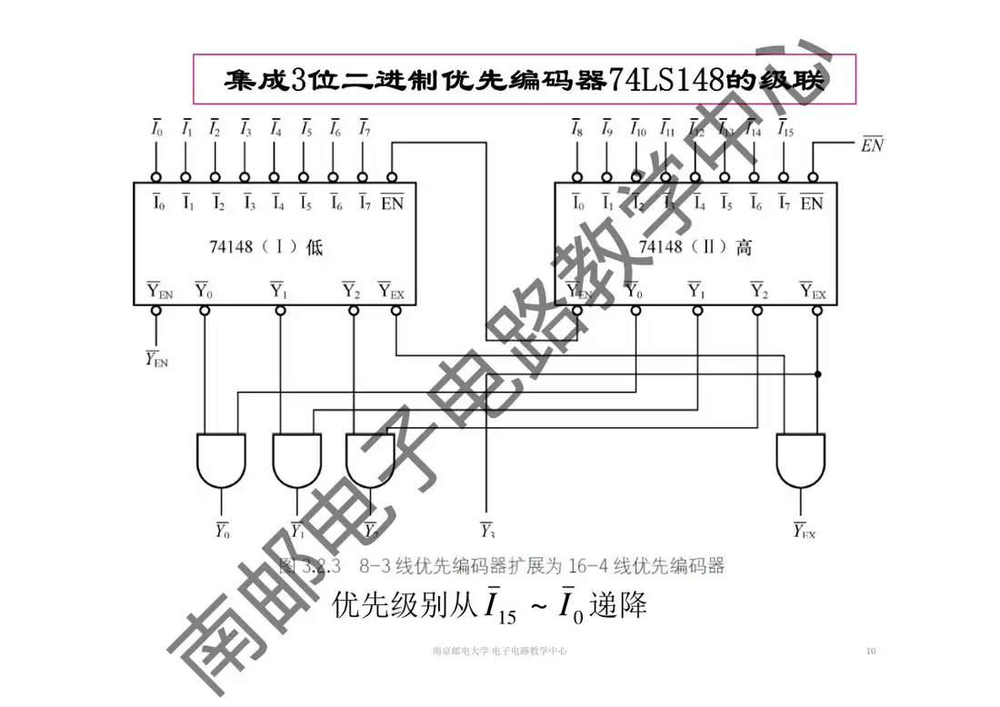

原文：

集成3位二进制优先编码器74LS148的级联

优先级别从 $\bar{I}_{15} \sim \bar{I}_0$ 递降

南京邮电大学 电子电路教学中心

10

### 2. 二-十进制编码器

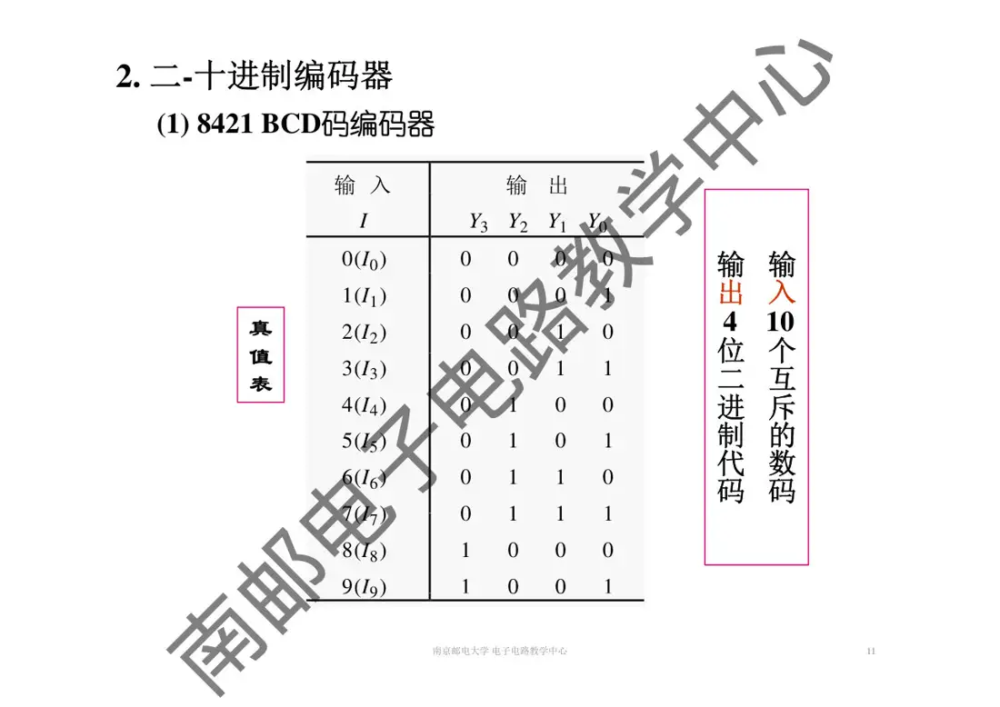

原文：

2. 二-十进制编码器

(1) 8421 BCD码编码器

<table><tr><td rowspan="2">输入I</td><td colspan="4">输出</td></tr><tr><td> $Y_3$ </td><td> $Y_2$ </td><td> $Y_1$ </td><td> $Y_0$ </td></tr><tr><td> $0(I_0)$ </td><td>0</td><td>0</td><td>0</td><td>0</td></tr><tr><td> $1(I_1)$ </td><td>0</td><td>0</td><td>0</td><td>1</td></tr><tr><td> $2(I_2)$ </td><td>0</td><td>0</td><td>1</td><td>0</td></tr><tr><td> $3(I_3)$ </td><td>0</td><td>0</td><td>1</td><td>1</td></tr><tr><td> $4(I_4)$ </td><td>0</td><td>1</td><td>0</td><td>0</td></tr><tr><td> $5(I_5)$ </td><td>0</td><td>1</td><td>0</td><td>1</td></tr><tr><td> $6(I_6)$ </td><td>0</td><td>1</td><td>1</td><td>0</td></tr><tr><td> $7(I_7)$ </td><td>0</td><td>1</td><td>1</td><td>1</td></tr><tr><td> $8(I_8)$ </td><td>1</td><td>0</td><td>0</td><td>0</td></tr><tr><td> $9(I_9)$ </td><td>1</td><td>0</td><td>0</td><td>1</td></tr></table>

输入10个互斥的数码
输出4位二进制代码

南京邮电大学 电子电路教学中心

11

### 逻辑表达式

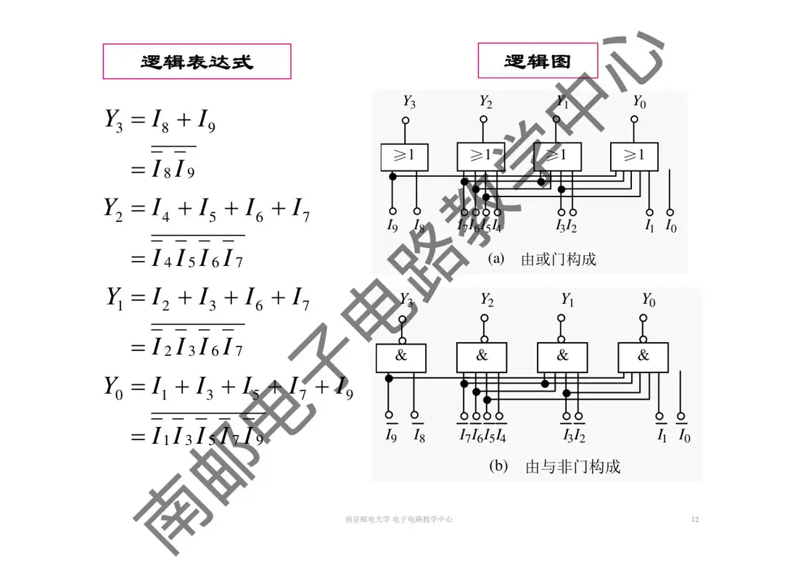

原文：

逻辑表达式

$$
\begin{array}{c} {Y _ {3} = I _ {8} + I _ {9}} \\ {= \overline {{I _ {8}}} \overline {{I _ {9}}}} \end{array}
$$

$$
\begin{array}{r} Y _ {2} = I _ {4} + I _ {5} + I _ {6} + I _ {7} \\ = \overline {{I _ {4} I _ {5} I _ {6} I _ {7}}} \end{array}
$$

$$
\begin{array}{c} Y _ {1} = I _ {2} + I _ {3} + I _ {6} + I _ {7} \\ = \overline {{I _ {2} I _ {3} I _ {6} I _ {7}}} \end{array}
$$

$$
\begin{array}{r l} Y _ {0} & = I _ {1} + I _ {3} + I _ {5} \\ & = \overline {{I _ {1}}} \overline {{I _ {3}}} \overline {{I _ {5}}} \overline {{I _ {7}}} \overline {{I _ {9}}} \end{array}
$$

逻辑图

南京邮电大学 电子电路教学中心

12

### (2) 8421 BCD码优先编码器 真值表

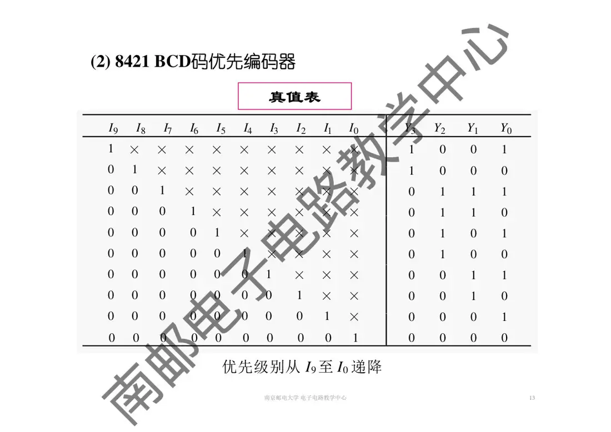

原文：

(2) 8421 BCD码优先编码器 真值表
<table><tr><td> $I_9$ </td><td> $I_8$ </td><td> $I_7$ </td><td> $I_6$ </td><td> $I_5$ </td><td> $I_4$ </td><td> $I_3$ </td><td> $I_2$ </td><td> $I_1$ </td><td> $I_0$ </td><td> $Y_3$ </td><td> $Y_2$ </td><td> $Y_1$ </td><td> $Y_0$ </td></tr><tr><td>1</td><td>×</td><td>×</td><td>×</td><td>×</td><td>×</td><td>×</td><td>×</td><td>×</td><td>×</td><td>1</td><td>0</td><td>0</td><td>1</td></tr><tr><td>0</td><td>1</td><td>×</td><td>×</td><td>×</td><td>×</td><td>×</td><td>×</td><td>×</td><td>×</td><td>1</td><td>0</td><td>0</td><td>0</td></tr><tr><td>0</td><td>0</td><td>1</td><td>×</td><td>×</td><td>×</td><td>×</td><td>×</td><td>×</td><td>×</td><td>0</td><td>1</td><td>1</td><td>1</td></tr><tr><td>0</td><td>0</td><td>0</td><td>1</td><td>×</td><td>×</td><td>×</td><td>×</td><td>×</td><td>×</td><td>0</td><td>1</td><td>1</td><td>0</td></tr><tr><td>0</td><td>0</td><td>0</td><td>0</td><td>1</td><td>×</td><td>×</td><td>×</td><td>×</td><td>×</td><td>0</td><td>1</td><td>0</td><td>1</td></tr><tr><td>0</td><td>0</td><td>0</td><td>0</td><td>0</td><td>1</td><td>×</td><td>×</td><td>×</td><td>×</td><td>0</td><td>1</td><td>0</td><td>0</td></tr><tr><td>0</td><td>0</td><td>0</td><td>0</td><td>0</td><td>0</td><td>1</td><td>×</td><td>×</td><td>×</td><td>0</td><td>0</td><td>1</td><td>1</td></tr><tr><td>0</td><td>0</td><td>0</td><td>0</td><td>0</td><td>0</td><td>0</td><td>1</td><td>×</td><td>×</td><td>0</td><td>0</td><td>1</td><td>0</td></tr><tr><td>0</td><td>0</td><td>0</td><td>0</td><td>0</td><td>0</td><td>0</td><td>0</td><td>1</td><td>×</td><td>0</td><td>0</td><td>0</td><td>1</td></tr><tr><td>0</td><td>0</td><td>0</td><td>0</td><td>0</td><td>0</td><td>0</td><td>0</td><td>0</td><td>1</td><td>0</td><td>0</td><td>0</td><td>0</td></tr></table>

优先级别从 $I_{9}$ 至 $I_0$ 递降

南京邮电大学 电子电路教学中心

13

### $$

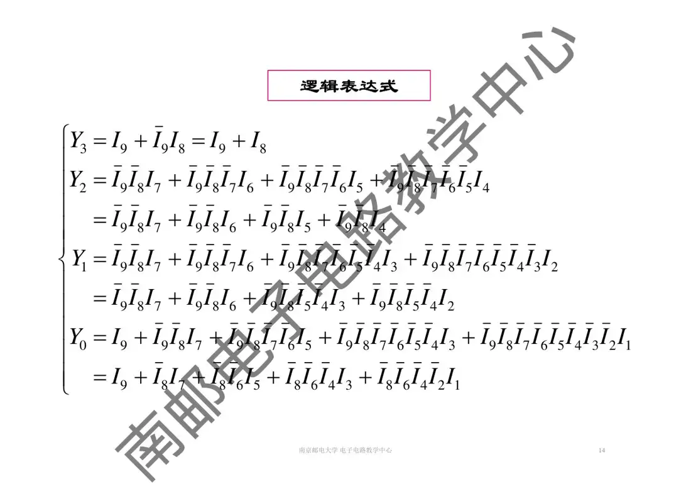

原文：

$$
\left\{ \begin{array}{l} Y _ {3} = I _ {9} + \bar {I} _ {9} I _ {8} = I _ {9} + I _ {8} \\ Y _ {2} = \bar {I} _ {9} \bar {I} _ {8} I _ {7} + \bar {I} _ {9} \bar {I} _ {8} \bar {I} _ {7} I _ {6} + \bar {I} _ {9} \bar {I} _ {8} \bar {I} _ {7} \bar {I} _ {6} I _ {5} + \bar {I} _ {9} \bar {I} _ {8} \bar {I} _ {7} \bar {I} _ {6} \bar {I} _ {5} I _ {4} \\ = \bar {I} _ {9} \bar {I} _ {8} I _ {7} + \bar {I} _ {9} \bar {I} _ {8} I _ {6} + \bar {I} _ {9} \bar {I} _ {8} I _ {5} + \bar {I} _ {9} \bar {I} _ {8} I _ {4} \\ Y _ {1} = \bar {I} _ {9} \bar {I} _ {8} I _ {7} + \bar {I} _ {9} \bar {I} _ {8} \bar {I} _ {7} I _ {6} + \bar {I} _ {9} \bar {I} _ {8} \bar {I} _ {7} \bar {I} _ {6} \bar {I} _ {5} \bar {I} _ {4} I _ {3} + \bar {I} _ {9} \bar {I} _ {8} \bar {I} _ {7} \bar {I} _ {6} \bar {I} _ {5} \bar {I} _ {4} \bar {I} _ {3} I _ {2} \\ = \bar {I} _ {9} \bar {I} _ {8} I _ {7} + \bar {I} _ {9} \bar {I} _ {8} I _ {6} + \bar {I} _ {9} \bar {I} _ {8} \bar {I} _ {5} \bar {I} _ {4} I _ {3} + \bar {I} _ {9} \bar {I} _ {8} \bar {I} _ {5} \bar {I} _ {4} I _ {2} \\ Y _ {0} = I _ {9} + \bar {I} _ {9} \bar {I} _ {8} I _ {7} + \bar {I} _ {9} \bar {I} _ {8} \bar {I} _ {7} \bar {I} _ {6} I _ {5} + \bar {I} _ {9} \bar {I} _ {8} \bar {I} _ {7} \bar {I} _ {6} \bar {I} _ {5} \bar {I} _ {4} I _ {3} + \bar {I} _ {9} \bar {I} _ {8} \bar {I} _ {7} \bar {I} _ {6} \overline \overline \overline \overline \overline \overline \overline \overline \overline \overline \overline \overline \overline \overline \overline \overline \overline {{\overline {{\overline {{\overline {{\overline {{\overline {{\overline {{\overline {{\overline {{\overline {{}}}}}}}}}}}}}}}}} - 1 0 0 0 0 0 0 0 0 0 0 0 0 0 0 0 0 0 0 0 0 0 0 0 0 0 0 0 0 0 0 0 0 0 0 0 0 0 0 0 0 0 0 0 0 0 0 0 0 0 0 1}, i j k a r e d o n t i o n s i n g l i n g l i n g l i n g l i n g l i n g l i n g l i n g l i n g l i n g l i n g l i n g l i n g l i n g l i n g l i n g l i n g l i n g l i n g l i n g l i n g l i n g l i n g l i n g l i n g l i n g, i j k a r e d o n t i o n s i n g l i n g l i n g l i n g l i n g l i n g l i n g l i n g l i n g l i n g l i n g l i n g l i n g l i n g l i n g l i n g, \\ = I _ {\mathrm{e}} + I _ {\mathrm{e}} + I _ {\mathrm{e}} + I _ {\mathrm{e}} + I _ {\mathrm{e}} + I _ {\mathrm{e}} + I _ {\mathrm{e}} + I _ {\mathrm{e}} + I _ {\mathrm{e}} + I _ {\mathrm{e}} + I _ {\mathrm{e}} + I _ {\mathrm{e}} + I _ {\mathrm{e}} + I _ {\textit {\scriptsize (i.e.})}, \\ = I _ {\mathrm{e}} + I _ {\mathrm{e}} + I _ {\mathrm{e}} + I _ {\mathrm{e}} + I _ {\mathrm{e}} + I _ {\mathrm{e}} + I _ {\mathrm{e}} + I _ {\mathrm{e}} + I _ {\mathrm{e}} + I _ {\mathrm{e}} + I _ {\mathrm{e}} + I _ {\mathrm{e}} + I. \\ = (1) ^ {- 1 / (1 - x / (x - y / (x - z / (x - y / (x - z / (x - y / (x - z / (x - y / (x - z / (x - y / (x - z / (x - y / (x - z / (x - y / (x - z / (x - y / (x - z / (x - y / (x - z / (x - y / (x - z / (x - y / (x - y / (x - y / (x - y / (x - y / (x - y / (x - y / (x - y / (x - y / (x - y / (x - y / (x - y / (x - y / (x - y / (x - y / (x - y / (x - y / (x - y / (x - y / (x - y / (x - x / (x - x / (x - x / (x - x / (x - x / (x - x / (x - x / (x - x / (x - x / (x - x / (x - x / (x - x / (x - x / (x - x / (x - x / (x - x / (x - x / (x - x / (x - x / (x - x / (x - y / (x - y / (x - y / (x - y / (x - y / (x - y / (x - y / (x - y / (x - y / (x - y / (x - y / (x - y / (x - y / (x - y / (x - y / (x - y / (x - y / (x - y / (x - y / (x - z / (y))}), i j k a r e d o n t i o n s i n g l i n g l i n g l i n g l i n g l i n g l i n g l i n g l i n g l i n g l i n g l i n g l i n g l i n g l i n g l i n g l i n g l i n g l i n g l i n g l i n g l i m p h a r e d o c t ] , \\ = (\frac {(1)}{(1)}), & \\ = (\frac {(1)}{(1)}), & \\ = (\frac {(1)}{(1)}), & \\ = (\frac {(1)}{(1)}), & \\ = (\frac {(1)}{(1)}), & \\ = (\frac {(1)}{(1)}), & \\ = (\frac {(1)}{(1)}), & \\ = (\frac {(1)}{(1)}), & \\ = (\frac {(1)}{(1)}), & \\ = (\sum_ {\substack {(i, j, k, l, m, n, o, p, q, r, w, u, v, w, w, w, w, w, w, w, w, w, w, w, w, w, w, w, w, w, w, w, w, w, w, w, w, w, w, w, w, w, w, w, w, w, w, w, w, w, w, w, w, w, w, w, w, w, w, w, w, w, w, W) & \\ = (\frac {(1)}{(1)}, & \\ = (\frac {(1)}{(1)}, & \\ = (\frac {(1)}{(1)}, & \\ = (\frac {(1)}{(1)}, & \\ = (\frac {(1)}{(1)}, & \\ = (\frac {(1)}{(1)}, & \\ = (\frac {(1)}{(1)}, & \\ = (\frac {(1)}{(1)}, & \\ = (\frac {(1)}{(1)}, & \\ = (\frac {(1)}{(1)},) & \\ = (\frac {(1)}{(1)}, & \\ = (\frac {(1)}{(1)}, & \\ = (\frac {(1)}{(1)}, & \\ = (\frac {(1)}{(1)}, & \\ = (\frac {(1)}{(1)}, & \\ = (\frac {(1)}{(1)}, & \\ = (\frac {(1)}{(1)}, & \\ = (\frac {(1)}{(1)}, & \\ = (\frac {(1)}{(1)}), & \\ = (\frac {(1)}{(1)}, & \\ = (\frac {(1)}{(1)}, & \\ = (\frac {(1)}{(1)}, & \\ = (\frac {(1)}{(1)}, & \\ = (\frac {(1)}{(1)}, & \\ = (\frac {(1)}{(1)}, & \\ = (\frac {(1)}{(1)}, & \\ = (\frac {(1)}{(1)}, & \\ = (\frac {(1)}{(1)},   & \\ = (\frac {(1)}{(1)},   & \\ = (\frac {(1)}{(1)},   & \\ = (\frac {(1)}{(1)},   & \\ = (\frac {(1)}{(1)},   & \\ = (\frac {(1)}{(1)},   & \\ = (\frac {(1)}{(1)},   & \\ = (\frac {(1)}{(1)},   & \\ = (\frac {(1)}{(1)},   & \\ = ((\frac {(i)}}{(i)}}), & \\ = ((i)}} [ A B C D E F A C D E F A C D E F A C D E F A C D E F A C D E F A C D E F A C D E F A C D E F A C D E F A C D E F A C D E F A C D E F A C D E F A C D E F A C D E F A C D E F A C D E F A C D E F A C D E F A C D E F B A C D E F A C D E F A C D E F A C D E F A C D E F A C D E F A C D E F A C D E F A C D E F A C D E F A C D E F A C D E F A C D E F A C D E F A C D E F A C D E F A C D E F A C D E F A C D E F A C D E G A C D E F A C D E G A C D E F A C D E G A C D E F A C D E G A C D E F A C D E G A C D E F A C D E G A C D E F A C D E G A C D E F A C D E G A C D E F A C D E G A C D E F A C D E G A C D E F A C D E F A C D E G A C D E F A C D E G A C D E F A C D E G A C D E F A C D E G A C D E F A C D E G A C D E F A C D E G A C D E F A C D E G A C D E F A C D E G A C D E F A C D E G A C D E G A C D E F A C D E G A C D E F A C D E G A C D E F A C D E G A C D E F A C D E G A C D E F A C D E G A C D E F A C D E G A C D E F A C D E G A C D E F A C D E G A C D E F A C D E G A C D E G A C D E G A C D E G A C D E G A C D E G A C D E G A C D E G A C D E G A C D E G A C D E G A C D E G A C D E G A C D E G A C D E G A C D E G A C D E G A C D E G A C D E G A C D E G A C D E K S U V V V V V V V V V V V V V V V V V V V V V V V V V V V V V V V V V V V V V V V V V V V V V V V V V V V V V V V V V V V V V V V V V V V V V V V V V V V V V V V V V V V V V V V V V V V V V V V W N N N N N N N N N N N N N N N N N N N N N N N N N N N N N N N N N N N N N N N N N N N N N N N N N N N N N N N N N N N N N N N N N N N N N N N N N N N N N N N N N N N N N N N N N N N N N N N N N N N NNINNINNINNINNINNINNINNINNINNINNINNINNINNINNINNINNINNINNINNINNINNINNINNINNINNINNINNINNINNINNINNINNINNINNINNINNINNINNINNINNINNINNINNINNINNINNINNINNINNINN INNINNINNINNINNINNINNINNINNINNINNINNINNINNINNINNINNINNINNINNINNINNINNINNINNINNINNINNINNINNINNINNINNINNINNINNINNINNINNINNINNINNINNINNINNINNINNINNINNINNInnInnInnInnInnInnInnInnInnInnInnInnInnInnInnInnInnInnInnInnInnInnInnInnInnInnInnInnInnInnInnInnInnInnInnInnInnInnInnInnInnInnInnInnInnInnInnInnInnInnInmInmInmInmInmInmInmInmInmInmInmInmInmInmInmInmInmInmInmInmInmInmInmInmInmInmInmInmInmInmInmInmInmInmInmInmInmInmInmInmInmInmInmInmInmInmInmInmInmInmInninjinkinjinkinjinkinjinkinjinkinjinkinjinkinjinkinjinkinjinkinjinkinjinkinjinkinjinkinjinkinjinkinjinkinjinkinjinkinjinkinjinkinjinkinjinkinjinkinjinkinjinkinjinkinjinkinjinkinjinkinjinkinjinkinjinkinjinkininjinkinjinkinjinkinjinkinjinkinjinkinjinkinjinkinjinkinjinkinjinkinjinkinjinkinjinkinjinkinjinkinjinkinjinkinjinkinjinkinjinkinjinkinjinkinjinkinjinkinjinkinjinkinjinkinjinkinjinkinjinkinjinkinjinkinJinkinJinkinJinkinJinkinJinkinJinkinJinkinJinkinJinkinJinkinJinkinJinkinJinkinJinkinJinkinJinkinJinkinJinkinJinkinJinkinJinkinJinkinJinkinJinkinJinkinJinkinJinkinJinkinJinkinJinkinJinkinJinkinJinkinJunkinskirkinskirkinskirkinskirkinskirkinskirkinskirkinskirkinskirkinskirkinskirkinskirkinskirkinskirkinskirkinskirkinskirkinskirkinskirkinskirkinskirkinskirkinskirkinskirkinskirkinskirkinskirkinskirkinskirkinskirkinskirkinskirkinskirkinskirkitskirkinskirkinskirkinskirkinskirkinskirkinskirkinskirkinskirkinskirkinskirkinskirkinskirkinskirkinskirkinskirkinskirkinskirkinskirkinskirkinskirkinskirkinskirkinskirkinskirkinskirkinskirkinskirkinskirkinskirkinskirkinskirkinskirkinssikirkinskirkinssikirkinssikirkinssikirkinssikirkinssikirkinssikirkinssikirkinssikirkinssikirkinssikirkinssikirkinssikirkinssikirkinssikirkinssikirkinssikirkinssikirkinssikirkinssikirkinssikirkinssikirkinssikirkinssikirkinssikirkinssikirkinssukirkinssukirkinssukirkinssukirkinssukirkinssukirkinssukirkinssukirkinssukirkinssukirkinssukirkinssukirkinssukirkinssukirkinssukirkinssukirkinssukirkinssukirkinssukirkinssukirkinssukirkinssukirkinssukirkinssukirkinssukirkinssutkinharklinharklinharklinharklinharklinharklinharklinharklinharklinharklinharklinharklinharklinharklinharklinharklinharklinharklinharklinharklinharklinharklinharklinharklinharklinharklinharklinharklinharklinharklinharklinharklinharklinharklin: f(x,y,z) ,\\ = (-i,j,k,l,k,l,k,l,k,l,k,l,k,l,k,l,k,l,k,l,k,l,k,l,k,l,k,l,k,l,k,l,k,l,k,l,k,l,k,l,k,l,k,l,k,l,k,l,k,l,k,l,k,l,k,l,k,l,k,l,k,l,k,l,k,l,k,l,k,l,k,l,k,l,k,l,k,l,k,l,k,l,k,l,k,l,k,l,k,l,k,l,k,l,k,l,k,l,k,l,k,l,k,r,s,u,v,w,v,w,v,w,v,w,v,w,v,w,v,w,v,w,v,w,v,w,v,w,v,w,v,w,v,w,v,w,v,w,v,w,v,w,v,w,v,w,v,w,v,w,v,w,v,w,v,w,v,w,v,w,v,w,v,w,v,w,v,w,v,w,v,w,v,w,v,w,v,w,v,w,v,w,v,w,v,w,v,w,v,w,v,w,v,w,v,w,v,w,v,w,v,w,v,w,v,w,v,WuWuWuWuWuWuWuWuWuWuWuWuWuWuWuWuWuWuWuWuWuWuWuWuWuWuWuWuWuWuWuWuWuWuWuWuWuWuWuWuWuWuWuWuWuWuWuWuWuWuWu< fcel>Y_(a,b,c,d,e,f,g,h,i,j,k,j,k,l,j,k,l,k,l,k,l,k,l,k,l,k,l,k,l,k,l,k,l,k,l,k,l,k,l,k,l,k,l,k,l,k,l,k,l,k,l,k,l,k,l,k,l,k,l,k,l,k,l,k,l,k,l,k,l,k,l,k,l,k,l,k,l,k,l,k,l,k,l,k,l,k,l,k,l,k,l,k,l,k,l,k,l,k,l,k,l,k,l,k,l,k,l,k,l,k,l,k,l,m,n,n,n,n,n,n,n,n,n,n,n,n,n,n,n,n,n,n,n,n,n,n,n,n,n,n,n,n,n,n,n,n,n,n,n,n,n,n,n,n,n,n,n,n,n,n,n,n,n,n,n,n,n,n,n,n,n,n,n,n,n,n,n,n,n,n,n,n,n,n,n,n,n,n,n,n,n,n,n,n,n,n,n,n,n,n,n,n,n,n,n,n,n,n,n,n,n,n,n,n,,\\;\\;\\;\\;\\;\\;\\;\\;\\;\\;\\;\\;\\;\\;\\;\\;\\;\\;\\;\\;\\;\\;\\;\\;\\;\\;\\;\\;\\;\\;\\;\\;\\;\\;\\;\\;\\;\\;\\;\\;\\;\\;\\;\\;\\;\\;\\;\\;\\;\\;\\;\end{array}\right.
$$

逻辑表达式

南京邮电大学 电子电路教学中心

14

### 10 线-4 线优先编码器

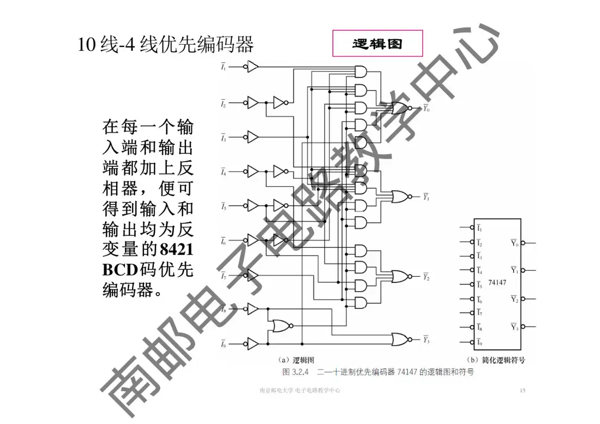

原文：

10 线-4 线优先编码器

在每一个输入端和输出端都加上反相器，便可得到输入和输出均为反变量的8421 BCD码优先编码器。

南京邮电大学 电子电路教学中心

15

### 集成10线-4线优先编码器

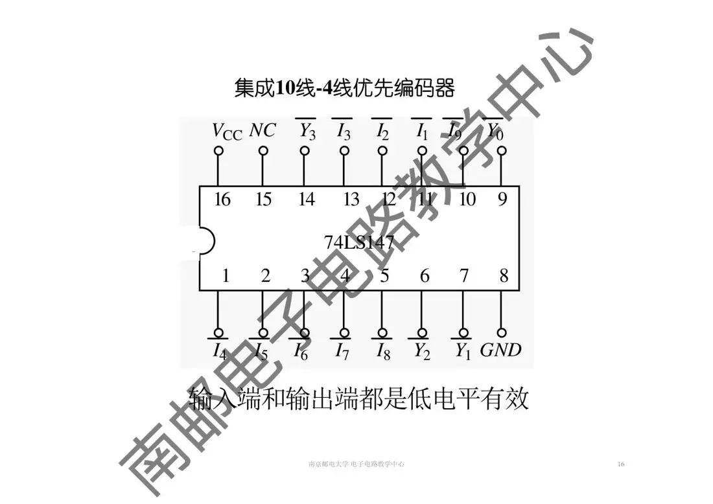

原文：

集成10线-4线优先编码器

输入端和输出端都是低电平有效

南京邮电大学 电子电路教学中心

16

### 小结

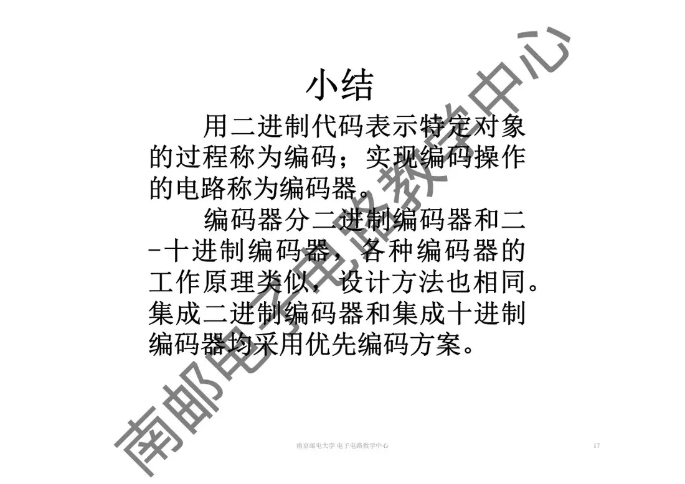

原文：

小结

用二进制代码表示特定对象的过程称为编码；实现编码操作的电路称为编码器。

编码器分二进制编码器和二十进制编码器，各种编码器的工作原理类似，设计方法也相同。集成二进制编码器和集成十进制编码器均采用优先编码方案。

南京邮电大学 电子电路教学中心

17

### 二、译码器

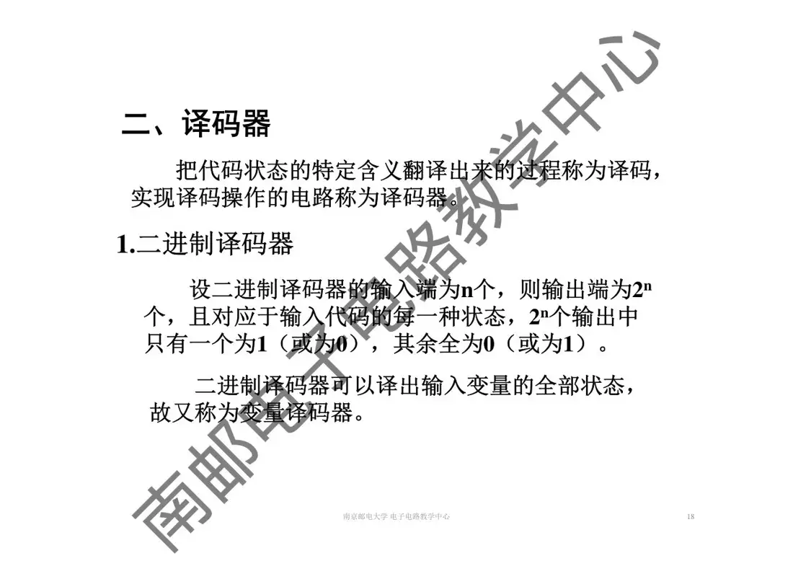

原文：

二、译码器

把代码状态的特定含义翻译出来的过程称为译码，实现译码操作的电路称为译码器。

1.二进制译码器

设二进制译码器的输入端为n个，则输出端为 $2^{n}$ 个，且对应于输入代码的每一种状态， $2^{n}$ 个输出中只有一个为1（或为0），其余全为0（或为1）。

二进制译码器可以译出输入变量的全部状态，故又称为变量译码器。

南京邮电大学 电子电路教学中心

18

### (1) 2 - 4 线译码器

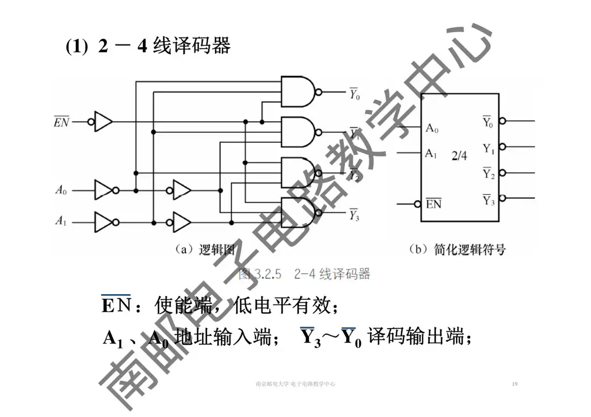

原文：

(1) 2 - 4 线译码器

EN：使能端，低电平有效；

$\mathbf{A}_1$ 、 $\mathbf{A}_0$ 地址输入端； $\overline{\mathbf{Y}}_3\sim \overline{\mathbf{Y}}_0$ 译码输出端；

南京邮电大学 电子电路教学中心

19

### 表 4.2.4 2-4 线译码器的功能表

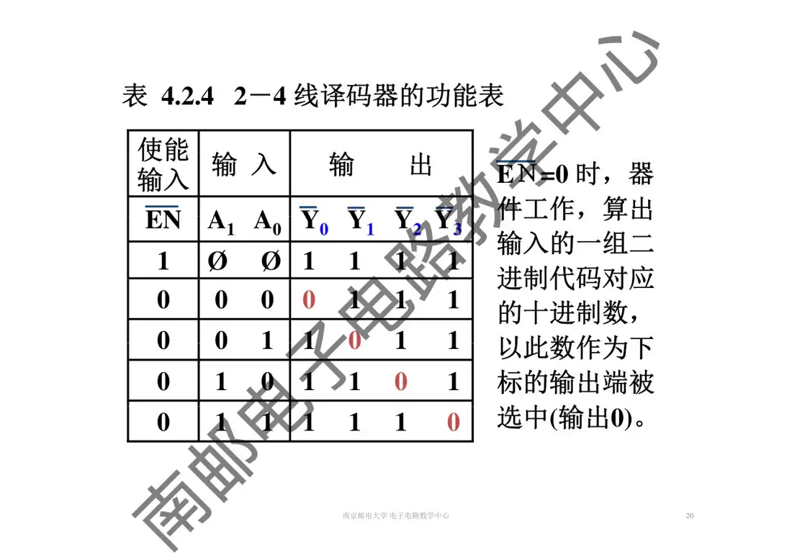

原文：

表 4.2.4 2-4 线译码器的功能表
<table><tr><td>使能输入</td><td colspan="2">输入</td><td colspan="4">输出</td></tr><tr><td> $\overline{EN}$ </td><td> $A_1$ </td><td> $A_0$ </td><td> $\overline{Y}_0$ </td><td> $\overline{Y}_1$ </td><td> $\overline{Y}_2$ </td><td> $\overline{Y}_3$ </td></tr><tr><td>1</td><td>∅</td><td>∅</td><td>1</td><td>1</td><td>1</td><td>1</td></tr><tr><td>0</td><td>0</td><td>0</td><td>0</td><td>1</td><td>1</td><td>1</td></tr><tr><td>0</td><td>0</td><td>1</td><td>1</td><td>0</td><td>1</td><td>1</td></tr><tr><td>0</td><td>1</td><td>0</td><td>1</td><td>1</td><td>0</td><td>1</td></tr><tr><td>0</td><td>1</td><td>1</td><td>1</td><td>1</td><td>1</td><td>0</td></tr></table>

EN=0 时，器件工作，算出输入的一组二进制代码对应的十进制数，以此数作为下标的输出端被选中(输出0)。

南京邮电大学 电子电路教学中心

20

### 2-4线译码器的逻辑表达式

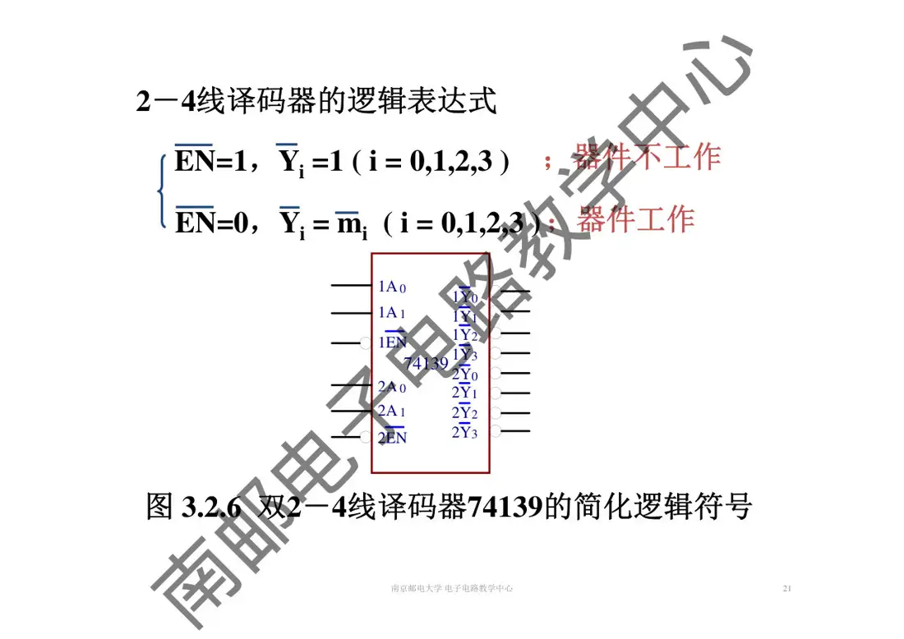

原文：

2-4线译码器的逻辑表达式

$\left\{ \begin{array}{ll}\overline{\mathbf{EN}} = 1, & \overline{\mathbf{Y}}_{\mathrm{i}} = 1 (\mathrm{i} = 0,1,2,3) \\ \overline{\mathbf{EN}} = 0, & \overline{\mathbf{Y}}_{\mathrm{i}} = \overline{\mathbf{m}}_{\mathrm{i}} (\mathrm{i} = 0,1,2,3) \end{array} ; \right.$ 器件不工作

南京邮电大学 电子电路教学中心

21

### (2) 3 - 8 线译码器

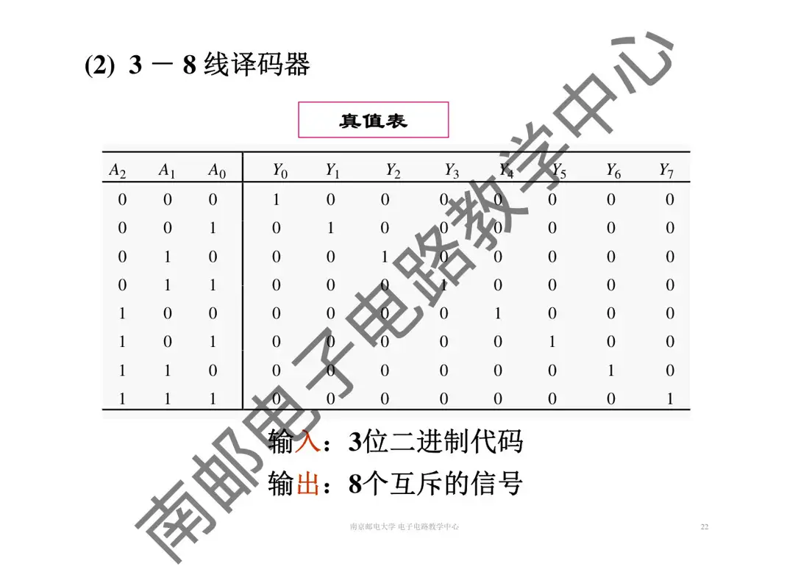

原文：

(2) 3 - 8 线译码器
<table><tr><td> $A_2$ </td><td> $A_1$ </td><td> $A_0$ </td><td> $Y_0$ </td><td> $Y_1$ </td><td> $Y_2$ </td><td> $Y_3$ </td><td> $Y_4$ </td><td> $Y_5$ </td><td> $Y_6$ </td><td> $Y_7$ </td></tr><tr><td>0</td><td>0</td><td>0</td><td>1</td><td>0</td><td>0</td><td>0</td><td>0</td><td>0</td><td>0</td><td>0</td></tr><tr><td>0</td><td>0</td><td>1</td><td>0</td><td>1</td><td>0</td><td>0</td><td>0</td><td>0</td><td>0</td><td>0</td></tr><tr><td>0</td><td>1</td><td>0</td><td>0</td><td>0</td><td>1</td><td>0</td><td>0</td><td>0</td><td>0</td><td>0</td></tr><tr><td>0</td><td>1</td><td>1</td><td>0</td><td>0</td><td>0</td><td>1</td><td>0</td><td>0</td><td>0</td><td>0</td></tr><tr><td>1</td><td>0</td><td>0</td><td>0</td><td>0</td><td>0</td><td>0</td><td>1</td><td>0</td><td>0</td><td>0</td></tr><tr><td>1</td><td>0</td><td>1</td><td>0</td><td>0</td><td>0</td><td>0</td><td>0</td><td>1</td><td>0</td><td>0</td></tr><tr><td>1</td><td>1</td><td>0</td><td>0</td><td>0</td><td>0</td><td>0</td><td>0</td><td>0</td><td>1</td><td>0</td></tr><tr><td>1</td><td>1</td><td>1</td><td>0</td><td>0</td><td>0</td><td>0</td><td>0</td><td>0</td><td>0</td><td>1</td></tr></table>

输入：3位二进制代码

输出：8个互斥的信号

南京邮电大学 电子电路教学中心

22

### 3 线-8 线译码器

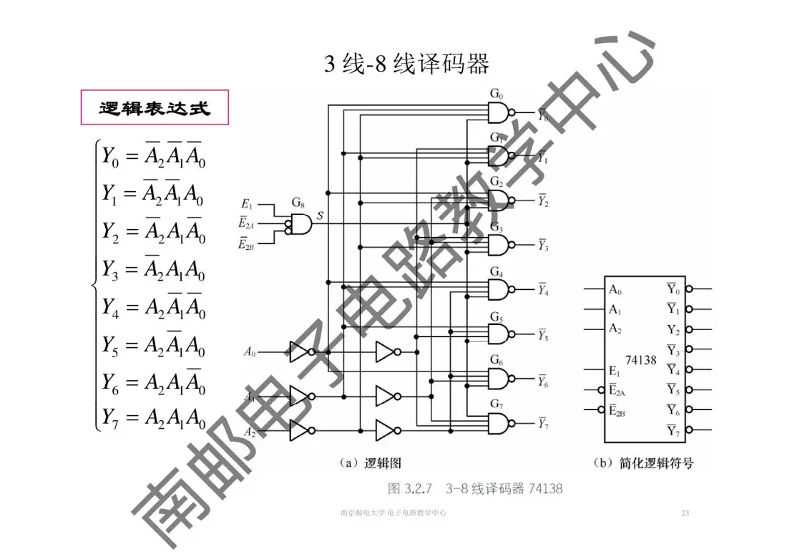

原文：

3 线-8 线译码器

逻辑表达式

$$
\left\{ \begin{array}{l} Y _ {0} = \overline {{A}} _ {2} \overline {{A}} _ {1} \overline {{A}} _ {0} \\ Y _ {1} = \overline {{A}} _ {2} \overline {{A}} _ {1} A _ {0} \\ Y _ {2} = \overline {{A}} _ {2} A _ {1} \overline {{A}} _ {0} \\ Y _ {3} = \overline {{A}} _ {2} A _ {1} A _ {0} \\ Y _ {4} = A _ {2} \overline {{A}} _ {1} \overline {{A}} _ {0} \\ Y _ {5} = A _ {2} \overline {{A}} _ {1} A _ {0} \\ Y _ {6} = A _ {2} A _ {1} \overline {{A}} _ {0} \\ Y _ {7} = A _ {2} A _ {1} A _ {0} \end{array} \right.
$$

南京邮电大学 电子电路教学中心

23

### 集成二进制译码器74LS138

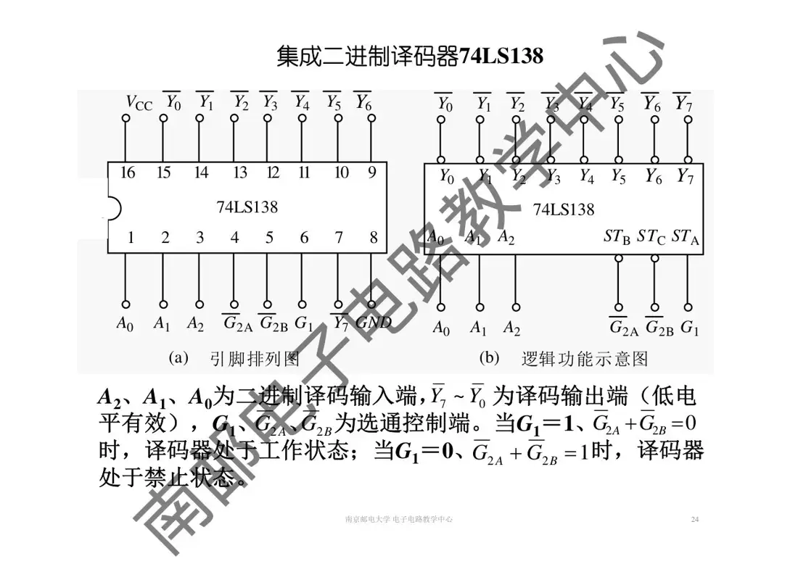

原文：

集成二进制译码器74LS138

$A_{2}$ 、 $A_{1}$ 、 $A_{0}$ 为二进制译码输入端， $\overline{Y}_{7}\sim\overline{Y}_{0}$ 为译码输出端（低电平有效）， $G_{1}$ 、 $\overline{G}_{2A}$ 、 $\overline{G}_{2B}$ 为选通控制端。当 $G_{1}=1$ 、 $\overline{G}_{2A}+\overline{G}_{2B}=0$ 时，译码器处于工作状态；当 $G_{1}=0$ 、 $\overline{G}_{2A}+\overline{G}_{2B}=1$ 时，译码器处于禁止状态。

南京邮电大学 电子电路教学中心

24

### 输入：自然二进制码

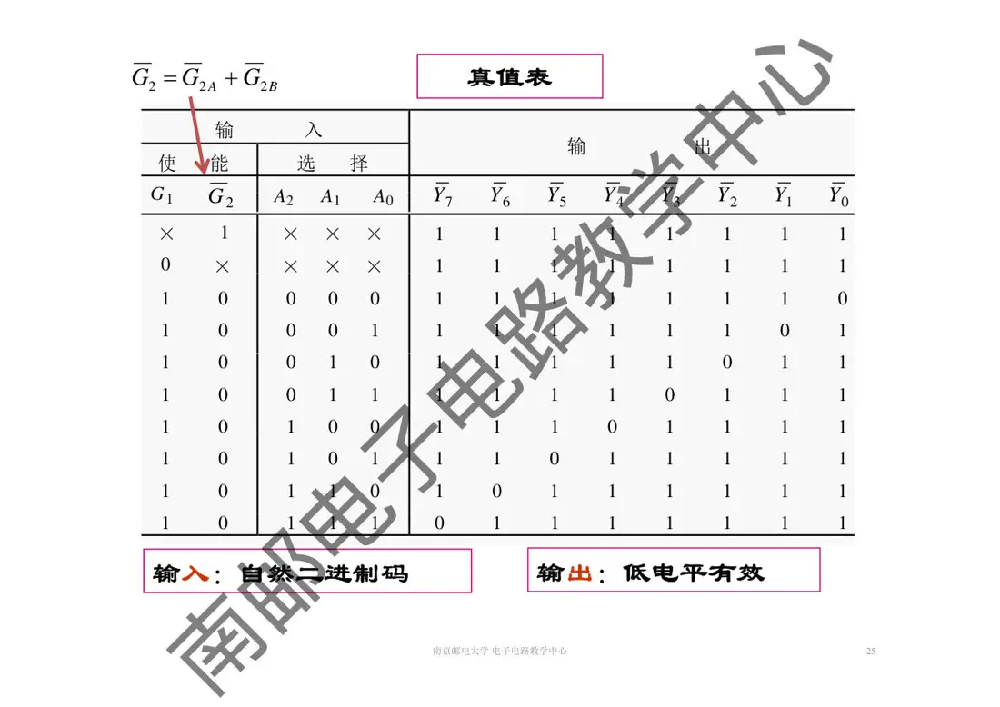

原文：

<table><tr><td colspan="5">输入</td><td rowspan="2" colspan="8">输出</td></tr><tr><td colspan="2">使能</td><td colspan="3">选择</td></tr><tr><td> $G_1$ </td><td> $\overline{G}_2$ </td><td> $A_2$ </td><td> $A_1$ </td><td> $A_0$ </td><td> $\overline{Y}_7$ </td><td> $\overline{Y}_6$ </td><td> $\overline{Y}_5$ </td><td> $\overline{Y}_4$ </td><td> $\overline{Y}_3$ </td><td> $\overline{Y}_2$ </td><td> $\overline{Y}_1$ </td><td> $\overline{Y}_0$ </td></tr><tr><td>×</td><td>1</td><td>×</td><td>×</td><td>×</td><td>1</td><td>1</td><td>1</td><td>1</td><td>1</td><td>1</td><td>1</td><td>1</td></tr><tr><td>0</td><td>×</td><td>×</td><td>×</td><td>×</td><td>1</td><td>1</td><td>1</td><td>1</td><td>1</td><td>1</td><td>1</td><td>1</td></tr><tr><td>1</td><td>0</td><td>0</td><td>0</td><td>0</td><td>1</td><td>1</td><td>1</td><td>1</td><td>1</td><td>1</td><td>1</td><td>0</td></tr><tr><td>1</td><td>0</td><td>0</td><td>0</td><td>1</td><td>1</td><td>1</td><td>1</td><td>1</td><td>1</td><td>1</td><td>0</td><td>1</td></tr><tr><td>1</td><td>0</td><td>0</td><td>1</td><td>0</td><td>1</td><td>1</td><td>1</td><td>1</td><td>1</td><td>0</td><td>1</td><td>1</td></tr><tr><td>1</td><td>0</td><td>0</td><td>1</td><td>1</td><td>1</td><td>1</td><td>1</td><td>1</td><td>0</td><td>1</td><td>1</td><td>1</td></tr><tr><td>1</td><td>0</td><td>1</td><td>0</td><td>0</td><td>1</td><td>1</td><td>1</td><td>0</td><td>1</td><td>1</td><td>1</td><td>1</td></tr><tr><td>1</td><td>0</td><td>1</td><td>0</td><td>1</td><td>1</td><td>1</td><td>0</td><td>1</td><td>1</td><td>1</td><td>1</td><td>1</td></tr><tr><td>1</td><td>0</td><td>1</td><td>1</td><td>0</td><td>1</td><td>0</td><td>1</td><td>1</td><td>1</td><td>1</td><td>1</td><td>1</td></tr><tr><td>1</td><td>0</td><td>1</td><td>1</td><td>1</td><td>0</td><td>1</td><td>1</td><td>1</td><td>1</td><td>1</td><td>1</td><td>1</td></tr></table>

输入：自然二进制码

输出：低电平有效

南京邮电大学 电子电路教学中心

25

### 3-8线译码器74138的逻辑表达式

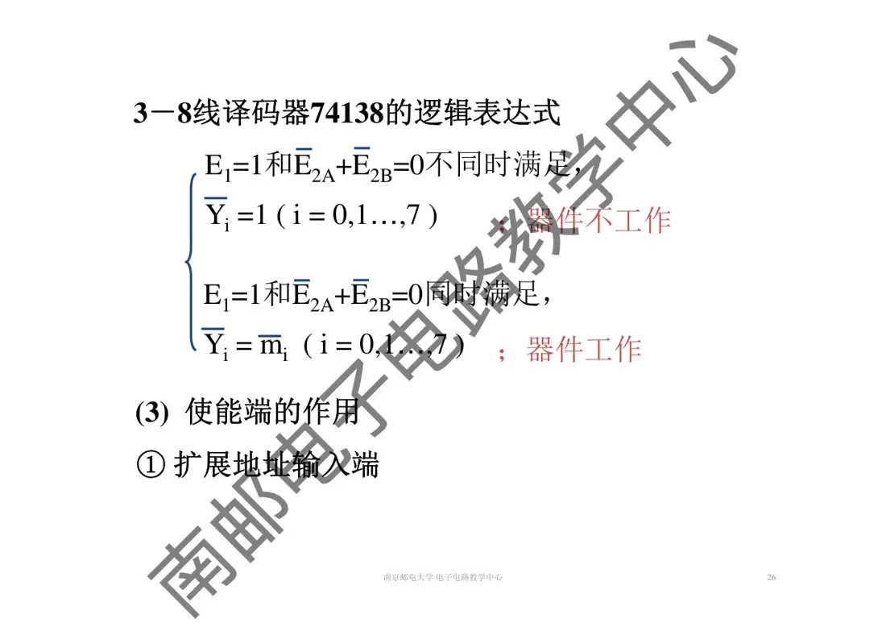

原文：

3-8线译码器74138的逻辑表达式

$E_{1}=1$ 和 $\overline{E}_{2A}+\overline{E}_{2B}=0$ 不同时满足，

$$
\overline {{\mathrm{Y}}} _ {\mathrm{i}} = 1 (\mathrm{i} = 0, 1 \dots , 7)
$$

；器件不工作

$\mathrm{E}_{1} = 1$ 和 $\overline{\mathrm{E}}_{2\mathrm{A}} + \overline{\mathrm{E}}_{2\mathrm{B}} = 0$ 同时满足，

$\overline{Y}_{i}=\overline{m}_{i}\quad(i=0,1\ldots,7)$ ；器件工作

(3) 使能端的作用

① 扩展地址输入端

南京邮电大学 电子电路教学中心

26

### (a) 两片 2-4 线译码器扩展为 3-8 线译码器

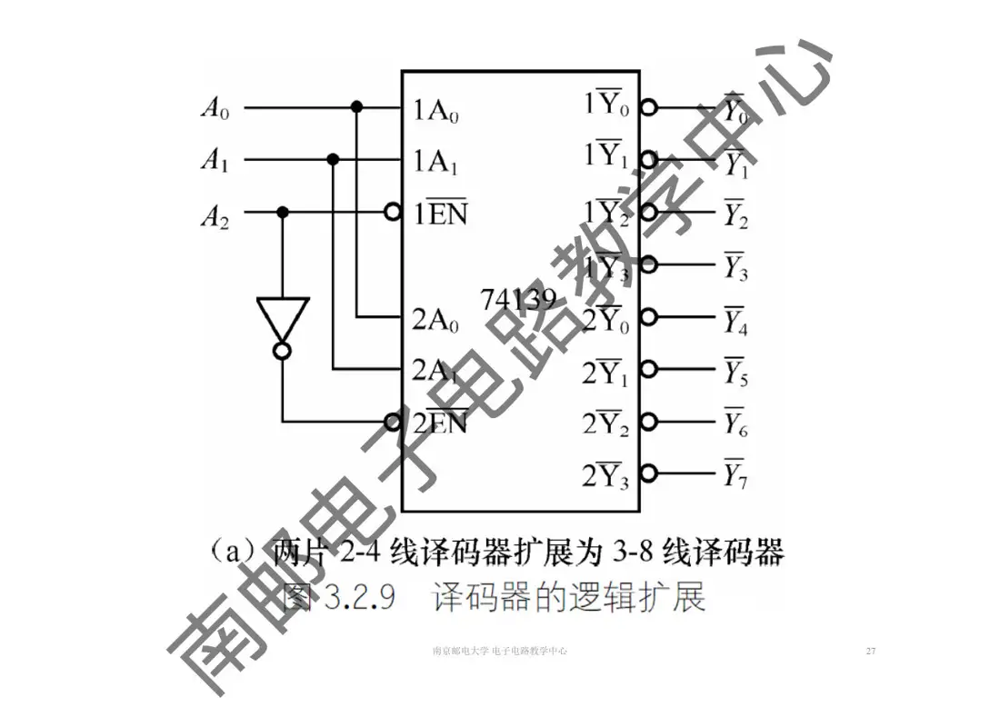

原文：

(a) 两片 2-4 线译码器扩展为 3-8 线译码器
图 3.2.9 译码器的逻辑扩展

南京邮电大学 电子电路教学中心

27

### 表 4.2.6 2-4 线译码器扩展为 3-8 线译码器的真值表

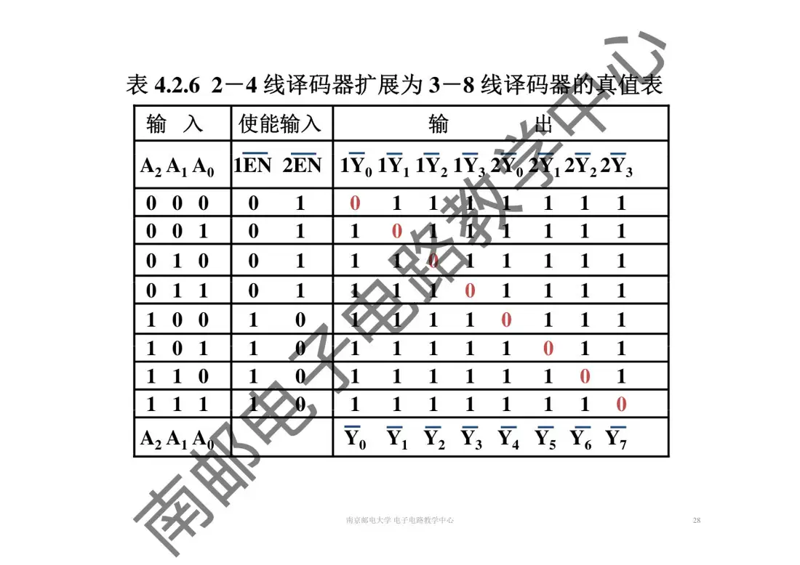

原文：

表 4.2.6 2-4 线译码器扩展为 3-8 线译码器的真值表
<table><tr><td>输入</td><td>使能输入</td><td>输出</td></tr><tr><td> $A_{2}A_{1}A_{0}$ </td><td> $1\overline{EN}$   $2\overline{EN}$ </td><td> $1\overline{Y}_{0}$   $1\overline{Y}_{1}$   $1\overline{Y}_{2}$   $1\overline{Y}_{3}$   $2\overline{Y}_{0}$   $2\overline{Y}_{1}$   $2\overline{Y}_{2}$   $2\overline{Y}_{3}$ </td></tr><tr><td>0 0 0</td><td>0 1</td><td>0 1 1 1 1 1 1 1</td></tr><tr><td>0 0 1</td><td>0 1</td><td>1 0 1 1 1 1 1 1</td></tr><tr><td>0 1 0</td><td>0 1</td><td>1 1 0 1 1 1 1 1</td></tr><tr><td>0 1 1</td><td>0 1</td><td>1 1 1 0 1 1 1 1</td></tr><tr><td>1 0 0</td><td>1 0</td><td>1 1 1 1 0 1 1 1</td></tr><tr><td>1 0 1</td><td>1 0</td><td>1 1 1 1 1 0 1 1 1</td></tr><tr><td>1 1 0</td><td>1 0</td><td>1 1 1 1 1 1 0 1</td></tr><tr><td>1 1 1</td><td>1 0</td><td>1 1 1 1 1 1 1 0</td></tr><tr><td> $A_{2}A_{1}A_{0}$ </td><td></td><td> $\overline{Y}_{0}$   $\overline{Y}_{1}$   $\overline{Y}_{2}$   $\overline{Y}_{3}$   $\overline{Y}_{4}$   $\overline{Y}_{5}$   $\overline{Y}_{6}$   $\overline{Y}_{7}$ </td></tr></table>

南京邮电大学 电子电路教学中心

28

### 南京邮电大学 电子电路教学中心

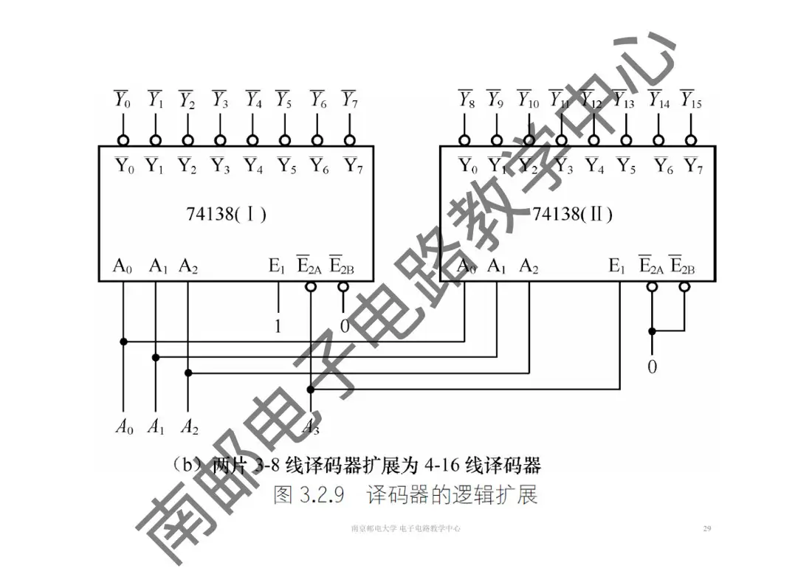

原文：

南京邮电大学 电子电路教学中心

29

### ② 构造数据分配器

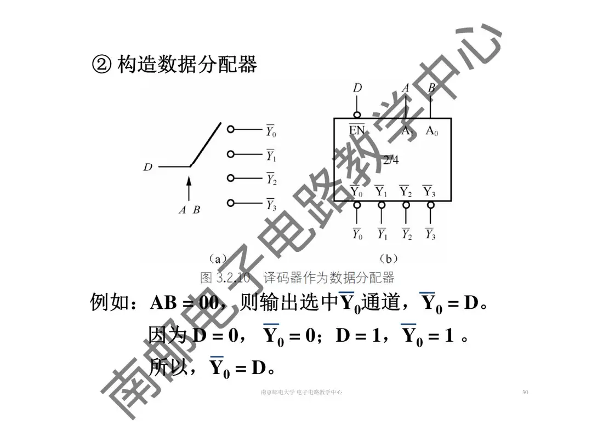

原文：

② 构造数据分配器

例如：AB=00，则输出选中 $\overline{Y}_{0}$ 通道， $\overline{Y}_{0}=D$ 。

因为 $\mathbf{D} = \mathbf{0}$ ， $\overline{\mathbf{Y}}_0 = \mathbf{0}$ ； $\mathbf{D} = \mathbf{1}$ ， $\overline{\mathbf{Y}}_0 = \mathbf{1}$ 。

所以， $\overline{\mathbf{Y}}_0 = \mathbf{D}$ 。

南京邮电大学 电子电路教学中心

30

### ③用译码器设计组合逻辑电路

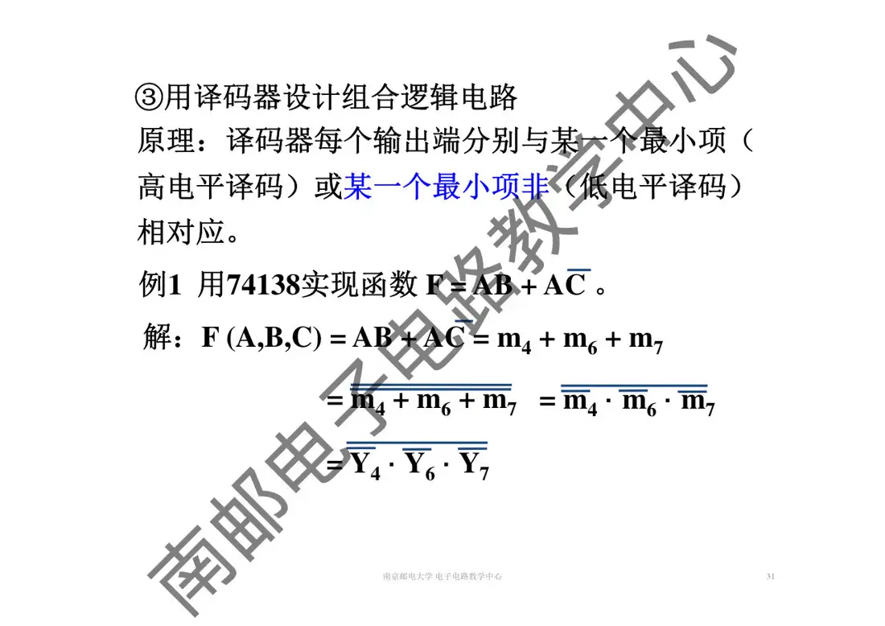

原文：

③用译码器设计组合逻辑电路

原理：译码器每个输出端分别与某一个最小项（高电平译码）或某一个最小项非（低电平译码）相对应。

例1 用74138实现函数 $F = AB + AC$ 。

解： $\mathbf{F}(\mathbf{A},\mathbf{B},\mathbf{C}) = \mathbf{A}\mathbf{B} + \mathbf{A}\overline{\mathbf{C}} = \mathbf{m}_{4} + \mathbf{m}_{6} + \mathbf{m}_{7}$

南京邮电大学 电子电路教学中心

31

### 南京邮电大学 电子电路教学中心

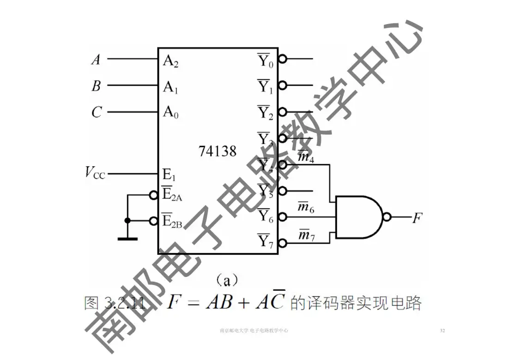

原文：

图3.2.11 $F = AB + AC\overline{C}$ 的译码器实现电路

南京邮电大学 电子电路教学中心

32

### $$

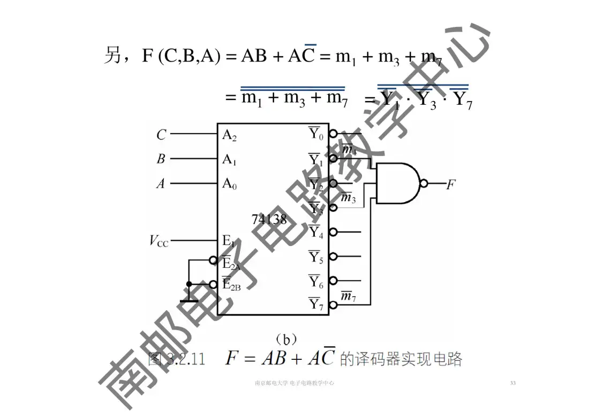

原文：

$$
\mathrm{F} (\mathrm{C}, \mathrm{B}, \mathrm{A}) = \mathrm{AB} + \mathrm{AC} = \mathrm{m} _ {1} + \mathrm{m} _ {3} + \mathrm{m} _ {7}
$$

$F = AB + A\overline{C}$ 的译码器实现电路例2 用74138设计一个多输出组合网络，它的输入为A、B、C三个变量，输出为下面三个函数。

南京邮电大学 电子电路教学中心

33

### $$

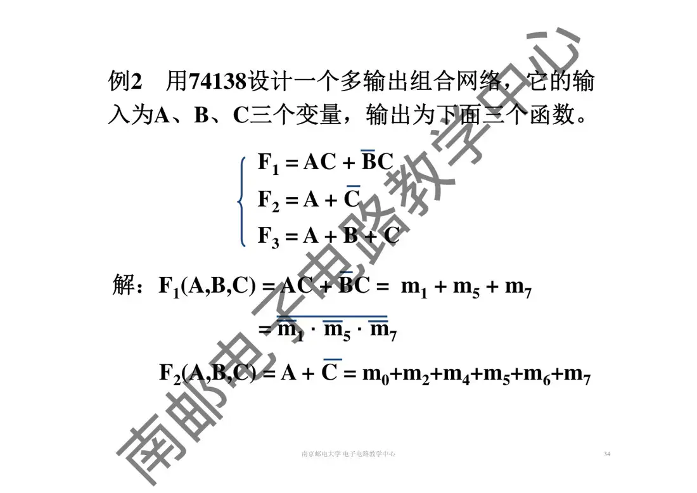

原文：

$$
\left\{ \begin{array}{l} \mathbf {F} _ {1} = \mathbf {A C} + \overline {{\mathbf {B}}} \mathbf {C} \\ \mathbf {F} _ {2} = \mathbf {A} + \overline {{\mathbf {C}}} \\ \mathbf {F} _ {3} = \mathbf {A} + \mathbf {B} + \mathbf {C} \end{array} \right.
$$

解： $\mathbf{F}_{1}(\mathbf{A},\mathbf{B},\mathbf{C}) = \mathbf{A}\mathbf{C} + \overline{\mathbf{B}}\mathbf{C} = \mathbf{m}_{1} + \mathbf{m}_{5} + \mathbf{m}_{7}$

$$
= \overline {{\mathbf {m} _ {1}}} \cdot \overline {{\mathbf {m} _ {5}}} \cdot \overline {{\mathbf {m} _ {7}}}
$$

$$
\mathbf {F} _ {2} (\mathbf {A}, \mathbf {B}, \mathbf {C}) = \mathbf {A} + \overline {{\mathbf {C}}} = \mathbf {m} _ {0} + \mathbf {m} _ {2} + \mathbf {m} _ {4} + \mathbf {m} _ {5} + \mathbf {m} _ {6} + \mathbf {m} _ {7}
$$

南京邮电大学 电子电路教学中心

34

### 南京邮电大学 电子电路教学中心

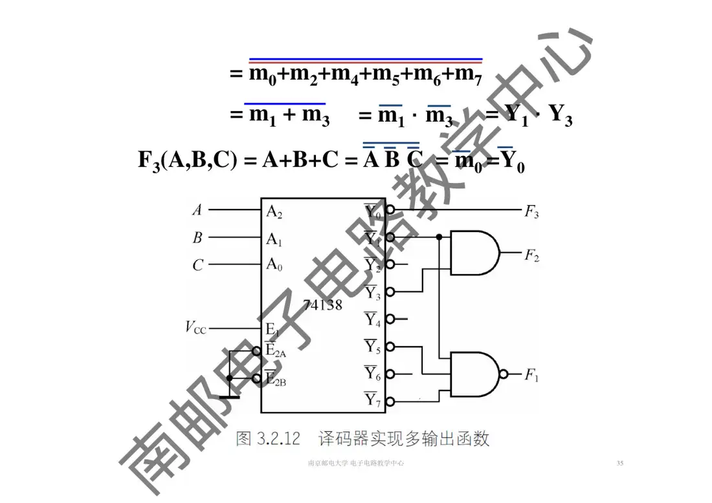

原文：

南京邮电大学 电子电路教学中心

35

### 2.二—十进制译码器

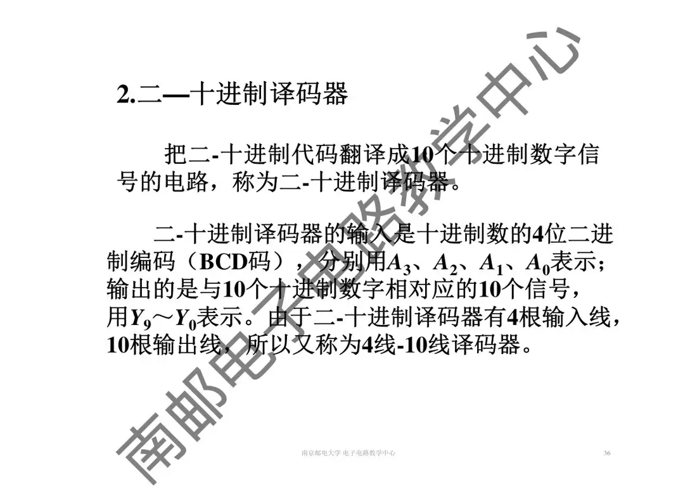

原文：

2.二—十进制译码器

把二-十进制代码翻译成10个十进制数字信号的电路，称为二-十进制译码器。

二-十进制译码器的输入是十进制数的4位二进制编码（BCD码），分别用 $A_{3}$ 、 $A_{2}$ 、 $A_{1}$ 、 $A_{0}$ 表示；输出的是与10个十进制数字相对应的10个信号，用 $Y_{9}\sim Y_{0}$ 表示。由于二-十进制译码器有4根输入线，10根输出线，所以又称为4线-10线译码器。

南京邮电大学 电子电路教学中心

36

### 南京邮电大学 电子电路教学中心

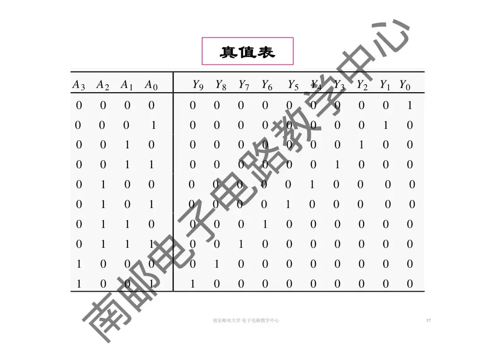

原文：

<table><tr><td colspan="14">真值表</td></tr><tr><td> $A_3$ </td><td> $A_2$ </td><td> $A_1$ </td><td> $A_0$ </td><td> $Y_9$ </td><td> $Y_8$ </td><td> $Y_7$ </td><td> $Y_6$ </td><td> $Y_5$ </td><td> $Y_4$ </td><td> $Y_3$ </td><td> $Y_2$ </td><td> $Y_1$ </td><td> $Y_0$ </td></tr><tr><td>0</td><td>0</td><td>0</td><td>0</td><td>0</td><td>0</td><td>0</td><td>0</td><td>0</td><td>0</td><td>0</td><td>0</td><td>0</td><td>1</td></tr><tr><td>0</td><td>0</td><td>0</td><td>1</td><td>0</td><td>0</td><td>0</td><td>0</td><td>0</td><td>0</td><td>0</td><td>0</td><td>1</td><td>0</td></tr><tr><td>0</td><td>0</td><td>1</td><td>0</td><td>0</td><td>0</td><td>0</td><td>0</td><td>0</td><td>0</td><td>0</td><td>1</td><td>0</td><td>0</td></tr><tr><td>0</td><td>0</td><td>1</td><td>1</td><td>0</td><td>0</td><td>0</td><td>0</td><td>0</td><td>0</td><td>1</td><td>0</td><td>0</td><td>0</td></tr><tr><td>0</td><td>1</td><td>0</td><td>0</td><td>0</td><td>0</td><td>0</td><td>0</td><td>0</td><td>1</td><td>0</td><td>0</td><td>0</td><td>0</td></tr><tr><td>0</td><td>1</td><td>0</td><td>1</td><td>0</td><td>0</td><td>0</td><td>0</td><td>1</td><td>0</td><td>0</td><td>0</td><td>0</td><td>0</td></tr><tr><td>0</td><td>1</td><td>1</td><td>0</td><td>0</td><td>0</td><td>0</td><td>1</td><td>0</td><td>0</td><td>0</td><td>0</td><td>0</td><td>0</td></tr><tr><td>0</td><td>1</td><td>1</td><td>1</td><td>0</td><td>0</td><td>1</td><td>0</td><td>0</td><td>0</td><td>0</td><td>0</td><td>0</td><td>0</td></tr><tr><td>1</td><td>0</td><td>0</td><td>0</td><td>0</td><td>1</td><td>0</td><td>0</td><td>0</td><td>0</td><td>0</td><td>0</td><td>0</td><td>0</td></tr><tr><td>1</td><td>0</td><td>0</td><td>1</td><td>1</td><td>0</td><td>0</td><td>0</td><td>0</td><td>0</td><td>0</td><td>0</td><td>0</td><td>0</td></tr></table>

南京邮电大学 电子电路教学中心

37

### 南京邮电大学 电子电路教学中心

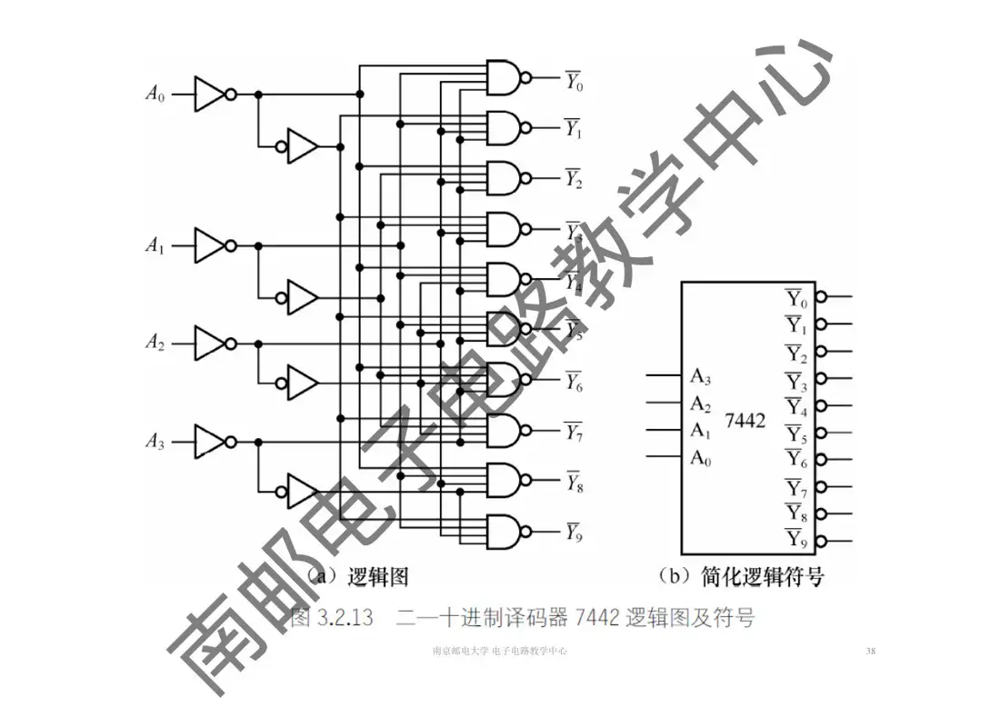

原文：

南京邮电大学 电子电路教学中心

38

### 集成8421 BCD码译码器74LS42

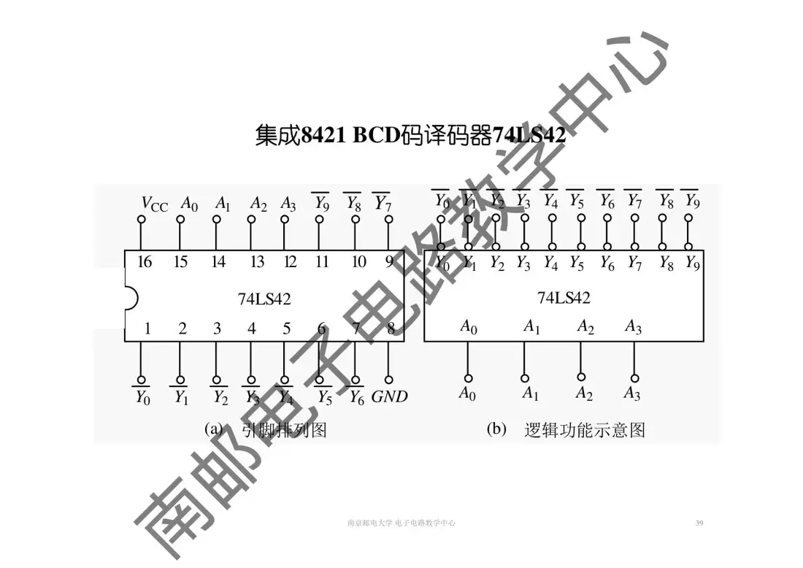

原文：

集成8421 BCD码译码器74LS42

(a) 引脚排列图 (b) 逻辑功能示意图
<table><tr><td>VCC</td><td>A0</td><td>A1</td><td>A2</td><td>A3</td><td> $\overline{Y_9}$ </td><td> $\overline{Y_8}$ </td><td> $\overline{Y_7}$ </td></tr><tr><td>16</td><td>15</td><td>14</td><td>13</td><td>12</td><td>11</td><td>10</td><td>9</td></tr><tr><td colspan="8">74LS42</td></tr><tr><td>1</td><td>2</td><td>3</td><td>4</td><td>5</td><td>6</td><td>7</td><td>8</td></tr><tr><td rowspan="12"> $\overline{Y_0}$ </td><td rowspan="12"> $\overline{Y_1}$ </td><td rowspan="12"> $\overline{Y_2}$ </td><td rowspan="12"> $\overline{Y_3}$ </td><td rowspan="12"> $\overline{Y_4}$ </td><td rowspan="12"> $\overline{Y_5}$ </td><td rowspan="12"> $\overline{Y_6}$ </td><td rowspan="11"> $\overline{Y_7}$ </td></tr><tr></tr><tr></tr><tr></tr><tr></tr><tr></tr><tr></tr><tr></tr><tr></tr><tr></tr><tr></tr><tr><td></td></tr><tr><td>作业题</td></tr><tr><td>3.10</td></tr><tr><td>3.11</td></tr><tr><td>3.12</td></tr></table>

南京邮电大学 电子电路教学中心

39

### 40

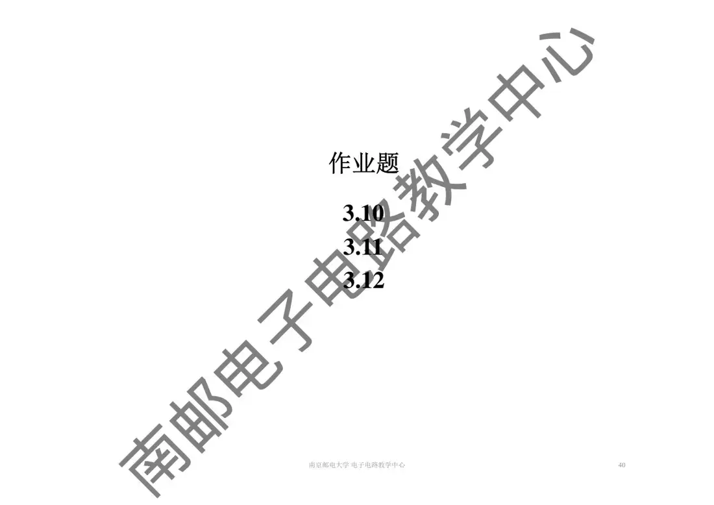

原文：

40
