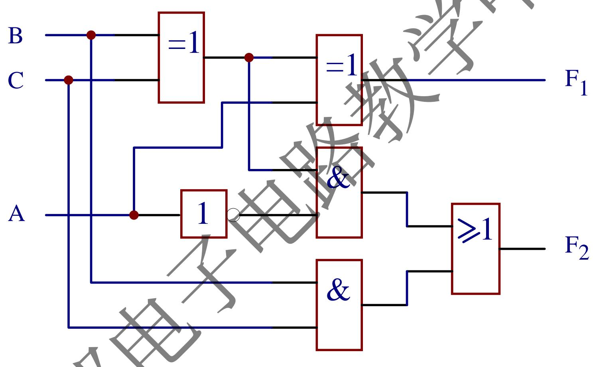
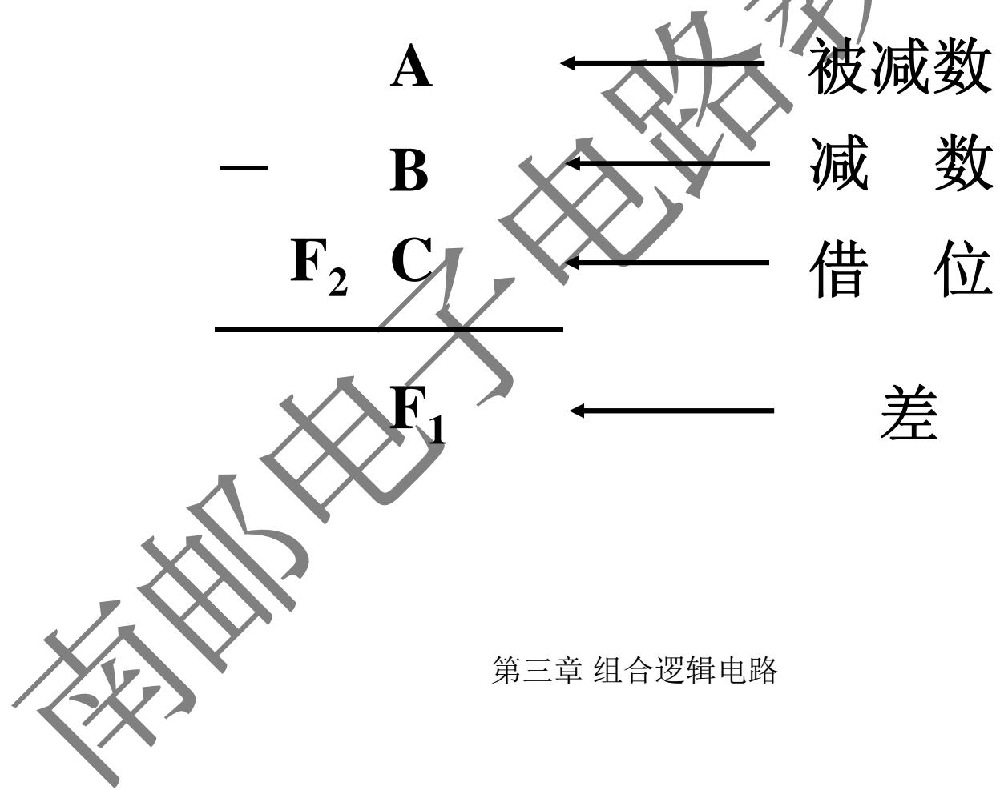
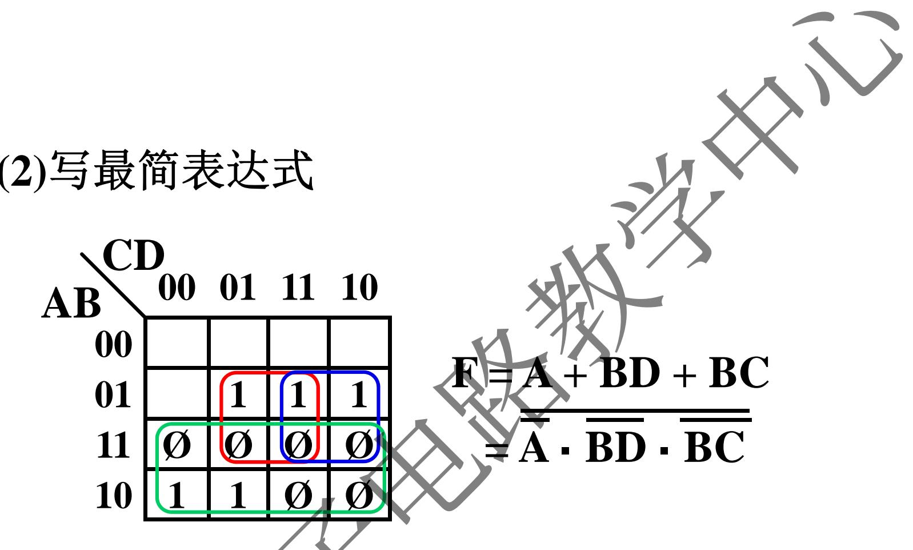
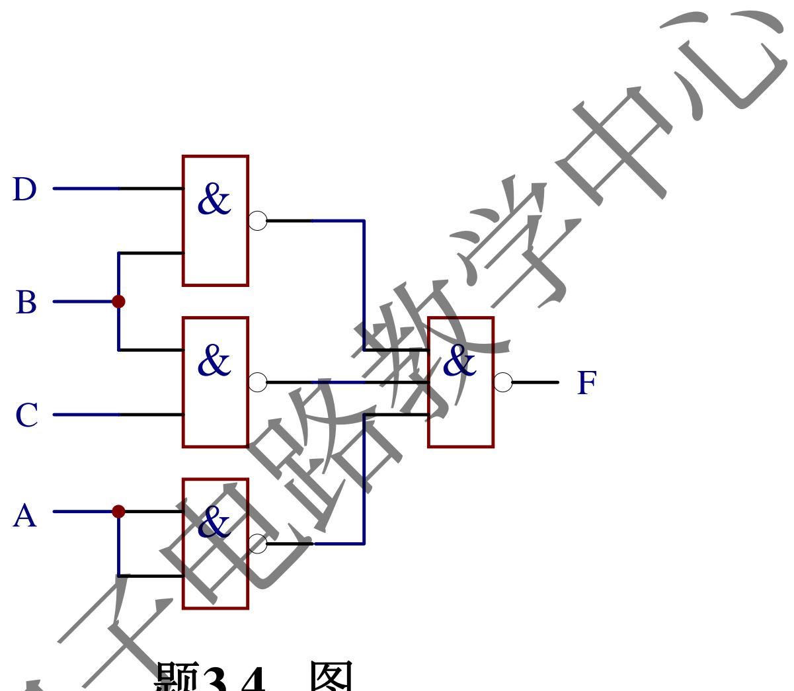
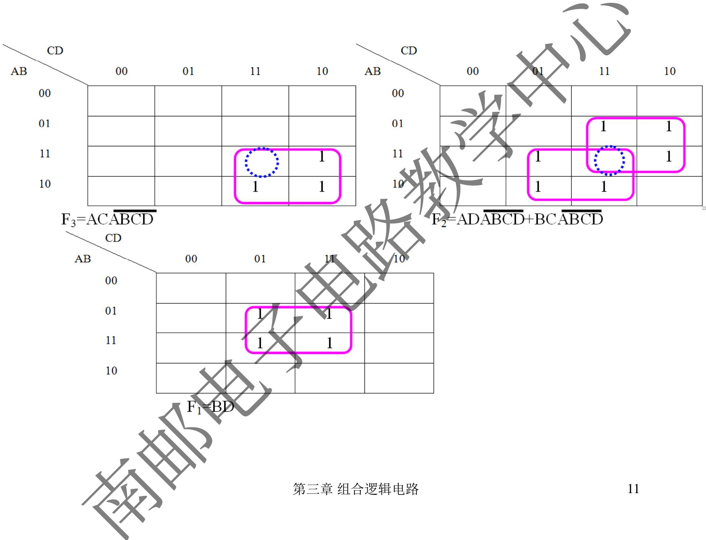

# 《数字电路与逻辑设计B》第三章 组合逻辑电路 习题1（含解答）

原件经识别和整理；“参考解答”是我们补的。

## 3.2 分析图 P3.2 电路的逻辑功能

答案：

（1）从输入端开始，逐级推导出函数表达式

$$
\mathbf {F} _ {1} = \mathbf {A} \oplus \mathbf {B} \oplus \mathbf {C}
$$

$$
\begin{aligned}
\mathbf{F}_2 &= \mathbf{A}(\mathbf{B} \oplus \mathbf{C}) + \mathbf{B}\mathbf{C} \\
&= \overline{\mathbf{A}}\,\overline{\mathbf{B}}\,\mathbf{C} + \overline{\mathbf{A}}\,\mathbf{B}\,\overline{\mathbf{C}} + \overline{\mathbf{A}}\,\mathbf{B}\,\mathbf{C} + \mathbf{A}\mathbf{B}\mathbf{C}
\end{aligned}
$$

（2）列真值表确定逻辑功能

| A | B | C | $F_1$ | $F_2$ |
|---|---|---|---|---|
| 0 | 0 | 0 | 0 | 0 |
| 0 | 0 | 1 | 1 | 1 |
| 0 | 1 | 0 | 1 | 1 |
| 0 | 1 | 1 | 0 | 1 |
| 1 | 0 | 0 | 1 | 0 |
| 1 | 0 | 1 | 0 | 0 |
| 1 | 1 | 0 | 0 | 0 |
| 1 | 1 | 1 | 1 | 1 |

（3）假设变量 A、B、C 和函数 $F_1$、$F_2$ 均表示一位二进制数，那么由真值表可知，该电路实现了全减器的功能。

A、B、C、$F_1$、$F_2$ 分别表示被减数、减数、来自低位的借位、本位差、本位向高位的借位。

## 3.4 设 ABCD 是一个 8421BCD 码，试用最少与非门设计一个能判断该 8421BCD 码是否大于等于 5 的电路，该数大于等于 5，F=1；否则为 0。

答案：

（1）列真值表

| A | B | C | D | F |
|---|---|---|---|---|
| 0 | 0 | 0 | 0 | 0 |
| 0 | 0 | 0 | 1 | 0 |
| 0 | 0 | 1 | 0 | 0 |
| 0 | 0 | 1 | 1 | 0 |
| 0 | 1 | 0 | 0 | 0 |
| 0 | 1 | 0 | 1 | 1 |
| 0 | 1 | 1 | 0 | 1 |
| 0 | 1 | 1 | 1 | 1 |
| 1 | 0 | 0 | 0 | 1 |
| 1 | 0 | 0 | 1 | 1 |
| 1 | 0 | 1 | 0 | ∅ |
| 1 | 0 | 1 | 1 | ∅ |
| 1 | 1 | 0 | 0 | ∅ |
| 1 | 1 | 0 | 1 | ∅ |
| 1 | 1 | 1 | 0 | ∅ |
| 1 | 1 | 1 | 1 | ∅ |

（2）写最简表达式

| AB\CD | 00 | 01 | 11 | 10 |
|---|---|---|---|---|
| 00 |  |  |  |  |
| 01 |  | 1 | 1 | 1 |
| 11 | ∅ | ∅ | ∅ | ∅ |
| 10 | 1 | 1 | ∅ | ∅ |

（3）画逻辑电路，如下图所示：

$$
= \mathbf{A} + \mathbf{B}\,\overline{\overline{\mathbf{D}}} \cdot \overline{\overline{\mathbf{C}}}
$$

## 3.5 试设计一个 2 位二进制数乘法器电路。

答案：

（1）设被乘数：AB，乘数 CD，乘积结果为 $F_4 F_3 F_2 F_1$。真值表为

| A | B | C | D | $F_4$ | $F_3$ | $F_2$ | $F_1$ |
|---|---|---|---|---|---|---|---|
| 0 | 0 | 0 | 0 | 0 | 0 | 0 | 0 |
| 0 | 0 | 0 | 1 | 0 | 0 | 0 | 0 |
| 0 | 0 | 1 | 0 | 0 | 0 | 0 | 0 |
| 0 | 0 | 1 | 1 | 0 | 0 | 0 | 0 |
| 0 | 1 | 0 | 0 | 0 | 0 | 0 | 0 |
| 0 | 1 | 0 | 1 | 0 | 0 | 0 | 1 |
| 0 | 1 | 1 | 0 | 0 | 0 | 1 | 0 |
| 0 | 1 | 1 | 1 | 0 | 0 | 1 | 1 |
| 1 | 0 | 0 | 0 | 0 | 0 | 0 | 0 |
| 1 | 0 | 0 | 1 | 0 | 0 | 1 | 0 |
| 1 | 0 | 1 | 0 | 0 | 1 | 0 | 0 |
| 1 | 0 | 1 | 1 | 0 | 1 | 1 | 0 |
| 1 | 1 | 0 | 0 | 0 | 0 | 0 | 0 |
| 1 | 1 | 0 | 1 | 0 | 0 | 1 | 1 |
| 1 | 1 | 1 | 0 | 0 | 1 | 1 | 0 |
| 1 | 1 | 1 | 1 | 1 | 0 | 0 | 1 |

