# 《数字电路与逻辑设计B》第二章 逻辑代数基础 第六节 逻辑函数的化简（非完全描述逻辑函数）（课件）

原件的每一页，下面附识别出的文字。

### 第二章 逻辑代数基础

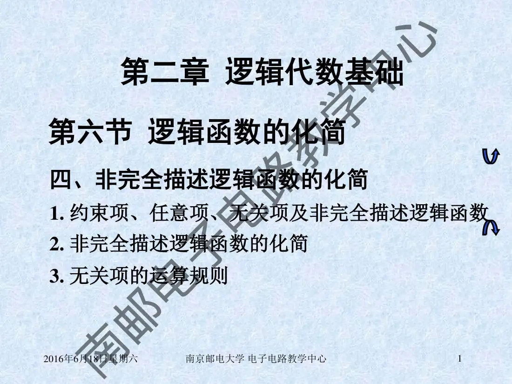

原文：

第二章 逻辑代数基础

第六节 逻辑函数的化简

四、非完全描述逻辑函数的化简

1. 约束项、任意项、无关项及非完全描述逻辑函数

2. 非完全描述逻辑函数的化简

3. 无关项的运算规则

2016年6月18日星期六

南京邮电大学 电子电路教学中心

1

### 四、非完全描述逻辑函数的化简

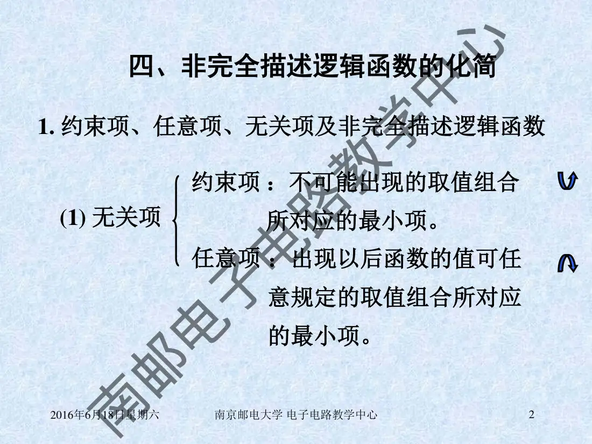

原文：

四、非完全描述逻辑函数的化简

1. 约束项、任意项、无关项及非完全描述逻辑函数

(1) 无关项

约束项：不可能出现的取值组合所对应的最小项。

：出现以后函数的值可任意规定的取值组合所对应的最小项。

2016年6月18日星期六

南京邮电大学 电子电路教学中心

2

### (2) 非完全描述逻辑函数

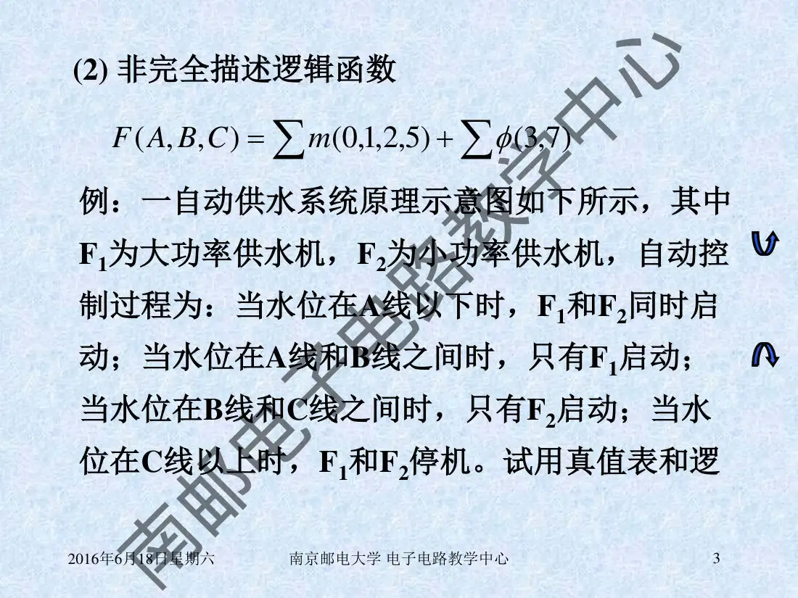

原文：

(2) 非完全描述逻辑函数

$$
F (A, B, C) = \sum m (0, 1, 2, 5) + \sum \phi (3, 7)
$$

例：一自动供水系统原理示意图如下所示，其中$\mathbf { F _ { 1 } }$ 为大功率供水机， $\mathbf { F } _ { 2 }$ 为小功率供水机，自动控制过程为：当水位在A线以下时， $\mathbf { F _ { 1 } }$ 和 $\mathbf { F } _ { 2 }$ 同时启动；当水位在A线和B线之间时，只有 $\mathbf { F _ { 1 } }$ 启动；当水位在B线和C线之间时，只有 $\mathbf { F } _ { 2 }$ 启动；当水位在C线以上时， $\mathbf { F _ { 1 } }$ 和 $\mathbf { F } _ { 2 }$ 停机。试用真值表和逻辑表达式描述该系统的控制功能。

2016年6月18日星期六

南京邮电大学 电子电路教学中心

3

### 2016年6月18日星期六

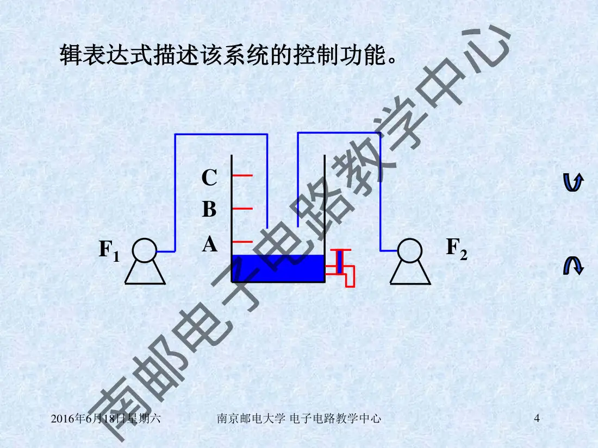

原文：

2016年6月18日星期六

南京邮电大学 电子电路教学中心

4

### CBA $F_1$  $F_2$ 0001100110010∅∅01101

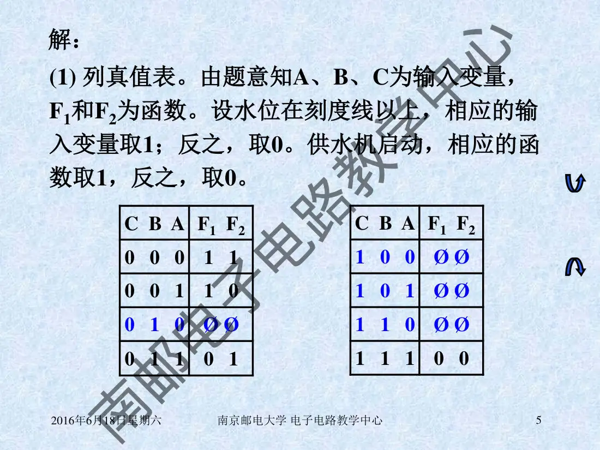

原文：

(1) 列真值表。由题意知A、B、C为输入变量，$\mathbf { F _ { 1 } }$ 和 $\mathbf { F } _ { 2 }$ 为函数。设水位在刻度线以上，相应的输入变量取1；反之，取0。供水机启动，相应的函数取1，反之，取0。

<table><tr><td>C</td><td>B</td><td>A</td><td> $F_1$ </td><td> $F_2$ </td></tr><tr><td>0</td><td>0</td><td>0</td><td>1</td><td>1</td></tr><tr><td>0</td><td>0</td><td>1</td><td>1</td><td>0</td></tr><tr><td>0</td><td>1</td><td>0</td><td>∅</td><td>∅</td></tr><tr><td>0</td><td>1</td><td>1</td><td>0</td><td>1</td></tr></table>

<table><tr><td>C</td><td>B</td><td>A</td><td> $F_1$ </td><td> $F_2$ </td></tr><tr><td>1</td><td>0</td><td>0</td><td>∅</td><td>∅</td></tr><tr><td>1</td><td>0</td><td>1</td><td>∅</td><td>∅</td></tr><tr><td>1</td><td>1</td><td>0</td><td>∅</td><td>∅</td></tr><tr><td>1</td><td>1</td><td>1</td><td>0</td><td>0</td></tr></table>

解：

2016年6月18日星期六

南京邮电大学 电子电路教学中心

5

### $\mathbf { F _ { 1 } }$ 的卡诺图

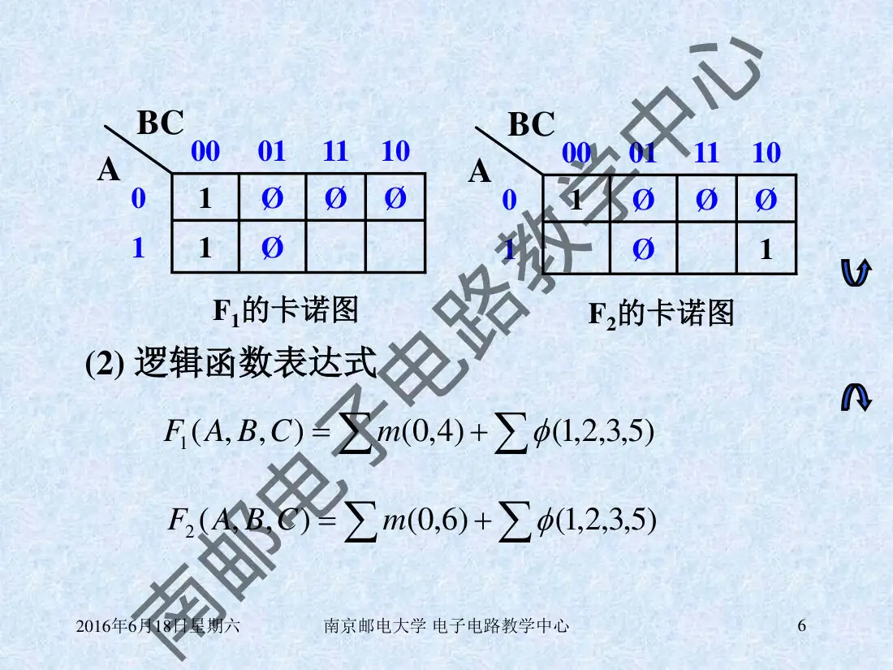

原文：

A

$\mathbf { F _ { 1 } }$ 的卡诺图
<table><tr><td rowspan="3">A\BC</td><td>00</td><td>01</td><td>11</td><td>10</td></tr><tr><td>0</td><td>1</td><td>∅</td><td>∅</td></tr><tr><td>1</td><td>1</td><td>∅</td><td></td></tr></table>

(2) 逻辑函数表达式

$$
F _ {1} (A, B, C) = \sum m (0, 4) + \sum \phi (1, 2, 3, 5)
$$

$$
F _ {2} (A, B, C) = \sum m (0, 6) + \sum \phi (1, 2, 3, 5)
$$

2016年6月18日星期六

南京邮电大学 电子电路教学中心

6

### 2. 非完全描述逻辑函数的化简

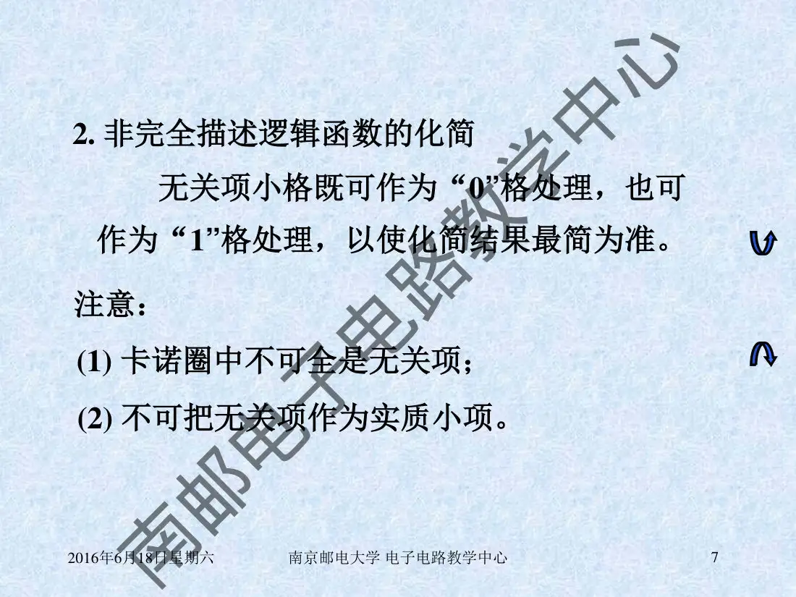

原文：

2. 非完全描述逻辑函数的化简

无关项小格既可作为“0”格处理，也可作为“1”格处理，以使化简结果最简为准。

注意：

(1) 卡诺圈中不可全是无关项；

(2) 不可把无关项作为实质小项。

2016年6月18日星期六

南京邮电大学 电子电路教学中心

7

### 例2.6.22 用卡诺图化简逻辑函数

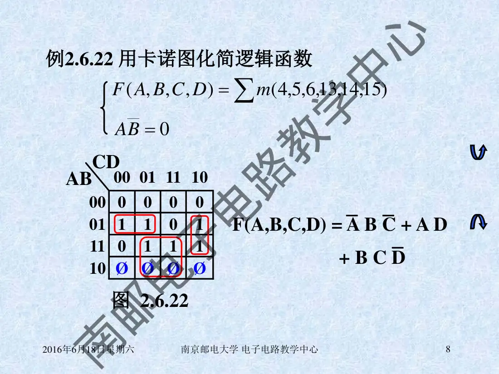

原文：

例2.6.22 用卡诺图化简逻辑函数

$$
\left\{ \begin{array}{l} F (A, B, C, D) = \sum m (4, 5, 6, 1 3, 1 4, 1 5) \\ A \overline {{B}} = 0 \end{array} \right.
$$

$$
\begin{array}{c c c c c} \text {AB} & 0 0 & 0 1 & 1 1 & 1 0 \\ \hline 0 0 & 0 & 0 & 0 & 0 \\ 0 1 & 1 & 1 & 0 & 1 \\ 1 1 & 0 & 1 & 1 & 1 \\ 1 0 & \emptyset & \emptyset & \emptyset & \emptyset \end{array} \tag {2.6.22}\tag{U}
$$

$$
\begin{array}{r l} \mathbf {F} (\mathbf {A}, \mathbf {B}, \mathbf {C}, \mathbf {D}) = & \overline {{\mathbf {A}}} \mathbf {B} \overline {{\mathbf {C}}} + \mathbf {A} \mathbf {D} \\ & + \mathbf {B} \mathbf {C} \overline {{\mathbf {D}}} \end{array}
$$

2016年6月18日星期六

南京邮电大学 电子电路教学中心

8

### 练习： 用卡诺图化简逻辑函数

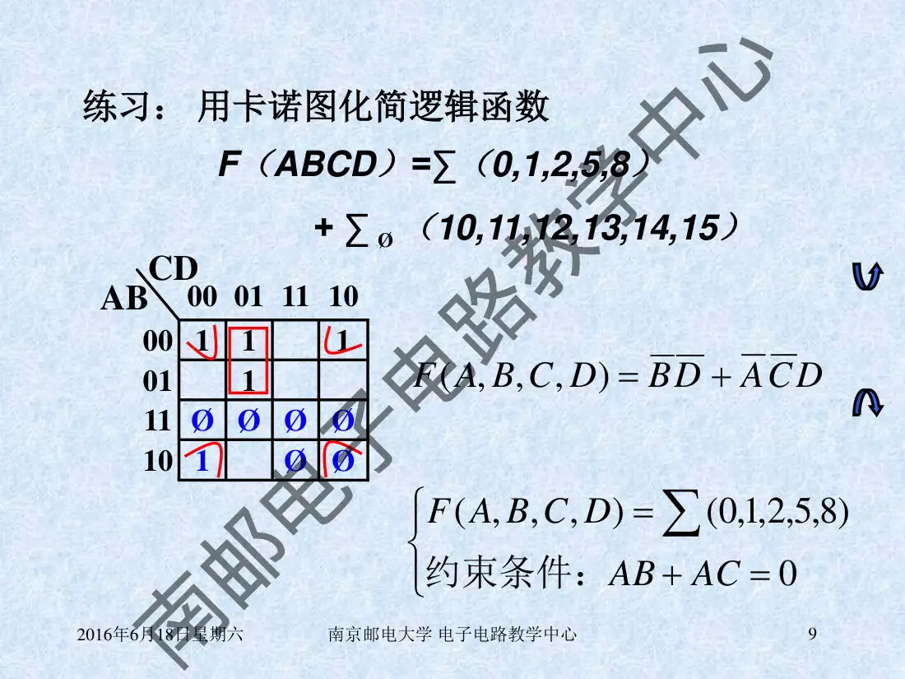

原文：

U

练习： 用卡诺图化简逻辑函数

$$
\begin{array}{r l} {F (A B C D) =} & {\sum (0, 1, 2, 5, 8)} \\ & {+ \sum_ {\emptyset} (1 0, 1 1, 1 2, 1 3, 1 4, 1 5)} \end{array}
$$

<table><tr><td>AB\CD</td><td>00</td><td>01</td><td>11</td><td>10</td></tr><tr><td>00</td><td>1</td><td>1</td><td></td><td>1</td></tr><tr><td>01</td><td></td><td>1</td><td></td><td></td></tr><tr><td>11</td><td>∅</td><td>∅</td><td>∅</td><td>∅</td></tr><tr><td>10</td><td>1</td><td></td><td>∅</td><td>∅</td></tr></table>

$$
F (A, B, C, D) = \overline {{B}} \overline {{D}} + \overline {{A}} \overline {{C}} D
$$

$$
F (A, B, C, D) = \sum (0, 1, 2, 5, 8)
$$

约束条件： $A B + A C = 0$

2016年6月18日星期六

南京邮电大学 电子电路教学中心

9

### 3. 无关项的运算规则

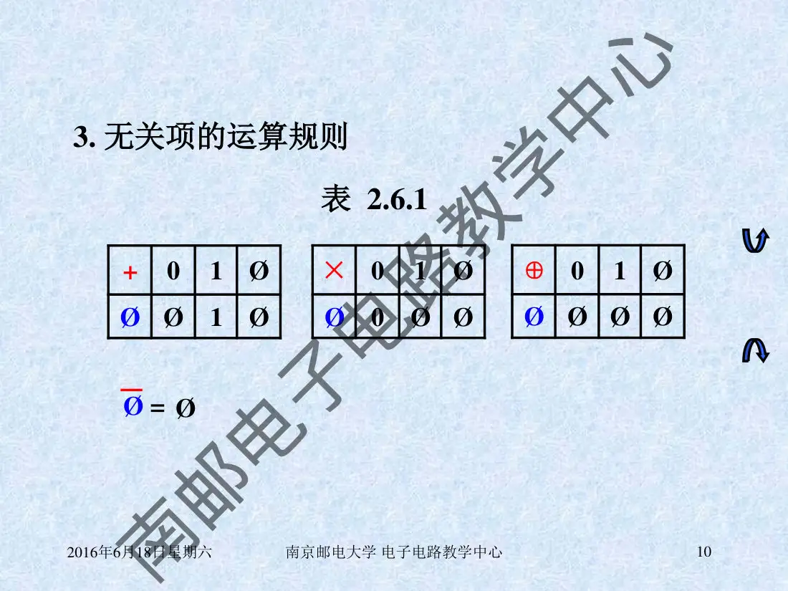

原文：

3. 无关项的运算规则

表 2.6.1

<table><tr><td>+</td><td>0</td><td>1</td><td>∅</td></tr><tr><td>∅</td><td>∅</td><td>1</td><td>∅</td></tr></table>

Ø = Ø

<table><tr><td>⊕</td><td>0</td><td>1</td><td>∅</td></tr><tr><td>∅</td><td>∅</td><td>∅</td><td>∅</td></tr></table>

A

2016年6月18日星期六

南京邮电大学 电子电路教学中心

10

### 五、最简与或式的转换

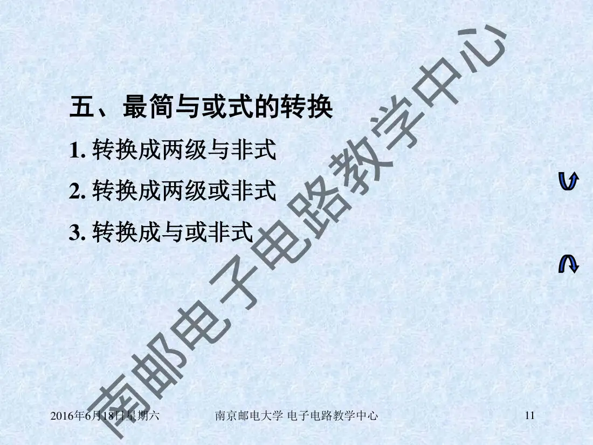

原文：

五、最简与或式的转换

1. 转换成两级与非式

2. 转换成两级或非式

3. 转换成与或非式

2016年6月18日星期六

南京邮电大学 电子电路教学中心

11

### 五、最简与或式的转换

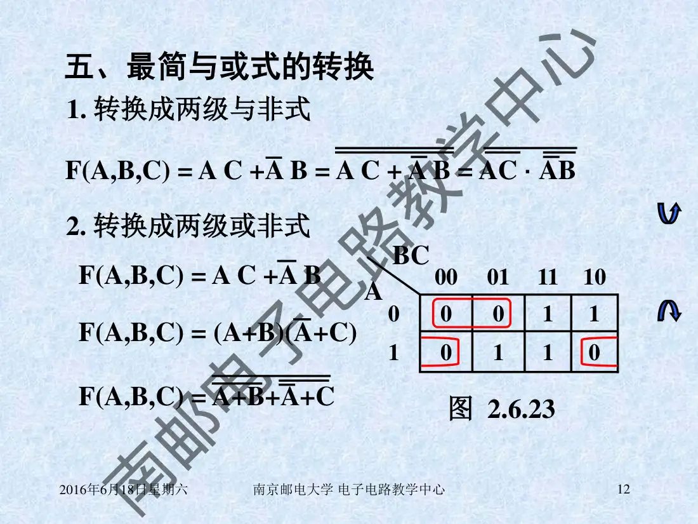

原文：

五、最简与或式的转换

1. 转换成两级与非式

$$
\mathbf {F} (\mathbf {A}, \mathbf {B}, \mathbf {C}) = \mathbf {A} \mathbf {C} + \overline {{\mathbf {A}}} \mathbf {B} = \overline {{\mathbf {A} \mathbf {C} + \overline {{\mathbf {A}}} \mathbf {B}}} = \overline {{\mathbf {A} \mathbf {C}}} \cdot \overline {{\overline {{\mathbf {A}}} \mathbf {B}}}
$$

2. 转换成两级或非式

$$
\mathbf {F} (\mathbf {A}, \mathbf {B}, \mathbf {C}) = \mathbf {A} \mathbf {C} + \overline {{\mathbf {A}}} \mathbf {B}
$$

$$
\mathbf {F} (\mathbf {A}, \mathbf {B}, \mathbf {C}) = (\mathbf {A} + \mathbf {B}) (\overline {{\mathbf {A}}} + \mathbf {C})
$$

$$
\mathbf {F} (\mathbf {A}, \mathbf {B}, \mathbf {C}) = \overline {{\overline {{\mathbf {A} + \overline {{\mathbf {B}}}}} + \overline {{\overline {{\mathbf {A}}}}} + \overline {{\mathbf {C}}}}}
$$

图 2.6.23

2016年6月18日星期六

南京邮电大学 电子电路教学中心

12

### 3. 转换成与或非式

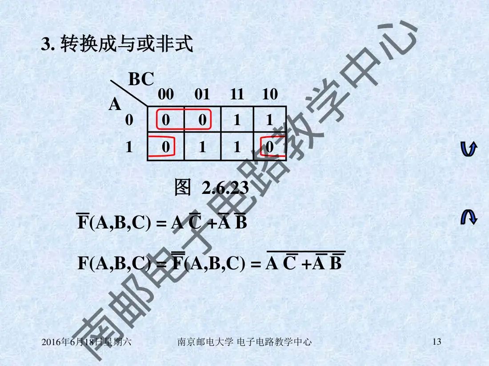

原文：

3. 转换成与或非式

$$
\overline {{\mathbf {F}}} (\mathbf {A}, \mathbf {B}, \mathbf {C}) = \mathbf {A} \overline {{\mathbf {C}}} + \overline {{\mathbf {A}}} \overline {{\mathbf {B}}}
$$

$$
\mathbf {F} (\mathbf {A}, \mathbf {B}, \mathbf {C}) = \overline {{\overline {{\mathbf {F}}}}} (\mathbf {A}, \mathbf {B}, \mathbf {C}) = \overline {{\mathbf {A} \overline {{\mathbf {C}}} + \overline {{\mathbf {A}}} \overline {{\mathbf {B}}}}}
$$

2016年6月18日星期六

南京邮电大学 电子电路教学中心

13

### 2016年6月18日星期六

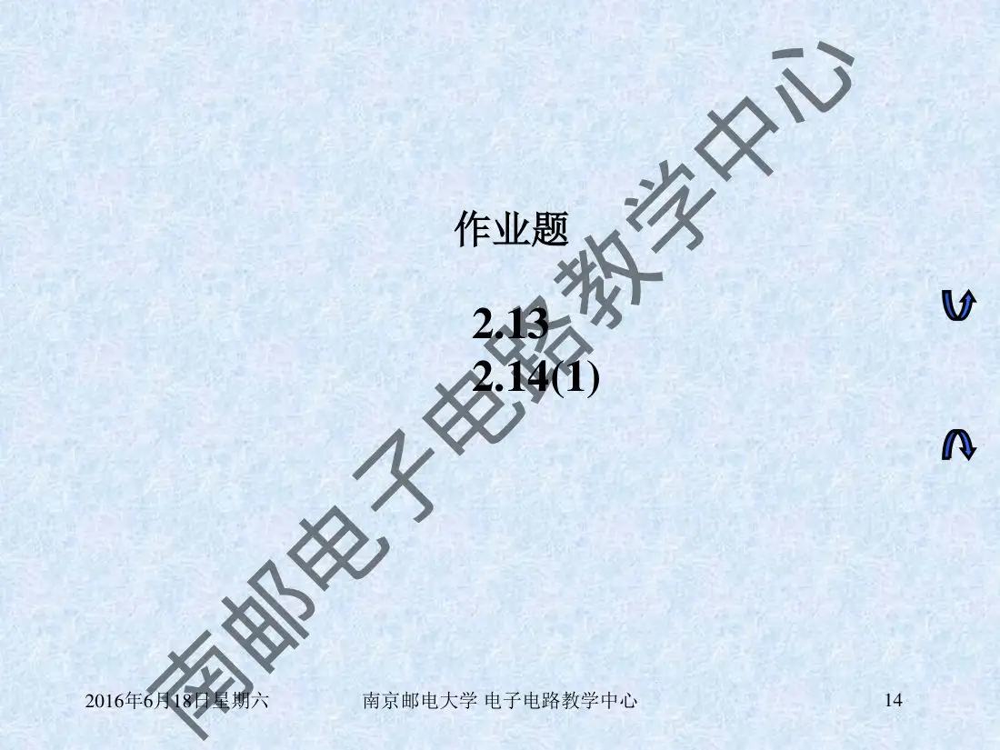

原文：

2016年6月18日星期六

南京邮电大学 电子电路教学中心

14
