# 《数字电路与逻辑设计B》第五章 时序逻辑电路（课件）

原件的每一页，下面附识别出的文字。

### 第五章 时序逻辑电路

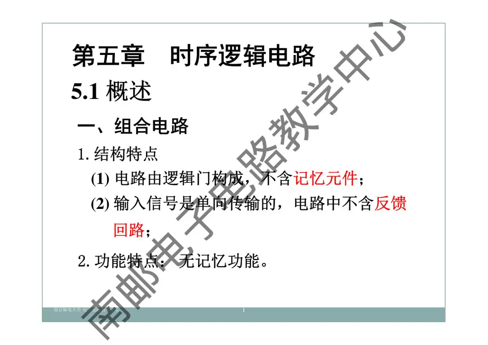

原文：

第五章 时序逻辑电路

5.1 概述

一、组合电路

1. 结构特点

(1) 电路由逻辑门构成，不含记忆元件；

(2) 输入信号是单向传输的，电路中不含反馈回路；

2. 功能特点：无记忆功能。

南京邮电大学

### 二、时序电路

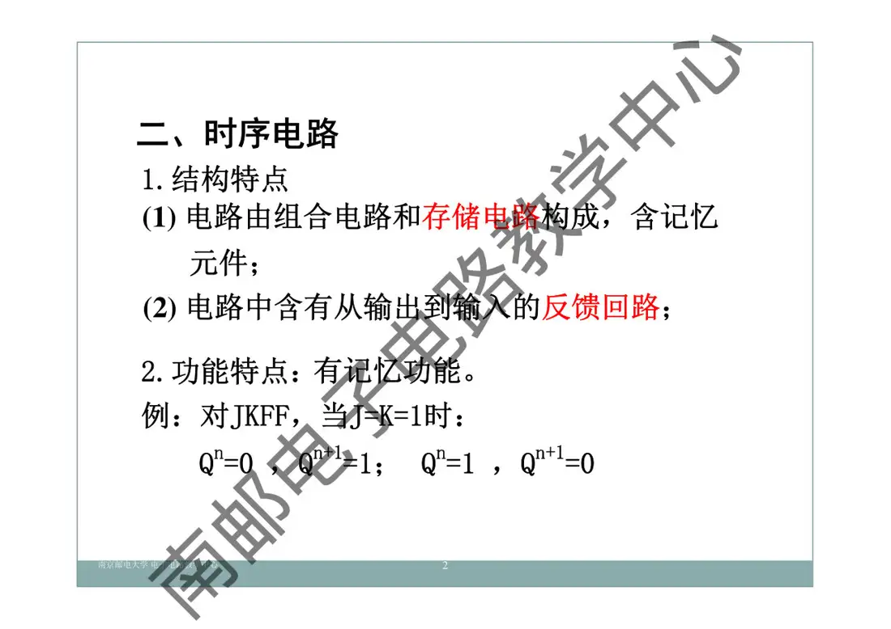

原文：

二、时序电路

1. 结构特点

(1) 电路由组合电路和存储电路构成，含记忆元件；

(2) 电路中含有从输出到输入的反馈回路;

2. 功能特点：有记忆功能。

例：对JKFF，当J=K=1时：

$$
Q ^ {n} = 0, Q ^ {n + 1} = 1; \quad Q ^ {n} = 1, Q ^ {n + 1} = 0
$$

2

南京邮电大学

### 第 3 页

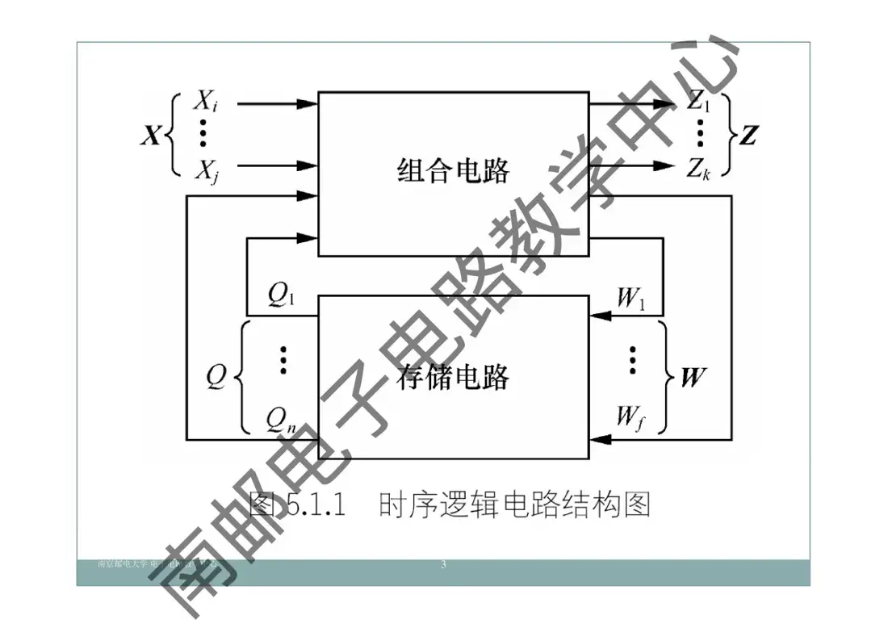

### 3. 工作描述

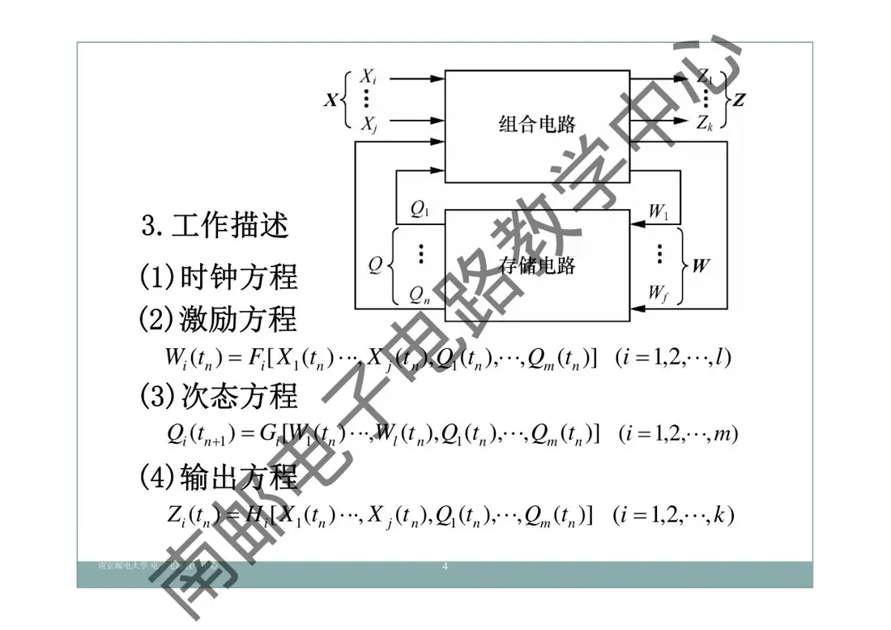

原文：

3. 工作描述

(1)时钟方程

(2) 激励方程

$$
W _ {i} (t _ {n}) = F _ {i} [ X _ {1} (t _ {n}) \dots , X _ {j} (t _ {n}), Q _ {1} (t _ {n}), \dots , Q _ {m} (t _ {n}) ] (i = 1, 2, \dots , l)
$$

(3) 次态方程

$$
Q _ {i} (t _ {n + 1}) = G _ {i} [ W _ {1} (t _ {n}) \dots , W _ {l} (t _ {n}), Q _ {1} (t _ {n}), \dots , Q _ {m} (t _ {n}) ] \quad (i = 1, 2, \dots , m)
$$

(4) 输出方程

$$
Z _ {i} \left(t _ {n}\right) = H _ {i} \left[ X _ {1} \left(t _ {n}\right) \dots , X _ {j} \left(t _ {n}\right), Q _ {1} \left(t _ {n}\right), \dots , Q _ {m} \left(t _ {n}\right) \right] (i = 1, 2, \dots , k)
$$

南京邮电大学

### 4. 分类

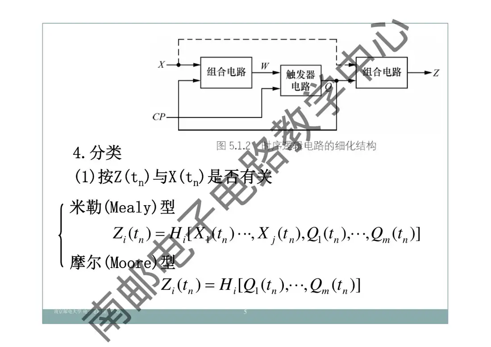

原文：

4. 分类

(1) 按 $Z(t_{n})$ 与 $X(t_{n})$ 是否有关

米勒(Mealy)型

$$
Z _ {i} (t _ {n}) = H _ {i} [ X _ {1} (t _ {n}) \dots , X _ {j} (t _ {n}), Q _ {1} (t _ {n}), \dots , Q _ {m} (t _ {n}) ]
$$

摩尔(Moore)型

$$
Z _ {i} (t _ {n}) = H _ {i} [ Q _ {1} (t _ {n}), \dots , Q _ {m} (t _ {n}) ]
$$

南京邮电大学

5

### (2) 按存储器的状态变化是否同时进行

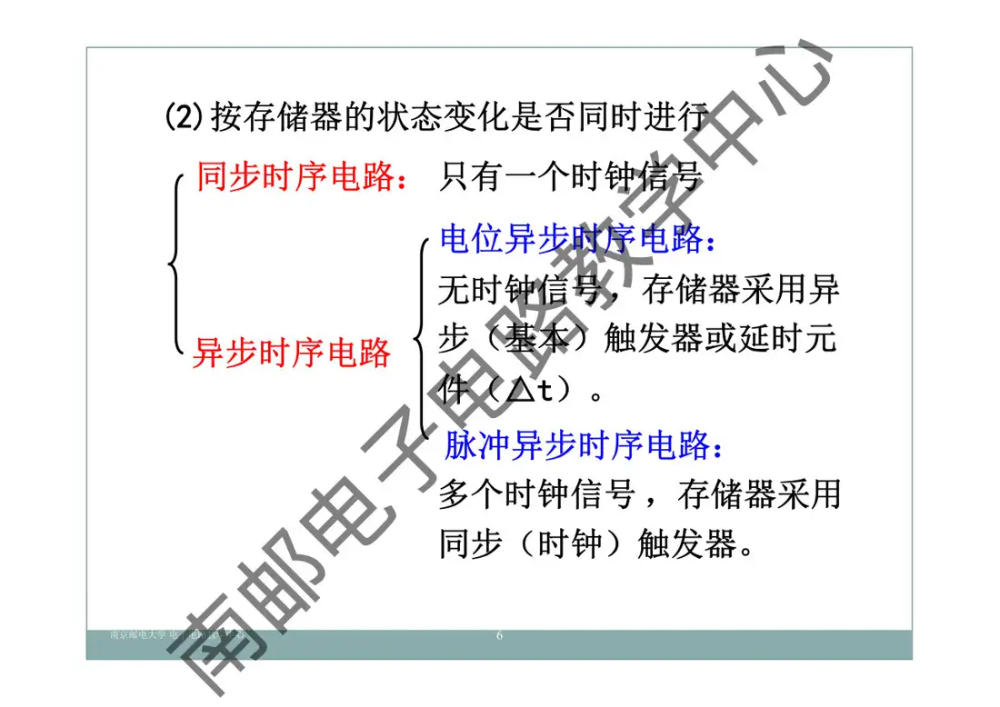

原文：

(2) 按存储器的状态变化是否同时进行

同步时序电路：只有一个时钟信号

电位异步时序电路:

异步时序电路

无时钟信号，存储器采用异步（基本）触发器或延时元件（ $\Delta t$ ）。

脉冲异步时序电路:

多个时钟信号，存储器采用同步（时钟）触发器。

6

南京邮电大学

### 5.2 寄存器

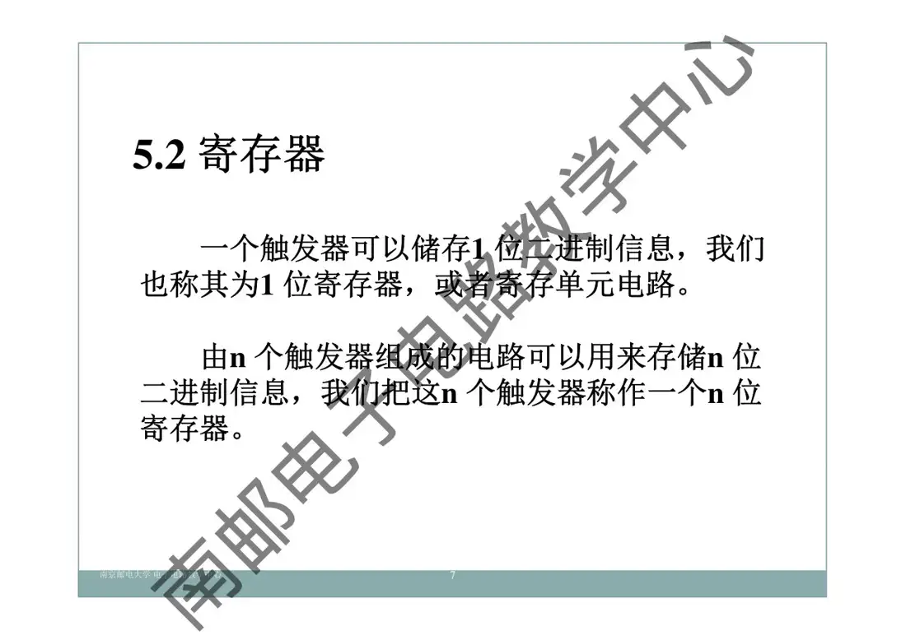

原文：

5.2 寄存器

一个触发器可以储存1位二进制信息，我们也称其为1位寄存器，或者寄存单元电路。

由n个触发器组成的电路可以用来存储n位二进制信息，我们把这n个触发器称作一个n位寄存器。

南京邮电大学

### 5.2.1 移位寄存器

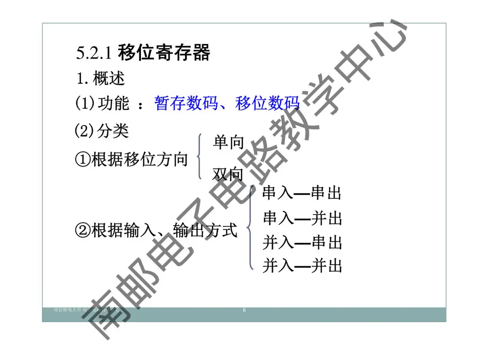

原文：

5.2.1 移位寄存器

1. 概述

(1) 功能：暂存数码、移位数码

(2) 分类

①根据移位方向

双向

串入一串出

②根据输入、输出方式

串入一并出

并入一串出

并入一并出

### 结构特点:

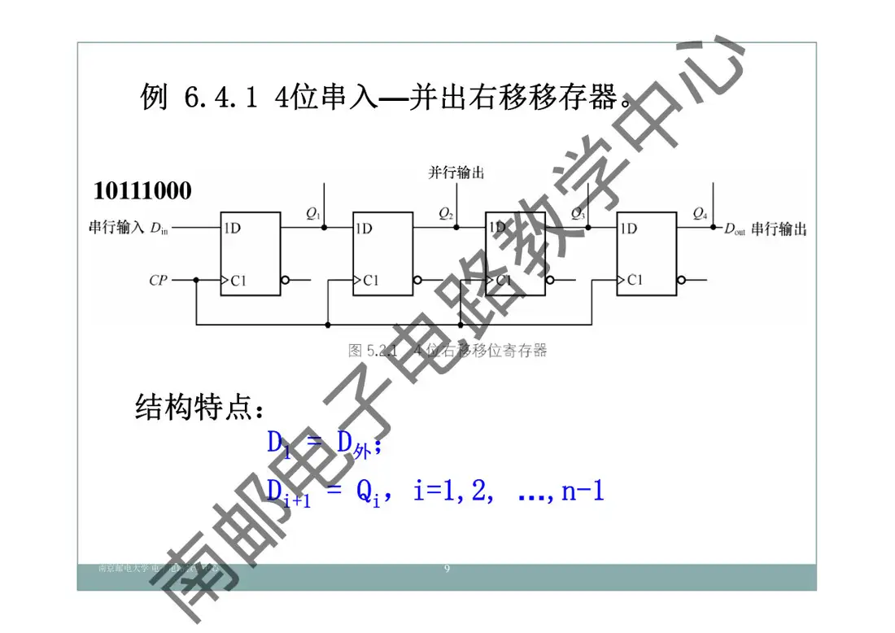

原文：

结构特点:

$$
Q _ {i}, \quad i = 1, 2, \dots , n - 1
$$

南京邮电大学

### 第 10 页

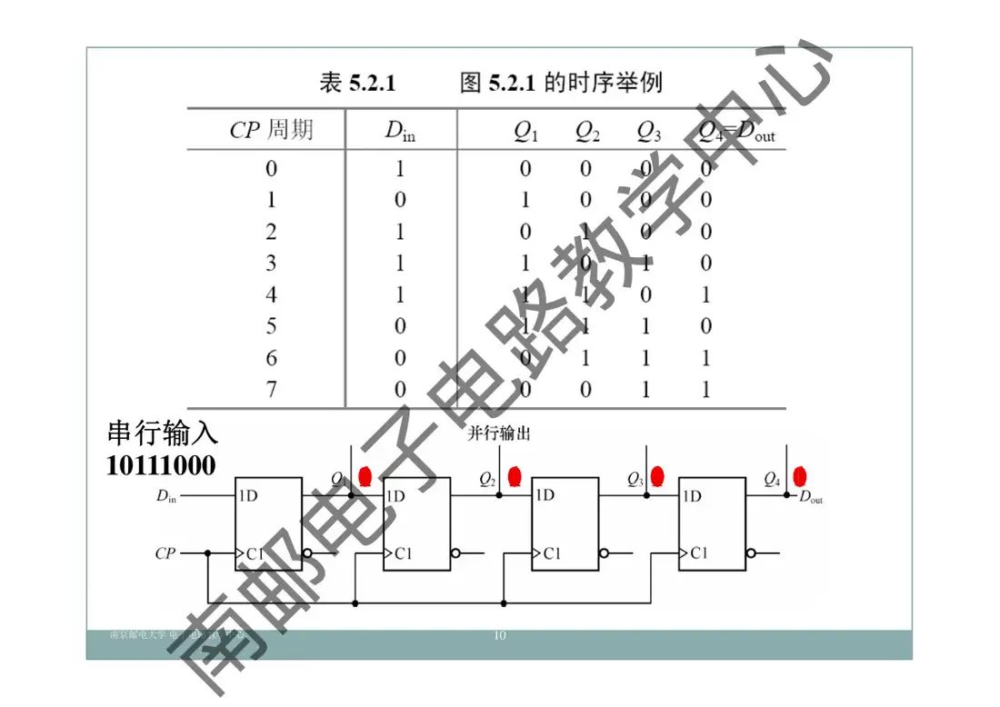

### 4位并入—串出左移移存器

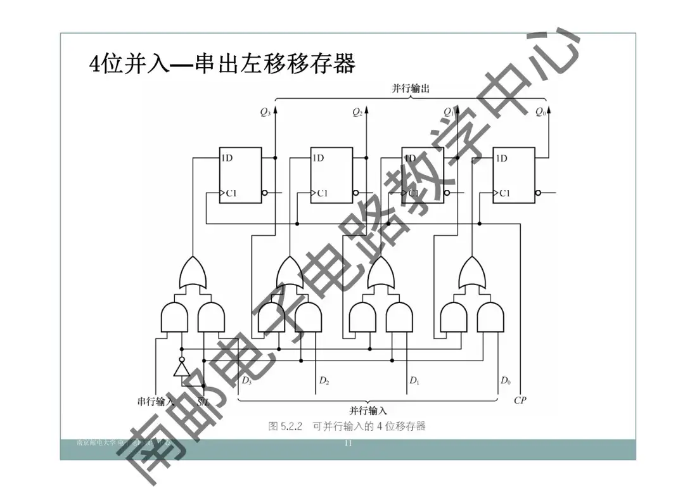

原文：

4位并入—串出左移移存器

11

### 2. MSI移位寄存器

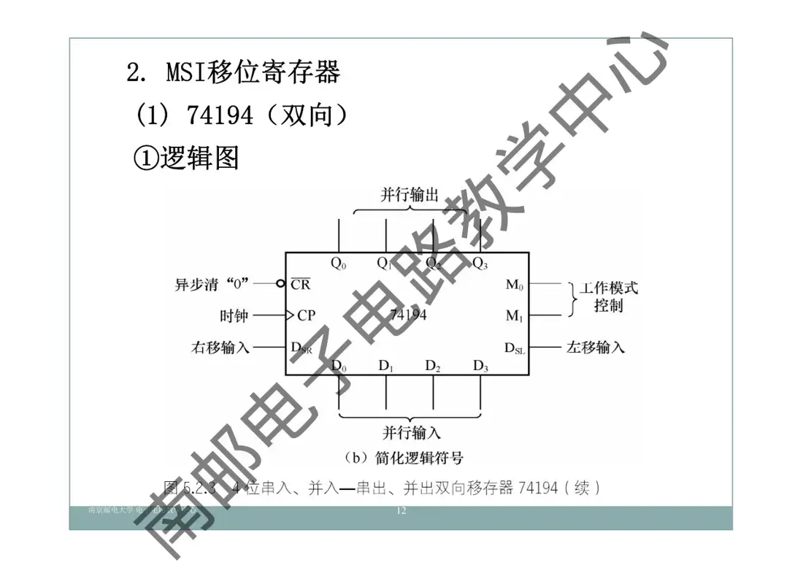

原文：

2. MSI移位寄存器

(1) 74194（双向）

①逻辑图

图5.2.3 4位串入、并入—串出、并出双向移存器74194（续）

南京邮电大学

12

### ②功能表

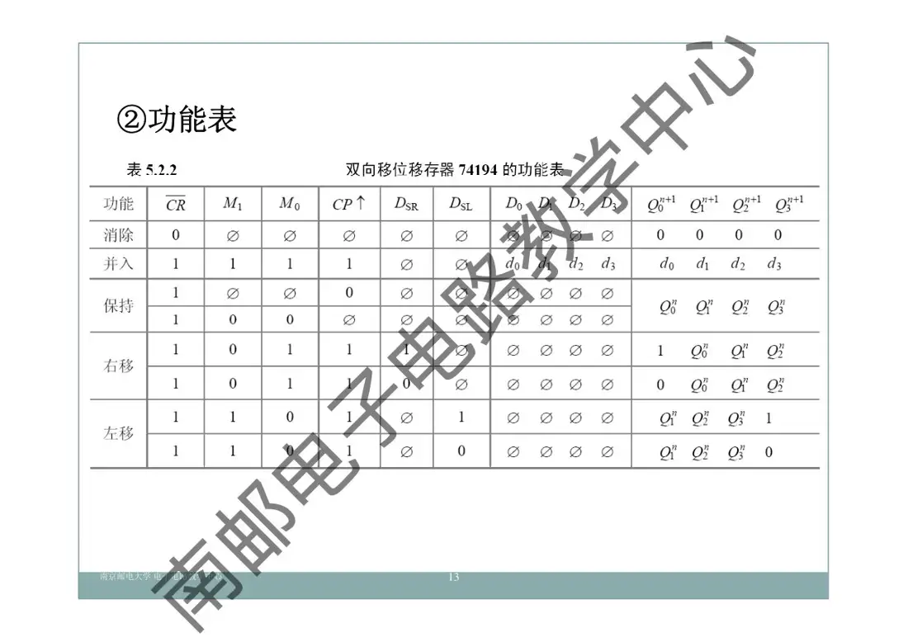

原文：

②功能表

表5.2.2
<table><tr><td>功能</td><td> $\overline{CR}$ </td><td> $M_1$ </td><td> $M_0$ </td><td> $CP\uparrow$ </td><td> $D_{SR}$ </td><td> $D_{SL}$ </td><td> $D_0$ </td><td> $D_1$ </td><td> $D_2$ </td><td> $D_3$ </td><td> $Q_0^{n+1}$ </td><td> $Q_1^{n+1}$ </td><td> $Q_2^{n+1}$ </td><td> $Q_3^{n+1}$ </td></tr><tr><td>消除</td><td>0</td><td>∅</td><td>∅</td><td>∅</td><td>∅</td><td>∅</td><td>∅</td><td>∅</td><td>∅</td><td>∅</td><td>0</td><td>0</td><td>0</td><td>0</td></tr><tr><td>并入</td><td>1</td><td>1</td><td>1</td><td>1</td><td>∅</td><td>∅</td><td> $d_0$ </td><td> $d_1$ </td><td> $d_2$ </td><td> $d_3$ </td><td> $d_0$ </td><td> $d_1$ </td><td> $d_2$ </td><td> $d_3$ </td></tr><tr><td rowspan="2">保持</td><td>1</td><td>∅</td><td>∅</td><td>0</td><td>∅</td><td>∅</td><td>∅</td><td>∅</td><td>∅</td><td>∅</td><td rowspan="2"> $Q_0^n$ </td><td rowspan="2"> $Q_1^n$ </td><td rowspan="2"> $Q_2^n$ </td><td rowspan="2"> $Q_3^n$ </td></tr><tr><td>1</td><td>0</td><td>0</td><td>∅</td><td>∅</td><td>∅</td><td>∅</td><td>∅</td><td>∅</td><td>∅</td></tr><tr><td rowspan="2">右移</td><td>1</td><td>0</td><td>1</td><td>1</td><td>1</td><td>∅</td><td>∅</td><td>∅</td><td>∅</td><td>∅</td><td>1</td><td> $Q_0^n$ </td><td> $Q_1^n$ </td><td> $Q_2^n$ </td></tr><tr><td>1</td><td>0</td><td>1</td><td>1</td><td>0</td><td>∅</td><td>∅</td><td>∅</td><td>∅</td><td>∅</td><td>0</td><td> $Q_0^n$ </td><td> $Q_1^n$ </td><td> $Q_2^n$ </td></tr><tr><td rowspan="2">左移</td><td>1</td><td>1</td><td>0</td><td>1</td><td>∅</td><td>1</td><td>∅</td><td>∅</td><td>∅</td><td>∅</td><td> $Q_1^n$ </td><td> $Q_2^n$ </td><td> $Q_3^n$ </td><td>1</td></tr><tr><td>1</td><td>1</td><td>0</td><td>1</td><td>∅</td><td>0</td><td>∅</td><td>∅</td><td>∅</td><td>∅</td><td> $Q_1^n$ </td><td> $Q_2^n$ </td><td> $Q_3^n$ </td><td>0</td></tr></table>

南京邮电大学

13

### ③应用举例

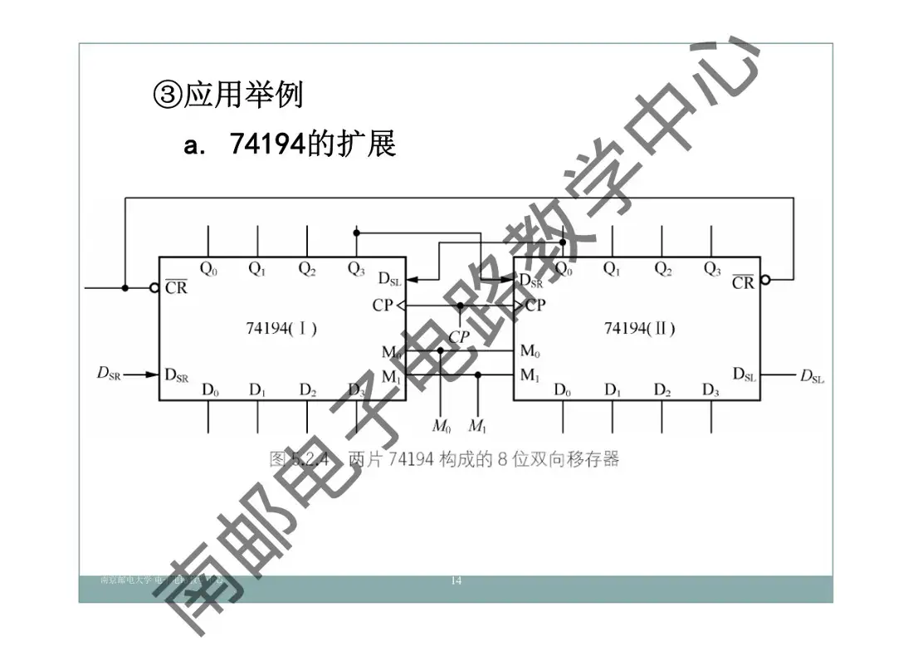

原文：

③应用举例

a. 74194的扩展

图5.2.4 两片74194构成的8位双向移存器b. 实现数据传输方式转换
※串行→并行

南京邮电大学

14

### 图5.2.5 7位串入—并出转换电路

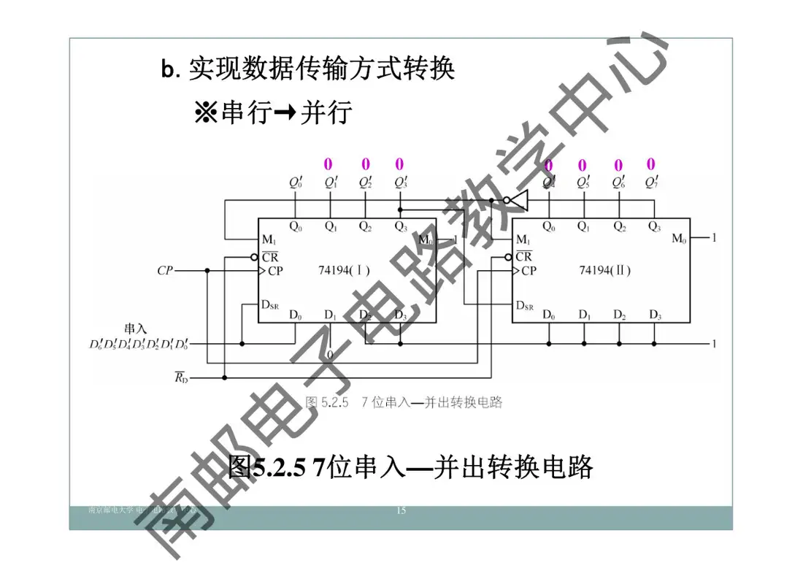

原文：

图5.2.5 7位串入—并出转换电路

南京邮电大学

15

### $D_{1}$ ：取0，作为标志码

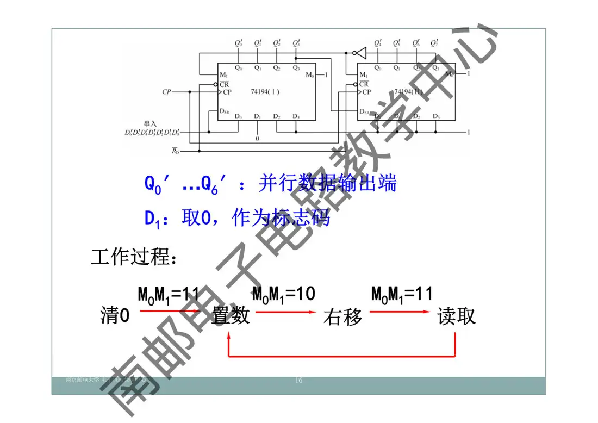

原文：

$Q_{0}^{\prime}\ldots Q_{6}^{\prime}$ ：并行数据输出端

$D_{1}$ ：取0，作为标志码

工作过程:

清0 $\xrightarrow{M_{0}M_{1}=11}$ 置数 $\xrightarrow{M_{0}M_{1}=10}$ 右移 $\xrightarrow{M_{0}M_{1}=11}$ 读取

南京邮电大学

16

### 表5.2.3

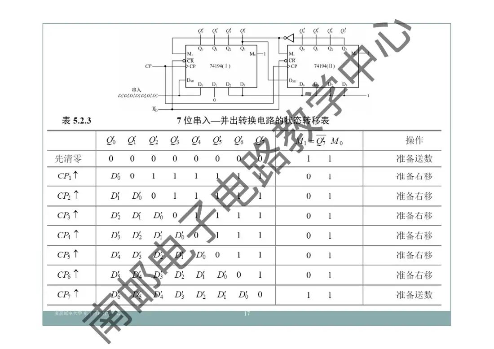

原文：

表5.2.3
<table><tr><td></td><td> $Q_0'$ </td><td> $Q_1'$ </td><td> $Q_2'$ </td><td> $Q_3'$ </td><td> $Q_4'$ </td><td> $Q_5'$ </td><td> $Q_6'$ </td><td> $Q_7'$ </td><td> $M_1 = \overline{Q_7'}$ </td><td> $M_0$ </td><td>操作</td></tr><tr><td>先清零</td><td>0</td><td>0</td><td>0</td><td>0</td><td>0</td><td>0</td><td>0</td><td>0</td><td>1</td><td>1</td><td>准备送数</td></tr><tr><td> $CP_1 \uparrow$ </td><td> $D_0'$ </td><td>0</td><td>1</td><td>1</td><td>1</td><td>1</td><td>1</td><td>1</td><td>0</td><td>1</td><td>准备右移</td></tr><tr><td> $CP_2 \uparrow$ </td><td> $D_1'$ </td><td> $D_0'$ </td><td>0</td><td>1</td><td>1</td><td>1</td><td>1</td><td>1</td><td>0</td><td>1</td><td>准备右移</td></tr><tr><td> $CP_3 \uparrow$ </td><td> $D_2'$ </td><td> $D_1'$ </td><td> $D_0'$ </td><td>0</td><td>1</td><td>1</td><td>1</td><td>1</td><td>0</td><td>1</td><td>准备右移</td></tr><tr><td> $CP_4 \uparrow$ </td><td> $D_3'$ </td><td> $D_2'$ </td><td> $D_1'$ </td><td> $D_0'$ </td><td>0</td><td>1</td><td>1</td><td>1</td><td>0</td><td>1</td><td>准备右移</td></tr><tr><td> $CP_5 \uparrow$ </td><td> $D_4'$ </td><td> $D_3'$ </td><td> $D_2'$ </td><td> $D_1'$ </td><td> $D_0'$ </td><td>0</td><td>1</td><td>1</td><td>0</td><td>1</td><td>准备右移</td></tr><tr><td> $CP_6 \uparrow$ </td><td> $D_5'$ </td><td> $D_4'$ </td><td> $D_3'$ </td><td> $D_2'$ </td><td> $D_1'$ </td><td> $D_0'$ </td><td>0</td><td>1</td><td>0</td><td>1</td><td>准备右移</td></tr><tr><td> $CP_7 \uparrow$ </td><td> $D_6'$ </td><td> $D_5'$ </td><td> $D_4'$ </td><td> $D_3'$ </td><td> $D_2'$ </td><td> $D_1'$ </td><td> $D_0'$ </td><td>0</td><td>1</td><td>1</td><td>准备送数</td></tr></table>

南京邮电大学 电子电路教学中心

17

### 南京邮电大学

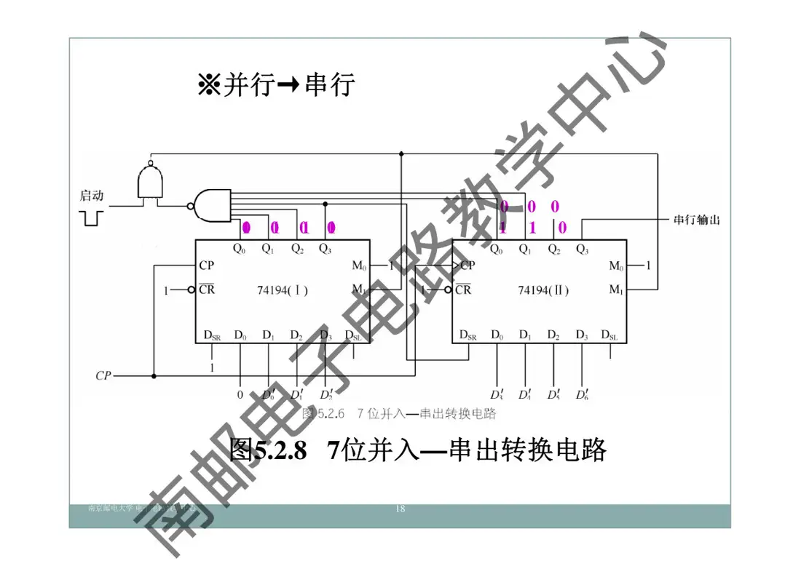

原文：

南京邮电大学

18

### 片Ⅱ的 $Q_{3}$ ：串行数据输出端

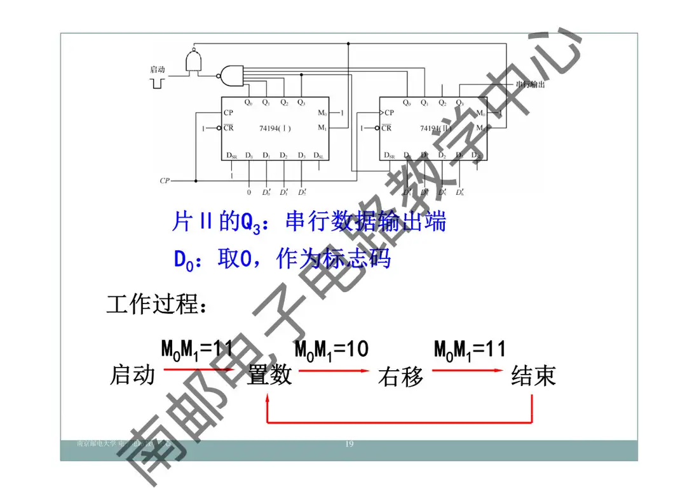

原文：

片Ⅱ的 $Q_{3}$ ：串行数据输出端

$D_{0}$ ：取0，作为标志码

工作过程:

启动

$$
\mathrm{M} _ {0} \mathrm{M} _ {1} = 1 1
$$

$$
\mathbf {M} _ {0} \mathbf {M} _ {1} = 1 0
$$

置数

右移

$$
\mathbf {M} _ {0} \mathbf {M} _ {1} = 1 1
$$

结束

南京邮电大学

### 表5.2.4

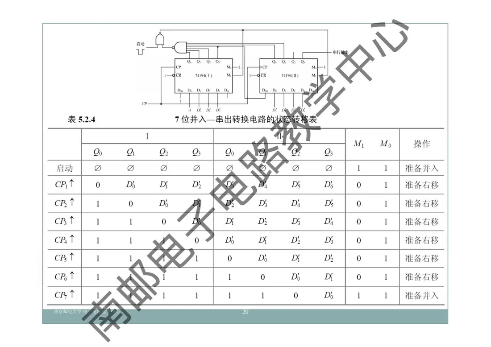

原文：

表5.2.4
<table><tr><td rowspan="2"></td><td colspan="4">I</td><td colspan="4">II</td><td rowspan="2"> $M_1$ </td><td rowspan="2"> $M_0$ </td><td rowspan="2">操作</td></tr><tr><td> $Q_0$ </td><td> $Q_1$ </td><td> $Q_2$ </td><td> $Q_3$ </td><td> $Q_0$ </td><td> $Q_1$ </td><td> $Q_2$ </td><td> $Q_3$ </td></tr><tr><td>启动</td><td>∅</td><td>∅</td><td>∅</td><td>∅</td><td>∅</td><td>∅</td><td>∅</td><td>∅</td><td>1</td><td>1</td><td>准备并入</td></tr><tr><td> $CP_1 \uparrow$ </td><td>0</td><td> $D_0'$ </td><td> $D_1'$ </td><td> $D_2'$ </td><td> $D_3'$ </td><td> $D_4'$ </td><td> $D_5'$ </td><td> $D_6'$ </td><td>0</td><td>1</td><td>准备右移</td></tr><tr><td> $CP_2 \uparrow$ </td><td>1</td><td>0</td><td> $D_0'$ </td><td> $D_1'$ </td><td> $D_2'$ </td><td> $D_3'$ </td><td> $D_4'$ </td><td> $D_5'$ </td><td>0</td><td>1</td><td>准备右移</td></tr><tr><td> $CP_3 \uparrow$ </td><td>1</td><td>1</td><td>0</td><td> $D_0'$ </td><td> $D_1'$ </td><td> $D_2'$ </td><td> $D_3'$ </td><td> $D_4'$ </td><td>0</td><td>1</td><td>准备右移</td></tr><tr><td> $CP_4 \uparrow$ </td><td>1</td><td>1</td><td>1</td><td>0</td><td> $D_0'$ </td><td> $D_1'$ </td><td> $D_2'$ </td><td> $D_3'$ </td><td>0</td><td>1</td><td>准备右移</td></tr><tr><td> $CP_5 \uparrow$ </td><td>1</td><td>1</td><td>1</td><td>1</td><td>0</td><td> $D_0'$ </td><td> $D_1'$ </td><td> $D_2'$ </td><td>0</td><td>1</td><td>准备右移</td></tr><tr><td> $CP_6 \uparrow$ </td><td>1</td><td>1</td><td>1</td><td>1</td><td>1</td><td>0</td><td> $D_0'$ </td><td> $D_1'$ </td><td>0</td><td>1</td><td>准备右移</td></tr><tr><td> $CP_7 \uparrow$ </td><td>1</td><td>1</td><td>1</td><td>1</td><td>1</td><td>1</td><td>0</td><td> $D_0'$ </td><td>1</td><td>1</td><td>准备并入</td></tr></table>

南京邮电大学 电子电路教学中心

20

### (2) 74195（右移）

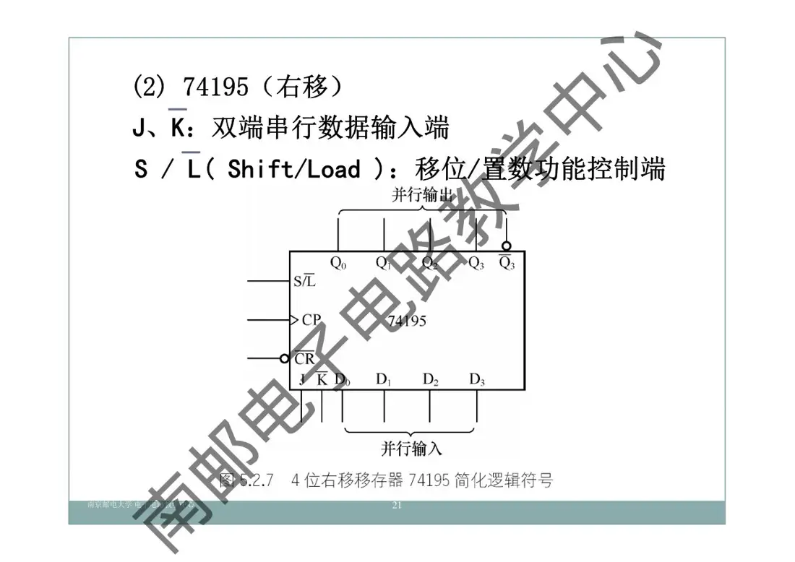

原文：

(2) 74195（右移）

J、K：双端串行数据输入端

S / L( Shift/Load ): 移位/置数功能控制端

4 位右移移存器 74195 简化逻辑符号

南京邮电大学

21

### 表5.2.5 4 位右移移存器 74195 的功能表

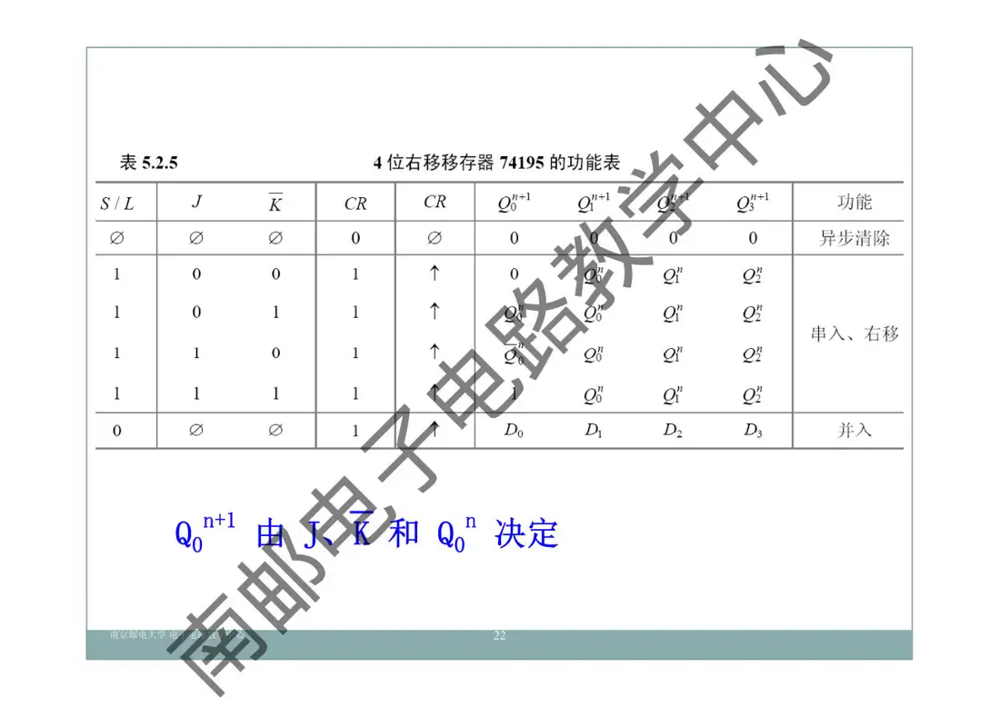

原文：

表5.2.5 4 位右移移存器 74195 的功能表
<table><tr><td> $S/\overline{L}$ </td><td> $J$ </td><td> $\overline{K}$ </td><td> $\overline{CR}$ </td><td> $CR$ </td><td> $Q_{0}^{n+1}$ </td><td> $Q_{1}^{n+1}$ </td><td> $Q_{2}^{n+1}$ </td><td> $Q_{3}^{n+1}$ </td><td>功能</td></tr><tr><td> $\emptyset$ </td><td> $\emptyset$ </td><td> $\emptyset$ </td><td>0</td><td> $\emptyset$ </td><td>0</td><td>0</td><td>0</td><td>0</td><td>异步清除</td></tr><tr><td>1</td><td>0</td><td>0</td><td>1</td><td>↑</td><td>0</td><td> $Q_{0}^{n}$ </td><td> $Q_{1}^{n}$ </td><td> $Q_{2}^{n}$ </td><td rowspan="4">串入、右移</td></tr><tr><td>1</td><td>0</td><td>1</td><td>1</td><td>↑</td><td> $Q_{0}^{n}$ </td><td> $Q_{0}^{n}$ </td><td> $Q_{1}^{n}$ </td><td> $Q_{2}^{n}$ </td></tr><tr><td>1</td><td>1</td><td>0</td><td>1</td><td>↑</td><td> $\overline{Q}_{0}^{n}$ </td><td> $Q_{0}^{n}$ </td><td> $Q_{1}^{n}$ </td><td> $Q_{2}^{n}$ </td></tr><tr><td>1</td><td>1</td><td>1</td><td>1</td><td>↑</td><td>1</td><td> $Q_{0}^{n}$ </td><td> $Q_{1}^{n}$ </td><td> $Q_{2}^{n}$ </td></tr><tr><td>0</td><td> $\emptyset$ </td><td> $\emptyset$ </td><td>1</td><td>↑</td><td> $D_{0}$ </td><td> $D_{1}$ </td><td> $D_{2}$ </td><td> $D_{3}$ </td><td>并入</td></tr></table>

$Q_{0}^{n+1}$ 由 J、K 和 $Q_{0}^{n}$ 决定

南京邮电大学

22

### (3) 74165（右移）

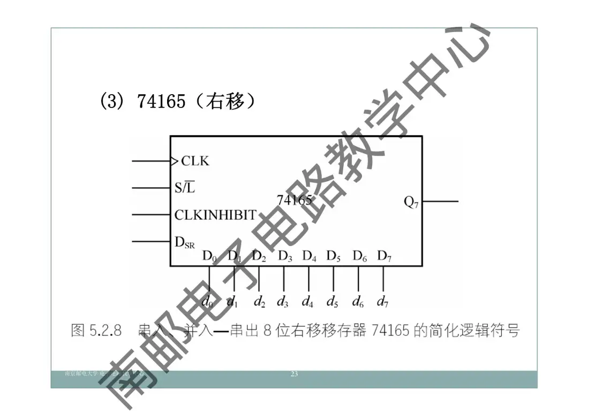

原文：

(3) 74165（右移）

图5.2.8 串入一并入一串出8位右移移存器74165的简化逻辑符号

南京邮电大学

23

### (3) 74165（右移）

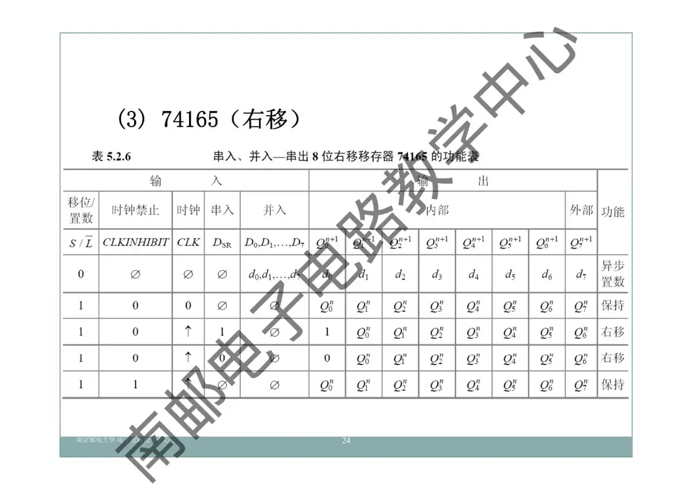

原文：

(3) 74165（右移）

表5.2.6 串入、并入—串出 8 位右移移存器 74165 的功能表
<table><tr><td colspan="5">输入</td><td colspan="8">输出</td><td rowspan="3">功能</td></tr><tr><td>移位/置数</td><td>时钟禁止</td><td>时钟</td><td>串入</td><td>并入</td><td colspan="7">内部</td><td>外部</td></tr><tr><td> $S/\overline{L}$ </td><td>CLKINHIBIT</td><td>CLK</td><td> $D_{SR}$ </td><td> $D_0,D_1,\dots,D_7$ </td><td> $Q_0^{n+1}$ </td><td> $Q_1^{n+1}$ </td><td> $Q_2^{n+1}$ </td><td> $Q_3^{n+1}$ </td><td> $Q_4^{n+1}$ </td><td> $Q_5^{n+1}$ </td><td> $Q_6^{n+1}$ </td><td> $Q_7^{n+1}$ </td></tr><tr><td>0</td><td>∅</td><td>∅</td><td>∅</td><td> $d_0,d_1,\dots,d_7$ </td><td> $d_0$ </td><td> $d_1$ </td><td> $d_2$ </td><td> $d_3$ </td><td> $d_4$ </td><td> $d_5$ </td><td> $d_6$ </td><td> $d_7$ </td><td>异步置数</td></tr><tr><td>1</td><td>0</td><td>0</td><td>∅</td><td>∅</td><td> $Q_0^n$ </td><td> $Q_1^n$ </td><td> $Q_2^n$ </td><td> $Q_3^n$ </td><td> $Q_4^n$ </td><td> $Q_5^n$ </td><td> $Q_6^n$ </td><td> $Q_7^n$ </td><td>保持</td></tr><tr><td>1</td><td>0</td><td>↑</td><td>1</td><td>∅</td><td>1</td><td> $Q_0^n$ </td><td> $Q_1^n$ </td><td> $Q_2^n$ </td><td> $Q_3^n$ </td><td> $Q_4^n$ </td><td> $Q_5^n$ </td><td> $Q_6^n$ </td><td>右移</td></tr><tr><td>1</td><td>0</td><td>↑</td><td>0</td><td>∅</td><td>0</td><td> $Q_0^n$ </td><td> $Q_1^n$ </td><td> $Q_2^n$ </td><td> $Q_3^n$ </td><td> $Q_4^n$ </td><td> $Q_5^n$ </td><td> $Q_6^n$ </td><td>右移</td></tr><tr><td>1</td><td>1</td><td>↑</td><td>∅</td><td>∅</td><td> $Q_0^n$ </td><td> $Q_1^n$ </td><td> $Q_2^n$ </td><td> $Q_3^n$ </td><td> $Q_4^n$ </td><td> $Q_5^n$ </td><td> $Q_6^n$ </td><td> $Q_7^n$ </td><td>保持</td></tr></table>

南京邮电大学

24

### 南京邮电大学 电子电路教育中心作业5.15.2

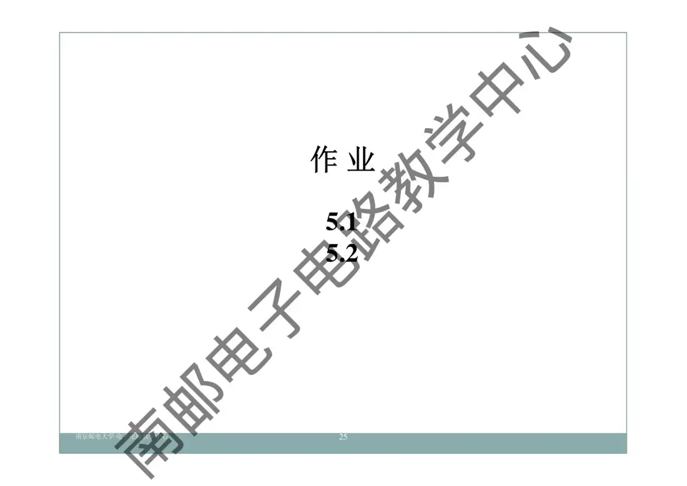

原文：

<table><tr><td>南京邮电大学 电子电路教育中心</td><td>作业5.15.2</td></tr></table>
