# 《数字电路与逻辑设计B》第五章 计数器（课件）

原件的每一页，下面附识别出的文字。

### 5 . 3 计数器

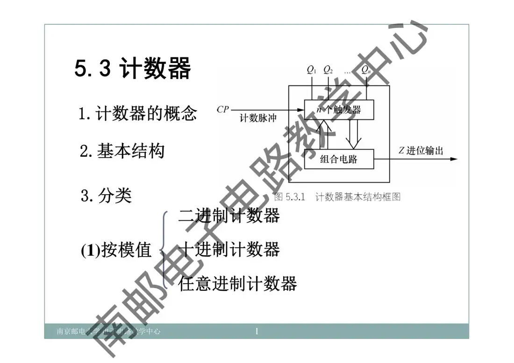

原文：

5 . 3 计数器

1. 计数器的概念

2. 基本结构

3. 分类

图 5.3.1 计数器基本结构框图

二进制计数器

(1)按模值

进制计数器

任意进制计数器(2) 按存储器的状态变化是否同时进行

南京邮电大学 电子电路教学中心

1

### (3) 按逻辑功能

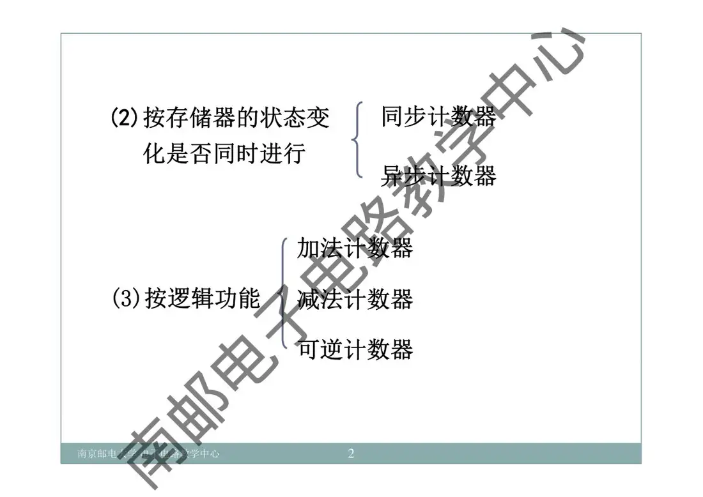

原文：

(3) 按逻辑功能

同步计数器

异步计数器

加法计数器

减法计数器

可逆计数器

南京邮电大学 电子电路教学中心

2

### 5. 3. 1 同步计数器的分析

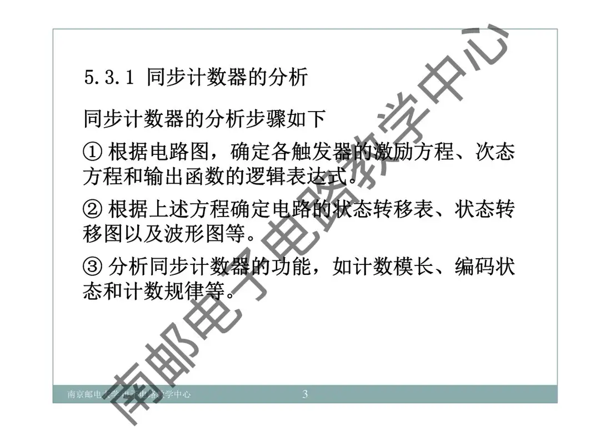

原文：

5. 3. 1 同步计数器的分析

同步计数器的分析步骤如下

① 根据电路图， 确定各触发器的激励方程、 次态方程和输 数的 辑表达式 出 函 逻 。

② 根据上述方程确定电路的状态转移表、 状态转移图 以及波形图等。

③ 分析同步计数器的功能， 如计数模长、 编码状态和计数规律等。

南京邮电大学 电子电路教学中心

3

### 5 3 1 同步计数器的分析. .

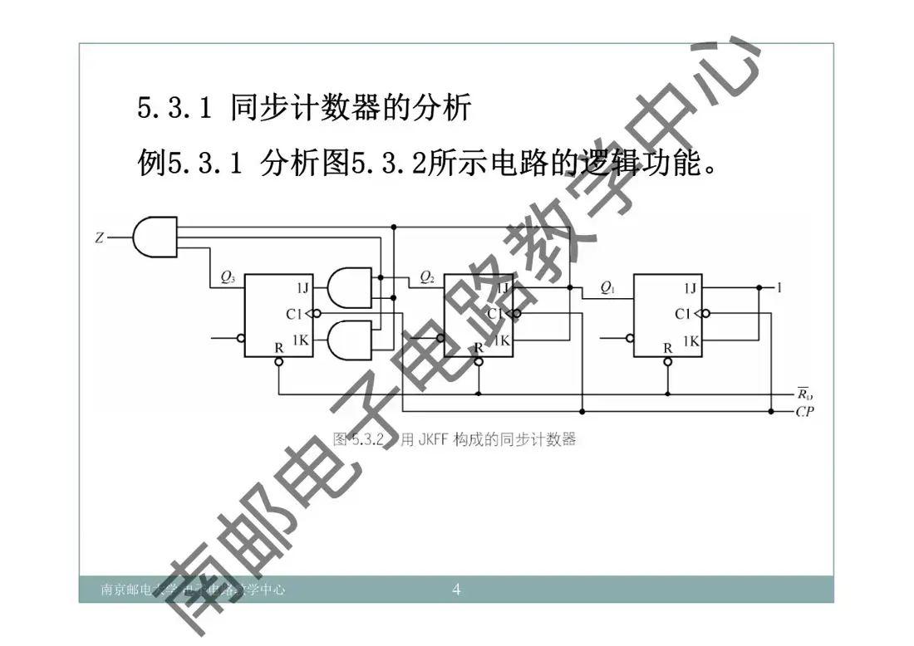

原文：

5 3 1 同步计数器的分析. .

例5. 3. 1 分析图5. 3. 2所示 电路的逻辑功能。

南京邮电大学 电子电路教学中心

4

### ① 写出三组方程

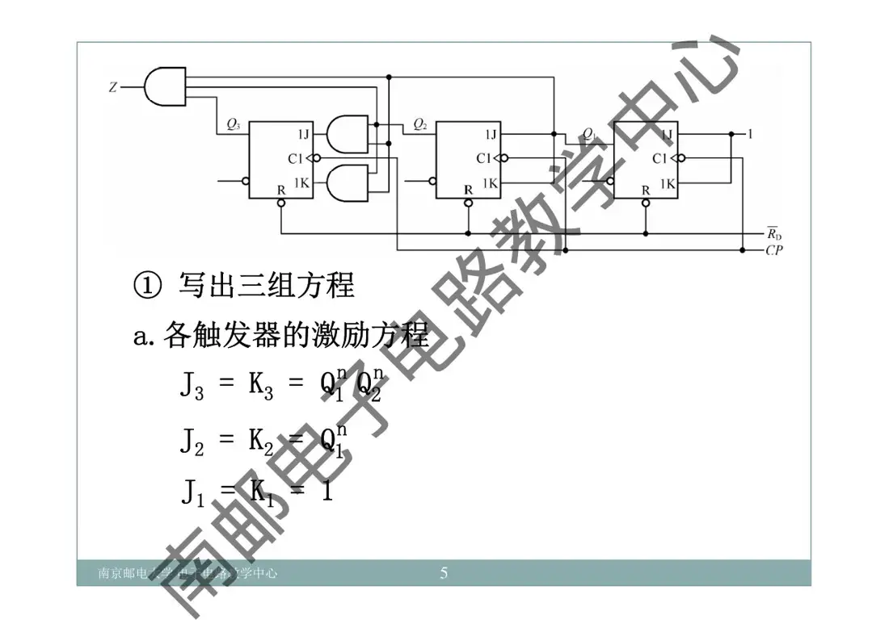

原文：

① 写出三组方程

a. 各触发器的激励方程

$$
\mathrm{J} _ {3} = \mathrm{K} _ {3} = \mathrm{Q} _ {1} ^ {\mathrm{n}} \mathrm{Q} _ {2} ^ {\mathrm{n}}
$$

$$
\mathrm{J} _ {2} = \mathrm{K} _ {2} = \mathrm{Q} _ {1} ^ {\mathrm{n}}
$$

$$
J _ {1} = K _ {1} =
$$

南京邮电大学 电子电路教学中心

5

### b. 各触发器的次态方程

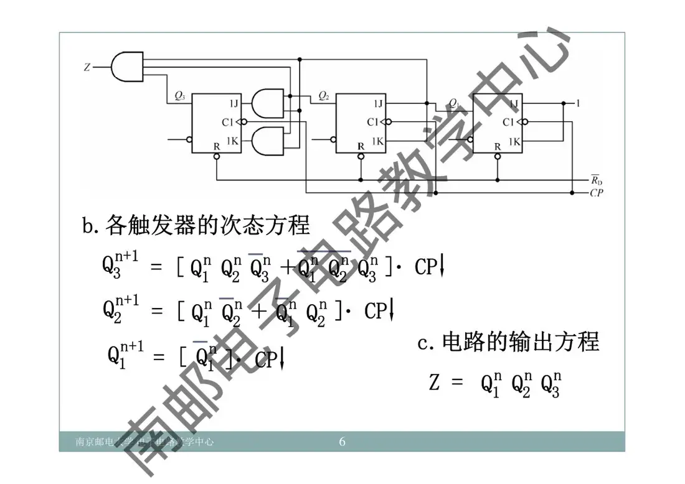

原文：

b. 各触发器的次态方程

$$
Q _ {3} ^ {n + 1} = [ Q _ {1} ^ {n} Q _ {2} ^ {n} \overline {{Q}} _ {3} ^ {n} + \overline {{Q _ {1} ^ {n} Q _ {2} ^ {n}}} Q _ {3} ^ {n} ] \cdot C P \downarrow
$$

$$
Q _ {2} ^ {n + 1} = [ Q _ {1} ^ {n} \overline {{Q}} _ {2} ^ {n} + \overline {{Q}} _ {1} ^ {n} Q _ {2} ^ {n} ] \cdot \mathrm{CP} \downarrow
$$

$$
Q _ {1} ^ {n + 1} = [ \overline {{Q}} _ {1} ^ {n} ] \cdot C P \downarrow
$$

c. 电路的输出方程

$$
Z = \mathbf {Q} _ {1} ^ {\mathrm{n}} \mathbf {Q} _ {2} ^ {\mathrm{n}} \mathbf {Q} _ {3} ^ {\mathrm{n}}
$$

南京邮电大学 电子电路教学中心

6

### ② 作状态转移表、 状态转移图或波形图

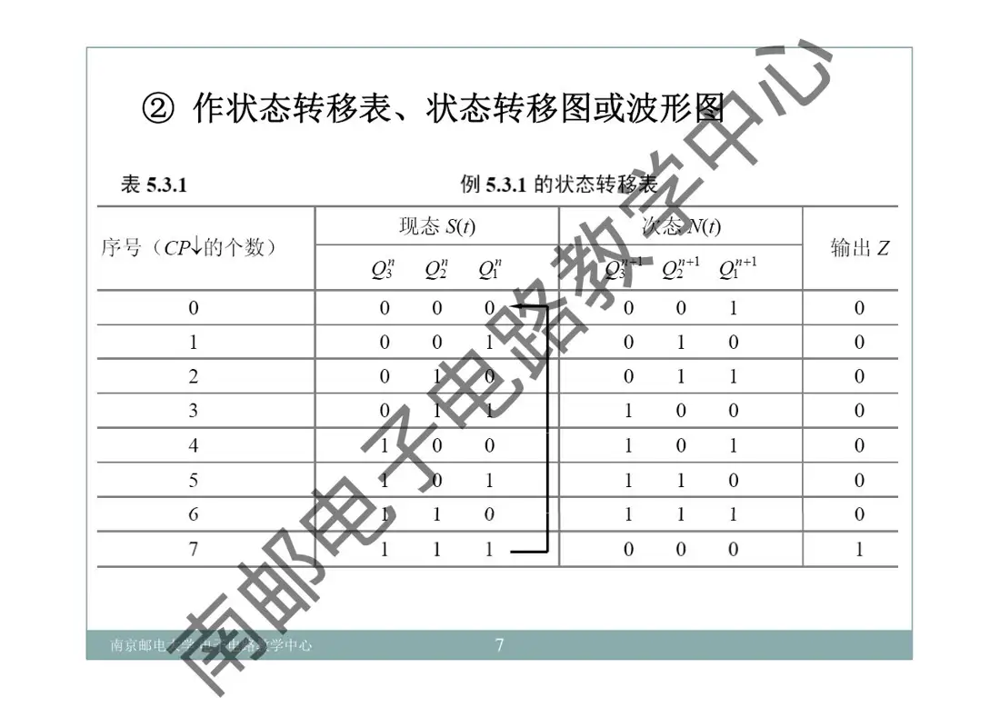

原文：

② 作状态转移表、 状态转移图或波形图

表 5.3.1 例 5.3.1 的状态转移表
<table><tr><td rowspan="2">序号(CP↓的个数)</td><td colspan="3">现态S(t)</td><td colspan="3">次态N(t)</td><td rowspan="2">输出Z</td></tr><tr><td> $Q_3^n$ </td><td> $Q_2^n$ </td><td> $Q_1^n$ </td><td> $Q_3^{n+1}$ </td><td> $Q_2^{n+1}$ </td><td> $Q_1^{n+1}$ </td></tr><tr><td>0</td><td>0</td><td>0</td><td>0</td><td>0</td><td>0</td><td>1</td><td>0</td></tr><tr><td>1</td><td>0</td><td>0</td><td>1</td><td>0</td><td>1</td><td>0</td><td>0</td></tr><tr><td>2</td><td>0</td><td>1</td><td>0</td><td>0</td><td>1</td><td>1</td><td>0</td></tr><tr><td>3</td><td>0</td><td>1</td><td>1</td><td>1</td><td>0</td><td>0</td><td>0</td></tr><tr><td>4</td><td>1</td><td>0</td><td>0</td><td>1</td><td>0</td><td>1</td><td>0</td></tr><tr><td>5</td><td>1</td><td>0</td><td>1</td><td>1</td><td>1</td><td>0</td><td>0</td></tr><tr><td>6</td><td>1</td><td>1</td><td>0</td><td>1</td><td>1</td><td>1</td><td>0</td></tr><tr><td>7</td><td>1</td><td>1</td><td>1</td><td>0</td><td>0</td><td>0</td><td>1</td></tr></table>

南京邮电大学 电子电路教学中心

7

### 表 5.3.2 例 5.3.1 的状态编码表

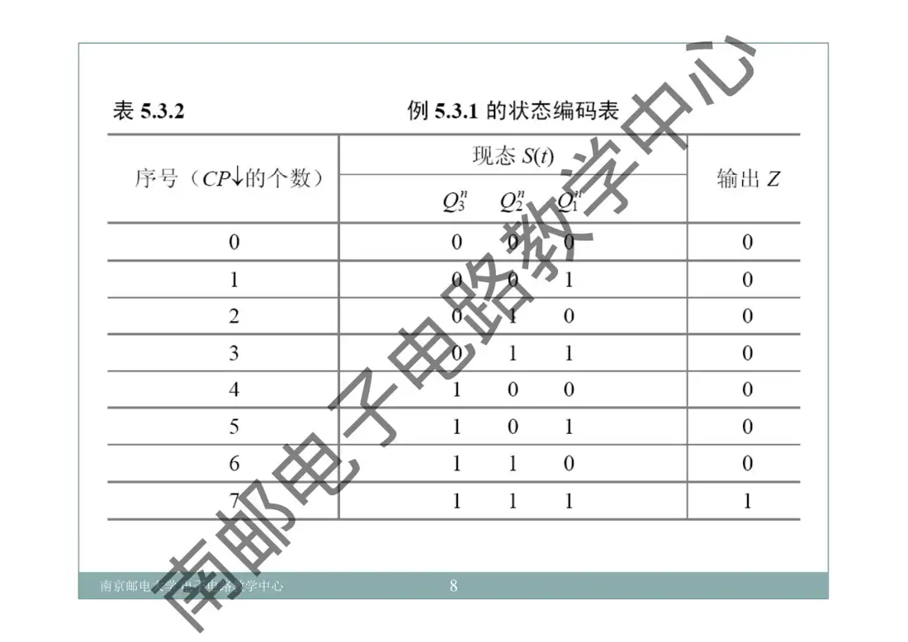

原文：

表 5.3.2 例 5.3.1 的状态编码表
<table><tr><td rowspan="2">序号(CP↓的个数)</td><td colspan="3">现态S(t)</td><td rowspan="2">输出Z</td></tr><tr><td> $Q_3^n$ </td><td> $Q_2^n$ </td><td> $Q_1^n$ </td></tr><tr><td>0</td><td>0</td><td>0</td><td>0</td><td>0</td></tr><tr><td>1</td><td>0</td><td>0</td><td>1</td><td>0</td></tr><tr><td>2</td><td>0</td><td>1</td><td>0</td><td>0</td></tr><tr><td>3</td><td>0</td><td>1</td><td>1</td><td>0</td></tr><tr><td>4</td><td>1</td><td>0</td><td>0</td><td>0</td></tr><tr><td>5</td><td>1</td><td>0</td><td>1</td><td>0</td></tr><tr><td>6</td><td>1</td><td>1</td><td>0</td><td>0</td></tr><tr><td>7</td><td>1</td><td>1</td><td>1</td><td>1</td></tr></table>

南京邮电大学 电子电路教学中心

8

### 南京邮电大学 电子电路教学中心

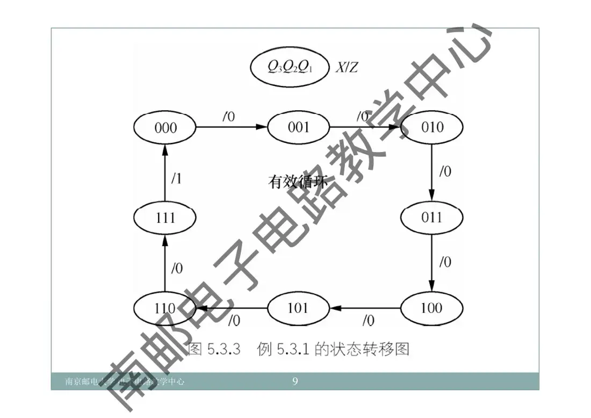

原文：

南京邮电大学 电子电路教学中心

9

### 图5.3.4 例 5.3.1 的波形图

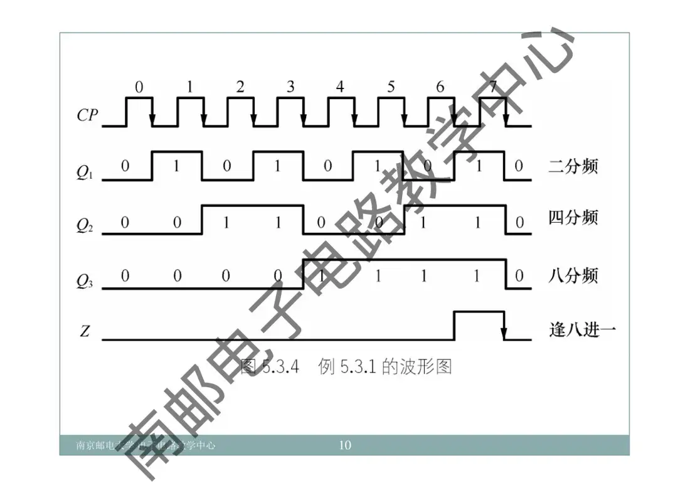

原文：

0 1 2 3 4 5 6 CP Q1 0 1 0 1 0 1 0 二分频 Q2 0 0 1 1 0 1 1 0 四分频 Q3 0 0 0 0 1 1 1 0 八分频 Z 逢八进

图5.3.4 例 5.3.1 的波形图

南京邮电大学 电子电路教学中心

1 0

### ③电路的逻辑功能描述

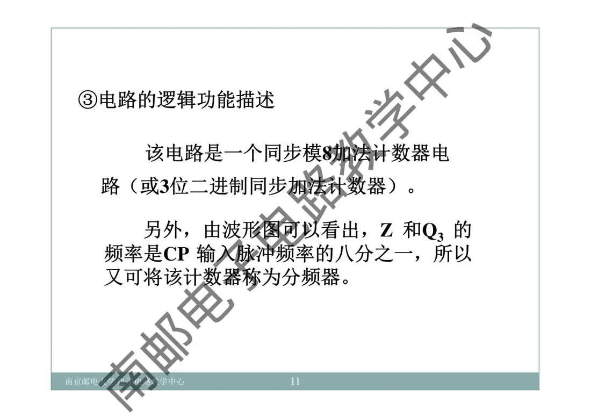

原文：

③电路的逻辑功能描述

该 路是 个同步模电 一 8加法计数器电路 （或3位二进制 同步加法计数器） 。

另外， 由波形图可 以看出 ， Z 和 $\mathbf { Q } _ { 3 }$ 的频率是CP 输入脉冲频率的八分之一， 所以又可将该计数器称为分频器。

南京邮电大学 电子电路教学中心

1 1

### ① 由 n 个 TFF 构成。

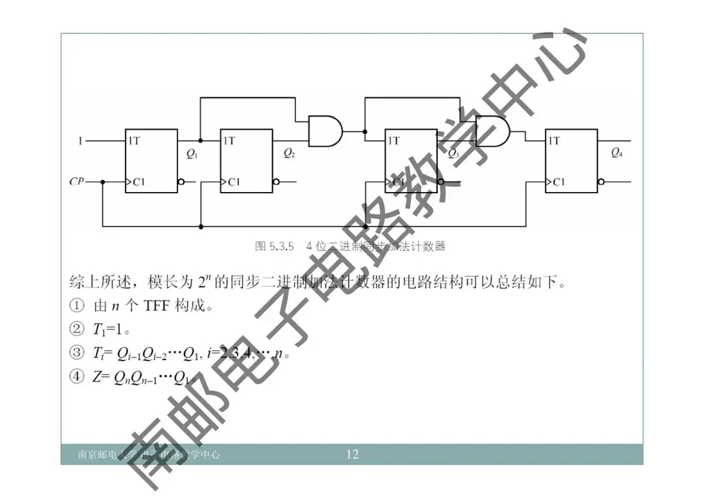

原文：

综上所述，模长为 $2 ^ { n }$ 的同步二进制加法计数器的电路结构可以总结如下。

① 由 n 个 TFF 构成。

② ${ \cal T } _ { 1 } { = } 1$

③ $T _ { i } \mathrm { = } \mathcal { Q } _ { i - 1 } \mathcal { Q } _ { i - 2 } \mathrm { \cdots } \mathcal { Q } _ { 1 }$ iFAn

④ $Z ^ { = } { \cal Q } _ { n } { \cal Q } _ { n - 1 } cdots { \cal Q } _ { 1 6 }$

南京邮电大学 电子电路教学中心

1 2

### 加法计数器状态转移表

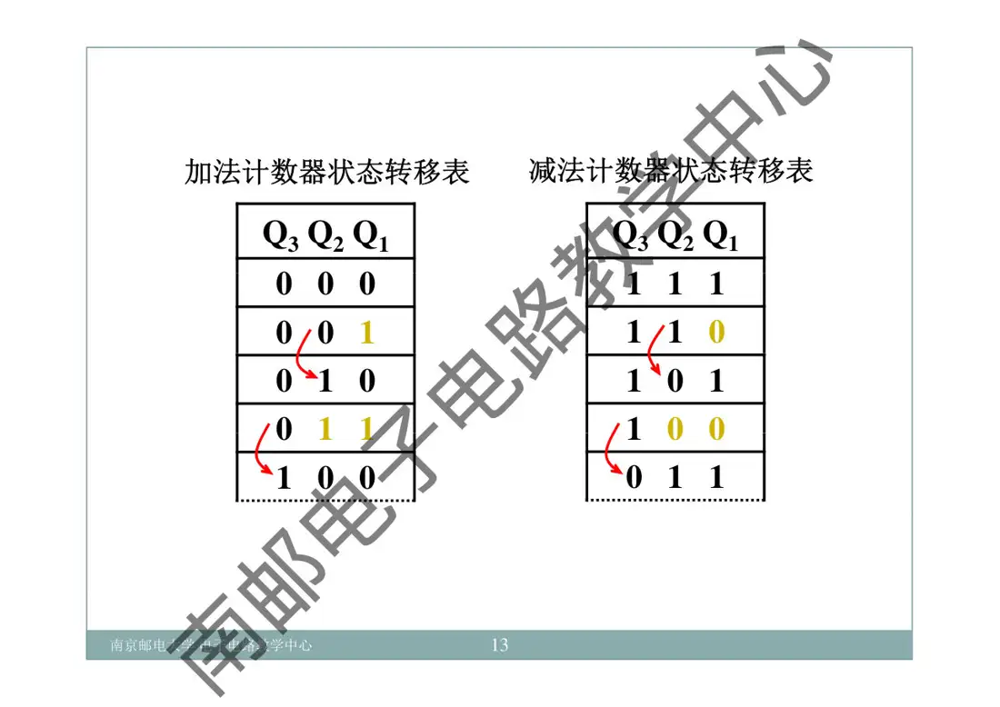

原文：

加法计数器状态转移表

$$
\begin{array}{c c c} \hline & Q _ {3} & Q _ {2} & Q _ {1} \\ \hline & 0 & 0 & 0 \\ \hline & 0 & 0 & 1 \\ \hline & 0 & 1 & 0 \\ \hline & 0 & 1 & 1 \\ \hline & 1 & 0 & 0 \\ \hline \end{array}
$$

减法计数器状态转移表

$$
\begin{array}{c c c} \hline & Q _ {3} & Q _ {2} & Q _ {1} \\ \hline & 1 & 1 & 1 \\ \hline & 1 & 1 & 0 \\ \hline & 1 & 0 & 1 \\ \hline & 1 & 0 & 0 \\ \hline & 0 & 1 & 1 \\ \hline \end{array}
$$

南京邮电大学 电子电路教学中心

1 3

### 减法计数器

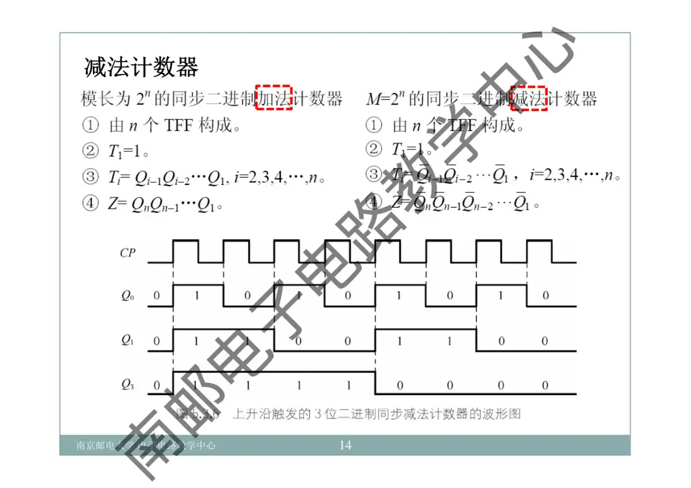

原文：

减法计数器

模长为 $2 ^ { n }$ 的同步二进制加法计数器

①由 n 个 TFF 构成。

② ${ \cal T } _ { 1 } { = } 1$

③ $T _ { i } \mathrm { = } \mathcal { Q } _ { i - 1 } \mathcal { Q } _ { i - 2 } \cdots \mathcal { Q } _ { 1 } , i \mathrm { = } 2 , 3 , 4 , \cdots , n \mathrm { \circ }$

④ $Z ^ { = } Q _ { n } Q _ { n - 1 } \cdots Q _ { 1 }$ 0

$M ^ { = } 2 ^ { n }$ 的同步二进制减法计数器

① 由n 个TFF 构成。

② $T _ { \underline { { \mathfrak { q } } } } { = } \underline { { \mathfrak { j } } } \ 。$

$\equiv \bar { Q } _ { i - 1 } \bar { Q } _ { i - 2 } \cdots \bar { Q } _ { 1 } , i = 2 , 3 , 4 , \cdots , n \mathrm { ~ o ~ }$

$\overline { { \ u { Q } } } _ { h } \overline { { \ u { Q } } } _ { n - 1 } \overline { { \ u { Q } } } _ { n - 2 } \cdots \overline { { \ u { Q } } } _ { 1 }$ o

上升沿触发的3位二进制同步减法计数器的波形图

南京邮电大学 电子电路教学中心

1 4

### 减法计数器

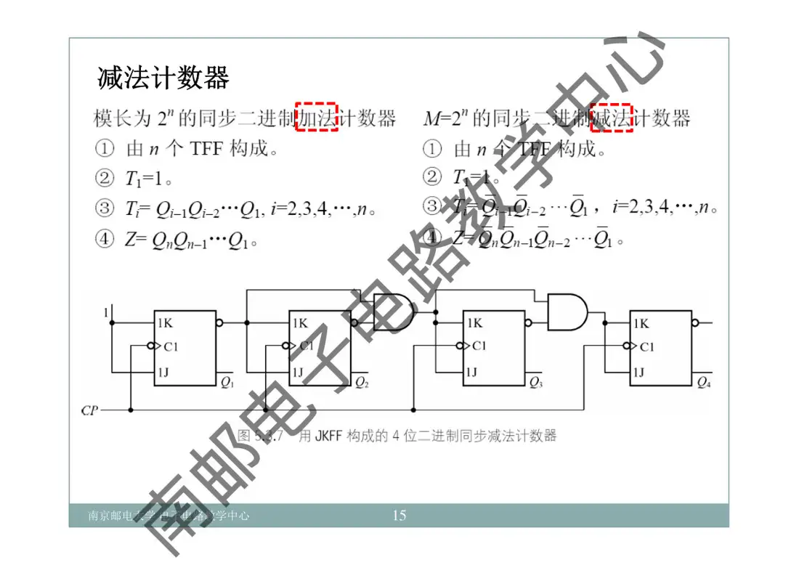

原文：

减法计数器

$$
2 ^ {n}
$$

① 由 n 个 TFF 构成。

② ${ \cal T } _ { 1 } { = } 1$

③ $T _ { i } \mathrm { = } \mathcal { Q } _ { i - 1 } \mathcal { Q } _ { i - 2 } \cdots \mathcal { Q } _ { 1 } , i \mathrm { = } 2 , 3 , 4 , \cdots , n \mathrm { ~ o ~ }$ 2

④ $Z ^ { = } Q _ { n } Q _ { n - 1 } \cdots Q _ { 1 }$ o

$M ^ { = } 2 ^ { n }$ 的同步一进制减法计数器

① 由n个YFE 构成。

②TT

$\overline { { \mathcal { Q } } } _ { n - 1 } \overline { { \mathcal { Q } } } _ { n - 2 } \cdots \overline { { \mathcal { Q } } } _ { 1 }$ 0

图 5.3.7 用 JKFF 构成的 4 位二进制同步减法计数器

南京邮电大学 电子电路教学中心

1 5

### 例5.3.2 图5.3.8 是一个同步任意进制计数器，试分析其逻辑功能。

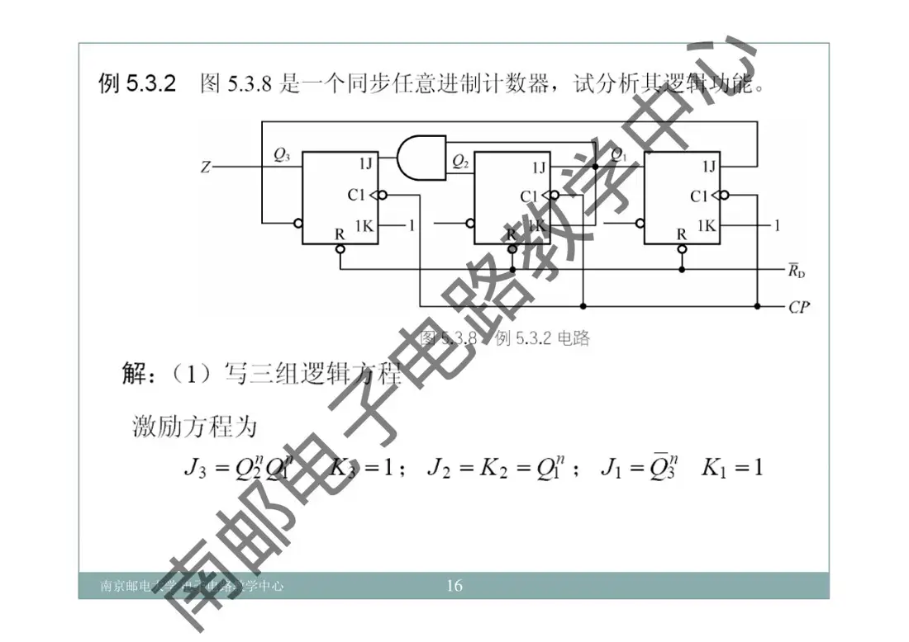

原文：

例5.3.2 图5.3.8 是一个同步任意进制计数器，试分析其逻辑功能。

解：（1）写三组逻辑方程

激励方程为

$$
J _ {3} = Q _ {2} ^ {n} Q _ {1} ^ {n}; \quad K _ {3} = 1; \quad J _ {2} = K _ {2} = Q _ {1} ^ {n}; \quad J _ {1} = \bar {Q} _ {3} ^ {n}; \quad K _ {1} = 1
$$

南京邮电大学 电子电路教学中心

1 6

### 次态方程为

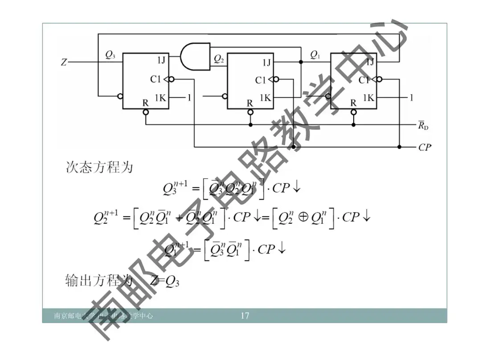

原文：

次态方程为

$$
Q _ {3} ^ {n + 1} = \left[ \bar {Q} _ {3} ^ {n} Q _ {2} ^ {n} Q _ {1} ^ {n} \right] \cdot C P \downarrow
$$

$$
Q _ {2} ^ {n + 1} = \left[ Q _ {2} ^ {n} \bar {Q} _ {1} ^ {n} + \bar {Q} _ {2} ^ {n} Q _ {1} ^ {n} \right] \cdot C P \downarrow = \left[ Q _ {2} ^ {n} \oplus Q _ {1} ^ {n} \right] \cdot C P \downarrow
$$

输出方程为Z=O3

南京邮电大学 电子电路教学中心

1 7

### （2） 状态转移表、 状态转移图和波形图

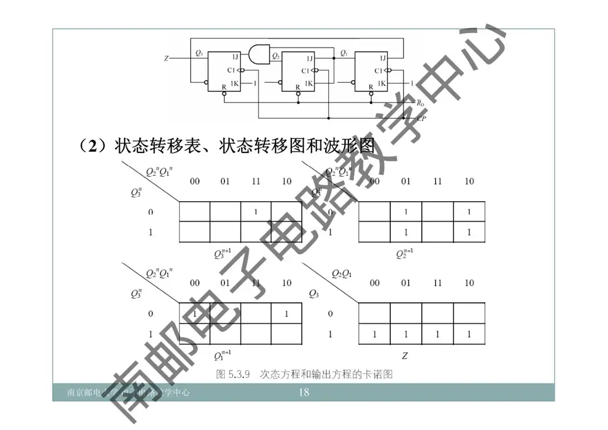

原文：

（2） 状态转移表、 状态转移图和波形图

南京邮电大学 电子电路教学中心

1 8

### （2） 状态转移表、 状态转移图和波形图

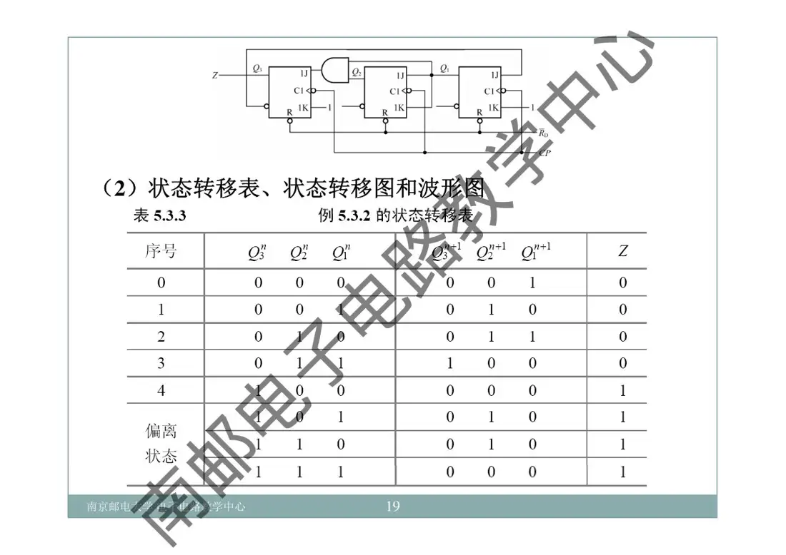

原文：

（2） 状态转移表、 状态转移图和波形图

表 5.3.3 例 5.3.2 的状态转移表
<table><tr><td>序号</td><td> $Q_3^n$ </td><td> $Q_2^n$ </td><td> $Q_1^n$ </td><td> $Q_3^{n+1}$ </td><td> $Q_2^{n+1}$ </td><td> $Q_1^{n+1}$ </td><td>Z</td></tr><tr><td>0</td><td>0</td><td>0</td><td>0</td><td>0</td><td>0</td><td>1</td><td>0</td></tr><tr><td>1</td><td>0</td><td>0</td><td>1</td><td>0</td><td>1</td><td>0</td><td>0</td></tr><tr><td>2</td><td>0</td><td>1</td><td>0</td><td>0</td><td>1</td><td>1</td><td>0</td></tr><tr><td>3</td><td>0</td><td>1</td><td>1</td><td>1</td><td>0</td><td>0</td><td>0</td></tr><tr><td>4</td><td>1</td><td>0</td><td>0</td><td>0</td><td>0</td><td>0</td><td>1</td></tr><tr><td rowspan="3">偏离状态</td><td>1</td><td>0</td><td>1</td><td>0</td><td>1</td><td>0</td><td>1</td></tr><tr><td>1</td><td>1</td><td>0</td><td>0</td><td>1</td><td>0</td><td>1</td></tr><tr><td>1</td><td>1</td><td>1</td><td>0</td><td>0</td><td>0</td><td>1</td></tr></table>

南京邮电大学 电子电路教学中心

1 9

### （2） 状态转移表、 状态转移图和波形图

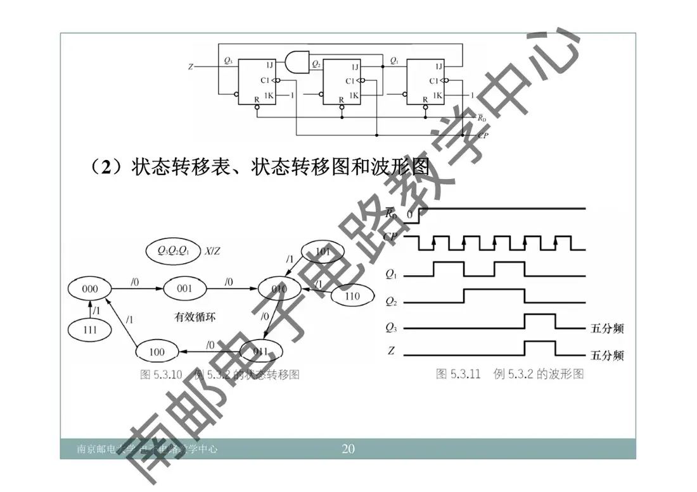

原文：

（2） 状态转移表、 状态转移图和波形图

图 5.3.10 例 5.3.2 的状态转移图

图 5.3.11 例 5.3.2 的波形图

南京邮电大学 电子电路教学中心

20

### （3） 功能分析

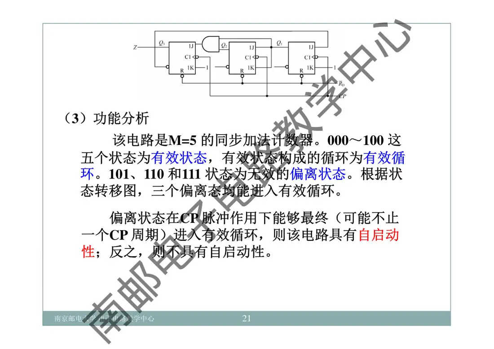

原文：

（3） 功能分析

该 电路是M=5 的 同步加法计数器。 000～100 这五个状态为有效状态， 有效状态构成的循环为有效循环。 101、 110 和111 状态为无效的偏离状态。 根据状态转移图， 三个偏离态均能进入有效循环。

偏离状态在CP 脉冲作用下能够最终 （可能不止一个CP 周期） 进入有效循环， 则该电路具有 自 启动性； 反之， 则不具有 自 启动性。

南京邮电大学 电子电路教学中心

2 1

### 5.3.2 同步计数器的设计

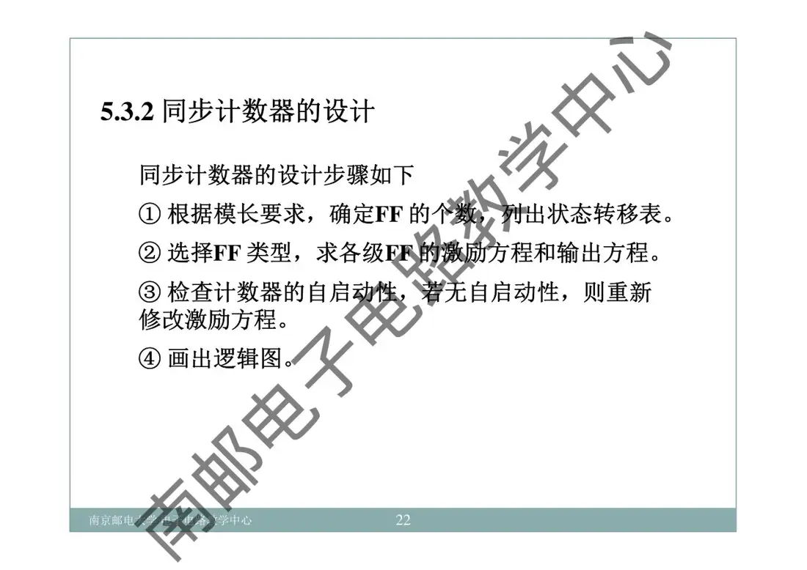

原文：

5.3.2 同步计数器的设计

同步计数器的设计步骤如下

① 根据模长要求， 确定FF 的个数， 列出状态转移表 。

② 选择FF 类型， 求各级FF 的激励方程和输出方程。

③ 检查计数器的 自 启动性， 若无 自 启动性， 则重新修改激励方程。

④ 画出逻辑图 。

南京邮电大学 电子电路教学中心

22

### 5.3.2 同步计数器的设计

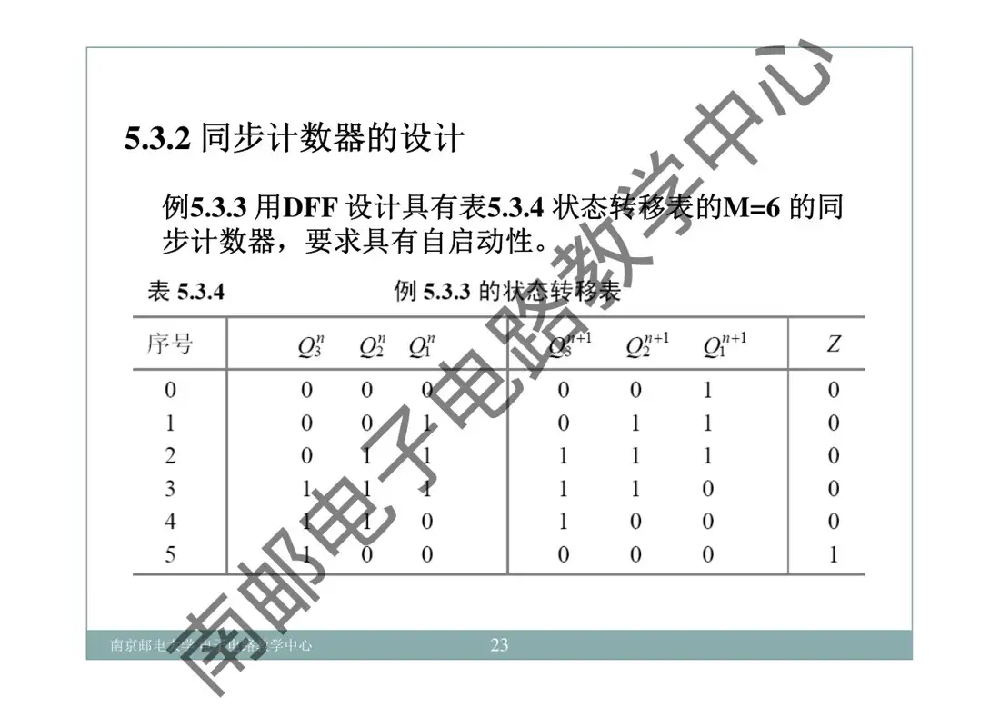

原文：

5.3.2 同步计数器的设计

例5.3.3 用DFF 设计具有表5.3.4 状态转移表 的M=6 的 同步计数器， 要求具有 自 启动性。

表 5.3.4 例 5.3.3 的状态转移表
<table><tr><td>序号</td><td> $Q_3^n$ </td><td> $Q_2^n$ </td><td> $Q_1^n$ </td><td> $Q_3^{n+1}$ </td><td> $Q_2^{n+1}$ </td><td> $Q_1^{n+1}$ </td><td>Z</td></tr><tr><td>0</td><td>0</td><td>0</td><td>0</td><td>0</td><td>0</td><td>1</td><td>0</td></tr><tr><td>1</td><td>0</td><td>0</td><td>1</td><td>0</td><td>1</td><td>1</td><td>0</td></tr><tr><td>2</td><td>0</td><td>1</td><td>1</td><td>1</td><td>1</td><td>1</td><td>0</td></tr><tr><td>3</td><td>1</td><td>1</td><td>1</td><td>1</td><td>1</td><td>0</td><td>0</td></tr><tr><td>4</td><td>1</td><td>1</td><td>0</td><td>1</td><td>0</td><td>0</td><td>0</td></tr><tr><td>5</td><td>1</td><td>0</td><td>0</td><td>0</td><td>0</td><td>0</td><td>1</td></tr></table>

南京邮电大学 电子电路教学中心

23

### 解： （1） 确定触发器个数

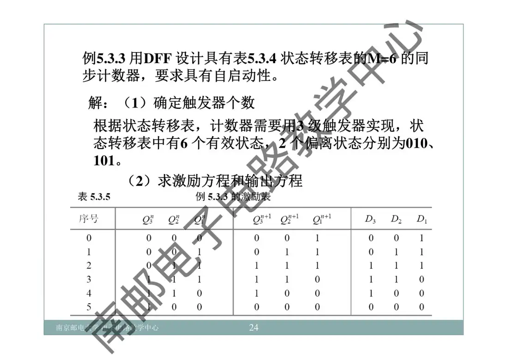

原文：

例5 3 3. . 用DFF 设计具有表5 3 4. . 状态转移表的M=6 的 同步计数器， 要求具有 自 启动性。 u

解： （1） 确定触发器个数

根据状态转移表， 计数器需要用3 级触发器实现， 状态转移表中有6 个有效状态， 2 个偏离状态分别为010、101 。

（2） 求激励方程和输出方程 表 5.3.5 例5.3.3的激励表
<table><tr><td>序号</td><td> $Q_3^n$ </td><td> $Q_2^n$ </td><td> $Q_1^n$ </td><td> $Q_3^{n+1}$ </td><td> $Q_2^{n+1}$ </td><td> $Q_1^{n+1}$ </td><td> $D_3$ </td><td> $D_2$ </td><td> $D_1$ </td></tr><tr><td>0</td><td>0</td><td>0</td><td>0</td><td>0</td><td>0</td><td>1</td><td>0</td><td>0</td><td>1</td></tr><tr><td>1</td><td>0</td><td>0</td><td>1</td><td>0</td><td>1</td><td>1</td><td>0</td><td>1</td><td>1</td></tr><tr><td>2</td><td>0</td><td>1</td><td>1</td><td>1</td><td>1</td><td>1</td><td>1</td><td>1</td><td>1</td></tr><tr><td>3</td><td>1</td><td>1</td><td>1</td><td>1</td><td>1</td><td>0</td><td>1</td><td>1</td><td>0</td></tr><tr><td>4</td><td>1</td><td>1</td><td>0</td><td>1</td><td>0</td><td>0</td><td>1</td><td>0</td><td>0</td></tr><tr><td>5</td><td>1</td><td>0</td><td>0</td><td>0</td><td>0</td><td>0</td><td>0</td><td>0</td><td>0</td></tr></table>

南京邮电大学 电子电路教学中心

24

### （2） 求激励方程和输出方程

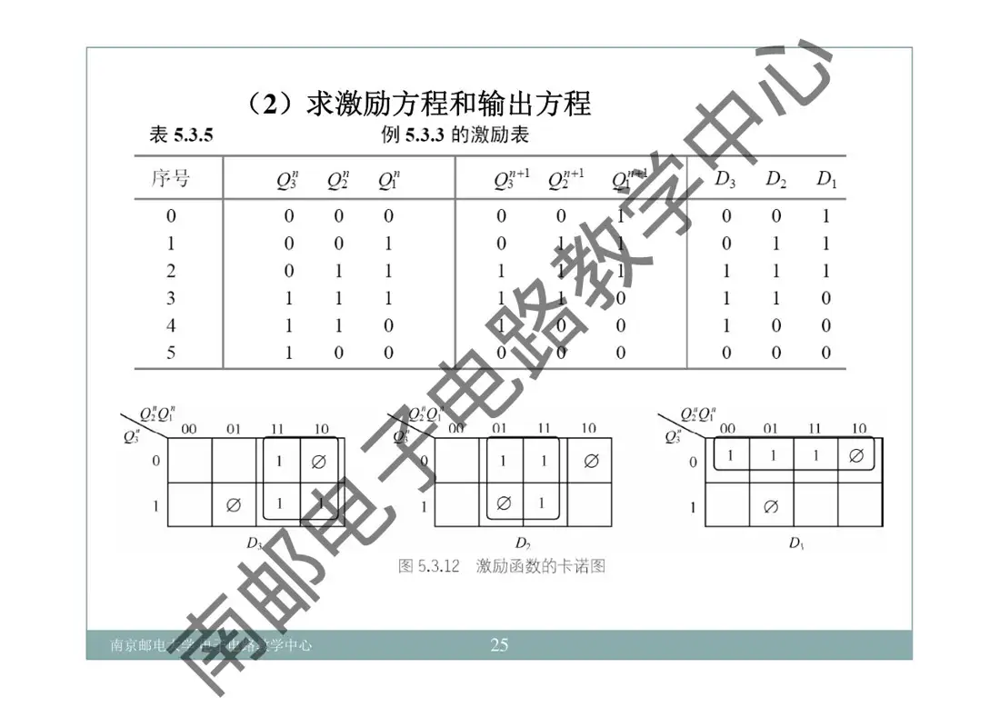

原文：

（2） 求激励方程和输出方程

表 5.3.5 例 5.3.3 的激励表 图5.3.12 激励函数的卡诺图
<table><tr><td>序号</td><td> $Q_3^n$ </td><td> $Q_2^n$ </td><td> $Q_1^n$ </td><td> $Q_3^{n+1}$ </td><td> $Q_2^{n+1}$ </td><td> $Q_1^{n+1}$ </td><td> $D_3$ </td><td> $D_2$ </td><td> $D_1$ </td></tr><tr><td>0</td><td>0</td><td>0</td><td>0</td><td>0</td><td>0</td><td>1</td><td>0</td><td>0</td><td>1</td></tr><tr><td>1</td><td>0</td><td>0</td><td>1</td><td>0</td><td>1</td><td>1</td><td>0</td><td>1</td><td>1</td></tr><tr><td>2</td><td>0</td><td>1</td><td>1</td><td>1</td><td>1</td><td>1</td><td>1</td><td>1</td><td>1</td></tr><tr><td>3</td><td>1</td><td>1</td><td>1</td><td>1</td><td>1</td><td>0</td><td>1</td><td>1</td><td>0</td></tr><tr><td>4</td><td>1</td><td>1</td><td>0</td><td>1</td><td>0</td><td>0</td><td>1</td><td>0</td><td>0</td></tr><tr><td>5</td><td>1</td><td>0</td><td>0</td><td>0</td><td>0</td><td>0</td><td>0</td><td>0</td><td>0</td></tr></table>

南京邮电大学 电子电路教学中心

25

### （2） 求激励方程和输出方程

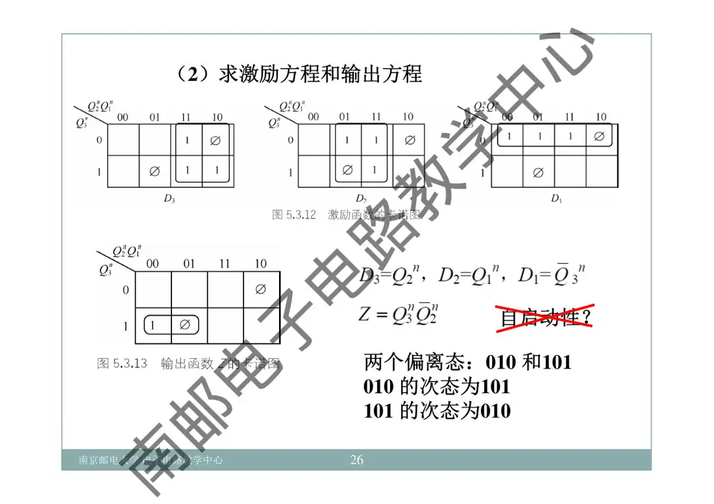

原文：

（2） 求激励方程和输出方程

$$
D _ {3} = Q _ {2} ^ {n}, D _ {2} = Q _ {1} ^ {n}, D _ {1} = \bar {Q} _ {3} ^ {n}
$$

$$
Z = Q _ {3} ^ {n} \overline {{Q}} _ {2} ^ {n}
$$

两个偏离态 ： 010 和 101010 的 次态为 101101 的 次态为010

南京邮电大学 电子电路教学中心

26

### 可将第一个触发器的激励函数修改

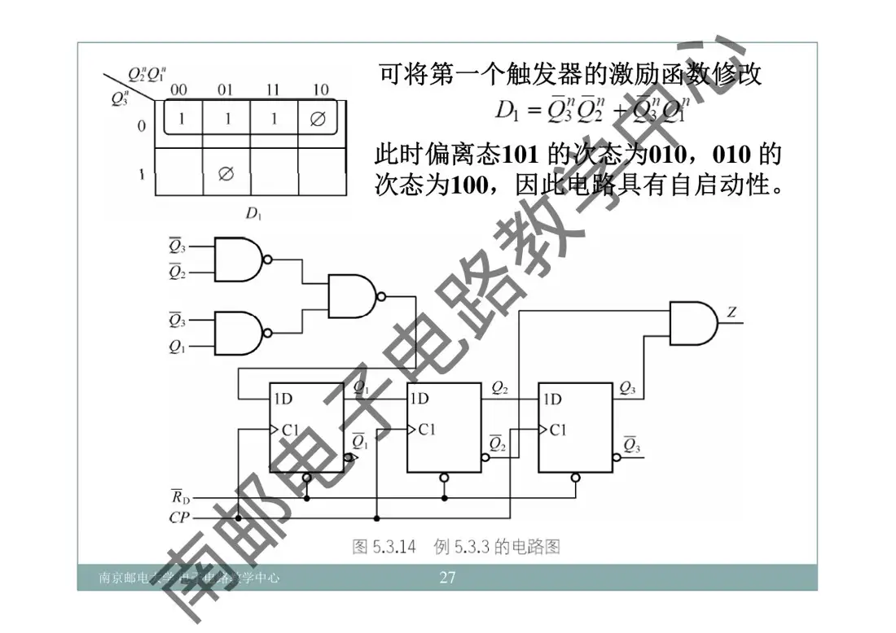

原文：

可将第一个触发器的激励函数修改

$$
D _ {1} = \bar {Q} _ {3} ^ {n} \bar {Q} _ {2} ^ {n} + \bar {Q} _ {3} ^ {n} Q _ {1} ^ {n}
$$

此时偏离态101 的次态为010， 010 的次态为100， 因此 电路 有 自 启动性具 。

南京邮电大学 电子电路教学中心

27

### 5 3 3 MSI 同 步计数器. .

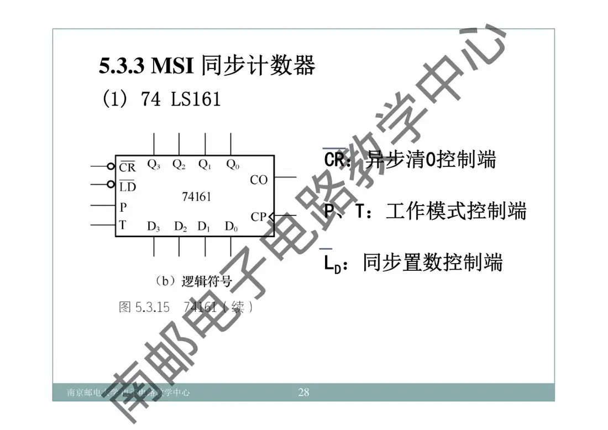

原文：

5 3 3 MSI 同 步计数器. .

( 1 ) 7 4 LS 1 6 1

(b) 逻辑符号

图 5.3.15

CR： 异步清0控制端

T： 工作模式控制端

$L _ { \tt D } \tt { : }$ 同步置数控制端

南京邮电大学 电子电路教学中心

28

### ②功能表

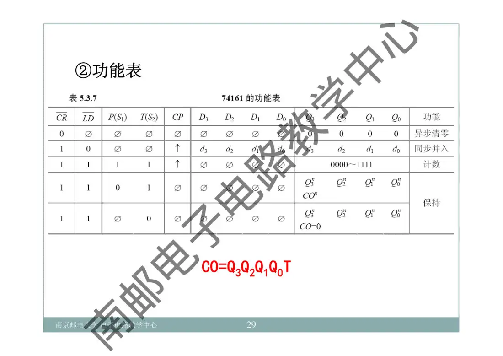

原文：

②功能表

表 5.3.7
<table><tr><td> $\overline{CR}$ </td><td> $\overline{LD}$ </td><td> $P(S_1)$ </td><td> $T(S_2)$ </td><td> $CP$ </td><td> $D_3$ </td><td> $D_2$ </td><td> $D_1$ </td><td> $D_0$ </td><td> $Q_3$ </td><td> $Q_2$ </td><td> $Q_1$ </td><td> $Q_0$ </td><td>功能</td></tr><tr><td>0</td><td>∅</td><td>∅</td><td>∅</td><td>∅</td><td>∅</td><td>∅</td><td>∅</td><td>∅</td><td>0</td><td>0</td><td>0</td><td>0</td><td>异步清零</td></tr><tr><td>1</td><td>0</td><td>∅</td><td>∅</td><td>↑</td><td> $d_3$ </td><td> $d_2$ </td><td> $d_1$ </td><td> $d_0$ </td><td> $d_3$ </td><td> $d_2$ </td><td> $d_1$ </td><td> $d_0$ </td><td>同步并入</td></tr><tr><td>1</td><td>1</td><td>1</td><td>1</td><td>↑</td><td>∅</td><td>∅</td><td>∅</td><td>∅</td><td></td><td colspan="3">0000~1111</td><td>计数</td></tr><tr><td>1</td><td>1</td><td>0</td><td>1</td><td>∅</td><td>∅</td><td>∅</td><td>∅</td><td>∅</td><td> $Q_3^n$  $CO^n$ </td><td> $Q_2^n$ </td><td> $Q_1^n$ </td><td> $Q_0^n$ </td><td rowspan="2">保持</td></tr><tr><td>1</td><td>1</td><td>∅</td><td>0</td><td>∅</td><td>∅</td><td>∅</td><td>∅</td><td>∅</td><td> $Q_3^n$  $CO=0$ </td><td> $Q_2^n$ </td><td> $Q_1^n$ </td><td> $Q_0^n$ </td></tr></table>

$$
\mathbf {C O} = \mathbf {Q} _ {3} \mathbf {Q} _ {2} \mathbf {Q} _ {1} \mathbf {Q} _ {0} \mathbf {T}
$$

南京邮电大学 电子电路教学中心

29

### （ 2 ） 应用

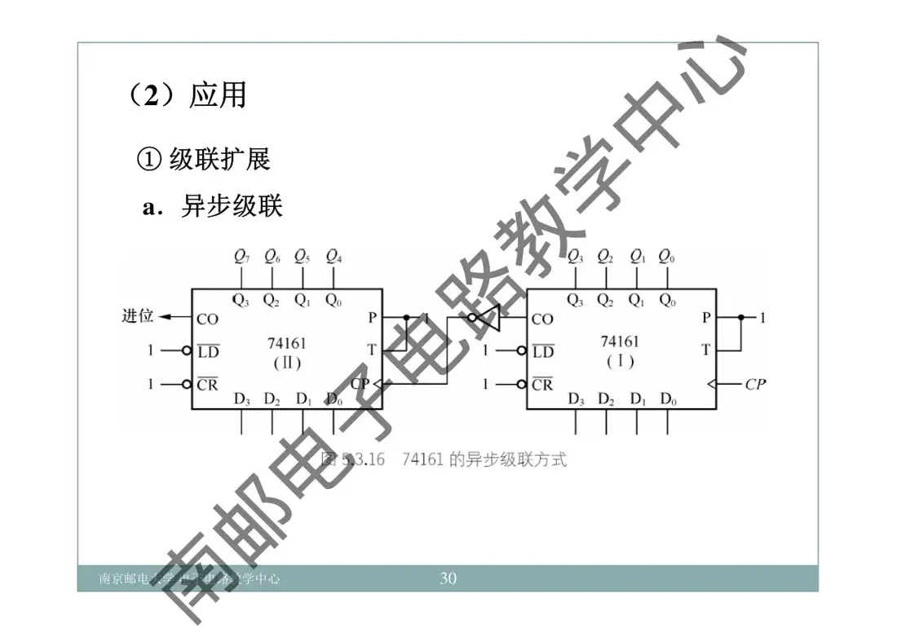

原文：

（ 2 ） 应用

① 级联扩展

a． 异步级联

南京邮电大学 电子电路教学中心

30

### （ 2 ） 应用

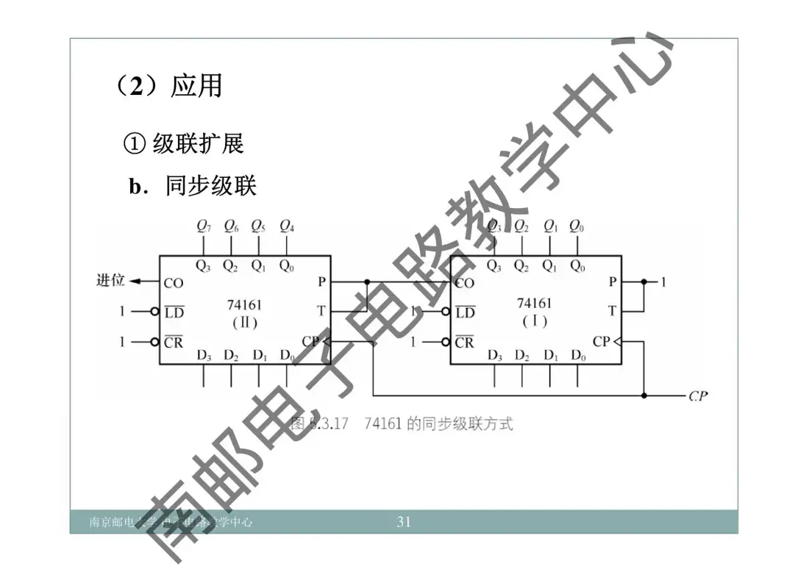

原文：

（ 2 ） 应用

① 级联扩展

b． 同步级联

南京邮电大学 电子电路教学中心

3 1

### ② 构成模长为M 16< 的任意进制计数器

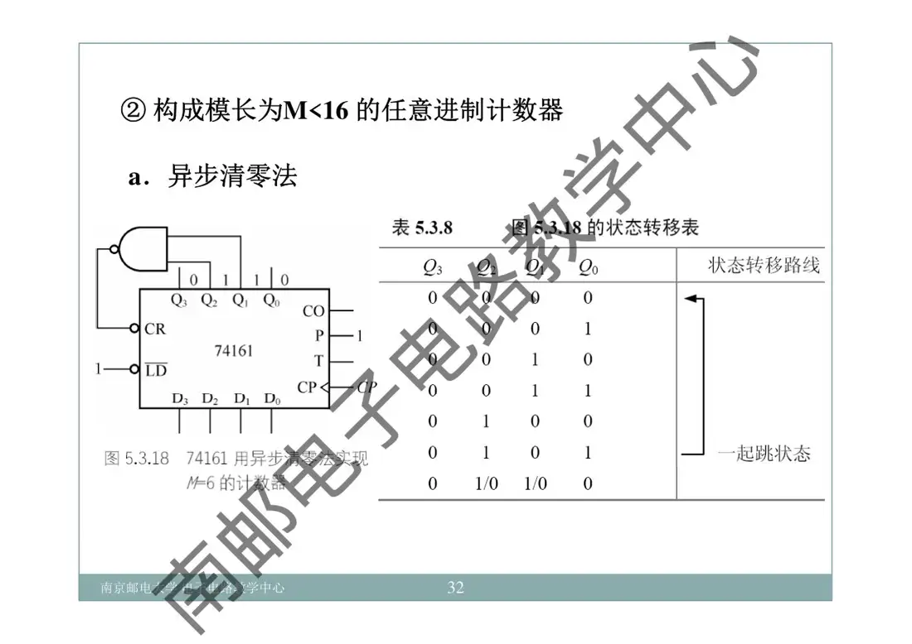

原文：

② 构成模长为M 16< 的任意进制计数器

a． 异步清零法

<table><tr><td></td><td>Q3</td><td>Q2</td><td>Q1</td><td>Q0</td><td>状态转移路线</td></tr><tr><td></td><td>0</td><td>0</td><td>0</td><td>0</td><td rowspan="7">一起跳状态</td></tr><tr><td></td><td>0</td><td>0</td><td>0</td><td>1</td></tr><tr><td></td><td>0</td><td>0</td><td>1</td><td>0</td></tr><tr><td></td><td>0</td><td>0</td><td>1</td><td>1</td></tr><tr><td></td><td>0</td><td>1</td><td>0</td><td>0</td></tr><tr><td></td><td>0</td><td>1</td><td>0</td><td>1</td></tr><tr><td></td><td>0</td><td>1/0</td><td>1/0</td><td>0</td></tr></table>

南京邮电大学 电子电路教学中心

32

### ② 构成模长为M 16< 的任意进制计数器

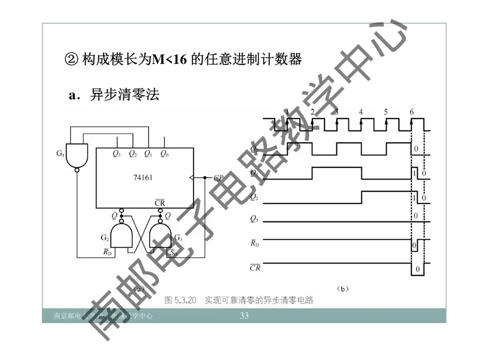

原文：

② 构成模长为M 16< 的任意进制计数器

a． 异步清零法

南京邮电大学 电子电路教学中心

3 3

### b 反馈置数法

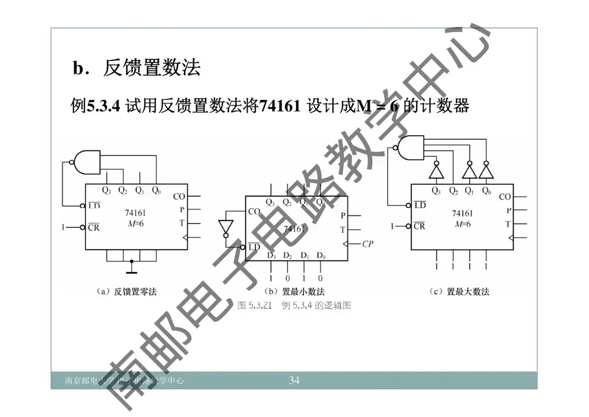

原文：

b 反馈置数法

例5.3.4 试用 反馈置数法将74161 设计成M = 6 的计数器

南京邮电大学 电子电路教学中心

34

### b 反馈置数法

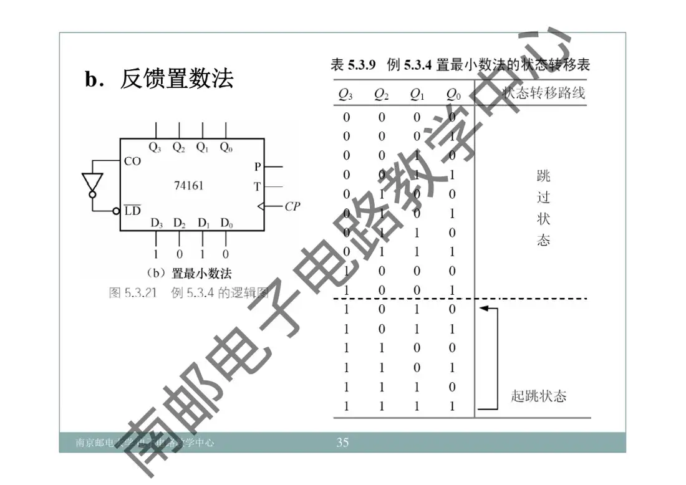

原文：

b 反馈置数法

南京邮电大学 电子电路教学中心

3 5

### b 反馈置数法

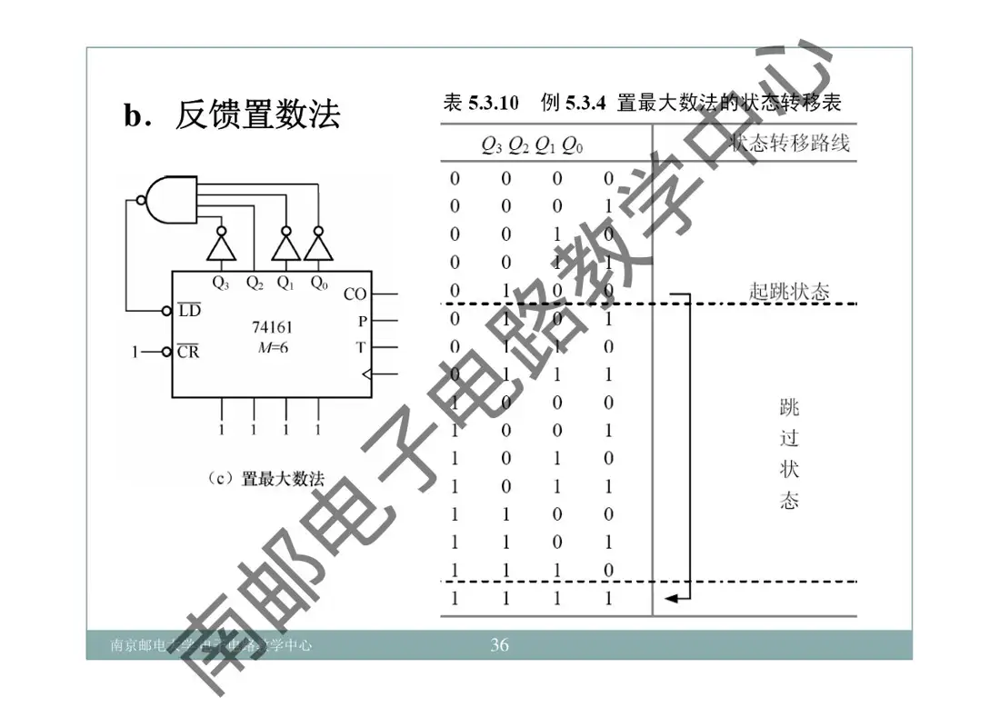

原文：

b 反馈置数法

南京邮电大学 电子电路教学中心

3 6

### 南京邮电大学 电子电路教学中心

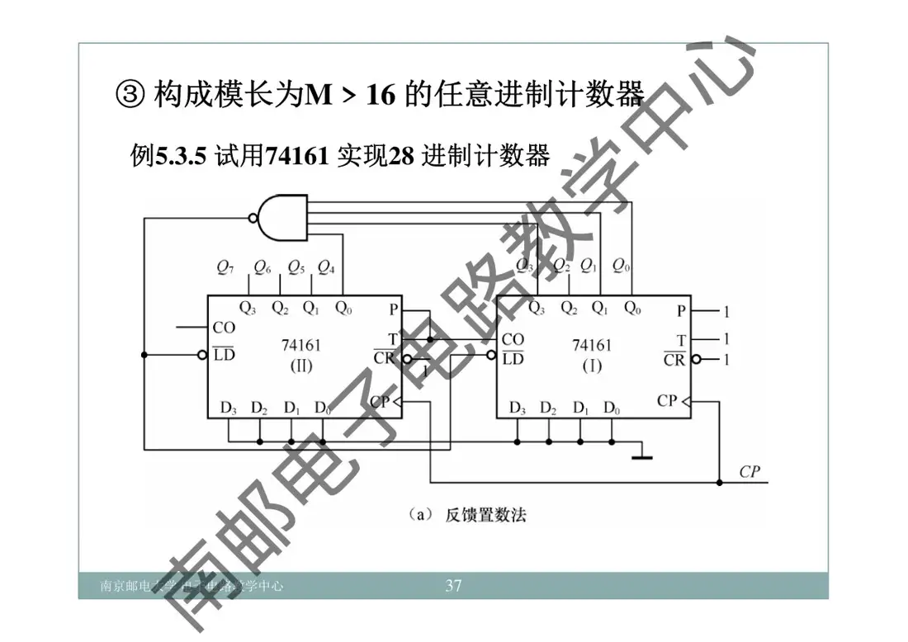

原文：

③ 构成模长为M > 16 的任意进制计数器例5.3.5 试用 74161 实现28 进制 计数器

南京邮电大学 电子电路教学中心

37

### 南京邮电大学 电子电路教学中心

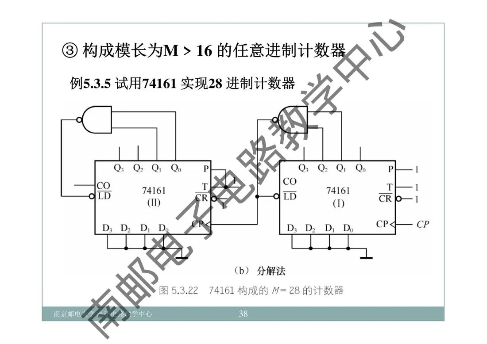

原文：

③ 构成模长为M > 16 的任意进制计数器例5.3.5 试用 74161 实现28 进制 计数器

南京邮电大学 电子电路教学中心

3 8

### 2 ． 集成计数器74163

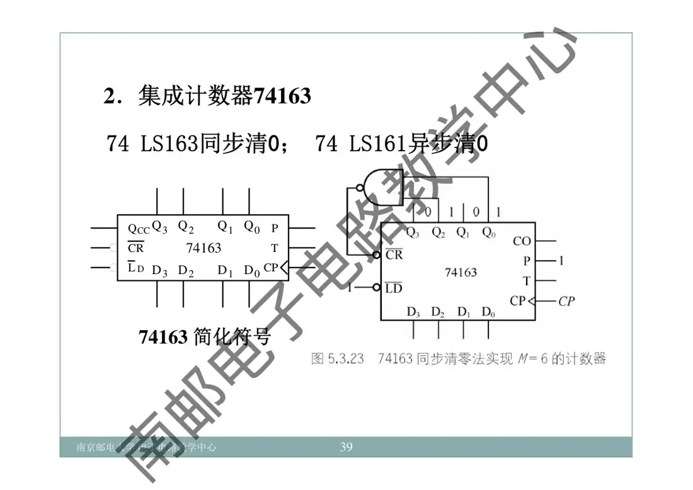

原文：

2 ． 集成计数器74163

同 步清 异 步清74 LS 1 6 3 0 ； 74 LS 1 6 1 0

南京邮电大学 电子电路教学中心

39

### 3 ． 集成计数器74160

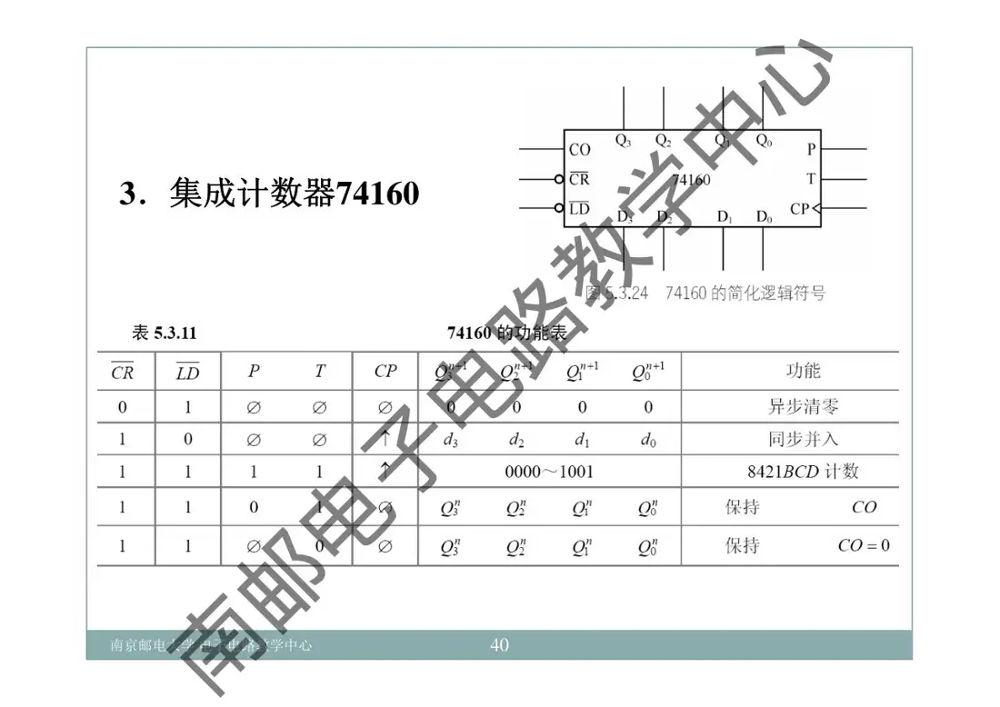

原文：

3 ． 集成计数器74160

表 5.3.11 74160的功能表
<table><tr><td> $\overline{CR}$ </td><td> $\overline{LD}$ </td><td>P</td><td>T</td><td>CP</td><td> $Q_{3}^{n+1}$ </td><td> $Q_{2}^{n+1}$ </td><td> $Q_{1}^{n+1}$ </td><td> $Q_{0}^{n+1}$ </td><td>功能</td></tr><tr><td>0</td><td>1</td><td>∅</td><td>∅</td><td>∅</td><td>0</td><td>0</td><td>0</td><td>0</td><td>异步清零</td></tr><tr><td>1</td><td>0</td><td>∅</td><td>∅</td><td>↑</td><td> $d_{3}$ </td><td> $d_{2}$ </td><td> $d_{1}$ </td><td> $d_{0}$ </td><td>同步并入</td></tr><tr><td>1</td><td>1</td><td>1</td><td>1</td><td>↑</td><td></td><td colspan="3">0000~1001</td><td>8421BCD计数</td></tr><tr><td>1</td><td>1</td><td>0</td><td>1</td><td>∅</td><td> $Q_{3}^{n}$ </td><td> $Q_{2}^{n}$ </td><td> $Q_{1}^{n}$ </td><td> $Q_{0}^{n}$ </td><td>保持 CO</td></tr><tr><td>1</td><td>1</td><td>∅</td><td>0</td><td>∅</td><td> $Q_{3}^{n}$ </td><td> $Q_{2}^{n}$ </td><td> $Q_{1}^{n}$ </td><td> $Q_{0}^{n}$ </td><td>保持 CO=0</td></tr></table>

南京邮电大学 电子电路教学中心

40

### 南京邮电大学 电子电路教学中心

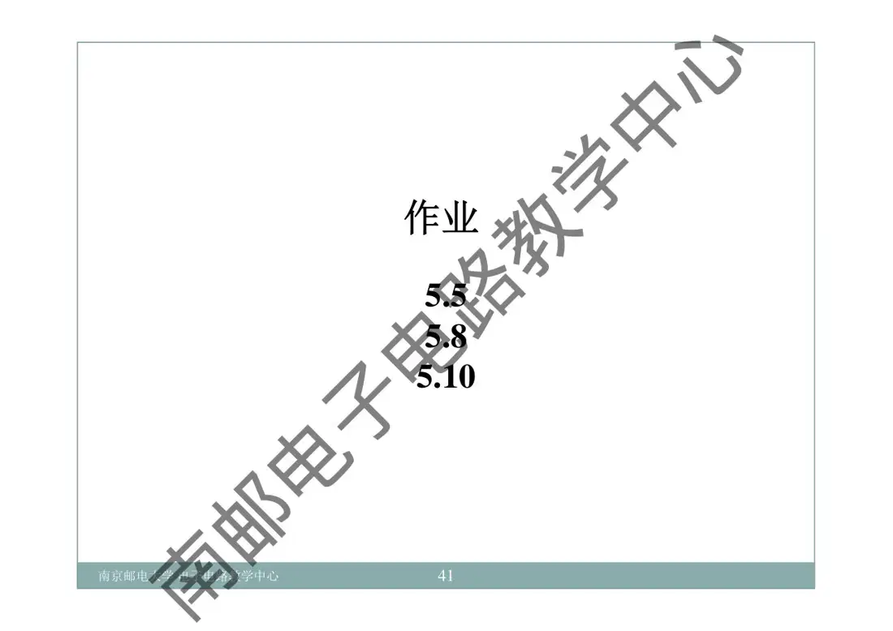

原文：

南京邮电大学 电子电路教学中心

4 1
