# 《数字电路与逻辑设计》第2章 逻辑代数基础（课件）

原件的每一页，下面附识别出的文字。

### 第二章 逻辑代数基础

原文：

第二章 逻辑代数基础

### 与逻辑关系

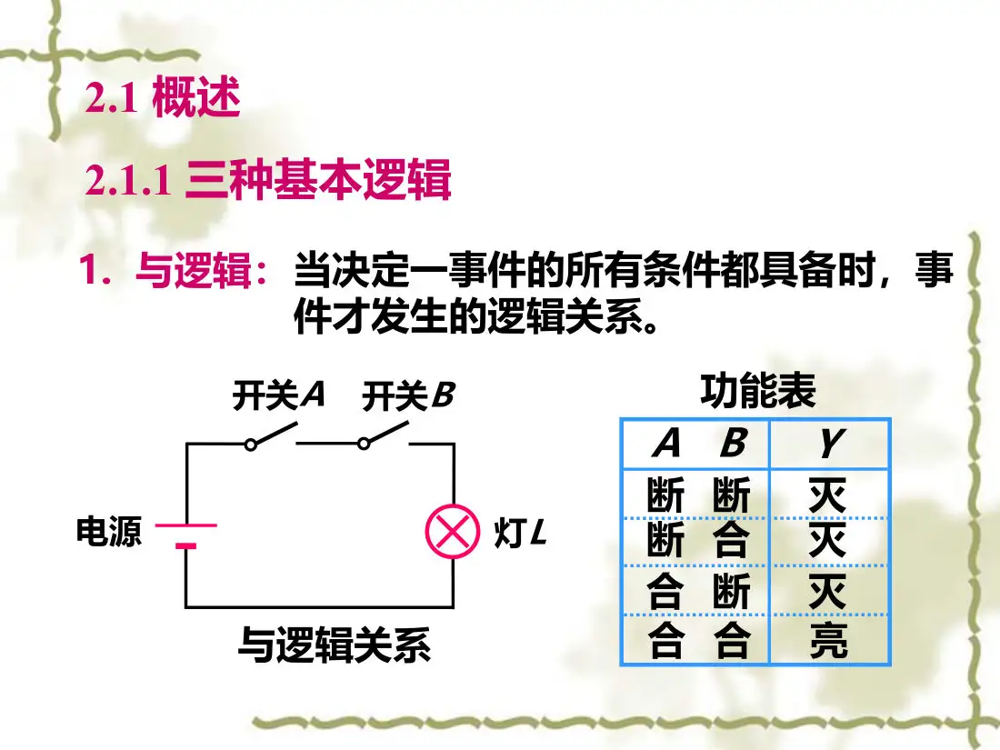

原文：

与逻辑关系

电源

2.1 概述

2.1.1 三种基本逻辑

1. 与逻辑：当决定一事件的所有条件都具备时，事件才发生的逻辑关系。

### 与逻辑的表示方法：

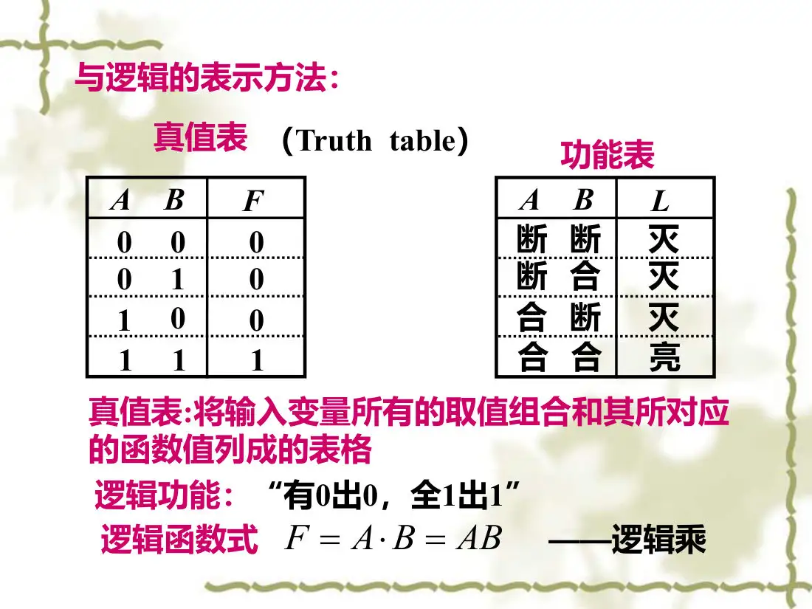

原文：

与逻辑的表示方法：

真值表 (Truth table)

<table><tr><td>A</td><td>B</td><td>F</td></tr><tr><td>0</td><td>0</td><td>0</td></tr><tr><td>0</td><td>1</td><td>0</td></tr><tr><td>1</td><td>0</td><td>0</td></tr><tr><td>1</td><td>1</td><td>1</td></tr></table>

功能表

<table><tr><td>A B</td><td>L</td></tr><tr><td>断 断</td><td>灭</td></tr><tr><td>断 合</td><td>灭</td></tr><tr><td>合 断</td><td>灭</td></tr><tr><td>合 合</td><td>亮</td></tr></table>

真值表:将输入变量所有的取值组合和其所对应的函数值列成的表格
逻辑功能: “有0出0, 全1出1”
逻辑函数式 $F = A \cdot B = AB$ ——逻辑乘

### ⑤与门的逻辑符号

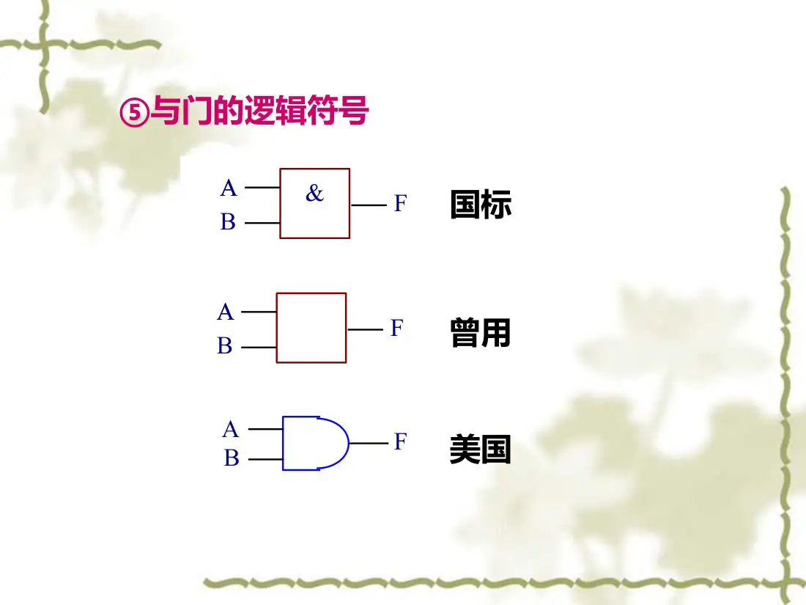

原文：

⑤与门的逻辑符号

$$
\begin{array}{c} \text {A} \\ \text {B} \end{array} \boxed {\ & } \boxed {\quad} \text {F}
$$

国标

$$
\begin{array}{c} \text { A } \\ \text { B } \end{array} \boxed {} \text { F }
$$

曾用

$$
\begin{array}{c} \text { A } \\ \text { B } \end{array} \boxed {\quad} \text { F }
$$

美国

### 或逻辑关系

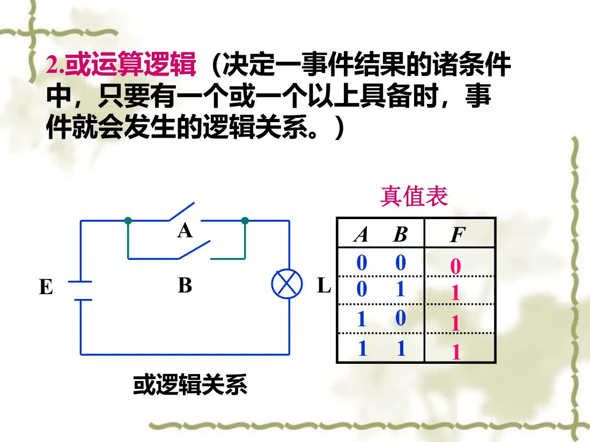

原文：

2.或运算逻辑（决定一事件结果的诸条件中，只要有一个或一个以上具备时，事件就会发生的逻辑关系。）

或逻辑关系

<table><tr><td></td><td>A</td><td>B</td><td>F</td></tr><tr><td rowspan="4">L</td><td>0</td><td>0</td><td>0</td></tr><tr><td>0</td><td>1</td><td>1</td></tr><tr><td>1</td><td>0</td><td>1</td></tr><tr><td>1</td><td>1</td><td>1</td></tr></table>

### 逻辑功能：“有1出1，全0出0”

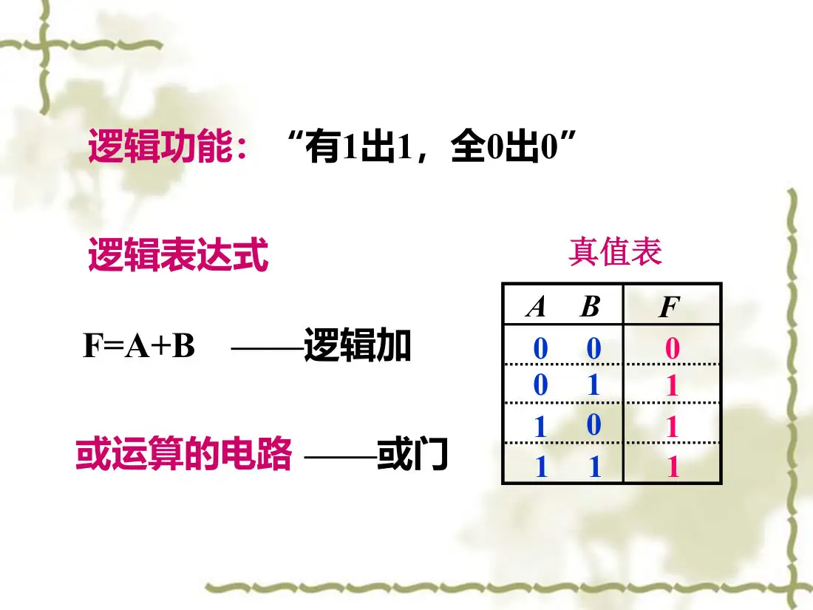

原文：

逻辑功能：“有1出1，全0出0”

逻辑表达式

$\mathbf{F} = \mathbf{A} + \mathbf{B}$ ——逻辑加

或运算的电路 ——或门

真值表

<table><tr><td>A</td><td>B</td><td>F</td></tr><tr><td>0</td><td>0</td><td>0</td></tr><tr><td>0</td><td>1</td><td>1</td></tr><tr><td>1</td><td>0</td><td>1</td></tr><tr><td>1</td><td>1</td><td>1</td></tr></table>

### ⑤或门的逻辑符号

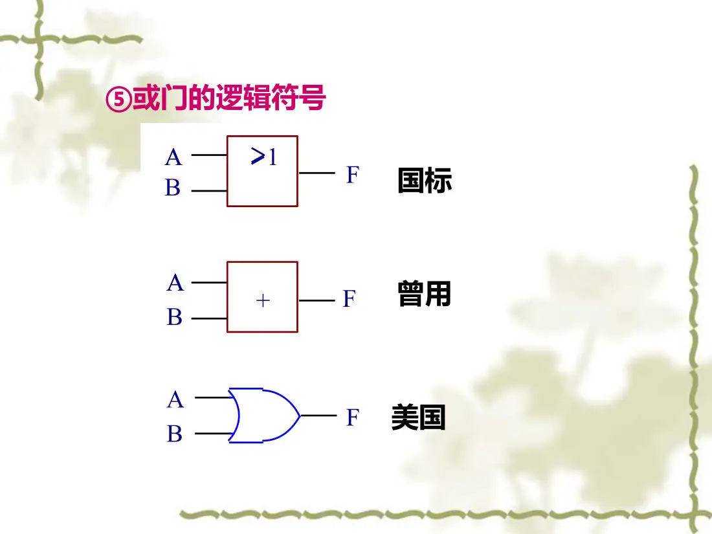

原文：

⑤或门的逻辑符号

$$
\begin{array}{c c} \text {A} & \text {>1} \\ \text {B} & \end{array} \quad \text {F}
$$

国标

$$
\begin{array}{c c} \text {A} & \\ \text {B} & \end{array} + \begin{array}{c c} \text {F} \end{array}
$$

曾用

美国

### 3.非运算逻辑

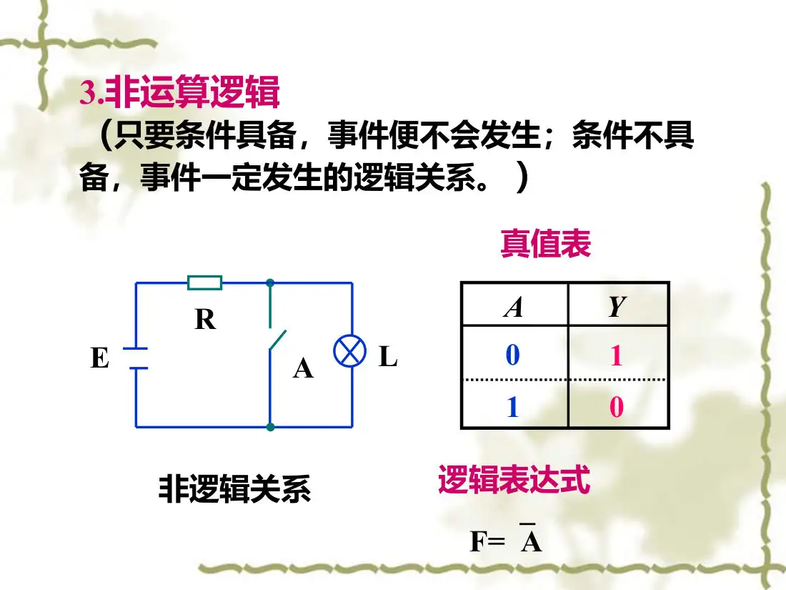

原文：

3.非运算逻辑

（只要条件具备，事件便不会发生；条件不具备，事件一定发生的逻辑关系。）

真值表

非逻辑关系

<table><tr><td>A</td><td>Y</td></tr><tr><td>0</td><td>1</td></tr><tr><td>1</td><td>0</td></tr></table>

逻辑表达式

$$
\mathbf {F} = \overline {{\mathbf {A}}}
$$

### 非门的逻辑符号

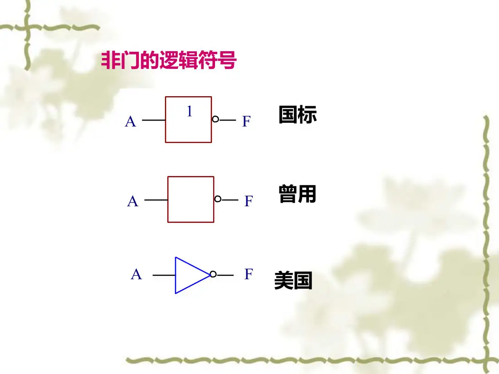

原文：

非门的逻辑符号

$$
A \boxed {1} \circ F
$$

国标

$$
A - \boxed {\quad} \circ - F
$$

曾用

美国

### 定义逻辑变量与逻辑函数

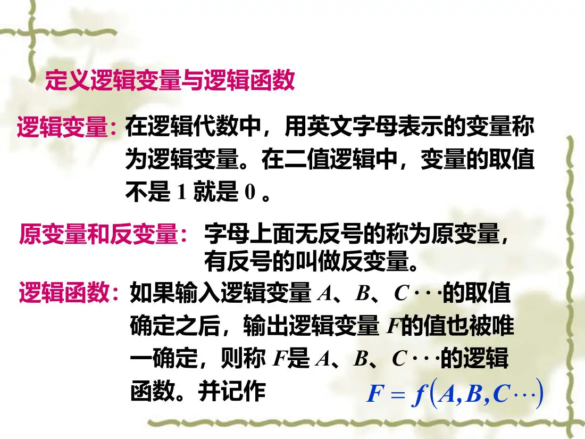

原文：

定义逻辑变量与逻辑函数

逻辑变量: 在逻辑代数中, 用英文字母表示的变量称为逻辑变量。在二值逻辑中, 变量的取值不是 1 就是 0 。

原变量和反变量：字母上面无反号的称为原变量，有反号的叫做反变量。

逻辑函数: 如果输入逻辑变量 $A 、 B 、 C \cdots$ 的取值确定之后, 输出逻辑变量 $F$ 的值也被唯一确定, 则称 $F$ 是 $A 、 B 、 C \cdots$ 的逻辑函数。并记作 $F = f(A, B, C \cdots)$

### 2、复合逻辑运算：

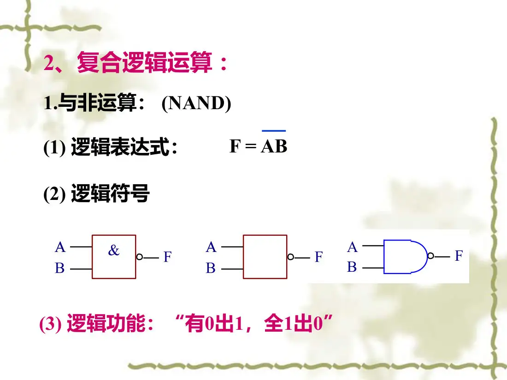

原文：

2、复合逻辑运算：

1.与非运算：(NAND)

(1) 逻辑表达式: $\mathrm{F} = \mathrm{AB}$

(2) 逻辑符号

$$
\begin{array}{c} \text {A} \\ \text {B} \end{array} \boxed {\ & } \circ - F
$$

$$
\begin{array}{c} \text { A } \\ \text { B } \end{array} \boxed {\quad} \circ - \text { F }
$$

(3) 逻辑功能: “有0出1, 全1出0”

### 2.或非运算: (NOR)

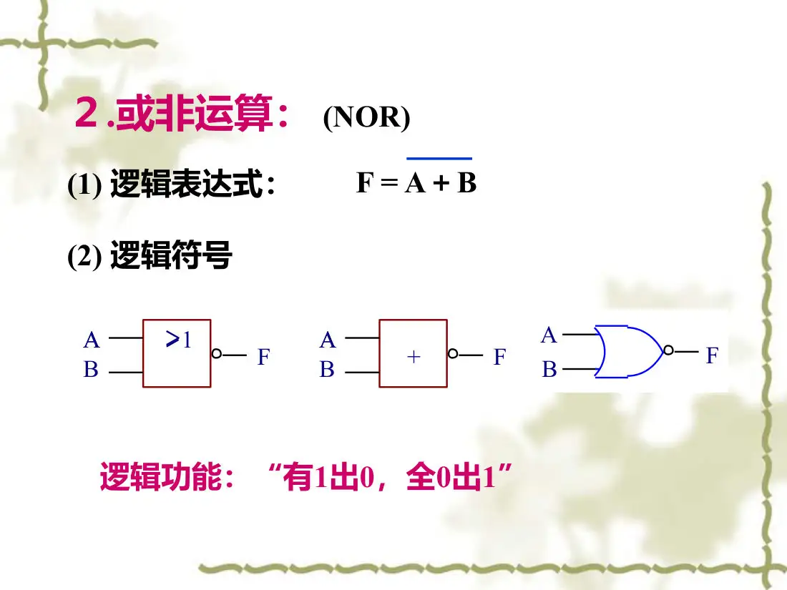

原文：

2.或非运算: (NOR)

(1) 逻辑表达式: $\mathrm{F} = \mathrm{A} + \mathrm{B}$

(2) 逻辑符号

$$
\begin{array}{c} \text { A } \\ \text { B } \end{array} \boxed {> 1} \circ - F
$$

$$
\begin{array}{c} \text { A } \\ \text { B } \end{array} + \text { F }
$$

逻辑功能：“有1出0，全0出1”

### 3.与或非运算：(AND - OR - INVERT)

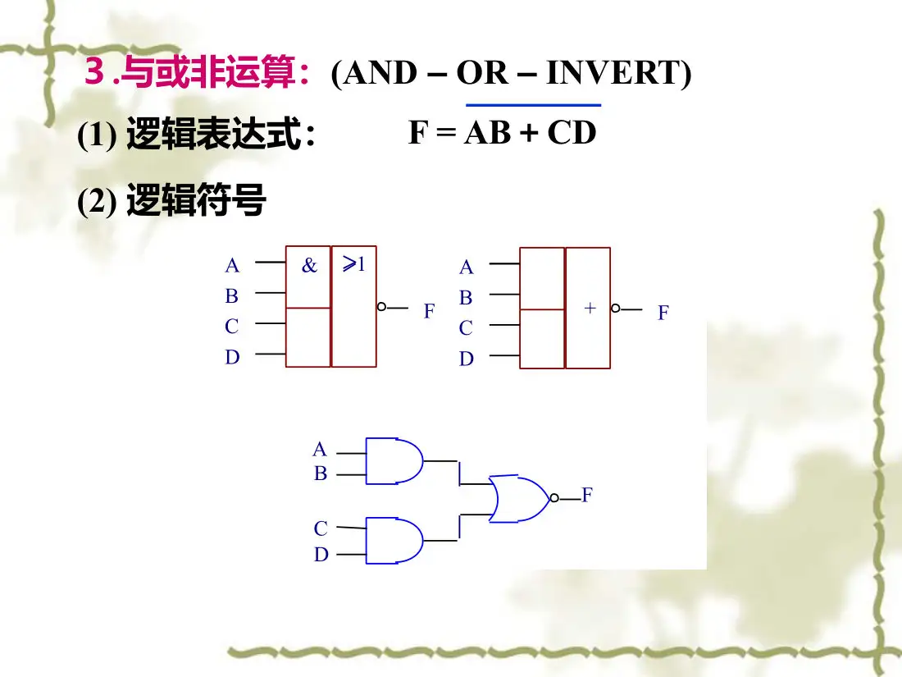

原文：

3.与或非运算：(AND - OR - INVERT)

(1) 逻辑表达式: $\mathrm{F} = \mathrm{AB} + \mathrm{CD}$

(2) 逻辑符号

$$
\begin{array}{c c} \text {A} & \& \quad \geqslant 1 \\ \text {B} & \\ \text {C} & \\ \text {D} & \end{array} \quad \text {F} \quad \begin{array}{c c} \text {A} & \\ \text {B} & \\ \text {C} & \\ \text {D} & \end{array} \quad \text {+} \quad \text {F}
$$

### 4. 异或运算 XOR(A、B 取值不同时，F 才为 1):

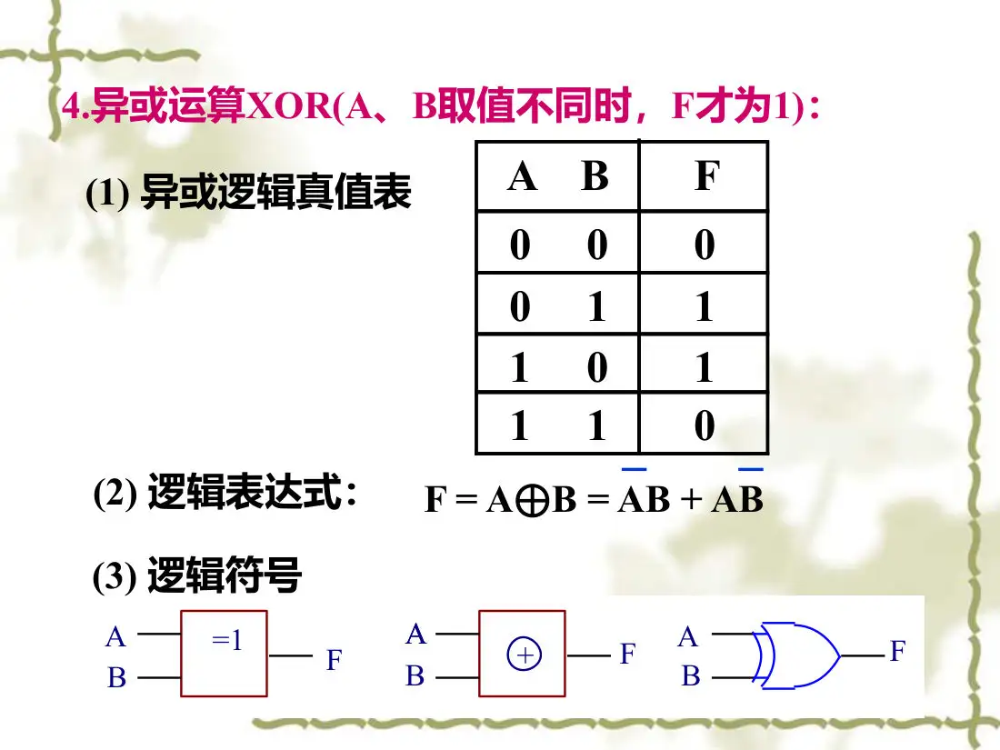

原文：

4. 异或运算 XOR(A、B 取值不同时，F 才为 1):

(1) 异或逻辑真值表

<table><tr><td>A B</td><td>F</td></tr><tr><td>0 0</td><td>0</td></tr><tr><td>0 1</td><td>1</td></tr><tr><td>1 0</td><td>1</td></tr><tr><td>1 1</td><td>0</td></tr></table>

(2) 逻辑表达式: $\mathrm{F} = \mathrm{A} \oplus \mathrm{B} = \overline{\mathrm{AB}} + \overline{\mathrm{AB}}$

(3) 逻辑符号

$$
\begin{array}{c} \text { A } \\ \text { B } \end{array} = 1 \quad \text { F }
$$

$$
\begin{array}{c} \text { A } \\ \text { B } \end{array} \boxed {\oplus} \longrightarrow \text { F }
$$

### 5. 同或运算XNOR(A、B取值相同时，F才为1):

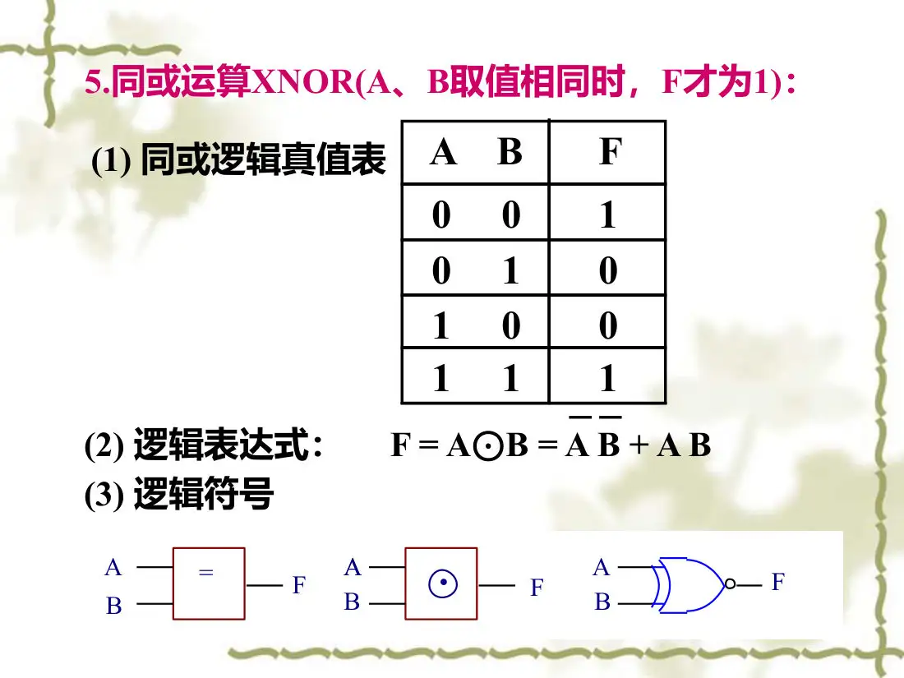

原文：

5. 同或运算XNOR(A、B取值相同时，F才为1):

(1) 同或逻辑真值表

<table><tr><td>A B</td><td>F</td></tr><tr><td>0 0</td><td>1</td></tr><tr><td>0 1</td><td>0</td></tr><tr><td>1 0</td><td>0</td></tr><tr><td>1 1</td><td>1</td></tr></table>

(2) 逻辑表达式: $\mathbf{F} = \mathbf{A} \odot \mathbf{B} = \mathbf{A} \mathbf{B} + \mathbf{A} \mathbf{B}$

(3) 逻辑符号

$$
\begin{array}{c c} \text {   A   } & = \\ \text {   B   } & \end{array} \quad \text {   F   }
$$

$$
\begin{array}{c} \text { A } \\ \text { B } \end{array} \boxed {\odot} \longrightarrow \text { F }
$$

### 异或、同或逻辑的公式

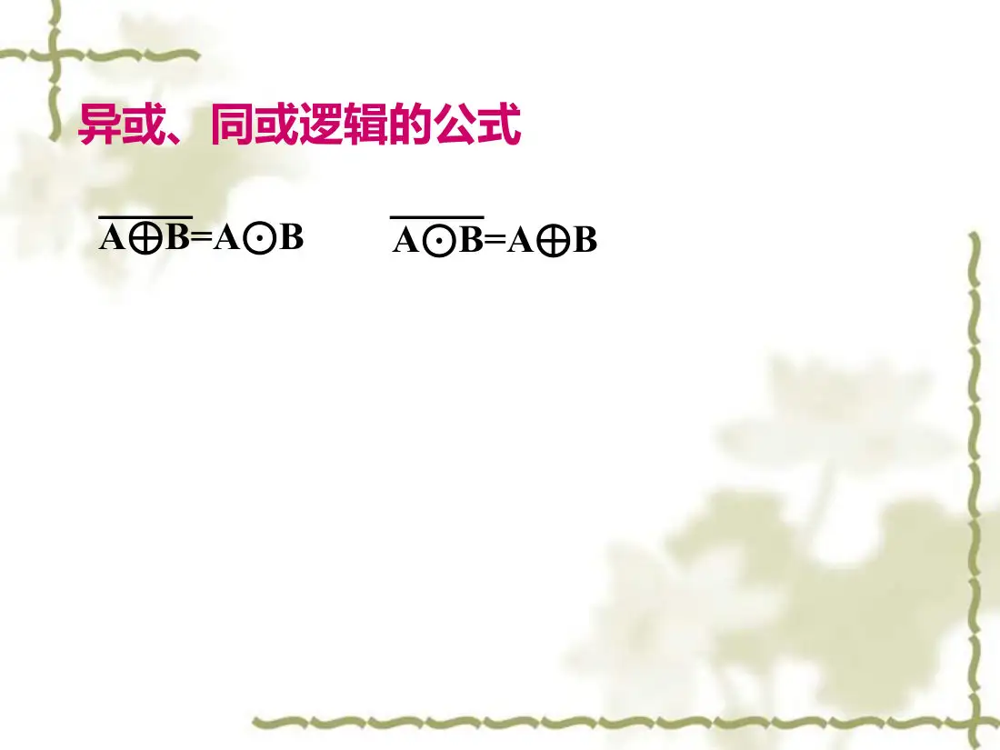

原文：

异或、同或逻辑的公式

$$
\overline {{\mathbf {A} \oplus \mathbf {B}}} = \mathbf {A} \odot \mathbf {B}
$$

$$
\overline {{\mathbf {A} \odot \mathbf {B}}} = \mathbf {A} \oplus \mathbf {B}
$$

### 2.2 逻辑运算的电路实现

原文：

2.2 逻辑运算的电路实现

用以实现基本和常用逻辑运算的电子电路称为逻辑门电路，简称门电路。从制造工艺来看，门电路分为双极型晶体管逻辑和单极型晶体管逻辑。

### 2.3 逻辑代数的公式

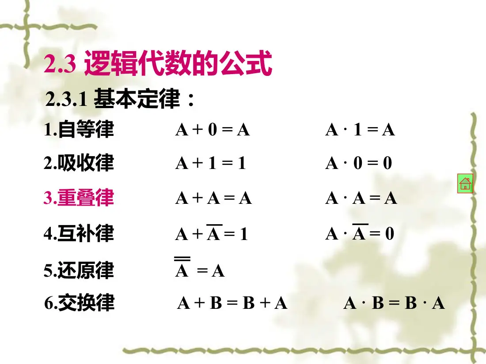

原文：

2.3 逻辑代数的公式

2.3.1 基本定律：

1. 自等律

$$
\mathbf {A} + \mathbf {0} = \mathbf {A}
$$

$$
\mathbf {A} \cdot \mathbf {1} = \mathbf {A}
$$

2.吸收律

$$
\mathbf {A} + \mathbf {1} = \mathbf {1}
$$

$$
\mathbf {A} \cdot \mathbf {0} = \mathbf {0}
$$

3.重叠律

$$
\mathbf {A} + \mathbf {A} = \mathbf {A}
$$

$$
\mathbf {A} \cdot \mathbf {A} = \mathbf {A}
$$

4.互补律

$$
\mathbf {A} + \overline {{\mathbf {A}}} = \mathbf {1}
$$

$$
\mathbf {A} \cdot \overline {{\mathbf {A}}} = \mathbf {0}
$$

5.还原律

$$
\overline {{\overline {{\mathbf {A}}}}} = \mathbf {A}
$$

6.交换律

$$
\mathbf {A} + \mathbf {B} = \mathbf {B} + \mathbf {A}
$$

$$
\mathbf {A} \cdot \mathbf {B} = \mathbf {B} \cdot \mathbf {A}
$$

### 7. 结合律

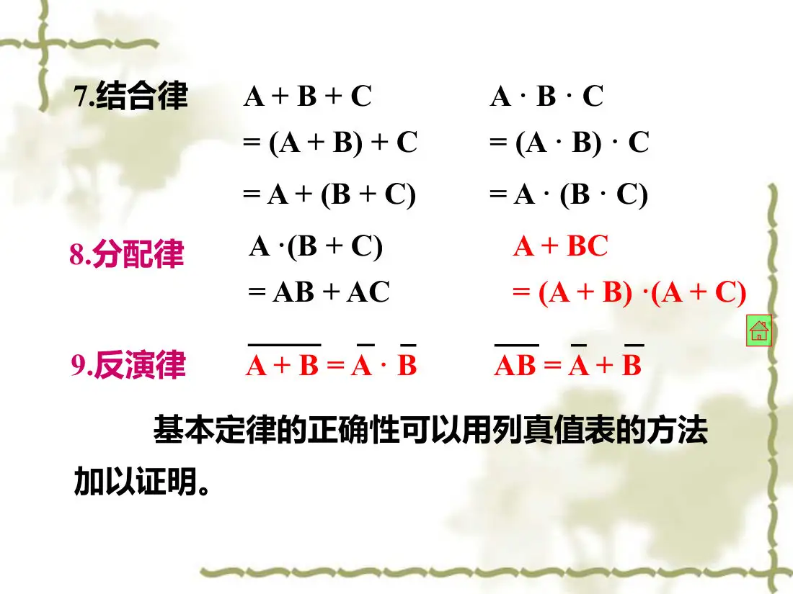

原文：

7. 结合律

$$
\mathbf {A} + \mathbf {B} + \mathbf {C}
$$

$$
\mathbf {A} \cdot \mathbf {B} \cdot \mathbf {C}
$$

$$
= (\mathbf {A} + \mathbf {B}) + \mathbf {C}
$$

$$
= (\mathbf {A} \cdot \mathbf {B}) \cdot \mathbf {C}
$$

$$
= \mathbf {A} + (\mathbf {B} + \mathbf {C})
$$

$$
= \mathbf {A} \cdot (\mathbf {B} \cdot \mathbf {C})
$$

8.分配律

$$
\mathbf {A} \cdot (\mathbf {B} + \mathbf {C})
$$

$$
\mathbf {A} + \mathbf {B C}
$$

$$
= \mathbf {A B} + \mathbf {A C}
$$

$$
= (\mathbf {A} + \mathbf {B}) \cdot (\mathbf {A} + \mathbf {C})
$$

9.反演律

$$
\overline {{\mathbf {A} + \mathbf {B}}} = \overline {{\mathbf {A}}} \cdot \overline {{\mathbf {B}}}
$$

$$
\overline {{\mathbf {A B}}} = \overline {{\mathbf {A}}} + \overline {{\mathbf {B}}}
$$

基本定律的正确性可以用列真值表的方法加以证明。

### 2.3.3 常用公式

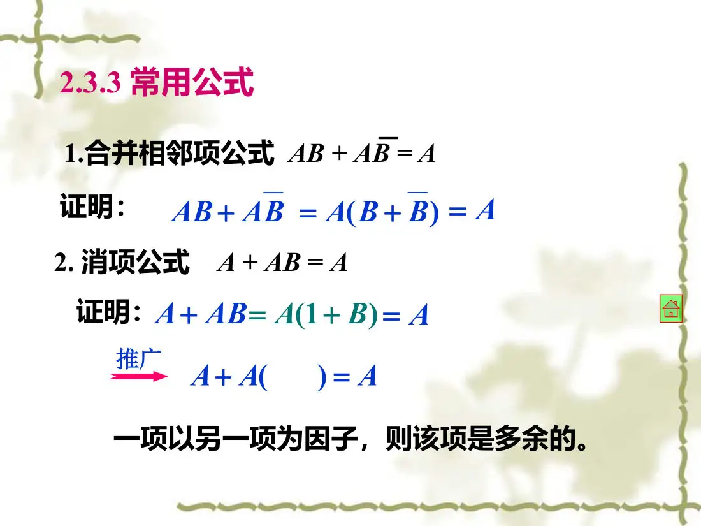

原文：

2.3.3 常用公式

1. 合并相邻项公式 $AB + AB = A$

证明: $AB + A\overline{B} = A(B + \overline{B}) = A$

2. 消项公式 $A + AB = A$

证明: $A + AB = A(1 + B) = A$

$$
\xrightarrow {\text {推广}} A + A (\quad) = A
$$

一项以另一项为因子，则该项是多余的。

### 分配律

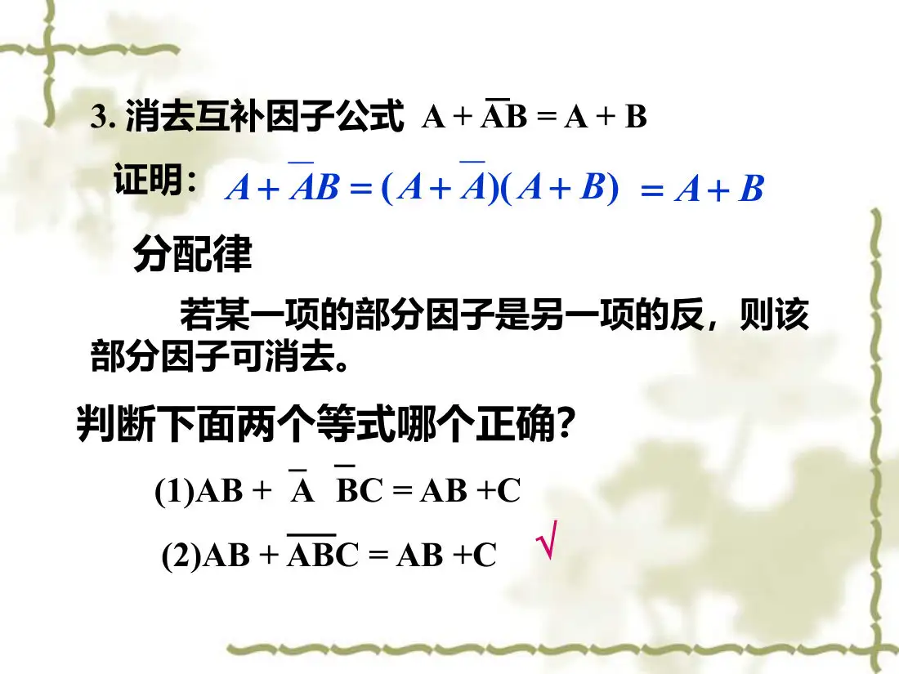

原文：

3. 消去互补因子公式 $\mathbf{A} + \overline{\mathbf{A}}\mathbf{B} = \mathbf{A} + \mathbf{B}$

证明: $A + \overline{A} B = (A + \overline{A})(A + B) = A + B$

分配律

若某一项的部分因子是另一项的反，则该部分因子可消去。

判断下面两个等式哪个正确？

(1)AB + $\overline{\mathbf{A}}$ $\overline{\mathbf{B}}\mathbf{C} = \mathbf{A}\mathbf{B} + \mathbf{C}$

$$
(2) \mathbf {A B} + \overline {{\mathbf {A B}}} \mathbf {C} = \mathbf {A B} + \mathbf {C}
$$

### 4. 多余项（生成项）公式

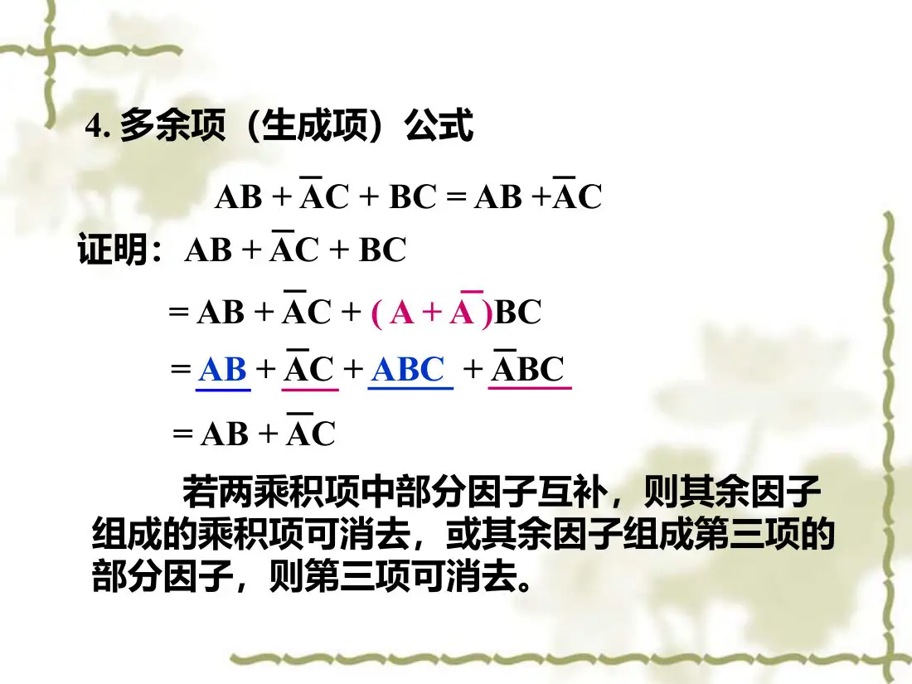

原文：

4. 多余项（生成项）公式

$$
\mathbf {A B} + \overline {{\mathbf {A}}} \mathbf {C} + \mathbf {B C} = \mathbf {A B} + \overline {{\mathbf {A}}} \mathbf {C}
$$

证明: $\mathbf{AB} + \overline{\mathbf{A}}\mathbf{C} + \mathbf{BC}$

$$
\begin{array}{r l} & = \mathbf {A B} + \overline {{\mathbf {A}}} \mathbf {C} + (\mathbf {A} + \overline {{\mathbf {A}}}) \mathbf {B C} \\ & = \underline {{\mathbf {A B}}} + \overline {{\mathbf {A}}} \mathbf {C} + \underline {{\mathbf {A B C}}} + \overline {{\mathbf {A}}} \mathbf {B C} \\ & = \mathbf {A B} + \overline {{\mathbf {A}}} \mathbf {C} \end{array}
$$

若两乘积项中部分因子互补，则其余因子组成的乘积项可消去，或其余因子组成第三项的部分因子，则第三项可消去。

### 2.4 逻辑代数的基本规则

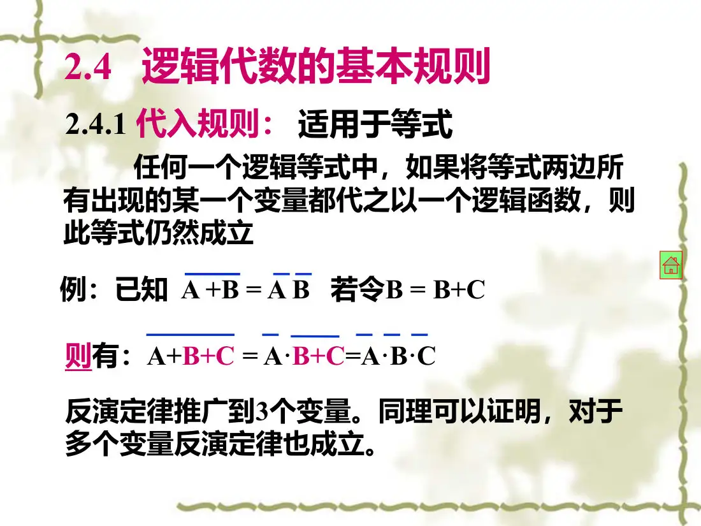

原文：

2.4 逻辑代数的基本规则

2.4.1 代入规则：适用于等式

任何一个逻辑等式中，如果将等式两边所有出现的某一个变量都代之以一个逻辑函数，则此等式仍然成立

例：已知 $\overline{A+B}=\overline{A}\overline{B}$ 若令 B=B+C

则有: $\mathrm{A} + \mathrm{B} + \mathrm{C} = \mathrm{A} \cdot \mathrm{B} + \mathrm{C} = \mathrm{A} \cdot \mathrm{B} \cdot \mathrm{C}$

反演定律推广到3个变量。同理可以证明，对于多个变量反演定律也成立。

### 方法:

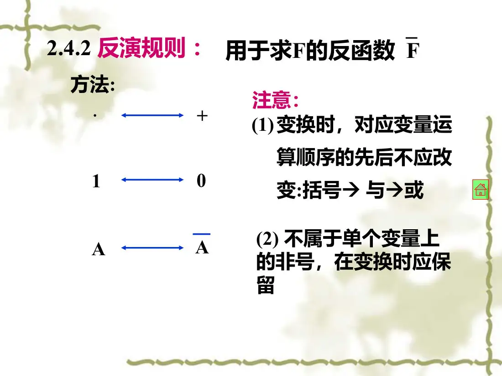

原文：

2.4.2 反演规则：用于求F的反函数 $\overline{\mathbf{F}}$

方法:

注意:

(1) 变换时，对应变量运算顺序的先后不应改变: 括号 $\rightarrow$ 与 $\rightarrow$ 或

(2) 不属于单个变量上的非号，在变换时应保留

### 试用反演规则求反函数 $\overline{F}$ 。

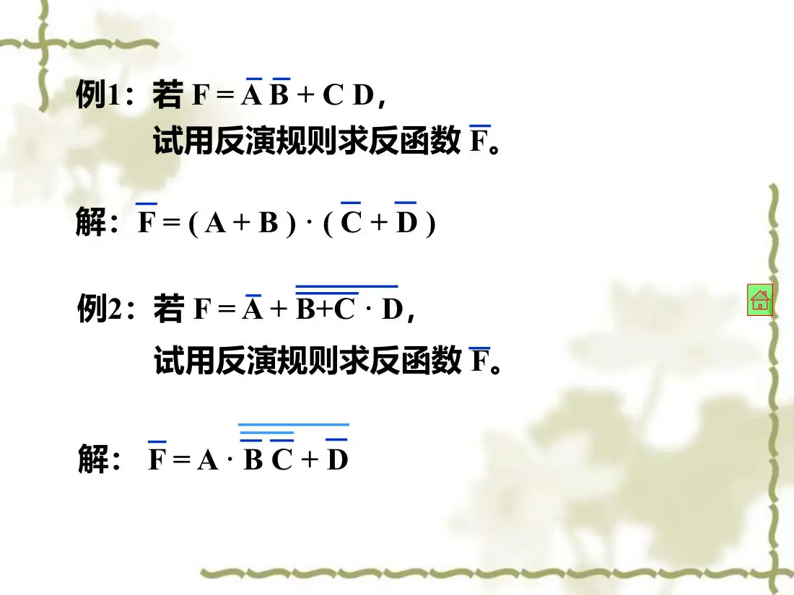

原文：

例1: 若 $F = \overline{A} \overline{B} + C D$ ,
试用反演规则求反函数 $\overline{F}$ 。

解： $\overline{\mathbf{F}}=(\mathbf{A}+\mathbf{B})\cdot(\overline{\mathbf{C}}+\overline{\mathbf{D}})$

例2：若 $F = \overline{A} + \overline{B + C} \cdot D$ ,
试用反演规则求反函数 $\overline{F}$ 。

解： $\overline{\mathbf{F}} = \mathbf{A} \cdot \overline{\overline{\mathbf{B}} \overline{\mathbf{C}} + \overline{\mathbf{D}}}$

### 常用关系式:

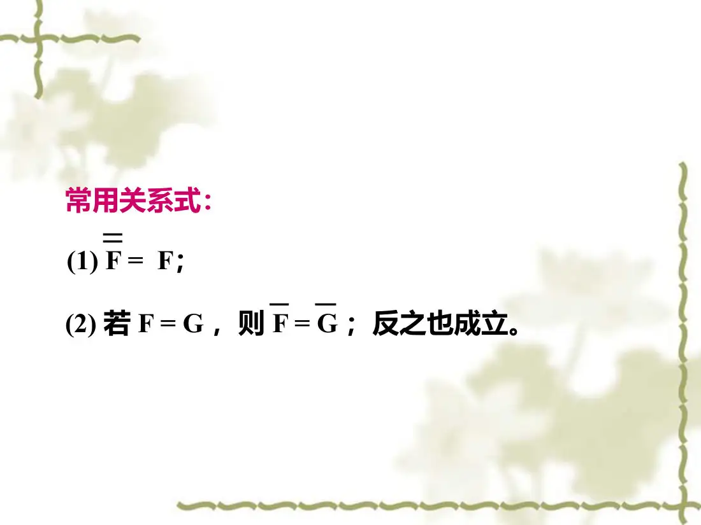

原文：

常用关系式:

(1) $\overline{F} = F;$

(2) 若 $\mathbf{F} = \mathbf{G}$ , 则 $\overline{\mathbf{F}} = \overline{\mathbf{G}}$ ; 反之也成立。

### 三、对偶规则：用于求F的对偶式数F'

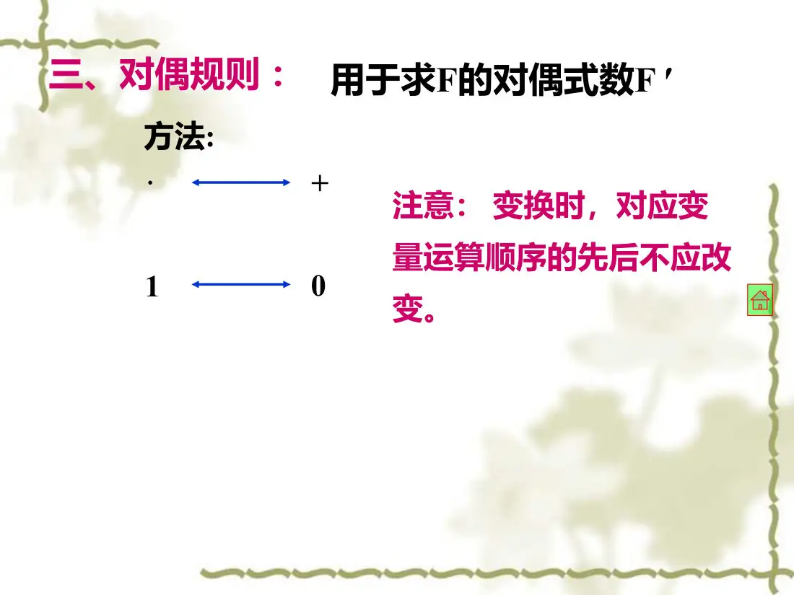

原文：

三、对偶规则：用于求F的对偶式数F'

方法:

注意：变换时，对应变量运算顺序的先后不应改变。

### 例1: 求 $F=A(B+C)$ 的对偶式

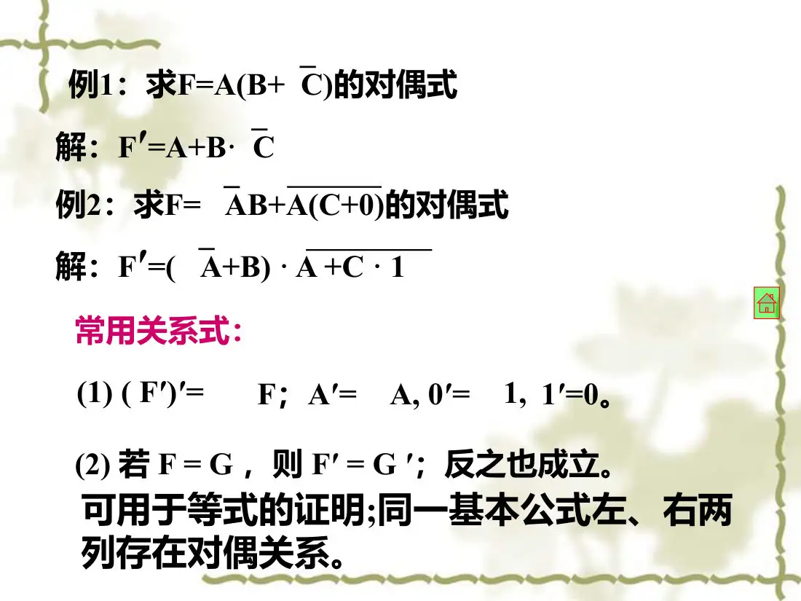

原文：

例1: 求 $F=A(B+C)$ 的对偶式

解： $F' = A + B \cdot \overline{C}$

例2：求F= $\overline{A}B+\overline{A(C+0)}$ 的对偶式

解: $\mathbf{F}' = (\overline{\mathbf{A}} + \mathbf{B}) \cdot \overline{\mathbf{A} + \mathbf{C} \cdot \mathbf{1}}$

常用关系式:

(1) $(\mathbf{F}')' = \quad \mathbf{F}; \mathbf{A}' = \quad \mathbf{A}, 0' = \quad 1, 1' = 0$ 。

(2) 若 F = G，则 $F' = G'$ ；反之也成立。
可用于等式的证明;同一基本公式左、右两列存在对偶关系。

### 反演式与对偶式的关系

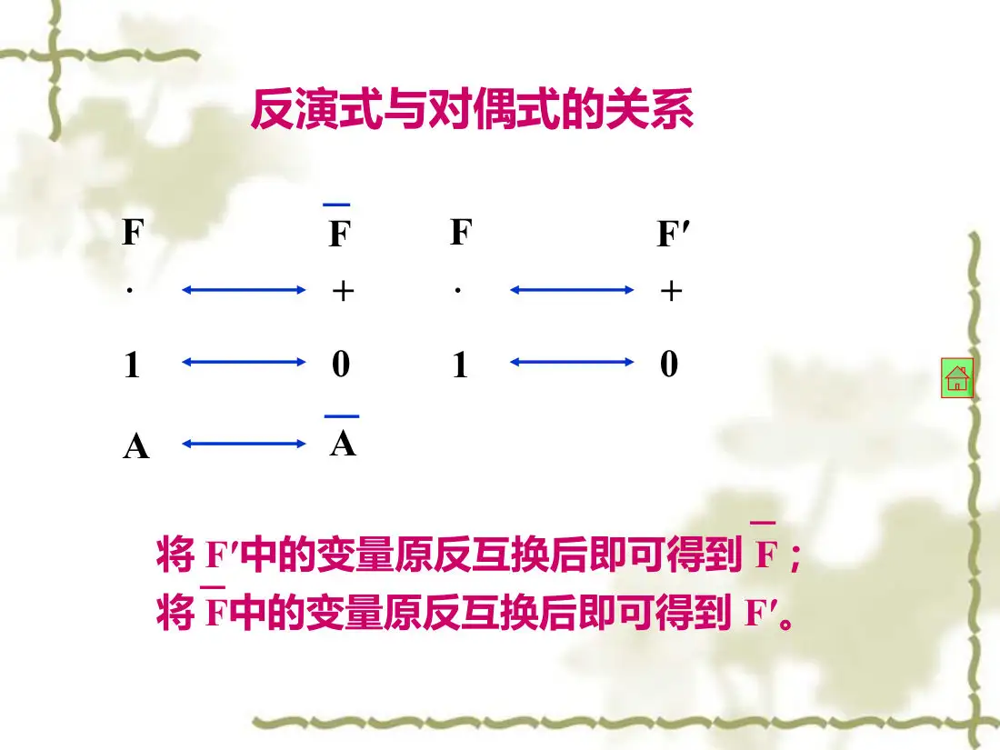

原文：

反演式与对偶式的关系

$$
\begin{array}{c c c c c} \mathbf {F} & \overline {{\mathbf {F}}} & \mathbf {F} & \mathbf {F ^ {\prime}} \\ \cdot & \longleftarrow + & \cdot & \longleftarrow + \\ 1 & \longleftarrow 0 & 1 & \longleftarrow 0 \\ \mathbf {A} & \longleftarrow \overline {{\mathbf {A}}} \end{array}
$$

将 F'中的变量原反互换后即可得到 F；将 $\overline{F}$ 中的变量原反互换后即可得到 F'。

### 作业题

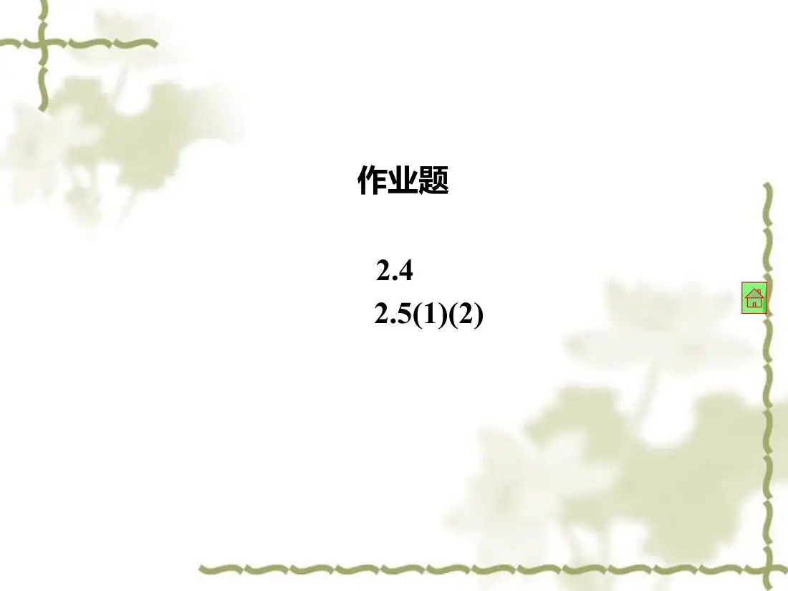

原文：

作业题

2.4
2.5(1)(2)
