# 《数字电路与逻辑设计》第5章 异步计数器的分析和设计（课件）

原件的每一页，下面附识别出的文字。

### 异步计数器的分析和设计

原文：

异步计数器的分析和设计

### 一、异步计数器的分析

原文：

一、异步计数器的分析

特点：各触发器的CP脉冲不是同一个，以至状态翻转不在同一时刻发生。

优点：同样性能的计数器，异步计数器结构比同步计数器简单。

缺点：分析与设计比同步计数器复杂些。计数器速度较慢。

2

### 例1：分析下图所示的异步计数器：

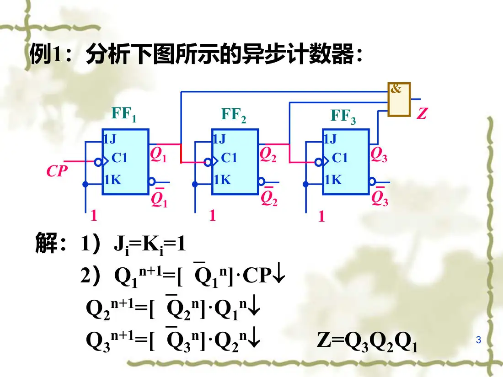

原文：

例1：分析下图所示的异步计数器：

解：1） $J_{i}=K_{i}=1$

2) $Q_{1}^{n+1}=[\overline{Q}_{1}^{n}]\cdot CP\downarrow$

$$
\mathbf {Q} _ {2} ^ {\mathrm{n+1}} = [ \overline {{\mathbf {Q}}} _ {2} ^ {\mathrm{n}} ] \cdot \mathbf {Q} _ {1} ^ {\mathrm{n}} \downarrow
$$

$$
\mathbf {Q} _ {3} ^ {\mathrm{n+1}} = [ \overline {{\mathbf {Q}}} _ {3} ^ {\mathrm{n}} ] \cdot \mathbf {Q} _ {2} ^ {\mathrm{n}} \downarrow
$$

$$
\mathrm{Z} = \mathrm{Q} _ {3} \mathrm{Q} _ {2} \mathrm{Q} _ {1}
$$

### 3) 列状态转移表:

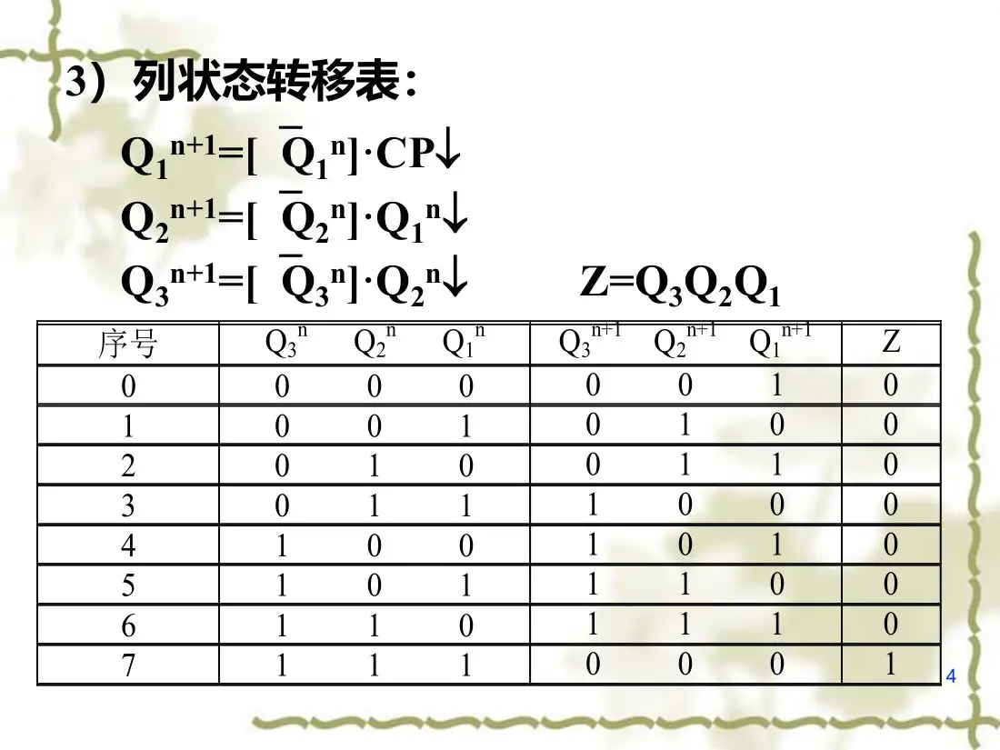

原文：

3) 列状态转移表:

$$
\begin{array}{l} \mathbf {Q} _ {1} ^ {\mathrm{n+1}} = [ \overline {{\mathbf {Q}}} _ {1} ^ {\mathrm{n}} ] \cdot \mathbf {C P} \downarrow \\ \mathbf {Q} _ {2} ^ {\mathrm{n+1}} = [ \overline {{\mathbf {Q}}} _ {2} ^ {\mathrm{n}} ] \cdot \mathbf {Q} _ {1} ^ {\mathrm{n}} \downarrow \\ \mathbf {Q} _ {3} ^ {\mathrm{n+1}} = [ \overline {{\mathbf {Q}}} _ {3} ^ {\mathrm{n}} ] \cdot \mathbf {Q} _ {2} ^ {\mathrm{n}} \downarrow \end{array}
$$

$$
\mathrm{Z} = \mathrm{Q} _ {3} \mathrm{Q} _ {2} \mathrm{Q} _ {1}
$$

<table><tr><td>序号</td><td> ${\mathrm{Q}}_{3}^{\mathrm{n}}$ </td><td> ${\mathrm{Q}}_{2}^{\mathrm{n}}$ </td><td> ${\mathrm{Q}}_{1}^{\mathrm{n}}$ </td><td> ${\mathrm{Q}}_{3}^{\mathrm{n} + 1}$ </td><td> ${\mathrm{Q}}_{2}^{\mathrm{n} + 1}$ </td><td> ${\mathrm{Q}}_{1}^{\mathrm{n} + 1}$ </td><td>Z</td></tr><tr><td>0</td><td>0</td><td>0</td><td>0</td><td>0</td><td>0</td><td>1</td><td>0</td></tr><tr><td>1</td><td>0</td><td>0</td><td>1</td><td>0</td><td>1</td><td>0</td><td>0</td></tr><tr><td>2</td><td>0</td><td>1</td><td>0</td><td>0</td><td>1</td><td>1</td><td>0</td></tr><tr><td>3</td><td>0</td><td>1</td><td>1</td><td>1</td><td>0</td><td>0</td><td>0</td></tr><tr><td>4</td><td>1</td><td>0</td><td>0</td><td>1</td><td>0</td><td>1</td><td>0</td></tr><tr><td>5</td><td>1</td><td>0</td><td>1</td><td>1</td><td>1</td><td>0</td><td>0</td></tr><tr><td>6</td><td>1</td><td>1</td><td>0</td><td>1</td><td>1</td><td>1</td><td>0</td></tr><tr><td>7</td><td>1</td><td>1</td><td>1</td><td>0</td><td>0</td><td>0</td><td>1</td></tr></table>

### 第 5 页

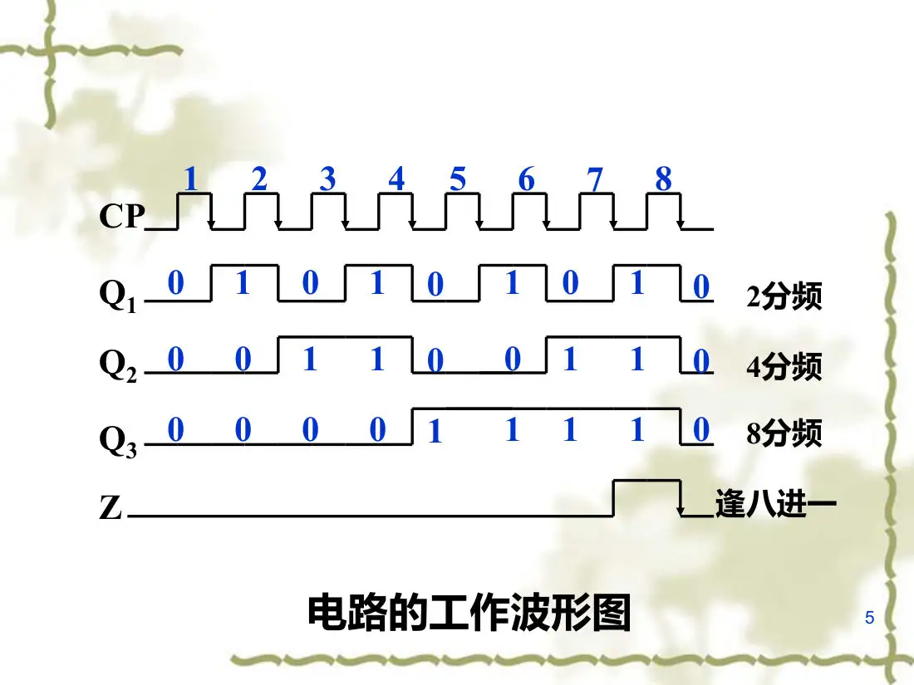

### $M=2^{n}$ 的异步二进制加法计数器的一般规律：

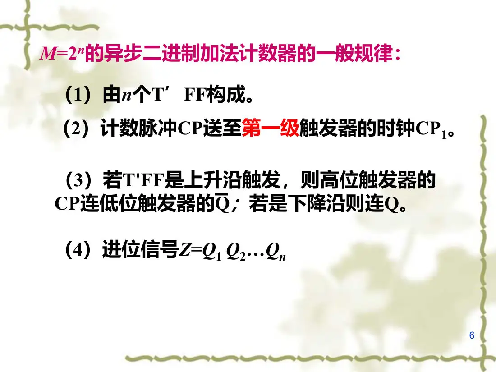

原文：

$M=2^{n}$ 的异步二进制加法计数器的一般规律：

(1) 由 $n$ 个 $\mathrm{T}^{\prime}$ FF构成。

(2) 计数脉冲CP送至第一级触发器的时钟 $\mathrm{CP}_{1}$ 。

(3) 若T'FF是上升沿触发，则高位触发器的CP连低位触发器的 $\overline{Q}$ ；若是下降沿则连Q。

(4) 进位信号 $Z=Q_{1}Q_{2}\cdots Q_{n}$ 用DFF构成的3位二进制异步加法计数器电路，如图6.5.5所示。

6

### 第 7 页

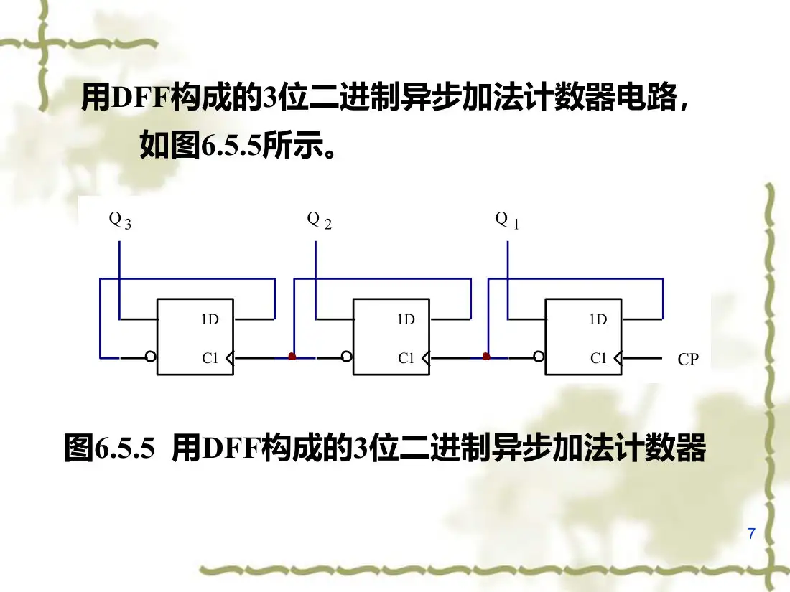

### 异步二进制减法计数器的波形图

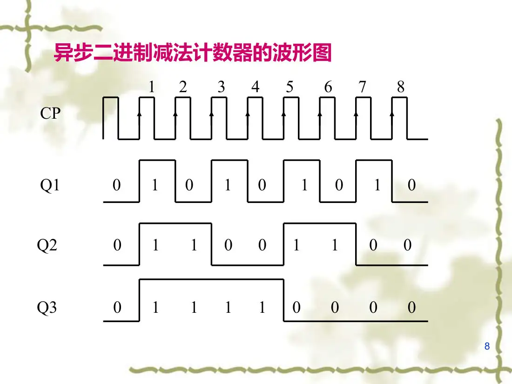

原文：

异步二进制减法计数器的波形图

CP

$$
\begin{array}{c c c c c c c c c c c c c c} \hline & 1 & 2 & 3 & 4 & 5 & 6 & 7 & 8 \\ \hline \end{array}\tag{Q1}
$$

$$
\begin{array}{c c c c c c c c c} 0 & 1 & 0 & 1 & 0 & 1 & 0 & 1 & 0 \end{array}\tag{Q2}
$$

$$
\begin{array}{c c c c c c c c c} 0 & \framebox {1} & 1 & 0 & 0 & 1 & 1 & 0 & 0 \end{array}\tag{Q3}
$$

$$
\begin{array}{c c c c c} 0 & 1 & 1 & 1 & 1 \\ \hline \end{array} \quad \begin{array}{c c c c c} 0 & 0 & 0 & 0 \\ \hline \end{array}
$$

8

### $M = 2^{n}$ 的异步二进制减法计数器的一般规律：

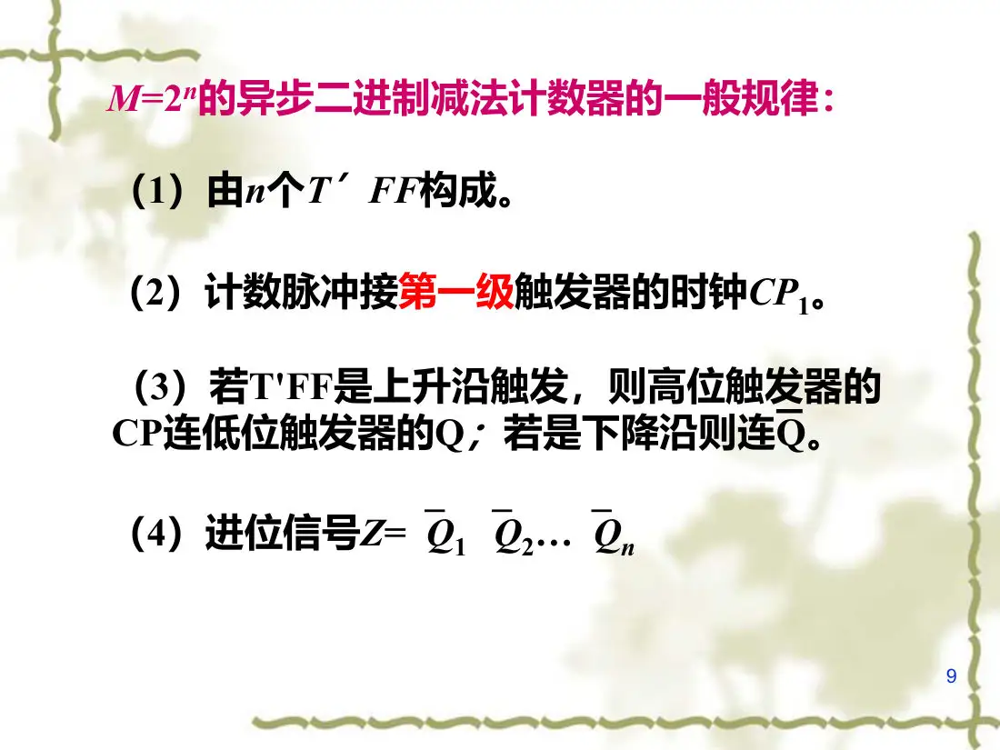

原文：

$M = 2^{n}$ 的异步二进制减法计数器的一般规律：

(1) 由 $n$ 个 $T^{\prime} FF$ 构成。

(2) 计数脉冲接第一级触发器的时钟 $CP_{1}$ 。

(3) 若T'FF是上升沿触发，则高位触发器的CP连低位触发器的Q；若是下降沿则连 $\overline{Q}$ 。

(4) 进位信号 $Z = \overline{Q}_{1} \overline{Q}_{2} \ldots \overline{Q}_{n}$

### 例2：分析下图异步计数器的功能

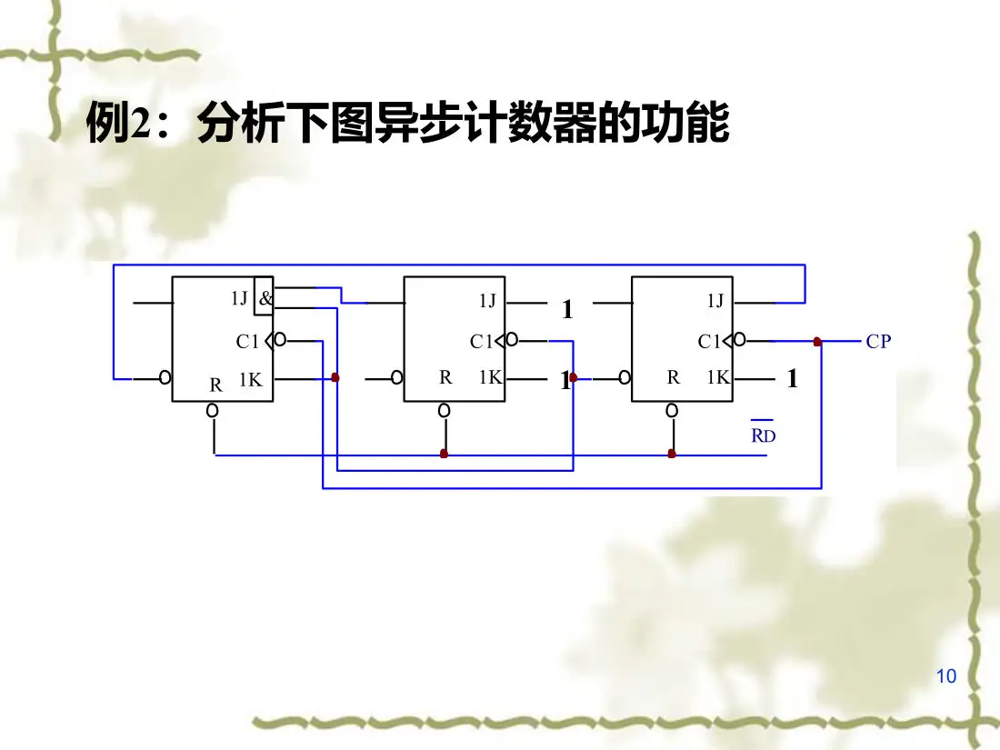

原文：

例2：分析下图异步计数器的功能

10

### 解：1）激励方程：

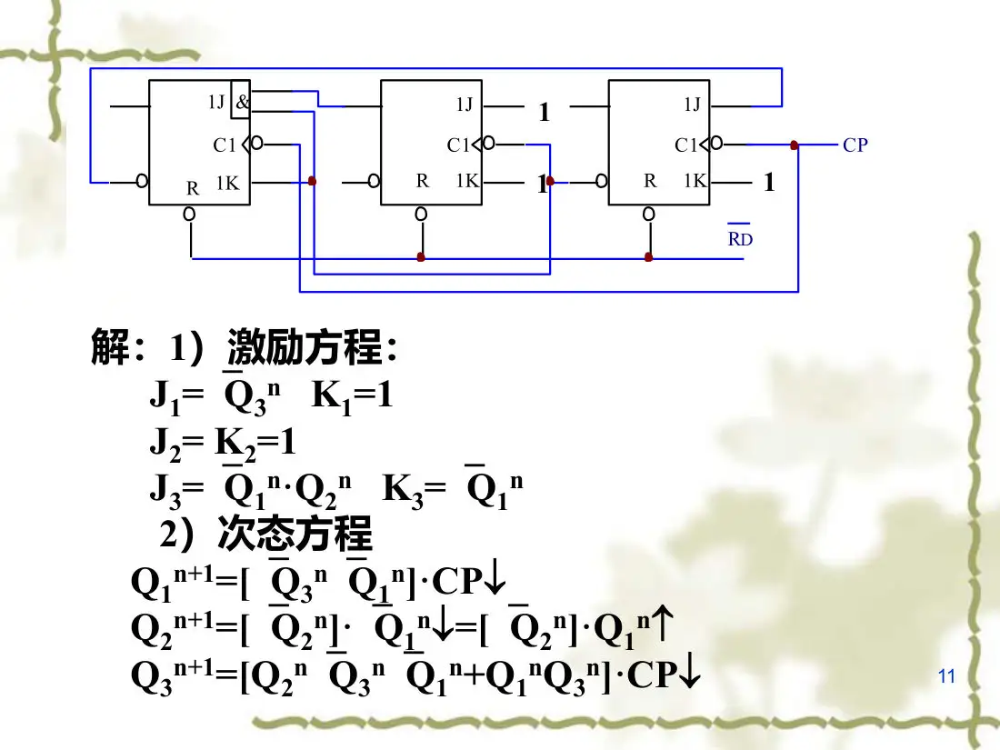

原文：

解：1）激励方程：

$$
\mathrm{J} _ {1} = \mathrm{Q} _ {3} ^ {\mathrm{n}} \quad \mathrm{K} _ {1} = 1
$$

$$
\mathrm{J} _ {2} = \underline {{\mathrm{K}}} _ {2} = 1
$$

$$
\mathbf {J} _ {3} = \overline {{\mathbf {Q}}} _ {1} ^ {\mathrm{n}} \cdot \mathbf {Q} _ {2} ^ {\mathrm{n}} \quad \mathbf {K} _ {3} = \overline {{\mathbf {Q}}} _ {1} ^ {\mathrm{n}}
$$

2）次态方程

$$
\mathrm{Q} _ {1} ^ {\mathrm{n+1}} = \left[ \begin{array}{l l} \overline {{\mathrm{Q}}} _ {3} ^ {\mathrm{n}} & \overline {{\mathrm{Q}}} _ {1} ^ {\mathrm{n}} \end{array} \right] \cdot \mathrm{CP} \downarrow
$$

$$
\mathbf {Q} _ {2} ^ {\mathrm{n+1}} = [ \overline {{\mathbf {Q}}} _ {2} ^ {\mathrm{n}} ] \cdot \overline {{\mathbf {Q}}} _ {1} ^ {\mathrm{n}} \downarrow = [ \overline {{\mathbf {Q}}} _ {2} ^ {\mathrm{n}} ] \cdot \mathbf {Q} _ {1} ^ {\mathrm{n}} \uparrow
$$

$$
\mathbf {Q} _ {3} ^ {\mathrm{n+1}} = [ \mathbf {Q} _ {2} ^ {\mathrm{n}} \overline {{\mathbf {Q}}} _ {3} ^ {\mathrm{n}} \overline {{\mathbf {Q}}} _ {1} ^ {\mathrm{n}} + \mathbf {Q} _ {1} ^ {\mathrm{n}} \mathbf {Q} _ {3} ^ {\mathrm{n}} ] \cdot \mathbf {C P} \downarrow
$$

11

### 2）次态方程

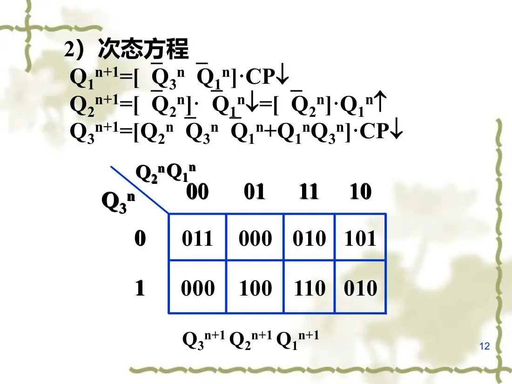

原文：

2）次态方程

$$
\begin{array}{l} \mathbf {Q} _ {1} ^ {\mathrm{n+1}} = [ \overline {{\mathbf {Q}}} _ {3} ^ {\mathrm{n}} \overline {{\mathbf {Q}}} _ {1} ^ {\mathrm{n}} ] \cdot \mathbf {C P} \downarrow \\ \mathbf {Q} _ {2} ^ {\mathrm{n+1}} = [ \overline {{\mathbf {Q}}} _ {2} ^ {\mathrm{n}} ] \cdot \overline {{\mathbf {Q}}} _ {1} ^ {\mathrm{n}} \downarrow = [ \overline {{\mathbf {Q}}} _ {2} ^ {\mathrm{n}} ] \cdot \mathbf {Q} _ {1} ^ {\mathrm{n}} \uparrow \\ \mathbf {Q} _ {3} ^ {\mathrm{n+1}} = [ \mathbf {Q} _ {2} ^ {\mathrm{n}} \overline {{\mathbf {Q}}} _ {3} ^ {\mathrm{n}} \overline {{\mathbf {Q}}} _ {1} ^ {\mathrm{n}} + \mathbf {Q} _ {1} ^ {\mathrm{n}} \mathbf {Q} _ {3} ^ {\mathrm{n}} ] \cdot \mathbf {C P} \downarrow \end{array}
$$

$$
\begin{array}{c c c c c} \mathbf {Q _ {2} ^ {n} Q _ {1} ^ {n}} & 0 0 & 0 1 & 1 1 & 1 0 \\ \hline \mathbf {Q _ {3} ^ {n}} & 0 & 0 1 1 & 0 0 0 & 0 1 0 \\ \hline 0 & 0 1 1 & 0 0 0 & 0 1 0 & 1 0 1 \\ \hline 1 & 0 0 0 & 1 0 0 & 1 1 0 & 0 1 0 \end{array}
$$

$$
\mathbf {Q} _ {3} ^ {\mathrm{n+1}} \mathbf {Q} _ {2} ^ {\mathrm{n+1}} \mathbf {Q} _ {1} ^ {\mathrm{n+1}}
$$

12

### 3）列状态转移表：

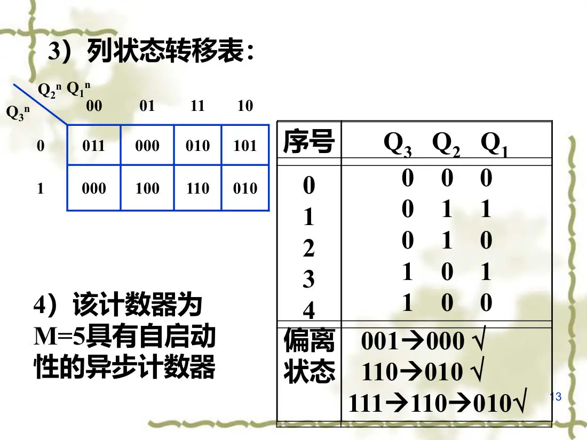

原文：

3）列状态转移表：

<table><tr><td colspan="5">Q3n\Q2n Q1n00 01 11 10</td></tr><tr><td>0</td><td>011</td><td>000</td><td>010</td><td>101</td></tr><tr><td>1</td><td>000</td><td>100</td><td>110</td><td>010</td></tr></table>

### 异步计数器的设计

原文：

异步计数器的设计

在异步二进制计数器的基础上，用脉冲反馈法实现任意进制计数器。

14

### 例：用脉冲反馈法设计异步8421BCD码计数器。

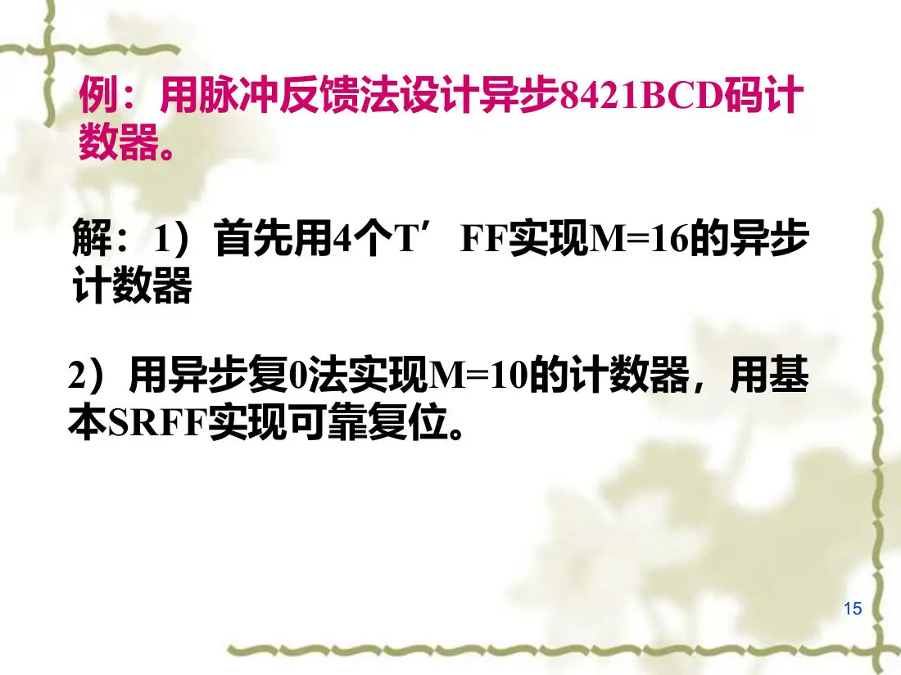

原文：

例：用脉冲反馈法设计异步8421BCD码计数器。

解：1）首先用4个T' FF实现M=16的异步计数器

2）用异步复0法实现M=10的计数器，用基本SRFF实现可靠复位。

15

### 电路图为:

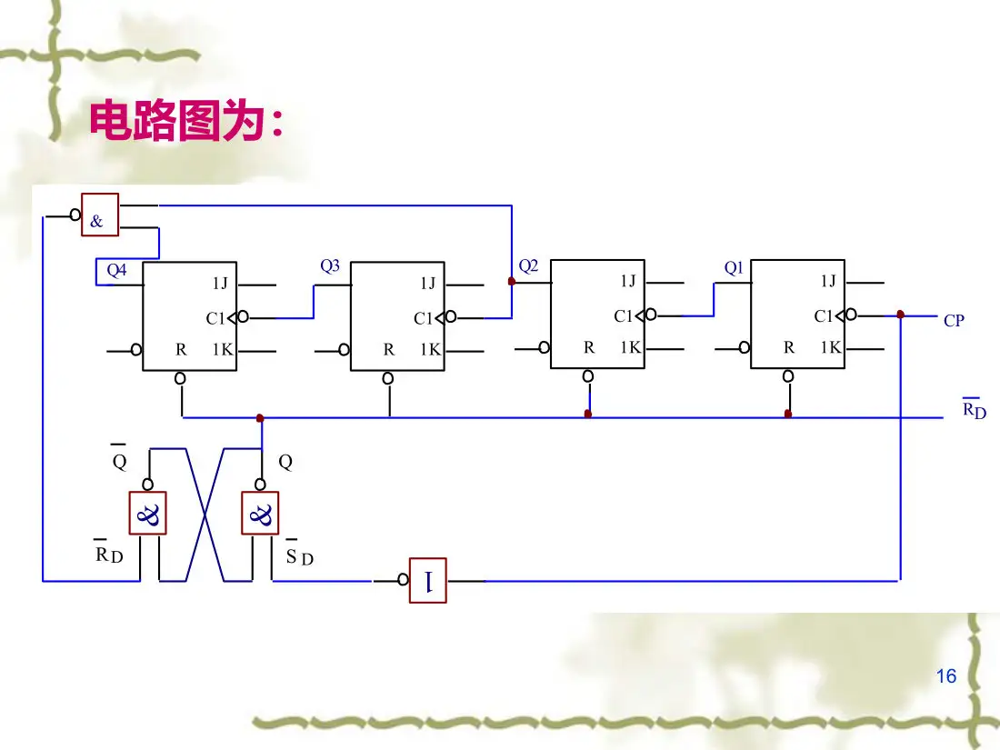

原文：

电路图为:

16

### 三、异步MSI计数器

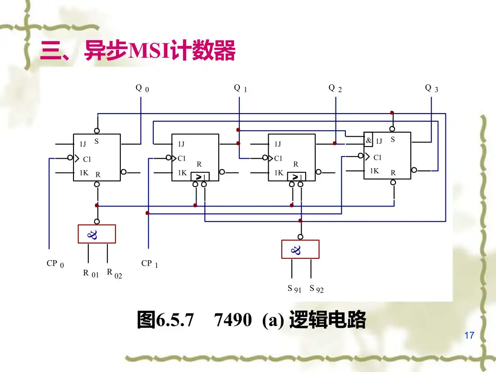

原文：

三、异步MSI计数器

17

### 18

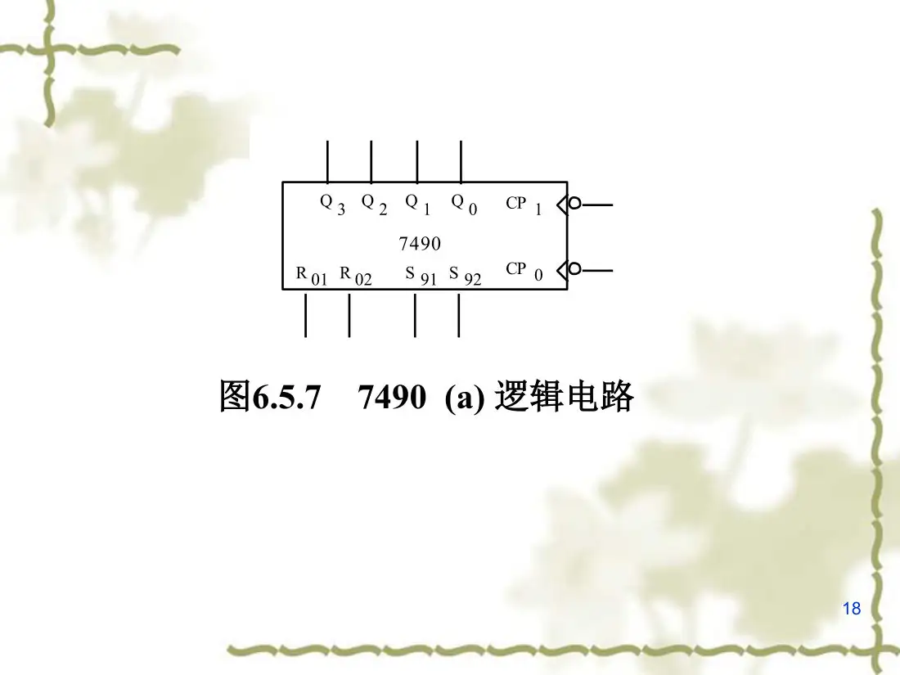

原文：

18

### 表6.5.3 $\mathrm{FF}_0$ 的状态转移表

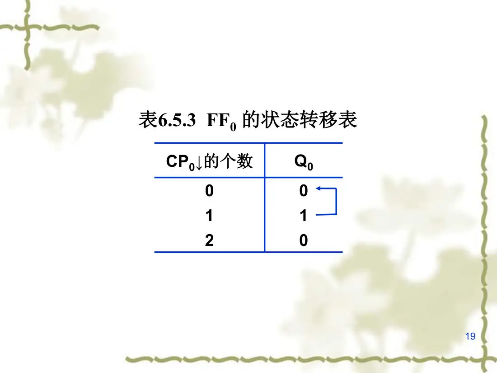

原文：

表6.5.3 $\mathrm{FF}_0$ 的状态转移表
<table><tr><td> $CP_{0} \downarrow$ 的个数</td><td> $Q_{0}$ </td></tr><tr><td>0</td><td>0</td></tr><tr><td>1</td><td>1</td></tr><tr><td>2</td><td>0</td></tr></table>

19

### 20

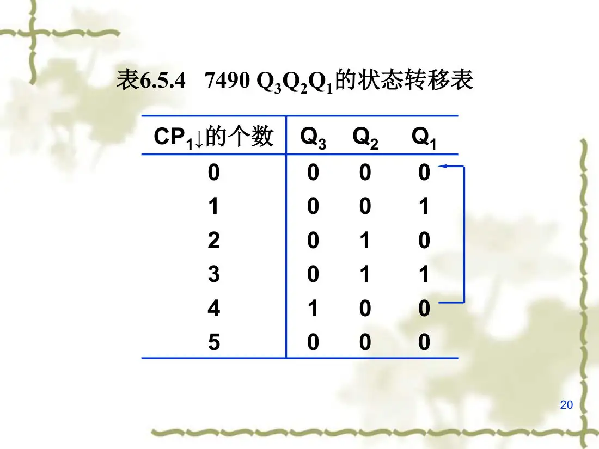

原文：

表6.5.4 7490 $\mathbf{Q}_3\mathbf{Q}_2\mathbf{Q}_1$ 的状态转移表
<table><tr><td> $CP_{1\downarrow}$ 的个数</td><td> $Q_{3}$ </td><td> $Q_{2}$ </td><td> $Q_{1}$ </td></tr><tr><td>0</td><td>0</td><td>0</td><td>0</td></tr><tr><td>1</td><td>0</td><td>0</td><td>1</td></tr><tr><td>2</td><td>0</td><td>1</td><td>0</td></tr><tr><td>3</td><td>0</td><td>1</td><td>1</td></tr><tr><td>4</td><td>1</td><td>0</td><td>0</td></tr><tr><td>5</td><td>0</td><td>0</td><td>0</td></tr></table>

20

### (2) 逻辑框图

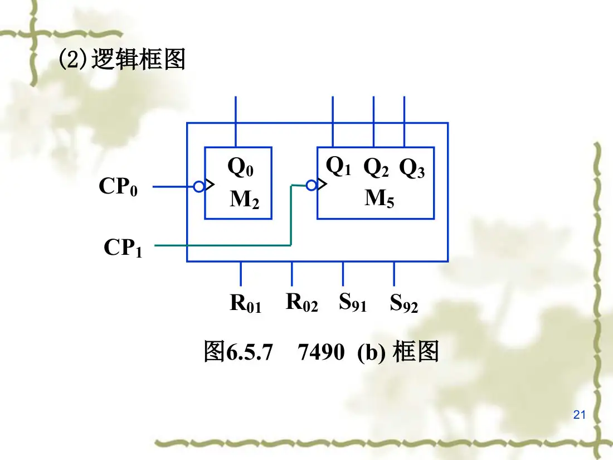

原文：

(2) 逻辑框图

21

### 22

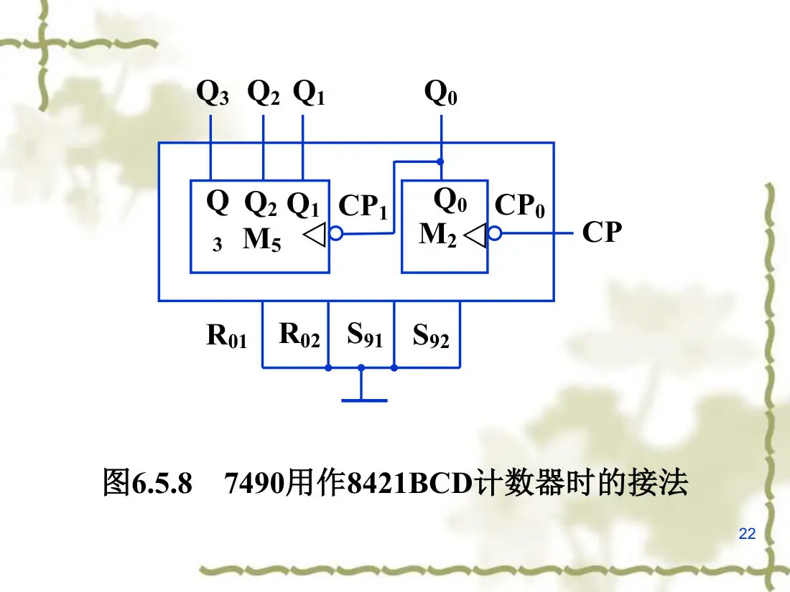

原文：

22

### 23

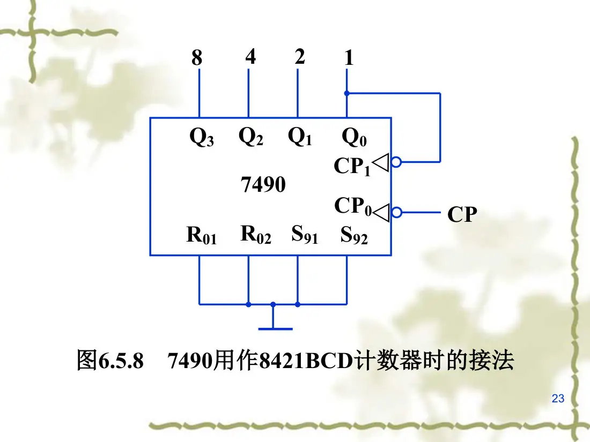

原文：

23

### 表6.5.5 7490作8421BCD计数时的状态转移表

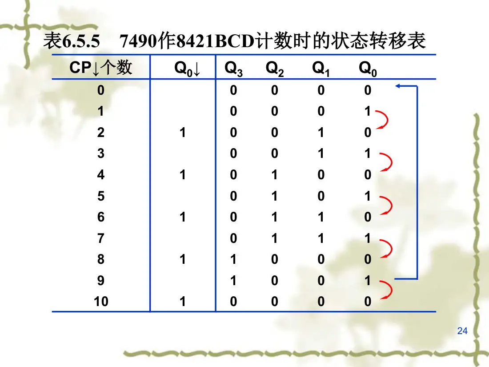

原文：

表6.5.5 7490作8421BCD计数时的状态转移表
<table><tr><td>CP↓个数</td><td> $Q_{0} \downarrow$ </td><td> $Q_{3}$ </td><td> $Q_{2}$ </td><td> $Q_{1}$ </td><td> $Q_{0}$ </td></tr><tr><td>0</td><td></td><td>0</td><td>0</td><td>0</td><td>0</td></tr><tr><td>1</td><td></td><td>0</td><td>0</td><td>0</td><td>1</td></tr><tr><td>2</td><td>1</td><td>0</td><td>0</td><td>1</td><td>0</td></tr><tr><td>3</td><td></td><td>0</td><td>0</td><td>1</td><td>1</td></tr><tr><td>4</td><td>1</td><td>0</td><td>1</td><td>0</td><td>0</td></tr><tr><td>5</td><td></td><td>0</td><td>1</td><td>0</td><td>1</td></tr><tr><td>6</td><td>1</td><td>0</td><td>1</td><td>1</td><td>0</td></tr><tr><td>7</td><td></td><td>0</td><td>1</td><td>1</td><td>1</td></tr><tr><td>8</td><td>1</td><td>1</td><td>0</td><td>0</td><td>0</td></tr><tr><td>9</td><td></td><td>1</td><td>0</td><td>0</td><td>1</td></tr><tr><td>10</td><td>1</td><td>0</td><td>0</td><td>0</td><td>0</td></tr></table>

24

### 25

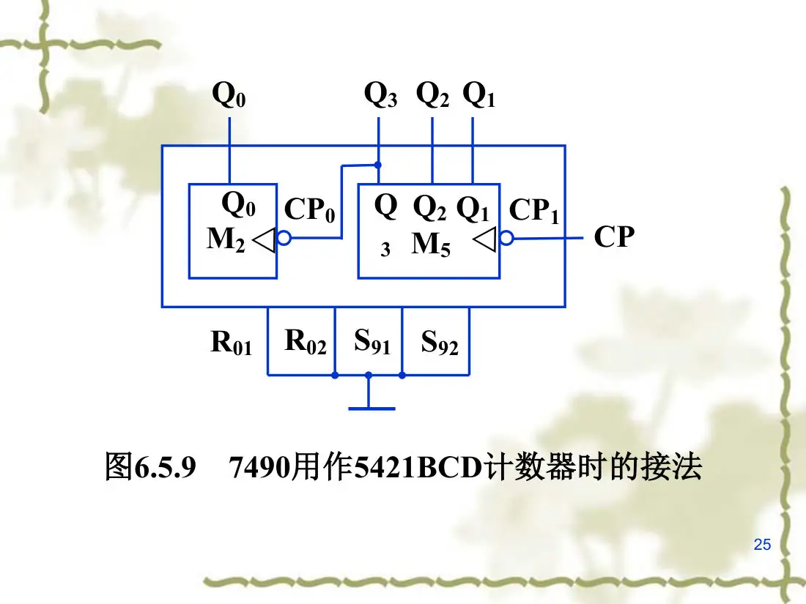

原文：

25

### 26

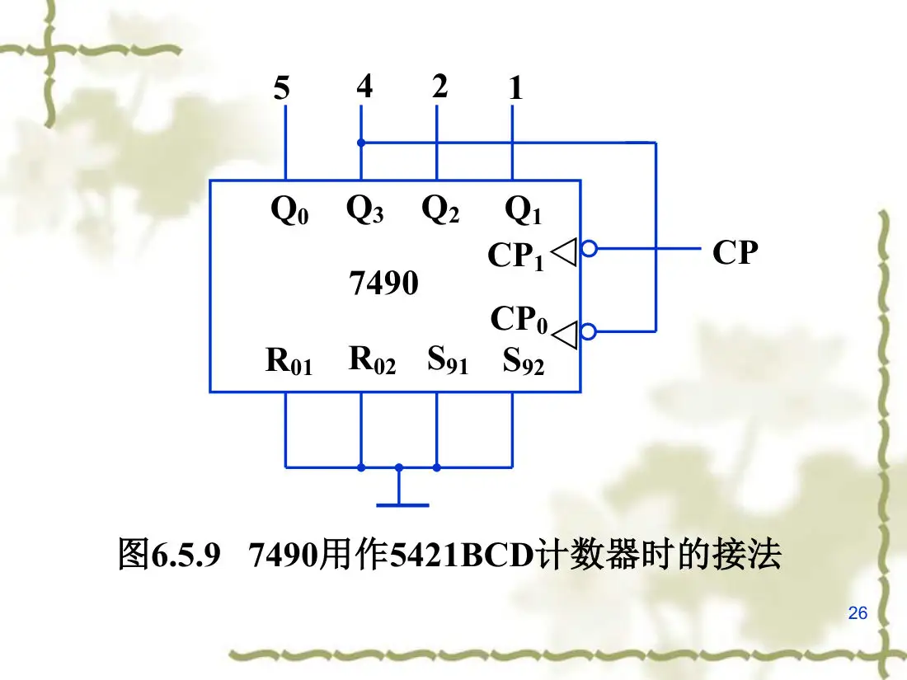

原文：

26

### 表6.5.6 7490作5421BCD计数时的状态转移表

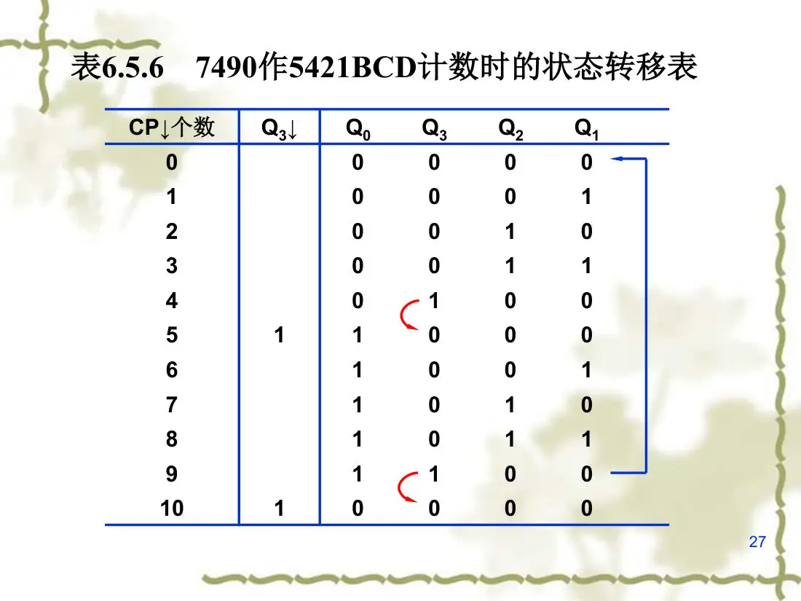

原文：

表6.5.6 7490作5421BCD计数时的状态转移表
<table><tr><td>CP↓个数</td><td> $Q_{3} \downarrow$ </td><td> $Q_0$ </td><td> $Q_3$ </td><td> $Q_2$ </td><td> $Q_1$ </td></tr><tr><td>0</td><td></td><td>0</td><td>0</td><td>0</td><td>0</td></tr><tr><td>1</td><td></td><td>0</td><td>0</td><td>0</td><td>1</td></tr><tr><td>2</td><td></td><td>0</td><td>0</td><td>1</td><td>0</td></tr><tr><td>3</td><td></td><td>0</td><td>0</td><td>1</td><td>1</td></tr><tr><td>4</td><td></td><td>0</td><td>1</td><td>0</td><td>0</td></tr><tr><td>5</td><td>1</td><td>1</td><td>0</td><td>0</td><td>0</td></tr><tr><td>6</td><td></td><td>1</td><td>0</td><td>0</td><td>1</td></tr><tr><td>7</td><td></td><td>1</td><td>0</td><td>1</td><td>0</td></tr><tr><td>8</td><td></td><td>1</td><td>0</td><td>1</td><td>1</td></tr><tr><td>9</td><td></td><td>1</td><td>1</td><td>0</td><td>0</td></tr><tr><td>10</td><td>1</td><td>0</td><td>0</td><td>0</td><td>0</td></tr></table>

27

### $$

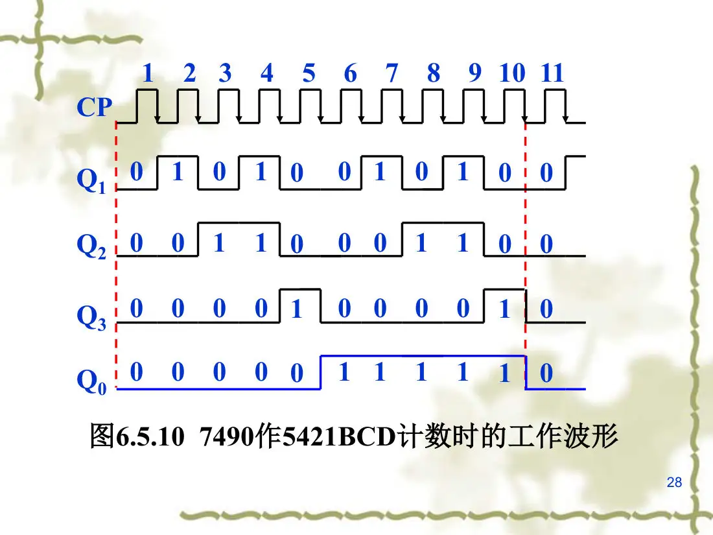

原文：

$$
\begin{array}{c c c c c c c c c c c c c c c} & 1 & 2 & 3 & 4 & 5 & 6 & 7 & 8 & 9 & 1 0 & 1 1 \\ \hline \text {CP} & & & & & & & & & & & \\ \hline Q _ {1} & 0 & 1 & 0 & 1 & 0 & 0 & 1 & 0 & 1 & 0 & 0 \\ \hline Q _ {2} & 0 & 0 & 1 & 1 & 0 & 0 & 0 & 1 & 1 & 0 & 0 \\ \hline Q _ {3} & 0 & 0 & 0 & 0 & 1 & 0 & 0 & 0 & 0 & 1 & 0 \\ \hline Q _ {0} & 0 & 0 & 0 & 0 & 0 & 1 & 1 & 1 & 1 & 1 & 0 \\ \hline \end{array}
$$

图6.5.10 7490作5421BCD计数时的工作波形

28

### (4) 功能表

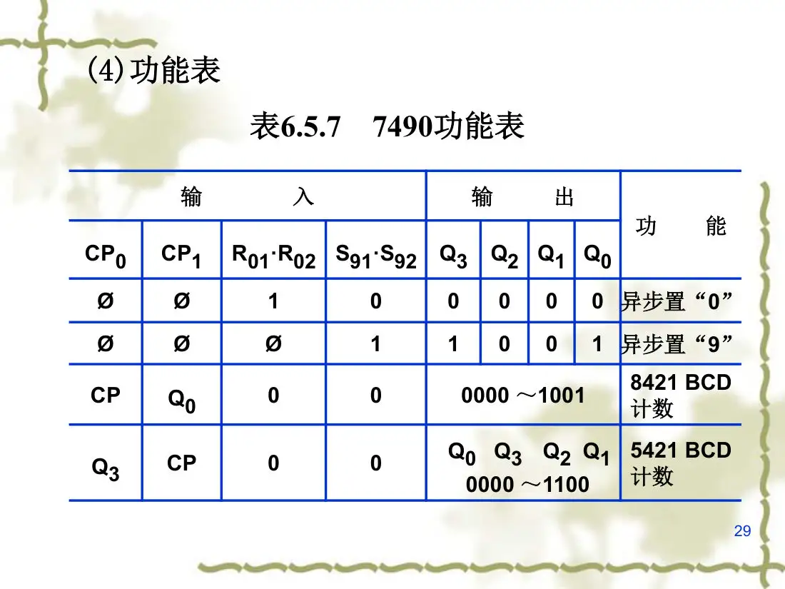

原文：

(4) 功能表

表6.5.7 7490功能表
<table><tr><td colspan="4">输入</td><td colspan="4">输出</td><td rowspan="2">功能</td></tr><tr><td> $CP_0$ </td><td> $CP_1$ </td><td> $R_{01} \cdot R_{02}$ </td><td> $S_{91} \cdot S_{92}$ </td><td> $Q_3$ </td><td> $Q_2$ </td><td> $Q_1$ </td><td> $Q_0$ </td></tr><tr><td>∅</td><td>∅</td><td>1</td><td>0</td><td>0</td><td>0</td><td>0</td><td>0</td><td>异步置“0”</td></tr><tr><td>∅</td><td>∅</td><td>∅</td><td>1</td><td>1</td><td>0</td><td>0</td><td>1</td><td>异步置“9”</td></tr><tr><td>CP</td><td> $Q_0$ </td><td>0</td><td>0</td><td colspan="4">0000~1001</td><td>8421 BCD计数</td></tr><tr><td> $Q_3$ </td><td>CP</td><td>0</td><td>0</td><td colspan="4"> $Q_0\ Q_3\ Q_2\ Q_1$ 0000~1100</td><td>5421 BCD计数</td></tr></table>

29

### 扩展7490可实现百进制计数器:

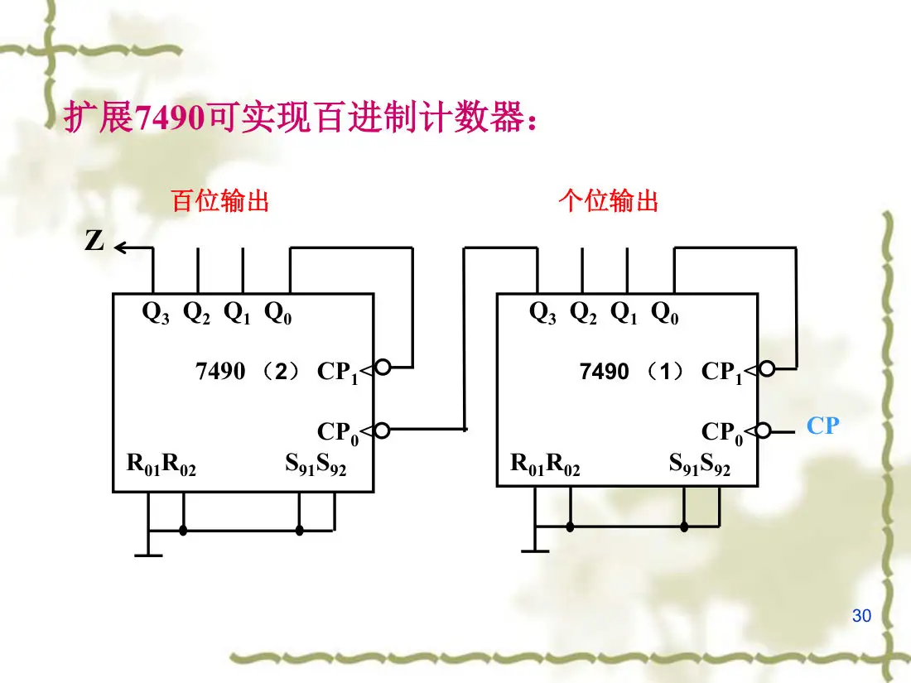

原文：

扩展7490可实现百进制计数器:

百位输出

个位输出

30

### 例：试用7490用复0法设计M=6的计数器。

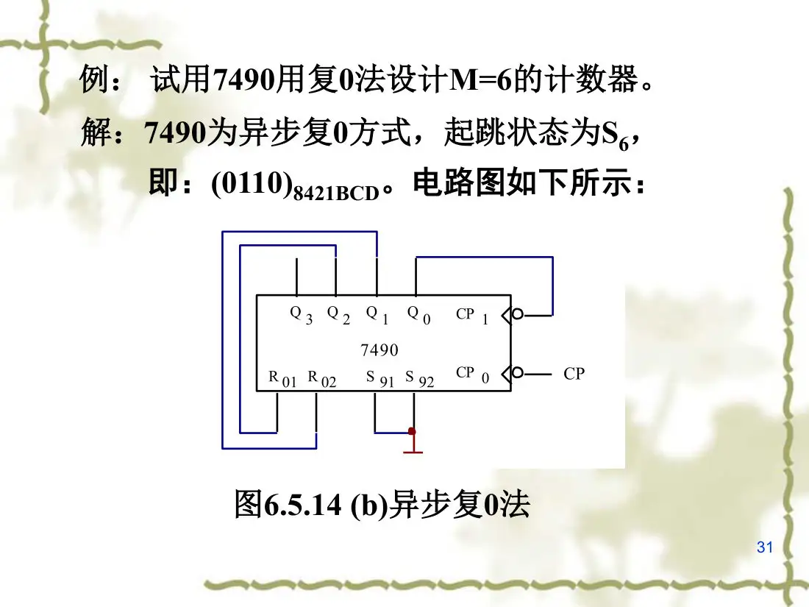

原文：

例：试用7490用复0法设计M=6的计数器。

解：7490为异步复0方式，起跳状态为 $S_{6}$ ，

即：(0110) $_{8421BCD}$ 。电路图如下所示：

31

### 用7490实现M=43的计数器:

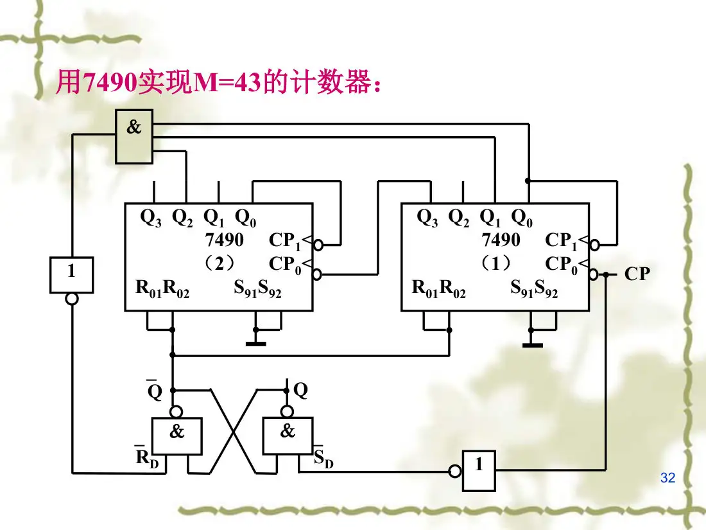

原文：

用7490实现M=43的计数器:

32

### 用T213构成M=12的异步计数器

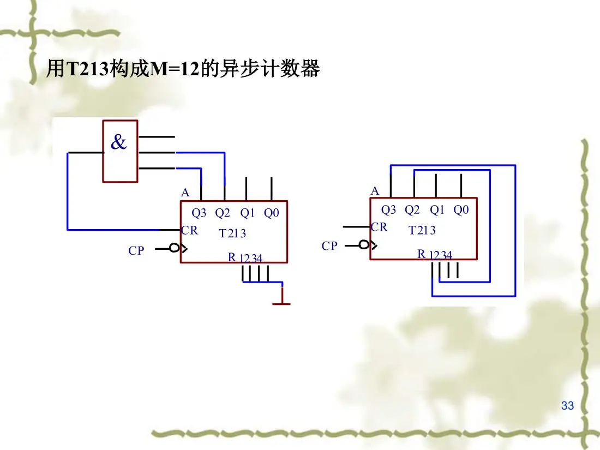

原文：

用T213构成M=12的异步计数器

33

### 第 34 页

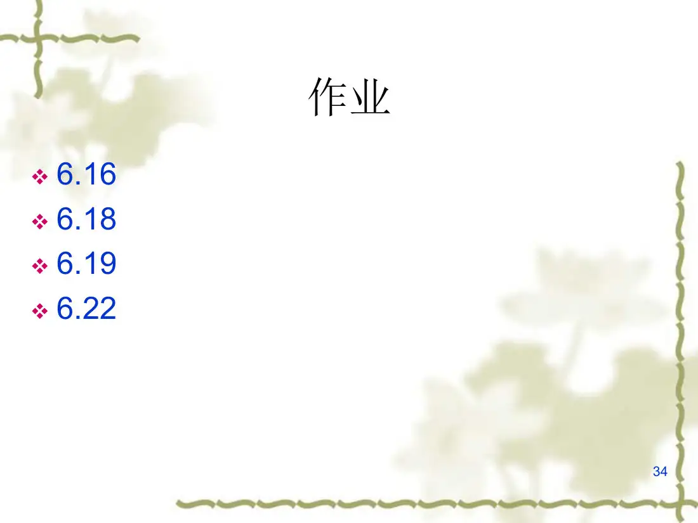
