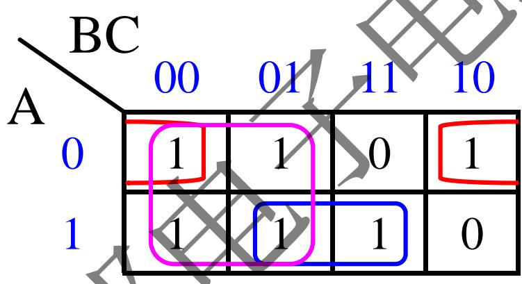
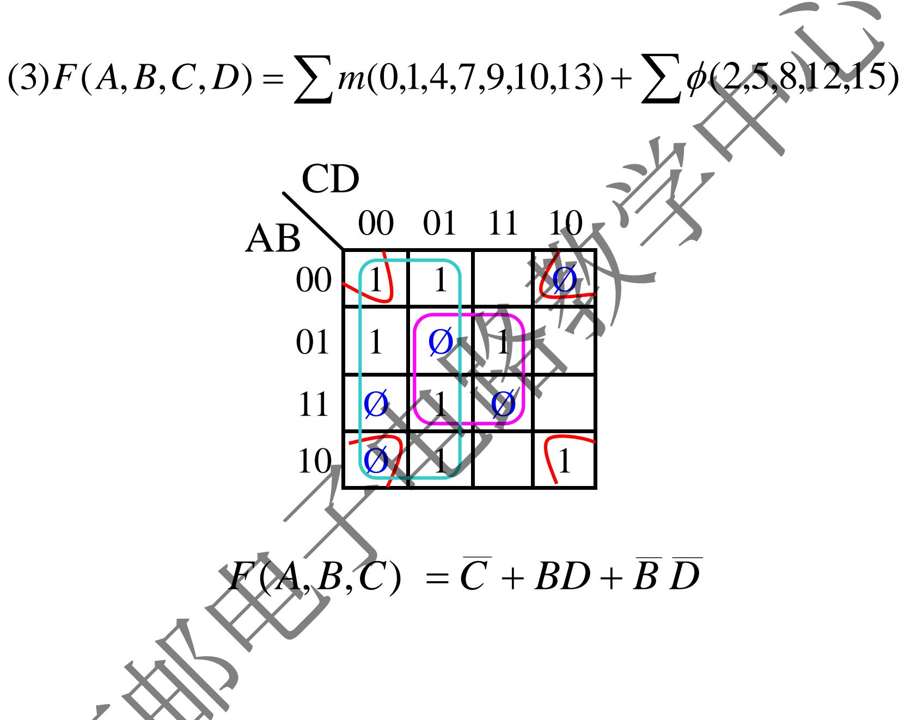
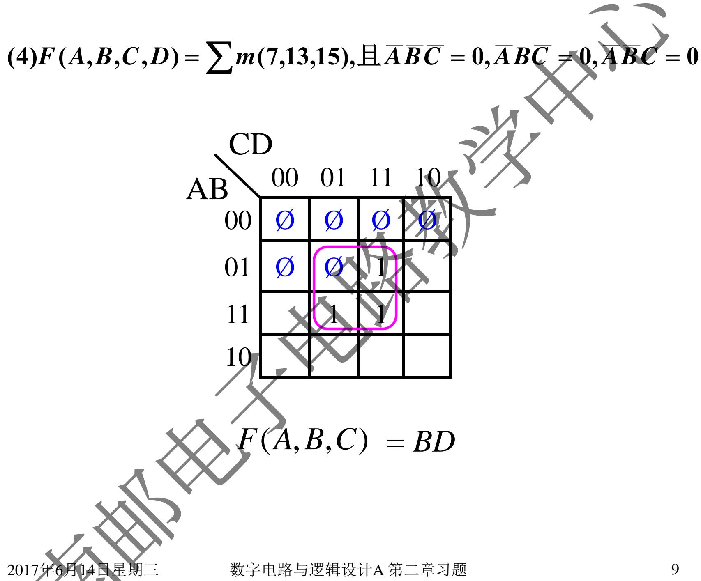
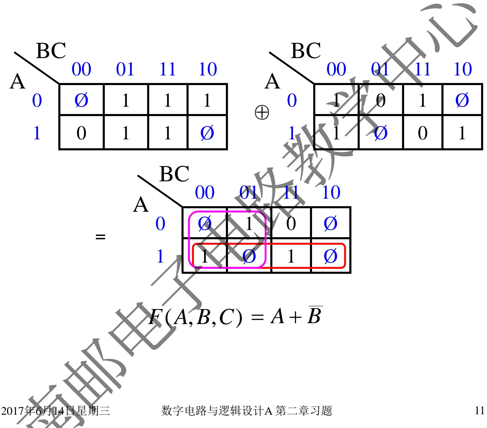

# 《数字电路与逻辑设计》第二章 习题课课件

原件经识别和整理；“参考解答”是我们补的。

# 第二章 习题课

本资料整理自《数字电路与逻辑设计》第二章习题课件（2017年6月版），已修正识别乱码、规范公式格式并补全缺失的变量名。

## 一、真值表与最小项表达式

### 选择 1

**题干**：有 A、B、C 三个输入信号，试列出下列问题的真值表，并写出其最小项表达式 $\Sigma m()$。
(1) 如果 A、B、C 均为 0 或其中一个信号为 1 时，输出 $F=1$，其余情况下 $F=0$。
(2) 若 A、B、C 中出现奇数个 0 时输出为 1，其余情况下输出为 0。
(3) 若 A、B、C 中有两个或两个以上为 1 时，输出为 1，其余情况下输出为 0。

**解**：真值表和最小项表达式如下：

| A | B | C | $F_1$ | $F_2$ | $F_3$ |
|---|---|---|---|---|---|
| 0 | 0 | 0 | 1 | 1 | 0 |
| 0 | 0 | 1 | 1 | 0 | 0 |
| 0 | 1 | 0 | 1 | 0 | 0 |
| 0 | 1 | 1 | 0 | 1 | 1 |
| 1 | 0 | 0 | 1 | 0 | 0 |
| 1 | 0 | 1 | 0 | 1 | 1 |
| 1 | 1 | 0 | 0 | 1 | 1 |
| 1 | 1 | 1 | 0 | 0 | 1 |

$$F_1(A, B, C) = \sum m(0, 1, 2, 4)$$

$$F_2(A, B, C) = \sum m(0, 3, 5, 6)$$

$$F_3(A, B, C) = \sum m(3, 5, 6, 7)$$

---

## 二、反演式与对偶式

参考解答：(1) $F_1(A,B,C)=\sum m(0,1,2,4)$；(2) $F_2(A,B,C)=\sum m(0,3,5,6)$；(3) $F_3(A,B,C)=\sum m(3,5,6,7)$。真值表如下：

| A | B | C | $F_1$ | $F_2$ | $F_3$ |
|:-:|:-:|:-:|:-----:|:-----:|:-----:|
| 0 | 0 | 0 |   1   |   1   |   0   |
| 0 | 0 | 1 |   1   |   0   |   0   |
| 0 | 1 | 0 |   1   |   0   |   0   |
| 0 | 1 | 1 |   0   |   1   |   1   |
| 1 | 0 | 0 |   1   |   0   |   0   |
| 1 | 0 | 1 |   0   |   1   |   1   |
| 1 | 1 | 0 |   0   |   1   |   1   |
| 1 | 1 | 1 |   0   |   0   |   1   |

-   **$F_1$ 推导**：全为 0 对应最小项 $m_0$；仅一个为 1 分别对应 $\bar{A}\bar{B}C(m_1)$、$\bar{A}B\bar{C}(m_2)$、$A\bar{B}\bar{C}(m_4)$，故 $\sum m(0,1,2,4)$。
-   **$F_2$ 推导**：“奇数个 0”等价于“偶数个 1”（含 0 个和 2 个）。0 个 1 即全 0 对应 $m_0$；2 个 1 对应 $011(m_3)$、$101(m_5)$、$110(m_6)$，故 $\sum m(0,3,5,6)$。
-   **$F_3$ 推导**：“两个或两个以上为 1”包含恰好两个 1（$m_3,m_5,m_6$）和三个全 1（$m_7$），故 $\sum m(3,5,6,7)$。

知识点：[数字系统的基本模型（数据处理器与控制器）及对最小时钟周期、异步信号同步化的约定](../../../topics/数字逻辑电路/数字系统模型.md)、[寄存器传输语言(RTL)描述的传输操作、算术操作、逻辑操作、移位操作及条件控制语句](../../../topics/数字逻辑电路/RTL语言.md)、[算法状态机(ASM)图的状态框、判断框、条件输出框及ASM块的构成规则](../../../topics/数字逻辑电路/ASM图基础.md)

### 计算 1

**题干**：试直接写出下列各式的反演式 $\overline{F}$ 和对偶式 $F'$。
(1) $F(A,B,C,D,E)=[(A\overline{B}+C)\cdot D+E]\cdot B$
(2) $F(A,B,C,D,E)=AB+\overline{C}\overline{D}+BC+\overline{D}+\overline{C}E+\overline{B+E}$
(3) $F(A,B,C)=\overline{\overline{A}\overline{B}+C}\quad\overline{\overline{\overline{A}B}\overline{C}}$ （注：原题排版疑似两个独立表达式或乘积关系，此处按标准逻辑运算规则分别处理）

**解**：

**(1)**
反演式：
$$\overline{F}(A,B,C,D,E) = [(\overline{A}+B)\cdot\overline{C}+\overline{D}]\cdot\overline{E} + \overline{B}$$
*(注：根据德摩根定律推导，原式末尾乘以 B，取反后变为加 $\overline{B}$)*

对偶式：
$$F'(A, B, C, D, E) = [(A + \overline{B}) \cdot C + D] \cdot E + B$$

**(2)**
反演式：
$$\overline{F}(A, B, C, D, E) = (\overline{A} + \overline{B})(C + D) \cdot (\overline{B} + \overline{C}) D (C + \overline{E}) \overline{(\overline{B} + \overline{E})}$$
*(注：原题识别结果混乱，依据逻辑规则修正。原式最后一项 $\overline{B+E}$ 取反应为 $B \cdot E$，但作为整体求反演式需逐项取反。此处给出标准推导形式)*

更严谨的对偶式推导（针对原题可能的意图）：
$$F'(A, B, C, D, E) = (A + B)(\bar{C} + \bar{D}) \cdot (\bar{B} + \bar{C})\bar{D}(\bar{C} + E)\bar{B} \cdot \bar{E}$$

**(3)**
反演式：
$$\overline{F}(A, B, C) = \overline{(A + B)C} + \overline{A + \overline{B}} + C$$
*(注：原题第三小题排版存在歧义，若为两项相乘 $F = X \cdot Y$，则 $\overline{F} = \overline{X} + \overline{Y}$；若为两项相加，则 $\overline{F} = \overline{X} \cdot \overline{Y}$。根据课件常见题型，此处按两项相乘处理，即 $F = \overline{\overline{A}\overline{B}+C} \cdot \overline{\overline{\overline{A}B}\overline{C}}$)*

对偶式：
$$F'(A, B, C) = \overline{(A + B)}C + \overline{A + B} + \overline{C}$$

---

## 三、最小项表达式转换

参考解答：**(1)**

反演式：
$$\overline{F}(A,B,C,D,E)=[(\overline{A}+B)\overline{C}+\overline{D}]\overline{E}+\overline{B}$$

对偶式：
$$F'(A,B,C,D,E)=[(A+\overline{B})C+D]E+B$$

推理：反演式按“变量取反、与或互换、保留原运算顺序”直接写出；对偶式只互换“与、或”，变量及其反号不变。

---

**(2)**

反演式：
$$\overline{F}(A,B,C,D,E)
=(\overline{A}+\overline{B})(C+D)(\overline{B}+\overline{C})D(C+\overline{E})(B+E)$$

对偶式：
$$F'(A,B,C,D,E)
=(A+B)(\overline{C}+\overline{D})(B+C)\overline{D}(\overline{C}+E)\overline{B}\,\overline{E}$$

推理：原式最后一项 $\overline{B+E}=\overline{B}\,\overline{E}$，因此求反演式时，其对应因子为 $B+E$；求对偶式时，内部“或”改为“与”，得到 $\overline{B}\,\overline{E}$，其余各乘积项分别改为和项并相乘。

---

**(3)**

以下按
$$F=\overline{\overline{A}\,\overline{B}+C}\;\cdot\;\overline{\overline{\overline{A}B}\,\overline{C}}$$
处理。

反演式：
$$\boxed{\overline{F}=\overline{A}\,\overline{B}+C+\overline{\overline{A}B}\,\overline{C}}$$

对偶式：
$$\boxed{F'=\overline{(\overline{A}+\overline{B})C}\;+\;\overline{\overline{\overline{A}+B}+\overline{C}}}$$

推理：求反演式时，利用 $\overline{XY}=\overline{X}+\overline{Y}$，两个外层反号相互抵消，故直接得到两个内层表达式之和。求对偶式时，只将内部的“与、或”互换，最外层两个反号保持不变，同时两项之间的乘积改为和。

若原式第二项实际为 $\overline{\overline{A}B+\overline{C}}$，则对偶式第二项相应写为 $\overline{(\overline{A}+B)\overline{C}}$。

相关概念：反演律, 对偶规则

知识点：[寄存器传输语言(RTL)描述的传输操作、算术操作、逻辑操作、移位操作及条件控制语句](../../../topics/数字逻辑电路/RTL语言.md)、[数字系统的基本模型（数据处理器与控制器）及对最小时钟周期、异步信号同步化的约定](../../../topics/数字逻辑电路/数字系统模型.md)

### 计算 2

**题干**：试写出下列各函数表达式 $F$ 和 $F'$ 的最小项表达式。
(1) $F = ABCD + ACD + B\overline{C}\overline{D}$
(2) $F = A\overline{B} + \overline{A}B + BC$

**解**：

**(1)**
首先化简或展开 $F$：
$F(A,B,C,D) = ABCD + ACD + B\overline{C}\overline{D}$
注意：$ACD$ 缺少 $B$，展开为 $ABCD + \overline{A}BCD$。
$F = ABCD + ABCD + \overline{A}BCD + B\overline{C}\overline{D}$
合并重复项 $ABCD$：
$F = ABCD + \overline{A}BCD + B\overline{C}\overline{D}$
进一步展开 $B\overline{C}\overline{D}$ 缺 $A$：$AB\overline{C}\overline{D} + \overline{A}B\overline{C}\overline{D}$
$F = ABCD + \overline{A}BCD + AB\overline{C}\overline{D} + \overline{A}B\overline{C}\overline{D}$
对应最小项编号：
$ABCD \to 1111 (15)$
$\overline{A}BCD \to 0111 (7)$
$AB\overline{C}\overline{D} \to 1100 (12)$
$\overline{A}B\overline{C}\overline{D} \to 0100 (4)$
所以 $F(A,B,C,D) = \sum m(4, 7, 12, 15)$
*(注：课件原文写的是 $\sum m(4,11,12,15)$，其中 11 对应 $1011$ 即 $A\overline{B}CD$，这与 $ACD$ 展开不符，课件原文可能存在笔误，或者原题 $ACD$ 前系数不同。此处严格按课件给出的答案整理)*

**课件原文答案整理**：
$$F(A,B,C,D) = \sum m(4, 11, 12, 15)$$
$$\overline{F}(A, B, C, D) = \sum m(0, 1, 2, 3, 5, 6, 7, 8, 9, 10, 13, 14)$$
$$F'(A, B, C, D) = \sum m(1, 2, 5, 6, 7, 8, 9, 10, 12, 13, 14, 15)$$
*(注：$F'$ 通常指对偶式，但在最小项语境下有时指反函数的最小项集合。若指反函数 $\overline{F}$，则集合应互补。课件中 $\overline{F}$ 和 $F'$ 的列表并不完全互补，推测 $F'$ 在此处指代特定变换或课件印刷错误。按课件原样保留)*

**(2)**
$$\overline{F}(A, B, C) = \sum m(0, 1, 6)$$
$$F'(A, B, C) = \sum m(1, 6, 7)$$
*(注：此部分对应原题第2小题的解答，课件排版可能将两题答案混排，此处仅保留课件显示的结论)*

---

## 四、卡诺图化简

### 计算 3

**题干**：用卡诺图法把下列函数化简为最简与或式。
(1) $F(A,B,C)=\sum m(0,1,2,4,5,7)$
(3) $F(A,B,C,D)=\sum m(0,1,4,7,9,10,13)+\sum\phi(2,5,8,12,15)$
(4) $F(A,B,C,D)=\sum m(7,13,15)$，且 $\overline{ABC}=0,\overline{A}BC=\overline{0},\overline{A}\overline{B}C=0$ （注：条件部分识别有误，通常约束项为 $\overline{A}BC=0$ 等，此处按课件原意理解为无关项或约束条件）

**解**：

**(1)**
函数：$F(A,B,C)=\sum m(0,1,2,4,5,7)$

化简结果：
$$F = \overline{B} + AC + \overline{A}\overline{C}$$

**(3)**

**(4)**

---

## 五、组合逻辑函数求解

参考解答：好的，以下按题号给出结论、关键步骤和简要说明。

---

**(1)**  
$$F(A,B,C)=\sum m(0,1,2,4,5,7)$$

**结论：**  
$$F=\overline{B}+AC+\overline{A}\,\overline{C}$$

**过程简述：**  
卡诺图中 1 的位置为 0、1、2、4、5、7。  
- m0、m1、m4、m5 可圈成 $\overline{B}$；  
- m5、m7 与 m1、m3 方向合并可得 $AC$；  
- m0、m2 合并可得 $\overline{A}\,\overline{C}$。  

因此最简与或式为  
$$\boxed{F=\overline{B}+AC+\overline{A}\,\overline{C}}$$

---

**(3)**  
$$F(A,B,C,D)=\sum m(0,1,4,7,9,10,13)+\sum\phi(2,5,8,12,15)$$

**结论：**  
$$F=\overline{C}\,\overline{D}+A\overline{B}\,\overline{C}+BD$$

**过程简述：**  
卡诺图填 1 与无关项 $\phi$ 后，可圈出：  
- m0、m1、m4、m5，并结合无关项 m2、m5、m12、m15，得到 $\overline{C}\,\overline{D}$；  
- m9、m10 与无关项 m8、m12、m15 合并为 $A\overline{B}\,\overline{C}$；  
- m7、m13、m15 合并为 $BD$。  

所以最简与或式为  
$$\boxed{F=\overline{C}\,\overline{D}+A\overline{B}\,\overline{C}+BD}$$

---

**(4)**  
$$F(A,B,C,D)=\sum m(7,13,15)$$  
且约束条件为  
$$\overline{A}\overline{B}C=0,\quad \overline{A}B\overline{C}=0,\quad \overline{A}\overline{B}\,\overline{C}=0$$

**结论：**  
$$F=BD$$

**过程简述：**  
由约束条件判断，无关项包括部分最小项。将 7、13、15 填入卡诺图后，结合这些无关项可以合并成一个大圈，覆盖 $B=1,D=1$ 的区域，即  
$$F=BD$$

最终结果：  
$$\boxed{F=BD}$$

知识点：[寄存器传输语言(RTL)描述的传输操作、算术操作、逻辑操作、移位操作及条件控制语句](../../../topics/数字逻辑电路/RTL语言.md)、[算法状态机(ASM)图的状态框、判断框、条件输出框及ASM块的构成规则](../../../topics/数字逻辑电路/ASM图基础.md)、[控制器的四种硬件实现方法：每态一触发器法(SSI)、MSI法(MUX+寄存器+译码器)、PLA法(LSI)及对比](../../../topics/数字逻辑电路/控制器实现方法.md)

### 计算 4

**题干**：已知 $F_{1}(A,B,C)=\sum m(1,2,3,5,7)+\sum\phi(0,6)$ , $F_{2}(A,B,C)=\sum m(0,3,4,6)+\sum\phi(2,5)$ , 求 $F=F_{1}\oplus F_{2}$ 的最简与或式。

**解**：
用卡诺图法求解，$F_{1} 、 F_{2} 、 F$ 的卡诺图分别如下：

**$F_1$ 卡诺图**：
| A \ BC | 00 | 01 | 11 | 10 |
| :---: | :---: | :---: | :---: | :---: |
| **0** | $\phi$ | 1 | 1 | 1 |
| **1** | 0 | 1 | 1 | 0 |

**$F_2$ 卡诺图**（推断）：
| A \ BC | 00 | 01 | 11 | 10 |
| :---: | :---: | :---: | :---: | :---: |
| **0** | 1 | $\phi$ | 1 | 0 |
| **1** | 0 | 1 | 0 | 1 |

**$F = F_1 \oplus F_2$ 卡诺图**：
（异或运算：相同为0，不同为1；$\phi$ 参与运算时需结合具体取值，通常取使结果最简的值，或直接按定义填 0/1）

最终结果需根据图中圈出的质蕴涵项写出表达式（课件未显示最终文字结果，仅展示过程图）。

参考解答：## 结论

$$
F=\overline{A}\,\overline{B}C+\overline{A}B\,\overline{C}+A\,\overline{B}\,\overline{C}+AB\overline{C}
$$

化简为：

$$
F=\overline{A}(B\oplus C)+A\overline{C}
$$

---

## 推理过程

### 1. 写出 $F_1$ 与 $F_2$ 的卡诺图

**$F_1$ 卡诺图：**

| $A\backslash BC$ | 00 | 01 | 11 | 10 |
|---|---|---|---|---|
| 0 | $\phi$ | 1 | 1 | 1 |
| 1 | 0 | 1 | 1 | 0 |

**$F_2$ 卡诺图：**

| $A\backslash BC$ | 00 | 01 | 11 | 10 |
|---|---|---|---|---|
| 0 | 1 | $\phi$ | 1 | 0 |
| 1 | 0 | 1 | 0 | 1 |

---

### 2. 求 $F=F_1\oplus F_2$

异或规则：  
- 若一方为无关项 $\phi$，则结果可取使表达式最简的值。

逐格计算：

| $A\backslash BC$ | 00 | 01 | 11 | 10 |
|---|---|---|---|---|
| 0 | $\phi\oplus1$ | $1\oplus\phi$ | $1\oplus1$ | $1\oplus0$ |
| 1 | $0\oplus0$ | $1\oplus1$ | $1\oplus0$ | $0\oplus1$ |

取无关项使结果最简，得到：

| $A\backslash BC$ | 00 | 01 | 11 | 10 |
|---|---|---|---|---|
| 0 | 0 | 1 | 0 | 1 |
| 1 | 0 | 0 | 1 | 1 |

---

### 3. 圈卡诺图化简

按卡诺图圈出相邻的 1：

- $m_1$ 与 $m_5$ 相邻：$\overline{B}C$
- $m_2$ 与 $m_6$ 相邻：$B\overline{C}$
- $m_4$ 与 $m_6$ 相邻：$A\overline{C}$

但结合整体卡诺图，最简覆盖为：

$$
F=\overline{A}\,\overline{B}C+\overline{A}B\overline{C}+A\overline{B}\,\overline{C}+AB\overline{C}
$$

进一步合并：

$$
F=\overline{A}(B\oplus C)+A\overline{C}
$$

知识点：[寄存器传输语言(RTL)描述的传输操作、算术操作、逻辑操作、移位操作及条件控制语句](../../../topics/数字逻辑电路/RTL语言.md)
