# 《数字电路与逻辑设计》第二章 第六节 逻辑函数的化简--图解法（课件）

原件的每一页，下面附识别出的文字。

### 第二章 逻辑代数基础

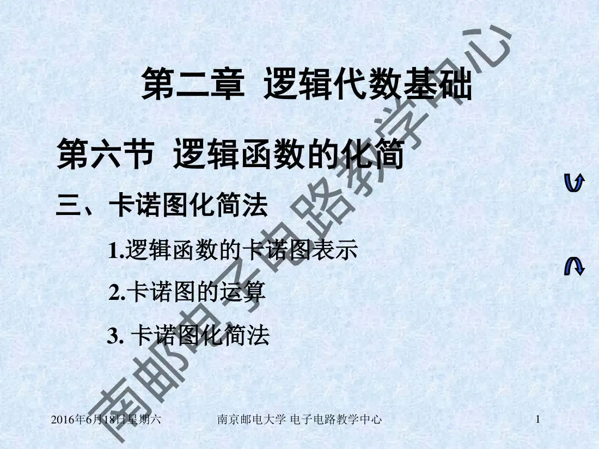

原文：

第二章 逻辑代数基础

第六节 逻辑函数的化简

三、卡诺图化简法

1.逻辑函数的卡诺图表示

2.卡诺图的运算

3. 卡诺图化简法

2016年6月18日星期六

南京邮电大学 电子电路教学中心

1

### 三、卡诺图化简法

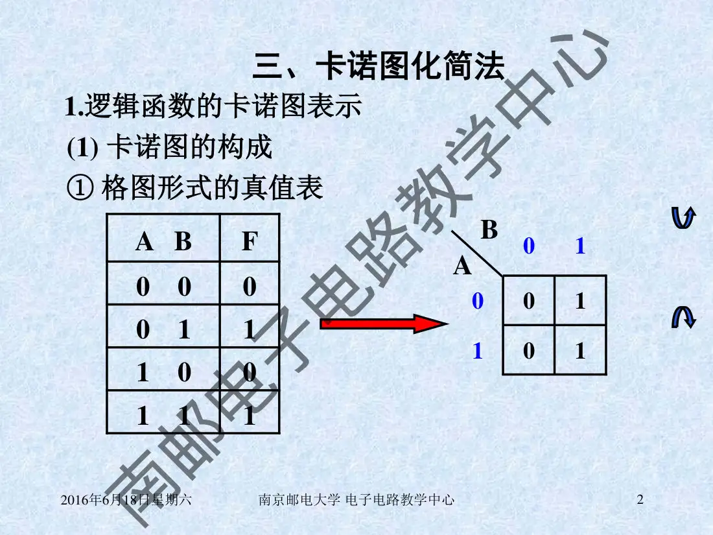

原文：

三、卡诺图化简法

1.逻辑函数的卡诺图表示

(1) 卡诺图的构成

① 格图形式的真值表

<table><tr><td>A B</td><td>F</td></tr><tr><td>0 0</td><td>0</td></tr><tr><td>0 1</td><td>1</td></tr><tr><td>1 0</td><td>0</td></tr><tr><td>1 1</td><td>1</td></tr></table>

<table><tr><td>A\B</td><td>0</td><td>1</td></tr><tr><td>0</td><td>0</td><td>1</td></tr><tr><td>1</td><td>0</td><td>1</td></tr></table>

2016年6月18日星期六

南京邮电大学 电子电路教学中心

2

### ② 最小项的方块图

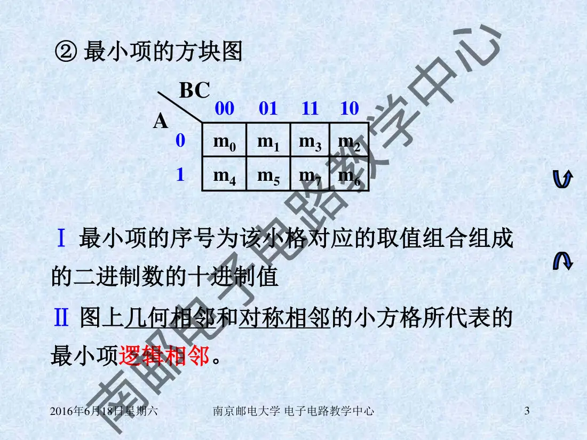

原文：

② 最小项的方块图

Ⅰ 最小项的序号为该小格对应的取值组合组成的二进制数的十进制值

Ⅱ 图上几何相邻和对称相邻的小方格所代表的最小项逻辑相邻。

2016年6月18日星期六

南京邮电大学 电子电路教学中心

3

### ③ 卡诺图中0和1的含义

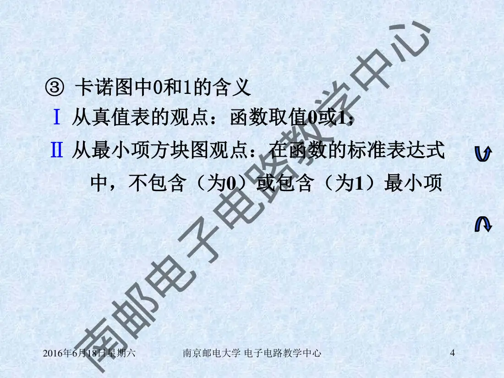

原文：

③ 卡诺图中0和1的含义

Ⅰ 从真值表的观点：函数取值0或1；

Ⅱ 从最小项方块图观点：在函数的标准表达式 V中，不包含（为0）或包含（为1）最小项

2016年6月18日星期六

南京邮电大学 电子电路教学中心

4

### A BF0 000 111 001 11

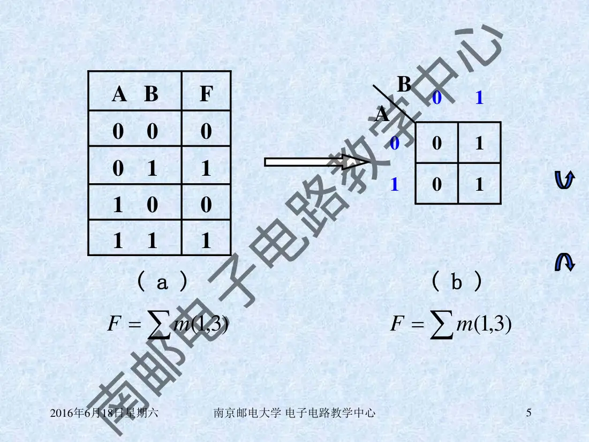

原文：

<table><tr><td>A B</td><td>F</td></tr><tr><td>0 0</td><td>0</td></tr><tr><td>0 1</td><td>1</td></tr><tr><td>1 0</td><td>0</td></tr><tr><td>1 1</td><td>1</td></tr></table>

( a )

= ∑ mF )3,1(

( b )

= ∑mF )3,1(

2016年6月18日星期六

南京邮电大学 电子电路教学中心

5

### 例2.6.11 将图2.6.4所示卡诺图用最小项表达式表示

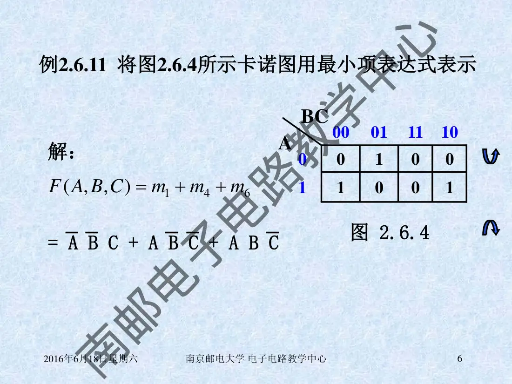

原文：

例2.6.11 将图2.6.4所示卡诺图用最小项表达式表示

解：

$$
F (A, B, C) = m _ {1} + m _ {4} + m _ {6}
$$

$$
= \overline {{\mathrm{A}}} \overline {{\mathrm{B}}} \mathrm{C} + \mathrm{A} \overline {{\mathrm{B}}} \overline {{\mathrm{C}}} + \mathrm{A} \mathrm{B} \overline {{\mathrm{C}}}
$$

图 2.6.4
<table><tr><td>0</td><td>1</td><td>0</td><td>0</td></tr><tr><td>1</td><td>0</td><td>0</td><td>1</td></tr></table>

2016年6月18日星期六

南京邮电大学 电子电路教学中心

6

### (2) 逻辑函数的几种移植方法

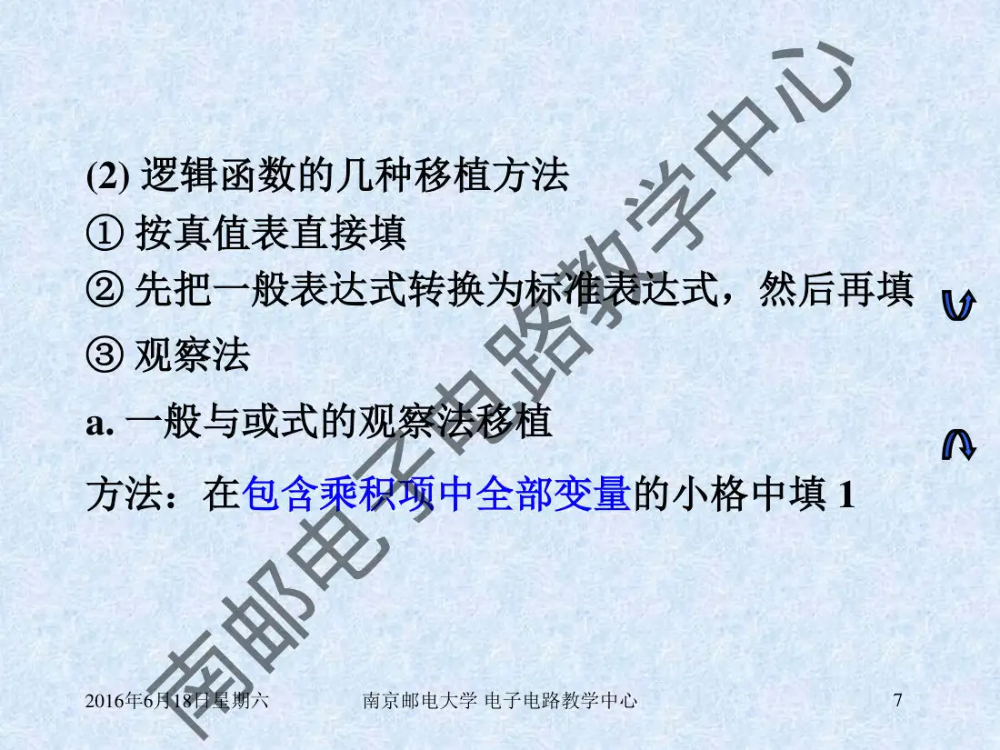

原文：

(2) 逻辑函数的几种移植方法

① 按真值表直接填

② 先把一般表达式转换为标准表达式，然后再填

③ 观察法

a. 一般与或式的观察法移植

方法：在包含乘积项中全部变量的小格中填 1例2.6.12 试将 $\mathbf { F ( A , B , C , D ) } = \mathbf { A B } \mathbf { \overline { { C } } } \mathbf { \overline { { D } } } + \mathbf { \overline { { A } } B D } + \mathbf { A C }$ 用卡诺图表示。

2016年6月18日星期六 南京邮电大学 电子电路教学中心

7

### 解：

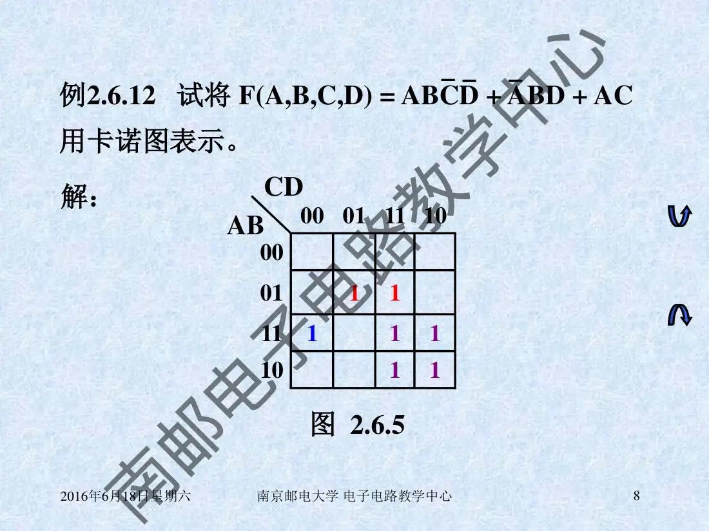

原文：

解：

图 2.6.5

2016年6月18日星期六

南京邮电大学 电子电路教学中心

8

### b. 一般或与式的观察法移植

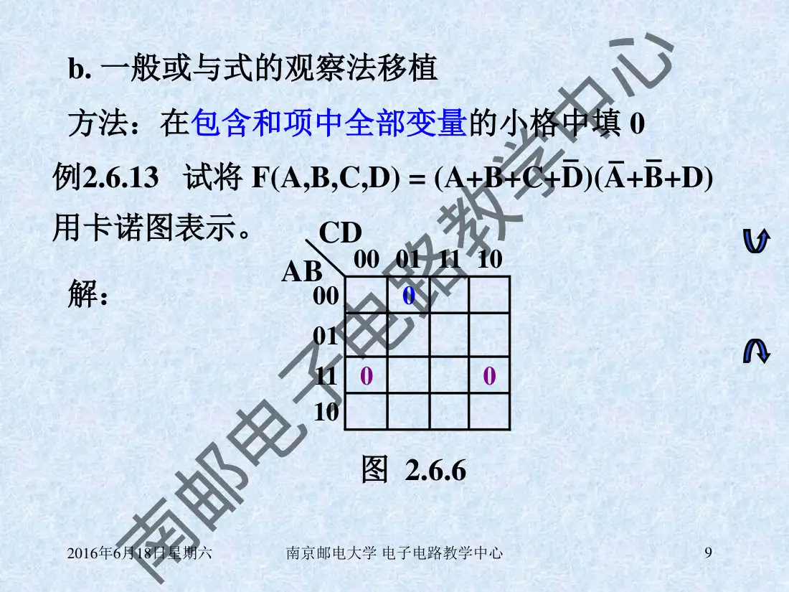

原文：

b. 一般或与式的观察法移植

方法：在包含和项中全部变量的小格中填 0

例2.6.13 试将 $\mathbf { F } ( \mathbf { A } , \mathbf { B } , \mathbf { C } , \mathbf { D } ) = ( \mathbf { A } + \mathbf { B } + \mathbf { C } + \mathbf { \overline { { D } } } ) ( \mathbf { \overline { { A } } } + \mathbf { \overline { { B } } } + \mathbf { D } )$ 用卡诺图表示。 CD

解：

2016年6月18日星期六

南京邮电大学 电子电路教学中心

9

### 2.卡诺图的运算

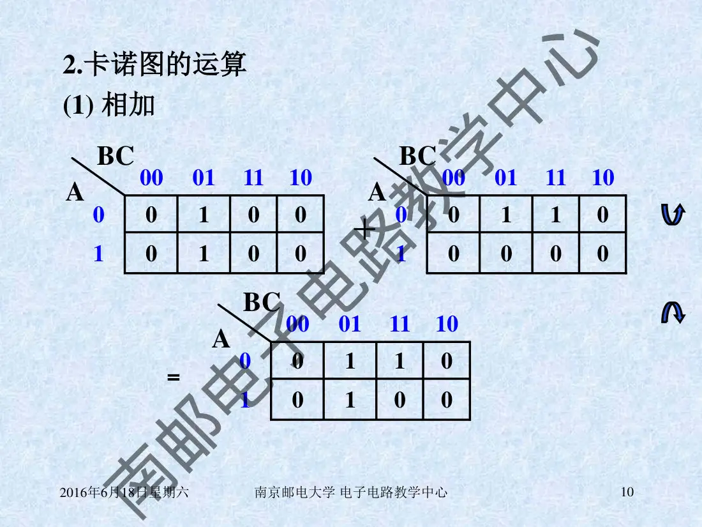

原文：

2.卡诺图的运算

(1) 相加

$$
\begin{array}{c c c c c} \text {BC} & 0 0 & 0 1 & 1 1 & 1 0 \\ \text {A} & 0 & 0 & 1 & 0 \\ & 1 & 0 & 1 & 0 \end{array}
$$

2016年6月18日星期六

南京邮电大学 电子电路教学中心

10

### A\BC0001111001100000

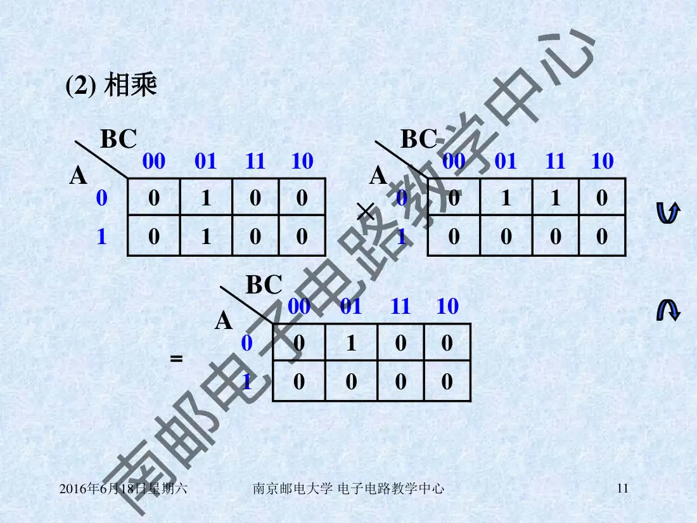

原文：

<table><tr><td rowspan="3">A\BC</td><td>00</td><td>01</td><td>11</td><td>10</td></tr><tr><td>0</td><td>1</td><td>1</td><td>0</td></tr><tr><td>0</td><td>0</td><td>0</td><td>0</td></tr></table>

(2) 相乘

<table><tr><td rowspan="3">A\BC</td><td>00</td><td>01</td><td>11</td><td>10</td></tr><tr><td>0</td><td>1</td><td>0</td><td>0</td></tr><tr><td>1</td><td>1</td><td>0</td><td>0</td></tr></table>

<table><tr><td rowspan="3">A\BC</td><td>00</td><td>01</td><td>11</td><td>10</td></tr><tr><td>0</td><td>1</td><td>0</td><td>0</td></tr><tr><td>0</td><td>0</td><td>0</td><td>0</td></tr></table>

2016年6月18日星期六

南京邮电大学 电子电路教学中心

11

### (3) 异或

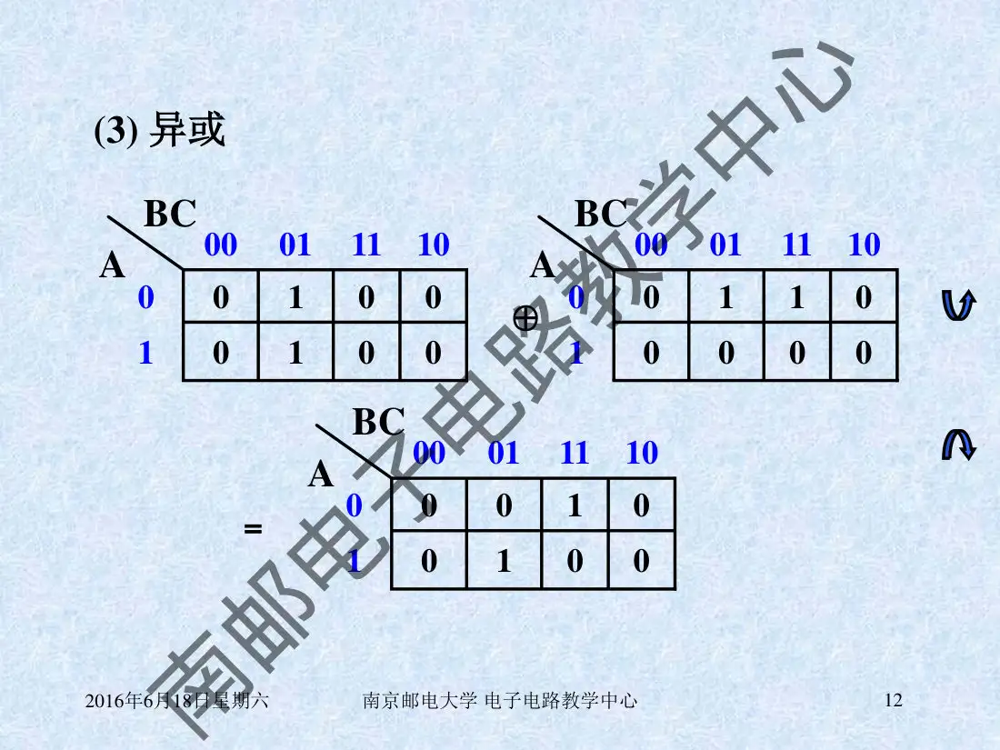

原文：

(3) 异或

A
<table><tr><td rowspan="3">A\BC</td><td>00</td><td>01</td><td>11</td><td>10</td></tr><tr><td>0</td><td>1</td><td>0</td><td>0</td></tr><tr><td>1</td><td>0</td><td>1</td><td>0</td></tr></table>

2016年6月18日星期六

南京邮电大学 电子电路教学中心

12

### (4) 反演

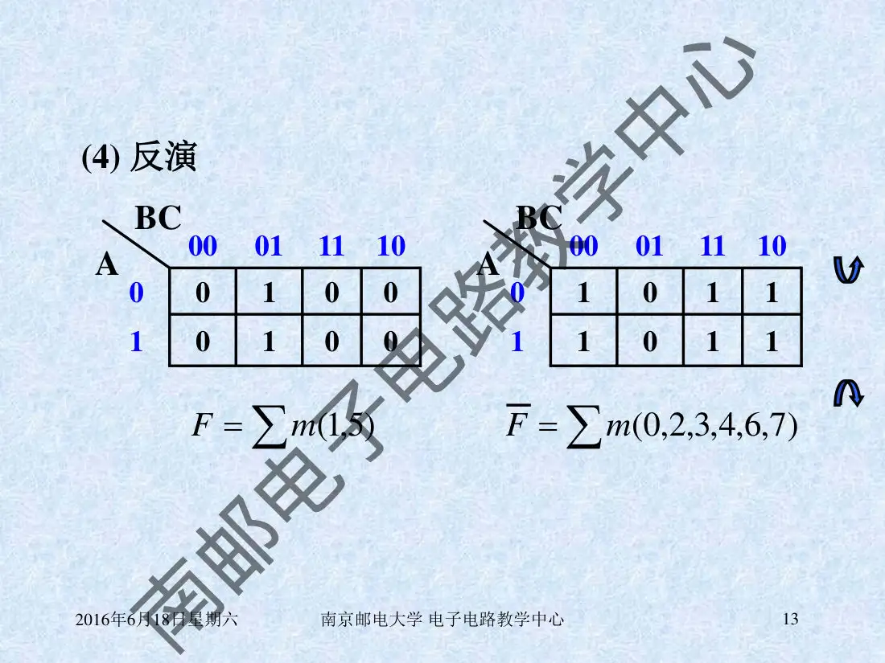

原文：

(4) 反演

<table><tr><td rowspan="3">A\BC</td><td>00</td><td>01</td><td>11</td><td>10</td></tr><tr><td>0</td><td>1</td><td>0</td><td>0</td></tr><tr><td>1</td><td>0</td><td>1</td><td>0</td></tr></table>

$$
F = \sum m (1, 5)
$$

<table><tr><td>00</td><td>01</td><td>11</td><td>10</td></tr><tr><td>1</td><td>0</td><td>1</td><td>1</td></tr><tr><td>1</td><td>0</td><td>1</td><td>1</td></tr></table>

$$
\overline {{F}} = \sum m (0, 2, 3, 4, 6, 7)
$$

2016年6月18日星期六

南京邮电大学 电子电路教学中心

13

### $$

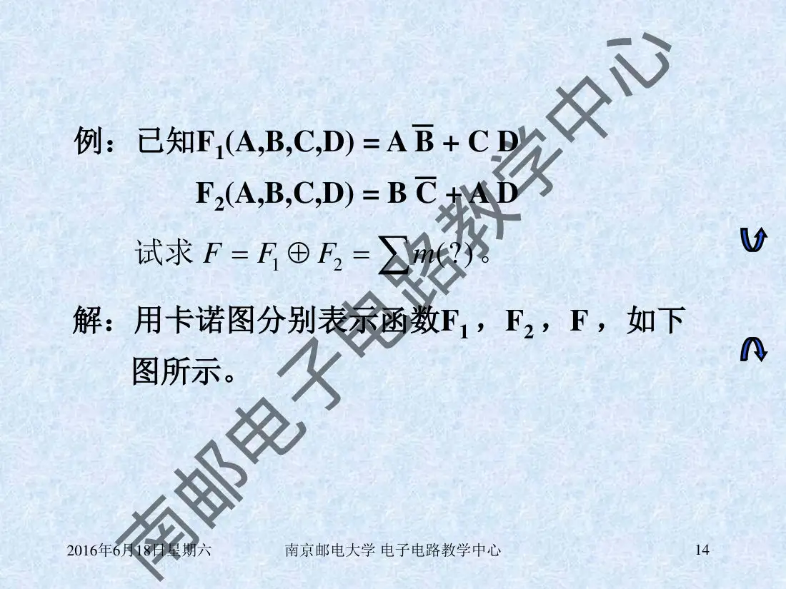

原文：

例：已知 $\mathbf { F } _ { 1 } ( \mathbf { A } , \mathbf { B } , \mathbf { C } , \mathbf { D } ) = \mathbf { A } \ \overline { { \mathbf { B } } } + \mathbf { C } \ \mathbf { D }$

$$
\mathbf {F} _ {2} (\mathbf {A}, \mathbf {B}, \mathbf {C}, \mathbf {D}) = \mathbf {B} \overline {{\mathbf {C}}} + \mathbf {A} \dot {\mathbf {D}}
$$

试求 $F = F _ { 1 } \oplus F _ { 2 } = \sum m ( ? ) { \stackrel { . } { \circ } }$

解：用卡诺图分别表示函数 $\mathbf { F _ { 1 } }$ ， $\mathbf { F } _ { 2 }$ ，F ，如下图所示。

2016年6月18日星期六

南京邮电大学 电子电路教学中心

14

### AB\CD00011110001011111101111

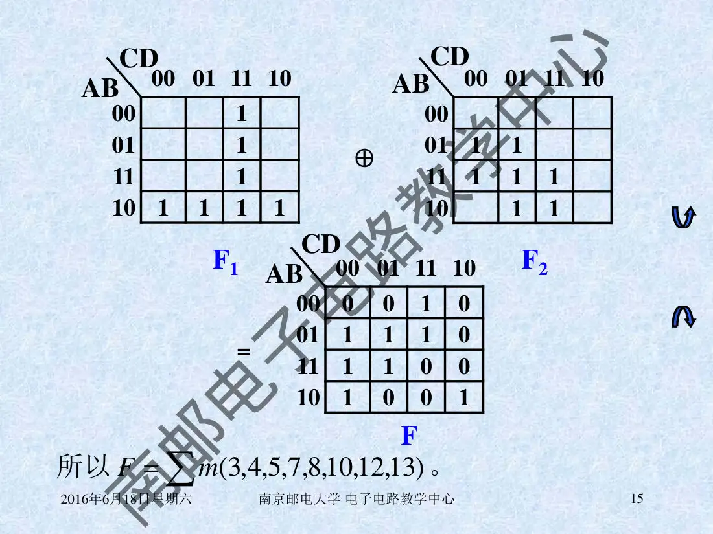

原文：

A
<table><tr><td>AB\CD</td><td>00</td><td>01</td><td>11</td><td>10</td></tr><tr><td>00</td><td></td><td></td><td>1</td><td></td></tr><tr><td>01</td><td></td><td></td><td>1</td><td></td></tr><tr><td>11</td><td></td><td></td><td>1</td><td></td></tr><tr><td>10</td><td>1</td><td>1</td><td>1</td><td>1</td></tr></table>

⊕
<table><tr><td>AB\CD</td><td>00</td><td>01</td><td>11</td><td>10</td></tr><tr><td>00</td><td></td><td></td><td></td><td></td></tr><tr><td>01</td><td>1</td><td>1</td><td></td><td></td></tr><tr><td>11</td><td>1</td><td>1</td><td>1</td><td></td></tr><tr><td>10</td><td></td><td>1</td><td>1</td><td></td></tr></table>

<table><tr><td>AB\</td><td>00</td><td>01</td><td>11</td><td>10</td></tr><tr><td>00</td><td>0</td><td>0</td><td>1</td><td>0</td></tr><tr><td>01</td><td>1</td><td>1</td><td>1</td><td>0</td></tr><tr><td>11</td><td>1</td><td>1</td><td>0</td><td>0</td></tr><tr><td>10</td><td>1</td><td>0</td><td>0</td><td>1</td></tr></table>

F

所以 = ∑mF ,8,7,5,4,3( 10,12,13)。

2016年6月18日星期六

南京邮电大学 电子电路教学中心

15

### $$

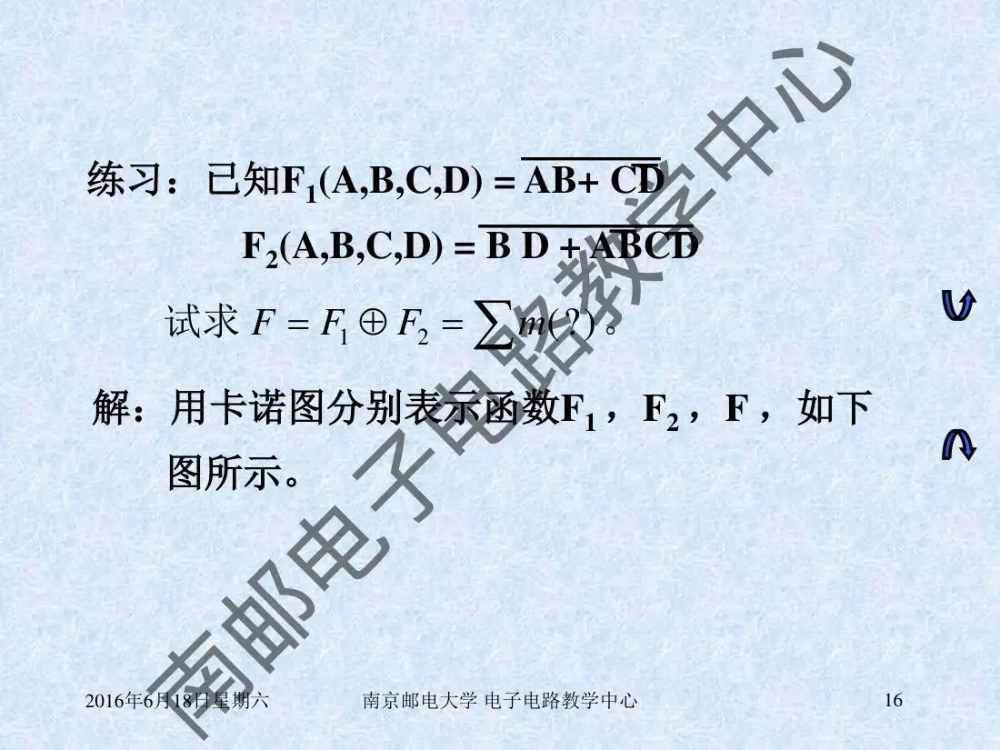

原文：

练习：已知 $\mathbf { F _ { 1 } } ( \mathbf { A } , \mathbf { B } , \mathbf { C } , \mathbf { D } ) = \mathbf { \overline { { A } } } \mathbf { B } + \mathbf { C } \mathbf { \overline { { D } } }$

$$
\mathbf {F} _ {2} (\mathbf {A}, \mathbf {B}, \mathbf {C}, \mathbf {D}) = \overline {{\mathbf {B D} + \mathbf {A B C D}}}
$$

试求 $F = F _ { 1 } \oplus F _ { 2 } = \sum m ( - 2 ) \times$

解：用卡诺图分别表示函数 $\mathbf { F _ { 1 } }$ ， $\mathbf { F } _ { 2 }$ ，F ，如下图所示。

2016年6月18日星期六 南京邮电大学 电子电路教学中心

16

### AB\CD0001111000111011111110111

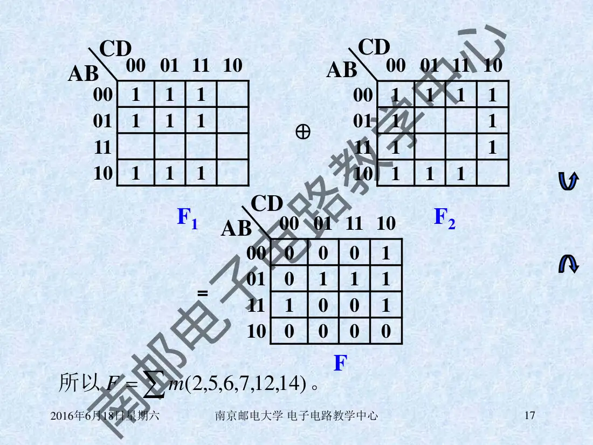

原文：

<table><tr><td>AB\CD</td><td>00</td><td>01</td><td>11</td><td>10</td></tr><tr><td>00</td><td>1</td><td>1</td><td>1</td><td></td></tr><tr><td>01</td><td>1</td><td>1</td><td>1</td><td></td></tr><tr><td>11</td><td></td><td></td><td></td><td></td></tr><tr><td>10</td><td>1</td><td>1</td><td>1</td><td></td></tr></table>

⊕
<table><tr><td>AB\CD</td><td>00</td><td>01</td><td>11</td><td>10</td></tr><tr><td>00</td><td>1</td><td>1</td><td>1</td><td>1</td></tr><tr><td>01</td><td>1</td><td></td><td></td><td>1</td></tr><tr><td>11</td><td>1</td><td></td><td></td><td>1</td></tr><tr><td>10</td><td>1</td><td>1</td><td>1</td><td></td></tr></table>

<table><tr><td>AB\</td><td>00</td><td>01</td><td>11</td><td>10</td></tr><tr><td>00</td><td>0</td><td>0</td><td>0</td><td>1</td></tr><tr><td>01</td><td>0</td><td>1</td><td>1</td><td>1</td></tr><tr><td>11</td><td>1</td><td>0</td><td>0</td><td>1</td></tr><tr><td>10</td><td>0</td><td>0</td><td>0</td><td>0</td></tr></table>

F

所以 = ∑ mF ,7,6,5,2( 12,14)。

2016年6月18日星期六

南京邮电大学 电子电路教学中心

17

### $$

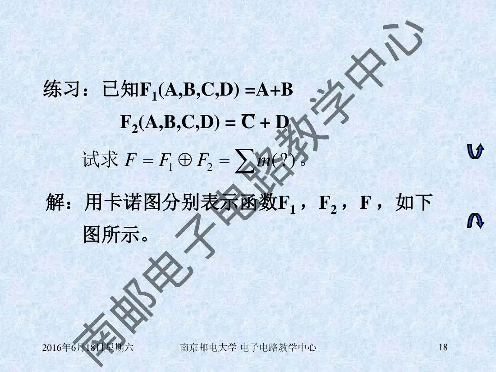

原文：

练习：已知 $\mathbf { F } _ { 1 } ( \mathbf { A } , \mathbf { B } , \mathbf { C } , \mathbf { D } ) = \mathbf { A } + \mathbf { B }$

$$
\mathbf {F} _ {2} (\mathbf {A}, \mathbf {B}, \mathbf {C}, \mathbf {D}) = \mathbf {\overline {{C}}} + \mathbf {D}
$$

试求 $F = F _ { 1 } \oplus F _ { 2 } = \sum m \odot 3 \cdot$

解：用卡诺图分别表示函数 $\mathbf { F _ { 1 } }$ ， $\mathbf { F } _ { 2 }$ ，F ，如下图所示。

2016年6月18日星期六

南京邮电大学 电子电路教学中心

18

### F2 A

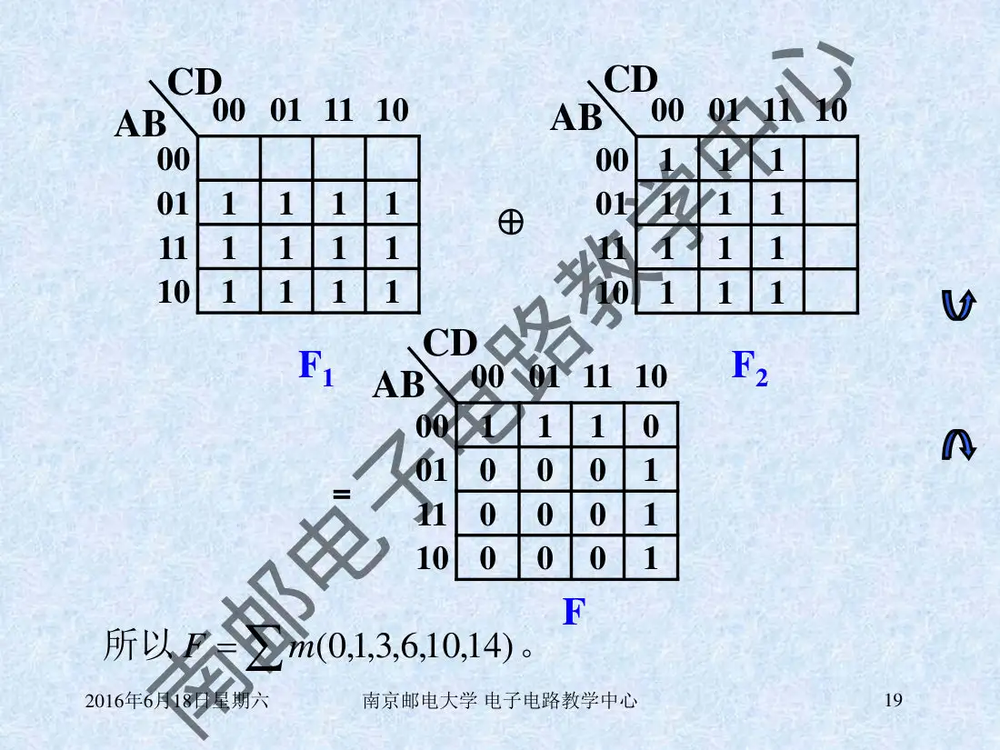

原文：

F2 A
<table><tr><td>AB\CD</td><td>00</td><td>01</td><td>11</td><td>10</td></tr><tr><td>00</td><td></td><td></td><td></td><td></td></tr><tr><td>01</td><td>1</td><td>1</td><td>1</td><td>1</td></tr><tr><td>11</td><td>1</td><td>1</td><td>1</td><td>1</td></tr><tr><td>10</td><td>1</td><td>1</td><td>1</td><td>1</td></tr></table>

⊕
<table><tr><td>AB\CD</td><td>00</td><td>01</td><td>11</td><td>10</td></tr><tr><td>00</td><td>1</td><td>1</td><td>1</td><td></td></tr><tr><td>01</td><td>1</td><td>1</td><td>1</td><td></td></tr><tr><td>11</td><td>1</td><td>1</td><td>1</td><td></td></tr><tr><td>10</td><td>1</td><td>1</td><td>1</td><td></td></tr></table>

<table><tr><td>AB\</td><td>00</td><td>01</td><td>11</td><td>10</td></tr><tr><td>00</td><td>1</td><td>1</td><td>1</td><td>0</td></tr><tr><td>01</td><td>0</td><td>0</td><td>0</td><td>1</td></tr><tr><td>11</td><td>0</td><td>0</td><td>0</td><td>1</td></tr><tr><td>10</td><td>0</td><td>0</td><td>0</td><td>1</td></tr></table>

所以 = ∑ mF ,6,3,1,0( 10,14)。

F

2016年6月18日星期六

南京邮电大学 电子电路教学中心

19

### 3. 卡诺图化简法

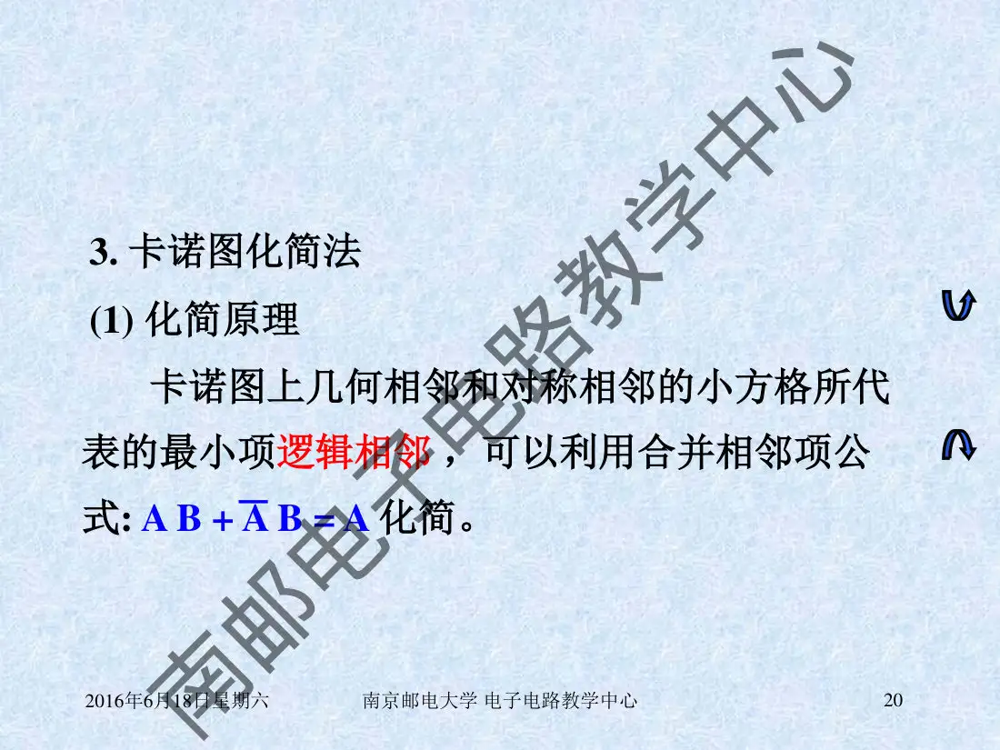

原文：

3. 卡诺图化简法

(1) 化简原理

卡诺图上几何相邻和对称相邻的小方格所代表的最小项逻辑相邻 ，可以利用合并相邻项公式: $A B + \overline { A } B = A$ 化简。

2016年6月18日星期六

南京邮电大学 电子电路教学中心

20

### $$

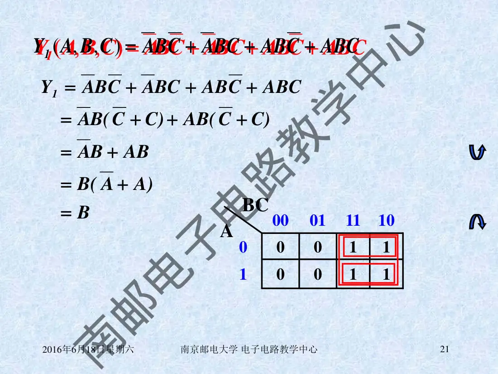

原文：

$$
\begin{array}{r l} & Y _ {1} (A, B, C) = \overline {{A}} \overline {{B}} \overline {{C}} + \overline {{A}} \overline {{B}} \overline {{C}} + A \overline {{B}} \overline {{C}} + A \overline {{B}} \overline {{C}} \\ & Y _ {1} = \overline {{A}} \overline {{B}} \overline {{C}} + \overline {{A}} \overline {{B}} \overline {{C}} + A \overline {{B}} \overline {{C}} + A \overline {{B}} \overline {{C}} \\ & = \overline {{A}} \overline {{B}} (\overline {{C}} + C) + A \overline {{B}} (\overline {{C}} + C) \\ & = \overline {{A}} \overline {{B}} + A \overline {{B}} \\ & = B (\overline {{A}} + A) \\ & = B \\ & \text {BC} \\ & A \quad 0 0 \quad 0 1 \quad 1 1 \quad 1 0 \\ & 0 \quad 0 \quad 1 \quad 1 \\ & 1 \quad 0 \quad 0 \quad 1 \quad 1 \end{array}\tag{U}
$$

2016年6月18日星期六

南京邮电大学 电子电路教学中心

21

### (2) 合并的对象

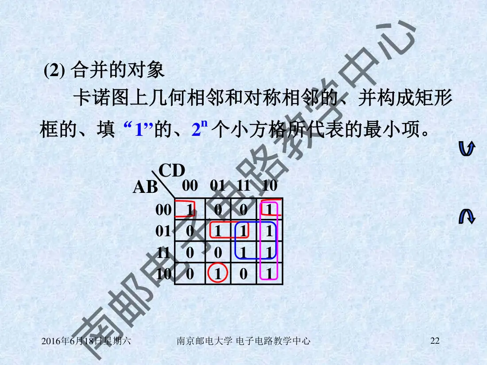

原文：

(2) 合并的对象

卡诺图上几何相邻和对称相邻的、并构成矩形框的、填“1”的、2n 个小方格所代表的最小项。

2016年6月18日星期六

南京邮电大学 电子电路教学中心

22

### (3) 合并项的写法

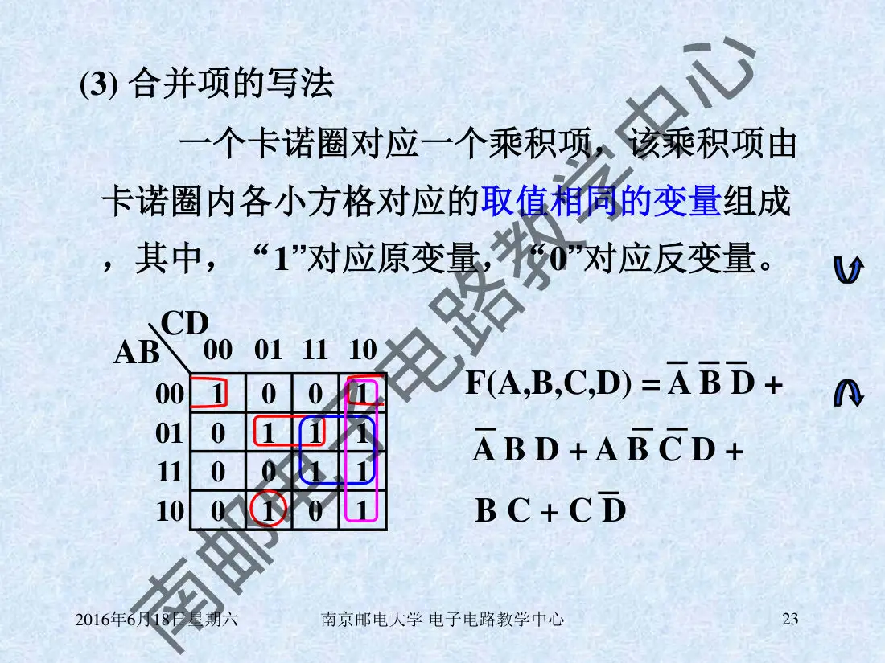

原文：

(3) 合并项的写法

一个卡诺圈对应一个乘积项，该乘积项由卡诺圈内各小方格对应的取值相同的变量组成，其中，“1”对应原变量，“0”对应反变量。

CD AB 00 01 11 10 X 00 0 0 1 F(A,B,C,D) = A B D + A 01 0 1 1 1 A B D + A B C D + 11 0 0 1 10 0 0 B C + C D

2016年6月18日星期六

南京邮电大学 电子电路教学中心

23

### (4) 合并的规律

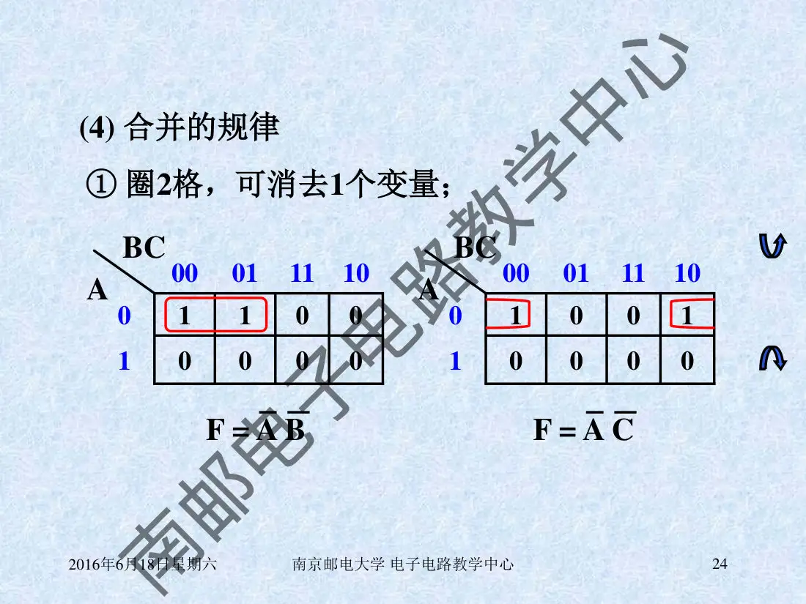

原文：

(4) 合并的规律

① 圈2格，可消去1个变量；

<table><tr><td rowspan="3">A\BC</td><td>00</td><td>01</td><td>11</td><td>10</td></tr><tr><td>0</td><td>1</td><td>1</td><td>0</td></tr><tr><td>1</td><td>0</td><td>0</td><td>0</td></tr></table>

F = A B

<table><tr><td>00</td><td>01</td><td>11</td><td>10</td></tr><tr><td>1</td><td>0</td><td>0</td><td>1</td></tr><tr><td>0</td><td>0</td><td>0</td><td>0</td></tr></table>
F = A C

2016年6月18日星期六

南京邮电大学 电子电路教学中心

24

### ② 圈4格，可消去2个变量；

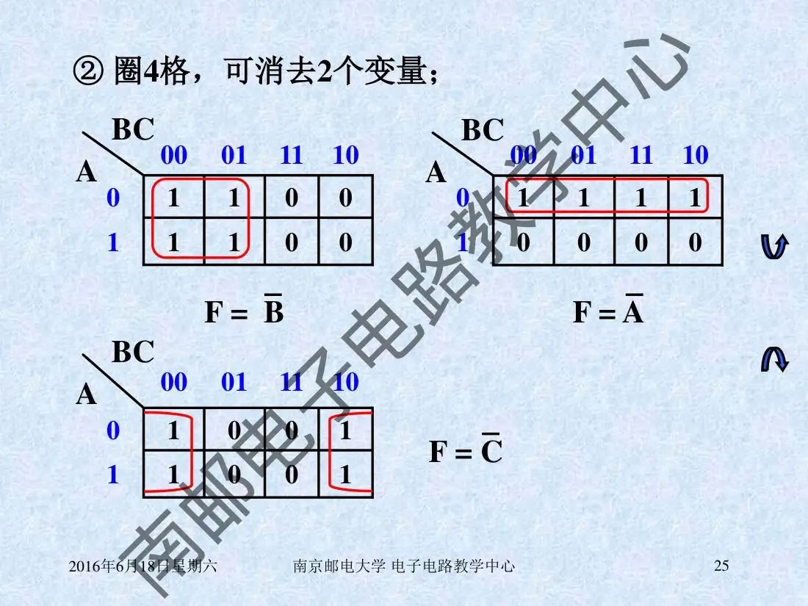

原文：

② 圈4格，可消去2个变量；

<table><tr><td>A\BC</td><td>00</td><td>01</td><td>11</td><td>10</td></tr><tr><td>0</td><td>1</td><td>1</td><td>0</td><td>0</td></tr><tr><td>1</td><td>1</td><td>1</td><td>0</td><td>0</td></tr></table>

$$
\mathbf {F} = \overline {{\mathbf {B}}}
$$

F = C

2016年6月18日星期六

南京邮电大学 电子电路教学中心

25

### AB\CD00011110000110011001111001100110

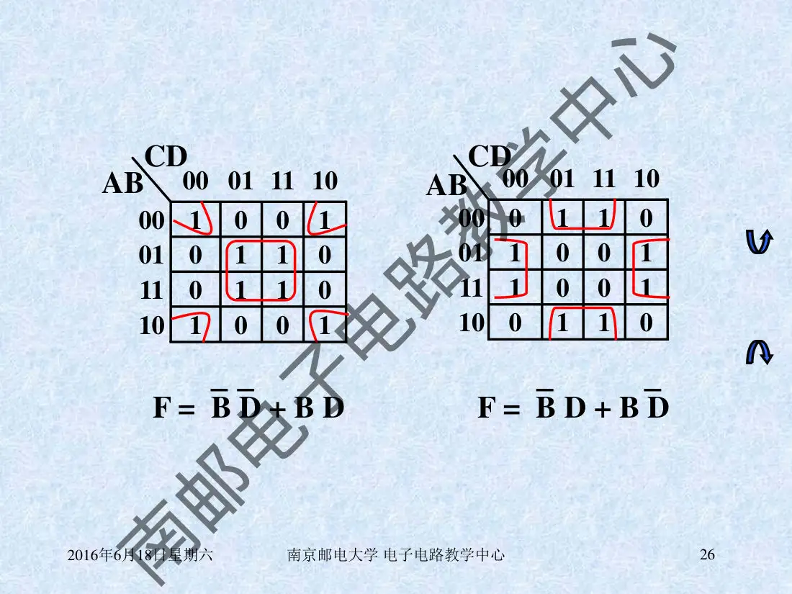

原文：

<table><tr><td>AB\CD</td><td>00</td><td>01</td><td>11</td><td>10</td></tr><tr><td>00</td><td>0</td><td>1</td><td>1</td><td>0</td></tr><tr><td>01</td><td>1</td><td>0</td><td>0</td><td>1</td></tr><tr><td>11</td><td>1</td><td>0</td><td>0</td><td>1</td></tr><tr><td>10</td><td>0</td><td>1</td><td>1</td><td>0</td></tr></table>
F = B D + B D

2016年6月18日星期六

南京邮电大学 电子电路教学中心

26

### ③ 圈8格，可消去3个变量；

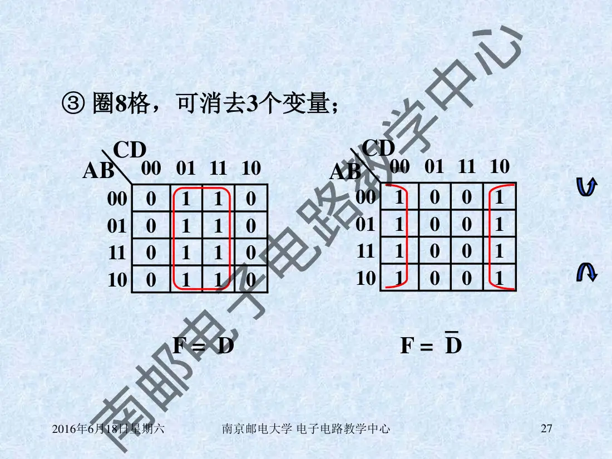

原文：

③ 圈8格，可消去3个变量；

<table><tr><td>AB\CD</td><td>00</td><td>01</td><td>11</td><td>10</td></tr><tr><td>00</td><td>0</td><td>1</td><td>1</td><td>0</td></tr><tr><td>01</td><td>0</td><td>1</td><td>1</td><td>0</td></tr><tr><td>11</td><td>0</td><td>1</td><td>1</td><td>0</td></tr><tr><td>10</td><td>0</td><td>1</td><td>1</td><td>0</td></tr></table>

F = D

2016年6月18日星期六

南京邮电大学 电子电路教学中心

27

### 结论：圈2i个相邻最小项，可消去 i 个变量(i = 0,1,2…)

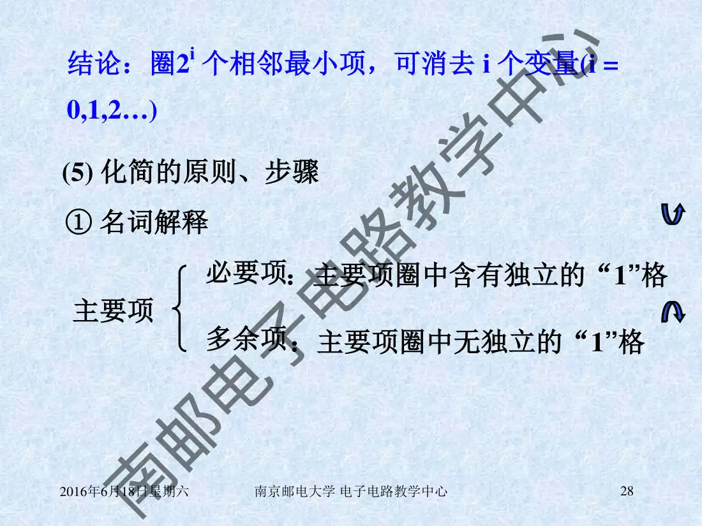

原文：

结论：圈2i个相邻最小项，可消去 i 个变量(i = 0,1,2…)

(5) 化简的原则、步骤

① 名词解释

必要项：主要项圈中含有独立的“1”格主要项 A多余项： 主要项圈中无独立的“1”格

2016年6月18日星期六 南京邮电大学 电子电路教学中心

28

### A\BC0001111001001100

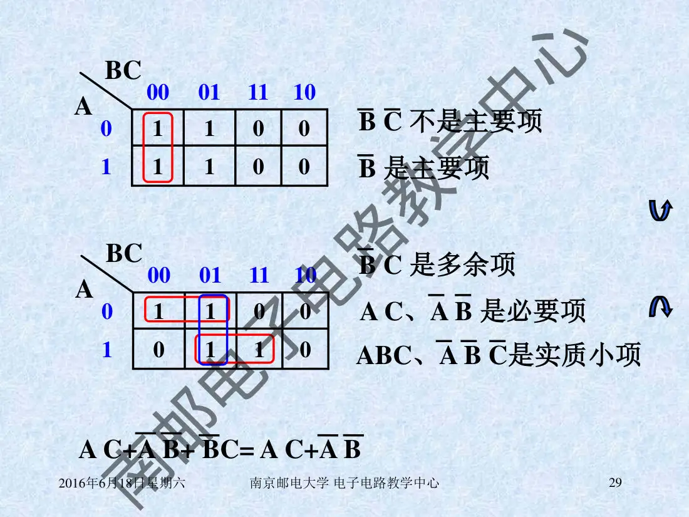

原文：

<table><tr><td rowspan="3">A\BC</td><td>00</td><td>01</td><td>11</td><td>10</td></tr><tr><td>0</td><td>1</td><td>0</td><td>0</td></tr><tr><td>1</td><td>1</td><td>0</td><td>0</td></tr></table>

A $\mathbf { C } + \mathbf { \overline { { A } } } \ \mathbf { \overline { { B } } } + \mathbf { \overline { { B } } } \mathbf { C } = \mathbf { A } \ \mathbf { C } + \mathbf { \overline { { A } } } \ \mathbf { \overline { { B } } }$

B C 不是主要项

B 是主要项

B C 是多余项

A C、 $\overline { { \mathbf { A } } } \overline { { \mathbf { B } } }$ 是必要项 AABC、A B C是实质小项

2016年6月18日星期六

南京邮电大学 电子电路教学中心

29

### ② 圈卡诺圈的原则

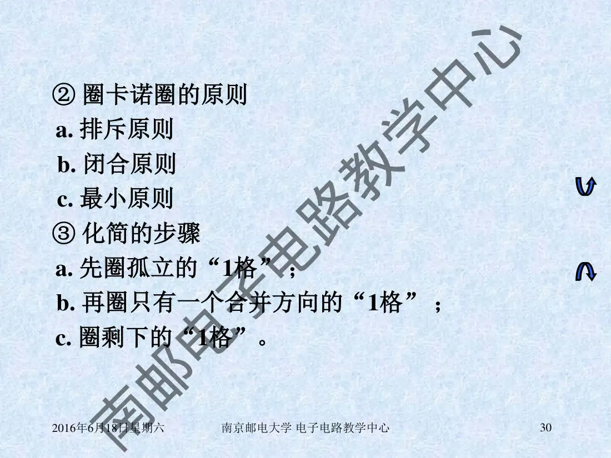

原文：

② 圈卡诺圈的原则

a. 排斥原则

b. 闭合原则

c. 最小原则

③ 化简的步骤

a. 先圈孤立的“1格”

b. 再圈只有一个合并方向的“1格” ；

c. 圈剩下的“1格”。

南京邮电大学 电子电路教学中心

30

### 注意：

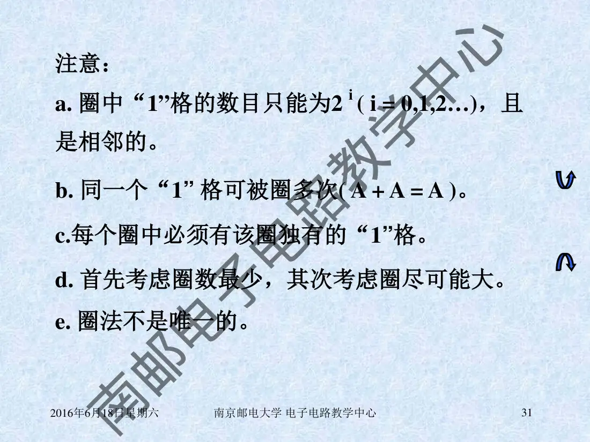

原文：

注意：

a. 圈中“1”格的数目只能为2 i ( i = 0,1,2…)，且是相邻的。

b. 同一个“1” 格可被圈多次( A + A = A )。

c.每个圈中必须有该圈独有的“1”格。

d. 首先考虑圈数最少，其次考虑圈尽可能大。

e. 圈法不是唯一的。

2016年6月18日星期六

南京邮电大学 电子电路教学中心

31

### (6) 化简举例

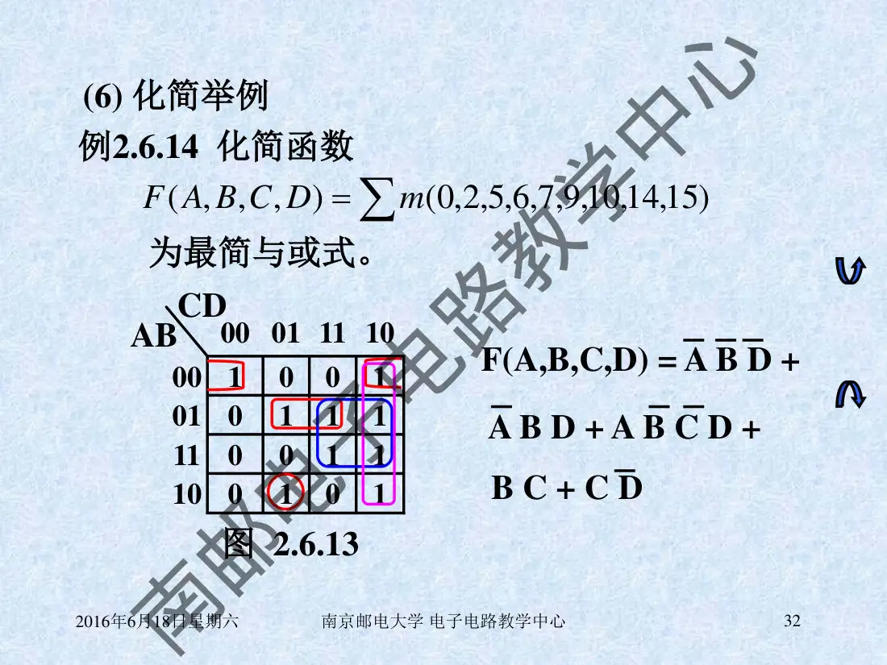

原文：

(6) 化简举例

例2.6.14 化简函数

$$
F (A, B, C, D) = \sum m (0, 2, 5, 6, 7, 9, 1 0, 1 4, 1 5)
$$

为最简与或式。

<table><tr><td>AB\CD</td><td>00</td><td>01</td><td>11</td><td>10</td></tr><tr><td>00</td><td>1</td><td>0</td><td>0</td><td>1</td></tr><tr><td>01</td><td>0</td><td>1</td><td>1</td><td>1</td></tr><tr><td>11</td><td>0</td><td>0</td><td>1</td><td>1</td></tr><tr><td>10</td><td>0</td><td>1</td><td>0</td><td>1</td></tr></table>

图 2.6.13

$$
\begin{array}{l} \mathbf {F} (\mathbf {A}, \mathbf {B}, \mathbf {C}, \mathbf {D}) = \overline {{\mathbf {A}}} \overline {{\mathbf {B}}} \overline {{\mathbf {D}}} + \\ \overline {{\mathbf {A}}} \mathbf {B} \mathbf {D} + \mathbf {A} \overline {{\mathbf {B}}} \overline {{\mathbf {C}}} \mathbf {D} + \\ \mathbf {B} \mathbf {C} + \mathbf {C} \overline {{\mathbf {D}}} \end{array}
$$

2016年6月18日星期六

南京邮电大学 电子电路教学中心

32

### 例2.6.16 化简函数

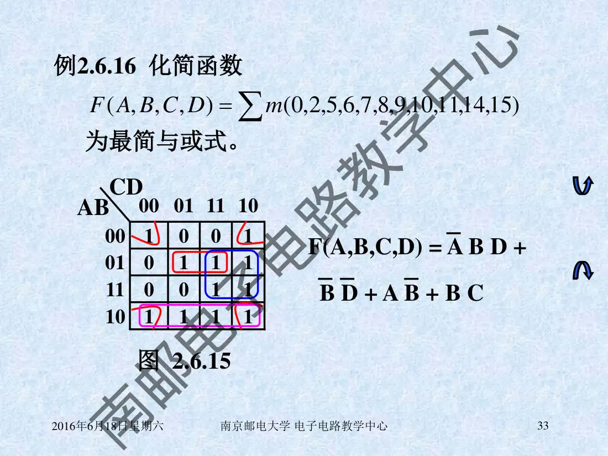

原文：

例2.6.16 化简函数

$F ( A , B , C , D ) = \sum m ( 0 , 2 , 5 , 6 , 7 , 8 , 9 , 1 0 , 1 1 , 1 4 , 1 5 )$ 为最简与或式。

$$
\begin{array}{c c c c c} \text {AB} & 0 0 & 0 1 & 1 1 & 1 0 \\ \hline 0 0 & 1 & 0 & 0 & 1 \\ \hline 0 1 & 0 & 1 & 1 & 1 \\ \hline 1 1 & 0 & 0 & 1 & 1 \\ \hline 1 0 & 1 & 1 & 1 & 1 \end{array}
$$

图 2.6.15

$$
\begin{array}{r l} & {\mathbf {F} (\mathbf {A}, \mathbf {B}, \mathbf {C}, \mathbf {D}) = \overline {{\mathbf {A}}} \mathbf {B} \mathbf {D} +} \\ & {\overline {{\mathbf {B}}} \overline {{\mathbf {D}}} + \mathbf {A} \overline {{\mathbf {B}}} + \mathbf {B} \mathbf {C}} \end{array}
$$

2016年6月18日星期六

南京邮电大学 电子电路教学中心

33

### 例：

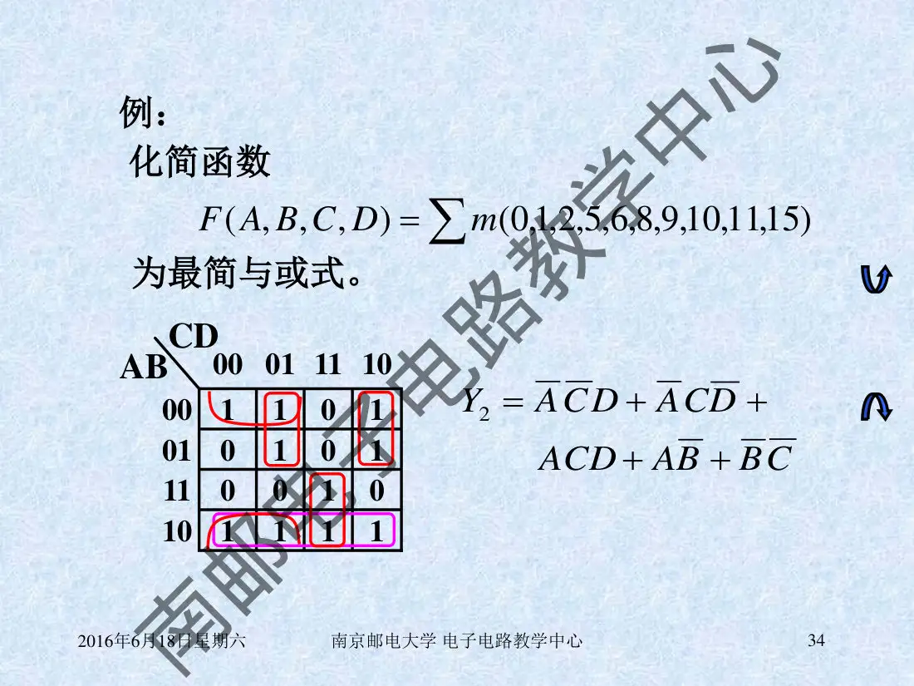

原文：

例：

化简函数

$F ( A , B , C , D ) = \sum m ( 0 , 1 / 2 , 5 , 6 , 8 , 9 , 1 0 , 1 1 , 1 5 )$ 为最简与或式。

$$
\begin{array}{c c c c c} \text {AB} & 0 0 & 0 1 & 1 1 & 1 0 \\ \hline 0 0 & 1 & 1 & 0 & 1 \\ \hline 0 1 & 0 & 1 & 0 & 1 \\ \hline 1 1 & 0 & 0 & 1 & 0 \\ \hline 1 0 & 1 & 1 & 1 & 1 \end{array}
$$

$$
\begin{array}{r} Y _ {2} = \overline {{A}} \overline {{C}} D + \overline {{A}} C \overline {{D}} + \\ A C D + A \overline {{B}} + \overline {{B}} \overline {{C}} \end{array}
$$

2016年6月18日星期六

南京邮电大学 电子电路教学中心

34

### 卡诺图表示练习1：

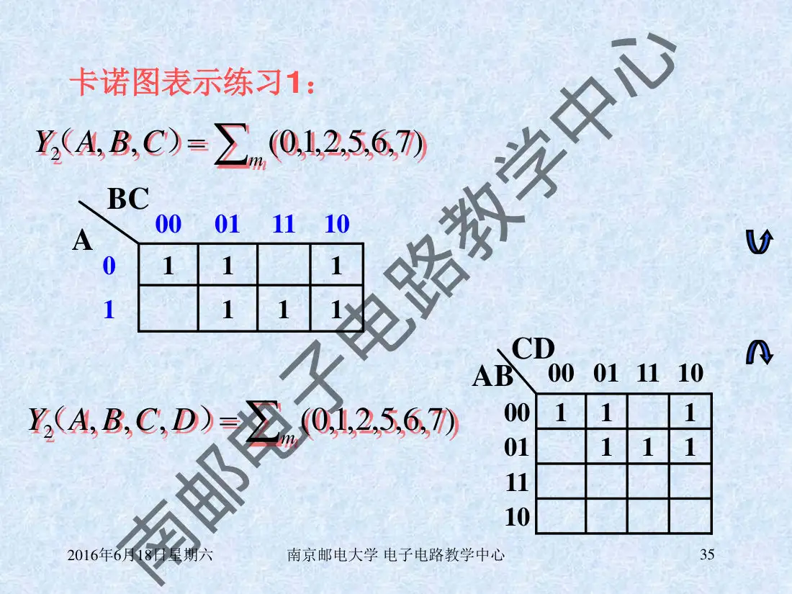

原文：

卡诺图表示练习1：

$$
Y _ {2} (A, B, C) \equiv \sum_ {m} (0, 1, 2, 5, 6, 7)
$$

<table><tr><td rowspan="3">A\BC</td><td>00</td><td>01</td><td>11</td><td>10</td></tr><tr><td>0</td><td>1</td><td>1</td><td>1</td></tr><tr><td>1</td><td></td><td>1</td><td>1</td></tr></table>

$$
Y _ {2} (A, B, C, D) \equiv \sum_ {m} (0, 1, 2, 5, 6, 7)
$$

<table><tr><td>AB\CD</td><td>00</td><td>01</td><td>11</td><td>10</td></tr><tr><td>00</td><td>1</td><td>1</td><td></td><td>1</td></tr><tr><td>01</td><td></td><td>1</td><td>1</td><td>1</td></tr><tr><td>11</td><td></td><td></td><td></td><td></td></tr><tr><td>10</td><td></td><td></td><td></td><td></td></tr></table>

2016年6月18日星期六

南京邮电大学 电子电路教学中心

35

### 卡诺图表示练习2：

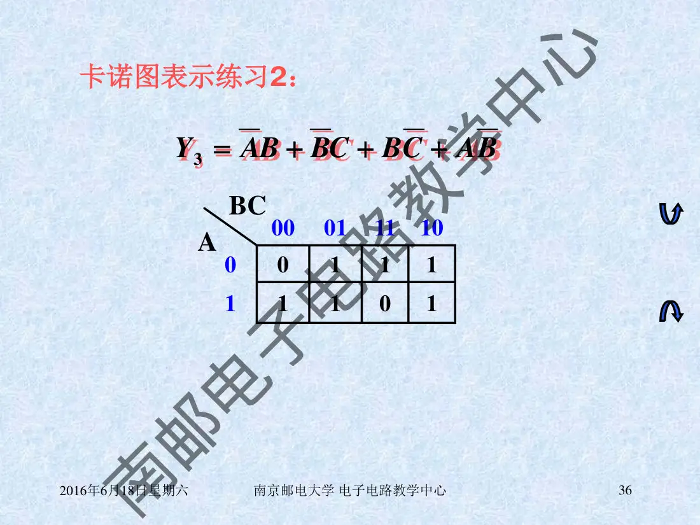

原文：

卡诺图表示练习2：

$$
Y _ {3} = \overline {{A}} B + \overline {{B}} C + B \overline {{C}} + A \overline {{B}}
$$

2016年6月18日星期六

南京邮电大学 电子电路教学中心

36

### 卡诺图表示练习3：

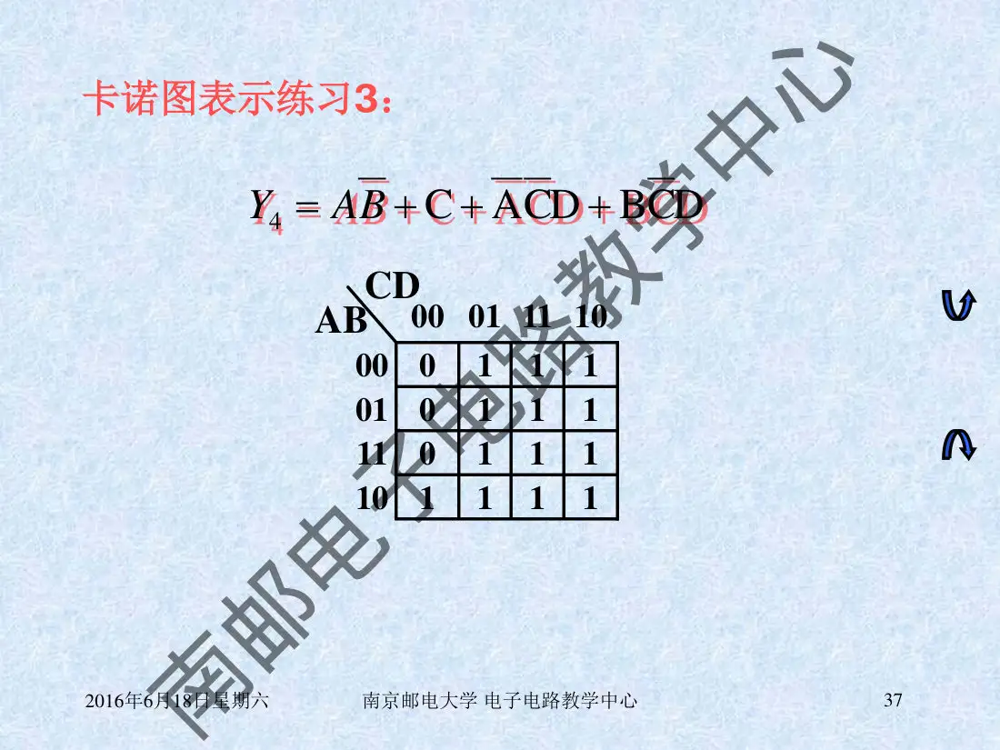

原文：

卡诺图表示练习3：

$$
Y _ {4} \equiv A \overline {{B}} + C + \overline {{A}} \overline {{C}} D + B \overline {{C}} D
$$

<table><tr><td>AB\CD</td><td>00</td><td>01</td><td>11</td><td>10</td></tr><tr><td>00</td><td>0</td><td>1</td><td>1</td><td>1</td></tr><tr><td>01</td><td>0</td><td>1</td><td>1</td><td>1</td></tr><tr><td>11</td><td>0</td><td>1</td><td>1</td><td>1</td></tr><tr><td>10</td><td>1</td><td>1</td><td>1</td><td>1</td></tr></table>

2016年6月18日星期六

南京邮电大学 电子电路教学中心

37

### 圈卡诺图练习1：

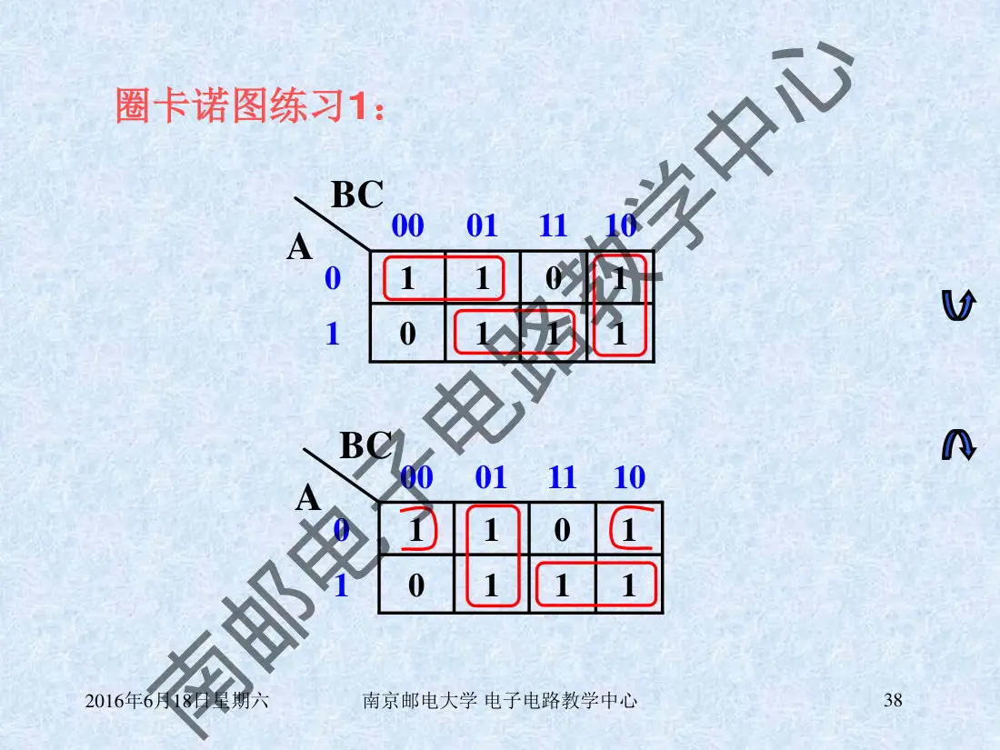

原文：

圈卡诺图练习1：

2016年6月18日星期六

南京邮电大学 电子电路教学中心

38

### 圈卡诺图练习2 ：

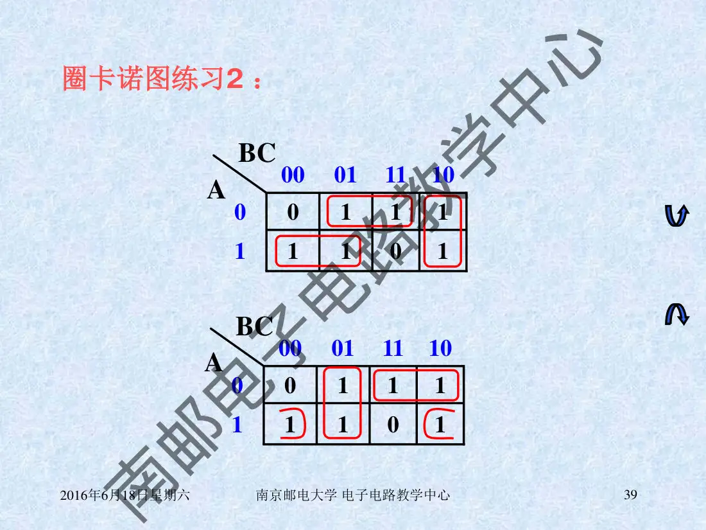

原文：

圈卡诺图练习2 ：

2016年6月18日星期六

南京邮电大学 电子电路教学中心

39

### 圈卡诺图练习3 ：

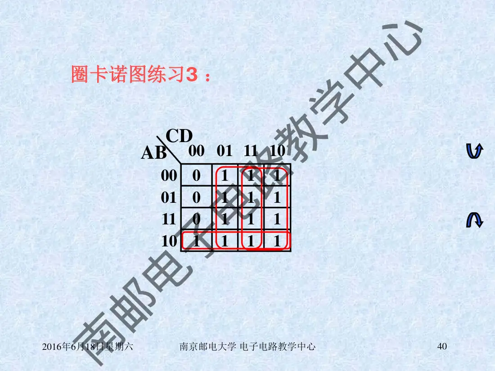

原文：

圈卡诺图练习3 ：

<table><tr><td>AB\CD</td><td>00</td><td>01</td><td>11</td><td>10</td></tr><tr><td>00</td><td>0</td><td>1</td><td>1</td><td>1</td></tr><tr><td>01</td><td>0</td><td>1</td><td>1</td><td>1</td></tr><tr><td>11</td><td>0</td><td>1</td><td>1</td><td>1</td></tr><tr><td>10</td><td>1</td><td>1</td><td>1</td><td>1</td></tr></table>

2016年6月18日星期六

南京邮电大学 电子电路教学中心

40

### 写表达式练习1：

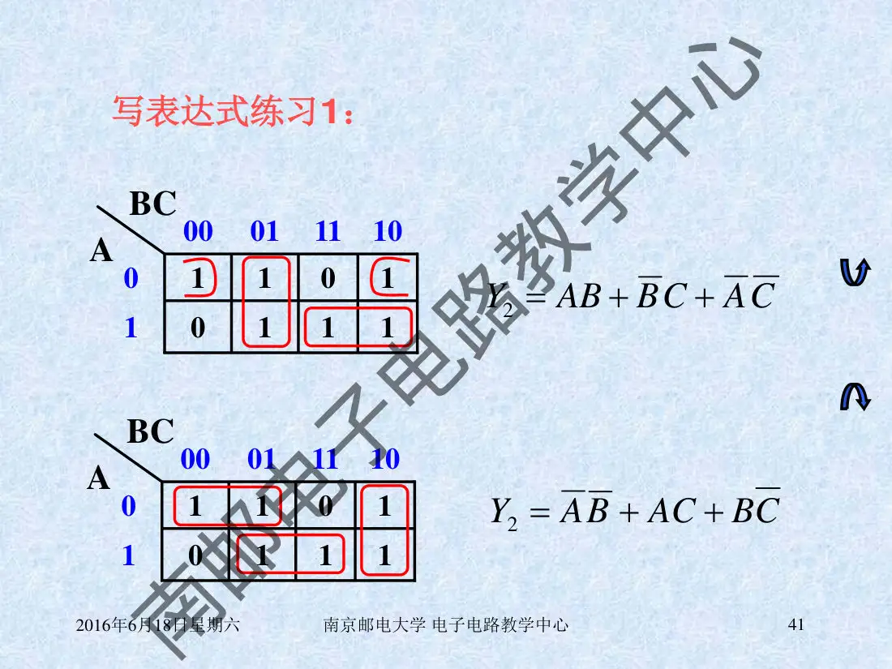

原文：

写表达式练习1：

<table><tr><td rowspan="3">A\BC</td><td>00</td><td>01</td><td>11</td><td>10</td></tr><tr><td>0</td><td>1</td><td>0</td><td>1</td></tr><tr><td>1</td><td>0</td><td>1</td><td>1</td></tr></table>

$$
Y _ {2} = \overline {{A}} \overline {{B}} + A C + B \overline {{C}}
$$

2016年6月18日星期六

南京邮电大学 电子电路教学中心

41

### 写表达式练习2：

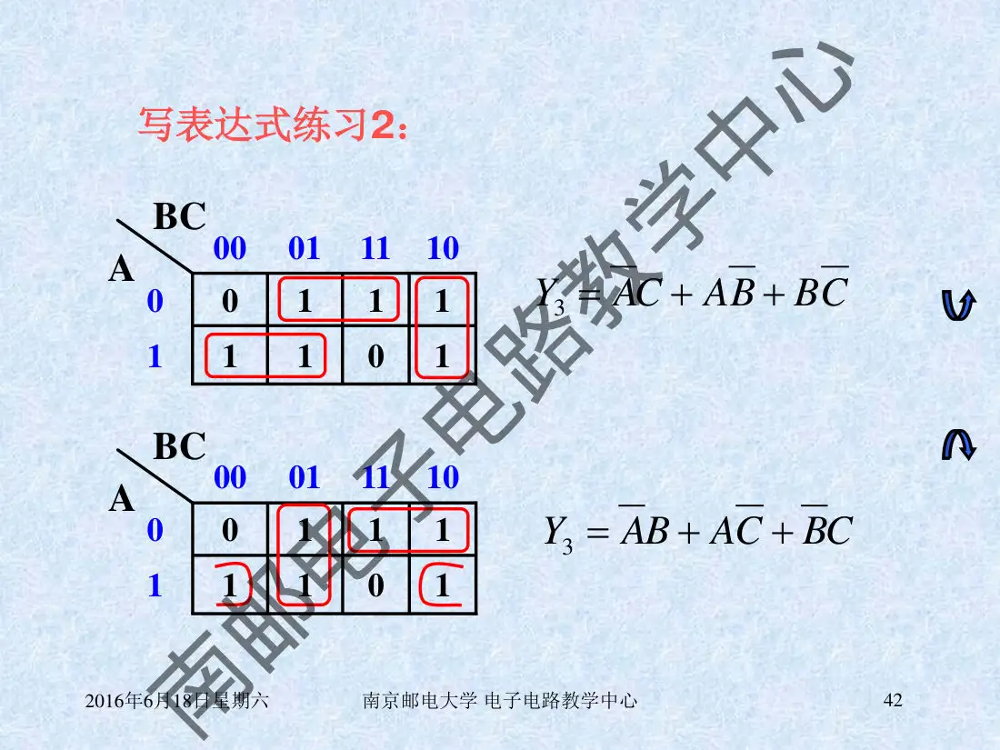

原文：

U

写表达式练习2：

$$
\begin{array}{c c c c c} \text {BC} & 0 0 & 0 1 & 1 1 & 1 0 \\ \hline A & 0 & 1 & 1 & 1 \\ \hline & 1 & 1 & 0 & 1 \end{array}
$$

$$
\begin{array}{c c c c c} \text {BC} & 0 0 & 0 1 & 1 1 & 1 0 \\ \hline A & 0 & 1 & 1 & 1 \\ \hline & 1 & 1 & 0 & 1 \end{array}
$$

$$
Y _ {3} = \overline {{A}} B + A \overline {{C}} + \overline {{B}} C
$$

2016年6月18日星期六

南京邮电大学 电子电路教学中心

42

### 写表达式练习3：

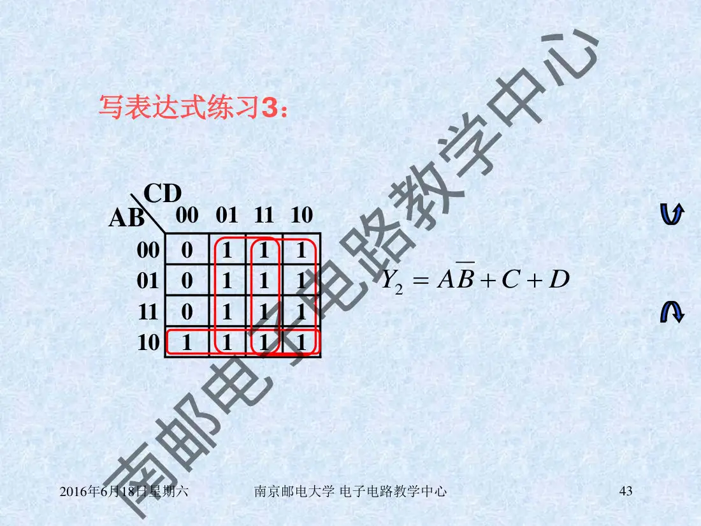

原文：

写表达式练习3：

<table><tr><td>AB\CD</td><td>00</td><td>01</td><td>11</td><td>10</td></tr><tr><td>00</td><td>0</td><td>1</td><td>1</td><td>1</td></tr><tr><td>01</td><td>0</td><td>1</td><td>1</td><td>1</td></tr><tr><td>11</td><td>0</td><td>1</td><td>1</td><td>1</td></tr><tr><td>10</td><td>1</td><td>1</td><td>1</td><td>1</td></tr></table>

2016年6月18日星期六

南京邮电大学 电子电路教学中心

43

### 综合练习1：

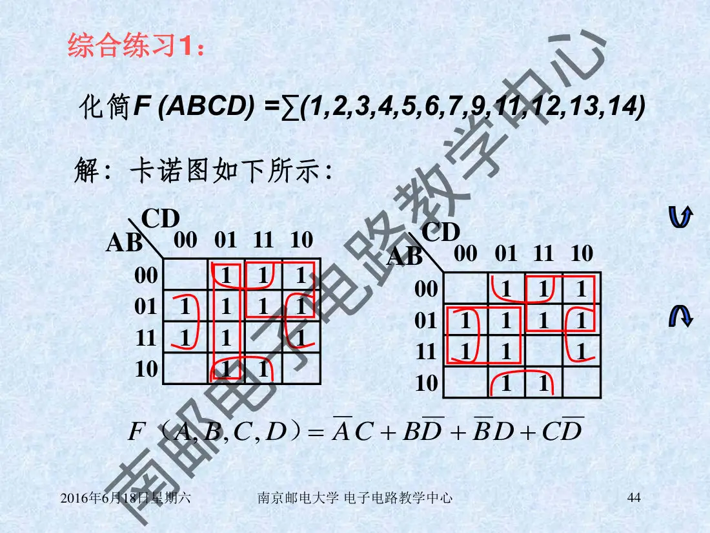

原文：

综合练习1：

化简F (ABCD) =∑(1,2,3,4,5,6,7,9,11,12,13,14)

解：卡诺图如下所示：

$$
F (A, B, C, D) = \overline {{A}} C + B \overline {{D}} + \overline {{B}} D + C \overline {{D}}
$$

2016年6月18日星期六

南京邮电大学 电子电路教学中心

44

### 综合练习2：

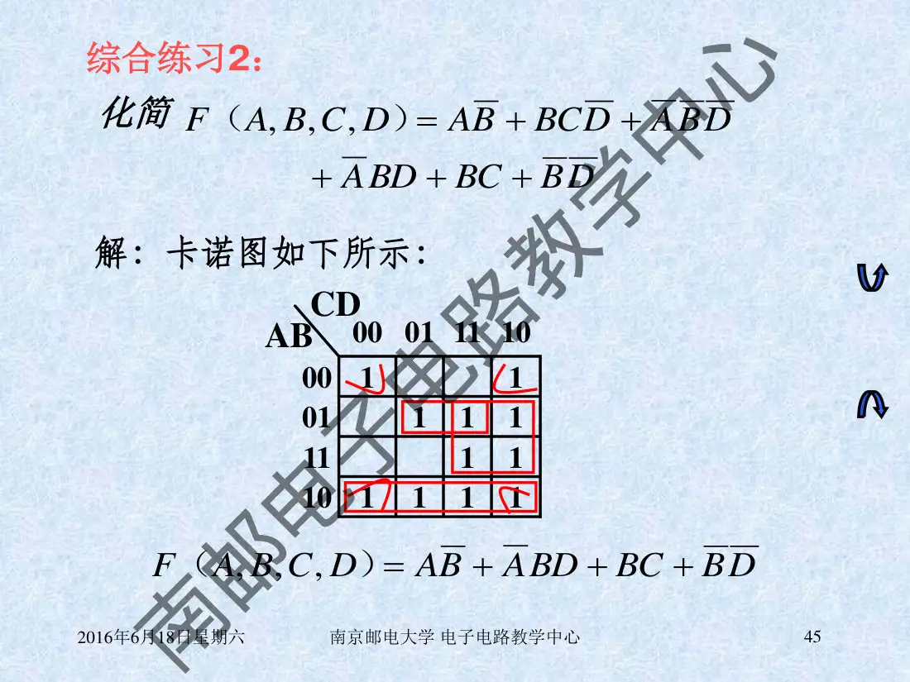

原文：

综合练习2：

$$
\begin{array}{r l} \text {化简} F (A, B, C, D) & = A \overline {{B}} + B C \overline {{D}} + \overline {{A}} \overline {{B}} \overline {{D}} \\ & + \overline {{A}} B D + B C + \overline {{B}} \overline {{D}} \end{array}
$$

解：卡诺图如下所示：

$$
F _ {,} (A, B, C, D) = A \overline {{B}} + \overline {{A}} B D + B C + \overline {{B}} \overline {{D}}\tag{U}
$$

2016年6月18日星期六

南京邮电大学 电子电路教学中心

45

### 2016年6月18日星期六

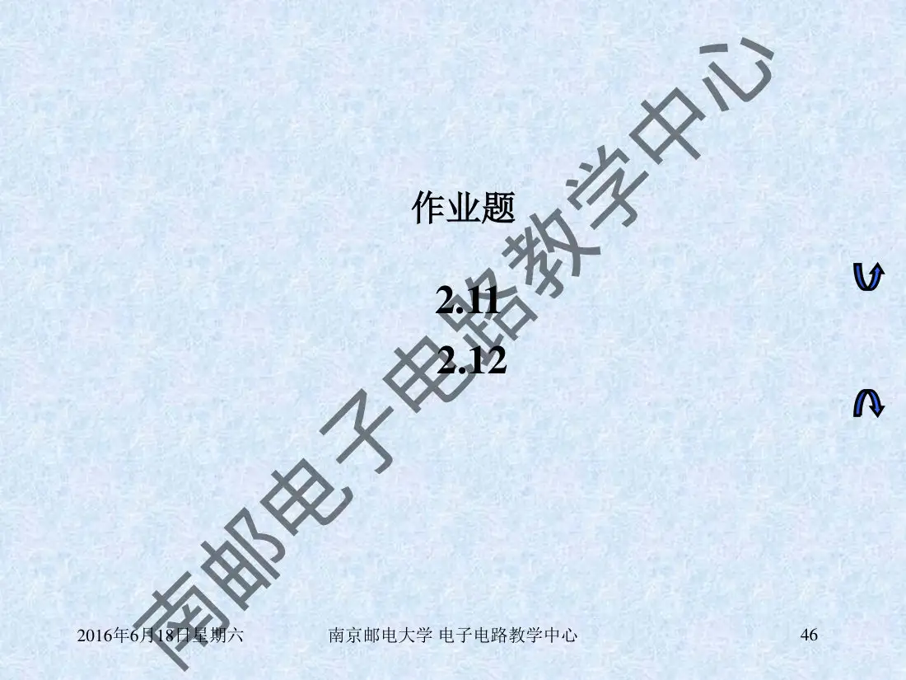

原文：

2016年6月18日星期六

南京邮电大学 电子电路教学中心

46
