# 《数字电路与逻辑设计》第四章 常用触发器（二）：JK触发器（课件）

原件的每一页，下面附识别出的文字。

### 第四节常用触发器

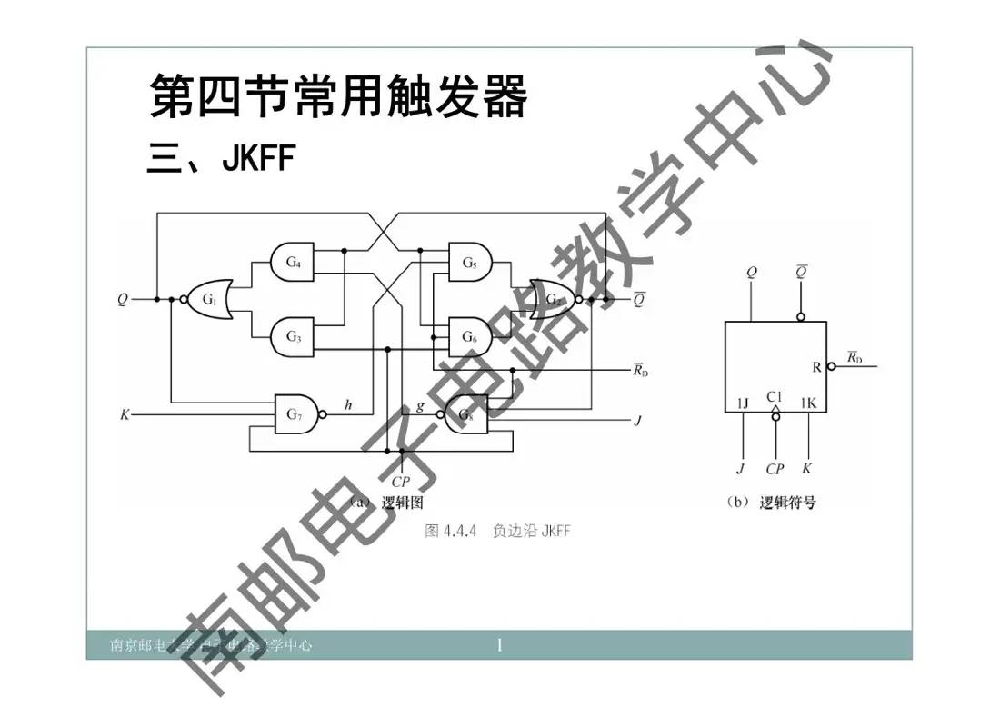

原文：

第四节常用触发器

三 、 J KFF

南京邮电大学 电子电路教学中心

1

### 功能分析

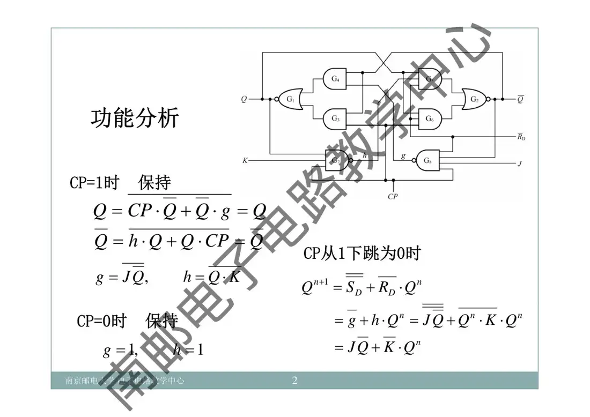

原文：

功能分析

CP= 1 时 保持

$$
Q = C P \cdot \overline {{Q}} + \overline {{Q}} \cdot g = Q
$$

$$
\overline {{Q}} = \overline {{h \cdot Q + Q \cdot C P}} =
$$

$$
g = J Q, \quad h = Q \cdot K
$$

CP=0 时 保持

$$
g = 1,
$$

CP从1下跳为0时

$$
\begin{array}{r l} & Q ^ {n + 1} = \overline {{\overline {{S _ {D}}}}} + \overline {{R _ {D}}} \cdot Q ^ {n} \\ & \qquad = \overline {{g}} + h \cdot Q ^ {n} = \overline {{\overline {{J \overline {{Q}}}}}} + \overline {{Q ^ {n} \cdot K}} \cdot Q ^ {n} \\ & \qquad = J \overline {{Q}} + \overline {{K}} \cdot Q ^ {n} \end{array}
$$

南京邮电大学 电子电路教学中心

2

### (1) 次态方程

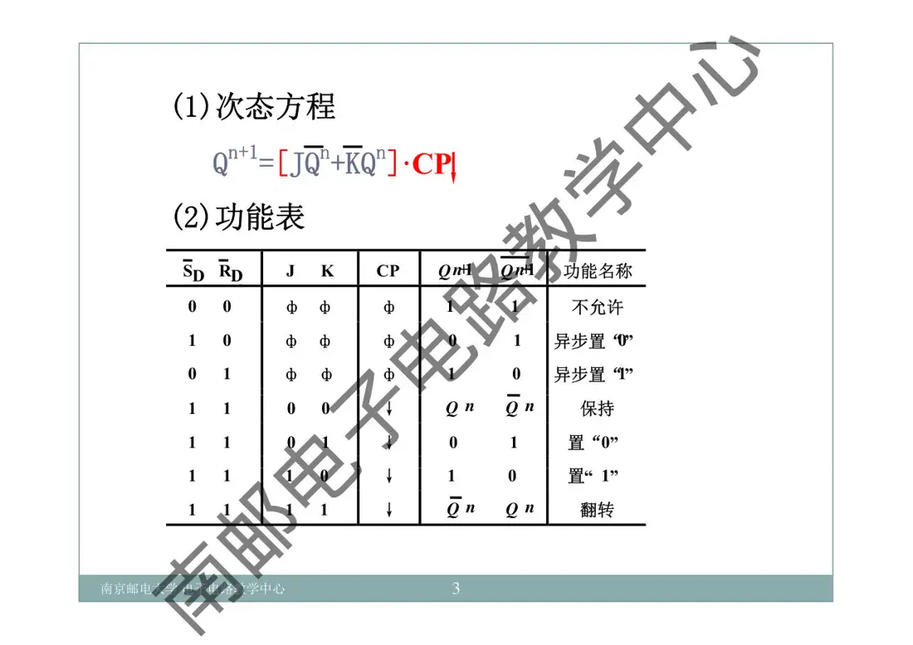

原文：

(1) 次态方程

$$
Q ^ {n + 1} = \left[ J \overline {{Q}} ^ {n} + \overline {{K}} Q ^ {n} \right] \cdot C P
$$

(2) 功能表

<table><tr><td> $\overline{S}_{D}$ </td><td> $\overline{R}_{D}$ </td><td>J</td><td>K</td><td>CP</td><td> $Qn^{H}$ </td><td> $\overline{Qn^{H}}$ </td><td>功能名称</td></tr><tr><td>0</td><td>0</td><td>Φ</td><td>Φ</td><td>Φ</td><td>1</td><td>1</td><td>不允许</td></tr><tr><td>1</td><td>0</td><td>Φ</td><td>Φ</td><td>Φ</td><td>0</td><td>1</td><td>异步置“0”</td></tr><tr><td>0</td><td>1</td><td>Φ</td><td>Φ</td><td>Φ</td><td>1</td><td>0</td><td>异步置“1”</td></tr><tr><td>1</td><td>1</td><td>0</td><td>0</td><td>↓</td><td>Q n</td><td> $\overline{Q}$  n</td><td>保持</td></tr><tr><td>1</td><td>1</td><td>0</td><td>1</td><td>↓</td><td>0</td><td>1</td><td>置“0”</td></tr><tr><td>1</td><td>1</td><td>1</td><td>0</td><td>↓</td><td>1</td><td>0</td><td>置“1”</td></tr><tr><td>1</td><td>1</td><td>1</td><td>1</td><td>↓</td><td> $\overline{Q}$  n</td><td>Q n</td><td>翻转</td></tr></table>

南京邮电大学 电子电路教学中心

3

### 南京邮电大学 电子电路教学中心

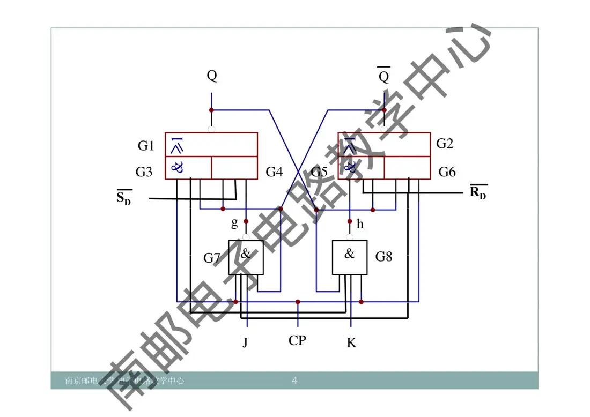

原文：

南京邮电大学 电子电路教学中心

4

### (3) 激励表

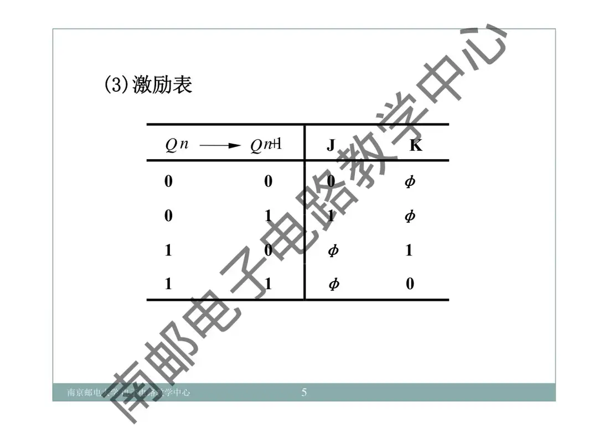

原文：

(3) 激励表

<table><tr><td colspan="2">Qn → QnH</td><td>J</td><td>K</td></tr><tr><td>0</td><td>0</td><td>0</td><td> $\phi$ </td></tr><tr><td>0</td><td>1</td><td>1</td><td> $\phi$ </td></tr><tr><td>1</td><td>0</td><td> $\phi$ </td><td>1</td></tr><tr><td>1</td><td>1</td><td> $\phi$ </td><td>0</td></tr></table>

南京邮电大学 电子电路教学中心

5

### (4) 波形 图

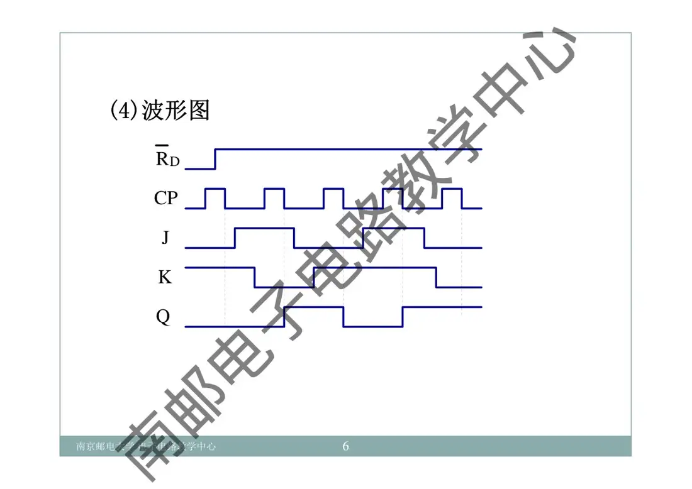

原文：

(4) 波形 图

南京邮电大学 电子电路教学中心

6

### （2） 负边沿JKFF 的动态特性

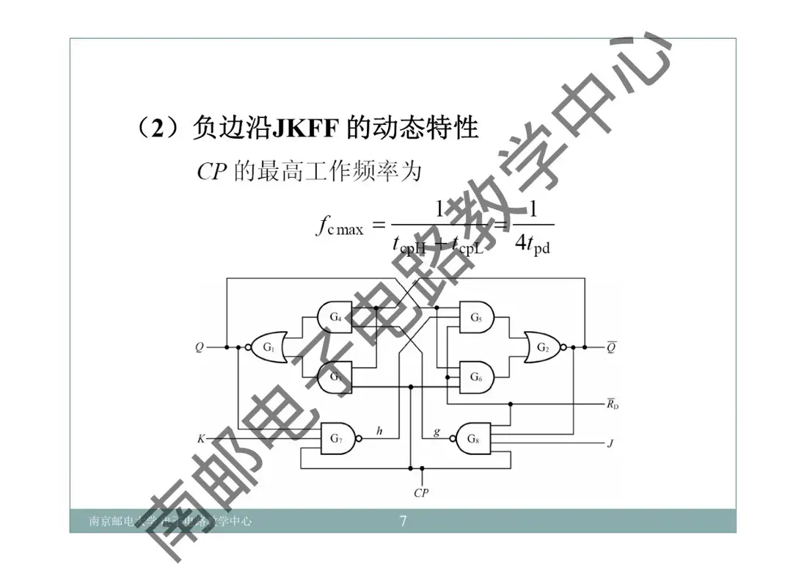

原文：

（2） 负边沿JKFF 的动态特性

CP的最高工作频率为

南京邮电大学 电子电路教学中心

7

### 四 、 T FF和 T FFˊ

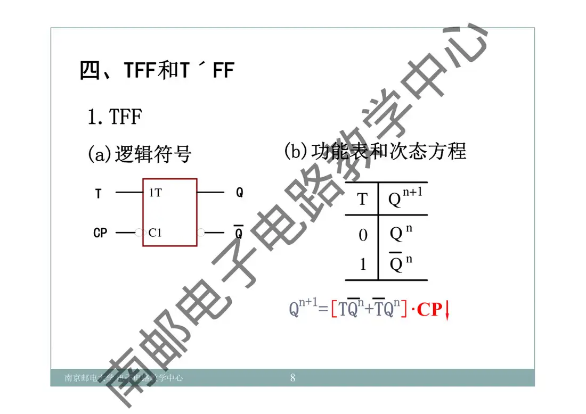

原文：

四 、 T FF和 T FFˊ

1 . TFF

(a) 逻辑符号

(b) 功能表和次态方程

<table><tr><td>T</td><td> $Q^{n+1}$ </td></tr><tr><td>0</td><td> $Q^n$ </td></tr><tr><td>1</td><td> $\overline{Q}^n$ </td></tr></table>

$$
Q ^ {n + 1} = \left[ T \overline {{Q}} ^ {n} + \overline {{T}} Q ^ {n} \right] \cdot C P \downarrow
$$

南京邮电大学 电子电路教学中心

8

### $$

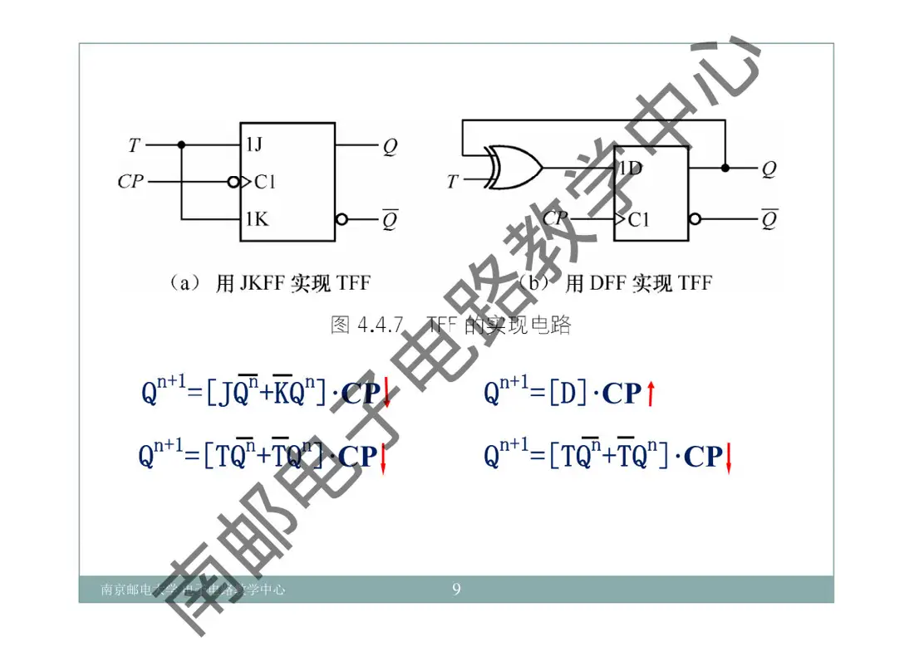

原文：

$$
\mathbf {Q} ^ {\mathrm{n+1}} = \left[ \mathrm{J} \overline {{\mathbf {Q} ^ {\mathrm{n}}}} + \overline {{\mathbf {K}}} \mathbf {Q} ^ {\mathrm{n}} \right] \cdot \mathbf {C P} \downarrow
$$

$$
\mathbf {Q} ^ {\mathrm{n+1}} = \left[ \mathrm{T} \overline {{\mathbf {Q}}} ^ {\mathrm{n}} + \overline {{\mathbf {T}}} \mathbf {Q} ^ {\mathrm{n}} \right] \cdot \mathbf {C P} \downarrow
$$

$$
\mathbf {Q} ^ {\mathrm{n+1}} = [ \mathbf {D} ] \cdot \mathbf {C P} \uparrow
$$

$$
\mathbf {Q} ^ {\mathrm{n+1}} = \left[ \mathbf {T} \overline {{\mathbf {Q}}} ^ {\mathrm{n}} + \overline {{\mathbf {T}}} \mathbf {Q} ^ {\mathrm{n}} \right] \cdot \mathbf {C P} \downarrow
$$

南京邮电大学 电子电路教学中心

9

### 南京邮电大学 电子电路教学中心

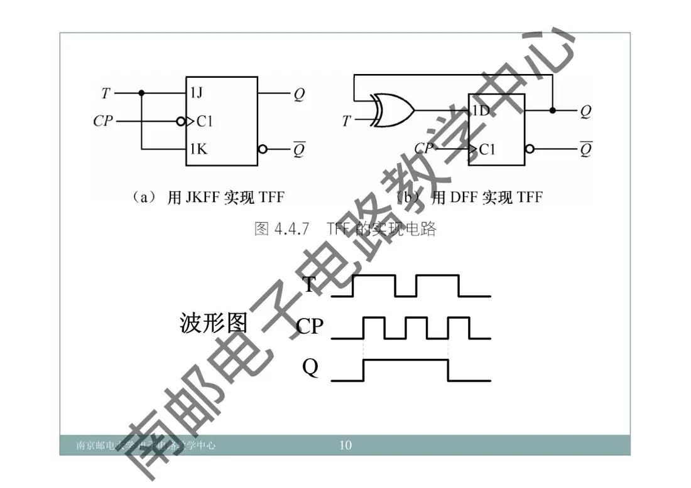

原文：

南京邮电大学 电子电路教学中心

1 0

### 2 T. ′FF

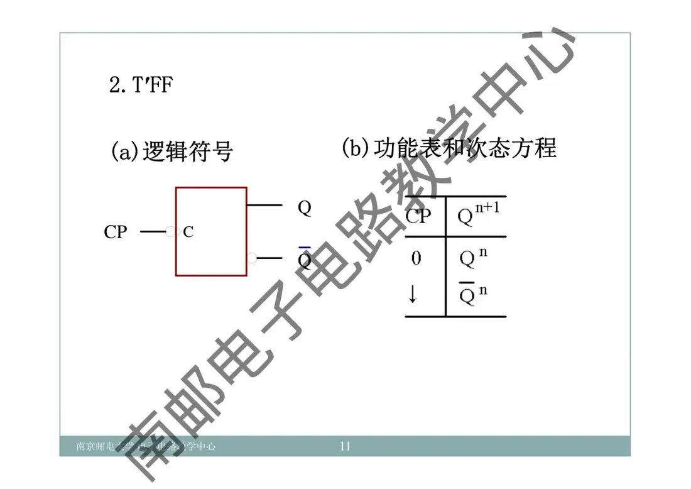

原文：

2 T. ′FF

(a) 逻辑符号

CP

(b) 功能表和次态方程

<table><tr><td>CP</td><td> $Q^{n+1}$ </td></tr><tr><td>0</td><td> $Q^n$ </td></tr><tr><td>↓</td><td> $\overline{Q}^n$ </td></tr></table>

南京邮电大学 电子电路教学中心

1 1

### $$

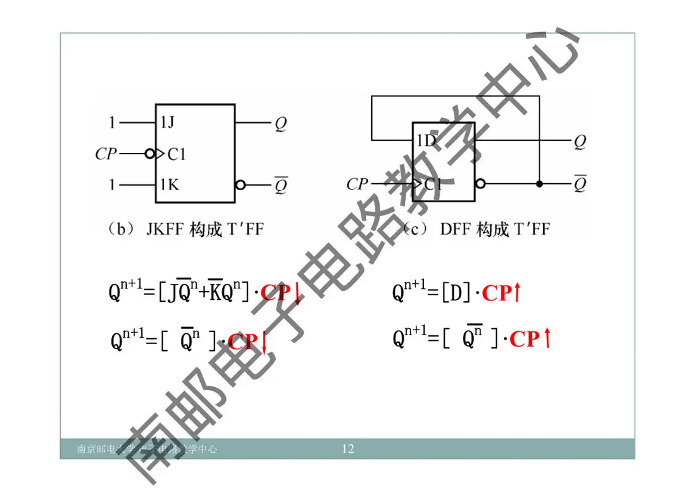

原文：

(b) JKFF 构成 $\mathrm { T ^ { \prime } F F }$

$$
Q ^ {n + 1} = [ J \overline {{Q}} ^ {n} + \overline {{K}} Q ^ {n} ]
$$

$$
Q ^ {n + 1} = \left[ \overline {{Q}} ^ {n} \right.
$$

(c) DFF 构成 T'FF

$$
Q ^ {n + 1} = [ D ] \cdot C P \uparrow
$$

$$
\mathbf {Q} ^ {\mathrm{n+1}} = \left[ \begin{array}{l} \overline {{\mathbf {Q} ^ {\mathrm{n}}}} \end{array} \right] \cdot \mathbf {C P} \uparrow
$$

南京邮电大学 电子电路教学中心

1 2

### 4.6 触发器应用举例

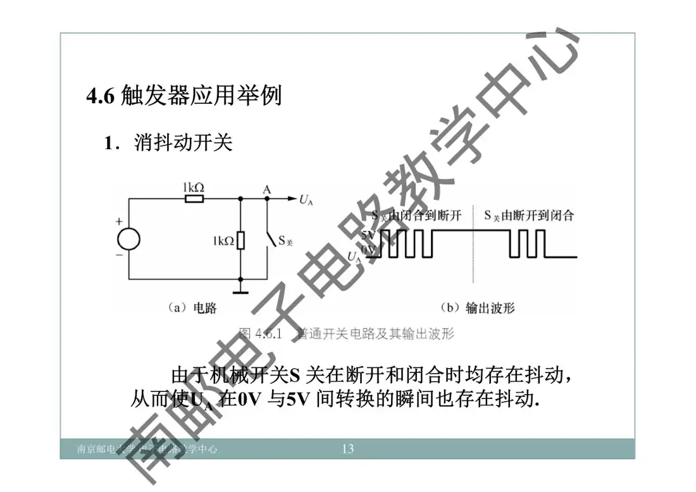

原文：

4.6 触发器应用举例

1． 消抖动开关

由于机械开关S 关在断开和 闭合时均存在抖动，从而使U 在0V 与5V 间转换的瞬间也存在抖动.

南京邮电大学 电子电路教学中心

1 3

### 1． 消抖动开关

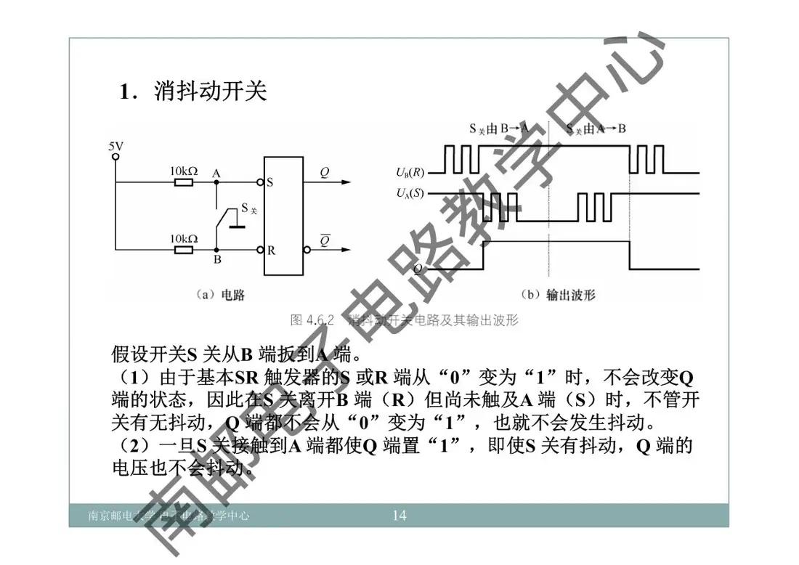

原文：

1． 消抖动开关

假设开关S 关从B 端扳到A 端。

（ 1 ） 由于基本SR 触发器的S 或R 端从 “0” 变为 “ 1 ” 时， 不会改变Q端的状态， 因此在S 关离开B 端 （R） 但尚未触及A 端 （S） 时， 不管开关有无抖动， Q 端都不会从 “0” 变为 “1” ， 也就不会发生抖动。

（2） 一旦S 关接触到A 端都使Q 端置 “1” ， 即使S 关有抖动， Q 端的电压也不会抖动。

南京邮电大学 电子电路教学中心

1 4

### 2． 单脉冲发生器

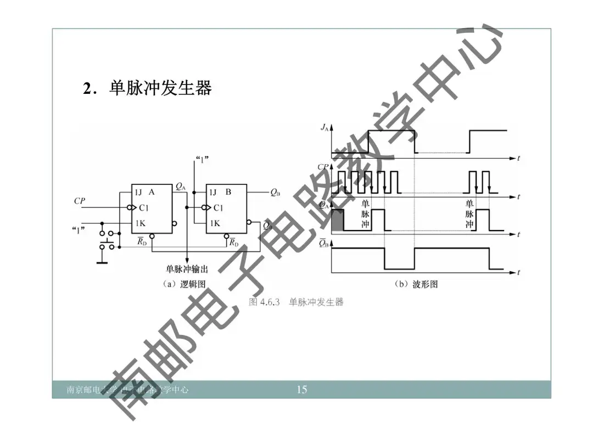

原文：

2． 单脉冲发生器

南京邮电大学 电子电路教学中心

1 5

### 3． 数据锁存器

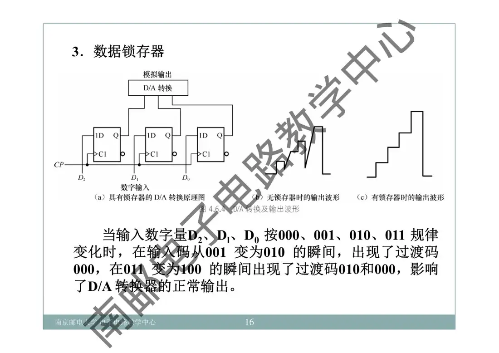

原文：

3． 数据锁存器

当输入数字量 $\mathbf { D _ { 2 } } . . \mathbf { \partial D _ { l } } . \mathbf { \partial D _ { 0 } }$ 按000 、 001 、 01 0 、 011 规律变化时， 在输入码从001 变为010 的瞬间 ， 出现了过渡码000 ， 在011 变为 1 00 的 瞬 间 出 现 了 过渡码01 0和 000 ， 影 响了D/A 转换器的正常输出 。

南京邮电大学 电子电路教学中心

1 6

### 4． 构成静态随机存储器 （ SRAM）

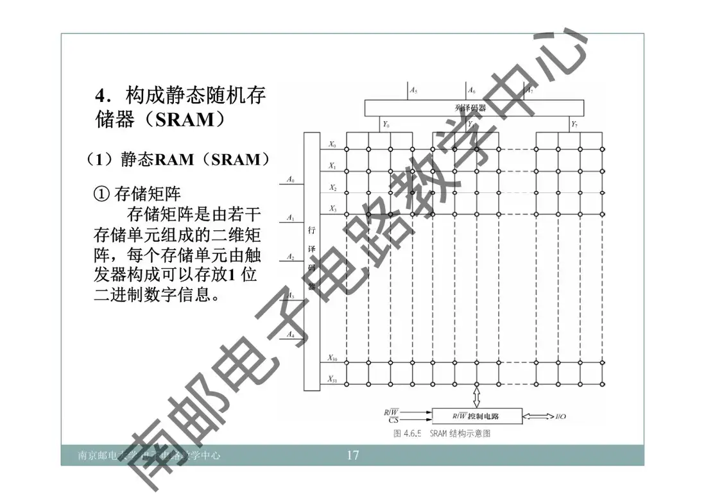

原文：

4． 构成静态随机存储器 （ SRAM）

（ 1 ） 静态RAM （ SRAM）

① 存储矩阵

存储矩阵是由若干存储单元组成的二维矩阵， 每个存储单元由触发器构成可以存放1 位二进制数字信息。

南京邮电大学 电子电路教学中心

1 7

### （ 1 ） 静态RAM （ SRAM）

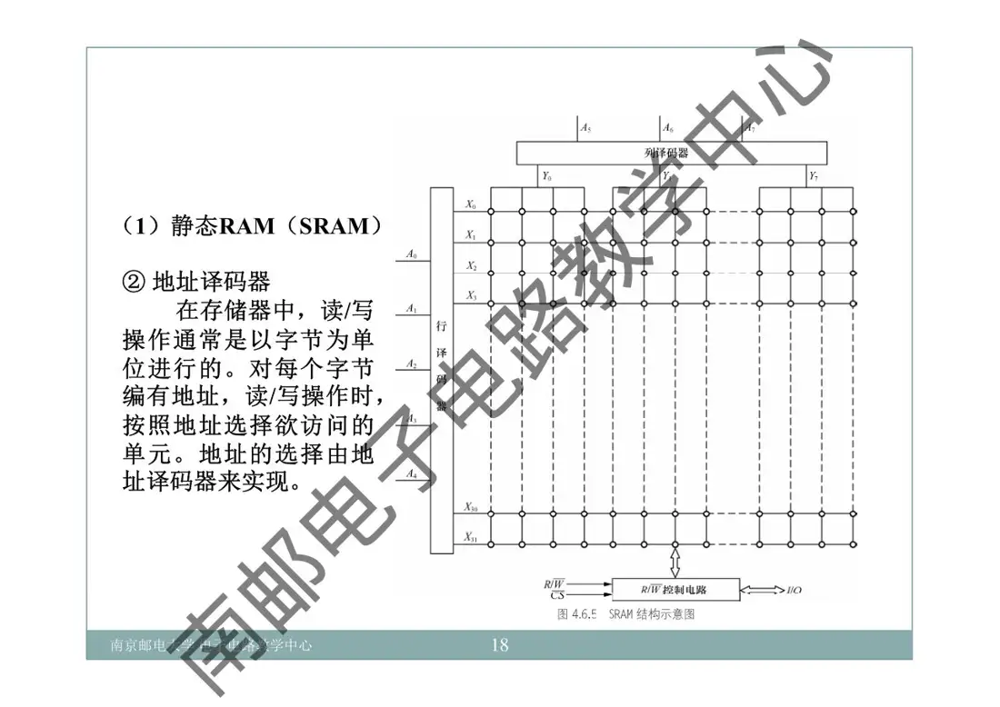

原文：

（ 1 ） 静态RAM （ SRAM）

② 地址译码器

在存储器中 ， 读/写操作通常是 以字节为单位进行 的 。 对每个字节编有地址， 读/写操作时按照地址选择欲访 问 的单元 。 地址 的选择 由 地址译码器来实现。

南京邮电大学 电子电路教学中心

1 8

### （ 1 ） 静态RAM （ SRAM）

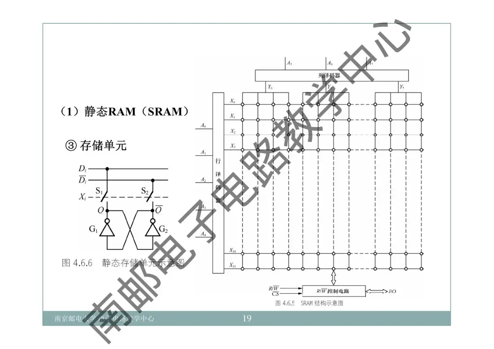

原文：

（ 1 ） 静态RAM （ SRAM）

③ 存储单元

南京邮电大学 电子电路教学中心

1 9

### （ 1 ） 静态RAM （ SRAM）

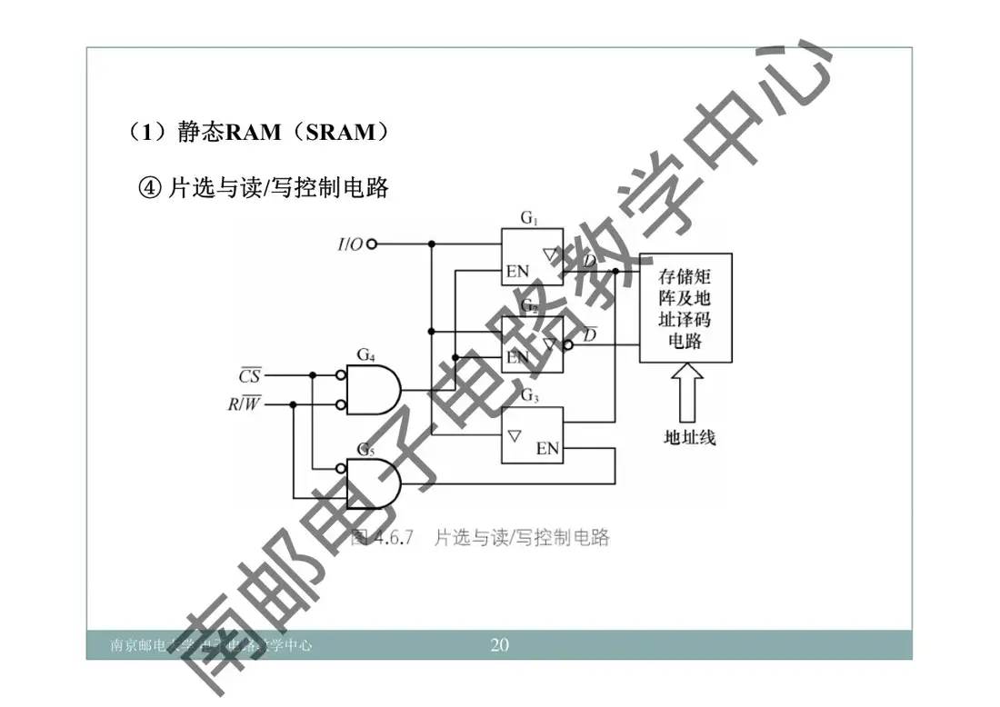

原文：

（ 1 ） 静态RAM （ SRAM）

④ 片选与读/写控制 电路

南京邮电大学 电子电路教学中心

20

### （2 ） 动态RAM （DRAM）

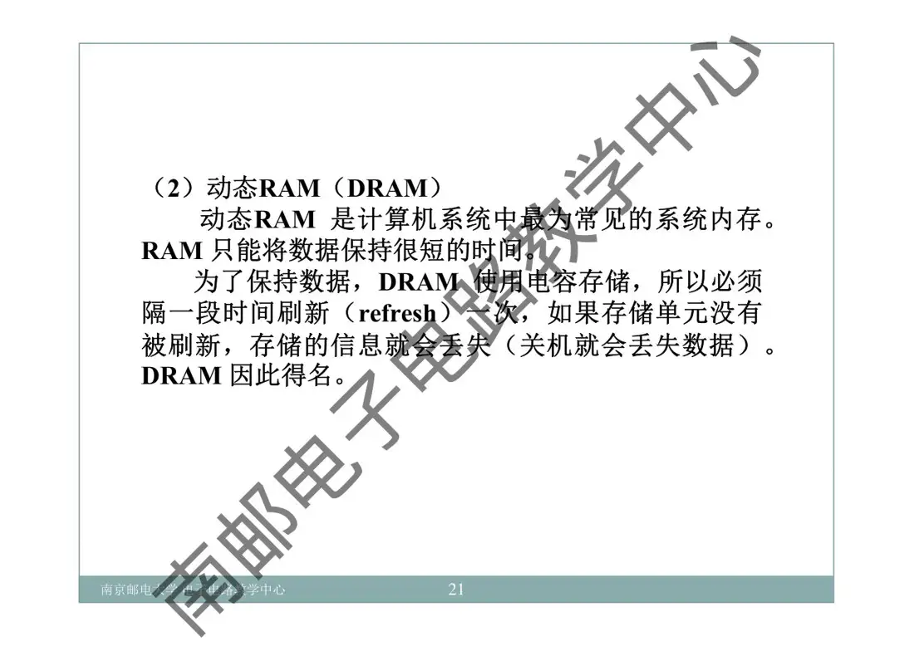

原文：

（2 ） 动态RAM （DRAM）

动态RAM 是计算机系统中最为常见的系统 内存。RAM 只能将数据保持很短的时间 。

为了保持数据， DRAM 使用 电容存储， 所以必须隔 段时 间刷新一 （ refresh） 一次， 如果存储单元没有被刷新， 存储的信息就会丢失 （ 关机就会丢失数据 ） 。DRAM 因此得名 。

南京邮电大学 电子电路教学中心

2 1

### 作业题4.84.114.17

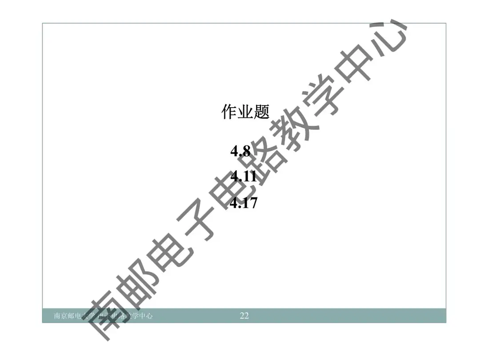

原文：

<table><tr><td>作业题</td></tr><tr><td>4.8</td></tr><tr><td>4.11</td></tr><tr><td>4.17</td></tr></table>
