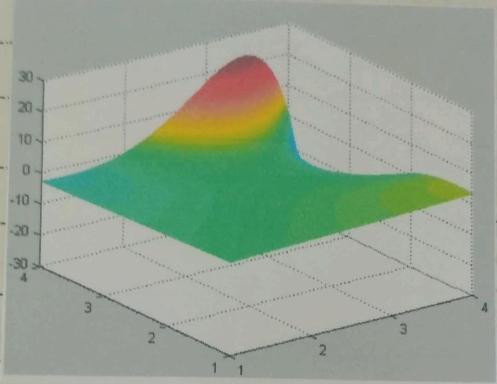

# 《数学实验B》实验：三维曲面绘图与网格生成

原件经识别和整理；“参考解答”是我们补的。

## 一、三维曲面绘图与网格生成

$[xy] = \text{meshgrid}(x, y)$ ; $z = x.^{y} - y.^{x}$ ; mesh $(x, y, z)$ ; grid on

图像：

因为 $(e, p_i, z)$ 的位置未标出，所以不易看出在 $(x, y) = (e, p_i)$ 位置时的 $i$ 的正负，所以应改进图像的显示，用直线与曲面的交点表示 $i$ 的位置代码： $a = \text{linspace}(1, 4, 100)$ ; $[x, y] = \text{meshgrid}(a, a)$ ; $x = 1: 0.01: 4$ ;

y = x ; $[x, y] = \text{meshgrid}(x, y)$ ; $z = x^2y - y^2x$ ;
