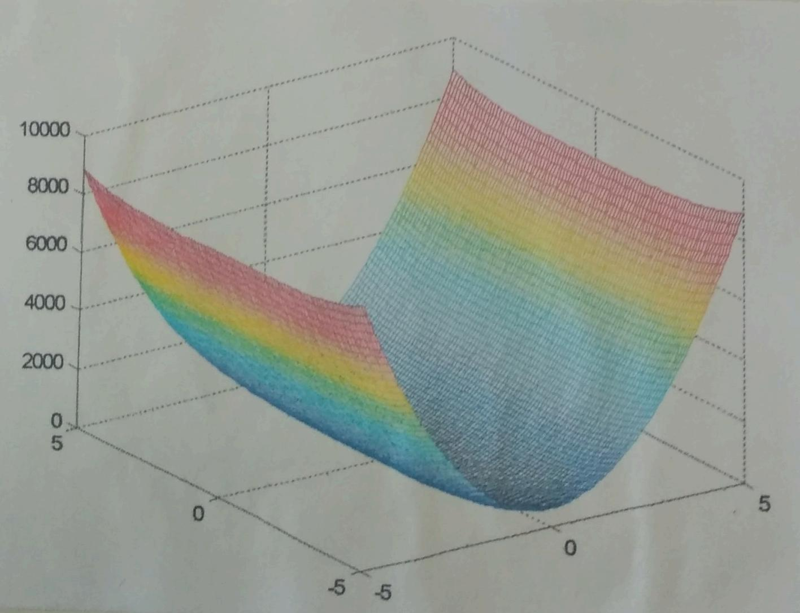

# 《数学实验B》隐函数绘图与网格数据可视化习题解析

原件经识别和整理；“参考解答”是我们补的。

### 计算 1

用 ezplot 命令画出由方程 $\sin(x^{2}+\frac{m}{1000}y^{2})=\cos(xy)$ 确定的隐函数图形。代码：
```matlab
ezplot('sin(x^2+331/1000*x^2)-cos(x*y)=0')
ezplot('sin(x^2+331/1000*x^2)-cos(x*y)',[-20,20,-20,20])
```

解: $x = -5 : 0.1 : 5; y = -5 : 0.1 : 5;$

$$
[X, Y] = \text{meshgrid}(x, y); Z = 331 * X.^2 + Y.^4; \text{mesh}(X, Y, Z);
$$



参考解答：**结论：** 原代码不能正确绘制题目给定的隐函数图形，且给出的网格代码对应的函数也不是原方程。

**解答：**

题目要求绘制的方程为

$$
\sin\left(x^2+\frac{m}{1000}y^2\right)=\cos(xy),
$$

因此 MATLAB 中应直接使用该方程绘制隐函数：

```matlab
m = 331;
f = @(x,y) sin(x.^2 + m/1000*y.^2) - cos(x.*y);

figure
ezplot(f, [-5,5,-5,5])
grid on
xlabel('x')
ylabel('y')
title('sin(x^2+331y^2/1000)=cos(xy)')
```

若 `ezplot` 无法直接识别匿名函数，可先通过 `ezplot` 的字符串形式绘制：

```matlab
figure
ezplot('sin(x^2+331/1000*y^2)-cos(x*y)', [-5,5,-5,5])
grid on
```

也可采用隐函数数值绘图：

```matlab
m = 331;
x = linspace(-5,5,1201);
y = linspace(-5,5,1201);
[X,Y] = meshgrid(x,y);

F = sin(X.^2 + m/1000*Y.^2) - cos(X.*Y);

figure
contour(X,Y,F, [0 0])
axis equal
xlabel('x')
ylabel('y')
title('sin(x^2+331y^2/1000)=cos(xy)')
```

原代码

```matlab
ezplot('sin(x^2+331/1000*x^2)-cos(x*y)=0')
ezplot('sin(x^2+331/1000*x^2)-cos(x*y)',[-20,20,-20,20])
```

存在两处主要问题：

1. 第一行在方程末尾多写了 `=0`。`ezplot` 所需的是关于 $x,y$ 的函数表达式，而不是带等号的方程，因此应去掉 `=0`。
2. 第二行把题目中的 $y^2$ 错写成了 $x^2$，实际绘图函数变成了
   
$$
\sin\left(x^2+\frac{331}{1000}x^2\right)-\cos(xy),
$$

   与原方程
   
$$
\sin\left(x^2+\frac{331}{1000}y^2\right)-\cos(xy)
$$

   不一致。

此外，原代码使用范围 $[-20,20]$ 绘图，而给出的网格范围为 $[-5,5]$。两者可统一采用 $[-5,5]$，以减少无效计算并使图形更清晰。

题后所列代码

```matlab
x = -5:0.1:5;
y = -5:0.1:5;
[X,Y] = meshgrid(x,y);
Z = 331*X.^2 + Y.^4;
mesh(X,Y,Z);
```

绘制的是曲面

$$
z=331x^2+y^4,
$$

与所给隐函数方程无关，因此不能作为本题的绘图代码。

知识点：[隐函数绘图与网格数据可视化](../../../topics/数学实验/隐函数绘图.md)
