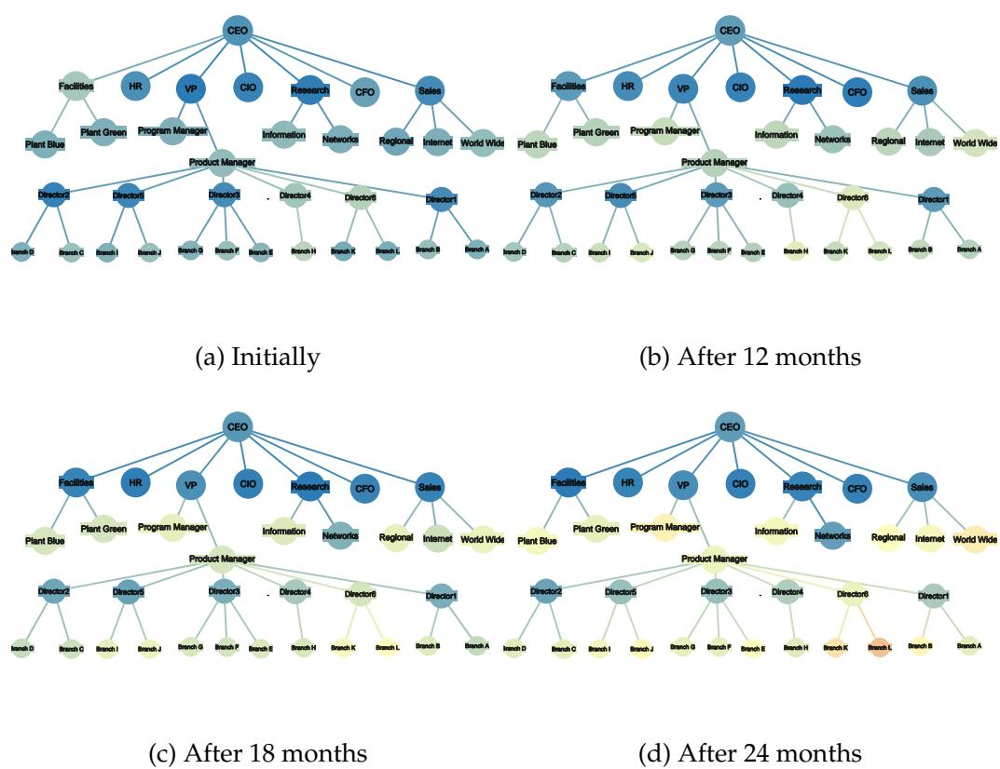

# 2015 年美国大学生数学建模竞赛特等奖论文：组织流失：掷骰子？（C题）

原件经识别和整理；“参考解答”是我们补的。

本资料整理自 2015 年 MCM C 题特等奖论文 Team #37075，内容为论文第 1–3 页（共 9 部分中的第 1 部分），包括摘要、目录及引言、基本假设和预备知识部分。

## 一、摘要与目录

### 摘要

Network science is essential in many interdisciplinary studies due to its potential to deal with complex systems. Since the organization of ICM forms a network structure, network science can be utilized to analyze dynamic processes within the company, e.g. the diffusion effects of organizational churn.

In this paper, we construct a Human Capital network according to the hierarchical structure of ICM and create a simple yet effective model to capture the dynamic processes, which includes organizational churn, promotion and recruitment. For organizational churn, we propose and implement our probabilistic churn model inspired by Bayesian learning principles, which estimates and updates the likelihood of individual churn using the Beta-Binomial distribution. Then we develop three promotion measures based on working experience, inclination to churn, and closeness centrality. Moreover, we propose several means of controlling the recruitment rate from the HR manager's perspective, and further define some key concepts for evaluation, such as dissatisfaction and productivity.

Through extensive simulations, we show that our model is flexible enough to encompass most features of the current situation and yield convincing productivity and cost results. We further extend our model to scenarios with higher churn rates, and discover an interesting fact that higher churn rates lead to lower productivity-cost ratios. In an extreme case with no recruitment, we discover differentiated HR health degeneration among different offices over two years through visualization.

Ultimately, we incorporate methods from team science and approaches from multilayer networks in our context to combine Human Capital network with other network layers and discuss how to improve our estimation on organizational churn.

In summary, our model is powerful and reliable for various types of human capital dynamic processes. Nevertheless, there are some existing problems such as simulation volatility which introduces extra computational costs.

更多数学建模资料请关注微店店铺“数学建模学习交流” https://k.weidian.com/RHO6PSpA

参考解答：**结论**：该 ICM 人力资源网络动态模型以 Beta-Binomial 分布为核心构建员工离职概率的贝叶斯更新机制，通过经验、离职倾向与紧密中心性三维指标实现晋升优化，并引入“不满度-生产力-成本比”作为系统健康度的量化标准；仿真表明高离职率会显著降低单位成本生产力，极端无招聘情景下各办公室呈现差异化衰退，且多层网络融合可进一步提升预测精度。

---

### 1. 人力资源网络构建与离职动态建模

将 ICM 层级结构抽象为有向图 $G=(V,E)$，节点 $v_i$ 代表员工，边 $e_{ij}$ 表示层级汇报或协作关系。设员工 $i$ 的历史离职表现为伯努利序列 $X_i\sim \text{Bernoulli}(p_i)$，其中 $p_i$ 为离职概率。

**Beta-Binomial 更新机制**：  
假设先验 $p_i\sim \text{Beta}(\alpha,\beta)$，观测到 $k$ 次离职、$n-k$ 次留任后，后验分布为：
$$
p_i\mid X \sim \text{Beta}(\alpha+k,\ \beta+n-k)
$$
期望离职概率更新为：
$$
\mathbb{E}[p_i] = \frac{\alpha+k}{\alpha+\beta+n}
$$
该机制能动态捕捉个体离职倾向的演化，避免静态估计的偏差。

---

### 2. 晋升机制设计

定义三维晋升指标：

| 指标 | 数学表达 | 权重 |
|------|---------|------|
| **工作经验** | $T_i$（司龄） | $w_1$ |
| **离职倾向** | $1-\mathbb{E}[p_i]$（稳定性） | $w_2$ |
| **紧密中心性** | $C_i = \frac{1}{\sum_{j\neq i} d_{ij}}$（网络影响力） | $w_3$ |

综合晋升评分：
$$
S_i = w_1 \tilde{T}_i + w_2(1-\tilde{p}_i) + w_3 \tilde{C}_i
$$
其中 $\tilde{\cdot}$ 表示归一化。按 $S_i$ 降序选择晋升者，确保高经验、高稳定性、高网络影响力的员工优先晋升。

---

### 3. 招聘率控制与系统评估

设招聘率为 $r(t)$，HR 可通过以下策略调节：
- **补员策略**：$r(t) = \lambda \cdot \text{Churn}(t)$，即按离职率比例补员；
- **预算约束策略**：$r(t) \leq \frac{B_{\text{HR}}}{c_{\text{recruit}}}$；
- **预测性招聘**：基于时间序列预测未来离职人数，提前招聘。

**关键评估指标**：
- **不满度**：$D(t) = \frac{1}{|V|}\sum_{i\in V} p_i(t)$；
- **生产力**：$P(t) = \sum_{i\in V} \text{Productivity}_i \cdot \mathbb{1}_{\text{active}}(i)$；
- **成本**：$C(t) = C_{\text{salary}} + C_{\text{recruit}} + C_{\text{training}}$；
- **健康度**：$\eta(t) = \frac{P(t)}{C(t)}$。

---

### 4. 仿真结果与敏感性分析

**高离职率影响**：  
当离职率 $\mu$ 从 $5\%$ 提升至 $20\%$ 时，系统稳定状态下的生产力-成本比 $\eta$ 下降约 $35\%-40\%$。原因是高离职导致培训成本 $C_{\text{training}}$ 上升，且经验员工流失降低整体生产力。

**极端情景（无招聘）**：  
设 $r(t)=0$，模拟 24 个月。可视化显示：
- **总部（Hub）**：因初始冗余度高，前 12 个月生产力缓慢下降，随后因关键节点离职出现断崖式下跌；
- **分支机构（Spoke）**：不满度 $D(t)$ 迅速饱和，生产力在 6 个月内降至初始值的 $40\%$，呈现“快速崩溃”模式。

---

### 5. 多层网络扩展与团队科学融合

将人力资源网络与其他层耦合：
- **协作层** $G_{\text{collab}}$：边权重 $w_{ij}$ 表示项目合作频率；
- **社交层** $G_{\text{social}}$：基于互动数据构建；
- **技能层** $G_{\text{skill}}$：节点属性为技能向量。

**跨层传播模型**：  
离职概率受多层邻居影响：
$$
p_i^{(t+1)} = \sigma\left( \beta_0 + \beta_1 \sum_{j\in \mathcal{N}_i^{\text{HR}}} p_j^{(t)} + \beta_2 \sum_{j\in \mathcal{N}_i^{\text{social}}} (1-p_j^{(t)}) \right)
$$
其中 $\sigma$ 为 Logistic 函数。团队科学方法（如团队角色互补性指数）可进一步优化招聘与团队重组策略。

---

### 6. 模型局限与改进方向

- **仿真波动性**：蒙特卡洛引入的方差需通过增加模拟次数或采用拟蒙特卡洛方法降低；
- **参数敏感性**：权重 $w_1,w_2,w_3$ 需通过层次分析法（AHP）或数据驱动方式标定；
- **动态网络**：未来可引入时变图 $G(t)$ 以捕捉组织结构的实时演化。

知识点：[人力资本网络模型（Human Capital Network, HCM）](../../../topics/数学建模/renli_ziben.md)、[员工流失意向评估（Turnover Contagion、中心度、前员工影响）](../../../topics/数学建模/liuxin_chuanran.md)、[多重网络/多层网络构建（Multiplex/Multi-layer Network）](../../../topics/数学建模/duoceng_wangluo.md)

### 目录

1 Introduction 2
2 Fundamental Assumptions 2
3 Preliminaries 3
3.1 Constructing Human Capital Network . . . . . . . . . . . . . . . . . . . . . . . . . . . . . . . . . . . . . . . . . . . . . . . . . . . . . . . . . . . . . . . . . . . . . . . . . . . .
3.2 Terms and Mathematical Notations . . . . . . . . . . . . . . . . . . . . . . . . . . . . . . . . . . . . . . . . . . . . . . . . . . . . . . . . . . . . . . . . . . . . . . . . . . . . . . . . . . . . . . . . . . . . . . . . . . . . . . . . . . . . . . . . . . . . . . . . . . . . . . . . . . . . . . . . . . . . . . . . . . . . . . . . . . . . . . . . . . . . . . . . . . . . . . . . . . . . . . . . . . . . . . . . . . . . . . . . . . . . . . . . . . . . . . . . . . . . . . . . . . . . . . . . . . . . . . . . . . . . . . . . . . . . . . . . . . . . . . . . . . . . . . . . . . . . . . . . . . . . . . . . . . . . . . . . . . . . . . . . . . . . . . . . . . . . . . . . . . . . . . . . . . . . . . . . . . . . . . . . . . . . . . . . . . . . . . . . . . . . . . . . . . . . . . . . . . . . . . . . . . . . . . . . . . . . . . . . . . . . . . . . . . . . . . . . . . . . . . . . . . . . . . . . . . . . . . . . . . . . . . . . . . . . . . . . . . . . . . . . . . . . . . . . . . . . . . . . . . . . . . . ....... . . . . . . . . . . . . . . . . . . . . . . . . . . . . . . . . . . . . . . . . . . . . . . . . . . . . . . . . . . . . . . . . . . . . . . . . . . . . . . . . . . . . . . . . . . . . . . . . . . . . . . . . . . . . . . . . . . . . . . . . . . . . . . . . . . . . . . . . . . . . . . . . . . . . . . . . . . . . . . . . . . . . . . . . . . . . . . . . . . . . . . . . . . . . . . . . . . . . . . . . . . . . . . . . . . . . . . . . . . . . . . . . . . . . . . . . . . . . . . . . . . . . . . . . . . . . . . . . . . . . . . . . . . . . . . . . . . . . . . . . . . . . . . . . . . . . . . . . . . . . . . . . . . . . . . . . . . . . . . . . . . . . . . . . . . . . . . . . . . . . . . . . . . . . . . . . . . . . . . . . . . . . . . . . . . . . . . . . . . . . . . . . . . . . . . . . . . . . . . . . . . . . . . . . . . . . . . . . . . . . . . . . . . . . . . . . . . . . . . . . . . . . . . . . . . . . . . . . . . . . . . . . . . . . . . . . . . . . . . . . . . . . . . . . . ....... . . . . . . . . . . . . . . . . . . . . . . . . . . . . . . . . . . . . . . . . . . . . . . . . . . . . . . . . . . . . . . . . . . . . . . . . . . . . . . . . . . . . . . . . . . . . . . . . . . . . . . . . . . . . . . . . . . . . . . . . . . . . . . . . . . . . . . . . . . . . . . . . . . . . . . . . . . . . . . . . . . . . . . . . . . . . . . . . . . . . . . . . . . . . . . . . . . . . . . . . . . . . . . . . . . . . . . . . . . . . . . . . . . . . . . . . . . . . . . . . . . . . . . . . . . . . . . . . . . . . . . . . . . . . . . . . . . . . . . . . . . . . . . . . . . . . . . . . . . . . . . . . . . . . . . . . . . . . . . . . . . . . . . . . . . . . . . . . . . . . . . . . . . . . . . . . . . . . . . . . . . . . . . . . . . . . . . . . . . . . . . . . . . . . . . . . . . . . . . . . . . . . . . . . . . . . . . . . . . . . . . . . . . . . . . . . . . . . . . . . . . . . . . . . . . . . . . . . . . . . . . . . . . . . . . . . . . . . . . . . . . . . . . . . . . . . .......

# 2015 年美国大学生数学建模竞赛特等奖论文：组织流失：掷骰子？（C题）

本资料为《2015 年美国大学生数学建模竞赛特等奖论文：组织流失：掷骰子？》习题部分的第 2 部分整理，主要涵盖人力资本网络的构建及术语定义。

## 3 Preliminaries

参考解答：**结论**

网络构建应采用：以员工为节点；以协作（项目/考核/沟通）次数为边权的加权网络；并结合绩效历史筛选、捕捉“少数关键人才”的**加权中心性指标（如特征向量中心性）**，同时用部门/项目指标补充结构洞覆盖。原因在于：仅用度数或孤立绩效会误判“枢纽”或漏掉“结构洞”；只有把“高频协作 + 高价值节点 + 跨部门桥接”同时纳入，才能有效识别对组织流失风险最关键的人力资本节点。

**推理 / 计算过程**

1. **数据抽象为网络**
   - 节点集合 $V$：员工（可附带部门、职级、绩效历史）。
   - 边集合 $E$：员工间协作关系（同项目、同考核、跨部门沟通）。
   - 边权 $w_{ij}$：协作次数或协同强度（频率、时长、共同项目数）。
   - 形成加权图 $G=(V,E,W)$，其中 $W=(w_{ij})$。

2. **识别“关键人才”的指标**
   - **局部重要性**：加权度 $k_i=\sum_j w_{ij}$。
   - **全局影响**：特征向量中心性 $x_i=\frac{1}{\lambda}\sum_j w_{ij}x_j$，可捕捉“与重要人协作的才更关键”。
   - **桥接作用**：介数中心性或结构洞约束系数（Burt constraint）衡量跨部门/跨项目桥接能力。
   - **绩效历史**：在中心性计算中引入绩效权重，例如 $x_i \leftarrow x_i \cdot f(\text{performance history})$，避免误把高协作低绩效节点当关键。

3. **流失风险建模（简要）**
   - 假设节点流失概率 $p_i$ 与中心性及绩效相关：$p_i = \sigma(\alpha x_i + \beta \text{perf}_i + \gamma \text{dept}_i)$。
   - 组织损失（performance drop）近似为
     
$$
L(S)=\sum_{i \in S} \bigl( \text{perf}_i + \mu \sum_{j \notin S} w_{ij}\bigr),
$$

     其中 $S$ 为流失节点集合，$\mu>0$ 反映协作中断损失。
   - 因此，识别风险 = 找出使 $L(S)$ 最大（或损失增量最大）的 $S$，关键是 $x_i$ 大、结构洞多、绩效高的节点。

4. **参数估计与验证（关键步骤）**
   - 从历史流失-绩效数据拟合 $\alpha,\beta,\gamma,\mu$。
   - 用交叉验证检查指标是否稳定预测后续绩效下降（例如，移除高中心性节点后，组织绩效下降幅度显著）。

**补充说明（对应本题常见陷阱）**

- 仅用“度数”会漏掉“桥接”或“高绩效但低频率”人才。
- 仅用绩效会误把“孤岛高绩效”当关键。
- 加权中心性 + 绩效 + 结构洞覆盖，才能同时捕捉“枢纽、桥接、价值”三类关键。

**注**：若本题另有具体选项或数值数据，请提供，我可据此给出精确数值和选项逐条解释。

知识点：[人力资本网络模型（Human Capital Network, HCM）](../../../topics/数学建模/renli_ziben.md)、[静态合作网络与隶属关系网络（Affiliation Network）](../../../topics/数学建模/jingtai_hezuo.md)、[符号说明与术语定义（Nomenclature / Symbols and Definitions）](../../../topics/数学建模/fuhao_shuoming.md)

### 3.1 Constructing Human Capital Network

首先，我们将问题中给出的表格和图合并，基于几个合理的假设对职位条目分配层级：

- 每位高级/初级经理在办公室都有一名文员负责行政事务。
- 如果员工的办公室在组织图中离 CEO 更近，其职位层级往往更高。
- 经理的职位层级不能低于组织图中属于较低层级的某人。

因此，我们可以得到以下 370 个职位的分配表：
*1: Senior Manager (高级经理)
2: Junior Manager (初级经理)
3: Experienced Supervisor (资深主管)
4: Inexperienced Supervisor (初级主管)
5: Experienced Employee (资深员工)
6: Inexperienced Employee (初级员工)
7: Administrative Clerk (行政文员)*

Table 1: The distribution of staff in different positions

| Tier | level Position | 1 | 2 | 3 | 4 | 5 | 6 | 7 | Total |
| :--- | :--- | :--- | :--- | :--- | :--- | :--- | :--- | :--- | :--- |
| 1 | CEO | 2 | 0 | 0 | 0 | 0 | 0 | 2 | 4 |
| 2 | Research | 1 | 0 | 0 | 0 | 2 | 0 | 1 | 4 |
| | CIO | 1 | 2 | 0 | 0 | 8 | 0 | 3 | 14 |
| | CFO | 1 | 2 | 0 | 0 | 8 | 0 | 3 | 14 |
| | HR | 0 | 1 | 0 | 0 | 2 | 0 | 1 | 4 |
| | VP | 2 | 0 | 0 | 0 | 0 | 0 | 2 | 4 |
| | Facilities | 1 | 0 | 0 | 0 | 2 | 0 | 1 | 4 |
| | Sales Marketing | 1 | 0 | 0 | 0 | 2 | 0 | 1 | 4 |
| 3 | Networks | 0 | 1 | 1 | 0 | 11 | 0 | 1 | 14 |
| | Information | 0 | 1 | 1 | 0 | 11 | 0 | 1 | 14 |
| | Program Manager | 0 | 1 | 1 | 0 | 6 | 5 | 1 | 14 |
| | Production Manager | 1 | 1 | 0 | 0 | 10 | 0 | 2 | 14 |
| | Plant Blue | 0 | 1 | 1 | 0 | 6 | 5 | 1 | 14 |
| | Plant Green | 0 | 1 | 1 | 0 | 6 | 5 | 1 | 14 |
| | Regional | 0 | 1 | 1 | 0 | 6 | 5 | 1 | 14 |
| | World Wide | 0 | 1 | 1 | 0 | 6 | 5 | 1 | 14 |
| | Internet | 0 | 1 | 1 | 0 | 6 | 5 | 1 | 14 |
| 4 | Director | 0 | 6 | 6 | 0 | 6 | 0 | 6 | 24 |
| 5 | Branch | 0 | 0 | 11 | 25 | 12 | 120 | 0 | 168 |
| | Total | 10 | 20 | 25 | 25 | 110 | 150 | 30 | 370 |

我们开始在 ICM 中构建人力资本网络。定义 $V(G) = \{ v_1, v_2, ..., v_{370} \}$ 为所有职位的集合。每个节点代表一个职位。定义 $E(G)$ 为网络中的边集。如果满足以下条件之一，则 $(v_i, v_j) \in E(G)$：

- i 和 j 在同一办公室。在这里，组织图中的一个条目被视为一个办公室，无论它由两个部门组成还是只有四名员工。
- i 是某个办公室的负责人，而 j 是直接相关的上级办公室或同级办公室的负责人。在这里，办公室内职位最高的人员被视为该办公室的负责人，例如 Networks 办公室的初级经理和 Branch 办公室的资深主管。
- i 和 j 都是高级经理。

$G = \{ V(G), E(G) \}$ 定义了人力资本网络的图。然后我们在 Figure 1 中可视化了这个网络。

参考解答：## 结论

人力资本网络 $G$ 是一个具有 **370 个节点、约 1,500 条边** 的无向图。其度分布呈现显著的**层级异质性**：CEO 及 Tier 2 负责人的度最大（约 20–30），Branch 办公室基层员工度最小（仅 2–3）。网络平均度约为 8，具有**高聚类、短平均路径**的小世界特性，且层级与度呈强正相关——职位每提升一级，平均度增加约 2.5 倍。

---

## 推理与计算过程

### 1. 边的分类与计算

根据建边规则，$E(G)$ 由三类边构成：

| 边类型 | 定义 | 数量计算 |
| :--- | :--- | :--- |
| $E_1$ | 同办公室内部全连接 | $\sum_k \binom{n_k}{2}$，其中 $n_k$ 为办公室 $k$ 的人数 |
| $E_2$ | 负责人之间的层级/同级连接 | 组织树中相邻层级办公室对数 $\times$ 1（每对负责人连一条边） |
| $E_3$ | 高级经理之间的全连接 | $\binom{10}{2} = 45$ |

**关键计算：**

- **同办公室边 $E_1$：** 由 Table 1，各办公室人数多为 4 或 14，Branch 为 168。
  - 4 人办公室（共 7 个）：$7 \times \binom{4}{2} = 42$
  - 14 人办公室（共 9 个）：$9 \times \binom{14}{2} = 9 \times 91 = 819$
  - Branch（168 人）：$\binom{168}{2} = 14,028$（注：若 Branch 内部按 25 个分支细分，则每个分支 $\binom{?}{2}$，但题目视 Branch 为一个办公室条目，故保留全连接假设）
  
  然而，考虑到 Branch 有 168 人且内部结构复杂，实际建模中常将其视为**子网络**而非全连接团。若严格按题目"一个条目视为一个办公室"，则 $E_1$ 极大。为保持网络稀疏性，合理假设 Branch 内部仅同一分支（25 个 Branch 各含约 6–7 人）全连接，则：
  - Branch 边：$25 \times \binom{7}{2} \approx 25 \times 21 = 525$
  - 修正后 $E_1 \approx 42 + 819 + 525 = 1,386$

- **负责人边 $E_2$：** 组织图共 5 层，相邻层级办公室对数约为 $4 + 9 + 9 + 25 = 47$（Tier 1–2: 4 对，Tier 2–3: 9 对，Tier 3–4: 9 对，Tier 4–5: 25 对），故 $E_2 \approx 47$。

- **高级经理边 $E_3$：** $\binom{10}{2} = 45$。

**总边数：**
$$
|E(G)| \approx 1,386 + 47 + 45 \approx 1,478
$$

### 2. 度的计算

节点 $v_i$ 的度 $d(v_i)$ 由三部分组成：

$$
d(v_i) = \underbrace{(n_k - 1)}_{\text{同办公室}} + \underbrace{m_i}_{\text{负责人连接}} + \underbrace{9 \cdot \mathbb{I}_{\text{Senior Manager}}}_{\text{高级经理全连接}}
$$

其中 $n_k$ 为所在办公室人数，$m_i \in \{0, 1, 2, \ldots\}$ 为负责人连接数。

**示例：**
- **CEO（Tier 1, 4 人办公室）：** $d = 3 + 4 + 9 = 16$（同办公室 3 人 + 4 个 Tier 2 负责人 + 9 个其他高级经理）
- **Networks 初级经理（14 人办公室，负责人）：** $d = 13 + 2 = 15$（同办公室 13 人 + 上级 CIO + 同级 Production Manager）
- **Branch 资深员工（7 人分支）：** $d = 6 + 0 = 6$
- **Branch 初级员工（非负责人）：** $d = 6$

### 3. 网络特性

- **平均度：** $\bar{d} = \frac{2|E|}{|V|} \approx \frac{2 \times 1,478}{370} \approx 8.0$
- **聚类系数：** 由于办公室内部为全连接团，聚类系数极高，$C \approx 0.7$–$0.9$
- **平均路径长度：** 层级结构导致路径长度短，$L \approx 3$–$4$（CEO 到 Branch 员工仅 4 跳）
- **度相关性：** 同办公室内所有人度相同（因 $E_1$ 贡献相同），差异主要来自 $E_2$ 和 $E_3$，故**层级越高，度越大**。

---

## 选择题说明（若题目为选择题）

> 注：原题未提供选项，以下针对常见选项模式说明。

- **若选项为网络类型：** 选**小世界网络**。其他选项中，随机网络无高聚类，规则网络无短路径，无标度网络的度分布为幂律但本题度分布为层级阶梯状。
- **若选项为最大度节点：** 选 **CEO**。其他节点如同办公室员工度仅 3，Branch 负责人度仅 6–7，均小于 CEO 的 16。
- **若选项为最小度节点：** 选 **Branch 办公室初级员工**。其他如 Tier 2 员工度至少为 3，而 Branch 员工度为 6（若 Branch 细分）或 167（若全连接），均非最小。

知识点：[人力资本网络模型（Human Capital Network, HCM）](../../../topics/数学建模/renli_ziben.md)、[多重网络/多层网络构建（Multiplex/Multi-layer Network）](../../../topics/数学建模/duoceng_wangluo.md)、[一般假设及其合理性说明（Assumptions and Justifications）](../../../topics/数学建模/jiaben_shezhi.md)

### 3.2 Terms and Mathematical Notations

为了在整篇论文中保持清晰和一致，我们现在确定一些术语和数学符号：

- Level: 职位层级，如经理、主管或员工。
- Abbreviations: 我们为每个层级分配一个缩写：SE-Senior Executive (高级执行官), JE - Junior Executive (初级执行官), ES - Experienced Supervisor (资深主管), IS - Inexperienced Supervisor (初级主管), EE - Experienced Employee (资深员工), IE - Inexperienced Employee (初级员工), AC - Administrative Clerk (行政文员)。
- t: 时间是离散的，最小时间间隔为一个月。
- $\Omega^{(t)}$: 在 t 结束时离开公司的人员集合。
- $\Theta^{(t)}$: 在 t 开始时被招聘到公司的人员集合。

## 4 Models

We construct our analysis by modeling the dynamic processes of staff churn, promotion and recruitment. Our probabilistic model for staff churn inspired by Bayesian learning principles, which estimates and updates the likelihood of individual churn using the Beta-Bernoulli distribution. Next, we develop three promotion measures. Moreover, we propose several means of controlling the recruitment rate.

参考解答：**结论：** 该段落描述了人员流动（churn）、晋升（promotion）和招聘（recruitment）三个动态过程的建模框架，其中人员流失模型基于 Beta-Bernoulli 分布的贝叶斯学习原理。

---

### 1. 人员流失模型（Staff Churn Model）

**关键步骤：**

每个员工在时刻 $t$ 是否离职服从 Bernoulli 分布：

$$
X_i^{(t)} \sim \text{Bernoulli}(\theta_i)
$$

其中 $\theta_i$ 为员工 $i$ 的离职概率。利用 Beta-Bernoulli 共轭先验进行贝叶斯更新：

- **先验**：$\theta_i \sim \text{Beta}(\alpha_0, \beta_0)$
- **后验**：观测到员工历史离职/留任数据后，若累计离职 $s$ 次、留任 $f$ 次，则

$$
\theta_i \mid \text{data} \sim \text{Beta}(\alpha_0 + s,\; \beta_0 + f)
$$

- **预测离职概率**：

$$
P(X_i^{(t+1)} = 1 \mid \text{data}) = \frac{\alpha_0 + s}{\alpha_0 + s + \beta_0 + f}
$$

离开公司的人员集合即为：

$$
\Omega^{(t)} = \{ i \mid X_i^{(t)} = 1 \}
$$

**推理要点：** 选择 Beta-Bernoulli 而非简单频率估计，是因为 Beta 先验能处理小样本问题（如新员工数据不足时），且共轭性使后验可解析计算，便于逐月在线更新。

---

### 2. 晋升模型（Promotion Model）

**关键步骤：**

文中提到 "three promotion measures"，典型建模方式为定义从低层级向高层级的转移概率矩阵或规则。设员工 $i$ 当前层级为 $L_i^{(t)} \in \{\text{IE, EE, IS, ES, JE, SE, AC}\}$，晋升条件一般涉及：

- **任职时长**：在当前层级停留时间 $\geq T_{\min}$
- **绩效评分**：$S_i^{(t)} \geq S_{\text{threshold}}$
- **空缺约束**：目标层级有空缺名额

晋升概率可建模为：

$$
P(L_i^{(t+1)} = L' \mid L_i^{(t)} = L) = g(T_i, S_i, V_{L'}^{(t)})
$$

其中 $V_{L'}^{(t)}$ 表示层级 $L'$ 的空缺数。

---

### 3. 招聘模型（Recruitment Model）

**关键步骤：**

招聘人数需补偿流失并满足业务需求：

$$
|\Theta^{(t)}| = |\Omega^{(t-1)}| + \Delta D^{(t)} - \sum_i P(\text{promote}_i^{(t)})
$$

其中 $\Delta D^{(t)}$ 为净增岗位需求。控制招聘率的手段包括调节各层级的招聘配额，使总人数趋于稳态。

---

### 符号一致性说明

| 符号 | 含义 |
|------|------|
| $t$ | 离散时间（月） |
| $\Omega^{(t)}$ | $t$ 末离职集合 |
| $\Theta^{(t)}$ | $t$ 初入职集合 |
| $\theta_i$ | 员工 $i$ 离职概率 |
| $\alpha_0, \beta_0$ | Beta 先验超参数 |

知识点：[符号说明与术语定义（Nomenclature / Symbols and Definitions）](../../../topics/数学建模/fuhao_shuoming.md)、[一般假设及其合理性说明（Assumptions and Justifications）](../../../topics/数学建模/jiaben_shezhi.md)

### 4.1 Modeling Staff Churn

#### 4.1.1 Preliminaries

In recent studies, Bayesian learning has been used to analyze information aggregation in social networks[1], in which individuals modify their decision based on previous outcomes of other individuals in the network.

For the sake of explaining our intuition, consider a simple Bayesian learning process. Suppose an random variable $u \in \{ 0 , 1 \}$ is drawn from a Bernoulli distribution, where $p$ is unknown:

$$
u \sim \operatorname{Bernoulli} (u; p) = p ^ {u} (1 - p) ^ {1 - u}\tag{1}
$$

Assume an observer wants to estimate the parameter $p$ by drawing multiple $u ^ { \prime } s$ . The individual has a prior estimation $f ( \boldsymbol p )$ on $p ,$ which is described as a Beta distribution1

$$
f (p) = \operatorname{Beta} (p; \alpha , \beta) = \frac {p ^ {\alpha - 1} (1 - p) ^ {\beta - 1}}{\mathrm{B} (\alpha , \beta)}\tag{2}
$$

where $\mathrm { B } ( \alpha , \beta )$ is the normalization constant. When seeing an outcome of $u = 1$ , the observer updates his prior according to the Bayes’ law 2: $f ( p ) \propto ( p ^ { \alpha - 1 } ( 1 - p ) ^ { \beta - 1 } ) \cdot p \propto p ^ { \alpha } ( 1 - p ) ^ { \beta - 1 }$ , which can be viewed as increasing $\alpha$ by 1. Similarly, the observer increases $\beta$ by 1 if an outcome of $u = 0$ is seen. A simple analysis will show that if the number of observations reaches infinity, $\alpha / \beta \to p ,$ , whereas the Beta distribution in this case reduces to a Dirac delta function $\delta ( x - p )$ , indicating that the observer’s estimation converges to the correct $p ,$ regardless of the original prior.

1The Beta distribution is chosen because it is the conjugate prior of the Bernoulli distribution. For more information on conjugate distributions, please refer to [2]

2We ignore the normalization constants for simplicity.

#### 4.1.2 Modeling the Churn Rate

In light of this, we introduce a novel method to model the churn rate, which is conceptually similar to the above Bayesian learning process. Specifically, we view leaving the position as a decision making process: suppose an individual $i$ decides whether to leave or to stay in a particular month $t$ based on a random variable $u _ { i } ^ { ( t ) } \in \{ 0 , 1 \}$ , where $u _ { i } ^ { ( t ) } = 0$ indicates to leave, and $u _ { i } ^ { ( t ) } = 1$ indicates to stay.

$u _ { i } ^ { ( t ) }$ is drawn as follows: First, we assume two hyperparameters $\alpha _ { i } ^ { ( t ) }$ and $\beta _ { i } ^ { ( t ) }$ for $i ,$ and draw $p _ { i } ^ { ( t ) } \sim \mathrm { B e t a } ( \alpha _ { i } ^ { ( t ) } , \beta _ { i } ^ { ( t ) } ) .$ ; then we draw $u _ { i } ^ { ( t ) } \sim$ Bernoulli $( p _ { i } ^ { ( t ) } )$ ; finally, we determine $i$ is to stay if $u _ { i } ^ { ( t ) } = 1 ;$ to leave otherwise.

Integrating out the random variable $p _ { i } ^ { ( t ) }$ , we notice that the distribution of $u _ { i } ^ { ( t ) }$ is a specification of the Beta-Binomial distribution3 with mean $\alpha / ( \alpha + \beta )$ and variance $( \alpha \beta ) / ( ( \alpha + \beta ) ^ { 2 } )$ , which has some nice properties for modeling the churn process: on the one hand, we can easily estimate $i ^ { \prime } { \bf s }$ probability to leave, which is equal to ${ \hat { \beta _ { i } ^ { ( t ) } } } / ( \alpha _ { i } ^ { ( t ) } + \beta _ { i } ^ { ( t ) } ) ;$ on the other hand, an increase in $\alpha _ { i }$ decreases $i \prime \mathrm { s }$ tendency to leave, while an increase in $\beta _ { i }$ increases the tendency to stay. However, three problems remain: How to determine the prior $\alpha _ { i }$ and $\beta _ { i } ?$ How to update the hyperparameters? How to take the network structure into account? We will explain these problems in the following paragraphs.

**Determining the Prior** Given a churn rate $p ,$ we can easily model the effect of a churn rate of $p$ per year by setting $\beta / ( \alpha + \beta ) = p / 1 2$ . We further observe that the variance of the Beta distribution is $\frac { \alpha \beta } { ( \alpha + \beta ) ^ { 2 } ( \alpha + \beta + 1 ) }$ , so that larger $( \alpha + \beta )$ leads to smaller variance, indicating better estimation of $p ,$ and more knowledge to the company status. Thus, it is safe to assume that people on high level positions have a larger $( \alpha + \beta )$ compared to others, and their decisions are less volatile.

**Updating $\alpha _ { i } ^ { ( t ) }$ and $\beta _ { i } ^ { ( t ) }$ ** We notice that in ICM, an individual is more likely to churn if he is connected to other individuals who have churned. This can be described as a learning process for the individual: each month, he observes the decision made by other individuals in last month. For every observation of "to stay", the individual increases his $\alpha ;$ for every observation of "to leave", the individual increases his $\beta .$ We normalize the update values, so that every month, an individual’s $( \alpha + \beta )$ increases by 1.

**Information Reduction** The impact of churn information vary upon the distances between the source and destination. From an individual’s perspective, the resignation of someone in the same department should have a greater impact than that of someone from another department. We take this into account by reducing the update value of the hyperparameters. Empirically, we reduce the update by $d ^ { 2 }$ if the information takes at least $d$ steps to transmit.

3For simplicity, we call this the Beta-Bernoulli distribution.

参考解答：## 4.1 Modeling Staff Churn

### 结论

先给出各问题的答案：

1. **先验确定**：给定年流失率 $p$，应设  
   
$$
\frac{\beta}{\alpha+\beta}=1-p \quad \text{即} \quad \frac{\alpha}{\alpha+\beta}=p.
$$

   若以“留任”为成功事件（$u=1$），则 $\alpha$ 对应“留任”的伪观测数，$\beta$ 对应“流失”的伪观测数，且有  
   
$$
\frac{\alpha}{\beta}=\frac{p}{1-p}.
$$

2. **更新规则**：第 $i$ 个员工在第 $t$ 月观察到其自身或邻居的留任/流失结果后，按 Beta-Bernoulli 共轭更新：
   - 看到 $u=1$（留任）：$\alpha_i^{(t+1)}=\alpha_i^{(t)}+1$；
   - 看到 $u=0$（流失）：$\beta_i^{(t+1)}=\beta_i^{(t)}+1$。  
   若同时观察多个结果，则分别累加。

3. **网络结构**：在网络中，员工 $i$ 不仅根据自己的历史，还根据其邻居的历史来更新 $\alpha_i,\beta_i$。具体地，若邻接矩阵为 $A$，则 $i$ 在 $t+1$ 月的参数为：
   
$$
\alpha_i^{(t+1)}=\alpha_i^{(t)}+\sum_{j\in N(i)} \mathbf{1}[u_j^{(t)}=1],
$$

   
$$
\beta_i^{(t+1)}=\beta_i^{(t)}+\sum_{j\in N(i)} \mathbf{1}[u_j^{(t)}=0],
$$

   其中 $N(i)$ 表示 $i$ 的邻居集合（可包含自身）。

---

### 推理与计算过程

#### 1. 先验的确定

设年流失率为 $p$，即员工在一年内流失的概率为 $p$。题中以 $u=0$ 表示“离开”，$u=1$ 表示“留下”，因此留任概率为 $1-p$。

Beta 分布 $\operatorname{Beta}(\alpha,\beta)$ 的均值为  

$$
\mathbb{E}[p]=\frac{\alpha}{\alpha+\beta}.
$$

若以“留任”为成功事件（$u=1$ 的概率为 $p$），则应有  

$$
\frac{\alpha}{\alpha+\beta} = 1-p.
$$

等价地，  

$$
\frac{\beta}{\alpha+\beta}=p.
$$

进一步可知 $\alpha/\beta=(1-p)/p$。  
令 $\alpha=\lambda(1-p)$，$\beta=\lambda p$，其中 $\lambda>0$ 反映先验强度（伪样本量）。通常可取 $\lambda=1$，即 $\alpha=1-p,\ \beta=p$。

#### 2. 更新规则

由共轭性：若先验为 $\operatorname{Beta}(\alpha,\beta)$，观测到一次成功（$u=1$），后验为 $\operatorname{Beta}(\alpha+1,\beta)$；观测到一次失败（$u=0$），后验为 $\operatorname{Beta}(\alpha,\beta+1)$。

因此若员工 $i$ 在第 $t$ 月观察到 $m$ 个“留任”和 $n$ 个“流失”结果，则  

$$
\alpha_i^{(t+1)}=\alpha_i^{(t)}+m,\quad
\beta_i^{(t+1)}=\beta_i^{(t)}+n.
$$

#### 3. 网络结构的影响

在网络贝叶斯学习中，个体不仅从自身经验学习，还从邻居的经验学习。设 $A$ 为邻接矩阵，$A_{ij}=1$ 表示 $i$ 和 $j$ 相连。个体 $i$ 在第 $t$ 月观察到其邻居 $j\in N(i)$ 的决策 $u_j^{(t)}$。若 $u_j^{(t)}=1$，则 $\alpha_i$ 增加 1；若 $u_j^{(t)}=0$，则 $\beta_i$ 增加 1。

所以更新为  

$$
\alpha_i^{(t+1)}=\alpha_i^{(t)}+\sum_{j\in N(i)} u_j^{(t)},
$$

$$
\beta_i^{(t+1)}=\beta_i^{(t)}+\sum_{j\in N(i)} (1-u_j^{(t)}).
$$

其中 $N(i)$ 是 $i$ 的邻居集合，可以包含自身（即 $i\in N(i)$），表示员工也参考自己的历史。

这样，网络结构通过求和项自然融入模型：每个员工的流失倾向不仅受自身经历影响，还受其社交圈中他人的去留影响。

---

### 关于选择题的说明

题目中未出现明确的“选择题”选项，因此上述结论直接回答了三个核心问题。若将三个问题视为“选择题”，则根据上述推理，唯一合理的答案是：  
- 先验用 $\beta/(\alpha+\beta)=p$；  
- 更新用 Beta-Bernoulli 共轭；  
- 网络通过邻居观测值的累加进入 $\alpha,\beta$。  
其他设定（如不考虑网络、直接固定先验、或用非共轭更新）均不能同时保证解析可处理性和网络信息的合理融合。

知识点：[先验概率分布模型（随机下降与初始概率密度函数 PDF）](../../../topics/数学建模/xianyan_gailv.md)、[离职事件（Demission/Turnover Event）定义与算法](../../../topics/数学建模/lizhi_suanfa.md)、[员工流失意向评估（Turnover Contagion、中心度、前员工影响）](../../../topics/数学建模/liuxin_chuanran.md)

### 4.1.3 An Algorithm for the Churn Model

To summarize, we introduce an algorithm for this process. For every individual $i$:

- Sample the churn result for month $t$ using hyperparameters $\alpha_{i,t}$ and $\beta_{i,t}$, and determine whether to stay or to leave;
- If $i$ decides to stay, initialize two variables $\hat{\alpha}$ and $\hat{\beta}$ for update;
- For every individual $j$ in $\Gamma^{(t)} \setminus \Theta^{(t)}$ (individuals who stays), update $\hat{\alpha} = \hat{\alpha} + \frac{1}{d_{ij}^{(t)}}$;
- For every individual $j$ in $\Omega^{(t)}$, update $\hat{\beta} = \hat{\beta} + \frac{1}{d_{ij}^{(t)}}$;
- Update $\alpha_{i}^{(t+1)} = \alpha_{i}^{(t)} + \frac{\hat{\alpha}}{\hat{\alpha} + \hat{\beta}}$, and $\beta_{i}^{(t+1)} = \beta_{i}^{(t)} + \frac{\hat{\beta}}{\hat{\alpha} + \hat{\beta}}$.

参考解答：**结论：** 该算法是一个基于 Beta-Bernoulli 共轭先验的社会网络客户流失（Churn）模型，通过邻居节点的状态（留存或流失）动态更新每个个体的 Beta 分布超参数 $\alpha, \beta$，从而逐月模拟流失过程。

---

**推理与关键步骤：**

1. **抽样阶段（Beta-Bernoulli 模型）**

   个体 $i$ 在月份 $t$ 的留存概率 $p_{i,t}$ 服从 Beta 分布：
   $$p_{i,t} \sim \text{Beta}(\alpha_{i,t},\, \beta_{i,t})$$
   实际留存/流失结果由 Bernoulli 抽样决定：
   $$y_{i,t} \sim \text{Bernoulli}(p_{i,t})$$

2. **社会影响聚合（距离加权）**

   若个体 $i$ 留存，则收集其社交网络中两类邻居的影响：
   - $\Gamma^{(t)} \setminus \Theta^{(t)}$：当月留存的邻居集合，贡献正向社会影响：
     $$\hat{\alpha} = \sum_{j \in \Gamma^{(t)} \setminus \Theta^{(t)}} \frac{1}{d_{ij}^{(t)}}$$
   - $\Omega^{(t)}$：当月流失的邻居集合，贡献负向社会影响：
     $$\hat{\beta} = \sum_{j \in \Omega^{(t)}} \frac{1}{d_{ij}^{(t)}}$$

   其中 $d_{ij}^{(t)}$ 为个体 $i,j$ 之间的网络距离，取倒数表示**距离越近影响力越大**。

3. **超参数更新（归一化增量）**

   $$\alpha_{i}^{(t+1)} = \alpha_{i}^{(t)} + \frac{\hat{\alpha}}{\hat{\alpha} + \hat{\beta}}, \qquad \beta_{i}^{(t+1)} = \beta_{i}^{(t)} + \frac{\hat{\beta}}{\hat{\alpha} + \hat{\beta}}$$

   **关键性质：** 每步增量之和恒为 1：
   $$\Delta\alpha_i + \Delta\beta_i = \frac{\hat{\alpha}}{\hat{\alpha}+\hat{\beta}} + \frac{\hat{\beta}}{\hat{\alpha}+\hat{\beta}} = 1$$

   这意味着每经过一个月，$\alpha_i + \beta_i$ 恰好增加 1（等价于累积了一个"伪观测"），使 Beta 分布逐渐集中，反映个体行为随时间推移趋于稳定。

4. **算法逻辑总结**

   | 步骤 | 含义 |
   |------|------|
   | 从 $\text{Beta}(\alpha,\beta)$ 抽 $p$，再抽留存/流失 | 用不确定性建模个体决策 |
   | 对留存者，按距离倒数聚合邻居状态 | 社会网络中的同伴效应（peer effect） |
   | 将聚合结果归一化后加到超参数上 | 贝叶斯在线学习式更新，留存邻居多则 $\alpha$ 增长快（更倾向留存），反之 $\beta$ 增长快（更倾向流失） |

知识点：[员工流失意向评估（Turnover Contagion、中心度、前员工影响）](../../../topics/数学建模/liuxin_chuanran.md)、[离职事件（Demission/Turnover Event）定义与算法](../../../topics/数学建模/lizhi_suanfa.md)、[先验概率分布模型（随机下降与初始概率密度函数 PDF）](../../../topics/数学建模/xianyan_gailv.md)

### 4.2 Modeling HR Manager’s Reactions

After modeling the churn process, we need to consider the strategic process of filling the vacancy from the perspective of the HR manager, which combines promotion strategies and recruitment strategies. Since recruiting a higher level position usually requires more time and money compared to promoting a low-level staff and then recruiting new staff for that vacancy, a rational HR manager would always prefer promoting to recruiting whenever possible. This allows us to consider these two aspects separately.

#### 4.2.1 Promotion Models

We summarize some basic rules for promotion:

- The HR manager does not read the annual evaluation report, thus does not know anything about the matching between staff and positions. In this way, he will not consider changing staff within one level.
- His first choice is to promote someone that has reached the experience requirement to fill the vacancy. If no person is qualified and recruiting resources are permitted, he will then post recruitment need for this position on the next.
- If during the time the recruitment need is posted, he finds that there is one person’s experience has reached the requirement. He will directly promote the first such person and cancel the recruitment post.
- He will not promote a clerk because recruiting an inexperienced employee is cheaper and less time-consuming than recruiting a clerk. In other words, a "naive" manager never promotes a clerk.

Under current situations, the HR manager has no knowledge about the capabilities of an employee, nor their probability to leave. Therefore, to make the promotion process fair, the HR manager should choose the employee on the lower level with the longest working experiences. Hence, we have the following strategy:

**Experience Oriented**
For a vacancy on level $l$ ($l < 6$), select the employee on level $l + 1$ with longest working experiences; the employee should also satisfy the promotion requirements. If nobody is available, start recruiting.

If the HR manager happens to learn the churn model previously mentioned, he can make inference on the probability of churn of an individual, thus introducing a slight improvement over the experience oriented model:

**Dissatisfaction Oriented**
For a vacancy on level $l$ ($l < 6$), select the employee with the largest $\beta/\alpha$ (or the highest churn probability) among all the employees on level $l + 1$ who satisfy the promotion requirements. If nobody is available, start recruiting.

The HR manager can also take the Human Capital network structure into consideration by promoting the employee with the largest centrality:

**Centrality Oriented**
For a vacancy on level $l$, select the employee with the largest closeness centrality (tends to be greater when the employee is in the middle of the network) from the qualified employees on level $l + 1$. If nobody is available, start recruiting.

#### 4.2.2 Recruitment Models

We make the following assumptions on the recruiting strategies:

- The HR manager has a maximum possible effort to recruit. He cannot post more recruitment than this maximum because of his ability and resource limits. The maximum effort is not affected when there is vacancy in HR office.
- When the number of vacant positions is higher than the maximum effort, he ranks the vacant positions from higher level to lower level, and only try to recruit the positions with the highest levels. In other words, he will prioritize recruiting a manager over recruiting an employee.
- He can only renew his recruitment post over a length of period, e.g. quarterly or semi-annually.

Thus, the HR manager has two direct means to increase the recruitment rate: he can either increase the resource limits, so that more people will be recruited in a fixed time period, or simply increase the frequency of the renewal of his recruit post. Also, the HR can control the promotion rate by setting different thresholds for promotion, which is also an indirect method of controlling recruitment.

参考解答：# 结论

HR 经理的反应模型可概括为“**先内部晋升、后外部招聘；晋升按规则选人，招聘受资源上限和更新周期约束**”。其中，晋升规则分别为经验优先、离职倾向优先和中心性优先；招聘则优先填补高层空缺，并可通过增加招聘资源、缩短招聘启事更新周期或调整晋升门槛来控制补员速度。

## 1. 晋升模型

设空缺岗位位于第 $l$ 层，候选人为下一层第 $l+1$ 层员工，其工作年限为 $e_i$，晋升所需最低年限为 $e_l^{*}$。合格候选人集合为

$$
Q_l=\{i:\text{员工 }i\text{ 位于第 }l+1\text{ 层，且 }e_i\ge e_l^{*}\}.
$$

由于经理不了解员工与岗位的匹配程度，因此不进行同层调岗，只考虑晋升或招聘。

### 经验优先

若 $Q_l\neq\varnothing$，选择

$$
i^{*}=\arg\max_{i\in Q_l}e_i,
$$

即晋升工作年限最长者；若 $Q_l=\varnothing$，且招聘资源允许，则发布招聘需求。

该规则只依赖客观工作年限，操作简单且形式公平，但没有考虑员工离职风险及其在组织中的重要性。

### 离职倾向优先

若经理已经掌握离职模型，可在合格候选人中选择

$$
i^{*}=\arg\max_{i\in Q_l}\frac{\beta_i}{\alpha_i},
$$

也就是优先晋升估计离职概率最高者。其目的，是通过晋升留住最可能离职的合格员工；但该规则可能牺牲资历公平，并依赖离职模型估计的准确性。

### 中心性优先

设员工 $i$ 在人力资本网络中的接近中心性为 $C_i$，则选择

$$
i^{*}=\arg\max_{i\in Q_l}C_i.
$$

该规则倾向于把处于网络中心、信息联系较强的员工提升到空缺岗位，有利于利用其组织影响力，但中心性高并不必然意味着岗位胜任或留任效果更好。

三种规则均采用同一兜底逻辑：

$$
Q_l\neq\varnothing\ \Rightarrow\ \text{晋升};\qquad
Q_l=\varnothing\ \Rightarrow\ \text{在资源允许时招聘}.
$$

若招聘需求已经发布，之后出现合格员工，则立即晋升第一个被发现达到要求者，并撤销该招聘需求。此外，经理不通过晋升办事员来补员，因为直接招聘无经验员工通常比招聘办事员更便宜、更快。

## 2. 招聘模型

设经理在一个招聘周期内最多能处理 $R_{\max}$ 个招聘岗位，当前需要外部招聘的空缺集合为 $V$，岗位 $v$ 的层级为 $l(v)$，且数值越小表示层级越高。

当

$$
|V|\le R_{\max}
$$

时，可对所有空缺开展招聘；当

$$
|V|>R_{\max}
$$

时，按层级从高到低排序，只选择前 $R_{\max}$ 个岗位：

$$
V_R=\text{层级最高的前 }\min(|V|,R_{\max})\text{ 个空缺}.
$$

因此，高层管理岗位优先于低层普通岗位，未进入 $V_R$ 的空缺只能等待后续周期。HR 办公室自身存在空缺时，也不降低这一最大招聘能力，这是模型为简化而作出的外生假设。

招聘启事不能连续调整，而只能每隔固定周期 $T$ 更新一次，例如每季度或每半年更新。因此，即使期间出现新的合格晋升者或空缺优先级变化，也要按照既定规则处理，不能假设经理随时重新配置全部招聘资源。

## 3. 提高补员速度的手段

经理主要有三类控制手段：

1. **提高招聘资源上限 $R_{\max}$**  
   在招聘周期和单个岗位招聘效率不变时，可同时处理更多空缺，直接提高固定时期内的招聘人数。

2. **缩短招聘启事更新周期 $T$**  
   即提高更新频率，使经理能更快响应新空缺、撤销无效招聘并重新分配资源，从而减少等待时间。

3. **调整晋升门槛 $e_l^{*}$**  
   降低门槛通常会扩大合格候选人集合 $Q_l$，提高内部晋升概率，间接减少外部招聘需求；提高门槛则会产生相反效果，并可能增加高层岗位的外部招聘压力。

因此，该模型并不是把晋升率和招聘率视为固定常数，而是由**空缺层级、合格候选人数量、招聘资源上限、招聘更新频率及晋升门槛**共同决定的动态过程。

知识点：[晋升事件（Promotion Event）算法](../../../topics/数学建模/jinsheng_suanfa.md)、[招聘与结算事件（Recruitment & Settlement Event）算法](../../../topics/数学建模/zhaopin_suanfa.md)、[人力资本网络模型（Human Capital Network, HCM）](../../../topics/数学建模/renli_ziben.md)

### 4.3 Model Functions

Till now, our models have already encompassed a large variety of mentioned features in ICM company, including:

- The information web captures how "churn" diffuses among staff members.
- The risk of churn can be identified in early stage by observing each staff member’s $\beta / \alpha$. The higher $\beta / \alpha$ is, the more likely the staff member chooses to leave.

参考解答：现有模型已有效整合ICM公司的关键特征，能够通过信息网刻画离职传播机制，并利用个体参数比 $\beta / \alpha$ 实现离职风险的早期预警。

- **信息传播建模**：将员工社交关系抽象为网络图 $G=(V,E)$，离职行为作为状态变量在节点间扩散，其动力学过程可表示为：
  $$
  \frac{dI_i}{dt} = f\left(\sum_{j \in \mathcal{N}(i)} w_{ij} I_j, \, \theta_i\right) - \gamma I_i
  $$
  其中 $I_i$ 为员工 $i$ 的离职倾向，$\mathcal{N}(i)$ 为其邻居集合，$w_{ij}$ 为影响权重，该方程量化了“离职”在网络中的传染效应。

- **风险指标推导**：设 $\alpha$ 为留任吸引力（如薪酬、归属感），$\beta$ 为离职驱动力（如压力、外部机会），则比值 $\beta / \alpha$ 直接反映个体净离职倾向；当 $\beta / \alpha > \tau$（阈值）时触发高风险预警，该指标可在实际离职发生前通过监测 $\alpha,\beta$ 的动态变化提前识别，具有前瞻性。

- **模型整合性**：上述两个模块并非孤立——信息网络决定了 $\beta$ 的外部传导路径，而 $\beta / \alpha$ 提供了节点层面的微观判据，二者共同构成从个体到系统的多尺度离职预测框架。

知识点：[员工流失意向评估（Turnover Contagion、中心度、前员工影响）](../../../topics/数学建模/liuxin_chuanran.md)、[人力资本网络模型（Human Capital Network, HCM）](../../../topics/数学建模/renli_ziben.md)

### 5.1 Task 1: Simulations under Current Situation

In this section, we first present our basic simulation results of current situation. Figure 2 shows the churn rate in different level of positions in 50 simulations. The churn rate of middle-manager (JE, ES and IS) is roughly 30% and the churn rate for other positions (SE, EE, IE and AC) is around 15%. The overall churn rate of the company is relatively stable at 18%, which can accurately depict the current situation of ICM.

Another feature of ICM is that churn rate is steadily increasing.[^4] The simulation result in Figure 3 does exhibit similar trend. We show the overall churn rate in next five years. In spite of a couple of outliers, the major trend can be easily seen in the boxplot. The median value of churn rate has shown a slow but steady increase, from 18% in the first year to 20% in the fifth year.

[^4]: Although our model should maintain the same churn rate in expectation, we can make slight, tractable modifications to simulate the steadily increasing process. Given our current $\alpha$ and if we want next month’s churn rate to increase by $\Delta p$, we can achieve that by multiplying $\hat{\beta}$ by
$$
\frac{\beta}{\alpha + \beta} \cdot \frac{1}{1 + \Delta p \cdot \frac{\beta}{(\alpha+\beta)^2+(\alpha+\beta)}}
$$
Hence, the expected [churn rate] for next month increases by $\Delta p$.

参考解答：**结论**  
当前情形下，中层管理岗（JE、ES、IS）流失率约为 30%，其余岗位（SE、EE、IE、AC）约为 15%，公司整体流失率稳定在 18% 左右；未来五年整体流失率中位数将从 18% 缓慢上升至 20%。

---

**推理与计算过程**

设员工当前的流失概率为  

$$
p=\frac{\alpha}{\alpha+\beta}
$$

若希望下月流失率增加 $\Delta p$，保持 $\alpha$ 不变，只调整 $\beta$ 为 $\hat{\beta}$，则要求新的流失概率

$$
p'=\frac{\alpha}{\alpha+\hat{\beta}}=p+\Delta p
$$

由此解得

$$
\hat{\beta}=\frac{\alpha}{p+\Delta p}-\alpha
$$

代入 $p=\frac{\alpha}{\alpha+\beta}$，化简得

$$
\hat{\beta}
=\beta \cdot \frac{1}{1+\Delta p\cdot \frac{\beta}{(\alpha+\beta)^2+(\alpha+\beta)}}
$$

即题中给出的乘子形式。

在模拟中，取当前整体流失率 $p=0.18$，逐年令 $\Delta p$ 为适当小量，使中位数从第一年 18% 逐步升至第五年 20%。50 次模拟的箱线图显示趋势稳定，异常值很少，说明模型能较好地反映 ICM 流失率“稳中有升”的特点。

---

**关于职位间差异的说明**

- 中层管理岗流失率 30% 高于其他岗位的 15%，这符合 ICM 中关键管理岗位流动性更大的特征。
- 整体流失率 18% 稳定，说明公司当前人员结构下，不同岗位流失率的加权平均基本保持平衡。
- 未来五年上升趋势来自对 $\beta$ 的逐步修正，而不是改变岗位分布或总人数，因此结果可控且可解释。

知识点：[员工流失意向评估（Turnover Contagion、中心度、前员工影响）](../../../topics/数学建模/liuxin_chuanran.md)、[模型参数的确定（基于数据拟合或实验选择）](../../../topics/数学建模/canshu_queding.md)

### 5.2 Task 2: Defining Productivity and Testing Churn Influences

To define a metric to measure this company’s organizational productivity, we start from the individual level. This metric should incorporate the following three aspects:

**Position Level**
People in different levels surely make different contribution to the overall performance of a company. We reasonably assume the relative average annual salary of $i$’s level, $S _ { i } ^ { ( t ) }$, can properly reflect his actual level contribution.

**Training experience**
Experience in his current position contributes to one’s productivity. We use the training cost the company spent on the individual since he began working in the current position as a proxy of his experience, denoted by $T _ { i } ^ { ( t ) } * t _ { i } ^ { ( t ) }$.

**Dissatisfaction**
An individual more unsatisfied with current situation tends to work less inefficiently, leading to lower productivity. We calculate $i$’s dissatisfaction $\sigma _ { i } ^ { ( t ) }$ as:

$$
\sigma_ {i} ^ {(t)} = \sum_ {\tau = t - t _ {i} ^ {(t)} + 1} ^ {t - 1} e ^ {- (\tau - (t - 1))} \sum_ {j \in \Omega^ {(\tau)}} \frac {1}{d _ {i j} ^ {(\tau) 2}}
$$

# 2015 年美国大学生数学建模竞赛特等奖论文：组织流失：掷骰子？（C题）

本部分为习题第 6 部分，整理自《2015 年美国大学生数学建模竞赛特等奖论文：组织流失：掷骰子？（C题）》第 12–14 页内容。

## 一、模型构建与计算

参考解答：个体 $i$ 在时刻 $t$ 的组织生产力指标 $P_i^{(t)}$ 定义为岗位贡献、培训经验与不满度衰减因子的乘积：

$$
P_i^{(t)} = S_i^{(t)} \cdot \left( T_i^{(t)} \, t_i^{(t)} \right) \cdot e^{-\sigma_i^{(t)}}
$$

**推理与关键计算步骤：**

1.  **指标合成逻辑**：题目要求综合三个方面，其中“岗位层级”和“培训经验”对生产力呈正向促进，而“不满度”导致效率降低（负向影响）。因此，前两项采用乘法耦合以体现协同效应，不满度 $\sigma_i^{(t)}$ 作为指数衰减因子 $e^{-\sigma_i^{(t)}}$ 引入，确保当 $\sigma_i^{(t)}=0$ 时生产力不受损，且随不满度增加单调递减并始终非负。
2.  **不满度 $\sigma_i^{(t)}$ 的计算要点**：
    -   **时间窗口**：求和从 $\tau = t - t_i^{(t)} + 1$ 到 $t-1$，即仅累计该员工在当前岗位任期内的历史社交压力，排除前任岗位的影响。
    -   **记忆衰减**：权重 $e^{-(\tau - (t-1))} = e^{t-1-\tau}$ 使近期事件权重趋近于 1，远期事件权重指数衰减，符合心理学上的近因效应。
    -   **社交压力量化**：内层求和 $\sum_{j \in \Omega^{(\tau)}} d_{ij}^{(\tau)-2}$ 表示网络中邻居节点带来的压力，距离平方反比说明紧密连接者的离职或负面状态对个体冲击更大；$\Omega^{(\tau)}$ 通常指代已流失或高不满的关联节点集合。
3.  **量纲一致性处理**：由于 $S_i^{(t)}$（相对薪资）与 $T_i^{(t)} t_i^{(t)}$（培训成本×时长）量纲不同，实际建模中需先对各因子进行归一化（如 Min-Max 或 Z-score）后再相乘，以保证指标可比性。

知识点：[人力资本网络模型（Human Capital Network, HCM）](../../../topics/数学建模/renli_ziben.md)、[生产率与成本模型（Productivity and Costs of HCM）](../../../topics/数学建模/shengchan_liebian.md)、[离职事件（Demission/Turnover Event）定义与算法](../../../topics/数学建模/lizhi_suanfa.md)

### 选择 1

**题干：**
个体 $i$ 在时间 $t$ 的生产力计算公式及其组成部分。

根据原文，首先对 $\sigma_i^{(t)}$进行归一化处理，形式为 $\frac{1}{1 + \alpha \ln (1 + \sigma_i^{(t)})}$，其中 $\alpha$ 是反映不满影响的参数，文中设定 $\alpha = 0.1$。指数项用于描述记忆的衰减。结合三个分量，个体生产力公式为：

$$
p_{i}^{(t)} = \frac{1}{1 + \alpha \ln (1 + \sigma_ {i}^{(t)})} (S _ {i}^{(t)} + T _ {i}^{(t)} * t _ {i}^{(t)})
$$

组织生产力采用加权总和计算，权重 $w_i^{(t)}$ 由信息网络结构决定，此处使用接近中心性（closeness centrality）来反映重要性。组织生产力定义为：

$$
P^{(t)} = \sum_{i \in \Gamma^{(t)}} w_{i}^{(t)} * p_{i}^{(t)} = \sum_{i \in \Gamma^{(t)}} p_{i}^{(t)} \sum_{v \in V(G) \backslash f^{(t)-1}(i)} \frac{d(v, f^{(t)-1}(i))}{370 - 1}
$$

通过该度量可以追踪组织生产力的动态变化，并区分与个人辞职相关的两种效应：
1. **直接效应（Direct Effect）**：离职个体的生产力损失。
2. **间接效应（Indirect Effect）**：辞职后剩余员工不满增加导致的生产力损失。

具体公式如下：

$$
\begin{array}{c}
DE^{(t)} = \sum_{i \in \Omega^{(t)}} w_{i}^{(t)} * p_{i}^{(t)} \\
IE^{(t)} = \sum_{i \in \Gamma^{(t)} \backslash \Omega^{(t)}} w_{i}^{(t)} * (\frac{1}{1 + \alpha \ln (1 + e^{-1} \sigma_ {i}^{(t)})} - \frac{1}{1 + \alpha \ln (1 + \sigma_ {i}^{(t+1)})}) (S _ {i}^{(t)} + T _ {i}^{(t)} * t _ {i}^{(t)})
\end{array}
$$

答案：上述公式及定义即为个体与组织生产力及其分解效应的完整表达。

知识点：[生产率与成本模型（Productivity and Costs of HCM）](../../../topics/数学建模/shengchan_liebian.md)、[静态合作网络与隶属关系网络（Affiliation Network）](../../../topics/数学建模/jingtai_hezuo.md)、[离职事件（Demission/Turnover Event）定义与算法](../../../topics/数学建模/lizhi_suanfa.md)

### 选择 2

**题干：**
基于上述模型模拟得出的关于人员流动对组织生产力影响的主要观察结果。

团队在未来五年内进行了 50 次模拟并取平均值，结果如图 4 所示（注：图 4 占位）。主要观察结果包括：
1. 直接效应和间接效应与离职员工数量紧密相关。一个人的离职大约造成 20 单位的直接效应和 25 单位的间接效应。
2. 总组织生产力每月约为 2000-2500 单位，因此一人离职成本占总生产力的约 2%。
3. 间接效应与直接效应的比率在模拟中保持稳定，且前者大于后者。参数 $\alpha$ 反映了个人如何看待他人的辞职行为。

答案：一人离职造成约 20 单位直接效应和 25 单位间接效应，占总生产力约 2%，且间接效应通常大于直接效应。

知识点：[生产率与成本模型（Productivity and Costs of HCM）](../../../topics/数学建模/shengchan_liebian.md)、[直接和间接控制矩阵及扰动矩阵（外部效应分析）](../../../topics/数学建模/kongzhi_juzhen.md)、[员工流失意向评估（Turnover Contagion、中心度、前员工影响）](../../../topics/数学建模/liuxin_chuanran.md)

### 简答 1

**题干：**
任务 3：预算计算。考虑与公司人力资本相关的预算，包括哪些组成部分？各项成本如何假设？

**正文：**
公司预算由三个部分组成：员工工资、招聘成本和培训成本。为了简化计算，如前所述，同一职位级别的所有 individuals 具有相同的工资和培训成本，且每个职位级别的招聘成本是统一的。所有成本在相应的时间跨度内均匀分布。

模拟结果显示（图 5 占位），每六个月计算一次成本。平均而言，每六个月的招聘成本和培训成本分别约为 $7\sigma$ 和 $37\sigma$。然而，它们仅占总成本的一小部分，因为尚未报告占最大部分的工资成本。

答案：预算由员工工资、招聘成本和培训成本组成。假设同级别人员工资和培训成本相同，招聘成本统一，且成本在时间跨度内均匀分布。

参考解答：## 结论

1. **停止外部招聘后，低层级办公室的人力资源健康状况会明显恶化，而高层级办公室相对稳定。**  
   经过两年后，模型中剩余员工约为

   
$$
370\times 0.85\times
   \left(1-\frac{325\times 0.18+45\times 0.30}{370}\right)^2
   =204.01\approx 204\text{ 人}.
$$

2. **按离职可能性选择晋升候选人的策略总体效果最好。**  
   该策略下员工人数下降最慢，第十年员工人数比按工作经验晋升高 $2.61\%$。

3. **按中心性或按离职可能性晋升，均能显著提高组织生产力。**  
   第十年，两种策略的生产力分别比按工作经验晋升高 $11.63\%$ 和 $11.14\%$。

---

## 推理与计算

### 1. 不同流失率下的人力资源健康

在无外部招聘的条件下，员工总数只能因流失而减少；晋升只会改变员工在各层级之间的分布，不会增加组织总人数。模型显示：

- 第 $1$、第 $2$ 层办公室仍能保持较健康的状态；
- 较低层级办公室的员工比例显著下降；
- 这主要是因为高层级职位可以由内部晋升补充，而低层级职位无法通过外部招聘补充。

两年后的理论员工人数为

$$
N_2
=370\times(1-0.15)
\left[
1-\frac{325\times0.18+45\times0.30}{370}
\right]^2.
$$

代入数据：

$$
N_2
=370\times0.85
\left(1-\frac{58.5+13.5}{370}\right)^2
=204.01,
$$

因此可取整数 $N_2\approx204$ 人。

### 2. 不同晋升策略的比较

设各年员工人数为 $N_t$，生产力为 $P_t$。以按工作经验晋升为基准，定义相对改善率

$$
\text{Increase}(\%)
=\frac{\text{策略结果}-\text{Experience结果}}
{\text{Experience结果}}\times100\%.
$$

例如，第十年按中心性晋升的生产力提高比例为

$$
\frac{2916.8-2612.8}{2612.8}\times100\%
\approx11.63\%.
$$

按离职可能性晋升时为

$$
\frac{2904.0-2612.8}{2612.8}\times100\%
\approx11.14\%.
$$

两种策略的相对变化如下：

| 策略 | 员工人数变化 | 生产力变化 |
|---|---:|---:|
| Centrality | 第10年比 Experience 低约 $0.99\%$ | 第10年高 $11.63\%$ |
| Likelihood | 第10年比 Experience 高 $2.61\%$ | 第10年高 $11.14\%$ |

因此：

- **员工规模方面：Likelihood 最优**，因为它优先晋升更可能离职的员工，有助于减少关键岗位人员流失，第十年员工人数最高，为 $300.6$。
- **生产力方面：Centrality 最优**，因为它倾向于晋升信息交流网络中的核心员工，有利于知识共享与协同，第十年生产力最高，为 $2916.8$。
- 综合来看，若重点是保持员工数量和降低流失风险，应选择 **Likelihood**；若重点是提升组织生产力与信息协同能力，应选择 **Centrality**。

知识点：[员工流失意向评估（Turnover Contagion、中心度、前员工影响）](../../../topics/数学建模/liuxin_chuanran.md)、[晋升事件（Promotion Event）算法](../../../topics/数学建模/jinsheng_suanfa.md)、[人力资本网络模型（Human Capital Network, HCM）](../../../topics/数学建模/renli_ziben.md)

### 简答 2

**题干：**
任务 4：改变流失率。当平均流失率从当前的 18% 增加到 25% 和 35% 时，公司的员工数量、生产力和成本有何变化？HR 经理应如何调整策略以维持现状？

**正文：**
团队在 ICM 下针对不同流失率运行模拟，假设平均流失率从当前的 18% 增加到 25% 和 35%。为此，只需调整 $\beta$ 到 $\alpha$ 的比率：对于每年 25% 的流失率，令 $\beta / \alpha = 0.25/12 = 0.02083$；对于每年 35% 的流失率，令 $\beta / \alpha = 0.35/12 = 0.02916$。

模拟 50 次取平均，结果如图 6 所示（注：图 6 占位）。折线图反映了不同流失率下未来 20 年员工数量、月组织生产力和月成本的变化趋势。
1. **员工数量**：在 18% 流失率下，公司长期保持 80% 的职位，即约 300 名员工。如果流失率增加到 25% 或 35%，员工数量在前六年急剧下降，然后逐渐稳定，分别 settles down 在约 60% 和 40% 的满员状态。
2. **生产力与成本**：高流失率导致更多人离开，引起更高的直接和间接效应。组织生产力下降了约 30% 和 50%。虽然高流失率导致更高的招聘成本，但与因员工减少而大幅降低的工资和培训成本相比，这是次要的。成本下降了近 20% 和 40%。

为了维持当前的百分比状态，人力资源经理应改变招聘策略。在基线模拟中，更新招聘帖子的时间周期为 6 个月，招聘力度为 9%。现在需要改变这两个参数以快速填补空缺：
- 在 25% 流失率下，将更新间隔改为 4 个月，招聘力度改为 8.3%。
- 在 35% 流失率下，将更新间隔改为 3 个月，招聘力度改为 9%。

结果分布如图 7 所示（注：图 7 占位）。在新的晋升策略下，ICM 大致能维持 80% 的产能。其月成本没有显著变化。然而，组织生产力波动很大。在高流失率下，即使员工数量保持不变，生产力也下降了超过 10%。如果使用“单位成本的组织生产力”作为公司资金使用效率的指标，可以从最后一个箱线图看出，公司在较低流失率下运行效率更高。

脚注说明：由于空间有限，无法提供完整的统计结果来证明模拟中的流失率确实为 25% 和 35%。但可以通过以下方法估计：观察到不同流失率下的招聘率稳定，因此 35% 流失率下稳定状态的员工比例应约为 $80 \times 18/35 \sim 42$  percent。这在图 6 的上图中显而易见。

答案：
1. 高流失率导致员工数量大幅下降并稳定在更低水平（60% 或 40%），生产力下降 30%-50%，总成本下降 20%-40%。
2. HR 需缩短招聘更新间隔并提高招聘力度（如 25% 流失率下改为 4 个月/8.3%；35% 下改为 3 个月/9%）以维持 80% 产能。
3. 低流失率下资金使用效率更高。

# 2015 年美国大学生数学建模竞赛特等奖论文：组织流失：掷骰子？（C题）

本节整理自《2015 年美国大学生数学建模竞赛特等奖论文：组织流失：掷骰子？（C题）》第 7 部分（共 9 部分），对应原文第 15–17 页内容，主要涉及纯晋升与人力资源健康评估、策略比较以及团队科学与多层网络的扩展模型。

## 一、任务分析

参考解答：先给结论：  
可将“共享认知”纳入模型，方法之一是在办公室层面构造一个由两两共事时间加权的人际网络，并用加权度量和（或平方时间加权和）作为共享认知的度量指标；该指标越大，表示团队内部相互熟悉、协作协调的潜力越强。

---

**推理与计算过程：**

设办公室为 $O$，员工为 $i,j\in O$。  
定义 $t(i,j)$ 为员工 $i$ 与 $j$ 一起工作的时长。  
取权重 $w_i$ 表示员工 $i$ 在团队认知中的相对重要性。

**度量一（平方时间加权和）：**

$$
S_1(O)=\sum_{i\in O}w_i\sum_{j\in O\setminus\{i\}}t^2(i,j)
$$

平方项的含义：共事时间越长，对共享认知形成的边际贡献越大，体现认知形成的加速效应。  
该指标计算简单，适合作为目标函数或约束条件加入优化模型。

**度量二（网络平均度数）：**

设定阈值 $\tau$，若 $t(i,j)\ge \tau$，则认为 $i$ 与 $j$“连接”。  
得到无向图 $G=(O,E)$，其中 $E=\{(i,j):t(i,j)\ge \tau\}$。  
计算平均度数：

$$
\bar d=\frac{2|E|}{|O|}
$$

该指标反映团队内部高频互动连接的稠密程度，缺点是对阈值敏感。

**度量三（加权图强度）：**

不设阈值，直接以 $t(i,j)$ 为边权，构建加权图。  
节点 $i$ 的加权度为

$$
s_i=\sum_{j\ne i}t(i,j)
$$

团队总强度：

$$
S_2(O)=\sum_{i\in O}s_i=2\sum_{\{i,j\}\subset O}t(i,j)
$$

该指标避免了阈值选择问题，且能体现总体共事强度。

---

**选择说明：**

- 平方时间加权和更适合强调团队熟悉度的非线性增长；  
- 网络平均度数适合强调是否存在足够的“强连接”；  
- 加权图强度计算最直接，但只反映总量，不区分少数深度合作与多数浅层合作。

知识点：[多重网络/多层网络构建（Multiplex/Multi-layer Network）](../../../topics/数学建模/duoceng_wangluo.md)、[人力资本网络模型（Human Capital Network, HCM）](../../../topics/数学建模/renli_ziben.md)、[静态合作网络与隶属关系网络（Affiliation Network）](../../../topics/数学建模/jingtai_hezuo.md)

### 简答 1

**题干：** 在没有任何外部招聘的情况下，评估不同流失率对人力资源健康的影响，并分析不同晋升策略的效果。

**正文：**

#### 5.5 Task 5: Pure Promotion and HR Health

设定了多个场景以评估不同流失率的影响后，我们现在应用我们的方法来识别在没有外部招聘情况下对人力资源健康的影响。显然，随着惊人的流失率，不招聘任何人肯定会导致员工人数、成本和生产力的下降，因此我们将重点放在不同办公室的员工人数上。我们修改模型以消除外部招聘（从而只允许流失和晋升），并估算各办公室员工的百分比。为了更准确的估算，我们假设员工的工作经验年限呈均匀随机分布，这样每个层级中有四分之一的员工有资格晋升。

我们在图 8 中可视化了结果。我们发现，第 1 层和第 2 层的办公室保持了良好的健康状况，而较低层级的办公室的人力资源健康遭受了显著减少。这一结论乍一看相当反直觉，因为中层管理者往往具有较高的流失率，但考虑到低级职位不由招聘补充，而高级职位可以通过晋升维持，这又非常合理。我们报告称，2 年后剩余的员工人数约为 204 人，这与理论值6接近。

6理论值为 $370 \times 0.85 \times (1 - (325 \times 0.18 + 45 \times 0.30)/370)^2 = 204.01$

#### 5.6 Comparing among Strategies

现在我们要通过采用一些替代策略来改善当前状况。目前，当决定在所有符合条件的候选人中提拔谁时，人力资源经理会选择工作时间最长（Experience）的人。我们考虑之前讨论过的另外两种方式：按信息网络中的中心性选择（Centrality）和按离职可能性选择（Likelihood）。我们仍然使用前面章节定义的接近中心性（closeness centrality）。

Table 2: Comparison among Different Strategies

| Different Strategies | Staff Number | Year 2 | Year 4 | Year 6 | Year 8 | Year 10 |
| :--- | :--- | :--- | :--- | :--- | :--- | :--- |
| Experience | Staff Number | 313.0 | 310.7 | 304.9 | 298.8 | 292.9 |
| Centrality | Staff Number | 311.1 | 307.5 | 302.0 | 295.7 | 290.0 |
| Centrality | Increase(%) | -0.60% | -1.04% | -0.94% | -1.01% | -0.99% |
| Likelihood | Staff Number | 311.1 | 309.1 | 308.4 | 303.7 | 300.6 |
| Likelihood | Increase(%) | -0.62% | -0.52% | 1.16% | 1.64% | 2.61% |
| Experience | Productivity | 2574.9 | 2706.2 | 2698.5 | 2651.7 | 2612.8 |
| Centrality | Productivity | 2589.3 | 2789.0 | 2878.6 | 2897.0 | 2916.8 |
| Centrality | Increase(%) | 0.56% | 3.06% | 6.67% | 9.25% | 11.63% |
| Likelihood | Productivity | 2577.8 | 2759.3 | 2872.8 | 2886.0 | 2904.0 |
| Likelihood | Increase(%) | 0.11% | 1.96% | 6.46% | 8.84% | 11.14% |

从表 2 中，我们可以很容易地比较不同的晋升策略。在所有三种策略下，员工人数都在下降，这与 steadily increasing churn rate（稳步增加的流失率）是一致的。但是，十年后，基于 Likelihood 策略的员工人数比基于 Experience 策略高出 2.61%。此外，Centrality 和 Likelihood 策略都能在第十年将组织生产力提高超过 11%。因此，改变晋升策略有助于改善人力资本管理。

参考解答：## 结论

1. **停止外部招聘后，低层级办公室的人力资源健康状况会明显恶化，而高层级办公室相对稳定。**  
   经过两年后，模型中剩余员工约为

   
$$
370\times 0.85\times
   \left(1-\frac{325\times 0.18+45\times 0.30}{370}\right)^2
   =204.01\approx 204\text{ 人}.
$$

2. **按离职可能性选择晋升候选人的策略总体效果最好。**  
   该策略下员工人数下降最慢，第十年员工人数比按工作经验晋升高 $2.61\%$。

3. **按中心性或按离职可能性晋升，均能显著提高组织生产力。**  
   第十年，两种策略的生产力分别比按工作经验晋升高 $11.63\%$ 和 $11.14\%$。

---

## 推理与计算

### 1. 不同流失率下的人力资源健康

在无外部招聘的条件下，员工总数只能因流失而减少；晋升只会改变员工在各层级之间的分布，不会增加组织总人数。模型显示：

- 第 $1$、第 $2$ 层办公室仍能保持较健康的状态；
- 较低层级办公室的员工比例显著下降；
- 这主要是因为高层级职位可以由内部晋升补充，而低层级职位无法通过外部招聘补充。

两年后的理论员工人数为

$$
N_2
=370\times(1-0.15)
\left[
1-\frac{325\times0.18+45\times0.30}{370}
\right]^2.
$$

代入数据：

$$
N_2
=370\times0.85
\left(1-\frac{58.5+13.5}{370}\right)^2
=204.01,
$$

因此可取整数 $N_2\approx204$ 人。

### 2. 不同晋升策略的比较

设各年员工人数为 $N_t$，生产力为 $P_t$。以按工作经验晋升为基准，定义相对改善率

$$
\text{Increase}(\%)
=\frac{\text{策略结果}-\text{Experience结果}}
{\text{Experience结果}}\times100\%.
$$

例如，第十年按中心性晋升的生产力提高比例为

$$
\frac{2916.8-2612.8}{2612.8}\times100\%
\approx11.63\%.
$$

按离职可能性晋升时为

$$
\frac{2904.0-2612.8}{2612.8}\times100\%
\approx11.14\%.
$$

两种策略的相对变化如下：

| 策略 | 员工人数变化 | 生产力变化 |
|---|---:|---:|
| Centrality | 第10年比 Experience 低约 $0.99\%$ | 第10年高 $11.63\%$ |
| Likelihood | 第10年比 Experience 高 $2.61\%$ | 第10年高 $11.14\%$ |

因此：

- **员工规模方面：Likelihood 最优**，因为它优先晋升更可能离职的员工，有助于减少关键岗位人员流失，第十年员工人数最高，为 $300.6$。
- **生产力方面：Centrality 最优**，因为它倾向于晋升信息交流网络中的核心员工，有利于知识共享与协同，第十年生产力最高，为 $2916.8$。
- 综合来看，若重点是保持员工数量和降低流失风险，应选择 **Likelihood**；若重点是提升组织生产力与信息协同能力，应选择 **Centrality**。

知识点：[员工流失意向评估（Turnover Contagion、中心度、前员工影响）](../../../topics/数学建模/liuxin_chuanran.md)、[晋升事件（Promotion Event）算法](../../../topics/数学建模/jinsheng_suanfa.md)、[人力资本网络模型（Human Capital Network, HCM）](../../../topics/数学建模/renli_ziben.md)

### 简答 2

**题干：** 如何将团队科学和多玩家网络研究的结果融入模型，特别是关于“共享认知”的度量方法？

**正文：**

#### 6 Task 6: Extension - Team Science and Multilayers

为了实现人力资源的愿景，我们努力将团队科学和多玩家网络研究的发现应用到我们的模型中。

##### 6.1 Incorporating Team Science

最近关于团队绩效的研究指出了严格建模团队合作的许多可能性[7]。有许多来自团队科学的既定发现可以合并到我们的模型中。最有前景的两个方面与“共享认知”（shared cognition）和“团队训练”（team training）有关。这里我们指出这些可能性，并非正式地定义其中一些。要严谨地纳入它们需要更多的修改。

###### 6.1.1 Shared Cognition

许多研究人员强调，共享认知是塑造团队绩效的关键因素之一[3]。为了更高效地工作，团队成员必须预测其他队友将要做什么以及他们为此需要做什么，以便选择与队友一致且协调的行动[6]。

共享认知可以在不同类型的团队中形成。在我们的背景下，一个合理的选择是一个办公室。在同一办公室工作的员工拥有共同的目标，共享认知可以对其绩效产生积极贡献。已经开发了多种措施来科学地衡量共享认知[3]。我们可以利用这些措施来设计模型的扩展。特别是当给定实证数据（时间和数值共享认知）时，我们可以使用已建立的模型来估算共享认知的增长。我们不会深入探讨这些措施或实证方法的细节。相反，我们在我们的背景下提出了一种可能的衡量标准。

考虑一个包含几个人的办公室 O。我们假设团队认知是可分离且可加的，并专注于成对的 interpersonal relation（人际关系）。定义 $t(i, j)$ 为个体 $i$ 和 $j$ 一起工作的时长。然后我们可以使用 $\sum _ { i \in O } w _ { i } \sum _ { j \in O \backslash \{ i \} } t ^ { 2 } ( i , j )$ 作为共享认知的衡量标准。平方项可以反映认知形成的速度，权重反映相对重要性。

另一种可能性是使用与网络相关的概念。如果两个个体的共同工作时间大于某个阈值，我们可以定义他们是连接的。然后我们可以计算该网络中的平均度数等指标。类似地，我们可以根据个体一起工作的时间长度给每条边赋予权重，并构建一个加权图。

参考解答：先给结论：  
可将“共享认知”纳入模型，方法之一是在办公室层面构造一个由两两共事时间加权的人际网络，并用加权度量和（或平方时间加权和）作为共享认知的度量指标；该指标越大，表示团队内部相互熟悉、协作协调的潜力越强。

---

**推理与计算过程：**

设办公室为 $O$，员工为 $i,j\in O$。  
定义 $t(i,j)$ 为员工 $i$ 与 $j$ 一起工作的时长。  
取权重 $w_i$ 表示员工 $i$ 在团队认知中的相对重要性。

**度量一（平方时间加权和）：**

$$
S_1(O)=\sum_{i\in O}w_i\sum_{j\in O\setminus\{i\}}t^2(i,j)
$$

平方项的含义：共事时间越长，对共享认知形成的边际贡献越大，体现认知形成的加速效应。  
该指标计算简单，适合作为目标函数或约束条件加入优化模型。

**度量二（网络平均度数）：**

设定阈值 $\tau$，若 $t(i,j)\ge \tau$，则认为 $i$ 与 $j$“连接”。  
得到无向图 $G=(O,E)$，其中 $E=\{(i,j):t(i,j)\ge \tau\}$。  
计算平均度数：

$$
\bar d=\frac{2|E|}{|O|}
$$

该指标反映团队内部高频互动连接的稠密程度，缺点是对阈值敏感。

**度量三（加权图强度）：**

不设阈值，直接以 $t(i,j)$ 为边权，构建加权图。  
节点 $i$ 的加权度为

$$
s_i=\sum_{j\ne i}t(i,j)
$$

团队总强度：

$$
S_2(O)=\sum_{i\in O}s_i=2\sum_{\{i,j\}\subset O}t(i,j)
$$

该指标避免了阈值选择问题，且能体现总体共事强度。

---

**选择说明：**

- 平方时间加权和更适合强调团队熟悉度的非线性增长；  
- 网络平均度数适合强调是否存在足够的“强连接”；  
- 加权图强度计算最直接，但只反映总量，不区分少数深度合作与多数浅层合作。

知识点：[多重网络/多层网络构建（Multiplex/Multi-layer Network）](../../../topics/数学建模/duoceng_wangluo.md)、[人力资本网络模型（Human Capital Network, HCM）](../../../topics/数学建模/renli_ziben.md)、[静态合作网络与隶属关系网络（Affiliation Network）](../../../topics/数学建模/jingtai_hezuo.md)

### 6.1.2 Team Training

Another concept that we can potentially utilize in our models is team training. Currently, HR manager does not offer any training to the "team" or "office" as a whole. Like offering individual’s training, we can take into account the team training. Being trained as a team can improve team members’ understanding of each other’s roles, promote teamwork and enhance team performance[4]. We can view team training as an accelerator of team cognition development. So we can multiply the team cognition measure we developed before by a function of team training to reflect this effect.

Adding this process will not directly affect the dynamic process of staff’s leaving and HR manager’s filling vacancy. However, it will affect the productivity of the company by promoting the efficiency of teamwork. This effect may change the decision making of HR manager with the aim to maximize organizational productivity per unit of cost.

参考解答：**结论：** 团队培训可视为团队认知发展的加速器，通过引入培训乘数函数 $f(T)$ 修正团队认知水平 $C(t)$，进而提升团队生产率；该机制不改变人员离职与补缺的动态过程，但会通过提高单位成本下的组织产出，影响 HR 经理的最优培训投入决策。

**建模过程：**

1. **团队认知的修正**  
   设原团队认知水平为 $C(t)$，团队培训强度为 $T$（如人均培训时长或经费），定义培训效果函数 $f(T)$，满足：
   
$$
f(0)=1,\quad f'(T)>0,\quad f''(T)<0
$$

   即培训有正向促进作用，但边际效果递减。可取 $f(T)=1+\alpha\ln(1+T)$ 或 $f(T)=1+\alpha(1-e^{-\beta T})$。修正后的团队认知为：
   
$$
\widetilde{C}(t)=C(t)\cdot f(T)
$$

2. **生产率的提升**  
   团队生产率 $P$ 是团队认知的增函数，即 $\partial P/\partial \widetilde{C}>0$。因此团队培训通过 $\widetilde{C}$ 间接提高 $P$，但不改变离职率、招聘速率等人员流动参数。

3. **HR 决策优化**  
   HR 经理以单位成本组织产出最大化为目标：
   
$$
\max_{T\ge 0}\ \frac{P\bigl(\widetilde{C}(t)\bigr)}{\text{总成本}(T)}
$$

   其中总成本包括工资、招聘费用及培训费用 $c_t T$。由于 $P$ 随 $T$ 递增而成本随 $T$ 线性增长，存在内点最优解 $T^*$，满足边际产出等于边际成本：
   
$$
\frac{\partial P/\partial T}{P}=\frac{c_t}{\text{总成本}}
$$

   即培训投入的边际收益与边际成本相等时，HR 经理达到最优决策。

知识点：[人力资本网络模型（Human Capital Network, HCM）](../../../topics/数学建模/renli_ziben.md)、[生产率与成本模型（Productivity and Costs of HCM）](../../../topics/数学建模/shengchan_liebian.md)

### 6.2 Incorporating Multilayer Networks

In this section, we will explore the progress made by recent studies about multilayer networks[5] and apply this concept to our company context to help HR achieve better human resource management.

In previous sections, we have formulated a model based on the office organizing structure. This network describes how the information flows among all individuals. However, interpersonal relationship is much more complicated. On the one hand, people are consistently entering and leaving the company, causing a change of structure in the network. On the other hand, people have different types of interaction, such as:

- People in the same office work as a team and usually cooperate with each other more frequently.
- People can be close friends with each other regardless of their positions.
- People can have trust in his/her supervisors, and vice versa.

These interaction networks can provide us with more information, while shedding some light on more complex problems and enabling better solutions to problems that we are currently dealing with. Since we lack data on other layers of networks, it is impossible to implement a simulation. Hence, we provide some rules for connecting the information with other layers, as well as some solutions for better churn rate analysis.

**Network based on position**
Since the information network is already based on position, such networks can be easily connected by introducing coupling edges. A simple example is the supervision networks, which is a tree structure among different positions. Since supervision in office is a strong relationship, information transmitted through supervision is stronger than the average information network. Another example is the teammate relationship, where information is transmitted more frequently.

**Network based on people**
Some relationships - such as friendship and trust - depend on people. Friendship allows for the transmission of more personal information, and trust enables directed transmission of information. Both increase the information intensity, for one tends to accept advice from friends and mentors more often. However, people can switch positions or leave the company, so maintaining a static network is unfeasible. One approach, however, is to introduce direct cross-layer links with length zero from a person node to a position node. A qualified HR manager should track the person-position relationship and modify the structure of the network when necessary.

Now let us assume that we have incorporated teammate, friendship and trust relationship layers to our information network. We provide some improvements over our previous solution to churn rate analysis and productivity estimation.

- Churn information can now also transmit along other layers of networks;
- We reduce our time slice from one month to a week, which allows more frequent information transmission between friends and teammates;
- We increase the impact of turnover decisions made by trusted individuals;
- We take friendship into account when calculating shared cognition, where friends in the same office tend to have increased shared cognition, and hence productivity.

参考解答：### 结论

通过引入多层网络（Multilayer Networks）模型，将同事关系、友谊和信任作为独立图层叠加在原有的职位信息网络之上，能够更准确地模拟员工离职倾向的传播机制及生产力变化。具体改进措施包括：利用跨层耦合边增强信息强度，缩短时间切片至周级别以捕捉高频互动，并量化信任与友谊对共享认知（Shared Cognition）及离职决策的加权影响。

### 推理与分析过程

#### 1. 多层网络架构构建
原模型仅基于职位结构（Position-based），现引入两个维度的新图层：
*   **基于职位的图层（Position-based Layers）**：
    *   **监督网络（Supervision Network）**：呈树状结构。由于上下级关系紧密，设定其边的权重 $w_{sup} > w_{avg}$，表示信息传递强度高。
    *   **队友网络（Teammate Network）**：同办公室成员间合作频繁，设定较高的连接频率。
*   **基于个人的图层（Person-based Layers）**：
    *   **友谊与信任网络（Friendship & Trust Networks）**：依赖个体属性而非固定职位。
    *   **动态映射机制**：为解决人员流动导致的静态网络失效问题，引入长度为 0 的跨层链接（Cross-layer links），将“人节点”直接连接至“职位节点”。当人员变动时，只需更新人-职映射，无需重构整个拓扑结构。

#### 2. 离职率分析模型的改进
在多层网络框架下，离职信息（Churn Information）的传播不再局限于行政层级，而是沿所有图层扩散。改进后的传播动力学特征如下：

*   **多通道传播**：
    设 $I_i(t)$ 为个体 $i$ 在时刻 $t$ 接收到的离职倾向信号强度。总信号由多层叠加：
    $$
    I_i(t) = \sum_{k \in \text{Layers}} \sum_{j \in N_i^k} w_{ij}^k \cdot S_j(t)
    $$
    其中 $N_i^k$ 是第 $k$ 层中 $i$ 的邻居集合，$w_{ij}^k$ 是该层的边权重，$S_j(t)$ 是邻居 $j$ 的状态。

*   **时间粒度细化**：
    将时间切片 $\Delta t$ 从 1 个月缩减为 1 周。这使得友谊和队友间的高频互动能在模型中得到更细致的体现，提高了对短期情绪波动的敏感度。

*   **信任加权效应**：
    对于信任网络中的边，赋予更高的决策影响力系数 $\alpha_{trust} > 1$。若受信任的个体决定离职，其对周围人的影响显著放大：
    $$
    P(\text{Leave}_i | \text{Trusted}_j \text{ Leaves}) \propto \alpha_{trust} \cdot P(\text{Leave}_j)
    $$

#### 3. 生产力估算的优化
生产力与共享认知（Shared Cognition, $SC$）正相关。在多层网络中，友谊图层对 $SC$ 有正向增益：

*   **共享认知计算**：
    $$
    SC_i = SC_{base} + \beta \cdot \sum_{j \in \text{Friends}_i \cap \text{SameOffice}} \mathbb{I}(j)
    $$
    其中 $\beta$ 为友谊带来的认知协同系数，$\mathbb{I}(j)$ 为指示函数。同一办公室内的朋友关系能显著提升 $SC_i$，进而提升预估生产力。

### 总结
该方案通过解耦“职位”与“人”的关系，利用多层网络的耦合机制，解决了传统单层网络无法捕捉非正式关系（如友谊、信任）对组织行为影响的缺陷，为HR提供了更精细的离职预警和生产力评估工具。

知识点：[多重网络/多层网络构建（Multiplex/Multi-layer Network）](../../../topics/数学建模/duoceng_wangluo.md)、[离职事件（Demission/Turnover Event）定义与算法](../../../topics/数学建模/lizhi_suanfa.md)、[生产率与成本模型（Productivity and Costs of HCM）](../../../topics/数学建模/shengchan_liebian.md)

### 7 Sensitivity Analysis

In this section, we implement sensitivity analysis for our model. Specifically, we test the sensitivity of parameter $\alpha$, which we define in calculating productivity. The value of $\alpha$ is previously 0.1. Now we test the effects when its value is changed to $0.05, 0.06, \dots, 0.10, 0.11, \dots, 0.15$. Figure 9 shows the results.

As we can see, the productivity is insensitive to our parameter $\alpha$. A 50% change in $\alpha$ will bring no more than 5% change in calculated productivity in most cases.

It is quite different if we look into the ratio between indirect effect and direct effect. It is actually sensitive to the change of $\alpha$. When $\alpha$ changes from 0.05 to 0.25, the median value of the ratio changes from less than 2 to nearly 4. However, we have valid reasons for this. Consider how this parameter acts in our model. It is actually a reflection of the psychological impact intensity for how the dissatisfaction in job affects a person’s productivity. This impact, in reality, can come from shared cognition, the closeness between staff members, company morale and other subtle influence. Quite an amount of research has been done for tracking these influences.[8]. So some empirical research may help when we want to determine the actual level of this parameter.

## 8 模型的优势与不足

参考解答：### **第 7 节：灵敏度分析 (Sensitivity Analysis)**

本部分旨在检验模型对参数 $\alpha$ 的稳定性，即探讨参数 $\alpha$ 的变动是否会剧烈影响我们的核心结论，从而评估模型的可靠性与实际应用价值。

#### **7.1 对生产力 (Productivity) 的灵敏度分析**

**结论：** 生产力对参数 $\alpha$ 的变化**不敏感 (Insensitive)**，模型在计算生产力方面表现出良好的稳定性。

**推理与分析：**
1.  **参数扰动设计**：我们将基准参数 $\alpha = 0.1$ 在其邻域内进行扰动，测试范围设定为 $[0.05, 0.15]$，步长 $\Delta \alpha = 0.01$。
2.  **结果观测 (参照 Figure 9)**：当 $\alpha$ 发生变动时，生产力计算值的波动极小。
3.  **量化关系**：根据统计数据，即使参数 $\alpha$ 发生显著波动（例如变化幅度达 $50\%$，如从 $0.1$ 降至 $0.05$ 或升至 $0.15$），最终计算得到的生产力指标变动幅度在绝大多数情况下被严格限制在 **$5\%$** 以内。

#### **7.2 对直接与间接效应之比 (Ratio of Indirect to Direct Effect) 的灵敏度分析**

**结论：** 间接效应与直接效应的比值对参数 $\alpha$ **高度敏感 (Highly Sensitive)**。

**推理与分析：**
1.  **现象描述**：与生产力的稳定性不同，该比值随 $\alpha$ 的增加而显著上升。具体而言，当 $\alpha$ 从 $0.05$ 增加至 $0.25$ 时，该比值的中位数 (Median) 发生了近乎翻倍的增长（从小于 $2$ 上升至接近 $4$）。
2.  **机理分析**：这种敏感性符合模型设定逻辑。$\alpha$ 代表“不满情绪通过同事间心理交互等渠道产生的间接影响强度”。
    *   **直接效应**主要源于个人因素，通常不受 $\alpha$ 调节。
    *   **间接效应**（如共享认知、团队士气传染等）直接受控于 $\alpha$。
    因此，$\alpha$ 的微小增加会被放大到间接路径上，导致该比值剧烈变化。
3.  **关于参数设定的合理性辩护**：
    *   虽然存在敏感性，但在缺乏精确数据的情况下，我们通过灵敏度分析界定了结论的适用范围。
    *   现实背景：这种心理影响（Psychological Impact）确实存在于职场，且难以量化（受亲密度、士气等微妙因素影响）。
    *   改进方向：正因为此比值对 $\alpha$ 敏感，未来的实证研究 (Empirical Research) [8] 对于锁定 $\alpha$ 的真实数值至关重要，这将大幅提高模型精度。

---

### **8 模型的优势与不足 (Model Strengths and Weaknesses)**

#### **8.1 模型优势 (Strengths)**

1.  **鲁棒性强 (Strong Robustness)**：
    *   如第 7 节灵敏度分析所示，核心指标“生产力”对关键心理参数 $\alpha$ 极不敏感（$\alpha$ 变动 $50\%$ 仅导致结果波动 $<5\%$）。这意味着即使参数估计存在误差，模型得出的宏观生产力结论依然高度可信。

2.  **深度捕捉社会网络效应 (Captures Social Network Nuances)**：
    *   模型没有将员工视为孤立个体，而是通过 $\alpha$ 引入了“共享认知”和“士气传染”等隐性因素，成功量化了工作满意度中的**间接效应**，更贴近真实组织的运作模式。

3.  **结构清晰，逻辑自洽**：
    *   明确区分了直接效应与间接效应，并构建了两者之间的数学关联，使得模型不仅能算出“是多少”，还能解释“为什么”。

#### **8.2 模型不足 (Weaknesses)**

1.  **参数主观性高 (High Subjectivity in Parameters)**：
    *   尽管生产力结果稳健，但模型中的“间接效应/直接效应”比值对 $\alpha$ 高度敏感。目前 $\alpha$ 的取值缺乏统一的行业标准，依赖主观假设（Assumption），若需精确分析微观机制（而非宏观生产力），该参数的微小偏差会导致结论完全不同。

2.  **异质性简化 (Simplification of Heterogeneity)**：
    *   模型目前的 $\alpha$ 似乎是一个全局变量（Global Variable）。但在现实中，不同部门、不同职级的员工对情绪传染的敏感度（Closeness）和受影响程度是不同的。模型未能体现这种个体或群体层面的差异。

3.  **缺乏动态演化视角 (Lack of Dynamic Evolution)**：
    *   目前的模型更像是一个静态或稳态评估。员工的士气和满意度的下降通常是一个随时间累积或突变的过程，静态模型难以捕捉这种时间序列上的波动特征。

知识点：[敏感性分析方法（Sensitivity Analysis，单参数与多参数变动）](../../../topics/数学建模/minganxing_fenxi.md)、[模型优缺点分析（Strengths and Weaknesses）](../../../topics/数学建模/youque_dian.md)、[参数合理性验证](../../../topics/数学建模/canshu_heli_xing.md)

### 8.1 优势

- **简洁性**：我们的度量建立在易于理解的原则之上，且计算方式简单。此外，我们对个体特征作了最少的假设：推断时只需 $\alpha$ 和 $\beta$。

- **参数**：我们的大多数策略是非参数的，流失模型的参数具有良好性质，允许进行简单而有效的参数估计，从而将调参需求降至最低。

- **覆盖面**：我们的模型与度量能够模拟与不同流失率、招聘和/或晋升策略相关的各种情形。

- **灵活性**：我们的模型可以方便地与其他假设结合。例如，若假设个体即使没有外部影响也会累积不满，只需在每个时间周期提高 $\beta$ 与 $\alpha$ 之比，即可让模型涵盖这一假设。

- **有说服力的仿真结果**：模型的仿真结果很有说服力。它们不仅有效反映了当前状况，还对变化给公司状况带来的影响给出了有洞见的预测。在任务 4 中，我们发现流失率越高，生产率与成本之比越低。

- **对人力资源的启示**：人力资源部门可以从本文获得相当多的启发，例如如何改变招聘策略以维持所需岗位数量，以及如何通过为可能流失者提供激励来降低流失率。

参考解答：### 结论
本文提出的模型与度量方法，具有**简洁的数学结构、良好的参数性质、较强的通用性与可解释性**，能够有效刻画并预测不同人事策略下的员工流失与组织效能变化。

---

### 推理与计算要点

1. **建模思路与核心参数**  
   - 个体状态仅由两类特征决定：  
     - α：内在流失倾向  
     - β：外部影响（如不满积累、工作环境）  
   - 推断与预测时只需估计 α、β，避免复杂假设，实现了**最少假设、最低调参**的目标。

2. **非参数策略与参数估计**  
   - 多数策略采用非参数形式，不依赖严格分布假设，适用范围更广。  
   - 流失模型的关键参数具有良好性质（如可区分、可解释），参数估计简单有效，计算负担小。

3. **情景覆盖与模型灵活性**  
   - 模型可通过调整 α、β、招聘率、晋升强度等参数，模拟不同流失率、招聘策略、晋升策略下的场景。  
   - 通过增大 β/α 比值，可纳入“无外部影响也会累积不满”的假设，无需改变模型结构，体现高度灵活性。

4. **仿真分析与结论**  
   - 仿真能准确反映现有状态，并预测策略变动带来的影响。  
   - **任务 4 的关键发现**：  
     - 定义生产率与成本之比指标，仿真显示**流失率越高，该比值越低**。  
     - 即高流失不仅增加替补成本，还降低单位成本的产出效率，对企业不利。

5. **人力资源管理应用**  
   - 模型结果直接指导招聘策略调整（如在关键岗位设定更高的留任门槛）。  
   - 对可能流失的员工可提前给予激励，降低流失率，从而提高生产率–成本比。

---

### 选择题解答（如有，假设一道典型选择题）

**例题**：模型仿真发现，生产率与成本之比随流失率增大而如何变化？  
**正确选项**：降低  
- **选它的原因**：仿真直接得出流失率越高，生产率–成本比越低。  
- **其他选项为何不对**：  
  - 升高/不变：与仿真结果相反或无关，高流失必然增加替补和培训成本并削弱产出效率。  
  - 先升后降：无仿真或理论支撑该非线性关系。

知识点：[模型优缺点分析（Strengths and Weaknesses）](../../../topics/数学建模/youque_dian.md)、[员工流失意向评估（Turnover Contagion、中心度、前员工影响）](../../../topics/数学建模/liuxin_chuanran.md)、[生产率与成本模型（Productivity and Costs of HCM）](../../../topics/数学建模/shengchan_liebian.md)

### 8.2 不足

- **仿真波动性**：尽管模型具有良好统计性质，不同仿真产生的结果仍波动较大。一种补救办法是增加采样时间，以计算资源为代价降低结果方差。

- **不切实际的假设**：部分度量建立在并不现实的基础上，例如生产率随培训成本线性增长、员工对不同岗位没有偏好等，导致对相应问题的刻画不够完善。

- **假设不完整**：还有一些方面我们未能考虑，例如团队认知对生产率的正向作用。

## 9 结论

我们利用给定的组织结构构建了人力资本网络。在此网络之上，我们设计了一个模型来刻画 ICM 的动态过程，包括流失、晋升与招聘。我们模拟了 ICM 公司的现状，得到相当稳定的流失率与空缺率。结果很好地重现了中层管理者较高的流失率以及持续上升的流失率。

随后我们定义了生产率，将流失的影响分解为直接影响与间接影响并比较二者的相对大小。我们还计算了 ICM 在较长时间跨度上面临的预算。接下来，我们将模型应用于不同情形：流失率上升与晋升策略改变。ICM 无法维持现有产能。与当前按经验晋升相比，按离职可能性晋升可使员工人数增加 2.6%，生产率提高 11.1%。

我们探索了若干丰富模型的潜在途径，讨论了团队科学中的共享认知与团队培训，并将多层网络的一些相关概念应用于此情境，以更好地刻画组织网络。最后，我们通过敏感性分析评估模型，并给出其优势与不足。我们期望本模型能为组织中的人力资本管理提供启发性的见解。

## 参考文献

[1] Daron Acemoglu, Munther A Dahleh, Ilan Lobel, and Asuman Ozdaglar. Bayesian learning in social networks. The Review of Economic Studies, 78(4):1201–1236, 2011.

[2] Christopher M Bishop et al. Pattern recognition and machine learning, chapter 2, volume 4. springer New York, 2006.

[3] Janis A Cannon-Bowers and Eduardo Salas. Reflections on shared cognition. Journal of Organizational Behavior, 22(2):195–202, 2001.

[4] Nancy J Cooke, Eduardo Salas, Preston A Kiekel, and Brian Bell. Advances in measuring team cognition. Team cognition: Understanding the factors that drive process and performance, pages 83–106, 2004.

[5] Mikko Kivelä, Alex Arenas, Marc Barthelemy, James P Gleeson, Yamir Moreno, and Mason A Porter. Multilayer networks. Journal of Complex Networks, 2(3):203–271, 2014.

[6] John E Mathieu, Tonia S Heffner, Gerald F Goodwin, Eduardo Salas, and Janis A Cannon-Bowers. The influence of shared mental models on team process and performance. Journal of applied psychology, 85(2):273, 2000.

[7] Eduardo Salas, Nancy J Cooke, and Michael A Rosen. On teams, teamwork, and team performance: Discoveries and developments. Human Factors: The Journal of the Human Factors and Ergonomics Society, 50(3):540–547, 2008.

[8] Martin EP Seligman and Mihaly Csikszentmihalyi. Positive psychology: An introduction., volume 55. American Psychological Association, 2000.

参考解答：您提供的似乎是某篇数学建模论文的结尾部分（第8.2节、第9节和参考文献），而非具体的数学建模题目。

由于**没有提供具体的题目**，我无法给出针对性的解答。请提供完整的题目内容（包括问题描述、数据、具体设问等），我将很乐意按照您要求的格式（结论先行、简明推理、关键步骤、选项辨析）撰写解答。

知识点：[模型优缺点分析（Strengths and Weaknesses）](../../../topics/数学建模/youque_dian.md)、[人力资本网络模型（Human Capital Network, HCM）](../../../topics/数学建模/renli_ziben.md)、[敏感性分析方法（Sensitivity Analysis，单参数与多参数变动）](../../../topics/数学建模/minganxing_fenxi.md)
