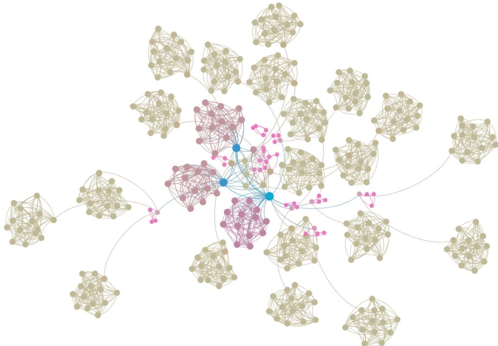

# 2015 年美国大学生数学建模竞赛特等奖论文：组织流失：掷骰子？（C题）

原件为竞赛论文。补充：文中的阅读练习及“参考解答”为整理时增加，原件图文保留出处。

本资料整理自 2015 年 MCM C 题特等奖论文 Team #37075，内容为论文第 1–3 页（共 9 部分中的第 1 部分），包括摘要、目录及引言、基本假设和预备知识部分。

## 一、摘要与目录

### 摘要

Network science is essential in many interdisciplinary studies due to its potential to deal with complex systems. Since the organization of ICM forms a network structure, network science can be utilized to analyze dynamic processes within the company, e.g. the diffusion effects of organizational churn.

In this paper, we construct a Human Capital network according to the hierarchical structure of ICM and create a simple yet effective model to capture the dynamic processes, which includes organizational churn, promotion and recruitment. For organizational churn, we propose and implement our probabilistic churn model inspired by Bayesian learning principles, which estimates and updates the likelihood of individual churn using the Beta-Binomial distribution. Then we develop three promotion measures based on working experience, inclination to churn, and closeness centrality. Moreover, we propose several means of controlling the recruitment rate from the HR manager's perspective, and further define some key concepts for evaluation, such as dissatisfaction and productivity.

Through extensive simulations, we show that our model is flexible enough to encompass most features of the current situation and yield convincing productivity and cost results. We further extend our model to scenarios with higher churn rates, and discover an interesting fact that higher churn rates lead to lower productivity-cost ratios. In an extreme case with no recruitment, we discover differentiated HR health degeneration among different offices over two years through visualization.

Ultimately, we incorporate methods from team science and approaches from multilayer networks in our context to combine Human Capital network with other network layers and discuss how to improve our estimation on organizational churn.

In summary, our model is powerful and reliable for various types of human capital dynamic processes. Nevertheless, there are some existing problems such as simulation volatility which introduces extra computational costs.

更多数学建模资料请关注微店店铺“数学建模学习交流” https://k.weidian.com/RHO6PSpA

知识点：[人力资本网络模型（Human Capital Network, HCM）](../../../topics/数学建模/renli_ziben.md)、[员工流失意向评估（Turnover Contagion、中心度、前员工影响）](../../../topics/数学建模/liuxin_chuanran.md)、[多重网络/多层网络构建（Multiplex/Multi-layer Network）](../../../topics/数学建模/duoceng_wangluo.md)

### 目录

1 Introduction 2
2 Fundamental Assumptions 2
3 Preliminaries 3
3.1 Constructing Human Capital Network . . . . . . . . . . . . . . . . . . . . . . . . . . . . . . . . . . . . . . . . . . . . . . . . . . . . . . . . . . . . . . . . . . . . . . . . . . . .
3.2 Terms and Mathematical Notations . . . . . . . . . . . . . . . . . . . . . . . . . . . . . . . . . . . . . . . . . . . . . . . . . . . . . . . . . . . . . . . . . . . . . . . . . . . . . . . . . . . . . . . . . . . . . . . . . . . . . . . . . . . . . . . . . . . . . . . . . . . . . . . . . . . . . . . . . . . . . . . . . . . . . . . . . . . . . . . . . . . . . . . . . . . . . . . . . . . . . . . . . . . . . . . . . . . . . . . . . . . . . . . . . . . . . . . . . . . . . . . . . . . . . . . . . . . . . . . . . . . . . . . . . . . . . . . . . . . . . . . . . . . . . . . . . . . . . . . . . . . . . . . . . . . . . . . . . . . . . . . . . . . . . . . . . . . . . . . . . . . . . . . . . . . . . . . . . . . . . . . . . . . . . . . . . . . . . . . . . . . . . . . . . . . . . . . . . . . . . . . . . . . . . . . . . . . . . . . . . . . . . . . . . . . . . . . . . . . . . . . . . . . . . . . . . . . . . . . . . . . . . . . . . . . . . . . . . . . . . . . . . . . . . . . . . . . . . . . . . . . . . . . ....... . . . . . . . . . . . . . . . . . . . . . . . . . . . . . . . . . . . . . . . . . . . . . . . . . . . . . . . . . . . . . . . . . . . . . . . . . . . . . . . . . . . . . . . . . . . . . . . . . . . . . . . . . . . . . . . . . . . . . . . . . . . . . . . . . . . . . . . . . . . . . . . . . . . . . . . . . . . . . . . . . . . . . . . . . . . . . . . . . . . . . . . . . . . . . . . . . . . . . . . . . . . . . . . . . . . . . . . . . . . . . . . . . . . . . . . . . . . . . . . . . . . . . . . . . . . . . . . . . . . . . . . . . . . . . . . . . . . . . . . . . . . . . . . . . . . . . . . . . . . . . . . . . . . . . . . . . . . . . . . . . . . . . . . . . . . . . . . . . . . . . . . . . . . . . . . . . . . . . . . . . . . . . . . . . . . . . . . . . . . . . . . . . . . . . . . . . . . . . . . . . . . . . . . . . . . . . . . . . . . . . . . . . . . . . . . . . . . . . . . . . . . . . . . . . . . . . . . . . . . . . . . . . . . . . . . . . . . . . . . . . . . . . . . . . ....... . . . . . . . . . . . . . . . . . . . . . . . . . . . . . . . . . . . . . . . . . . . . . . . . . . . . . . . . . . . . . . . . . . . . . . . . . . . . . . . . . . . . . . . . . . . . . . . . . . . . . . . . . . . . . . . . . . . . . . . . . . . . . . . . . . . . . . . . . . . . . . . . . . . . . . . . . . . . . . . . . . . . . . . . . . . . . . . . . . . . . . . . . . . . . . . . . . . . . . . . . . . . . . . . . . . . . . . . . . . . . . . . . . . . . . . . . . . . . . . . . . . . . . . . . . . . . . . . . . . . . . . . . . . . . . . . . . . . . . . . . . . . . . . . . . . . . . . . . . . . . . . . . . . . . . . . . . . . . . . . . . . . . . . . . . . . . . . . . . . . . . . . . . . . . . . . . . . . . . . . . . . . . . . . . . . . . . . . . . . . . . . . . . . . . . . . . . . . . . . . . . . . . . . . . . . . . . . . . . . . . . . . . . . . . . . . . . . . . . . . . . . . . . . . . . . . . . . . . . . . . . . . . . . . . . . . . . . . . . . . . . . . . . . . . . . . .......

# 2015 年美国大学生数学建模竞赛特等奖论文：组织流失：掷骰子？（C题）

本资料为《2015 年美国大学生数学建模竞赛特等奖论文：组织流失：掷骰子？》习题部分的第 2 部分整理，主要涵盖人力资本网络的构建及术语定义。

## 3 Preliminaries

知识点：[人力资本网络模型（Human Capital Network, HCM）](../../../topics/数学建模/renli_ziben.md)、[静态合作网络与隶属关系网络（Affiliation Network）](../../../topics/数学建模/jingtai_hezuo.md)、[符号说明与术语定义（Nomenclature / Symbols and Definitions）](../../../topics/数学建模/fuhao_shuoming.md)

### 3.1 Constructing Human Capital Network

首先，我们将问题中给出的表格和图合并，基于几个合理的假设对职位条目分配层级：

- 每位高级/初级经理在办公室都有一名文员负责行政事务。
- 如果员工的办公室在组织图中离 CEO 更近，其职位层级往往更高。
- 经理的职位层级不能低于组织图中属于较低层级的某人。

因此，我们可以得到以下 370 个职位的分配表：
*1: Senior Manager (高级经理)
2: Junior Manager (初级经理)
3: Experienced Supervisor (资深主管)
4: Inexperienced Supervisor (初级主管)
5: Experienced Employee (资深员工)
6: Inexperienced Employee (初级员工)
7: Administrative Clerk (行政文员)*

Table 1: The distribution of staff in different positions

| Tier | level Position | 1 | 2 | 3 | 4 | 5 | 6 | 7 | Total |
| :--- | :--- | :--- | :--- | :--- | :--- | :--- | :--- | :--- | :--- |
| 1 | CEO | 2 | 0 | 0 | 0 | 0 | 0 | 2 | 4 |
| 2 | Research | 1 | 0 | 0 | 0 | 2 | 0 | 1 | 4 |
| | CIO | 1 | 2 | 0 | 0 | 8 | 0 | 3 | 14 |
| | CFO | 1 | 2 | 0 | 0 | 8 | 0 | 3 | 14 |
| | HR | 0 | 1 | 0 | 0 | 2 | 0 | 1 | 4 |
| | VP | 2 | 0 | 0 | 0 | 0 | 0 | 2 | 4 |
| | Facilities | 1 | 0 | 0 | 0 | 2 | 0 | 1 | 4 |
| | Sales Marketing | 1 | 0 | 0 | 0 | 2 | 0 | 1 | 4 |
| 3 | Networks | 0 | 1 | 1 | 0 | 11 | 0 | 1 | 14 |
| | Information | 0 | 1 | 1 | 0 | 11 | 0 | 1 | 14 |
| | Program Manager | 0 | 1 | 1 | 0 | 6 | 5 | 1 | 14 |
| | Production Manager | 1 | 1 | 0 | 0 | 10 | 0 | 2 | 14 |
| | Plant Blue | 0 | 1 | 1 | 0 | 6 | 5 | 1 | 14 |
| | Plant Green | 0 | 1 | 1 | 0 | 6 | 5 | 1 | 14 |
| | Regional | 0 | 1 | 1 | 0 | 6 | 5 | 1 | 14 |
| | World Wide | 0 | 1 | 1 | 0 | 6 | 5 | 1 | 14 |
| | Internet | 0 | 1 | 1 | 0 | 6 | 5 | 1 | 14 |
| 4 | Director | 0 | 6 | 6 | 0 | 6 | 0 | 6 | 24 |
| 5 | Branch | 0 | 0 | 11 | 25 | 12 | 120 | 0 | 168 |
| | Total | 10 | 20 | 25 | 25 | 110 | 150 | 30 | 370 |

我们开始在 ICM 中构建人力资本网络。定义 $V(G) = \{ v_1, v_2, ..., v_{370} \}$ 为所有职位的集合。每个节点代表一个职位。定义 $E(G)$ 为网络中的边集。如果满足以下条件之一，则 $(v_i, v_j) \in E(G)$：

- i 和 j 在同一办公室。在这里，组织图中的一个条目被视为一个办公室，无论它由两个部门组成还是只有四名员工。
- i 是某个办公室的负责人，而 j 是直接相关的上级办公室或同级办公室的负责人。在这里，办公室内职位最高的人员被视为该办公室的负责人，例如 Networks 办公室的初级经理和 Branch 办公室的资深主管。
- i 和 j 都是高级经理。

$G = \{ V(G), E(G) \}$ 定义了人力资本网络的图。然后我们在 Figure 1 中可视化了这个网络。

知识点：[人力资本网络模型（Human Capital Network, HCM）](../../../topics/数学建模/renli_ziben.md)、[多重网络/多层网络构建（Multiplex/Multi-layer Network）](../../../topics/数学建模/duoceng_wangluo.md)、[一般假设及其合理性说明（Assumptions and Justifications）](../../../topics/数学建模/jiaben_shezhi.md)

### 3.2 Terms and Mathematical Notations

为了在整篇论文中保持清晰和一致，我们现在确定一些术语和数学符号：

- Level: 职位层级，如经理、主管或员工。
- Abbreviations: 我们为每个层级分配一个缩写：SE-Senior Executive (高级执行官), JE - Junior Executive (初级执行官), ES - Experienced Supervisor (资深主管), IS - Inexperienced Supervisor (初级主管), EE - Experienced Employee (资深员工), IE - Inexperienced Employee (初级员工), AC - Administrative Clerk (行政文员)。
- t: 时间是离散的，最小时间间隔为一个月。
- $\Omega^{(t)}$: 在 t 结束时离开公司的人员集合。
- $\Theta^{(t)}$: 在 t 开始时被招聘到公司的人员集合。

## 4 Models

We construct our analysis by modeling the dynamic processes of staff churn, promotion and recruitment. Our probabilistic model for staff churn inspired by Bayesian learning principles, which estimates and updates the likelihood of individual churn using the Beta-Bernoulli distribution. Next, we develop three promotion measures. Moreover, we propose several means of controlling the recruitment rate.

知识点：[符号说明与术语定义（Nomenclature / Symbols and Definitions）](../../../topics/数学建模/fuhao_shuoming.md)、[一般假设及其合理性说明（Assumptions and Justifications）](../../../topics/数学建模/jiaben_shezhi.md)

### 4.1 Modeling Staff Churn

#### 4.1.1 Preliminaries

In recent studies, Bayesian learning has been used to analyze information aggregation in social networks[1], in which individuals modify their decision based on previous outcomes of other individuals in the network.

For the sake of explaining our intuition, consider a simple Bayesian learning process. Suppose an random variable $u \in \{ 0 , 1 \}$ is drawn from a Bernoulli distribution, where $p$ is unknown:

$$
u \sim \operatorname{Bernoulli} (u; p) = p ^ {u} (1 - p) ^ {1 - u}\tag{1}
$$

Assume an observer wants to estimate the parameter $p$ by drawing multiple $u ^ { \prime } s$ . The individual has a prior estimation $f ( \boldsymbol p )$ on $p ,$ which is described as a Beta distribution1

$$
f (p) = \operatorname{Beta} (p; \alpha , \beta) = \frac {p ^ {\alpha - 1} (1 - p) ^ {\beta - 1}}{\mathrm{B} (\alpha , \beta)}\tag{2}
$$

where $\mathrm { B } ( \alpha , \beta )$ is the normalization constant. When seeing an outcome of $u = 1$ , the observer updates his prior according to the Bayes’ law 2: $f ( p ) \propto ( p ^ { \alpha - 1 } ( 1 - p ) ^ { \beta - 1 } ) \cdot p \propto p ^ { \alpha } ( 1 - p ) ^ { \beta - 1 }$ , which can be viewed as increasing $\alpha$ by 1. Similarly, the observer increases $\beta$ by 1 if an outcome of $u = 0$ is seen. A simple analysis will show that if the number of observations reaches infinity, $\alpha / \beta \to p ,$ , whereas the Beta distribution in this case reduces to a Dirac delta function $\delta ( x - p )$ , indicating that the observer’s estimation converges to the correct $p ,$ regardless of the original prior.

1The Beta distribution is chosen because it is the conjugate prior of the Bernoulli distribution. For more information on conjugate distributions, please refer to [2]

2We ignore the normalization constants for simplicity.

#### 4.1.2 Modeling the Churn Rate

In light of this, we introduce a novel method to model the churn rate, which is conceptually similar to the above Bayesian learning process. Specifically, we view leaving the position as a decision making process: suppose an individual $i$ decides whether to leave or to stay in a particular month $t$ based on a random variable $u _ { i } ^ { ( t ) } \in \{ 0 , 1 \}$ , where $u _ { i } ^ { ( t ) } = 0$ indicates to leave, and $u _ { i } ^ { ( t ) } = 1$ indicates to stay.

$u _ { i } ^ { ( t ) }$ is drawn as follows: First, we assume two hyperparameters $\alpha _ { i } ^ { ( t ) }$ and $\beta _ { i } ^ { ( t ) }$ for $i ,$ and draw $p _ { i } ^ { ( t ) } \sim \mathrm { B e t a } ( \alpha _ { i } ^ { ( t ) } , \beta _ { i } ^ { ( t ) } ) .$ ; then we draw $u _ { i } ^ { ( t ) } \sim$ Bernoulli $( p _ { i } ^ { ( t ) } )$ ; finally, we determine $i$ is to stay if $u _ { i } ^ { ( t ) } = 1 ;$ to leave otherwise.

Integrating out the random variable $p _ { i } ^ { ( t ) }$ , we notice that the distribution of $u _ { i } ^ { ( t ) }$ is a specification of the Beta-Binomial distribution3 with mean $\alpha / ( \alpha + \beta )$ and variance $( \alpha \beta ) / ( ( \alpha + \beta ) ^ { 2 } )$ , which has some nice properties for modeling the churn process: on the one hand, we can easily estimate $i ^ { \prime } { \bf s }$ probability to leave, which is equal to ${ \hat { \beta _ { i } ^ { ( t ) } } } / ( \alpha _ { i } ^ { ( t ) } + \beta _ { i } ^ { ( t ) } ) ;$ on the other hand, an increase in $\alpha _ { i }$ decreases $i \prime \mathrm { s }$ tendency to leave, while an increase in $\beta _ { i }$ increases the tendency to stay. However, three problems remain: How to determine the prior $\alpha _ { i }$ and $\beta _ { i } ?$ How to update the hyperparameters? How to take the network structure into account? We will explain these problems in the following paragraphs.

**Determining the Prior** Given a churn rate $p ,$ we can easily model the effect of a churn rate of $p$ per year by setting $\beta / ( \alpha + \beta ) = p / 1 2$ . We further observe that the variance of the Beta distribution is $\frac { \alpha \beta } { ( \alpha + \beta ) ^ { 2 } ( \alpha + \beta + 1 ) }$ , so that larger $( \alpha + \beta )$ leads to smaller variance, indicating better estimation of $p ,$ and more knowledge to the company status. Thus, it is safe to assume that people on high level positions have a larger $( \alpha + \beta )$ compared to others, and their decisions are less volatile.

**Updating $\alpha _ { i } ^ { ( t ) }$ and $\beta _ { i } ^ { ( t ) }$ ** We notice that in ICM, an individual is more likely to churn if he is connected to other individuals who have churned. This can be described as a learning process for the individual: each month, he observes the decision made by other individuals in last month. For every observation of "to stay", the individual increases his $\alpha ;$ for every observation of "to leave", the individual increases his $\beta .$ We normalize the update values, so that every month, an individual’s $( \alpha + \beta )$ increases by 1.

**Information Reduction** The impact of churn information vary upon the distances between the source and destination. From an individual’s perspective, the resignation of someone in the same department should have a greater impact than that of someone from another department. We take this into account by reducing the update value of the hyperparameters. Empirically, we reduce the update by $d ^ { 2 }$ if the information takes at least $d$ steps to transmit.

3For simplicity, we call this the Beta-Bernoulli distribution.

知识点：[先验概率分布模型（随机下降与初始概率密度函数 PDF）](../../../topics/数学建模/xianyan_gailv.md)、[离职事件（Demission/Turnover Event）定义与算法](../../../topics/数学建模/lizhi_suanfa.md)、[员工流失意向评估（Turnover Contagion、中心度、前员工影响）](../../../topics/数学建模/liuxin_chuanran.md)

### 4.1.3 An Algorithm for the Churn Model

To summarize, we introduce an algorithm for this process. For every individual $i$:

- Sample the churn result for month $t$ using hyperparameters $\alpha_{i,t}$ and $\beta_{i,t}$, and determine whether to stay or to leave;
- If $i$ decides to stay, initialize two variables $\hat{\alpha}$ and $\hat{\beta}$ for update;
- For every individual $j$ in $\Gamma^{(t)} \setminus \Theta^{(t)}$ (individuals who stays), update $\hat{\alpha} = \hat{\alpha} + \frac{1}{d_{ij}^{(t)}}$;
- For every individual $j$ in $\Omega^{(t)}$, update $\hat{\beta} = \hat{\beta} + \frac{1}{d_{ij}^{(t)}}$;
- Update $\alpha_{i}^{(t+1)} = \alpha_{i}^{(t)} + \frac{\hat{\alpha}}{\hat{\alpha} + \hat{\beta}}$, and $\beta_{i}^{(t+1)} = \beta_{i}^{(t)} + \frac{\hat{\beta}}{\hat{\alpha} + \hat{\beta}}$.

知识点：[员工流失意向评估（Turnover Contagion、中心度、前员工影响）](../../../topics/数学建模/liuxin_chuanran.md)、[离职事件（Demission/Turnover Event）定义与算法](../../../topics/数学建模/lizhi_suanfa.md)、[先验概率分布模型（随机下降与初始概率密度函数 PDF）](../../../topics/数学建模/xianyan_gailv.md)

### 4.2 Modeling HR Manager’s Reactions

After modeling the churn process, we need to consider the strategic process of filling the vacancy from the perspective of the HR manager, which combines promotion strategies and recruitment strategies. Since recruiting a higher level position usually requires more time and money compared to promoting a low-level staff and then recruiting new staff for that vacancy, a rational HR manager would always prefer promoting to recruiting whenever possible. This allows us to consider these two aspects separately.

#### 4.2.1 Promotion Models

We summarize some basic rules for promotion:

- The HR manager does not read the annual evaluation report, thus does not know anything about the matching between staff and positions. In this way, he will not consider changing staff within one level.
- His first choice is to promote someone that has reached the experience requirement to fill the vacancy. If no person is qualified and recruiting resources are permitted, he will then post recruitment need for this position on the next.
- If during the time the recruitment need is posted, he finds that there is one person’s experience has reached the requirement. He will directly promote the first such person and cancel the recruitment post.
- He will not promote a clerk because recruiting an inexperienced employee is cheaper and less time-consuming than recruiting a clerk. In other words, a "naive" manager never promotes a clerk.

Under current situations, the HR manager has no knowledge about the capabilities of an employee, nor their probability to leave. Therefore, to make the promotion process fair, the HR manager should choose the employee on the lower level with the longest working experiences. Hence, we have the following strategy:

**Experience Oriented**
For a vacancy on level $l$ ($l < 6$), select the employee on level $l + 1$ with longest working experiences; the employee should also satisfy the promotion requirements. If nobody is available, start recruiting.

If the HR manager happens to learn the churn model previously mentioned, he can make inference on the probability of churn of an individual, thus introducing a slight improvement over the experience oriented model:

**Dissatisfaction Oriented**
For a vacancy on level $l$ ($l < 6$), select the employee with the largest $\beta/\alpha$ (or the highest churn probability) among all the employees on level $l + 1$ who satisfy the promotion requirements. If nobody is available, start recruiting.

The HR manager can also take the Human Capital network structure into consideration by promoting the employee with the largest centrality:

**Centrality Oriented**
For a vacancy on level $l$, select the employee with the largest closeness centrality (tends to be greater when the employee is in the middle of the network) from the qualified employees on level $l + 1$. If nobody is available, start recruiting.

#### 4.2.2 Recruitment Models

We make the following assumptions on the recruiting strategies:

- The HR manager has a maximum possible effort to recruit. He cannot post more recruitment than this maximum because of his ability and resource limits. The maximum effort is not affected when there is vacancy in HR office.
- When the number of vacant positions is higher than the maximum effort, he ranks the vacant positions from higher level to lower level, and only try to recruit the positions with the highest levels. In other words, he will prioritize recruiting a manager over recruiting an employee.
- He can only renew his recruitment post over a length of period, e.g. quarterly or semi-annually.

Thus, the HR manager has two direct means to increase the recruitment rate: he can either increase the resource limits, so that more people will be recruited in a fixed time period, or simply increase the frequency of the renewal of his recruit post. Also, the HR can control the promotion rate by setting different thresholds for promotion, which is also an indirect method of controlling recruitment.

知识点：[晋升事件（Promotion Event）算法](../../../topics/数学建模/jinsheng_suanfa.md)、[招聘与结算事件（Recruitment & Settlement Event）算法](../../../topics/数学建模/zhaopin_suanfa.md)、[人力资本网络模型（Human Capital Network, HCM）](../../../topics/数学建模/renli_ziben.md)

### 4.3 Model Functions

Till now, our models have already encompassed a large variety of mentioned features in ICM company, including:

- The information web captures how "churn" diffuses among staff members.
- The risk of churn can be identified in early stage by observing each staff member’s $\beta / \alpha$. The higher $\beta / \alpha$ is, the more likely the staff member chooses to leave.

知识点：[员工流失意向评估（Turnover Contagion、中心度、前员工影响）](../../../topics/数学建模/liuxin_chuanran.md)、[人力资本网络模型（Human Capital Network, HCM）](../../../topics/数学建模/renli_ziben.md)

### 5.1 Task 1: Simulations under Current Situation

In this section, we first present our basic simulation results of current situation. Figure 2 shows the churn rate in different level of positions in 50 simulations. The churn rate of middle-manager (JE, ES and IS) is roughly 30% and the churn rate for other positions (SE, EE, IE and AC) is around 15%. The overall churn rate of the company is relatively stable at 18%, which can accurately depict the current situation of ICM.

Another feature of ICM is that churn rate is steadily increasing.[^4] The simulation result in Figure 3 does exhibit similar trend. We show the overall churn rate in next five years. In spite of a couple of outliers, the major trend can be easily seen in the boxplot. The median value of churn rate has shown a slow but steady increase, from 18% in the first year to 20% in the fifth year.

[^4]: Although our model should maintain the same churn rate in expectation, we can make slight, tractable modifications to simulate the steadily increasing process. Given our current $\alpha$ and if we want next month’s churn rate to increase by $\Delta p$, we can achieve that by multiplying $\hat{\beta}$ by
$$
\frac{\beta}{\alpha + \beta} \cdot \frac{1}{1 + \Delta p \cdot \frac{\beta}{(\alpha+\beta)^2+(\alpha+\beta)}}
$$
Hence, the expected [churn rate] for next month increases by $\Delta p$.

知识点：[员工流失意向评估（Turnover Contagion、中心度、前员工影响）](../../../topics/数学建模/liuxin_chuanran.md)、[模型参数的确定（基于数据拟合或实验选择）](../../../topics/数学建模/canshu_queding.md)

### 5.2 Task 2: Defining Productivity and Testing Churn Influences

To define a metric to measure this company’s organizational productivity, we start from the individual level. This metric should incorporate the following three aspects:

**Position Level**
People in different levels surely make different contribution to the overall performance of a company. We reasonably assume the relative average annual salary of $i$’s level, $S _ { i } ^ { ( t ) }$, can properly reflect his actual level contribution.

**Training experience**
Experience in his current position contributes to one’s productivity. We use the training cost the company spent on the individual since he began working in the current position as a proxy of his experience, denoted by $T _ { i } ^ { ( t ) } * t _ { i } ^ { ( t ) }$.

**Dissatisfaction**
An individual more unsatisfied with current situation tends to work less inefficiently, leading to lower productivity. We calculate $i$’s dissatisfaction $\sigma _ { i } ^ { ( t ) }$ as:

$$
\sigma_ {i} ^ {(t)} = \sum_ {\tau = t - t _ {i} ^ {(t)} + 1} ^ {t - 1} e ^ {- (\tau - (t - 1))} \sum_ {j \in \Omega^ {(\tau)}} \frac {1}{d _ {i j} ^ {(\tau) 2}}
$$

# 2015 年美国大学生数学建模竞赛特等奖论文：组织流失：掷骰子？（C题）

本部分为习题第 6 部分，整理自《2015 年美国大学生数学建模竞赛特等奖论文：组织流失：掷骰子？（C题）》第 12–14 页内容。

## 一、模型构建与计算

知识点：[人力资本网络模型（Human Capital Network, HCM）](../../../topics/数学建模/renli_ziben.md)、[生产率与成本模型（Productivity and Costs of HCM）](../../../topics/数学建模/shengchan_liebian.md)、[离职事件（Demission/Turnover Event）定义与算法](../../../topics/数学建模/lizhi_suanfa.md)

### 选择 1

**题干：**
个体 $i$ 在时间 $t$ 的生产力计算公式及其组成部分。

根据原文，首先对 $\sigma_i^{(t)}$进行归一化处理，形式为 $\frac{1}{1 + \alpha \ln (1 + \sigma_i^{(t)})}$，其中 $\alpha$ 是反映不满影响的参数，文中设定 $\alpha = 0.1$。指数项用于描述记忆的衰减。结合三个分量，个体生产力公式为：

$$
p_{i}^{(t)} = \frac{1}{1 + \alpha \ln (1 + \sigma_ {i}^{(t)})} (S _ {i}^{(t)} + T _ {i}^{(t)} * t _ {i}^{(t)})
$$

组织生产力采用加权总和计算，权重 $w_i^{(t)}$ 由信息网络结构决定，此处使用接近中心性（closeness centrality）来反映重要性。组织生产力定义为：

$$
P^{(t)} = \sum_{i \in \Gamma^{(t)}} w_{i}^{(t)} * p_{i}^{(t)} = \sum_{i \in \Gamma^{(t)}} p_{i}^{(t)} \sum_{v \in V(G) \backslash f^{(t)-1}(i)} \frac{d(v, f^{(t)-1}(i))}{370 - 1}
$$

通过该度量可以追踪组织生产力的动态变化，并区分与个人辞职相关的两种效应：
1. **直接效应（Direct Effect）**：离职个体的生产力损失。
2. **间接效应（Indirect Effect）**：辞职后剩余员工不满增加导致的生产力损失。

具体公式如下：

$$
\begin{array}{c}
DE^{(t)} = \sum_{i \in \Omega^{(t)}} w_{i}^{(t)} * p_{i}^{(t)} \\
IE^{(t)} = \sum_{i \in \Gamma^{(t)} \backslash \Omega^{(t)}} w_{i}^{(t)} * (\frac{1}{1 + \alpha \ln (1 + e^{-1} \sigma_ {i}^{(t)})} - \frac{1}{1 + \alpha \ln (1 + \sigma_ {i}^{(t+1)})}) (S _ {i}^{(t)} + T _ {i}^{(t)} * t _ {i}^{(t)})
\end{array}
$$

答案：上述公式及定义即为个体与组织生产力及其分解效应的完整表达。

知识点：[生产率与成本模型（Productivity and Costs of HCM）](../../../topics/数学建模/shengchan_liebian.md)、[静态合作网络与隶属关系网络（Affiliation Network）](../../../topics/数学建模/jingtai_hezuo.md)、[离职事件（Demission/Turnover Event）定义与算法](../../../topics/数学建模/lizhi_suanfa.md)

### 选择 2

**题干：**
基于上述模型模拟得出的关于人员流动对组织生产力影响的主要观察结果。

团队在未来五年内进行了 50 次模拟并取平均值，结果如图 4 所示（注：图 4 占位）。主要观察结果包括：
1. 直接效应和间接效应与离职员工数量紧密相关。一个人的离职大约造成 20 单位的直接效应和 25 单位的间接效应。
2. 总组织生产力每月约为 2000-2500 单位，因此一人离职成本占总生产力的约 2%。
3. 间接效应与直接效应的比率在模拟中保持稳定，且前者大于后者。参数 $\alpha$ 反映了个人如何看待他人的辞职行为。

答案：一人离职造成约 20 单位直接效应和 25 单位间接效应，占总生产力约 2%，且间接效应通常大于直接效应。

知识点：[生产率与成本模型（Productivity and Costs of HCM）](../../../topics/数学建模/shengchan_liebian.md)、[直接和间接控制矩阵及扰动矩阵（外部效应分析）](../../../topics/数学建模/kongzhi_juzhen.md)、[员工流失意向评估（Turnover Contagion、中心度、前员工影响）](../../../topics/数学建模/liuxin_chuanran.md)

### 简答 1

**题干：**
任务 3：预算计算。考虑与公司人力资本相关的预算，包括哪些组成部分？各项成本如何假设？

**正文：**
公司预算由三个部分组成：员工工资、招聘成本和培训成本。为了简化计算，如前所述，同一职位级别的所有 individuals 具有相同的工资和培训成本，且每个职位级别的招聘成本是统一的。所有成本在相应的时间跨度内均匀分布。

模拟结果显示（图 5 占位），每六个月计算一次成本。平均而言，每六个月的招聘成本和培训成本分别约为 $7\sigma$ 和 $37\sigma$。然而，它们仅占总成本的一小部分，因为尚未报告占最大部分的工资成本。

答案：预算由员工工资、招聘成本和培训成本组成。假设同级别人员工资和培训成本相同，招聘成本统一，且成本在时间跨度内均匀分布。

知识点：[员工流失意向评估（Turnover Contagion、中心度、前员工影响）](../../../topics/数学建模/liuxin_chuanran.md)、[晋升事件（Promotion Event）算法](../../../topics/数学建模/jinsheng_suanfa.md)、[人力资本网络模型（Human Capital Network, HCM）](../../../topics/数学建模/renli_ziben.md)

### 简答 2

**题干：**
任务 4：改变流失率。当平均流失率从当前的 18% 增加到 25% 和 35% 时，公司的员工数量、生产力和成本有何变化？HR 经理应如何调整策略以维持现状？

**正文：**
团队在 ICM 下针对不同流失率运行模拟，假设平均流失率从当前的 18% 增加到 25% 和 35%。为此，只需调整 $\beta$ 到 $\alpha$ 的比率：对于每年 25% 的流失率，令 $\beta / \alpha = 0.25/12 = 0.02083$；对于每年 35% 的流失率，令 $\beta / \alpha = 0.35/12 = 0.02916$。

模拟 50 次取平均，结果如图 6 所示（注：图 6 占位）。折线图反映了不同流失率下未来 20 年员工数量、月组织生产力和月成本的变化趋势。
1. **员工数量**：在 18% 流失率下，公司长期保持 80% 的职位，即约 300 名员工。如果流失率增加到 25% 或 35%，员工数量在前六年急剧下降，然后逐渐稳定，分别 settles down 在约 60% 和 40% 的满员状态。
2. **生产力与成本**：高流失率导致更多人离开，引起更高的直接和间接效应。组织生产力下降了约 30% 和 50%。虽然高流失率导致更高的招聘成本，但与因员工减少而大幅降低的工资和培训成本相比，这是次要的。成本下降了近 20% 和 40%。

为了维持当前的百分比状态，人力资源经理应改变招聘策略。在基线模拟中，更新招聘帖子的时间周期为 6 个月，招聘力度为 9%。现在需要改变这两个参数以快速填补空缺：
- 在 25% 流失率下，将更新间隔改为 4 个月，招聘力度改为 8.3%。
- 在 35% 流失率下，将更新间隔改为 3 个月，招聘力度改为 9%。

结果分布如图 7 所示（注：图 7 占位）。在新的晋升策略下，ICM 大致能维持 80% 的产能。其月成本没有显著变化。然而，组织生产力波动很大。在高流失率下，即使员工数量保持不变，生产力也下降了超过 10%。如果使用“单位成本的组织生产力”作为公司资金使用效率的指标，可以从最后一个箱线图看出，公司在较低流失率下运行效率更高。

脚注说明：由于空间有限，无法提供完整的统计结果来证明模拟中的流失率确实为 25% 和 35%。但可以通过以下方法估计：观察到不同流失率下的招聘率稳定，因此 35% 流失率下稳定状态的员工比例应约为 $80 \times 18/35 \sim 42$  percent。这在图 6 的上图中显而易见。

答案：
1. 高流失率导致员工数量大幅下降并稳定在更低水平（60% 或 40%），生产力下降 30%-50%，总成本下降 20%-40%。
2. HR 需缩短招聘更新间隔并提高招聘力度（如 25% 流失率下改为 4 个月/8.3%；35% 下改为 3 个月/9%）以维持 80% 产能。
3. 低流失率下资金使用效率更高。

# 2015 年美国大学生数学建模竞赛特等奖论文：组织流失：掷骰子？（C题）

本节整理自《2015 年美国大学生数学建模竞赛特等奖论文：组织流失：掷骰子？（C题）》第 7 部分（共 9 部分），对应原文第 15–17 页内容，主要涉及纯晋升与人力资源健康评估、策略比较以及团队科学与多层网络的扩展模型。

## 一、任务分析

知识点：[多重网络/多层网络构建（Multiplex/Multi-layer Network）](../../../topics/数学建模/duoceng_wangluo.md)、[人力资本网络模型（Human Capital Network, HCM）](../../../topics/数学建模/renli_ziben.md)、[静态合作网络与隶属关系网络（Affiliation Network）](../../../topics/数学建模/jingtai_hezuo.md)

### 简答 1

**题干：** 在没有任何外部招聘的情况下，评估不同流失率对人力资源健康的影响，并分析不同晋升策略的效果。

**正文：**

#### 5.5 Task 5: Pure Promotion and HR Health

设定了多个场景以评估不同流失率的影响后，我们现在应用我们的方法来识别在没有外部招聘情况下对人力资源健康的影响。显然，随着惊人的流失率，不招聘任何人肯定会导致员工人数、成本和生产力的下降，因此我们将重点放在不同办公室的员工人数上。我们修改模型以消除外部招聘（从而只允许流失和晋升），并估算各办公室员工的百分比。为了更准确的估算，我们假设员工的工作经验年限呈均匀随机分布，这样每个层级中有四分之一的员工有资格晋升。

我们在图 8 中可视化了结果。我们发现，第 1 层和第 2 层的办公室保持了良好的健康状况，而较低层级的办公室的人力资源健康遭受了显著减少。这一结论乍一看相当反直觉，因为中层管理者往往具有较高的流失率，但考虑到低级职位不由招聘补充，而高级职位可以通过晋升维持，这又非常合理。我们报告称，2 年后剩余的员工人数约为 204 人，这与理论值6接近。

6理论值为 $370 \times 0.85 \times (1 - (325 \times 0.18 + 45 \times 0.30)/370)^2 = 204.01$

#### 5.6 Comparing among Strategies

现在我们要通过采用一些替代策略来改善当前状况。目前，当决定在所有符合条件的候选人中提拔谁时，人力资源经理会选择工作时间最长（Experience）的人。我们考虑之前讨论过的另外两种方式：按信息网络中的中心性选择（Centrality）和按离职可能性选择（Likelihood）。我们仍然使用前面章节定义的接近中心性（closeness centrality）。

Table 2: Comparison among Different Strategies

| Different Strategies | Staff Number | Year 2 | Year 4 | Year 6 | Year 8 | Year 10 |
| :--- | :--- | :--- | :--- | :--- | :--- | :--- |
| Experience | Staff Number | 313.0 | 310.7 | 304.9 | 298.8 | 292.9 |
| Centrality | Staff Number | 311.1 | 307.5 | 302.0 | 295.7 | 290.0 |
| Centrality | Increase(%) | -0.60% | -1.04% | -0.94% | -1.01% | -0.99% |
| Likelihood | Staff Number | 311.1 | 309.1 | 308.4 | 303.7 | 300.6 |
| Likelihood | Increase(%) | -0.62% | -0.52% | 1.16% | 1.64% | 2.61% |
| Experience | Productivity | 2574.9 | 2706.2 | 2698.5 | 2651.7 | 2612.8 |
| Centrality | Productivity | 2589.3 | 2789.0 | 2878.6 | 2897.0 | 2916.8 |
| Centrality | Increase(%) | 0.56% | 3.06% | 6.67% | 9.25% | 11.63% |
| Likelihood | Productivity | 2577.8 | 2759.3 | 2872.8 | 2886.0 | 2904.0 |
| Likelihood | Increase(%) | 0.11% | 1.96% | 6.46% | 8.84% | 11.14% |

从表 2 中，我们可以很容易地比较不同的晋升策略。在所有三种策略下，员工人数都在下降，这与 steadily increasing churn rate（稳步增加的流失率）是一致的。但是，十年后，基于 Likelihood 策略的员工人数比基于 Experience 策略高出 2.61%。此外，Centrality 和 Likelihood 策略都能在第十年将组织生产力提高超过 11%。因此，改变晋升策略有助于改善人力资本管理。

知识点：[员工流失意向评估（Turnover Contagion、中心度、前员工影响）](../../../topics/数学建模/liuxin_chuanran.md)、[晋升事件（Promotion Event）算法](../../../topics/数学建模/jinsheng_suanfa.md)、[人力资本网络模型（Human Capital Network, HCM）](../../../topics/数学建模/renli_ziben.md)

### 简答 2

**题干：** 如何将团队科学和多玩家网络研究的结果融入模型，特别是关于“共享认知”的度量方法？

**正文：**

#### 6 Task 6: Extension - Team Science and Multilayers

为了实现人力资源的愿景，我们努力将团队科学和多玩家网络研究的发现应用到我们的模型中。

##### 6.1 Incorporating Team Science

最近关于团队绩效的研究指出了严格建模团队合作的许多可能性[7]。有许多来自团队科学的既定发现可以合并到我们的模型中。最有前景的两个方面与“共享认知”（shared cognition）和“团队训练”（team training）有关。这里我们指出这些可能性，并非正式地定义其中一些。要严谨地纳入它们需要更多的修改。

###### 6.1.1 Shared Cognition

许多研究人员强调，共享认知是塑造团队绩效的关键因素之一[3]。为了更高效地工作，团队成员必须预测其他队友将要做什么以及他们为此需要做什么，以便选择与队友一致且协调的行动[6]。

共享认知可以在不同类型的团队中形成。在我们的背景下，一个合理的选择是一个办公室。在同一办公室工作的员工拥有共同的目标，共享认知可以对其绩效产生积极贡献。已经开发了多种措施来科学地衡量共享认知[3]。我们可以利用这些措施来设计模型的扩展。特别是当给定实证数据（时间和数值共享认知）时，我们可以使用已建立的模型来估算共享认知的增长。我们不会深入探讨这些措施或实证方法的细节。相反，我们在我们的背景下提出了一种可能的衡量标准。

考虑一个包含几个人的办公室 O。我们假设团队认知是可分离且可加的，并专注于成对的 interpersonal relation（人际关系）。定义 $t(i, j)$ 为个体 $i$ 和 $j$ 一起工作的时长。然后我们可以使用 $\sum _ { i \in O } w _ { i } \sum _ { j \in O \backslash \{ i \} } t ^ { 2 } ( i , j )$ 作为共享认知的衡量标准。平方项可以反映认知形成的速度，权重反映相对重要性。

另一种可能性是使用与网络相关的概念。如果两个个体的共同工作时间大于某个阈值，我们可以定义他们是连接的。然后我们可以计算该网络中的平均度数等指标。类似地，我们可以根据个体一起工作的时间长度给每条边赋予权重，并构建一个加权图。

知识点：[多重网络/多层网络构建（Multiplex/Multi-layer Network）](../../../topics/数学建模/duoceng_wangluo.md)、[人力资本网络模型（Human Capital Network, HCM）](../../../topics/数学建模/renli_ziben.md)、[静态合作网络与隶属关系网络（Affiliation Network）](../../../topics/数学建模/jingtai_hezuo.md)

### 6.1.2 Team Training

Another concept that we can potentially utilize in our models is team training. Currently, HR manager does not offer any training to the "team" or "office" as a whole. Like offering individual’s training, we can take into account the team training. Being trained as a team can improve team members’ understanding of each other’s roles, promote teamwork and enhance team performance[4]. We can view team training as an accelerator of team cognition development. So we can multiply the team cognition measure we developed before by a function of team training to reflect this effect.

Adding this process will not directly affect the dynamic process of staff’s leaving and HR manager’s filling vacancy. However, it will affect the productivity of the company by promoting the efficiency of teamwork. This effect may change the decision making of HR manager with the aim to maximize organizational productivity per unit of cost.

知识点：[人力资本网络模型（Human Capital Network, HCM）](../../../topics/数学建模/renli_ziben.md)、[生产率与成本模型（Productivity and Costs of HCM）](../../../topics/数学建模/shengchan_liebian.md)

### 6.2 Incorporating Multilayer Networks

In this section, we will explore the progress made by recent studies about multilayer networks[5] and apply this concept to our company context to help HR achieve better human resource management.

In previous sections, we have formulated a model based on the office organizing structure. This network describes how the information flows among all individuals. However, interpersonal relationship is much more complicated. On the one hand, people are consistently entering and leaving the company, causing a change of structure in the network. On the other hand, people have different types of interaction, such as:

- People in the same office work as a team and usually cooperate with each other more frequently.
- People can be close friends with each other regardless of their positions.
- People can have trust in his/her supervisors, and vice versa.

These interaction networks can provide us with more information, while shedding some light on more complex problems and enabling better solutions to problems that we are currently dealing with. Since we lack data on other layers of networks, it is impossible to implement a simulation. Hence, we provide some rules for connecting the information with other layers, as well as some solutions for better churn rate analysis.

**Network based on position**
Since the information network is already based on position, such networks can be easily connected by introducing coupling edges. A simple example is the supervision networks, which is a tree structure among different positions. Since supervision in office is a strong relationship, information transmitted through supervision is stronger than the average information network. Another example is the teammate relationship, where information is transmitted more frequently.

**Network based on people**
Some relationships - such as friendship and trust - depend on people. Friendship allows for the transmission of more personal information, and trust enables directed transmission of information. Both increase the information intensity, for one tends to accept advice from friends and mentors more often. However, people can switch positions or leave the company, so maintaining a static network is unfeasible. One approach, however, is to introduce direct cross-layer links with length zero from a person node to a position node. A qualified HR manager should track the person-position relationship and modify the structure of the network when necessary.

Now let us assume that we have incorporated teammate, friendship and trust relationship layers to our information network. We provide some improvements over our previous solution to churn rate analysis and productivity estimation.

- Churn information can now also transmit along other layers of networks;
- We reduce our time slice from one month to a week, which allows more frequent information transmission between friends and teammates;
- We increase the impact of turnover decisions made by trusted individuals;
- We take friendship into account when calculating shared cognition, where friends in the same office tend to have increased shared cognition, and hence productivity.

知识点：[多重网络/多层网络构建（Multiplex/Multi-layer Network）](../../../topics/数学建模/duoceng_wangluo.md)、[离职事件（Demission/Turnover Event）定义与算法](../../../topics/数学建模/lizhi_suanfa.md)、[生产率与成本模型（Productivity and Costs of HCM）](../../../topics/数学建模/shengchan_liebian.md)

### 7 Sensitivity Analysis

In this section, we implement sensitivity analysis for our model. Specifically, we test the sensitivity of parameter $\alpha$, which we define in calculating productivity. The value of $\alpha$ is previously 0.1. Now we test the effects when its value is changed to $0.05, 0.06, \dots, 0.10, 0.11, \dots, 0.15$. Figure 9 shows the results.

As we can see, the productivity is insensitive to our parameter $\alpha$. A 50% change in $\alpha$ will bring no more than 5% change in calculated productivity in most cases.

It is quite different if we look into the ratio between indirect effect and direct effect. It is actually sensitive to the change of $\alpha$. When $\alpha$ changes from 0.05 to 0.25, the median value of the ratio changes from less than 2 to nearly 4. However, we have valid reasons for this. Consider how this parameter acts in our model. It is actually a reflection of the psychological impact intensity for how the dissatisfaction in job affects a person’s productivity. This impact, in reality, can come from shared cognition, the closeness between staff members, company morale and other subtle influence. Quite an amount of research has been done for tracking these influences.[8]. So some empirical research may help when we want to determine the actual level of this parameter.

## 8 模型的优势与不足

知识点：[敏感性分析方法（Sensitivity Analysis，单参数与多参数变动）](../../../topics/数学建模/minganxing_fenxi.md)、[模型优缺点分析（Strengths and Weaknesses）](../../../topics/数学建模/youque_dian.md)、[参数合理性验证](../../../topics/数学建模/canshu_heli_xing.md)

### 8.1 优势

- **简洁性**：我们的度量建立在易于理解的原则之上，且计算方式简单。此外，我们对个体特征作了最少的假设：推断时只需 $\alpha$ 和 $\beta$。

- **参数**：我们的大多数策略是非参数的，流失模型的参数具有良好性质，允许进行简单而有效的参数估计，从而将调参需求降至最低。

- **覆盖面**：我们的模型与度量能够模拟与不同流失率、招聘和/或晋升策略相关的各种情形。

- **灵活性**：我们的模型可以方便地与其他假设结合。例如，若假设个体即使没有外部影响也会累积不满，只需在每个时间周期提高 $\beta$ 与 $\alpha$ 之比，即可让模型涵盖这一假设。

- **有说服力的仿真结果**：模型的仿真结果很有说服力。它们不仅有效反映了当前状况，还对变化给公司状况带来的影响给出了有洞见的预测。在任务 4 中，我们发现流失率越高，生产率与成本之比越低。

- **对人力资源的启示**：人力资源部门可以从本文获得相当多的启发，例如如何改变招聘策略以维持所需岗位数量，以及如何通过为可能流失者提供激励来降低流失率。

知识点：[模型优缺点分析（Strengths and Weaknesses）](../../../topics/数学建模/youque_dian.md)、[员工流失意向评估（Turnover Contagion、中心度、前员工影响）](../../../topics/数学建模/liuxin_chuanran.md)、[生产率与成本模型（Productivity and Costs of HCM）](../../../topics/数学建模/shengchan_liebian.md)

### 8.2 不足

- **仿真波动性**：尽管模型具有良好统计性质，不同仿真产生的结果仍波动较大。一种补救办法是增加采样时间，以计算资源为代价降低结果方差。

- **不切实际的假设**：部分度量建立在并不现实的基础上，例如生产率随培训成本线性增长、员工对不同岗位没有偏好等，导致对相应问题的刻画不够完善。

- **假设不完整**：还有一些方面我们未能考虑，例如团队认知对生产率的正向作用。

## 9 结论

我们利用给定的组织结构构建了人力资本网络。在此网络之上，我们设计了一个模型来刻画 ICM 的动态过程，包括流失、晋升与招聘。我们模拟了 ICM 公司的现状，得到相当稳定的流失率与空缺率。结果很好地重现了中层管理者较高的流失率以及持续上升的流失率。

随后我们定义了生产率，将流失的影响分解为直接影响与间接影响并比较二者的相对大小。我们还计算了 ICM 在较长时间跨度上面临的预算。接下来，我们将模型应用于不同情形：流失率上升与晋升策略改变。ICM 无法维持现有产能。与当前按经验晋升相比，按离职可能性晋升可使员工人数增加 2.6%，生产率提高 11.1%。

我们探索了若干丰富模型的潜在途径，讨论了团队科学中的共享认知与团队培训，并将多层网络的一些相关概念应用于此情境，以更好地刻画组织网络。最后，我们通过敏感性分析评估模型，并给出其优势与不足。我们期望本模型能为组织中的人力资本管理提供启发性的见解。

## 参考文献

[1] Daron Acemoglu, Munther A Dahleh, Ilan Lobel, and Asuman Ozdaglar. Bayesian learning in social networks. The Review of Economic Studies, 78(4):1201–1236, 2011.

[2] Christopher M Bishop et al. Pattern recognition and machine learning, chapter 2, volume 4. springer New York, 2006.

[3] Janis A Cannon-Bowers and Eduardo Salas. Reflections on shared cognition. Journal of Organizational Behavior, 22(2):195–202, 2001.

[4] Nancy J Cooke, Eduardo Salas, Preston A Kiekel, and Brian Bell. Advances in measuring team cognition. Team cognition: Understanding the factors that drive process and performance, pages 83–106, 2004.

[5] Mikko Kivelä, Alex Arenas, Marc Barthelemy, James P Gleeson, Yamir Moreno, and Mason A Porter. Multilayer networks. Journal of Complex Networks, 2(3):203–271, 2014.

[6] John E Mathieu, Tonia S Heffner, Gerald F Goodwin, Eduardo Salas, and Janis A Cannon-Bowers. The influence of shared mental models on team process and performance. Journal of applied psychology, 85(2):273, 2000.

[7] Eduardo Salas, Nancy J Cooke, and Michael A Rosen. On teams, teamwork, and team performance: Discoveries and developments. Human Factors: The Journal of the Human Factors and Ergonomics Society, 50(3):540–547, 2008.

[8] Martin EP Seligman and Mihaly Csikszentmihalyi. Positive psychology: An introduction., volume 55. American Psychological Association, 2000.

知识点：[模型优缺点分析（Strengths and Weaknesses）](../../../topics/数学建模/youque_dian.md)、[人力资本网络模型（Human Capital Network, HCM）](../../../topics/数学建模/renli_ziben.md)、[敏感性分析方法（Sensitivity Analysis，单参数与多参数变动）](../../../topics/数学建模/minganxing_fenxi.md)
