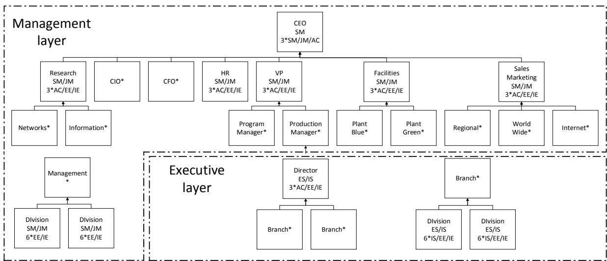
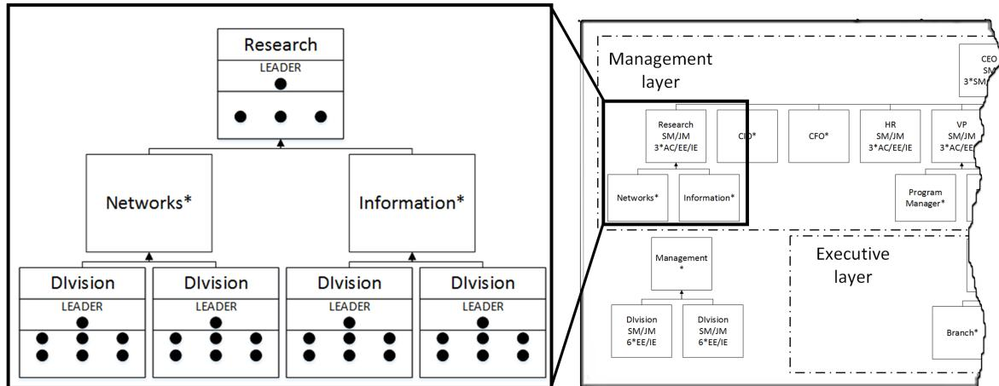
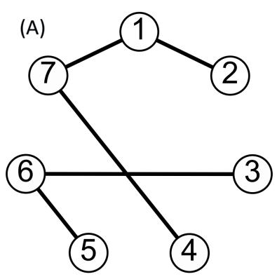
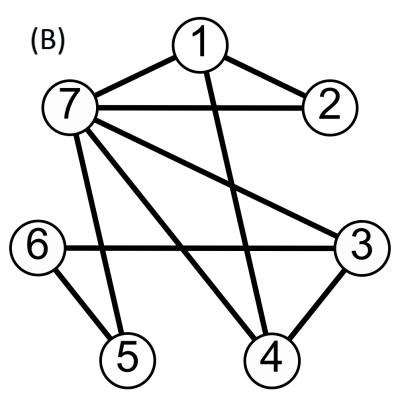
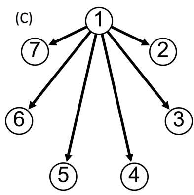
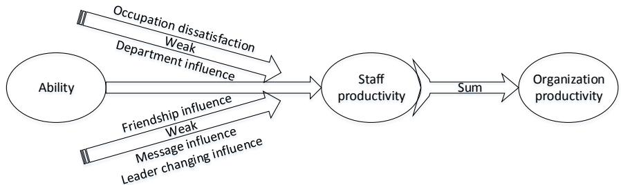

# 2015年MCM/ICM特等奖论文：基于多重网络的人力资本动态模型（Problem C）

原件经识别和整理；“参考解答”是我们补的。

## 2015 Mathematical Contest in Modeling (MCM) Summary Sheet

Simulation company: a dynamic model based on the Multiplex Network

### Summary

In order to build a Human Capital Network model inside an organization, our idea is to establish a comprehensive model with plentiful properties of nodes which are consistent with the actual situations. Therefore, the concept of Multiplex Network is introduced to enrich the nodes' characteristics. What's more, the notion of automaton is applied to present the dynamic process within the company.

Based on the desire for simulating the reality more vividly, a multiplex network with specific assumptions describing the occupation distribution methods is selected rather than a single-layer network. Having considered about the complexity of human beings, four typical layers are explored to describe the relationship within the organization. The four subnets of the multiplex network are Friendship Network, Department Network, Leadership Network and Information Flow Network. The multiplex network of the Human Capital Network is set up after connecting the four layers together. And the four effect indexes, namely, friendship influence index, department influence index, leader changing influence index and message influence index are calculated to evaluate each subnets' impact on the personnels.

Since the static network is gained, the dynamic process is divided into five events covering common scenarios like demission, promotion, transfer, recruitment and settlement to drive the network. Besides, some concepts are defined before the course of evolution. Moreover, the demission index consists of the above four indexes and the occupation dissatisfaction index is proposed to measure the churn rate in the company. And the evaluation on the further influence on organization's productivity is conducted under the churn value of 18% in a decade.

The prediction about the company's budget in the next two years indicates the ability of the algorithm serving for the above five events. After simulations of the process, the total recruiting budget is 32.8σ and the budget of training is 141.79σ.

The accuracy and stability of the Human Capital Network are proved by the sensitivity analysis on the changing churn rate. And ICM can not sustain its 80% full status no matter the annual churn rate is 25% or 35%. Task Five reflects the rationality of the construction method of the model due to the fact that ICM can sustain its 56.8% status under such extreme conditions.

Key Words: Multiplex Network; Automaton; Churn rate; Dynamic processes

## 1 Introduction

### 1.1 Background

The company economic benefit were limited much when the company organizations were lengthy and jumbled in the past. And the appearance of Human resource (HR) as a newlydeveloping discipline marks the arrival of Knowledge Management era. Human Capital concept is put forward to emphasize the importance of human resource management within the produce performance. Hence, as industries move from manual to more managerial professions so does the need for more highly skilled graduates.

HR specialists are hired to help senior leadership improve the corporate structure, provide mature officers continuing education projects and foster an enterprise culture. Especially, leaders intend to establish an effective company structure where staff can get work training and remuneration as they deserve. Besides, priority promotions are given to employees who are more experienced. These talent managements and team building aspects of HR management improve the sense of belonging of each clerk and rise the company outcomes.

Therefore, it is necessary to build a Human Capital Network to reflect the dynamic process of HR. Thus, it would be much easier for senior managers to monitor and control skilled personnels in order to prevent them from turning over. Moreover, analyzing the network enables employers to optimize Workforce Management for saving money and contributes to the remake of companies in the end.

### 1.2 Problem Restatement and Analysis

Firstly, combining with the given nine issues, the HR manager requires writers to set up a model with bold assumptions to reflect the dynamic process within the human resource. Referring to bibliography, the science of team science[1] and some discoveries on teamwork are applied to the modelling. What's more, a multi-layered model is taken into account to describe the connections among human capital, information flow, friendship and so on. Having considered about the specific situation within the networks, a multiplex network is used. The edges in the multiplex network link the same node in different layers and it satisfies our requirements. Therefore, on the basis of the multiplex network, our model is established to show the organizational churn and its influence on the company benefits. As preparation we need to propose a dynamic occupation distribution method to allocate 370 positions into the comprehensive organizational graph.

Secondly, a vivid dynamic process involved in organizational churn should be presented. We decide to fulfill this through model simulation. The data obtained from simulating can explain this course and its direct and indirect effects on the organization productivity. In addition, integrating the data with Table 1 in the problem, the organization's budget for talent management in terms of for both recruiting and training over the next 2 years should be worked out.

Finally, the HR manager asks authors evaluate sensitivity and robustness of the multilayered model by changing the annual churn rate and adding extra conditions.

Having considered about all the requirements above, our goal is to construct afour-layered model to simulate the behavior of turning over and gain further analysis and answers for the problem.

## 2 Bold Assumptions

- Efficiency man gets promotion eliminating other personal reasons;
- No discharge and demotion except for special cases;
- Demission, promotion, transfer and recruitment happen in the beginning of the month while settlement happens in the end of the month;
- The posting diagram is dynamic and thus has universality which means the model is suitable for multiple post distribution methods;
- The churn rate remains constant except for specific requirements;
- Administrative clerk can not be promoted to any other positions;
- The organizational churn rate is only related to the demission index.

Under the bold assumptions proposed in the paper, the occupation distribution method and the multiplex model can be designed later.

## 3 Symbol Description

In the section, we define some symbols when constructing the model as follows.

**Table 1: Symbol Description**

| Symbol | Description |
| :--- | :--- |
| $X$ | The set of personnels. |
| $J$ | The set of 7 kinds of jobs. |
| $NP_S$ | The total number of company personnels. |
| $NP_M$ | The number of middle managers. |
| $Ab$ | The current capacity value. |
| $Ab_G$ | Growth limitation. |
| $Ab_N$ | Position threshold. |
| $P_C$ | Churn rate. |

## 4 Model Preparation: occupation distribution

A comprehensive organizational graph describing the corporate structure is given by the HR manager. It is significant to determine the occupation distribution before the construction of multi-layered networks. Because persons in different level of positions have diverse characteristics and thus the network structures among nodes vary from one plan to other plans. Therefore, it is necessary for us to work out an appropriate distribution plan to allocate 370 positions into the comprehensive organizational graph. What’s more, the arrangement should be dynamic and flexible so that the model based on it could be universal. Several assumptions are made before the distribution as below.

- Divide the graph into two parts. The first three layers are regarded as management layer and the latter two are called executive layer. The arrangements are completely independent from one another.
- The distribution order is arranged from top to bottom and left to right as well. And each department adopts one position at a time.
- The managers in the management layer are senior manager (SM) and junior manager (JM) while the mangers in the executive layer are experienced supervisor (ES) and inexperienced supervisor (IS). SM is prior to JM and ES is prior to IS.
- Each department can only have one manager except for CEO and branchs. CEO and branches can have several managers in the mean while.
- The priority list of the rest of employees in the office is administrative clerk (AC), experienced employee (EE) and inexperienced employee (IE) respectively. The priority list of the rest of employees in the division is EE and IE.
- Allocate the first place positions to the department as much as possible. Then the positions in the second place is used to fill the vacancies.

After applying the rules to the organizational graph, an occupation distribution diagram is drawn in Figure 1.

From Figure 1, the distribution plan is dynamic due to the fact that once someone leave the organization, his or her position can be replaced by other positions. For instance, an AC working in a VP office quits his or her job and it is much easier for the VP office to find an EE or IE or another AC to replace her rather than only AC is feasible. Hence, the multi-layered network based on it is suitable for many organization structures.

## 5 A multiplex network construction: Human Capital Network model

The concept of multiplex network [5] is introduced due to the consideration of personnels’ properties. An employee’s characteristics consist of several factors like the organization position in a department, the connections between him and his friends, the leading role of his supervisors and the atmosphere among the organization and so on. Besides, in Task Six, the HR manager asserts that the HR office should take the lead in the effort to connect network models of the organization, fulfilling the talent management. Therefore, the consideration of nodes’ properties in the human capital network counts on not only the characteristics of Department Network but also other networks such as Information Flow Network, Friendship Network and Leadership Network. Hence, a multiplex network is needed to combine all the factors we think about in different networks so that a comprehensive model can be set up.

### 5.1 First layer: Department Network

The definition of the Department Network is $G _ { H } = ( V _ { H } , E _ { H } )$ where $V _ { H } = X ; E _ { H }$ stands for the relationship between an employee and the organization.

The Department Network details the occupation distribution diagram in respect of working divisions inside the department. And the part of the Department Network graph is drawn in Figure 2.

From Figure 2, the Department Network is established by considering personnels inside the department as nodes while the connections between parent departments and child departments are regarded as edges. Besides, there is no link among departments in the same layer. Thus the edges reflect the promotion path in the organization.

Moreover, the change in the number of staffs within the department will influence the departmental cohesiveness. For example, a division with adequate and experienced employees has greater power of execution than a division lack of manpower. It means that working members in an outstanding department are much closer and work together to gain office honour while people in a downhill department are more willing to leave. This phenomenon can be demonstrated by the index of department influence. And its calculation formula is listed below.

$$
I _ {H} ^ {(x)} = \frac {H _ {D} ^ {(x)}}{H _ {M} ^ {(x)} - 1}\tag{1}
$$

where $x \in X ; H _ { D } ^ { ( x ) }$ is the job vacancy in node x’s department; $H _ { M } ( x )$ is the amount of positions in node x’s department.

### 5.2 The other three layers: Friendship, Leadership and Information flow Network

Task Six requires authors to connect Department Network to other organizational network layers such as information flow, trust, influence, and friendship. After digging into the reference and considering reality factors, the layers are simplified into three layers which are leadership, friendship and information flow. The clerk loyalties to the office complex and to subgroups mainly lie on the ability of a leader. And to great extent, a leader has great influence on the employee loyalties to the office complex and to subgroups. Hence, it is sensible to classify trust and leader influence into the leadership layer.

The definition of the three networks are as follow.

*   Friendship Network: $G _ { F } = ( V _ { F } , E _ { F } )$ where $V _ { F } = X ; E _ { F }$ represents the undirected edge describing the friendship between two persons;
*   Information flow Network: $G _ { M } = ( V _ { M } , E _ { M } )$ where $V _ { M } = X ; E _ { M }$ stands for the undirected edge showing the information path among nodes;
*   Leadership Network: $G _ { L } = \left( V _ { L } , E _ { L } \right)$ where $V _ { L } = X ; E _ { L }$ is the directed edge pointed from immediate boss to their subordinates;

值得注意的是，由于缺乏真实数据，这三个网络只能通过与生活经验和参考文献中的理论相吻合的虚拟数据来建立。例如，某些信息主题只能被假设用来模拟人员之间的消息流量。尽管如此，对信息网络影响的评估仍然可以基于日常对话的经验进行操作。此外，领导网络是一个有向树图，其中边从直接上级指向其下属。这种链接方式展示了领导者对员工的影响。

然后，根据网络理论，节点被视为工作人员，并使用边来描述人员之间的关系。具体的构建方法因网络而异。例如，在信息流网络中，两个节点之间的一条边意味着通信链路。边上的数字代表消息流量的主题类型。随后，三个网络绘制在图3中，并得到各自的公式如下。

中心性的一种特征——度中心性[2]被引入以描绘友谊的影响。它计算与节点 $x$ 相连的邻居节点数量，这等于图论中度数的概念。在友谊网络中，只有邻居节点被视为朋友并相互影响。因此，当一名员工抱怨组织的规章制度时，他的其余朋友也会对此感到不满。这种现象被称为羊群效应。衡量羊群效应影响程度的友谊影响力指数公式列示如下：

$$
I _ {F} ^ {(x)} = \frac {1}{F _ {S} ^ {(x)} + 1}\tag{2}
$$

其中 $x \in X ; F _ { S } ^ { ( x ) }$ 表示节点 $x$ 的度数。

PageRank[4]是谷歌搜索用于在其搜索引擎结果中对网站排名的算法，被应用于信息流网络中。PageRank与该网络的相似之处在于它们都由节点和边组成，反映了交互效应。PageRank用于计算满足代表消息流量影响程度要求的节点权重。对于办公环境而言，心情不好的员工可能会不当与他人交谈，从而导致与其聊天的人也变得脾气不好。这种现象可以通过PageRank算法演示。消息影响力指数的方程如下所示：

$$
I _ {M} ^ {(x)} = \operatorname{tansig} \left(P R ^ {(x)}\right)\tag{3}
$$

其中 $\boldsymbol { x } \in { X } ; { P R } ^ { ( x ) }$ 是节点 $x$ 中的 PageRank 值；$\operatorname{tansig}$ 是双曲正切函数。

在讨论领导网络时，考虑了节点 $i$ 与其上级节点之间的距离。该网络由一个类似于职业分布图的树状图组成。因此，论文定义了对员工最大的影响来自其直接主管，这等于图中的最短距离。此外，一旦部门中的领导者被晋升或解雇，员工的忠诚度和归属感就会遭到破坏。计算两个节点之间距离的领导变动影响力指数公式如下所示：

$$
I _ {L} ^ {(x)} = \max _ {y \in L L} \left(\frac {1}{\text {distance} (x , y)}\right)\tag{4}
$$

其中 $x \in X ; L L$ 表示离职领导者的集合；$\text{distance}(x, y)$ 表示节点 $x$ 与其直接上级节点 $y$ 之间的距离。

人力资本网络模型是通过将部门网络与其他三个网络相结合而建立的。下面将讨论这四个网络之间的关系。

### 5.3 四个网络之间的联系

由于员工的状态复杂且与上述四个因素相关，这四个网络转化为多重网络[5]的操作被执行，从而导致了人力资本网络的构建。多重网络的定义为 ${ \mathcal { M } } = ( { \mathcal { G } } , { \mathcal { C } } )$，其中 $\mathcal { G } = \{ G _ { H } , G _ { F } , G _ { M } , G _ { L } \}$；$\mathcal{C}$ 显示不同层中同一节点的边。为了描述组织流失的具体动态过程，从四个网络中引入了五个节点效应指数。多重网络及其指数的图形绘制如下。

从领导网络中可以看出，节点1是该部门的老板，其余都在他之下。而在友谊网络中，节点7是节点4的朋友。但这并不意味着节点4只有一个朋友。它可以与部门网络之外的其他人建立联系。同样，信息流网络也不局限于七人部门网络，这表明了人们在组织内部对他人的影响。此外，五种指数详细描述如下，用以说明组织流失的情况。

首先，部门影响力指数代表了部门内部的效率，这意味着随着员工数量从最多变为最少。工人之间的不适感会滋生，导致工作效率从高到低变化，人们想要寻找另一份工作。特别是，当一位领导者离开组织时，这对他的部门士气来说是一场灾难，因为员工习惯于听从他的命令而不是其他人的命令。员工很难听从可能不如前任优秀的新领导者。这种现象通过领导影响力指数来描绘。

When considering the message influence index, if a colleague complains about the low payment and terrible working environment to an employee, the employee’s unsatisfactory will rise and may push him to quit the position. What’s worse, as for the friendship influence index, the impact is even stronger and results that both the friends and employee himself resign their positions.

In addition, even if a working member is not affected by others, it is possible for him to leave the organization. Because as time flies, an inexperienced employee becomes an experienced one while the desire of promotion has grown. However, if the organization can not satisfy his expectation, the employee’s occupation dissatisfaction index will grow; thus let him quit office eventually.

Having taken the five indexes into account, the Human Capital Network model is complete. Applying several events and threshold values to the network, the paper finally simulates the dynamic process below.

### 6 Description of the dynamic processes on organizational churn

### 6.1 Construction of ability system

The properties of nodes in the Human Capital Network must be determined before the simulation of organizational churn. Apart from the five effect indexes, a few basis factors of an employee are set below.

• Level of present position: the location of the staff’s present post in the list of position level; moving to the next level means moving to the higher level of position called promotion.

• Ability score: a criterion to evaluate the working ability of a staff and estimate whether he is able to be promoted (move to the next level);

• Growth limitation on employee’s ability score: the maximum ability score a staff can obtained in the present position;

• Lower limit on next level position’s ability score: the minimum ability score needed to move to the next level.

• Type of present position: no matter the staff is a manager or a subordinate;

• Location in the Department Network: reflecting the department and position where the staff is in the Department Network.

• Employee churn rate: the probability for the staff to resign his position.

The equation of occupation dissatisfaction index is drawn after the definition of ability score.

$$
I _ {P} ^ {(x)} = \left\{ \begin{array}{c c} 0 & i f A b \leq A b _ {N} \\ \frac {A b ^ {(x)} - A b _ {N} ^ {(x)}}{A b _ {G} ^ {(x)} - A b _ {N} ^ {(x)}} & e l s e \end{array} \right.\tag{5}
$$

where $x \in X ; A b ^ { ( x ) }$ is the present ability score of node x; $A b _ { N } ^ { ( x ) }$ is the lowest limit on the next level position’s ability score; $A b _ { G } ( x )$ is the growth limitation on employee’s ability score

Team # 33572

Page 8 of 20

An ability growth system measuring the dynamic changes in the organization is established with the above properties. The annual growth of ability score is set based on the average annual training cost. Without loss of generality, the average annual salary rate for AC or IE is set to unit 1 in designing the table of position threshold. Besides the given Issue Six indicates that in order to move up into the higher management-level positions, people are currently required to have several years of experience in the organization at specific levels and types of positions. Therefore, the authors stipulate the promotion interval of each position referring to the enterprise’s regulations and rules. Assume the employee’s ability score increased by the month and the table of threshold in each position is drawn below:

Table 2: Threshold in each position
<table><tr><td>Level of Position</td><td>Threshold in position</td><td>Annual growth</td></tr><tr><td>AC</td><td>1</td><td>0.05</td></tr><tr><td>IE</td><td>1</td><td>0.3</td></tr><tr><td>EE</td><td>1.6</td><td>0.1</td></tr><tr><td>IS</td><td>1.8</td><td>0.3</td></tr><tr><td>ES</td><td>2.1</td><td>0.2</td></tr><tr><td>JM</td><td>2.3</td><td>0.6</td></tr><tr><td>SM</td><td>5.3</td><td>0.5</td></tr></table>

From Table 2, it takes two years for an IE to be promoted to EE. However, thinking over the special sorting technique using in the Department Network, an EE in the executive layer only need two years to be promoted to the manager part as IS in the division. Unfortunately, it will take him seven years to become a department manager as a JM in the management layer. Such situation is similar to our social experience.

In addition, the growth limitation on employee’s ability score in the present position is quantized as a computational formula:

$$
A b _ {B} ^ {(x)} = 1. 3 \cdot A b _ {N} ^ {(x)}
$$

Due to the fact that SM can not be promoted to the higher level and the assumption that AC can not be promoted to other positions, the growth limitation for SM and AC are shown respectively.

$$
\begin{array}{c} {A b _ {B} ^ {(x)} = 1. 5 \times 5. 3} \\ {A b _ {B} ^ {(x)} = 1. 5 \times 1} \end{array}
$$

Once a staff’s ability score has risen to the upper limit and he cannot be moved to the higher level, the occupation dissatisfaction causing the rise of employee churn rate will increase .

### 6.2 Description of dynamic process

Since the salary is paid monthly and the median time to recruit is depicted by month, the nodes in the Human Capital Network are updated monthly[7].

Before the discussion on the five events, it is necessary to draw a clear distinction between promotion and transfer. Promotion means a employee’s position is risen to the higher level. For example, an IE becoming an EE is called a direct promotion. On the contrary, to some extent, transfer is different from promotion. Transfer stands for the change of node’s location in the Department Network. Hence, an IS who becomes an ES but still listen to the ES’s order in his branch is called promotion without transfer. And if the new ES becomes a manager in his department or other departments, this behaviour is called promotion with transfer. What’s more, the concept of transfer with no promotion depicts the situation where an JM is moved from one department manager location to another department manger location. After understanding all the concepts, the five events are discussed below.

Team # 33572

Page 9 of 20

# 2015年MCM/ICM特等奖论文：基于多重网络的人力资本动态模型（Problem C）

本部分整理自《2015年MCM/ICM特等奖论文：基于多重网络的人力资本动态模型》教材第6部分，由识别工具读取并修正格式后的内容，主要涵盖离职事件、晋升事件和调动事件的算法逻辑。

## 一、离职事件（Demission Event）

### (1) 离职事件定义与参数

离职事件代表员工因职业不满及他人影响而辞职的现象。在Issue Seven中，公司当前的年流失率为恒定的18%，这由各层级辞职员工数量体现。因此，计算离职条件和离职指数以制定员工在各职位辞职的概率优先级列表，然后选取列表顶部人员以满足指定的流失率数据。

定义如下离职条件参数：

- 总体人员数量：$NP_S$
- 中层管理人员数量（包括JM, ES和IS）：$NP_M$
- 公司总体流失率：$P_C = 18\%$
- 中层管理人员流失率：
  $$ P_M = \frac{2 NP_S \cdot NP_M \cdot P_C}{(NP_S + NP_M) \cdot NP_M} $$
- 其他职位流失率：
  $$ P_O = \frac{P_M}{2} $$
- 每月离职人员数量：
  $$ PL^{(p)} = R_P \left( \frac{NP^{(p)} \cdot P^{(p)}}{12} \right) $$

其中 $R_P$ 是服从泊松分布的随机函数；$P^{(p)}$ 表示每个职位的流失率，当 $p$ 为中层管理者时等于 $P_M$，当 $p$ 为其他职位时等于 $P_O$。

每月离职人员数量通过离职指数计算。离职指数是一个包含前述五个影响指数的方程。采用层次分析法（AHP），一种基于数学和心理学的组织和分析复杂决策的结构化技术[3]，来确定每个影响指数的权重。对五个指数的重要性进行评估，结果显示职业不满指数最重要，友谊影响指数次之。部门影响指数权重与领导变更影响指数相同。领导力影响指数最小。

应用AHP对各指数权重进行数值计算，结果如下：
$W_O = 0.5992$, $W_H = 0.0795$, $W_F = 0.1926$, $W_M = 0.0492$, $W_L = 0.0795$。

因此，离职指数方程如下：

$$ I_D = W \cdot I \tag{6} $$

其中 $I$ 表示指数向量，$W$ 表示权重向量。根据公式(1)-(5)：

$$
\begin{array}{l} 
W = \left[ \begin{array}{lllll} W_O & W_H & W_F & W_M & W_L \end{array} \right] \\ 
I = \left[ \begin{array}{lllll} I_O & I_H & I_F & I_M & I_L \end{array} \right]' 
\end{array}
$$

最终，离职指数方程列为：

$$ I_D = 0.5992 \times I_O + 0.0795 \times I_H + 0.1926 \times I_F + 0.0492 \times I_M + 0.0795 \times I_L $$

因此，离职事件的算法可分为两步：

- 第一步：基于组织的总体流失率计算各层级职位的流失率；
- 第二步：计算每位员工的离职指数，并根据辞职可能性制作优先级列表。然后选取列表顶部人员以满足各职位指定的流失率数据。

## 二、晋升事件（Promotion Event）

### (2) 晋升事件算法

随着时间的推移，员工的能力分数会增加并触及下一级别的最低限制。在这种情况下，设计了两种晋升方法来反映实际情况。情况转化为以下算法：

- 第一步：更新所有在职成员的能力分数；
- 第二步：如果员工的能力分数满足更高级别职位的最低限制，且部门网络的同一位置有空缺职位，则该员工晋升到下一级（无调动晋升）；
- 第三步：否则，如果员工的能力分数满足更高级别职位的最低限制，且部门网络的上级位置有空缺职位，则该员工晋升到下一级（有调动晋升）；
- 第四步：否则，如果上述条件均不满足，则推迟晋升。

## 三、调动事件（Transfer Event）

### (3) 调动事件算法

当有人离开组织时触发调动事件。需要填补职业空缺，以保持组织的良好状态。为了节省劳动力，不考虑EE、IE或AC的调动。同样，经理的调动情况分为几个步骤：

- 第一步：如果部门内部有人可以晋升并填补空缺，则进行带晋升的调动；
- 第二步：否则，如果下级部门的人员满足该部门所需职位的管理级别，则进行不带晋升的调动；
- 第三步：否则，如果下级部门的人员满足管理职位的最低限制，则进行晋升和调动；
- 第四步：否则，如果CEO办公室的下级人员满足经理职位级别的要求，则进行不带晋升的调动；

# 2015年MCM/ICM特等奖论文：基于多重网络的人力资本动态模型（Problem C）

本资料整理自《2015年MCM/ICM特等奖论文：基于多重网络的人力资本动态模型（Problem C）》教材第7部分，由识别工具读取并修正格式。

## 一、人员流动与招聘算法细节

### 内部晋升与调动步骤

- **Step Five: Search for the substitution manager among the brother departments;**
    - **Substep One:** if someone inside the brother departments is able to promote and cover the vacancy, then the transfer is conducted with promotion;
    - **Substep Two:** else if someone in the subordinate sectors of the brother departments satisfy the managerial level of position required in the department, then the transfer is conducted without promotion;
    - **Substep Three:** else if someone in the subordinate sectors of the brother departments meets the lowest limit on the managerial position, then promotion and transfer are conducted.

- **Step Six:** the position remains empty and waits for the recruitment.

### (4) Recruitment event:

Once the suitable personnels cannot be found inside the organization to make up for the gap, it is time to recruit new employees from the outside world. The paper define the present month as $NM$ and the medium time to recruit for the position $P$ as $\dot { M } ^ { ( \dot { P } ) }$. What’s more $J V ^ { ( P ) }$ represents the number of the rest of the job vacancies. The algorithm is listed below.

- **Step One:** if $NM \mod M ^ { ( P ) } = 0$, conduct the recruitment and put the hired people into the list to be assigned, refreshing the multiplex network; this step indicates the minimum recruiting numbers which is computed by the formula $\min \left( \tilde { J { V ^ { ( p ) } } } , R P \left( \frac { J { V ^ { ( p ) } } \cdot 2 / 3 } { M ^ { ( p ) } / 1 2 } \right) \right)$ and the personnels hired meet the lowest limit on the recruiting department.

- **Step Two:** calculate the cost of recruitment according to the distribution list;

- **Step Three:** refer to the priority list of positions which is SM, JM, AC, ES, IS, EE and IE respectively, and allocate the hired personnels to the vacant departments until the distribution list is empty; the distribution order is from top to bottom and from left to right; and each department adopts one position at a time.
    - **Substep One:** if the hired person in the list is suitable for a vacant position, put the person in the Department Network and delete its data in the list;
    - **Substep Two:** else if there is no appropriate job vacancy, according to the distribution method, compare the present to-be-assigned employee to the personnels within the department in order; if the former one is prior to a certain person inside, swap the to-be-assigned employee with the old one then put the old one to the distribution list and delete the data of assigned employee; if not, change to the next department.

### (5) Settlement event:

After the employee changes within a month, the settlement event happens at the end of the month to compute the expense in each category like continuing education, recruitment and so on. The evaluation of the settlement reflects the economic benefit of the organization.

## 二、Task Two: Results and analysis on dynamic process

### 7.1 Analysis on the organizational churn

A comprehensive broken line graph is drawn to identify and analyze the dynamic processes of organizational churn.

From Figure 6, a downtrend on the total number of employees is observed in the first two years. Then with a gradual increase, the amount of staffs varies from 285 to 295 leading to a steady state. Besides, the per month amount of employees depends on the recruitments and the churn rate in each month. Due to the hiring cycle, the number of recruits varies from time to time. And the churn rate remains stable so that the number of employees will rise during the furious recruiting time and it will drop when few job fairs is held. The above mentioned are called hiring busy seasons and slack seasons respectively which cause the crests and troughs in the graph. For example, it is easier to find that lost of people are hired in March, June, September and December thus the sum of the employees is increased. The reason to explain the phenomenon is the great amounts of EE and IE are hired during that period. What is more noticeable is that the sum of employees always rises to the peak in December in every year. This is related to the situation where most of the positions except for SM and ES are opening at that time.

Further digging focuses on proving the accuracy of the multiplex network. The comparison between the true value and ideal value is conducted during the steady stage in the later period.

First, some parameters are defined. Let $N _ { S }$ denotes the sum of employees in the steady state. And $P _ { C }$ stands for the present churn rate. So the expectation of personnels leaving from the organization is $N _ { S } \times P _ { C }$. Similarly, the expectation of personnels newly hired is $( 3 7 0 - N _ { S } ) \times 2 / 3$. When the two expectations come to the balanced state, the equation is worked out below.

$$
\begin{array}{c} N _ {S} \times P _ {C} = (3 7 0 - N _ {S}) \times \frac {2}{3} \\ N _ {S} = \frac {3 7 0 \times 2 / 3}{P _ {C} + 2 / 3} \end{array}\tag{7}
$$

As for the current case, $P _ { C } = 1 8 \%$ and thus the ideal value for the amount of working members is 291 within the true value interval during the stable stage. This fact indicates the reliability and accuracy of our model.

### 7.2 Effects on organization’s productivity

Some definitions measuring the productive forces is needed before analyzing the dynamic process’s effect on organization’s productivity.

The first one is employee productive power which is mainly influenced by the ability score of clerk himself. Other minor influence factors are the five effect indexes talked above like the occupation dissatisfaction index, department influence index and so on. Hence, the equation of employee productivity is obtained as follow according to Equation (6).

$$
P r o ^ {(x)} = A b ^ {(x)} - w e a k \cdot A b ^ {(x)}
$$

$$
w e a k = I _ {D} \times 0. 5 = (0. 5 9 9 2 \times I _ {O} + 0. 0 7 9 5 \times I _ {H} + 0. 1 9 2 6 \times I _ {F} + 0. 0 4 9 2 \times I _ {M} + 0. 0 7 9 5 \times I _ {L}) \times 0. 5
$$

where ${ P r o } ^ { ( x )}$ is the employee productive power; $A b ^ { ( x )}$ characterizes the employee’s ability score; weak represents the minor effect factors.

Taking the concepts of personnels above as reference, the ability score and productivity of the organization are defined below.

$$
A b _ {O} = \sum_ {x \in M} A b ^ {(x)}
$$

$$
P r o _ {O} = \sum_ {x \in M} P r o ^ {(x)}
$$

where $A b _ { O }$ stands for the ability score of the organization; $Pro_O$ denotes the productivity of the organization; M is the set of the working members.

The definition procedure can also be demonstrated by Figure 7.

From Figure 7 and the above-mentioned analysis, it is wise for us to regard the ability score of employees as the most powerful and favourable factor when determining the productivity of the organization. Other indirect acting factors working as adverse factors are occupation dissatisfaction index, department influence index, friendship influence index, message influence index and leader changing influence index. The good effect brought by the employee’s ability score offsets part of the bad impact of the negative factors.

Moreover, a broken line graph describing the ten-year dynamic processes of organization’s productivity based on the 18% churn rate is drawn in Figure 8.

Figure 8 shows that the productivity rises with the ability score at first. Then it keeps constant within the interval from 600 to 700. And the demission index maintains its increase until it enters into the steady stage. Such phenomenon is accordant to the analysis of the organizational churn.

The dynamic processes’ direct and indirect effects on the organization’s productivity are analyzed below:

#### Direct effects

From Figure 8, the productivity of the organization is directly influenced by the clerk’s ability score. In the early stage of the personnels, even though the number of employees is decreased, the ability score of the organization is increased. Because of the fact that the staff in the early stage has much promotion space so that the ability score of the organization rises with the one of the employee, leading to the rising of the organization’s productivity. Finally, the number of employees is tending towards stability and the ability of employee is saturated over time. Thus the organization’s productivity keeps stable.

#### Indirect effects

The minor factor consisting of five effected indexes is similar to the demission index. Because they all put negative impact on the productivity. From Figure 8 we can see that the difference value between ability and productivity becomes larger as the rising of demission index. However, when the demission index is unchanged, so does the difference value. And the description about the change of demission index has been discussed in the multiplex network section.

## 8 Task Three: prediction of the organization’s budget

Task Three requires the prediction of the organization‘s budget requirements for human resource management in terms of $\sigma$ for both recruiting and training over the next 2 years. Besides the churn rate of the organization is still 18% per year.

Figure 9 gives three distinct simulation results which can be explained by the fact that both the demission event and the recruitment event obey Poisson distribution. So the random variation of these events is equal to the reality that the actual amount of recruitment depends on the quality of applicants rather than the expected quantity. What is noteworthy is that December is still the hiring peak in a year which is identical to the conclusion in Task Two.

In the mean time, the cost for hiring middle layer managers makes up a high proportion of the total cost. This situation can be demonstrated by the given Issue Four. And these mid-level positions suffer churn rate as twice the average rate of the rest of the company so that they are need filling all the time. Besides, the cost for hiring a middle layer manager is more expensive than other positions.

When it comes to the discussion about the reason why ES is not hired at a frenetic pace, the paper figures out that on the basis of a large amount of IS is recruited, the one-year promotion interval between IS and ES makes it possible for IS to fulfil the vacancy left by ES. Therefore, there is no need to hire extra ES from the outside.

From Figure 10, the total training cost to each position’s training cost ratio is very similar in the three simulations. And the total training cost remains invariant. The reasons for the phenomenon are the following two ways.

On the one hand, one of the conclusions drawn in the Task Two shows that the organization network is stable and the types of positions keeps unchanged in the two years. Therefore, the ratios among the simulations is quite close. On the other hand, there is no sign of randomness when compared with Figure 9 which is to say the stability of the company structure prevents the training cost from changing randomly.

Table 3: Organization’s budget

| | DATA1 Recruiting(σ) | DATA1 Salary(σ) | DATA1 Training(σ) | DATA1 Total(σ) | DATA2 Recruiting(σ) | DATA2 Salary(σ) | DATA2 Training(σ) | DATA2 Total(σ) | DATA3 Recruiting(σ) | DATA3 Salary(σ) | DATA3 Training(σ) | DATA3 Total(σ) |
|---|---|---|---|---|---|---|---|---|---|---|---|---|
| SM | 2.40 | 148.67 | 9.29 | 160.36 | 1.20 | 133.33 | 8.33 | 142.87 | 0.00 | 159.33 | 9.96 | 169.29 |
| JM | 9.10 | 123.67 | 18.55 | 151.32 | 4.20 | 123.33 | 18.50 | 146.03 | 4.90 | 132.00 | 19.80 | 156.70 |
| ES | 0.00 | 98.50 | 9.85 | 108.35 | 0.00 | 97.83 | 9.78 | 107.62 | 0.00 | 97.67 | 9.77 | 107.43 |
| IS | 7.80 | 42.13 | 8.43 | 58.35 | 9.00 | 39.38 | 7.88 | 56.25 | 10.20 | 46.00 | 9.20 | 65.40 |
| AC | 1.80 | 48.75 | 2.71 | 53.26 | 2.10 | 46.28 | 2.57 | 50.95 | 2.10 | 45.83 | 2.55 | 50.47 |
| EE | 7.20 | 197.67 | 19.77 | 224.63 | 6.30 | 199.17 | 19.92 | 225.38 | 4.20 | 193.17 | 19.32 | 216.68 |
| IE | 4.50 | 219.60 | 73.20 | 297.30 | 5.60 | 225.68 | 75.23 | 306.50 | 4.60 | 210.83 | 70.28 | 285.70 |
| Total | 32.80 | 878.98 | 141.79 | 1053.57 | 28.40 | 864.99 | 142.20 | 1035.60 | 26.00 | 884.82 | 140.86 | 1051.68 |

Using the Human Capital Network to simulate the cost of the company in terms of recruiting, salary, training and in total. And thus the prediction of the company’s budget in the following two years is made. As for the above three aspects, the total budget varies within a small interval. This result corresponds to the reality that the senior managers always want to keep the prosperity of their company.

### 9 Task Four: sensitivity analysis

Task Four requires to conduct a sensitivity analysis on the Human Capital Network by changing the annual churn rate for all positions. Estimating whether ICM can sustain its 80% full status for positions after the adjustment, the determination of the costs and indirect effects of these higher turnover rates is proceed.

Three broken lines whose churn rates are 18%, 25% and 35% respectively are drawn below. Besides, after using the equation of employee’s steady-state value [Equation (7)] to calculate the ideal value of the amount of employees, the results are worked out as 291, 269 and 242 separately. However, the expected number of staffs is 296 which varies widely from the ideal value. Thus, ICM cannot sustain its 80% full status for positions after changing the turnover rate theoretically.

Change $P_{C}$ to satisfy the task and add the original curve to the graph, the dynamic process in the number of personnels with three different churn rates is drawn in Figure 11.

Figure 11 implies that the higher the staff turnover is, the lower the steady-state value with respect to the total number of employees. Besides, the curves drop much in the first 36 months. All these three curves approach to the steady-state value at the end of the third year. And the steady areas are nearby the theoretical steady value corresponding to the churn rate. Hence the simulation results and the theoretical ones are consistent: the ICM company cannot sustain its 80% full status for positions.

Table 4: Several parameters in different churn rate

| Churn rate | Cost Recruiting(σ) | Cost Salary(σ) | Cost Training(σ) | Cost Total(σ) | Average vacancy | Average Leader vacancy | Average $Pro_{O}$ | Average $I_{D}$ | Average $I_{O}$ | Average $I_{H}$ | Average $I_{F}$ | Average $I_{M}$ | Average $I_{L}$ |
|---|---|---|---|---|---|---|---|---|---|---|---|---|---|
| 18% | 119.00 | 4358.31 | 670.11 | 5147.42 | 83.27 | 4.49 | 574.78 | 0.26 | 0.20 | 0.20 | 0.02 | 0.76 | 0.89 |
| 25% | 167.90 | 4013.64 | 597.53 | 4779.07 | 92.11 | 5.40 | 528.46 | 0.20 | 0.10 | 0.21 | 0.03 | 0.76 | 0.88 |
| 35% | 250.10 | 3672.95 | 538.18 | 4461.23 | 116.38 | 8.25 | 459.71 | 0.16 | 0.04 | 0.21 | 0.03 | 0.76 | 0.84 |

Table 4 indicates that the high turnover rate causes great damage to the health of human resource. The cost for recruitment rises with the churn rate while salary and training fees drop much, causing the reduction of the total budget. As the turnover rate goes up, much more money is allocated to the recruitment, causing the rise of the recruitment costs. However, the more staffs leave the company the lower the cost is for training and salary. What’s worse, even if the total budget is decreased which saves money for the company, the number of job vacancies still increases and most of the departments are short of manpower. The disorder in the Department Network is harmful to the organization’s productivity eventually.

The indirect effects of high turnover rate are mainly concentrated on the Human Capital Network and they are reflected by the five effect indexes. As for $I_{O}$, the job vacancies in the Department Network make it easier for an employee to get promotion. And the lack of employees raises the value of $I_{H}$. As the number of people quitting jobs goes up, the number of friends people have is decreased; thus cause the rise of $I_{F}$. When considering $I_{L}$, the centralization allows personnels connect with others much close. Thus the index of leadership drops. In addition, the index of demission $I_{D}$ relies on $I_{O}$ partly so that $I_{D}$ decreases with $I_{O}$.

# 2015年MCM/ICM特等奖论文：基于多重网络的人力资本动态模型（Problem C）

本部分为教材第 10 部分，对应原稿第 20–21 页内容，包含任务五的具体条件分析、模型的优缺点总结及参考文献。整理方式：将识别出的 HTML 表格转换为 Markdown 表格，修正明显的拼写错误（如 chracterize -> characterize），保留原文的公式和引用格式。

## 一、任务五：特定条件下的分析

### 任务 5

任务五模拟了一种情况：初级经理和资深主管的流失率均为 30%。此外，禁止外部招聘，在接下来的两年内，只有合格的员工可以在内部网络中晋升。其他流失率保持在 18%。此外，要求解释这种特定情况对组织人力资源健康的影响。

图 12 表明，员工人数在第二年结束时逐渐减少到 200 人。与此同时，领导层短缺的问题变得更加严重。尽管一些空缺职位通过晋升和调岗填补，但差距越来越大，并在次年年底达到 9 个。这是因为普通员工成为管理者需要很长时间，而两年的时间太短了。

Table 5: The number of personnels with three different churn rates in a decad
| Item | Sum($\sigma$) | | | Last Month | | | | | | | | |
| :--- | :---: | :---: | :---: | :---: | :---: | :---: | :---: | :---: | :---: | :---: | :---: | :---: |
| | Resign | Promote | Transfer | Leader vacancy | Total | $Pro_{O}$ | $I_{D}$ | $I_{O}$ | $I_{H}$ | $I_{F}$ | $I_{M}$ | $I_{L}$ |
| Number | 104 | 88 | 24 | 9.00 | 210.00 | 404.04 | 0.23 | 0.10 | 0.35 | 0.04 | 0.76 | 0.90 |

与任务四的情况类似，表 5 讨论了接下来两年最后一个月五个绩效指标的表现。由于最后一个月有九个领导层空缺，$I_L$ 较小。这意味着 $I_O$ 的值也较小。由于消息影响指数是通过 PageRank 算法计算的，$I_M$ 更加稳定，因此信息流网络是稳定的。基于对不同子网中五个指标的分析，可以全面描述员工的情况。

## 二、模型的优缺点

### 优点

- 与单层部门网络相比，多重网络模型更全面、有效地表征人力资本网络，能够描述和估计受多种因素影响的下课指数（demission index）。
- 动态过程被划分为五个事件，涵盖了晋升、调岗等常见场景，这不仅简化了模型并增强了可理解性，还使模型在面对最坏情况（如无招聘事件）时，在保持职位高占有率方面更具鲁棒性。
- 根据多重网络模型进行的仿真结果比仅基于经验值推导的结果更可靠、更实用。

### 缺点

- 在多重网络模型中，同一层节点之间连接的边是随机生成的（部门网络除外），这不一定符合现实情况。
- 表 4 的配置中没有考虑员工的主观因素，这些因素是不可控的，例如家庭因素。

## 三、参考文献

[1] D. Stokols, K.L. Hall, B.K. Taylor, R.P. Moser (2008). The Science of Team Science: Overview of the Field and Introduction to the Supplement, Am J Prev Med 2008;35(2S): S77-S89.

[2] Wasserman, S. & Faust, K. (1994) Social Network Analysis: Methods and Applications. Cambridge: Cambridge University Press.

[3] AHP. http://en.wikipedia.org/wiki/Analytic_hierarchy_process 02/08/2015

[4] PageRank. http://en.wikipedia.org/wiki/PageRank 02/08/2015

[5] Mikko Kivelä, Alexandre Arenas, Marc Barthelemy, James P. Gleeson, Yamir Moreno, Mason A. Porter. (2013). Multilayer Networks, J. Complex Networks, 2(3):203-271 (2014); arXiv preprint arXiv:1309.7233, 2013.

[6] E. Salas, N.J. Cooke, and M.A. Rosen. (2008). On Teams, Teamwork, and Team Performance: Discoveries and Developments. Human Factors: The Journal of the Human Factors and Ergonomics Society June 2008 vol. 50 no. 3 540-547.

[7] Hopcroft, John E. Introduction to automata theory, languages, and computation. Pearson Education India, 1979.
