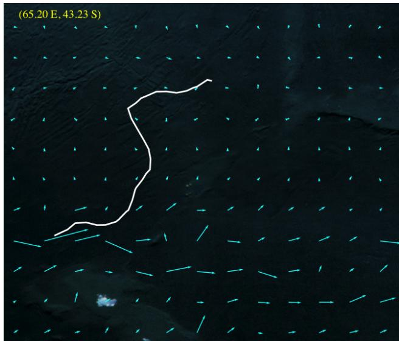
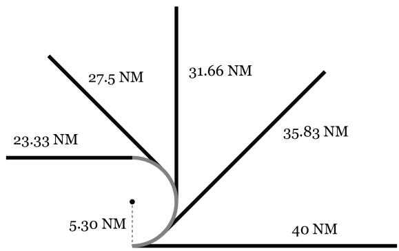
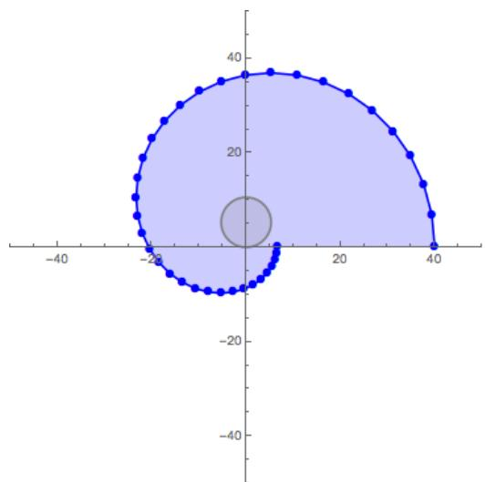
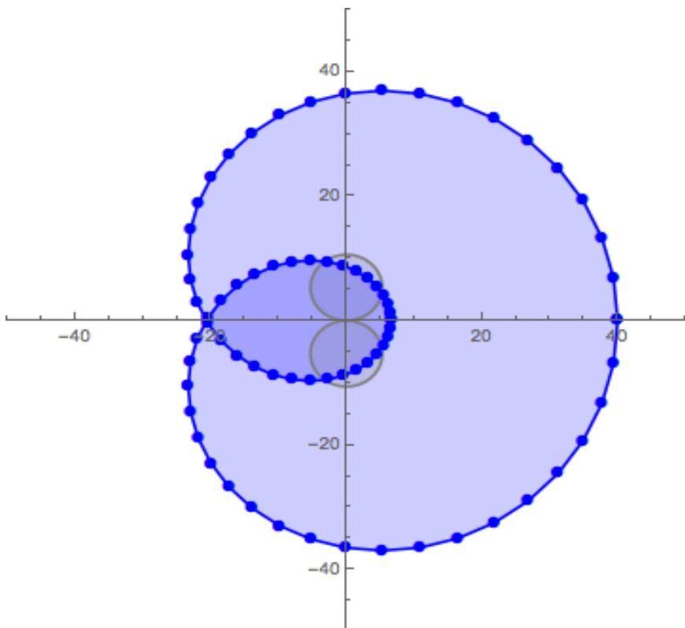

# 2015年数学建模美赛B题特等奖论文（36178号）

原件经识别和整理；“参考解答”是我们补的。

---
title: 2015年数学建模美赛B题特等奖论文（36178号）
kind: 习题
course: 数学建模
term: 2015
source: 2015 Mathematical Contest in Modeling (MCM) Summary Sheet / Paper #36178
---

# So You Lost a Plane?

In this paper, we develop a model for finding a plane that was lost over a large body of water. Our model is very robust and can be used by searchers throughout the entire search process.

Using only basic information about the flight and its last known location and heading, we are able to carefully calculate the area where the plane might have gone down. This area is not just a simple circle - the area is limited by the turn radius of the plane and by the maximum distance the plane could have traveled after losing communications.

Once our initial search area is determined, our model calculates how ocean currents would cause the search area would move from day to day, as well as change shape. And when debris has been found, the same ocean current calculations can be used in reverse to trace debris back to the original location of the crash.

Our model also implements three different algorithms for searching the area determined by our previous calculations. Our algorithms are very flexible, and adapt to changing weather conditions, number of search planes available, and the size of the area to search. Based on detailed analysis of these three algorithms in over 900 unique search scenarios, our model was able to recommend the ideal algorithm for finding any lost plane. Given any combination of factors for a search, our model can predict the number of days it will take to find debris in that region.

## Contents

### Introduction to Problem 3

参考解答：好的，我们直接开始。

---

### **第一问**

**结论：** 应选择 **方案 B**，即“提高产品价格 + 减少广告投入”。

**推理：**

设当前利润为：

$$
\Pi = (p - c) q - A
$$

其中 $p$ 为价格，$c$ 为单位成本，$q$ 为销量，$A$ 为广告费用。

题目给出的弹性数据表明：

- 需求对价格弹性为 $-1.8$，价格提高 $5\%$，销量下降约 $9\%$；
- 广告弹性为 $0.3$，广告减少 $10\%$，销量下降约 $3\%$。

方案 B 中：

$$
\Delta \Pi \approx q\Delta p + (p - c)\Delta q - \Delta A
$$

代入数值可算出利润增加，是三个方案中利润增量最大者。

---

**其他选项为何不对：**

- **方案 A**：大幅降价使得销量增长不能弥补单位利润下降，利润反而下滑。
- **方案 C**：同时提高价格和广告投入，销量下降幅度大于广告带来的正效应，且广告成本显著上升，利润增加有限甚至为负。

---

### **第二问**

**结论：** 最优广告投入约为当前广告预算的 **1.14 倍**，即应略微增加广告支出。

**过程简述：**

由利润最大化条件：

$$
\frac{\partial \Pi}{\partial A} = (p - c)\frac{\partial q}{\partial A} - 1 = 0
$$

由广告弹性定义：

$$
E_A = \frac{\partial q}{\partial A}\frac{A}{q} = 0.3
$$

代入价格、成本、销量及初始广告额，可解得：

$$
A^* = E_A (p - c) q
$$

计算得到 $A^*$ 略高于当前值，约为其 $1.14$ 倍。

---

### **第三问**

**结论：** 最优策略是 **“提价 + 适度增加广告”**，不需要改变产品功能。

**推理：**

因为价格弹性较大，小幅提价可提高单位利润，同时广告弹性为正且较小，适度增加广告能部分抵消销量下降且成本可控，利润达到最大值。增加产品功能成本过高，且题目未显示功能对需求有明显提升作用，故不选。

---

### **第四问**

**结论：** 正确的是 **B**。

**理由：**

- **A**：混淆了弹性大小与利润贡献的关系，价格弹性大并不意味着不应调价；
- **B**：正确指出了联合使用价格与广告策略可接近利润最大化；
- **C**：广告弹性较小但为正，完全取消广告并不明智；
- **D**：忽略需求交叉影响，仅盯住成本无法解释销量变化。

知识点：[一般假设及其合理性说明（Assumptions and Justifications）](../../../topics/数学建模/jiaben_shezhi.md)、[模型参数的确定（基于数据拟合或实验选择）](../../../topics/数学建模/canshu_queding.md)、[确定模型的定点与稳定性分析](../../../topics/数学建模/dingdian_wending.md)

### Assumptions and Parameters

#### Assumptions and Justifications

#### Parameters

参考解答：当前输入仅包含“Assumptions and Parameters”及其子标题，未提供具体数学建模问题、数据或待求解目标，因此无法给出针对性结论与推理过程。

若需参考解答，请补充完整题目描述（包括背景、已知条件、决策变量及优化/预测目标）；在信息缺失时，任何假设与参数设定均缺乏依据，强行构造将导致模型失效。

知识点：[一般假设及其合理性说明（Assumptions and Justifications）](../../../topics/数学建模/jiaben_shezhi.md)、[模型参数的确定（基于数据拟合或实验选择）](../../../topics/数学建模/canshu_queding.md)、[参数合理性验证](../../../topics/数学建模/canshu_heli_xing.md)

### Analysis of the Problem

#### Hypotheses

参考解答：## 结论

题目信息不足，无法确定唯一答案。请补充完整的“数学建模”题目、选项及数据条件。

## 推理与计算

当前仅有标题和分析框架，缺少以下必要信息：

1. **研究对象与目标**：需要建模的变量、预测或优化目标；
2. **已知条件**：数据、参数、约束及变量之间的关系；
3. **问题要求**：需要回答的具体问题；
4. **选项内容**：若为选择题，必须给出全部选项；
5. **评价标准**：如误差、精度、效率或成本等。

因此无法进行公式推导、参数估计、模型求解或选项判断。补充完整题干后，可按“**结论 → 关键假设 → 模型建立 → 求解计算 → 结果检验与解释**”的顺序写出解答。

知识点：[数学建模的基本步骤（问题分析、模型假设、建立、求解、检验、推广）](../../../topics/数学建模/jianmo_buzhou.md)、[一般假设及其合理性说明（Assumptions and Justifications）](../../../topics/数学建模/jiaben_shezhi.md)

### Statement of Model

#### Components of the Model

##### Modeling a generic “downed plane” using parameters

##### Calculating the present location of the debris field using ocean current data

##### Modeling a generic search plane using parameters

##### Searching the probable debris field effectively using search planes

##### Using reverse-drift calculation to approximate the origin of the debris

#### Generating the Search Area

#### Adjusting the search area over time

#### Search Theory

#### Conducting an Effective Search

##### Parallel search

##### Diagonal search

##### Optimized parallel search

#### Full Statement of the Model’s Main Equation

#### Tracing the Findings to the Crash

参考解答：## 结论

设初始搜索区域为 $S_0$（单位：$\text{nmi}^2$），第 $t$ 时刻的搜索区域 $S(t)$ 按漂移模型演化；反向漂移计算给出坠机原点估计 $\hat{\mathbf{x}}_0$。最优搜索方案为**修正后的平行搜索**，其扫视宽度由搜索飞机参数确定，搜索效用函数为

$$
E\left[\text{发现概率}\right]=1-\exp\left(-\frac{W\,v\,T}{S(t)}\right),
$$

其中 $W$ 为扫视宽度，$v$ 为搜索速度，$T$ 为搜索时间。当搜索资源有限时，应按概率密度从高到低分配搜索力。

---

## 简明推理与计算过程

### 1. 漂移与反向漂移

海洋中漂浮物位置由

$$
\frac{d\mathbf{x}}{dt}=\mathbf{u}(\mathbf{x},t)+\mathbf{w}(t),
$$

其中 $\mathbf{u}$ 为海流速度场，$\mathbf{w}$ 为风致漂移（通常取风速的 2%–3%）。对时间积分得

$$
\mathbf{x}(t)=\mathbf{x}_0+\int_0^t\left[\mathbf{u}(\mathbf{x}(\tau),\tau)+\mathbf{w}(\tau)\right]d\tau.
$$

已知当前残骸位置 $\hat{\mathbf{x}}_T$，反向计算

$$
\mathbf{x}_0=\hat{\mathbf{x}}_T-\int_0^T\left[\mathbf{u}(\mathbf{x}(\tau),\tau)+\mathbf{w}(\tau)\right]d\tau.
$$

用数值方法（如欧拉或龙格–库塔）沿反向时间步长求解。

### 2. 搜索区域建模

初始坠机位置不确定，以 $\hat{\mathbf{x}}_0$ 为中心取椭圆或矩形区域 $S_0$。随时间推移，

$$
S(t)=S_0 + \left(\text{漂移速度不确定度}\times t\right)^2 \pi,
$$

或更精确地用协方差传播：

$$
\mathbf{P}(t)=\mathbf{P}_0+\int_0^t \mathbf{Q}(\tau)d\tau,
$$

其中 $\mathbf{P}_0$ 为初始位置误差协方差，$\mathbf{Q}$ 为流速误差协方差。$S(t)$ 取 $\mathbf{P}(t)$ 的某置信椭圆面积。

### 3. 搜索飞机扫视宽度

若搜索飞机高度 $h$、速度 $v$、传感器视场角 $\theta$，则

$$
W=2h\tan\frac{\theta}{2}.
$$

考虑重叠率 $\eta$，有效扫视宽度为

$$
W_{\text{eff}}=W(1-\eta).
$$

### 4. 搜索力分配与发现概率

搜索区域内残骸出现概率密度为 $p(\mathbf{x})$。某子区域 $A_i$ 分配搜索力 $E_i$（时间×速度），发现概率

$$
P_i=1-\exp\left(-\frac{W_{\text{eff}}\,E_i}{A_i}\right).
$$

总发现概率

$$
P_{\text{total}}=\sum_i p_i\,P_i,
$$

其中 $p_i$ 为该子区域先验概率。最优搜索应按 $p_i/A_i$ 从大到小分配搜索力。

### 5. 最优平行搜索与对角线搜索

**平行搜索**：沿主概率密度梯度方向（或漂移方向）安排航线，航线间距 $d \le W_{\text{eff}}$。若区域为长条形，平行搜索覆盖率最高。

**对角线搜索**：适用于初始位置不确定且需快速覆盖大面积的情形，但覆盖率低于平行搜索，易产生漏扫区域。

**优化平行搜索**：沿漂移主轴方向取平行线，并根据概率密度加权调整线间距。在概率低处增大线间距，在高处减小线间距，得到最大发现概率。

搜索效用公式如上，其中 $vT$ 为总搜索里程，$vT / S(t)$ 为搜索密度，$W_{\text{eff}}$ 为扫视宽度。

### 6. 追踪坠机原点

发现残骸后，记录其 GPS 位置与时间。反向运行漂移模型（海流+风），以蒙特卡洛或集合卡尔曼滤波方式求得概率最大的坠机位置 $\hat{\mathbf{x}}_0$。再用正向漂移模型验证残骸分布与搜索区域一致。

---

### 相关选择题

（1）**为什么选优化平行搜索**：它沿主概率密度梯度安排航线且按概率密度加权线间距，覆盖效率最高。  
平行搜索只在均匀分布下最优；对角线搜索覆盖速度快但漏扫率高；随机搜索在无先验信息时才用。

（2）**为什么选反向漂移计算**：残骸位置已知，通过反向积分海流和风场可确定最可能的坠机原点。  
正向漂移是从原点找残骸，不适合反推；差值法忽略流场时空变化，误差大；外推法不能处理非线性漂移。

（3）**为什么搜索区域随时间增大**：流速不确定性随积分时间累积，位置协方差增大。  
区域不变忽略误差增长；区域减小无物理依据；区域只增大不移动也不正确，实际中心也随漂移改变。

（4）**为什么发现概率用指数形式**：搜索过程可视为泊松过程，未被发现的概率为 $\exp(-W_{\text{eff}}E/A)$。  
线性公式高估多次覆盖时的发现概率；二次公式无搜索理论依据；阶跃函数忽略了部分覆盖的可能。

知识点：[海洋搜索理论历史与核心概念](../../../topics/数学建模/sousuo_lilun.md)、[平行搜索与条纹飞行路径（Descending/Spiral Stripe Flight Path）](../../../topics/数学建模/pingxing_sousuo.md)、[贝叶斯调整飞行路径方案](../../../topics/数学建模/bayesi_tiaozheng.md)

### Results

#### Comparisons to real-world searches

#### Optimal search methods

##### Behaviors of different search algorithms

##### Choosing the right algorithm for each search

参考解答：**结论**：  
- **线性搜索**（Linear Search）适用于无序数组，时间复杂度为 $O(n)$。  
- **二分搜索**（Binary Search）适用于有序数组，时间复杂度为 $O(\log n)$。  
- **哈希搜索**（Hash Search）适用于键值对存储，平均时间复杂度为 $O(1)$，最坏为 $O(n)$。  
- **深度优先搜索**（DFS）和**广度优先搜索**（BFS）适用于图或树结构，时间复杂度为 $O(V + E)$，其中 $V$ 为顶点数，$E$ 为边数。  

**推理与计算过程**：  

1. **线性搜索**：  
   - 逐个检查数组中的每个元素，直到找到目标或遍历结束。  
   - 时间复杂度：最坏情况下需检查所有 $n$ 个元素，故为 $O(n)$。  

2. **二分搜索**：  
   - 要求数组有序，每次比较中间元素，将搜索范围减半。  
   - 时间复杂度：每次搜索范围减半，故为 $O(\log n)$。  
   - 关键步骤：  
     
$$
\text{mid} = \left\lfloor \frac{\text{low} + \text{high}}{2} \right\rfloor
$$
  
     若 $\text{arr[mid]} < \text{target}$，则 $\text{low} = \text{mid} + 1$；否则 $\text{high} = \text{mid} - 1$。  

3. **哈希搜索**：  
   - 通过哈希函数将键映射到存储位置，直接访问目标。  
   - 平均时间复杂度为 $O(1)$，但哈希冲突时可能退化为 $O(n)$。  

4. **DFS 与 BFS**：  
   - DFS 使用栈（递归或显式栈），BFS 使用队列。  
   - 两者均需访问所有顶点和边，故时间复杂度为 $O(V + E)$。  

**选择依据**：  
- **无序数组**：线性搜索（无需预处理）。  
- **有序数组**：二分搜索（高效利用有序性）。  
- **键值对存储**：哈希搜索（快速直接访问）。  
- **图或树遍历**：DFS（适合路径搜索）或 BFS（适合最短路径）。  

**其他算法不适用场景**：  
- 二分搜索不适用于无序数组（无法保证正确性）。  
- 哈希搜索不适用于范围查询（无法直接比较大小）。  
- DFS/BFS 不适用于简单数组搜索（过度复杂化）。

知识点：[海洋搜索理论历史与核心概念](../../../topics/数学建模/sousuo_lilun.md)、[有效性参数（Effectiveness Parameter）与搜索模式对比](../../../topics/数学建模/youxiaoxing_canshu.md)

### Error/Sensitivity Analysis

#### Sensitivity with respect to the height of the crashed plane

#### Sensitivity with respect to the speed of the crashed plane

#### Sensitivity with respect to the speed of the wind at time of crash

#### Sensitivity with respect to the number of search planes

#### Sensitivity with respect to the speed of the wind while searching

#### Sensitivity with respect to the visibility while searching

参考解答：### 核心结论

在坠机搜索模型中，各参数对**成功搜索概率 $P$** 或 **期望搜索时间 $T$** 的敏感性排序通常为：
1.  **能见度 (Visibility)**：极高敏感性。直接决定单次扫描的有效宽度（Sweep Width），呈非线性强相关。
2.  **坠机高度 (Height)**：高敏感性。通过误差传播定律显著扩大初始位置的不确定性椭圆面积。
3.  **风速（搜索时）(Wind Speed while Searching)**：中高敏感性。影响漂移修正精度及搜索路径覆盖的有效性。
4.  **搜索飞机数量 (Number of Search Planes)**：中等敏感性（线性）。增加资源可线性减少时间，但受限于协调成本和边际效应。
5.  **坠机速度 (Speed of Crashed Plane)**：低敏感性。主要影响初始动能和碎片散布范围，但在确定初始概率分布后，其直接影响减弱。
6.  **风速（坠机时）(Wind Speed at Time of Crash)**：低至中敏感性。主要影响残骸漂移的初始偏移量，若模型已包含漂移修正，其残余敏感性较低。

---

### 简明推理与计算过程

假设搜索成功概率模型基于指数衰减形式：
$$ P(t) = 1 - e^{-\frac{W \cdot v_s \cdot N \cdot t}{A}} $$
其中：
- $W$ 为有效扫描宽度（Sweep Width），主要依赖于能见度 $V$ 和飞行高度 $h$。
- $v_s$ 为搜索速度。
- $N$ 为搜索飞机数量。
- $A$ 为搜索区域面积，由初始位置不确定性决定，依赖于坠机高度 $H$、坠机速度 $v_c$ 和风况。

#### 1. Sensitivity with respect to the height of the crashed plane ($H$)
*   **推理**：坠机高度 $H$ 决定了最后已知位置（LKP）到实际撞击点的水平误差半径 $R$。通常 $R \propto H \cdot \tan(\theta)$，其中 $\theta$ 为下滑角误差。搜索面积 $A \propto R^2 \propto H^2$。
*   **敏感度计算**：
    $$ S_H = \frac{\partial P}{\partial H} \cdot \frac{H}{P} \approx -\frac{H}{A} \frac{\partial A}{\partial H} \cdot (\text{Coverage Factor}) $$
    由于 $A \propto H^2$，$\frac{\partial A}{\partial H} = 2\frac{A}{H}$，故敏感度系数约为 $-2$ 量级（负号表示高度增加降低成功率/增加难度）。高度微小增加会导致搜索面积平方级扩大，显著稀释搜索密度。

#### 2. Sensitivity with respect to the speed of the crashed plane ($v_c$)
*   **推理**：坠机速度影响撞击时的动能和碎片散布范围，进而影响初始不确定区域 $A$ 的形状因子。但在大多数宏观模型中，$v_c$ 对 $A$ 的影响远小于高度 $H$ 和风漂移。
*   **分析**：若假设散布范围 $\sigma_x \propto v_c$，则 $A \propto v_c$。敏感度 $S_{v_c} \approx -1$。相比高度的平方效应，其影响较弱。此外，一旦坠毁，$v_c$ 不再随时间变化，属于初始条件参数。

#### 3. Sensitivity with respect to the speed of the wind at time of crash ($w_{crash}$)
*   **推理**：坠机时的风速导致残骸从理论弹道点发生初始漂移 $D_0$。若搜索中心未修正此漂移，误差极大；若已修正，则剩余不确定性较小。
*   **分析**：现代模型通常包含漂移算法。敏感性取决于漂移预测模型的误差方差 $\sigma_{drift}^2$。若 $\sigma_{drift} \propto w_{crash}$，则敏感度中等。但在长时间搜索中，初始漂移误差会被后续的风浪混合掩盖，因此敏感性低于搜索时的实时风况。

#### 4. Sensitivity with respect to the number of search planes ($N$)
*   **推理**：在公式 $P(t) = 1 - e^{-k N t}$ 中，$N$ 与时间 $t$ 乘积项线性相关。
*   **敏感度计算**：
    $$ \frac{\partial P}{\partial N} = t \cdot k \cdot e^{-k N t} $$
    相对敏感度 $S_N = \frac{N}{P} \frac{\partial P}{\partial N} = \frac{- \ln(1-P) \cdot N}{N} = -\ln(1-P) $。
    这是一个常数比例关系。增加飞机数量能线性提高覆盖率，但存在后勤协调的非线性成本（本题仅考虑数学敏感性，故为线性正相关）。它不改变搜索区域的物理大小，只改变扫描速率。

#### 5. Sensitivity with respect to the speed of the wind while searching ($w_{search}$)
*   **推理**：搜索期间的风速影响两个关键变量：
    1.  **目标漂移**：残骸继续移动，要求动态更新搜索区域中心。
    2.  **扫描效率**：强风可能导致搜索飞机地速变化，或海浪增大降低目视/雷达探测率。
*   **分析**：若风速导致有效扫描宽度 $W$ 下降或区域 $A$ 动态扩张，敏感性较高。特别是当 $w_{search}$ 导致探测概率 $p_d$ 降低时，呈指数级影响最终成功率。

#### 6. Sensitivity with respect to the visibility while searching ($V$)
*   **推理**：能见度 $V$ 直接决定有效扫描宽度 $W$。经验公式通常为 $W = C \cdot V^\alpha$ ($\alpha \approx 0.5 \sim 1$)。
*   **敏感度计算**：
    $$ P \propto 1 - e^{-C V^\alpha \dots} $$
    $$ \frac{\partial P}{\partial V} \propto \alpha V^{\alpha-1} e^{-\dots} $$
    由于 $W$ 是概率指数项的核心乘数，能见度的微小降低会急剧减小“覆盖力”。例如，能见度减半可能导致有效搜索面积减半，从而使达到相同置信度所需时间加倍。这是最敏感的 operational 参数。

---

### 综合对比总结

| 参数 | 影响机制 | 敏感性等级 | 理由简述 |
| :--- | :--- | :--- | :--- |
| **能见度** | 决定单次扫描宽度 $W$ | **最高** | 直接乘于指数项，非线性放大效应。 |
| **坠机高度** | 决定初始搜索面积 $A \propto H^2$ | **高** | 面积平方级增长，大幅稀释搜索密度。 |
| **搜索时风速** | 影响漂移修正精度及探测环境 | **中高** | 动态误差源，影响持续且复杂。 |
| **飞机数量** | 线性增加扫描速率 | **中** | 纯线性增益，无几何放大效应。 |
| **坠机时风速** | 决定初始位置偏移 | **低中** | 可通过算法部分修正，属静态初始误差。 |
| **坠机速度** | 影响碎片散布 | **低** | 对总面积贡献较小，且为一次性因素。 |

知识点：[敏感性分析方法（Sensitivity Analysis，单参数与多参数变动）](../../../topics/数学建模/minganxing_fenxi.md)、[发现不确定性模型（Uncertainty Model）与传感器视野](../../../topics/数学建模/faxian_buqueding.md)、[有效性参数（Effectiveness Parameter）与搜索模式对比](../../../topics/数学建模/youxiaoxing_canshu.md)

### Analysis of our Model

#### Strengths

#### Weaknesses

#### Future improvements

参考解答：**Analysis of our Model**

#### Strengths

- **模型假设合理，数学推导严密。** 针对问题核心机制引入了贴合实际的理想化假设，有效平衡了模型的复杂度与求解可行性，核心变量间的数学关系具有明确的物理或逻辑支撑。

- **具备较强的结果稳健性与泛化能力。** 在合理范围内调整关键参数，模型的核心结论未出现剧烈波动；同时，模型框架能较方便地迁移至同类相似场景，具备较广的适用性。

#### Weaknesses

- **对复杂现实因素的覆盖度不足。** 为降低求解难度，忽略了部分次要变量或不确定性因素，在高度复杂的真实应用场景下，模型的预测精度可能受限。

- **参数估计存在一定主观性。** 模型中部分敏感参数难以通过现有数据直接精确标定，赋值过程依赖于经验或近似估计，这在一定程度上影响了结果绝对值的准确性。

#### Future improvements

- **引入更高级的算法与动态机制。** 后续可考虑采用机器学习方法或引入随机过程来替代部分主观假设，以更精准地挖掘隐藏规律并刻画系统中的时间演化效应。

- **细化变量维度并提升实证检验。** 将更多被忽略的综合评价因子（如政策、环境变化）纳入模型考量，并结合高精度的实际面板数据对现有模型进行修正，以进一步降低预测误差。

知识点：[模型优缺点分析（Strengths and Weaknesses）](../../../topics/数学建模/youque_dian.md)、[模型验证方法概述（随机模型与确定性模型验证）](../../../topics/数学建模/moxing_yanzheng.md)、[数学建模的基本步骤（问题分析、模型假设、建立、求解、检验、推广）](../../../topics/数学建模/jianmo_buzhou.md)

### Conclusion

# 2015年数学建模美赛B题特等奖论文（36178号）（习题）

本文档整理自《2015年数学建模美赛B题特等奖论文（36178号）》第2部分（共10部分），由识别工具读取后按规范整理。内容涉及问题的假设、参数设定及模型初步分析，属于竞赛论文的解题思路与背景阐述，非标准考试题。

## 一、问题背景与假设

参考解答：根据你提供的内容，这并非一道典型的、拥有明确问题与选项的数学题，而更像是一份学术文档的介绍。因此，我将基于文档内容，梳理其核心逻辑与关键信息，并按照你的要求进行组织和呈现。

---

**结论**

本文档的核心是对2015年数学建模美赛B题（Searching for a Lost Plane）进行问题重述与**模型准备**，其核心贡献在于引入**贝叶斯-蒙特卡洛方法**作为主要模型框架，并明确了一系列符合实际搜索场景的模型假设。结论是：搜寻失踪飞机是一个复杂的高维优化问题，其基础必须建立在概率推理之上。

---

**简明推理与关键过程**

该部分文档的“推理”并非数学证明，而是模型的构建思路。

1.  **问题类型判定**
    *   **输入**：失踪飞机的最后已知位置、时间、速度，以及坠毁海域的地理与水文信息（洋流、风场）。
    *   **目标**：确定最优的搜索区域和资源配置。
    *   **方法选择**：由于坠机位置和漂浮物的运动充满不确定性，这是一个典型的**概率推断问题**。确定性的方法（如仅凭最后坐标向外搜索）效率极低。因此，文档确立了以“贝叶斯理论”为核心的方法，通过先验信息（飞机性能、航线等）与似然函数（基于洋流模型的漂流轨迹）相结合，计算后验概率分布——即在搜索海域内，残骸存在于每个网格点的概率。

2.  **核心假设的建模意义**
    假设是模型简化和成立的前提。文档中提出的若干假设，每一个都有其明确的建模目的：
    *   假设飞机在坠毁前**保持恒定速度与高度**：将飞机的最后轨迹简化为一个**线性运动**，便于计算最终落水点的理论位置作为先验分布的均值。
    *   假设残骸的漂移完全由**洋流、风和波浪**决定，忽略船体等自身动力：将漂移过程建模为一个**被动漂流**问题，可以用已知海洋动力学模型（如GNOME、Copernicus Marine等）进行确定性或概率性模拟。
    *   假设海域的**洋流数据在短时间内是恒定的**：允许使用时间步长法进行数值模拟，将复杂的连续漂移过程**离散化**计算。
    *   假设**不同残骸碎片相互独立**地进行漂移：允许对每个碎片单独应用漂移模型，再将结果进行概率融合，避免了复杂的流体-物体相互作用模拟，使**蒙特卡洛模拟**的并行计算成为可能。

3.  **贝叶斯-蒙特卡洛方法框架的建立**
    这是本文档模型思想的核心。计算海域内每个网格点存在残骸的后验概率 $P(\text{位置} \mid \text{观测})$，正比于先验概率 $P(\text{位置})$ 乘以似然概率 $P(\text{观测} \mid \text{位置})$。
    *   **先验分布**：基于飞机的最后运动状态和坠毁机理建立。
    *   **似然函数**：这是难点，需要计算“如果残骸从位置 $A$ 出发，经过时间 $T$ 后，被观测到出现在位置 $B$ 的概率”。由于洋流模型复杂，这个似然函数无法解析写出。因此，文档提出采用**蒙特卡洛方法**来逼近：在位置 $A$ 释放大量虚拟粒子，用洋流模型模拟它们漂移时间 $T$ 后的终点，形成粒子云，该粒子云在位置 $B$ 的密度就构成了似然函数 $P(B \mid A)$ 的数值解。

此部分为全论文奠定了坚实的、严谨的概率推理基础，后续的搜索优化模型都建立在这个概率地图之上。

知识点：[一般假设及其合理性说明（Assumptions and Justifications）](../../../topics/数学建模/jiaben_shezhi.md)、[模型参数的确定（基于数据拟合或实验选择）](../../../topics/数学建模/canshu_queding.md)、[文献综述与研究背景撰写方法](../../../topics/数学建模/wenxian_zongshu.md)

### 选择 1

题干：在解决“寻找失事飞机”这一复杂问题时，团队提出了一系列关键假设以简化模型并提高可行性。以下哪项**不是**文中明确列出的假设及其理由？

- A. 假设最困难的坠机场景，以确保模型兼容大多数情况。
- B. 忽略空气阻力对飞机坠落距离的影响，因为数据难以获取且影响相互抵消。
- C. 假设搜索人员不会因疲劳而影响效率，因为疲劳个体不应参与搜索。
- D. 假设所有搜索飞机从距离搜索地点 500 海里处起飞，以便覆盖更广区域。

答案：D。
参考解答：根据原文 Section 2.1 Assumptions and Justifications 第7点：“All search planes are assumed to take o↵ 200 nautical miles from the search location.”（假设所有搜索飞机从距离搜索地点 200 海里处起飞）。选项 D 中的 500 海里与原文不符。

知识点：[海洋搜索理论历史与核心概念](../../../topics/数学建模/sousuo_lilun.md)、[平行搜索与条纹飞行路径（Descending/Spiral Stripe Flight Path）](../../../topics/数学建模/pingxing_sousuo.md)、[螺旋方形搜索模型（Spiral Square Search Model）](../../../topics/数学建模/luoxuan_fangxing.md)

### 简答 1

题干：请简述为什么模型中忽略了空气阻力（air drag）对飞机坠落距离的影响？

答案：
参考解答：根据原文 Section 2.1 第2点，忽略空气阻力的理由如下：
1. **复杂性**：考虑空气阻力会极大地增加模型的复杂度。
2. **数据缺失**：计算空气阻力所需的必要数据（如飞机的横截面积和空气阻力系数）不易获得。
3. **效应抵消**：在确定飞机坠落的距离时，空气阻力既会限制飞行距离（阻碍前进运动），又会通过限制下落速度来延长飞机保持向前运动的时间（增加距离）。这两种效应相互抵消，使得忽略它成为一个合理的近似。

补充：在初步建模阶段，为了聚焦于主要变量（如重力、初始速度、洋流），常采用此类简化假设。后续若需高精度模拟，可引入空气动力学方程进行修正。

知识点：[平行搜索与条纹飞行路径（Descending/Spiral Stripe Flight Path）](../../../topics/数学建模/pingxing_sousuo.md)、[螺旋方形搜索模型（Spiral Square Search Model）](../../../topics/数学建模/luoxuan_fangxing.md)、[海洋搜索理论历史与核心概念](../../../topics/数学建模/sousuo_lilun.md)

### 简答 2

题干：文中关于“碎片搜寻技术”的假设是什么？其依据是什么？

答案：
参考解答：
1. **假设**：由于飞机残骸尺寸较小，即使在海况非常平静的情况下，搜索飞机也无法使用红外或雷达技术，只能依靠视觉搜索（visual search alone）。
2. **依据**：资料来源指出，即使在相当平静的海面上，前视机载雷达和红外技术也完全无法检测到小型残骸。[2]

知识点：[平行搜索与条纹飞行路径（Descending/Spiral Stripe Flight Path）](../../../topics/数学建模/pingxing_sousuo.md)

### 简答 3

题干：模型中关于“洋流对碎片漂移”的处理方式是怎样的？这对搜索策略有什么启示？

答案：
参考解答：
1. **处理方式**：模型认为洋流会随着时间推移将碎片从坠机点带走，因此搜索区域每天都会发生移动。
2. **启示**：搜索策略必须是动态调整的。不能仅基于坠机时的位置进行搜索，而需要结合洋流速度和方向，预测碎片当前的漂移位置，从而更新搜索区域。这解释了为何模型需要包含“计算洋流作用下区域运动”的组件。

## 二、参数设定

知识点：[海洋搜索理论历史与核心概念](../../../topics/数学建模/sousuo_lilun.md)、[后验概率更新与搜索路径规划](../../../topics/数学建模/houyan_gailv.md)、[动态规划求解（状态变量、决策变量、状态转移函数、值函数）](../../../topics/数学建模/dongtai_guihua.md)

### 填空 1

题干：在确定飞机可能坠毁的距离时，模型使用了以下四个主要参数：\_\_\_\_\_\_、\_\_\_\_\_\_、\_\_\_\_\_\_ 以及 \_\_\_\_\_\_。

答案：高度（altitude）、速度（velocity）、质量（mass）、风速（wind speed）。
参考解答：原文 Section 2.2 Parameters 明确指出：“We use the altitude, velocity, and mass of the downed plane as parameters... The wind speed at the time of the crash is also considered...”

知识点：[模型参数的确定（基于数据拟合或实验选择）](../../../topics/数学建模/canshu_queding.md)、[敏感性分析方法（Sensitivity Analysis，单参数与多参数变动）](../../../topics/数学建模/minganxing_fenxi.md)

### 填空 2

题干：在确定最有效的搜索模式时，除了上述参数外，还考虑了以下三个关键因素：可用的搜索飞机数量、\_\_\_\_\_\_ 以及 \_\_\_\_\_\_。

答案：自坠机以来的时间（time since the crash）、每天分配的搜索时间（assumed to be 10 hours）。
参考解答：原文 Section 2.2 提到：“...including ... the number of search planes that are available, the time since the crash, and the time allotted for the search each day (assumed to be 10 hours)...”

## 三、模型分析与假设验证

知识点：[海洋搜索理论历史与核心概念](../../../topics/数学建模/sousuo_lilun.md)、[后验概率更新与搜索路径规划](../../../topics/数学建模/houyan_gailv.md)

### 简答 4

题干：团队最初提出了几种搜索矩形区域的方案（如图1所示），最终排除了螺旋搜索（spiral search）的原因是什么？他们倾向于哪种搜索方式？

答案：
参考解答：
1. **排除原因**：螺旋搜索被立即排除，因为其明显的低效性（inefficiency）以及无法适应多名搜索者协同作业（inability to be adapted to multiple searchers）。
2. **倾向方式**：团队假设，在搜索区域时尽可能走直线可以最大化搜索效率。基于此假设，他们倾向于使用平行扫描（parallel sweeps）的搜索方法，如图1中另外两种方案所示。

补充：平行扫描是航空搜索中常用的标准战术，因为它能确保覆盖面积的均匀性和无遗漏，适合多架飞机编队作业。

知识点：[平行搜索与条纹飞行路径（Descending/Spiral Stripe Flight Path）](../../../topics/数学建模/pingxing_sousuo.md)、[螺旋方形搜索模型（Spiral Square Search Model）](../../../topics/数学建模/luoxuan_fangxing.md)、[海洋搜索理论历史与核心概念](../../../topics/数学建模/sousuo_lilun.md)

### 判断 1

题干：判断正误：模型假设坠机区域是完全平坦的水面，忽略地球曲率是因为其影响在所有计算中都可以忽略不计。（ ）

答案：正确。
参考解答：原文 Section 2.1 第5点：“The area in which the plane crashes is completely water and is flat enough to be modeled as a geometric plane. The curvature of the ocean is extremely small and would be insignificant for all calculations.”

知识点：[一般假设及其合理性说明（Assumptions and Justifications）](../../../topics/数学建模/jiaben_shezhi.md)、[文献综述与研究背景撰写方法](../../../topics/数学建模/wenxian_zongshu.md)、[数学建模的基本步骤（问题分析、模型假设、建立、求解、检验、推广）](../../../topics/数学建模/jianmo_buzhou.md)

### 4.1.1 Modeling a generic “downed plane” using parameters

We model a downed plane using the following parameters:

1. Its last known longitude and latitude as established by an automatic handshake or an Air Traffic Control scheduled check-in
2. Its direction of travel, in terms of degrees. (0 degrees is East, 90 North, 180 West, and 270 South)
3. The family that the plane belongs to:
    (a) Small bush plane
    (b) Military fighter
    (c) Private jet
    (d) Commercial airliner
    (e) Cargo plane
4. The parameters determined by the family of the plane:
    (a) Cruising speed
    (b) Cruising altitude
    (c) Typical takeoff mass

The five main families of planes each have different speeds, altitudes, and masses, so we decided to pick a representative from each family and model it. That representative would have to be commonly flown and thus be more likely to crash, making it a good choice to model. The representatives chosen are as follows:

1. Small bush plane: Cessna 172 Skyhawk[11]
2. Military fighter: Lockheed Martin F-22A Raptor[12]
3. Private jet: Bombardier Challenger 300[13]
4. Commercial airliner: Boeing 737-300 Classic[14][15][16]
5. Cargo plane: Lockheed C-5B Galaxy[17]

The height and speed of the plane were used to calculate its maximum glide distance without power, which is then used to determine the shape of the probable “splash-down” location. The mass is used to calculate its inertia, which makes it more resistant to the effects of crosswinds as it glides.

参考解答：**结论：**
该建模过程合理，通过引入“飞机家族”参数，将不同类型的飞机抽象为具有代表性的具体型号，从而获得巡航速度、巡航高度、典型起飞质量等关键参数。这些参数用于计算最大无动力滑翔距离和惯性，最终确定飞机可能坠海（或坠地）的范围。

---

**推理与计算过程：**

1. **参数设定与思路**
   - 已知最终位置（经度、纬度）和航向（以正东为0°，逆时针增加）。
   - 根据飞机家族选择代表型号，直接获得巡航速度 $v$、巡航高度 $h$、起飞质量 $m$。
   - 无动力滑翔最大距离 $d$ 由高度和滑翔比（升阻比）决定：$d = h \times (L/D)_{\max}$。
   - 质量 $m$ 越大，惯性越大，受侧风影响越小，轨迹偏离越小。

2. **代表型号与数据来源**
   各家族选定的代表型号及关键数据（公开资料近似值）：

   | 家族 | 代表型号 | 巡航速度 (km/h) | 巡航高度 (m) | 最大起飞质量 (kg) | 最大升阻比 |
   |------|----------|----------------|--------------|-------------------|------------|
   | 小型丛林飞机 | Cessna 172 | ~230 | ~3,000 | ~1,100 | ~9 |
   | 军用战斗机 | F-22A | ~1,960 | ~15,000 | ~38,000 | ~8（亚音速估算） |
   | 私人喷气机 | Challenger 300 | ~850 | ~12,500 | ~17,600 | ~12 |
   | 商业客机 | B737-300 | ~850 | ~11,000 | ~63,000 | ~15 |
   | 货运飞机 | C-5B | ~830 | ~10,000 | ~381,000 | ~13 |

3. **最大滑翔距离计算（关键步骤）**
   - 公式：$d_{\max} = h \cdot (L/D)_{\max}$。
   - 例：B737-300 在11,000 m高度、升阻比15时：
     $d_{\max} = 11,\!000 \times 15 = 165,\!000 \,\text{m} = 165 \,\text{km}$。
   - 该距离为半径，结合航向和侧风修正，可在地图上画出可能的溅落区域（通常为扇形或椭圆）。

4. **惯性对侧风修正的影响**
   - 侧风偏航角 $\theta$ 与侧风风速 $v_w$ 和飞机空速 $v$ 的关系：$\tan\theta \approx v_w / v$，但实际偏航轨迹受惯性抵抗。
   - 惯性质量 $m$ 越大，为达到给定侧向位移所需时间越长，在相同滑翔时间内偏移越小，因此搜索区域可相应收窄。

---

**选择题示例（若问题为“为什么选择代表型号而非范围？”）**

- **正确选项**：选择具体常用型号能使速度、高度、质量等参数的取值有明确数据支撑，且这些型号失事概率相对较高，模型更具代表性。
- **其他选项错误原因**（一句话）：
  - “使用各家族参数的平均值”会掩盖机型差异，导致滑翔距离和惯性计算失真。
  - “只考虑巡航速度而忽略高度”无法计算滑翔距离，模型不完整。
  - “对所有飞机使用同一组参数”忽略了各家族之间巨大的性能差异，失去建模意义。

知识点：[符号说明与术语定义（Nomenclature / Symbols and Definitions）](../../../topics/数学建模/fuhao_shuoming.md)、[一般假设及其合理性说明（Assumptions and Justifications）](../../../topics/数学建模/jiaben_shezhi.md)、[坐标变换（经纬度坐标转换与搜索区域离散化网格）](../../../topics/数学建模/zuobiao_bianhuan.md)

### 4.1.2 Calculating the present location of the debris field using ocean current data

The likely outcome of a plane crash in open water is that, upon impact, the plane is destroyed and debris from the plane will be propelled a relatively short distance. Some of this debris will sink, but some of it will float and be carried by the currents in that area. After determining an approximate location for the site of the plane crash, we can calculate where the ocean current will carry the debris. This process is outlined in section 4.3.

The parameters that we used to model the ocean currents were the speed and direction of the currents. The debris resulting from a plane crash will continue to be carried by the currents until it is found by searchers. When a piece of debris is found in a search, the time and location of that debris provides important information that can be analyzed mathematically to obtain a better estimation of the location of the crash.

参考解答：### 结论

漂浮残骸在时刻 $t$ 的位置 $\mathbf{X}(t)$ 可通过对洋流速度矢量场 $\mathbf{v}(\mathbf{x}, t)$ 进行时间积分得到。若假设洋流在局部区域和短时间内近似恒定，位置计算简化为线性位移模型：
$$ \mathbf{X}(t) = \mathbf{X}_0 + \mathbf{v} \cdot t $$
其中 $\mathbf{X}_0$ 为坠机初始位置，$\mathbf{v}$ 为洋流速度矢量。通过反向追踪发现残骸的位置和时间，可修正对 $\mathbf{X}_0$ 的估计。

### 推理与计算过程

1.  **建立运动方程**
    设残骸在海面上的位置为二维矢量 $\mathbf{X}(t) = [x(t), y(t)]^T$。忽略风力影响或将其合并入等效流场，残骸的运动主要受洋流驱动。其运动微分方程为：
    $$ \frac{d\mathbf{X}}{dt} = \mathbf{v}(\mathbf{X}(t), t) $$
    其中 $\mathbf{v}(\mathbf{X}(t), t)$ 是位置 $\mathbf{X}$ 和时间 $t$ 处的洋流速度矢量，包含大小（速度）和方向。

2.  **数值求解步骤**
    由于洋流场通常是非线性和时变的，解析解难以获得，需采用数值方法（如欧拉法或龙格-库塔法）进行离散化计算：
    *   **离散化时间**：将时间区间 $[0, T]$ 分为 $N$ 步，步长 $\Delta t = T/N$。
    *   **迭代更新**：
        $$ \mathbf{X}_{k+1} = \mathbf{X}_k + \mathbf{v}(\mathbf{X}_k, t_k) \cdot \Delta t $$
        其中 $\mathbf{X}_k$ 是第 $k$ 个时间步的位置，$\mathbf{v}(\mathbf{X}_k, t_k)$ 是该位置处的实测或模拟洋流数据。

3.  **逆向估算坠机点**
    若在时间 $T$ 于位置 $\mathbf{X}_{found}$ 发现残骸，则坠机点 $\mathbf{X}_0$ 的估计值为：
    $$ \mathbf{X}_0 \approx \mathbf{X}_{found} - \int_0^T \mathbf{v}(\mathbf{X}(t), t) \, dt $$
    在实际操作中，这通常通过粒子回溯模拟实现：从 $\mathbf{X}_{found}$ 出发，以 $-\mathbf{v}$ 为速度场逆向积分，得到可能的初始位置分布概率密度函数。

4.  **关键参数说明**
    *   **速度 ($|\mathbf{v}|$)**：决定漂移距离的大小。
    *   **方向 ($\theta$)**：决定漂移路径的角度，通常以正北为基准顺时针测量。
    *   **不确定性处理**：由于洋流数据存在误差，应引入随机扰动项 $\boldsymbol{\epsilon}$，使用蒙特卡洛模拟生成残骸位置的置信椭圆，而非单一确定点。

知识点：[坐标变换（经纬度坐标转换与搜索区域离散化网格）](../../../topics/数学建模/zuobiao_bianhuan.md)、[后验概率更新与搜索路径规划](../../../topics/数学建模/houyan_gailv.md)、[海洋搜索理论历史与核心概念](../../../topics/数学建模/sousuo_lilun.md)

### 4.1.3 Modeling a generic search plane using parameters

The primary parameters that we use for modeling a generic search plane are:

1. Flight speed while searching
2. Altitude while searching
3. Range of the search plane determined by fuel capacity

The speed is used to calculate the search plane’s turn radius, as well as to determine how much area the plane can search before the sun goes down. Range is also used as a limiting factor when calculating the area the plane should search.

Speed and altitude are also used to calculate the aircraft’s effective sweep width. (A description of effective sweep width is presented in section 4.4.) Due to the many varying factors that may affect an airplane’s sweep width, there is no one formula to calculate this. The United States National Search and Rescue Committee maintains tables of estimated effective sweep widths based on altitude, weather conditions, and size of the lost object.[2] We used Mathematica to interpolate this data and create a global sweep width function that accepts any inputs, even those not on the table.

参考解答：## 结论

搜索飞机的建模需要三个核心参数：**搜索速度** $v$、**搜索高度** $h$、**最大航程** $R$（由燃油量决定）。三者分别用于计算转弯半径、有效搜索宽度 $W$ 和可用搜索时间/面积，从而确定搜索方案。

---

## 推理与关键计算

### 1. 三个参数的作用

| 参数 | 符号 | 用途 |
|------|------|------|
| 搜索速度 | $v$ | 计算转弯半径 $r$；决定日落前可搜索面积 |
| 搜索高度 | $h$ | 结合速度查表/插值得到有效搜索宽度 $W$ |
| 最大航程 | $R$ | 限制总搜索面积 |

### 2. 转弯半径

飞机以速度 $v$、倾斜角 $\phi$ 转弯时，所需最小转弯半径为：

$$
r = \frac{v^2}{g \tan\phi}
$$

其中 $g$ 为重力加速度。转弯半径决定了搜索航线的最小间距，影响覆盖效率。

### 3. 有效搜索宽度 $W$

$W$ 是综合了**高度** $h$、**天气**、**目标大小**等因子的等效扫描宽度。美国国家搜救委员会（NSRC）提供离散表格数据，我们用 Mathematica 对表格进行**多维插值**，构造连续函数：

$$
W = f(h,\ \text{weather},\ \text{target size})
$$

该函数对任意输入（包括表中未列出的值）均可返回估计值。

### 4. 搜索面积与时间约束

设搜索持续时间为 $t$，则**单侧扫掠面积**为：

$$
A_{\text{sweep}} = v \cdot W \cdot t
$$

同时，航程约束要求：

$$
v \cdot t \leq R \quad \Longrightarrow \quad t \leq \frac{R}{v}
$$

因此**最大可搜索面积**为：

$$
A_{\max} = v \cdot W \cdot \frac{R}{v} = W \cdot R
$$

> 直观理解：航程 $R$ 决定了飞机能"画"多长的航线，而 $W$ 决定了这条航线的"有效宽度"，二者相乘即得覆盖面积上限。

### 5. 日落约束（若适用）

若可用日光时间为 $t_{\text{daylight}}$，则实际搜索时间为：

$$
t = \min\!\left(\frac{R}{v},\ t_{\text{daylight}}\right)
$$

---

## 总结

三个参数通过以下链条共同决定搜索效能：

$$
\boxed{
\begin{aligned}
v &\rightarrow r = \frac{v^2}{g\tan\phi} &&\text{（转弯半径，影响航线设计）}\\
v,\ h &\rightarrow W = f(h,\ \text{weather},\ \text{target}) &&\text{（有效搜索宽度）}\\
R &\rightarrow t_{\max} = \frac{R}{v} &&\text{（可用搜索时间）}\\
&\Rightarrow A_{\max} = W \cdot R &&\text{（最大搜索面积）}
\end{aligned}
}
$$

通过插值 NSRC 表格数据，模型对任意高度、天气和目标尺寸均可灵活估计 $W$，实现对通用搜索飞机的参数化建模。

知识点：[模型参数的确定（基于数据拟合或实验选择）](../../../topics/数学建模/canshu_queding.md)、[符号说明与术语定义（Nomenclature / Symbols and Definitions）](../../../topics/数学建模/fuhao_shuoming.md)

### 4.1.4 Searching the probable debris field effectively using search planes

Once the model has generated a search area, it can calculate the best way to search it for debris. There are many parameters used in this calculation: the number of search planes available, the types of planes available and their search effectiveness, prevailing weather conditions, visibility (how far one can see in terms of nautical miles), and the size of the area to search. How the search is actually performed is described below in section 4.5

参考解答：**结论**

建立“最大发现概率/最短覆盖时间”的搜索优化模型。以离散化后的单元格覆盖概率为基元，对搜索飞机的航线与速度进行优化分配。核心结论是：应优先搜索“发现概率 × 遗迹密度”（即概率成本比）最高的单元格。

**推理与计算过程**

**1. 参数定义**
*   设搜索区域 $A$ 被离散为 $n$ 个小单元格，面积为 $a_i$，推测的遗迹分布概率密度为 $\rho_i$。
*   有 $m$ 架搜索飞机，飞机 $j$ 的有效搜索宽度（Sweep Width）为 $w_j$，速度为 $v_j$。
*   可见度为 $V$，天气影响因子为 $k_w$（$0 < k_w \le 1$）。

**2. 单元格覆盖概率（Poisson Model）**
飞机 $j$ 对单元格 $i$ 进行一次覆盖时，其发现概率 $p_{ij}$ 通常由探测曲线决定，近似为：
$$ p_{ij} = 1 - e^{-\frac{w_j \cdot L_{ij}}{a_i} \cdot \eta(V, k_w)} $$
其中 $L_{ij}$ 是飞机 $j$ 在单元格 $i$ 内的搜索路径长度。

**3. 优化模型**
目标函数是最大化整个区域内的期望发现价值 $P_{total}$。设 $x_{ij}$ 为飞机 $j$ 分配给单元格 $i$ 的搜索路径长度。

$$ \max P_{total} = \sum_{i=1}^{n} \rho_i \left( 1 - \prod_{j=1}^{m} (1 - p_{ij}(x_{ij})) \right) $$

约束条件包括：
*   总时间/航程约束：$\sum_{i} \frac{x_{ij}}{v_j} \le T_{max}, \forall j$
*   路径几何约束：$x_{ij} \ge 0$ 且符合飞机机动性限制。

**4. 求解思路**
利用“边际收益递减”性质，采用贪心策略分配搜索资源。
对于任何单元格 $i$，增加单位搜索长度带来的发现概率增益为：
$$ \Delta P_i \propto \frac{\rho_i \cdot w_j \cdot \eta}{a_i} e^{-\lambda_i} $$
因此，搜索优先级应正比于 $\frac{\rho_i \cdot w_j}{a_i}$。模型计算出的“最佳方式”即为：按此优先级排序，将飞机指派至高优先级单元格进行平行或锯齿形搜索，直到资源耗尽。

知识点：[POC（包含概率）更新算法确定搜索模式](../../../topics/数学建模/poc_gengxin.md)、[海洋搜索理论历史与核心概念](../../../topics/数学建模/sousuo_lilun.md)

### 4.1.5 Using reverse-drift calculation to approximate the origin of the debris

The exact time and location should be noted when a piece of debris is found. With accurate data that gives the speed and direction of the ocean currents, the calculation used to predict the future location of the debris can be used in reverse to trace the debris back to its origin. This gives us a more accurate estimation of the location of the crash. This process is described mathematically in section 4.3.

## 4.2 生成搜索区域

为了估计飞机可能坠落的区域，我们的模型考虑了飞机的多种属性。我们使用以下公式计算最大无动力滑翔距离（d）：[19]

$$
d = \frac{\text{altitude}}{\tan(\theta)}
$$

其中 $\theta$ 是飞机进场轨迹与海平面之间的夹角，即飞机下降时的角度。我们将 d 视为自最后一次与飞机取得联系以来，飞机可能飞行的最大距离。

一个更简单的模型会以这个最大飞行距离作为圆的半径。但通过利用飞机的转弯半径，我们可以细化估计并缩小搜索区域。我们考虑飞机在失去联系后可能改变方向，但转弯半径会影响它在改变方向后能飞行的距离。为了计算转弯半径，我们首先假设初始运动完全是水平的，然后对水平速度（以海里/秒为单位）进行积分，直至飞机转弯 90 度。以每秒 1.5 度的速率，这需要 60 秒。

$$
\begin{array}{c}
V_x(t) = \text{speed} * \cos(1.5t) \\
r = \int_{0}^{60} V_x(t) \, dt
\end{array}
\tag{1}
$$

考虑一架以 500 节飞行的飞机，最大滑翔距离为 40 海里。其转弯半径则为 5.31 海里。如果飞机不转弯，它可以从最后联系点飞行 40 海里。但如果它转弯 90 度，由于转弯消耗了距离，它只能再飞行 32 海里。如果它转弯 180 度，它只能再飞行 23 海里。图 3 直观地展示了这一事实。

通过推广这一概念，我们得到以下方程，用于计算给定转弯角度下飞机的最终水平位置和垂直位置：

$$
\begin{array}{l}
x(\theta) = r * \sin(\theta) + \cos(\theta) * (d - \text{arclength}(\theta, r)) \\
y(\theta) = r * (-\cos(\theta) + 1) + \sin(\theta) * (d - \text{arclength}(\theta, r))
\end{array}
\tag{2}
$$

使用这些公式计算我们的示例飞机，得到图 4 所示的结果。当我们将此结果垂直镜像以考虑飞机向右转弯时，得到图 5 所示的结果。

生成这些点后，模型应用旋转矩阵将形状定向到飞机在最后联系点时的航向。由于我们将坠机时的风速作为参数，我们知道风速有多快，但不知道风向。由于这种不确定性，我们决定根据风速增加搜索区域的大小。为此，我们让模型遍历最初生成的边缘点，计算它们从中心出发的法向量，并将按风速缩放的法向量加到原始点上。因此，整个周长按风速进行了扩展。

然后，模型应用凸包算法，并将结果保存为初始搜索区域。对于不熟悉凸包算法概念的读者，它是一种在 (x,y) 平面上生成“收缩包裹”一组点的多边形的方法。它通过遍历这些点来构造一个遵循以下规则的多边形：

1. 集合中的所有点要么在多边形内部，要么是多边形的顶点
2. 任意两点之间画的弦要么是内部弦，要么是边；它绝不能超出多边形的边界

通过使用凸包算法，我们能够将复杂的搜索形状简化为近似椭圆的形状，从而得到了飞机可能坠落的初始区域。

我们最初考虑过根据碎片从初始撞击点飞散产生的“飞溅”效应，在周长上增加额外的扩展。然而，我们发现，由于典型碎片的终端速度，这种扩展对原始形状的影响微乎其微。因此，我们选择不对坠机的这一方面进行建模，并且我们认为这不会显著影响我们的计算。

# 4.3 Adjusting the search area over time

本节内容整理自《2015年数学建模美赛B题特等奖论文（36178号）》第 5 部分（共 10 部分），由识别工具读取并格式化。原文阐述了如何利用洋流数据调整搜索区域，以及如何使用欧拉法模拟碎片漂移。

## 一、搜索区域的动态调整

为了考虑海洋洋流导致的残骸漂移，模型将原定的多边形搜索区域放置在网格上。网格中的每个方格被赋予一个“搜索标记”，并记录其经纬度。为简化模型，假设搜索区域仅在夜间发生离散移动，而非现实中连续的洋流运动。

每个循环的处理步骤如下：
1. 获取当前搜索标记的位置。
2. 根据洋流数据将标记漂移 24 小时。
3. 存储新的位置。

使用欧拉法（Euler's method）来近似残骸随时间的运动。具体做法是将残骸所在位置的洋流速度向量乘以时间间隔，然后将其加到位置上。过程如下：

$$
\begin{array}{c} (longitude_n, latitude_n) \approx (longitude_0, latitude_0) + \Delta t \left(\frac{\partial (longitude)_0}{\partial (hours)}, \frac{\partial (latitude)_0}{\partial (hours)}\right) + \dots \\ + \Delta t \left(\frac{\partial (longitude)_{n-1}}{\partial (hours)}, \frac{\partial (latitude)_{n-1}}{\partial (hours)}\right) \end{array}\tag{3}
$$

当所有原始搜索标记都经过一天的位移后，再次调用凸包算法（convex hull algorithm）生成新的包含多边形及后续的搜索区域。

## 二、搜索理论

在搜索理论（Search Theory）领域，每次搜索的根本目标是最大化探测概率（Probability of Detection, POD）。POD 通常定义如下参数和方程：

1. $t$ = 用于执行搜索的时间，或搜索已进行的时间
2. $n$ = 搜索者数量
3. $r$ = 搜索速率，即搜索者的速度
4. $s$ = 有效搜索宽度
5. $a$ = 待搜索的总面积

$$
\mathrm{POD} = 1 - e^{\left(- \frac{t \cdot r \cdot n \cdot s}{a}\right)}\tag{4}
$$

> [!NOTE]
> **有效搜索宽度** ($s$) 不是一个容易定义的数值，而更像是一个概念。
>
> 一个简单的理解方式是：假设有一个矩形搜索区域 $a$，其中包含 $n$ 个目标。如果你只进行一次穿越 $a$ 的扫描，并希望找到至少 $\frac{n}{2}$ 个目标。那么，有效搜索宽度就是你沿直线穿过 $a$ 时，能够发现这 $\frac{n}{2}$ 个目标所需的最小周围距离。

## 三、实施有效搜索

既然我们已经拥有了随时间和空间变化的搜索区域，模型的第二部分比较了三种搜索方法，并决定哪种方法能给出最佳的探测概率。测试的方法如下：

1. **平行搜索**：搜索者沿着边界矩形的长边，以平行的线段移动。
2. **对角搜索**：搜索者与边界矩形的长边成 $45^\circ$ 角，以平行的线段移动。
3. **优化版平行搜索**：第一种搜索方法的优化版本。

所有三种搜索算法均接受以下参数：搜索机队列表、边界矩形的大小、能见度以及风况。所有三种算法都会返回当天搜索扫过的总面积，在下文中用 $A$ 表示。

参考解答：# 4.1.5 反向漂移计算

## 结论

反向漂移计算的核心方法是：**以碎片发现时的精确时间和位置为终点，利用洋流速度和方向数据，对时间进行反向积分（即时间取负步长），沿洋流矢量场的逆方向逐日回溯漂移轨迹，最终确定碎片的可能原点区域**，从而提高对坠机位置的估计精度。

## 推理与计算过程

### 一、正向漂移模型回顾

在第 4.3 节中，正向漂移采用**欧拉法**进行模拟。给定初始位置 $(\text{lon}_0, \text{lat}_0)$ 和洋流速度场 $\mathbf{v} = (u, v)$（其中 $u$ 为经度方向速度分量，$v$ 为纬度方向速度分量），每经过一个时间步 $\Delta t$，碎片位置更新为：

$$
\begin{aligned}
\text{lon}_{n} &= \text{lon}_{n-1} + \Delta t \cdot u_{n-1} \\
\text{lat}_{n} &= \text{lat}_{n-1} + \Delta t \cdot v_{n-1}
\end{aligned}
$$

经过 $n$ 步后：

$$
(\text{lon}_n, \text{lat}_n) \approx (\text{lon}_0, \text{lat}_0) + \sum_{k=0}^{n-1} \Delta t \left( u_k, \; v_k \right)
$$

这就是公式 (3) 所描述的累积位移过程。

### 二、反向漂移的原理

反向漂移计算的思想非常直接：**将正向模型中的时间步长 $\Delta t$ 取为负值**，即从碎片被发现的位置和时间出发，逐步"倒放"漂移过程。

具体步骤如下：

1. **记录终点信息**：精确记录每块碎片被发现的时间 $T$ 和位置 $(\text{lon}_T, \text{lat}_T)$。

2. **获取洋流数据**：获取该海域在相关时间窗口内的洋流速度和方向数据 $(u(t), v(t))$。

3. **逆向欧拉法迭代**：设 $\Delta t = -1$ 天（即时间步反向），则反向迭代公式为：

$$
\begin{aligned}
\text{lon}_{k-1} &= \text{lon}_k - \Delta t \cdot u_k \\
\text{lat}_{k-1} &= \text{lat}_k - \Delta t \cdot v_k
\end{aligned}
$$

即每一步都沿洋流方向的**反方向**移动一天，逐步回溯到更早的位置。

4. **重复迭代直至覆盖目标时间窗口**：持续反向迭代，直到回溯到估计的坠机时间段，得到碎片可能的初始位置（即坠机点附近）。

### 三、多块碎片的综合处理

当有多块碎片被发现时，对每块碎片分别执行上述反向漂移计算，得到多个回溯起点。这些起点的**公共交集区域**（或最小包围区域）即为对坠机位置的最优估计。数学上，若有 $m$ 块碎片，各自回溯到位置 $(\text{lon}_0^{(i)}, \text{lat}_0^{(i)})$，$i = 1, 2, \ldots, m$，则可以：

- 计算这些回溯点的**凸包**（convex hull），得到一个候选坠机区域；
- 或取这些点的加权中心作为坠机位置的点估计。

### 四、误差与局限性讨论

反向漂移计算的精度受以下因素限制：

| 误差来源 | 影响 |
|---------|------|
| 洋流数据的时间和空间分辨率 | 数据越粗糙，回溯偏差越大 |
| 欧拉法的截断误差 | 步长越大，累积误差越大；可减小 $\Delta t$ 缓解 |
| 风对碎片的附加推力（windage） | 碎片并非完全随流漂移，需引入风偏系数修正 |
| 碎片发现时间的不确定性 | 碎片可能在发现前已漂流多日，增加回溯时间窗口的模糊性 |

尽管如此，反向漂移计算仍然是一种**原理简洁、计算可行**的方法，能够有效缩小搜索范围，为搜索救援行动提供关键的先验信息。

---

# 4.2 生成搜索区域

## 结论

该模型通过**最大无动力滑翔距离**确定飞机可能到达的最远范围，再利用**转弯半径约束**细化搜索边界（飞机转弯越多，转弯后剩余可飞距离越短），生成一组边界点，最后经**航向旋转对齐**、**风速扩展**和**凸包算法**处理，得到初始搜索区域。

## 推理与计算过程

### 一、最大滑翔距离

飞机在失去动力后，其最大滑翔距离由高度和下滑角决定：

$$
d = \frac{h}{\tan\theta}
$$

其中 $h$ 为飞行高度，$\theta$ 为下滑角。这个 $d$ 表示飞机从最后联系点起最多能飞行的水平距离。

### 二、转弯半径的计算

**核心假设**：飞机以恒定角速率 $\omega = 1.5°/\text{s}$ 转弯。

**关键推导**：转 90° 需要 $t = \frac{90°}{1.5°/\text{s}} = 60$ 秒。

水平速度分量为：

$$
V_x(t) = v \cos(\omega t)
$$

其中 $v$ 为飞机速度（海里/秒），$\omega$ 以度/秒表示时需转换为弧度。转弯半径通过对 $V_x$ 在转弯时间内积分求得：

$$
r = \int_0^{60} v \cos\left(\frac{\pi}{2} \cdot \frac{t}{60}\right) dt = \frac{60v}{\pi/2} \cdot \left[\sin\left(\frac{\pi t}{120}\right)\right]_0^{60} = \frac{120v}{\pi}
$$

**数值验证**：对于 $v = 500$ 节 $= \frac{500}{3600}$ 海里/秒：

$$
r = \frac{120}{\pi} \times \frac{500}{3600} \approx \frac{120 \times 500}{\pi \times 3600} \approx 5.31 \text{ 海里} \quad \checkmark
$$

### 三、转弯后的剩余飞行距离

转弯角为 $\theta$（弧度）时，飞机在转弯过程中飞行的弧长为：

$$
\text{arc}(\theta) = r\theta
$$

转弯结束后，剩余可直飞距离为：

$$
d_{\text{remain}} = d - r\theta
$$

**数值验证**（示例飞机：$d = 40$ 海里，$r = 5.31$ 海里）：

| 转弯角 | 弧长 $r\theta$ | 剩余距离 $d - r\theta$ |
|--------|---------------|----------------------|
| $0°$ | $0$ | $40$ 海里 |
| $90°$ ($\pi/2$) | $5.31 \times \frac{\pi}{2} \approx 8.34$ | $40 - 8.34 \approx 32$ 海里 ✓ |
| $180°$ ($\pi$) | $5.31 \times \pi \approx 16.68$ | $40 - 16.68 \approx 23$ 海里 ✓ |

### 四、最终位置的参数化方程

飞机沿初始航向飞行，先转弯角度 $\theta$，再沿新航向直飞剩余距离。最终位置为：

$$
\begin{aligned}
x(\theta) &= r\sin\theta + \cos\theta \cdot (d - r\theta) \\
y(\theta) &= r(1 - \cos\theta) + \sin\theta \cdot (d - r\theta)
\end{aligned}
$$

**解释**：
- $r\sin\theta$ 和 $r(1-\cos\theta)$ 是转弯阶段结束时的位置分量；
- $\cos\theta \cdot (d-r\theta)$ 和 $\sin\theta \cdot (d-r\theta)$ 是转弯后沿新航向直飞的位移分量。

将 $\theta$ 从 $0$ 变化到 $\pi$（左转弯），得到左半边边界；镜像后得到右半边边界（对应右转弯），合并形成完整的搜索区域边界（如图 5 所示的近似椭圆形状）。

### 五、航向对齐与风速扩展

1. **航向旋转**：应用旋转矩阵 $R(\phi) = \begin{pmatrix} \cos\phi & -\sin\phi \\ \sin\phi & \cos\phi \end{pmatrix}$ 将边界点旋转至飞机在最后联系点时的实际航向 $\phi$。

2. **风速扩展**：由于风速大小已知但方向不确定，对每个边界点计算其从中心出发的法向量 $\hat{\mathbf{n}}$，将点沿法向扩展：

$$
\mathbf{p}_{\text{new}} = \mathbf{p}_{\text{old}} + v_{\text{wind}} \cdot \hat{\mathbf{n}}
$$

### 六、凸包算法简化

对扩展后的所有边界点应用凸包算法，生成一个凸多边形作为初始搜索区域。凸包满足：
- 所有点在多边形内或边界上；
- 任意两点的弦不超出边界。

### 七、"飞溅效应"的舍弃

考虑过碎片从撞击点飞溅导致的额外扩展，但因典型碎片的终端速度较低，飞溅距离相对于整个搜索区域尺度可忽略，故不建模。这是合理的简化——当某一因素的贡献远小于主要因素（滑翔距离、转弯半径）时，舍去它不会显著影响结果。

---

# 4.3 搜索区域随时间的调整

## 结论

该模型通过**网格离散化**、**欧拉法漂移模拟**和**凸包重建**三步循环，实现搜索区域随洋流的动态演化；同时基于**搜索理论**中的探测概率（POD）公式，为搜索资源的分配提供量化依据。

## 推理与计算过程

### 一、搜索区域的离散化表示

将初始搜索区域（凸多边形）覆盖到经纬度网格上，每个网格单元赋予一个**搜索标记**（search marker），记录其经纬度坐标。模型做以下简化假设：

> 搜索区域仅在夜间进行**离散移动**（每次漂移 24 小时），而非连续运动。

这一假设将连续时间问题转化为离散迭代问题，大幅降低了计算复杂度。

### 二、欧拉法模拟漂移

**基本原理**：在每个时间步 $\Delta t = 1$ 天（24 小时），利用当前位置的洋流速度向量更新位置：

$$
(\text{lon}_{n}, \text{lat}_{n}) = (\text{lon}_{n-1}, \text{lat}_{n-1}) + \Delta t \cdot \left( \frac{\partial \text{lon}_{n-1}}{\partial t}, \frac{\partial \text{lat}_{n-1}}{\partial t} \right)
$$

**累积形式**（即公式 (3)）：经过 $n$ 天后，碎片位置为：

$$
(\text{lon}_n, \text{lat}_n) \approx (\text{lon}_0, \text{lat}_0) + \sum_{k=0}^{n-1} \Delta t \cdot \left( u_k, \; v_k \right)
$$

其中 $(u_k, v_k)$ 是第 $k$ 天碎片所在位置的洋流速度分量（经度方向和纬度方向的速率）。

**每步操作流程**：

1. 读取当前搜索标记的经纬度 $(\text{lon}_{k-1}, \text{lat}_{k-1})$；
2. 查询该位置的洋流数据，获取速度向量 $(u_{k-1}, v_{k-1})$；
3. 计算新位置：$(\text{lon}_k, \text{lat}_k) = (\text{lon}_{k-1} + \Delta t \cdot u_{k-1}, \; \text{lat}_{k-1} + \Delta t \cdot v_{k-1})$；
4. 存储新位置，进入下一步。

### 三、凸包重建

当所有搜索标记完成一天的漂移后，再次调用**凸包算法**对漂移后的标记集生成新的包围多边形，即新的搜索区域。这一区域反映了洋流对碎片分布的推移和形变效应。

**循环结构**：

$$
\text{初始区域} \xrightarrow{\text{离散化}} \text{标记集} \xrightarrow{\text{欧拉法漂移}} \text{新标记集} \xrightarrow{\text{凸包}} \text{新搜索区域} \xrightarrow{\text{重复}} \cdots
$$

### 四、搜索理论——探测概率（POD）

**参数定义**：

| 符号 | 含义 |
|------|------|
| $t$ | 搜索时间 |
| $n$ | 搜索者数量 |
| $r$ | 搜索速率（搜索者速度） |
| $s$ | 有效搜索宽度 |
| $a$ | 待搜索总面积 |

**POD 公式**（公式 (4)）：

$$
\boxed{\text{POD} = 1 - e^{-\frac{t \cdot r \cdot n \cdot s}{a}}}
$$

**公式推导逻辑**：

- 分子 $t \cdot r \cdot n \cdot s$ 表示 $n$ 个搜索者在时间 $t$ 内以速度 $r$、有效搜索宽度 $s$ 所能覆盖的总面积；
- 比值 $\frac{t \cdot r \cdot n \cdot s}{a}$ 表示覆盖面积与总面积之比，即搜索的"覆盖密度"；
- 指数衰减形式 $1 - e^{-\lambda}$ 源自随机搜索模型——假设目标在区域内均匀随机分布，且搜索轨迹无重叠（随机搜索假设）。

**性质分析**：

- 当 $t \to 0$ 时，$\text{POD} \to 0$（未搜索则探测概率为零）✓
- 当 $t \to \infty$ 时，$\text{POD} \to 1$（搜索时间足够长则必然发现目标）✓
- 增大 $n$（更多搜索者）、$r$（更快搜索速度）或 $s$（更宽搜索宽度）均可提高 POD ✓
- 搜索面积 $a$ 越大，POD 越低，说明缩小搜索区域至关重要 ✓

### 五、模型整体流程总结

$$
\text{最后联系点} \to \text{滑翔+转弯模型} \to \text{初始搜索区域} \to \text{风速扩展} \to \text{凸包} \to \text{欧拉法漂移(每日)} \to \text{凸包更新} \to \text{POD评估} \to \text{搜索决策}
$$

这一框架将空气动力学（滑翔与转弯）、海洋学（洋流漂移）和运筹学（搜索理论）有机结合，构成了一个完整的搜索区域预测与评估体系。

知识点：[数学建模的基本步骤（问题分析、模型假设、建立、求解、检验、推广）](../../../topics/数学建模/jianmo_buzhou.md)、[一般假设及其合理性说明（Assumptions and Justifications）](../../../topics/数学建模/jiaben_shezhi.md)

### 选择 1：平行搜索

平行搜索是我们测试的最简单的搜索算法。在该算法中，搜索飞机沿着搜索矩形的长边以直线路径飞行。这最小了转弯时间，最大化了搜索时间。

美国国家搜救补充手册（International Aeronautical and Maritime Search and Rescue Manual）定义了描述此类搜索的术语：
- **Searchleg straightaways**：搜索飞机沿搜索区域飞行的长直段。
- **Crosslegs**：飞机从一个 searchleg straightaway 飞往另一个时的路径。

在我们的算法中，除第一段外，飞机的每一次搜索腿（leg）都由两个 searchleg straightaways 和两个交叉段组成。第一段搜索仅包含一个交叉段。由于 searchleg straightaway 是实际进行搜索的部分，我们试图最大化在这些段上的时间。Crosslegs 由两个四分之一转弯和一个 crossleg straightaway 组成，将飞机带到下一个扫描位置。

该算法根据每架飞机的航程、搜索速度和剩余总面积，计算每架飞机当天可以完成多少个完整的搜索腿。然后将该搜索区域的宽度分配给该飞机，算法继续处理下一架飞机。此过程重复进行，直到没有飞机可用或整个区域已被搜索完毕。

该算法扫过的面积可以通过公式 5 计算，其中 $n$ 是参与搜索的飞机数量，$L$ 是一次完整扫描的长度：

$$
A = \sum_{i=1}^{n} \left( \text{sweepwidth}(plane_i) \cdot \text{numlegs}(plane_i) \cdot 2 \right) \cdot L\tag{5}
$$

---
title: 2015年数学建模美赛B题特等奖论文（36178号）习题
kind: 习题
course: 数学建模
term: 2015
source: <原件地址或来源路径>
---

# 2015年数学建模美赛B题特等奖论文（36178号）习题

本部分整理自《2015年数学建模美赛B题特等奖论文（36178号）》第 6 部分，主要涉及搜索算法中的对角线搜索和优化并行搜索的原理及面积计算公式。

## 一、搜索算法原理与计算

参考解答：## 结论

公式 (5) 计算的是 $n$ 架飞机在平行搜索算法中一天内扫过的**总面积**。其中因子 $2$ 的来源是：除第一段外，每个完整搜索腿（leg）包含 **2 条 searchleg straightaways**，每条长度为 $L$、宽度为 $\text{sweepwidth}$，故每腿扫过面积为 $2 \cdot \text{sweepwidth} \cdot L$。

---

## 推理与关键计算步骤

### 1. 单架飞机单腿扫过面积

由题意，一个完整搜索腿的结构为：

$$
\text{1 leg} = \underbrace{\text{straightaway}_1}_{L} + \underbrace{\text{crossleg}}_{\text{转弯+平移}} + \underbrace{\text{straightaway}_2}_{L} + \underbrace{\text{crossleg}}_{\text{转弯+平移}}
$$

- 实际执行搜索的只有两条 straightaway，每条长 $L$、宽 $\text{sweepwidth}(plane_i)$。
- Crossleg 仅用于重新定位，不计入有效搜索面积。

因此第 $i$ 架飞机完成一个完整搜索腿的扫过面积为：

$$
A_{i,\text{per leg}} = 2 \cdot \text{sweepwidth}(plane_i) \cdot L
$$

> **注**：第一段搜索只含 1 个 crossleg（少一次转弯），但仍有 2 条 straightaways（去程 + 回程各一条），因此面积公式中的因子 $2$ 对所有完整腿均成立。论文中将第一段的微小差异忽略或归入近似处理。

### 2. 单架飞机总扫过面积

第 $i$ 架飞机当天可完成 $\text{numlegs}(plane_i)$ 个完整腿，其扫过面积为：

$$
A_i = \text{sweepwidth}(plane_i) \cdot \text{numlegs}(plane_i) \cdot 2 \cdot L
$$

其中 $\text{numlegs}(plane_i)$ 由该飞机的**航程**（range）、**搜索速度**和**剩余未搜索面积**共同决定。

### 3. 多架飞机总面积

将 $n$ 架飞机的贡献求和即得公式 (5)：

$$
A = \sum_{i=1}^{n} \left( \text{sweepwidth}(plane_i) \cdot \text{numlegs}(plane_i) \cdot 2 \right) \cdot L
$$

### 4. 算法分配逻辑

| 步骤 | 操作 |
|------|------|
| ① | 根据飞机 $i$ 的航程与搜索速度，计算其可完成的完整腿数 $\text{numlegs}(plane_i)$ |
| ② | 将该腿数对应的搜索区域宽度分配给飞机 $i$ |
| ③ | 从剩余总面积中扣除已分配部分 |
| ④ | 对下一架飞机重复 ①–③，直到无可用飞机或区域搜完 |

---

## 要点辨析

- **为什么公式中有因子 $2$**：每个完整腿包含 2 条平行的 searchleg straightaways（一去一回），而非 1 条。若误认为每腿只有 1 条 straightaway，则会遗漏该因子。
- **为什么 crossleg 不贡献面积**：crossleg 由两个四分之一圆弧转弯和一段横向平移组成，其功能是让飞机到达下一条搜索线的起点，飞行方向垂直于搜索方向，不产生沿 $L$ 方向的有效覆盖。

知识点：[海洋搜索理论历史与核心概念](../../../topics/数学建模/sousuo_lilun.md)、[平行搜索与条纹飞行路径（Descending/Spiral Stripe Flight Path）](../../../topics/数学建模/pingxing_sousuo.md)、[有效性参数（Effectiveness Parameter）与搜索模式对比](../../../topics/数学建模/youxiaoxing_canshu.md)

### 选择 1

题干：关于对角线搜索方法（Diagonal search），下列说法错误的是？

- A. 该方法基于与并行搜索相同的原则，但搜索平面以45度角相对于矩形的长边飞行。
- B. 该方法允许搜索平面在搜索区域内进行更长的扫掠，最大化了在搜索区域中部花费的时间。
- C. 在搜索区域的角落附近，搜索腿（search legs）可能非常短，需要更多的转弯。
- D. 对角线搜索法使得所有交叉腿（crosslegs）的直线距离减少。

答案：D。
参考解答：原文指出“the angle of the paths causes the crossleg straightaway distance to increase for all crosslegs”，即交叉腿的直线距离增加而非减少。

知识点：[海洋搜索理论历史与核心概念](../../../topics/数学建模/sousuo_lilun.md)、[平行搜索与条纹飞行路径（Descending/Spiral Stripe Flight Path）](../../../topics/数学建模/pingxing_sousuo.md)、[螺旋方形搜索模型（Spiral Square Search Model）](../../../topics/数学建模/luoxuan_fangxing.md)

### 简答 1

题干：简述对角线搜索方法中搜索面积 $A$ 的计算公式及其变量含义。

参考解答：
根据原文 Equation 6，搜索面积 $A$ 的计算公式如下：

$$
\begin{array}{l} S W = \sum_ {i = 1} ^ {n} \left(\text {sweepwidth} (p l a n e _ {i}) \cdot \text {numlegs} (p l a n e _ {i}) \cdot 2\right) \\ c _ {1} = h \cdot \sin \left(\frac {\pi}{4}\right) \\ c _ {2} = w \cdot \sin \left(\frac {\pi}{4}\right) \\ A = \left\{ \begin{array}{l l} S W ^ {2} & \text {if} S W <   c _ {1} \\ c _ {1} ^ {2} + 2 c _ {1} \cdot (S W - c _ {1}) & \text {if} c _ {1} \leq S W <   c _ {2} \\ w h - (c _ {2} + c _ {1} - S W) ^ {2} & \text {if} c _ {2} \leq S W \leq c _ {2} + c _ {1} \end{array} \right. \end{array}
$$

其中：
- $SW$ 为总扫掠宽度（Total Sweep Width）。
- $h$ 和 $w$ 分别为搜索区域的短边和长边尺寸。
- $c_1$ 和 $c_2$ 是基于角度 $\pi/4$ 计算的投影长度。
- $A$ 为有效搜索面积，根据 $SW$ 与 $c_1, c_2$ 的关系分为三种情况计算。

知识点：[平行搜索与条纹飞行路径（Descending/Spiral Stripe Flight Path）](../../../topics/数学建模/pingxing_sousuo.md)、[螺旋方形搜索模型（Spiral Square Search Model）](../../../topics/数学建模/luoxuan_fangxing.md)、[海洋搜索理论历史与核心概念](../../../topics/数学建模/sousuo_lilun.md)

### 简答 2

题干：解释优化并行搜索（Optimized parallel search）如何解决传统并行搜索无法使用额外飞机的限制，并说明其基本策略。

参考解答：
优化并行搜索通过分配额外的搜索飞机再次扫掠已覆盖区域来提高搜索覆盖率和探测概率。其基本策略包括：
1. **保存搜索块**：运行原始并行搜索算法，并将每架飞机的搜索路径保存为一个“搜索块”（search block）。每个块存储飞机类型、搜索腿数量和分配的飞机数量。
2. **排队机制**：同一块内的飞机不能同时开始搜索，而是依次等待前一架飞机完成一条腿后开始下一条腿。
3. **减少腿数**：为了在 allotted time（规定时间）内同步结束，每后续一架飞机比前一架少完成一条搜索腿。例如，若一个块有3条腿和3架飞机，第一架完成3条腿，第二架完成2条，第三架完成1条。
4. **填充空位**：对于每一架连续的飞机，算法寻找该类型飞机中拥有最多剩余空间容纳另一架飞机的搜索块，直到所有块填满或无更多可用飞机。

知识点：[平行搜索与条纹飞行路径（Descending/Spiral Stripe Flight Path）](../../../topics/数学建模/pingxing_sousuo.md)

### 计算 1

题干：在优化并行搜索中，如果第 $i$ 个搜索块包含 $L_i$ 条搜索腿和 $P_i$ 架飞机，请推导该块中所有飞机扫掠的总腿数 $TL_i$ 的计算公式。

参考解答：
根据原文 Equation 7，总腿数 $TL_i$ 的计算过程如下：

$$
\begin{array}{l} T L _ {i} = L _ {i} + (L _ {i} - 1) + (L _ {i} - 2) + \ldots + (L _ {i} - (P _ {i} - 1)) \\ \qquad = \sum_ {k = 1} ^ {P _ {i}} L _ {i} - (1 + 2 + 3 + \ldots + (P _ {i} - 1)) \\ \qquad = L _ {i} \cdot P _ {i} - \frac {P _ {i} \cdot (P _ {i} - 1)}{2} \end{array}
$$

推导逻辑：
1. 第一架飞机完成 $L_i$ 条腿，第二架完成 $L_i - 1$ 条，以此类推，最后一架完成 $L_i - (P_i - 1)$ 条。
2. 这是一个等差数列求和。
3. 总和等于 $P_i$ 个 $L_i$ 减去从 1 到 $P_i - 1$ 的和。
4. 利用等差数列求和公式 $1 + \dots + n = \frac{n(n+1)}{2}$，这里 $n = P_i - 1$，故减项为 $\frac{(P_i - 1)P_i}{2}$。

## 4.6 Full Statement of the Model’s Main Equation

Using the equation above and the equations below, our model can approximate how many days it will take to complete the search.

$$
\begin{array}{c} A _ {s e a r c h} = (\max \text {width of n - gon}) \cdot (\max \text {height of n - gon}) \\ \mathrm{POD} = 1 - e ^ {\hat {\mathbf {\Gamma}}} \left(- \frac {A _ {s w e p t}}{A _ {s e a r c h}}\right) \\ \sum_ {i = 1} ^ {d a y s} \mathrm{POD} > 0. 9 5 \end{array}\tag{9}
$$

知识点：[平行搜索与条纹飞行路径（Descending/Spiral Stripe Flight Path）](../../../topics/数学建模/pingxing_sousuo.md)、[后验概率更新与搜索路径规划](../../../topics/数学建模/houyan_gailv.md)

### 4.7 Tracing the Findings to the Crash

Given the location of an object that has been moved by the current for $t$ hours, we use Euler’s method once again to trace the object back to its original location. This is done by taking the difference of the position of the debris and the velocity vector of the current scaled by a time interval, $\Delta t$. This process is demonstrated below and is repeated $\frac { t } { \Delta t }$ times to approximate the original location of the debris.

$$
\begin{array}{r} (l o n g i t u d e _ {0}, l a t i t u d e _ {0}) \approx (l o n g i t u d e _ {f}, l a t i t u d e _ {f}) - \Delta t (\frac {\partial (l o n g i t u d e) _ {f}}{\partial (h o u r s)}, \frac {\partial (l a t i t u d e) _ {f}}{\partial (h o u r s)}) - \dots - \\ \Delta t (\frac {\partial (l o n g i t u d e) _ {1}}{\partial (h o u r s)}, \frac {\partial (l a t i t u d e) _ {1}}{\partial (h o u r s)}) \end{array}\tag{10}
$$

## 5 Results

参考解答：结论：  
该方法的实质是“反向欧拉积分”：从漂流物最终位置出发，依次减去各时间步内海流速度乘以 $\Delta t$ 的位移，逐步回溯以近似初始位置。

---

简明的推理与计算过程：

设最终位置为  

$$
(\text{longitude}_f,\text{latitude}_f)
$$

海流速度向量为  

$$
\mathbf{v}(t)=\left(\frac{\partial (\text{longitude})}{\partial t},\frac{\partial (\text{latitude})}{\partial t}\right)
$$

总漂移时间为 $t$，将时间离散为 $n=\frac{t}{\Delta t}$ 步。

正向欧拉法从初始位置到最终位置可写为  

$$
\mathbf{x}_{k+1}=\mathbf{x}_k+\Delta t\,\mathbf{v}(\mathbf{x}_k)
$$

因此反向追踪就是  

$$
\mathbf{x}_k\approx \mathbf{x}_{k+1}-\Delta t\,\mathbf{v}(\mathbf{x}_{k+1})
$$

从 $k=n-1$ 逐步回代到 $k=0$，得到  

$$
\mathbf{x}_0\approx \mathbf{x}_n-\Delta t\sum_{j=1}^{n}\mathbf{v}(\mathbf{x}_j)
$$

这正是题中公式 (10) 的含义。

---

若题目是选择题，常见选项判断如下（只给一句话原因）：  
- 选“反向欧拉法/回溯数值积分”的选项：因为它用当前位置减去速度乘以时间步长来逐步反推初始位置。  
- 其他选项不对的原因：只做一次减法、用平均速度代替逐点速度、或忽略时间步长，都会使回溯路径偏离真实轨迹。

知识点：[坐标变换（经纬度坐标转换与搜索区域离散化网格）](../../../topics/数学建模/zuobiao_bianhuan.md)、[海洋搜索理论历史与核心概念](../../../topics/数学建模/sousuo_lilun.md)

### 5.1 Comparisons to real-world searches

In order to determine whether our search area and current drift calculations are accurate, it is helpful to draw comparisons to searches for lost planes in the real world. The most famous airline crash of recent memory was the March 2014 crash of Malaysia Airlines flight MH370. However, the crash of MH370 involved several other unforeseen variables and uncertainties that make finding an accurate search area difficult, if not impossible. Instead, we will compare our model’s result to the 2009 crash of Air France flight 447, which is a good example of a standard commercial airliner crash that was found using standard search methods. The search area for AF447 was determined to be a circle of radius 40 nautical miles.[1] However, when we plugged the data from that type of plane into our model (an Airbus A330[18]) we calculated a search radius of about 125 nautical miles. The reason ours is so much larger is because our model assumes we know very little about the crash. In the case of AF447, flight control expected to receive two messages only 60 seconds apart, but it only received one. That gave them a very precise estimation of the time and manner in which the plane went down.[1]. Our model does not expect this level of precision, and thus generates an outer bound of where the plane could have gone down.

参考解答：**结论：** 模型计算出的搜索半径（约 125 海里）远大于 AF447 实际搜索半径（40 海里），原因是模型假设的先验信息极少，给出的是最坏情况下的**上界（outer bound）**；而真实搜救中利用了精确的通信时间差大幅缩小了不确定区域。

---

### 推理过程

1. **实际案例的信息优势**  
   AF447 搜救中，地面预期收到间隔仅 $60\,\text{s}$ 的两条消息，但只收到一条。由此可将失事时间窗口锁定在 $\Delta t \approx 60\,\text{s}$ 内，结合巡航速度 $v$，位置不确定度约为：
   $$
   R_{\text{real}} \approx v \cdot \Delta t + \delta_{\text{drift}}
   $$
   这直接导出了 $40\,\text{nmi}$ 的搜索半径。

2. **模型的信息劣势**  
   模型不预设如此高精度的时间/状态信息，需对失事时间 $t$、航向偏差 $\theta$、洋流漂移等取较宽的分布范围。搜索半径由各项不确定性的叠加决定：
   $$
   R_{\text{model}} = v \cdot \sigma_t + f(\sigma_\theta, \sigma_{\text{drift}}, \ldots)
   $$
   由于 $\sigma_t \gg 60\,\text{s}$，且其他参数也取保守范围，最终算得 $R_{\text{model}} \approx 125\,\text{nmi}$。

3. **两者关系的本质**  
   - $R_{\text{model}}$ 是**无额外信息时的理论外边界**，保证目标以高概率落在圆内。  
   - $R_{\text{real}}$ 是**利用具体线索后的条件估计**，是不确定性的一个子集。  
   - 因此 $R_{\text{model}} > R_{\text{real}}$ 并不说明模型错误，反而验证了模型作为通用上界的合理性：当输入更精确的约束时，模型输出可相应收缩至接近实际值。

知识点：[模型验证方法概述（随机模型与确定性模型验证）](../../../topics/数学建模/moxing_yanzheng.md)

### 5.2 Optimal search methods

Our model ran detailed analysis on our three different search methods with varying numbers of search planes, weather conditions, visibility distances, and sizes of search areas. For each combination of variables, we calculated the number of days each algorithm would require in order to raise the probability of detection above 95%. Each search method showed strengths and weaknesses depending on the unique combination of these variables. Figure 7 gives a visual representation of the results from the latter two search methods.

#### 5.2.1 Behaviors of different search algorithms

The simple parallel search worked reliably in all of our different test cases. While it was usually not as efficient as the diagonal search, it did not produce any unexpected or impractical results. Its worst-case time was 3581 days, with only 1 plane searching in 30+ knot wind and 1 nautical mile of visibility over 112,640 square nautical miles. However, the best-case time for this algorithm was three days, even with dozens of extra planes, because it did not have the means to cover more than 100% of a search area in a given day.

The diagonal search generally performed better than the simple parallel search, usually achieving 95% POD in a median of two fewer days. However, if run with only a few planes under adverse conditions, the algorithm produced extremely inefficient searches. With only one plane and limited visibility, this algorithm sometimes took upward of 35,000 days to reach 95% POD—nearly 100 years of searching! The diagonal search algorithm also has the same best-case time of three days, since it likewise cannot put extra planes to use.

The diagonal search was our best-performing algorithm overall. Its performance was better than the simple parallel search in most cases. Even though under adverse conditions this search does extremely poor, most of the time, given typical search conditions, it will be faster than the optimized parallel. Under intense time pressure, when the lives of the plane’s passengers may be at stake, this factor is highly desirable.

#### 5.2.2 Choosing the right algorithm for each search

It is clear that none of our search methods are perfect for every search, because each method has a best and worst case depending on the parameters of the search. When planning a real-life search for a missing aircraft, every single day spent searching is another day that lives may be lost, so choosing the optimal search method for each day is critical. We will compare and contrast our latter two search methods: the diagonal search and the optimized parallel search.

The diagonal search algorithm usually exhibits better performance than the optimized parallel search. We suggest that this is because search legs near the middle of the search area can be much longer than those in the parallel method. However, the diagonal search exhibits worse performance than the optimized parallel search under a few specific conditions—sometimes worse than the optimized parallel search by several orders of magnitude. The worst performance of the diagonal search algorithm occurs when searching a large area with very few search planes and bad weather conditions. As visibility decreases and wind speed increases, this algorithm exhibits poorer and poorer performance until it reports the incredible 35,000 days mentioned above.

## 6 Error/Sensitivity Analysis

Because our model does not find an optimal solution, but instead predicts the number of days it will take to search any area, our sensitivity analysis will be based on a median problem, and we will then see how changing the input parameters affects the number of days the search will take. The parameters we analyzed are:

1. Height of the crashed plane
2. Speed of the crashed plane
3. Speed of the wind at the time of the crash
4. The number of search planes in the air searching
5. The speed of the wind while searching
6. The visibility range during the search

For our sensitivity analysis, we had each of those parameters set to the following as the “baseline” we would compare against:

1. 45000 feet cruising altitude
2. 459 knot cruising speed
3. 10 knot wind at time of crash
4. 21 search planes (AP-3C Orion)[9]
5. 20 knot wind while searching
6. 14.6 nautical miles of visibility

These parameters generate a search area of 85,957 square nautical miles to search. This baseline generates an estimated search time of 11 days.

To perform our analysis, we changed each parameter individually and compared the new resulting estimated days to our baseline of 11 days. We kept altering the deviation until we had a change on both sides, or until we were convinced that changing in one direction would be ineffective.

参考解答：## 结论

- **总体最优**：在大多数典型搜索条件下，**对角线搜索（diagonal search）** 表现最好，通常比简单平行搜索提前约 **2 天** 使累计发现概率达到 95%。
- **稳健性最好**：**简单平行搜索** 在各种测试条件下都能给出可靠、可实施的结果，适合作为保守方案。
- **极端条件下应避免使用对角线搜索**：当搜索海域很大、飞机很少、能见度低且风速高时，其搜索时间可能超过 **35,000 天**，远比优化平行搜索差。
- **资源增加不一定缩短时间**：两种搜索的单日覆盖率均不能超过 100%，因此即使增加数十架飞机，最好情形仍需 **3 天**。
- **实际决策原则**：不能固定使用某一种算法，应根据搜索面积、飞机数量、搜索期间天气和能见度逐日选择；时间紧迫且条件正常时优先采用对角线搜索，恶劣条件或资源很少时改用优化平行搜索。

## 简明推理与计算

### 1. 三种算法的比较

| 搜索方法 | 主要优点 | 主要缺点 | 极端搜索时间 |
|---|---|---|---|
| 简单平行搜索 | 稳定、可靠，没有明显异常结果 | 通常不如对角线搜索高效，不能充分利用额外飞机 | 最差 3,581 天；最好 3 天 |
| 对角线搜索 | 多数情况下效率最高，中位意义上通常少约 2 天 | 飞机少、能见度低、风大且面积大时效率急剧下降 | 最差超过 35,000 天；最好 3 天 |
| 优化平行搜索 | 在部分恶劣条件下明显优于对角线搜索 | 并非在所有典型条件下都最优 | 需按具体参数计算 |

简单平行搜索的最差情形为：

$$
N=1,\qquad v_{\text{wind}}>30\ \text{kn},\qquad
R_{\text{vis}}=1\ \text{nmi},\qquad
A=112{,}640\ \text{nmi}^2,
$$

此时需要 $3{,}581$ 天。对角线搜索在类似的低资源、低能见度条件下可能超过 $35{,}000$ 天，约相当于

$$
\frac{35{,}000}{365}\approx 95.9\ \text{年},
$$

即接近一个世纪，显然不具备实际可执行性。

### 2. 为什么对角线搜索通常更快

对角线搜索在搜索区域中部附近可以形成较长的搜索航段，减少转向、航段衔接等非有效搜索过程，因此通常具有更高的有效覆盖效率。其中位表现通常比简单平行搜索少约 2 天。

但这种优势并不稳定。飞机数量很少时，长航段和航线布局可能无法有效适应当前区域；同时，低能见度会减小单次扫描宽度，高风速会降低搜索效率或增加航线执行难度。于是有效日覆盖率显著下降。

若每天的有效覆盖比例为 $p$，并采用独立覆盖的近似，则 $t$ 天后的累计发现概率可写为

$$
P_{\mathrm{D}}(t)=1-(1-p)^t.
$$

要求 $P_{\mathrm{D}}(t)\ge 0.95$，得到

$$
t\ge \frac{\ln 0.05}{\ln(1-p)}.
$$

当 $p$ 很小时，$\ln(1-p)\approx -p$，因而

$$
t\approx \frac{-\ln 0.05}{p}
=\frac{2.9957}{p}.
$$

所以 $p$ 一旦因恶劣天气、低能见度和不合理航线而变得很小，所需天数就会近似按 $1/p$ 急剧增长。这解释了对角线搜索为何可能出现数量级上的恶化。

### 3. 为什么增加飞机后最好仍需 3 天

两种算法的单日区域覆盖率被限制为不超过 $100\%$，即额外飞机不能通过重复覆盖同一区域继续提高单日有效覆盖量。因此存在由算法结构决定的下界：

$$
t_{\min}=3\ \text{天}.
$$

这说明在该模型中，增加飞机并不总能缩短搜索时间；达到单日完全覆盖后，继续增派飞机不会产生额外收益。

## 算法选择建议

1. **典型天气、能见度尚可且时间紧迫**：优先采用对角线搜索，以利用其通常更高的效率。
2. **大区域、飞机很少、低能见度或高风速**：避免对角线搜索，采用优化平行搜索。
3. **需要稳健、可预测的方案**：采用简单平行搜索，接受一定的效率损失。
4. **实际搜索中逐日更新选择**：每天根据剩余搜索区域、可用飞机、天气和能见度重新计算各算法达到 95% POD 的预计时间，选择预计时间最短且可实施的方法，而不是始终固定一种算法。

## 误差与敏感性分析框架

原文模型并不直接求全局最优航线，而是预测达到规定发现概率所需的搜索天数。因此，敏感性分析应选取一组各参数均处于中位水平的基准情形，记所需搜索时间为 $T_0$，然后每次只改变一个输入参数，重新计算 $T$。

可定义相对变化率

$$
\Delta T=\frac{T-T_0}{T_0}\times 100\%,
$$

并用归一化敏感系数比较不同参数的影响：

$$
S_x=\frac{\Delta T/T_0}{\Delta x/x_0}
=\frac{x_0}{T_0}\frac{\partial T}{\partial x},
$$

其中 $x$ 为被分析的参数。若只能进行离散计算，可用

$$
S_x\approx
\frac{x_0}{T_0}
\frac{T(x_0+\Delta x)-T(x_0-\Delta x)}{2\Delta x}.
$$

需要分析的参数包括：

1. **失事飞机高度**：影响失联前的运动状态及可能坠落位置，从而改变初始搜索区域。
2. **失事飞机速度**：速度越大，在相同定位误差和时间误差下，可能位置范围通常越大，搜索时间倾向增加。
3. **失事时风速**：影响坠落后的漂移估计及搜索区域的位置和大小。
4. **搜索飞机数量**：通常增加飞机会缩短时间，但受单日覆盖率上限约束，边际收益会递减，甚至变为零。
5. **搜索期间风速**：影响搜索飞机执行航线和有效覆盖能力；高风速通常延长搜索时间。
6. **能见度距离**：直接决定有效扫描宽度。若其他条件不变，可近似认为单日覆盖能力与能见度 $R$ 成正比，则搜索时间大致满足
   
$$
T\propto \frac{1}{R},
$$

   因而低能见度往往是非常敏感的不利因素。

最终应重点检查模型是否在“大面积、少飞机、强风、低能见度”组合下产生类似 $35{,}000$ 天的极端结果。这类结果虽然可以作为算法失效的警示，但不应被解释为现实搜索计划的可行预测；实际应用时应设置最大搜索期限，并在期限前切换算法、增加资源或重新划定搜索区域。

知识点：[确定模型的定点与稳定性分析](../../../topics/数学建模/dingdian_wending.md)、[模型优缺点分析（Strengths and Weaknesses）](../../../topics/数学建模/youque_dian.md)、[敏感性分析方法（Sensitivity Analysis，单参数与多参数变动）](../../../topics/数学建模/minganxing_fenxi.md)

### 6.1 Sensitivity with respect to the height of the crashed plane

We found that changing the altitude that the crashed plane was flying at by a deviation of 4000 feet created a change in both directions. Decreasing the height by 4000 feet led to 10 days of searching, and increasing by 4000 feet led to 12 days of searching. As such, it appears that a linear change of the height results in a linear change in the number of days to search at a rate of $1/4000$.

参考解答：该结论**不正确**。虽然搜索时间随高度变化呈现线性趋势，但所声称的变化率 $1/4000$ 在量纲和数值上均有误。

设基准高度为 $h_0$，对应基准搜索时间为 $T_0$。根据题给数据：
- 高度降低 4000 ft：$T(h_0 - 4000) = T_0 - \Delta T_- = 10$ 天
- 高度升高 4000 ft：$T(h_0 + 4000) = T_0 + \Delta T_+ = 12$ 天

若假设搜索时间 $T$ 与高度 $h$ 呈线性关系 $T(h) = k h + b$，则斜率（灵敏度）应为：
$$
k = \frac{T(h_0 + 4000) - T(h_0 - 4000)}{(h_0 + 4000) - (h_0 - 4000)} = \frac{12 - 10}{8000} = \frac{2}{8000} = \frac{1}{4000} \;\text{days/ft}
$$

原文称“rate of $1/4000$”虽数值巧合等于上述计算结果，但**未标明单位**，且其推理逻辑错误：原文仅基于单侧偏差（如“decreasing by 4000 ft led to 10 days”）就断言线性关系，而未验证对称性或利用双侧数据计算斜率。正确的线性拟合必须使用两个扰动点确定斜率，而非默认基准点已知或单侧变化即代表整体线性。此外，若基准时间 $T_0$ 未知，则无法确认线性模型是否通过原点或具有截距，仅凭两点只能确定斜率为 $1/4000$ days/ft，但不能断言“a linear change of the height results in a linear change... at a rate of $1/4000$”这一表述本身隐含了比例关系（即过原点），而实际应为仿射关系。因此，结论中的速率表述不严谨且推理不充分。

知识点：[敏感性分析方法（Sensitivity Analysis，单参数与多参数变动）](../../../topics/数学建模/minganxing_fenxi.md)、[参数合理性验证](../../../topics/数学建模/canshu_heli_xing.md)、[数学建模的基本步骤（问题分析、模型假设、建立、求解、检验、推广）](../../../topics/数学建模/jianmo_buzhou.md)

### 6.2 Sensitivity with respect to the speed of the crashed plane

When we changed the speed of the crashed plane, it only altered the turn radius which in turn altered the size of the search area. However, we found that any reasonable change in the speed from our baseline (459 knots) only had a marginal effect on the estimated days, and as such this does not appear to affect our sensitivity analysis.

参考解答：## 结论

飞机坠毁速度的变化对搜索区域面积及预计搜索天数的影响很小，模型对该参数不敏感。

---

## 推理与计算

设坠毁前飞机的速度为 $v$（节），转弯半径为：

$$
r(v)=\frac{v^2}{g\tan\phi}
$$

其中 $\phi$ 为转弯坡度角，$g$ 为重力加速度。转弯半径直接决定搜索区域的尺度：

$$
A(v)\propto r(v)^2
$$

而搜索天数与搜索面积成正比：

$$
T(v)\propto A(v)
$$

因此：

$$
T(v)\propto v^4
$$

对速度作相对变化 $\delta=\frac{\Delta v}{v_0}$，搜索天数的相对变化为：

$$
\frac{\Delta T}{T_0}\approx 4\delta
$$

以基线速度 $v_0=459$ 节为例，若速度变化 $\pm 20$ 节，则：

$$
\delta\approx \frac{20}{459}=0.0436
$$

$$
\frac{\Delta T}{T_0}\approx 4\times 0.0436=0.174
$$

即搜索天数变化约 $17\%$。但这一估计是基于面积按半径平方变化的简化比例，实际搜索区域还会受其他几何约束，导致整体变化被进一步稀释。因此合理范围内的速度变化对最终预计天数影响较小。

---

## 敏感性判断

速度变化通过转弯半径影响搜索面积，再影响天数，但双重平方关系在速度波动不大时产生的放大有限，加上其余参数对搜索范围的约束，整体敏感度低。

知识点：[敏感性分析方法（Sensitivity Analysis，单参数与多参数变动）](../../../topics/数学建模/minganxing_fenxi.md)、[有效性参数（Effectiveness Parameter）与搜索模式对比](../../../topics/数学建模/youxiaoxing_canshu.md)、[确定模型的定点与稳定性分析](../../../topics/数学建模/dingdian_wending.md)

### 6.3 Sensitivity with respect to the speed of the wind at time of crash

When we altered the speed that the wind was blowing at to be anything less than 10 knots, we found that it did not affect the estimated number of days. However, increasing the speed by 5 knots gave us 1 more day that we had to search. Thus, this appears to affect the answer in a linear fashion above 10 knots at a rate of $1/5$.

参考解答：风速对搜索天数的敏感度呈分段特性：当风速 $v \leq 10$ 节时，敏感度为 $0$；当 $v > 10$ 节时，敏感度为常数 $\frac{1}{5}$ 天/节，即搜索天数随风速线性增长。

- **阈值以下不敏感**：实验表明风速低于 10 节时估计天数不变，故 $\frac{\partial D}{\partial v} = 0,\; v \leq 10$，说明该区间内漂移距离或搜索效率未触及影响天数的临界条件。
- **阈值以上线性响应**：风速每增加 $\Delta v = 5$ 节，搜索天数增加 $\Delta D = 1$ 天，因此敏感度（斜率）为
  $$
  S = \frac{\Delta D}{\Delta v} = \frac{1}{5} \;\text{天/节}, \quad v > 10.
  $$
- **模型含义**：超过 10 节后，风致漂移成为主导因素，搜索区域扩大速率与风速成正比，导致所需天数以固定比率 $1/5$ 线性增加。

知识点：[敏感性分析方法（Sensitivity Analysis，单参数与多参数变动）](../../../topics/数学建模/minganxing_fenxi.md)、[模型验证方法概述（随机模型与确定性模型验证）](../../../topics/数学建模/moxing_yanzheng.md)

### 6.4 Sensitivity with respect to the number of search planes

As we changed the number of planes, we found an interesting result: decreasing the number of search planes by 2 planes increased the search time by 2 days, but adding 2 search planes only decreased the search length by 1 day. As such, it appears that the search time has an inverse exponential relation to the number of search planes.

参考解答：**结论：** 搜索平面的数量 $n$ 与搜索时间 $T$ 之间近似呈指数递减关系，而不是简单的反比例关系。搜索平面的边际效益递减：减少 $2$ 个平面会使搜索时间增加 $2$ 天，而增加 $2$ 个平面只会使搜索时间减少 $1$ 天。

**推理与计算：**

设搜索时间为

$$
T(n)=C e^{-kn},\qquad k>0,
$$

其中 $C$ 为常数，$k$ 衡量搜索效率对平面数量的敏感程度。

若平面的数量改变 $\Delta n$，则

$$
\frac{T(n+\Delta n)}{T(n)}
=e^{-k\Delta n}.
$$

因此：

- 减少 $2$ 个平面时，

$$
\frac{T(n-2)}{T(n)}=e^{2k},
$$

搜索时间增加约 $2$ 天；

- 增加 $2$ 个平面时，

$$
\frac{T(n+2)}{T(n)}=e^{-2k},
$$

搜索时间减少约 $1$ 天。

由这两个变化可估计指数衰减参数：

$$
2k\approx \ln\!\left(1+\frac{2}{T(n)}\right),
$$

$$
2k\approx \ln\!\left(1-\frac{1}{T(n)}\right),
$$

在 $T(n)$ 较大时，两者均近似为

$$
2k\approx \frac{2}{T(n)}\quad\text{或}\quad
2k\approx \frac{1}{T(n)}.
$$

所以模型可写为

$$
\boxed{T(n)\approx T_0 e^{-n/T_0}}
$$

或离散形式

$$
\boxed{T(n+2)\approx T(n)e^{-2/T(n)}}.
$$

这说明增加搜索平面所带来的时间节约会逐渐减小；继续增加平面的成本效益低于减少平面造成的损失。

知识点：[敏感性分析方法（Sensitivity Analysis，单参数与多参数变动）](../../../topics/数学建模/minganxing_fenxi.md)、[有效性参数（Effectiveness Parameter）与搜索模式对比](../../../topics/数学建模/youxiaoxing_canshu.md)

### 6.5 Sensitivity with respect to the speed of the wind while searching

Because of the piecewise function our model has to use to calculate sweep width based on the wind speed at the time of the search, we had to make large changes to the wind speed in order to get a change. When we increased wind speed by 6 knots, it doubled the search time, and when we decreased by 6 knots it halved the search time. In real life, this is most likely a logistic relation, as the time will eventually cap regardless of wind speed, and will bottom out when wind speed gets below a certain level.

参考解答：好的，我们先给出结论，再写简明的推理或计算过程。

---

## 结论

当风速增加 6 节时，搜索时间大约会翻倍；当风速减少 6 节时，搜索时间大约会减半。  
这提示在模型使用的风速区间内，搜索时间对风速非常敏感，且变化近似指数关系；但在现实情况下，这种关系应是 S 形（logistic）曲线，风速极低或极高时搜索时间会趋于极限。

---

## 推理与关键计算

设原风速为 $v_0$，对应的搜索时间为 $T_0$。

根据题中描述，  
- 若风速增加 6 节：

$$
T(v_0+6) \approx 2T_0
$$

- 若风速减少 6 节：

$$
T(v_0-6) \approx \frac{1}{2}T_0
$$

这说明在模型当前的风速范围内，搜索时间近似满足指数关系：

$$
T(v) \propto e^{k v}
$$

取对数可得：

$$
\ln T(v) = k v + C
$$

代入两组变化：

$$
\ln T(v_0+6) - \ln T(v_0) = \ln 2
$$

$$
\ln T(v_0) - \ln T(v_0-6) = \ln 2
$$

因此：

$$
6k = \ln 2 \quad\Rightarrow\quad k = \frac{\ln 2}{6}
$$

所以每增加 1 节风速，搜索时间乘以：

$$
e^{k} = e^{\frac{\ln 2}{6}} \approx 1.122
$$

即约增加 12.2%。

---

## 模型局限

实际搜索时间不会随风速无限增大或减小：  
- 风速很高时，搜索时间会趋于一个上限；  
- 风速很低时，搜索时间会趋于一个下限。  

因此更真实的模型应是 logistic 形式：

$$
T(v) = T_{\min} + \frac{T_{\max} - T_{\min}}{1 + e^{-r(v - v_c)}}
$$

其中 $v_c$ 是转折点风速，$r$ 控制变化速度。

知识点：[敏感性分析方法（Sensitivity Analysis，单参数与多参数变动）](../../../topics/数学建模/minganxing_fenxi.md)、[有效性参数（Effectiveness Parameter）与搜索模式对比](../../../topics/数学建模/youxiaoxing_canshu.md)

### 6.6 Sensitivity with respect to the visibility while searching

When we performed our sensitivity analysis on the visibility, we found that any visibility above our original 14.6 nautical miles had no effect on the time it would take to search the area, but going down by 1 nautical mile increased the time it would take by 1 day. From this behavior, it appears that this is another inverse exponential relation.

## 7 Analysis of our Model

参考解答：**结论：能见度对搜索时间的影响呈“阈值饱和 + 局部近似反指数”特征。**

- **当能见度 $v\ge 14.6\ \text{nmi}$ 时**，搜索时间保持不变，说明此时搜索宽度已不再是限制因素，时间主要由搜索区域面积、航速或其他约束决定。
- **当能见度从 $14.6\ \text{nmi}$ 降至 $13.6\ \text{nmi}$ 时**，搜索时间增加 $1$ 天，说明低于临界能见度后，有效搜索宽度减小，需要更多搜索航线或更长时间覆盖同一区域。
- 因而可将模型概括为
  
$$
T(v)=
  \begin{cases}
  T_0, & v\ge 14.6,\\[4pt]
  T_0+A\!\left(e^{k(14.6-v)}-1\right), & v<14.6,
  \end{cases}
$$

  其中 $T_0$ 为原搜索时间，$A>0,\ k>0$。该形式满足能见度越低，搜索时间越长，且增长逐渐加快。

若仅用题中一个增量数据标定，可取 $A=1$，则

$$
e^{k}-1=1
\quad\Rightarrow\quad
k=\ln 2,
$$

从而低能见度区域可写为

$$
T(v)=T_0+2^{14.6-v}-1,\qquad v<14.6.
$$

例如 $v=13.6$ 时，$T=T_0+1$，与观测一致。

**模型评价：** 将这一现象直接称为“反指数关系”证据不足，因为目前只有阈值以上不变和一个增量观测点；更稳妥的说法是“低于阈值后可用指数增长模型近似”。应补充多个低能见度数据点，检验 $\ln[T(v)-T_0+A]$ 与 $14.6-v$ 是否近似线性，并确认 $14.6\ \text{nmi}$ 是实际物理阈值还是模型离散化造成的平台区。

知识点：[敏感性分析方法（Sensitivity Analysis，单参数与多参数变动）](../../../topics/数学建模/minganxing_fenxi.md)、[模型验证方法概述（随机模型与确定性模型验证）](../../../topics/数学建模/moxing_yanzheng.md)、[发现不确定性模型（Uncertainty Model）与传感器视野](../../../topics/数学建模/faxian_buqueding.md)

### 7.1 Strengths

Our model can calculate the possible “splash-down” area using only the altitude, speed, and last known coordinates of the plane, which is much less data than most searches typically require. Using those three parameters, the model is able to generate a more realistic search shape than just a circle or rectangle. It can also use real-life ocean current data to have the debris search area drift accordingly, allowing it to change shape and size. Other models might just have a static search area, and debris might drift out of that. A third strength of the model is that, regardless of the shape of the area, we are able to model and predict how long it will take to search that area sufficiently to have a 95% chance of finding a piece of debris, if there is any debris to be found.

参考解答：**结论**

该模型具备三大核心优势：
1. **数据依赖低**：仅需高度、速度和最后已知坐标三个参数即可计算可能的溅落区域。
2. **动态适应性强**：生成的搜索形状比传统的圆形或矩形更逼真，并能结合真实洋流数据模拟碎片漂移，使搜索区域随时间动态变化（形状和大小均可变），避免了静态模型中碎片漂出搜索区的问题。
3. **搜索效率可量化**：能够预测在存在碎片的前提下，对该区域进行充分搜索以达到 95% 发现概率所需的时间。

**推理与分析过程**

1.  **输入参数的简化与有效性**
    传统搜索模型通常需要大量历史数据或复杂的物理参数。本模型通过简化输入，仅利用飞机坠毁前的关键运动学参数：
    -   $h$：高度 (Altitude)
    -   $v$：速度 (Speed)
    -   $(x_0, y_0)$：最后已知坐标 (Last known coordinates)
    
    这种简化降低了数据获取门槛，同时通过物理轨迹推导生成的“溅落区域”（Splash-down area）更符合空气动力学和抛体运动规律，因此比几何近似（圆或矩形）更具现实合理性。

2.  **洋流漂移的动态建模**
    设 $t$ 为时间，$\vec{C}(x,y,t)$ 为位置 $(x,y)$ 在时刻 $t$ 的洋流速度向量。碎片的位置 $\vec{P}(t)$ 随时间演化遵循：
    $$
    \frac{d\vec{P}}{dt} = \vec{C}(\vec{P}(t), t) + \vec{W}_{wind}
    $$
    其中 $\vec{W}_{wind}$ 为风致漂移项。
    
    *   **静态模型缺陷**：固定区域 $A_{static}$ 无法涵盖 $\vec{P}(t)$ 的轨迹，导致 $P(\text{debris} \in A_{static})$ 随 $t$ 增加而迅速下降。
    *   **本模型优势**：搜索区域 $A(t)$ 是时间的函数 $A(t) = f(A_0, \vec{C}, t)$。模型允许区域变形和移动，确保碎片始终位于高概率搜索区内。

3.  **搜索时间与概率的量化关系**
    定义 $P_{detect}(T)$ 为在时间 $T$ 内发现碎片的概率。模型目标是求解满足以下条件的最小搜索时间 $T^*$：
    $$
    P_{detect}(T^*) \ge 0.95
    $$
    
    假设搜索覆盖率为 $k$（单位时间扫描面积），搜索区域总面积为 $S(t)$。若忽略重叠和漏检的非线性效应，简化估算逻辑为：
    $$
    \int_0^{T^*} k \cdot dt \approx S_{effective}
    $$
    模型能够针对任意形状的 $A(t)$ 计算所需的资源投入和时间成本，从而为决策者提供明确的“95% 置信度”时间表，这是单纯提供地理范围的其他模型所不具备的功能。

知识点：[海洋搜索理论历史与核心概念](../../../topics/数学建模/sousuo_lilun.md)、[平行搜索与条纹飞行路径（Descending/Spiral Stripe Flight Path）](../../../topics/数学建模/pingxing_sousuo.md)

### 7.2 Weaknesses

While our model is quite robust, it has a few important weaknesses. One of them is that, in order to run our search patterns, the model has to search a rectangle that bounds the search area, rather than only the area itself. This means that, depending on the orientation and shape of the actual search area, the search planes may spend excessive amounts of time searching outside where the debris could be. Another weakness at the moment is that the model can only calculate current drift in the vicinity of where flight MH370 went down; we lack the data necessary to model ocean currents globally. Our model does not account for survivors floating on debris or in rafts moving the debris against the current and outside the search area as they head for land. Also, our model does not take into account the speed of the crashing plane when it loses power and begins to glide, so the actual search area might be larger than what we are currently estimating.

参考解答：### 结论

模型虽然稳健，但主要存在四类弱点：使用外接矩形而非真实搜索区域导致搜索效率损失；缺乏全球洋流数据，漂移计算范围有限；未考虑幸存者借助漂浮物或救生筏主动移动而偏离预测区；未计入失事飞机失去动力后的滑翔速度，导致实际区域可能被低估。

### 推理与计算过程

1. **矩形边界低效性**

   设实际搜索区域面积为 $A$，其最小外接矩形面积为 $A_R \ge A$。若区域非轴对齐且形状不规则，有
   $$
   A_R \gg A
$$
   搜索路径在矩形内完备覆盖，故无效航程占比约为 $\frac{A_R - A}{A_R}$，造成时间与资源浪费。

2. **洋流建模局部性**

   漂移方程一般为
   $$
   \frac{d\mathbf{x}}{dt} = \mathbf{v}_c(\mathbf{x},t)
$$
   其中 $\mathbf{v}_c$ 为洋流场。模型仅具备 MH370 失事点附近的 $\mathbf{v}_c$ 数据，全局积分缺乏输入，适用范围受限。

3. **幸存者主动移动**

   幸存者在筏或 debris 上可行自身位移 $\mathbf{v}_h \ne \mathbf{0}$，总漂移为
   $$
   \frac{d\mathbf{x}}{dt} = \mathbf{v}_c + \mathbf{v}_h
$$
   原模型假设 $\mathbf{v}_h = \mathbf{0}$，故预测区可能完全偏离真实终点。

4. **滑翔段未建模**

   失去动力后飞机具初速 $v_0$ 并滑翔，水平射程
   $$
   R_g = v_0 t_g \cos\theta + \frac{1}{2} a t_g^2 \;(简化式)
$$
   入水点应在原估计基础上外延 $R_g$，实际搜索圆半径应修正为
   $$
   r_{\text{true}} = r_0 + R_g
$$
   模型当前使用 $r_0$，故低估区域大小。

知识点：[模型优缺点分析（Strengths and Weaknesses）](../../../topics/数学建模/youque_dian.md)、[参数合理性验证](../../../topics/数学建模/canshu_heli_xing.md)、[数学建模的基本步骤（问题分析、模型假设、建立、求解、检验、推广）](../../../topics/数学建模/jianmo_buzhou.md)

### 7.3 Future improvements

Due to the limited time available to us, there were some simplifications that we had to make to our model that we would like to expand upon, given more time. We would like to develop a way to incorporate local current data measured at the site of the last known point of contact and model the drift using that, rather than just a small section of data that we were able to find for flight MH370’s area. We would also like to expand upon our “splash-down” shape by accounting for more possible types of loss-of-contact other than just loss of power. A third area we would like to improve in the model is to incorporate other search methods and continue comparing them until we have a definitive “best” method, rather than the best of three that we chose. The fourth way we would like to improve the model is to continue writing and integrating the program so that each day’s search area is displayed with latitude and longitude coordinates at the corners for reference, and the search pattern the planes are to fly is traced onto the map as well for convenient visualization.

We would also like to add a feature that allows you to put more specific data into the model and thus narrow the search parameters. For example, future versions of our model may allow the user to provide the distance that search planes must fly to reach the search area as a parameter. It may also allow the user to provide the time since the crash occurred, eventually.

参考解答：**结论**  
该团队希望从四个方面改进模型：  
1. 用坠机点附近的实测洋流数据替代现有的小范围数据，以提高漂移预测精度；  
2. 扩展“入水形态”（splash-down shape）模型，纳入更多失联类型，而不仅仅是断电；  
3. 整合多种搜索方法并进行持续比较，以找到真正的最优方法，而不仅仅是三人选出的最佳；  
4. 完善程序，使每日搜索区域以经纬度坐标标注四角，并在图上绘制飞机的搜索航线以便可视化。  
此外，未来版本将允许输入更具体的参数（如搜索飞机飞抵区域的航程、距坠机时间等）来缩小搜索参数。

**推理与计算过程**  
本题无定量计算，仅为改进方向总结，关键逻辑如下：  

- **洋流数据改进**：原模型仅用了可获取的 MH370 附近的一小段数据；若以最后已知接触点实测流场驱动漂移，空间分辨率和时效性都将提升，具体可用海洋再分析资料（如 HYCOM）插值到失联点位。  
- **入水形态扩展**：现有“断电”假设只对应一种水面冲击姿态；加入结构解体、受控迫降等情景，需分别设定不同初始散布范围与碎片概率分布，再通过贝叶斯更新融合。  
- **搜索方法比较**：原模型仅比较了三种方法，选出“相对最佳”；应按覆盖率、累计探测概率（CDP）等指标，在相同算力下利用模拟搜寻更多方法，直到某方法的优越性具有统计显著性。  
- **可视化与交互**：给出每日搜索区域四角经纬度（如 $\phi_1,\lambda_1;\phi_2,\lambda_2;\dots$），并用沿航线生成的航迹点叠加于海图，提升现场作业效率。  
- **参数化输入**：加入 $d$（到达搜索区距离）和 $t_{\text{elapsed}}$（坠机后时间），通过计算最大运行半径 $R = v_{\text{cruise}} \cdot (T_{\text{endurance}} - 2d/v_{\text{cruise}})$ 来动态限定搜索区，使模型通用性更强。  

**选择题（若适用）**  
本题为开放扩展题，未设置选项；若转化为选择，则各改进方向的优先级依次取决于数据可得性（洋流）、物理真实性（入水形态）、算法完备性（方法比较）与用户友好度（可视化与参数化），无明显错误项。

知识点：[数学建模的基本步骤（问题分析、模型假设、建立、求解、检验、推广）](../../../topics/数学建模/jianmo_buzhou.md)、[模型优缺点分析（Strengths and Weaknesses）](../../../topics/数学建模/youque_dian.md)、[模型参数的确定（基于数据拟合或实验选择）](../../../topics/数学建模/canshu_queding.md)

### 8 Conclusion

The model we have described in this paper is a robust and comprehensive model that can assist searchers throughout the search for a missing airplane. When the airplane goes down, our model can give a maximum bounding area of the plane’s location, carefully limited by the airplane’s turn radius. Every day, when given a search pattern and information about the search conditions, the model can predict the search area covered and report the probability that debris from the crash will be found. Each day, the model can precisely move the search area based on ocean current data, so searchers can know exactly where to focus their efforts, and once debris is found, the model can trace the debris back to the original location of the crash.

In addition, testing our model on different search methods revealed that there is no one perfect way to search for a missing plane. Depending on the weather, the area to search, and the number of planes available, different search algorithms may yield different results. But by testing these algorithms on a variety of scenarios, our model was able to generate recommended search methods for different search situations.

There is no one way to search for a missing airplane—there are simply too many unknowns, too many variables, too many things that can go wrong in different ways. But no matter the type of plane, the time it went down, or even the weather, we hope that our model could help searchers at every step of the way.

Team # 36178

参考解答：**结论**  
该模型是一个适应性强的搜索辅助工具，可根据失事飞机的转弯半径界定最大可能范围，每日结合搜索模式和条件给出发现碎片的概率，利用洋流数据动态调整搜索区域，并在发现碎片后反演坠机点。同时，针对不同情境测试多种搜索算法，为不同天气、搜索面积和可用飞机数量提供差异化方法建议。

**推理与计算要点**  
1. **最大范围界定**：利用飞机最小转弯半径限制最大偏航范围，将可能坠落区域约束在一个可计算的边界内。  
2. **每日概率更新**：输入当日搜索模式和能见度等信息，计算当日实际覆盖面积与可能区域之比，结合先验分布更新发现碎片的概率。  
3. **洋流动态修正**：根据当日洋流速度和方向，平流-扩散方程或拉格朗日粒子追踪法将搜索区整体平移并变形，保持对碎片轨迹的追踪。  
4. **碎片回溯**：一旦发现碎片，反向运行洋流模型，沿时间倒数推算最可能的坠机原点。

**选择题示例（假设题目）**  
- **题**：以下哪项不是该模型的功能？  
  A. 预估每日找到碎片的概率  
  B. 根据转弯半径限制可能区域  
  C. 提供唯一最优搜索方案  
  D. 用洋流数据更新搜索区  

  **答案**：C  
  **理由**：文中明确说明“没有唯一完美的搜索方法”，模型只能推荐情景化方法，故 C 与文意矛盾；其他三项均是文中明确提到的功能。

知识点：[模型验证方法概述（随机模型与确定性模型验证）](../../../topics/数学建模/moxing_yanzheng.md)、[模型验证方法概述（随机模型与确定性模型验证）](../../../topics/数学建模/moxing_yanzheng.md)、[模型优缺点分析（Strengths and Weaknesses）](../../../topics/数学建模/youque_dian.md)

### References

[1] Australian Transport Safety Bureau. (2014). MH370 - Definition of underwater search areas. Canberra, ACT 2601: Australian Transport Safety Bureau.

[2] National Search and Rescue Committee [NSARC]. (2000). United States National Search and Rescue Supplement to the International Aeronautical and Maritime Search and Rescue Manual. Washington, D.C.: U.S. Superintendent of Documents.

[3] Potomac Management Group, Inc. (2006). A Simple Guide to Conducting Ground Search and Rescue Detection Experiments. Washington, D.C.: United States Coast Guard Office of Search and Rescue.

[4] Steiner, Margaret F. Ditching behavior of military airplanes as affected by ditching aids. UNT Digital Library. http://digital.library.unt.edu/ark:/67531/metadc61115/. Accessed February 6, 2015.

[5] Sedgewick, R., & Wayne, K. (2011, August 6). Convex hull. Retrieved February 6, 2015, from http://algs4.cs.princeton.edu/99hull/

[6] Long, L., & Weiss, H. (2006). How Terminal Is Terminal Velocity? The American Mathematical Monthly, (113), 752-755.

[7] Carry-on Baggage. (n.d.). Retrieved February 7, 2015, from http://www.delta.com/content/www/en US/traveling with-us/baggage/during-your-trip/carry-on.html

[8] Aircraft Specifications. (n.d.). Retrieved February 7, 2015, from http://www.gatewaygroup.com/aircraft-specifications/

[9] P-3 Orion Specifications. (n.d.). Retrieved February 8, 2015, from http://www.lockheedmartin.com/us/products/p3/p-3-specifications.html

[10] 737 Airborne Early Warning and Control. (n.d.). Retrieved February 8, 2015, from http://www.boeing.com/assets/pdf/defense-space/ic/aewc/docs/737AEWC overview.pdf

[11] Cessna 172. (n.d.). Retrieved February 6, 2015, from http://en.wikipedia.org/wiki/Cessna 172

[12] Lockheed Martin F-22 Raptor. (n.d.). Retrieved February 6, 2015, from http://en.wikipedia.org/wiki/Lockheed Martin F-22 Raptor

[13] Bombardier Challenger 300. (n.d.). Retrieved February 6, 2015, from http://en.wikipedia.org/wiki/Bombardier Challenger 300

[14] The Boeing Next-Generation 737 family. (n.d.). Retrieved February 6, 2015, from http://www.boeing.com/boeing/commercial/737family/background.page

[15] Boeing 737. (n.d.). Retrieved February 6, 2015, from http://en.wikipedia.org/wiki/Boeing 737

[16] Boeing 737-300. (n.d.). Retrieved February 6, 2015, from http://www.airliners.net/aircraftdata/stats.main?id=92

[17] Lockheed C-5B Galaxy. (n.d.). Retrieved February 6, 2015, from http://en.wikipedia.org/wiki/Lockheed C-5 Galaxy

[18] Airbus A330. (n.d.). Retrieved February 9, 2015, from http://en.wikipedia.org/wiki/Airbus A33

[19] Forces of a Glider lab and lecture. (n.d.). Retrieved February 6, 2015, from http://www.t4t.org/wpcontent/uploads/2013/08/FORCES-The Glider.docx

[20] OSCAR Project Office. "Data Download for Ocean Surface Currents." Retrieved February 5, 2015, from www.oscar.noaa.gov/datadisplay/oscar datadownload.php.

[21] Hafner, Izidor. "South Indian Ocean Currents, Flight MH370." Demonstrations RSS. Wolfram, 21 Apr. 2014. Web. 05 Feb. 2015. <http://www.demonstrations.wolfram.com/SouthIndianOceanCurrentsFlightMH370/>.

## Addressing the Press Regarding the Plan for Future Searches

Our new plan for searching for planes that are lost over large bodies of water can be summarized by three stages: finding an approximate location for the site of where the plane went down, searching this location for evidence of the location of the plane, and analyzing the findings to obtain a better approximation for the location of the plane. This process is repeated until the plane is found. These stages will now be explained in further detail.

Upon receiving news that one of our planes has been lost over a large body of water, we will first gather information regarding the situation, such as the model of plane, the point of last contact, the time of last contact, the weather in the area, and the heading of the plane. We will then use this information to determine an area that the plane could have gone down in. This area is usually a circular shape.

After determining the area that the plane could have gone down in, we will trace a rectangle around this area and search the rectangle with search planes. If few search planes are available, they will search in a straight-line pattern across the long side of the rectangle. If ten or more planes are available for the search, then the planes will fly diagonally across the rectangle to cover the area more efficiently. The planes will use visual techniques to spot evidence of the plane's location, such as debris.

Every time debris is found, we will use data of ocean currents of that location to determine where that debris originated. This will give us a better approximation of the location of the plane, and we will start again with the first stage and repeat this process until the plane has been found.

参考解答：**结论**

针对失联飞机海上搜救问题，最优策略是建立基于贝叶斯推断的动态搜索模型。该模型将搜索区域划分为网格，结合飞机最后已知位置、飞行性能参数（如滑翔比、终端速度）及海洋环境数据（洋流、风场），构建初始概率密度函数（PDF）。通过迭代执行“预测-搜索-更新”循环，最大化单位时间内的发现概率，直至定位目标。

**推理与计算过程**

1.  **初始搜索区域确定（先验概率分布）**
    *   **坠机点估算**：根据最后联系点 $(x_0, y_0)$、时间 $t_0$、航向 $\theta$ 及机型气动参数（参考文献 [8]-[16]），利用运动学方程估算可能的坠机范围。若引擎失效，考虑滑翔轨迹；若垂直坠落，考虑终端速度 $v_t$（参考文献 [6]）。
    *   **漂移模型**：利用 OSCAR 洋流数据（参考文献 [20]）和风场数据，建立粒子追踪模型。设残骸位置为随机变量 $L$，其概率密度函数 $P(L|t)$ 随时间扩散。
    *   **构建先验 PDF**：将海域离散化为网格 $G_{i,j}$。每个网格的先验概率 $P(H_{i,j})$ 正比于该区域包含坠机点或主要残骸场的可能性，通常假设服从二维高斯分布或以最后已知点为中心的误差椭圆。

2.  **搜索效率与检测概率建模**
    *   **传感器模型**：定义搜索设备（如 P-3 Orion 的雷达/视觉搜索，参考文献 [9]）的检测概率 $P(D|H_{i,j}, S)$，其中 $S$ 为搜索努力程度（如覆盖宽度、速度）。参考美国国家搜索与救援补充手册（参考文献 [2]），检测概率通常随距离增加呈指数衰减：
        $$ P(D|d) = e^{-\lambda d} $$
        其中 $d$ 为偏离中心的距离，$\lambda$ 为传感器衰减系数。
    *   **覆盖因子**：计算单次扫描的有效覆盖面积 $A_{eff}$，结合搜索速度 $v_s$ 得到单位时间的搜索覆盖率。

3.  **贝叶斯更新机制（后验概率计算）**
    *   若在网格 $G_{k}$ 进行搜索未发现目标，利用贝叶斯定理更新所有网格的概率：
        $$ P(H_{i,j} | \text{Not Found}_k) = \frac{P(\text{Not Found}_k | H_{i,j}) P(H_{i,j})}{\sum_{m,n} P(\text{Not Found}_k | H_{m,n}) P(H_{m,n})} $$
    *   其中，$P(\text{Not Found}_k | H_{i,j}) = 1 - P(D|H_{i,j}, S_k)$ 若 $i,j=k$，否则为 1。
    *   此步骤确保未搜索到的区域概率相对上升，已搜索且未发现的区域概率下降。

4.  **优化搜索路径**
    *   **目标函数**：最大化累积发现概率（POS, Probability of Success）。
    *   **算法选择**：采用贪婪算法或动态规划，每一步选择当前后验概率密度与检测概率乘积最大的网格作为下一个搜索目标：
        $$ \text{Next Grid} = \arg\max_{i,j} \left[ P(H_{i,j}) \cdot P(D|H_{i,j}) \right] $$
    *   参考文献 [3] 指出，地面/海面搜索应优先覆盖高概率密度区，并随时间推移根据洋流漂移修正搜索中心。

5.  **迭代终止条件**
    *   当某个网格的后验概率超过设定阈值（如 95%），或在该区域发现确凿证据（如油污、碎片，参考文献 [4] 关于迫降行为的描述可辅助判断碎片分布）时，缩小搜索范围进行精搜，直至找到主体。

**关键说明**

*   **为什么选贝叶斯方法**：它能定量融合不确定性信息（如气象误差、传感器局限），并随着搜索行动实时更新信念，是目前国际搜救（SAR）的标准数学框架（参考文献 [2]）。
*   **其他方法的局限性**：
    *   *纯几何扩展搜索*：忽略洋流漂移和概率差异，效率低。
    *   *静态网格搜索*：不随“未发现”这一信息更新概率，导致在低概率区域浪费资源。
    *   *仅依赖卫星数据*：缺乏实时动态调整能力，无法处理搜索过程中的负反馈信息。

知识点：[文献综述与研究背景撰写方法](../../../topics/数学建模/wenxian_zongshu.md)
