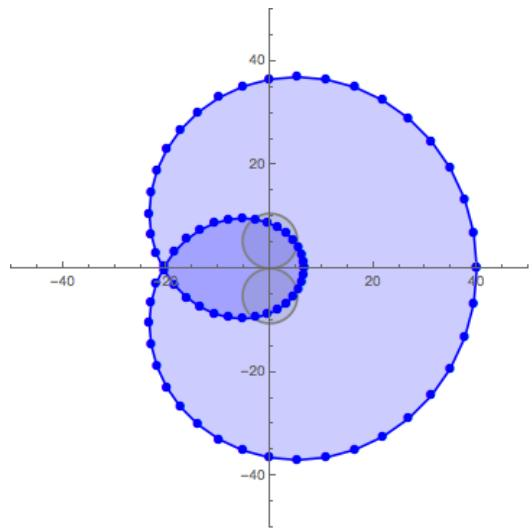
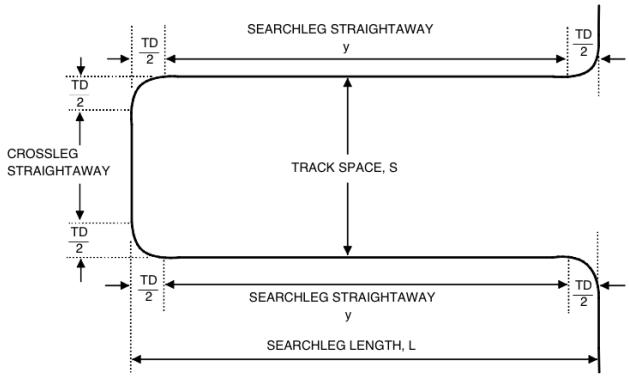
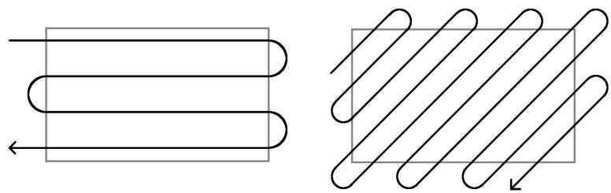
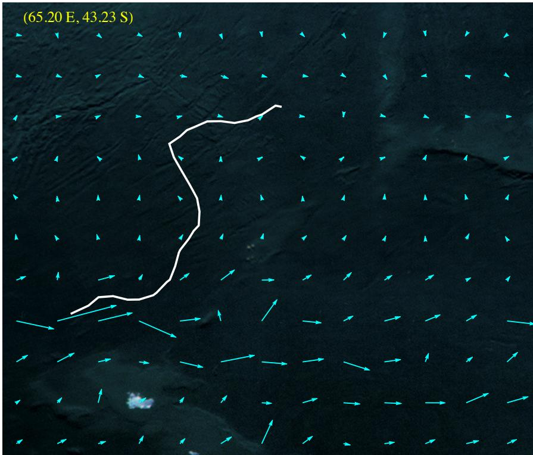

# 2015年数学建模美赛B题特等奖论文（36178号）

原件为竞赛论文。补充：文中的阅读练习及“参考解答”为整理时增加，原件图文保留出处。

In this paper, we develop a model for finding a plane that was lost over a large body of water. Our model is very robust and can be used by searchers throughout the entire search process.

Using only basic information about the flight and its last known location and heading, we are able to carefully calculate the area where the plane might have gone down. This area is not just a simple circle - the area is limited by the turn radius of the plane and by the maximum distance the plane could have traveled after losing communications.

Once our initial search area is determined, our model calculates how ocean currents would cause the search area would move from day to day, as well as change shape. And when debris has been found, the same ocean current calculations can be used in reverse to trace debris back to the original location of the crash.

Our model also implements three different algorithms for searching the area determined by our previous calculations. Our algorithms are very flexible, and adapt to changing weather conditions, number of search planes available, and the size of the area to search. Based on detailed analysis of these three algorithms in over 900 unique search scenarios, our model was able to recommend the ideal algorithm for finding any lost plane. Given any combination of factors for a search, our model can predict the number of days it will take to find debris in that region.

## Contents

### Introduction to Problem 3

知识点：[一般假设及其合理性说明（Assumptions and Justifications）](../../../topics/数学建模/jiaben_shezhi.md)、[模型参数的确定（基于数据拟合或实验选择）](../../../topics/数学建模/canshu_queding.md)、[确定模型的定点与稳定性分析](../../../topics/数学建模/dingdian_wending.md)

### Assumptions and Parameters

#### Assumptions and Justifications

#### Parameters

知识点：[一般假设及其合理性说明（Assumptions and Justifications）](../../../topics/数学建模/jiaben_shezhi.md)、[模型参数的确定（基于数据拟合或实验选择）](../../../topics/数学建模/canshu_queding.md)、[参数合理性验证](../../../topics/数学建模/canshu_heli_xing.md)

### Analysis of the Problem

#### Hypotheses

知识点：[数学建模的基本步骤（问题分析、模型假设、建立、求解、检验、推广）](../../../topics/数学建模/jianmo_buzhou.md)、[一般假设及其合理性说明（Assumptions and Justifications）](../../../topics/数学建模/jiaben_shezhi.md)

### Statement of Model

#### Components of the Model

##### Modeling a generic “downed plane” using parameters

##### Calculating the present location of the debris field using ocean current data

##### Modeling a generic search plane using parameters

##### Searching the probable debris field effectively using search planes

##### Using reverse-drift calculation to approximate the origin of the debris

#### Generating the Search Area

#### Adjusting the search area over time

#### Search Theory

#### Conducting an Effective Search

##### Parallel search

##### Diagonal search

##### Optimized parallel search

#### Full Statement of the Model’s Main Equation

#### Tracing the Findings to the Crash

知识点：[海洋搜索理论历史与核心概念](../../../topics/数学建模/sousuo_lilun.md)、[平行搜索与条纹飞行路径（Descending/Spiral Stripe Flight Path）](../../../topics/数学建模/pingxing_sousuo.md)、[贝叶斯调整飞行路径方案](../../../topics/数学建模/bayesi_tiaozheng.md)

### Results

#### Comparisons to real-world searches

#### Optimal search methods

##### Behaviors of different search algorithms

##### Choosing the right algorithm for each search

知识点：[海洋搜索理论历史与核心概念](../../../topics/数学建模/sousuo_lilun.md)、[有效性参数（Effectiveness Parameter）与搜索模式对比](../../../topics/数学建模/youxiaoxing_canshu.md)

### Error/Sensitivity Analysis

#### Sensitivity with respect to the height of the crashed plane

#### Sensitivity with respect to the speed of the crashed plane

#### Sensitivity with respect to the speed of the wind at time of crash

#### Sensitivity with respect to the number of search planes

#### Sensitivity with respect to the speed of the wind while searching

#### Sensitivity with respect to the visibility while searching

知识点：[敏感性分析方法（Sensitivity Analysis，单参数与多参数变动）](../../../topics/数学建模/minganxing_fenxi.md)、[发现不确定性模型（Uncertainty Model）与传感器视野](../../../topics/数学建模/faxian_buqueding.md)、[有效性参数（Effectiveness Parameter）与搜索模式对比](../../../topics/数学建模/youxiaoxing_canshu.md)

### Analysis of our Model

#### Strengths

#### Weaknesses

#### Future improvements

知识点：[模型优缺点分析（Strengths and Weaknesses）](../../../topics/数学建模/youque_dian.md)、[模型验证方法概述（随机模型与确定性模型验证）](../../../topics/数学建模/moxing_yanzheng.md)、[数学建模的基本步骤（问题分析、模型假设、建立、求解、检验、推广）](../../../topics/数学建模/jianmo_buzhou.md)

### Conclusion

# 2015年数学建模美赛B题特等奖论文（36178号）（习题）

本文档整理自《2015年数学建模美赛B题特等奖论文（36178号）》第2部分（共10部分），由识别工具读取后按规范整理。内容涉及问题的假设、参数设定及模型初步分析，属于竞赛论文的解题思路与背景阐述，非标准考试题。

## 一、问题背景与假设

知识点：[一般假设及其合理性说明（Assumptions and Justifications）](../../../topics/数学建模/jiaben_shezhi.md)、[模型参数的确定（基于数据拟合或实验选择）](../../../topics/数学建模/canshu_queding.md)、[文献综述与研究背景撰写方法](../../../topics/数学建模/wenxian_zongshu.md)

### 选择 1

题干：在解决“寻找失事飞机”这一复杂问题时，团队提出了一系列关键假设以简化模型并提高可行性。以下哪项**不是**文中明确列出的假设及其理由？

- A. 假设最困难的坠机场景，以确保模型兼容大多数情况。
- B. 忽略空气阻力对飞机坠落距离的影响，因为数据难以获取且影响相互抵消。
- C. 假设搜索人员不会因疲劳而影响效率，因为疲劳个体不应参与搜索。
- D. 假设所有搜索飞机从距离搜索地点 500 海里处起飞，以便覆盖更广区域。

答案：D。
知识点：[海洋搜索理论历史与核心概念](../../../topics/数学建模/sousuo_lilun.md)、[平行搜索与条纹飞行路径（Descending/Spiral Stripe Flight Path）](../../../topics/数学建模/pingxing_sousuo.md)、[螺旋方形搜索模型（Spiral Square Search Model）](../../../topics/数学建模/luoxuan_fangxing.md)

### 简答 1

题干：请简述为什么模型中忽略了空气阻力（air drag）对飞机坠落距离的影响？

答案：
知识点：[平行搜索与条纹飞行路径（Descending/Spiral Stripe Flight Path）](../../../topics/数学建模/pingxing_sousuo.md)、[螺旋方形搜索模型（Spiral Square Search Model）](../../../topics/数学建模/luoxuan_fangxing.md)、[海洋搜索理论历史与核心概念](../../../topics/数学建模/sousuo_lilun.md)

### 简答 2

题干：文中关于“碎片搜寻技术”的假设是什么？其依据是什么？

答案：
知识点：[平行搜索与条纹飞行路径（Descending/Spiral Stripe Flight Path）](../../../topics/数学建模/pingxing_sousuo.md)

### 简答 3

题干：模型中关于“洋流对碎片漂移”的处理方式是怎样的？这对搜索策略有什么启示？

答案：
知识点：[海洋搜索理论历史与核心概念](../../../topics/数学建模/sousuo_lilun.md)、[后验概率更新与搜索路径规划](../../../topics/数学建模/houyan_gailv.md)、[动态规划求解（状态变量、决策变量、状态转移函数、值函数）](../../../topics/数学建模/dongtai_guihua.md)

### 填空 1

题干：在确定飞机可能坠毁的距离时，模型使用了以下四个主要参数：\_\_\_\_\_\_、\_\_\_\_\_\_、\_\_\_\_\_\_ 以及 \_\_\_\_\_\_。

答案：高度（altitude）、速度（velocity）、质量（mass）、风速（wind speed）。
知识点：[模型参数的确定（基于数据拟合或实验选择）](../../../topics/数学建模/canshu_queding.md)、[敏感性分析方法（Sensitivity Analysis，单参数与多参数变动）](../../../topics/数学建模/minganxing_fenxi.md)

### 填空 2

题干：在确定最有效的搜索模式时，除了上述参数外，还考虑了以下三个关键因素：可用的搜索飞机数量、\_\_\_\_\_\_ 以及 \_\_\_\_\_\_。

答案：自坠机以来的时间（time since the crash）、每天分配的搜索时间（assumed to be 10 hours）。
知识点：[海洋搜索理论历史与核心概念](../../../topics/数学建模/sousuo_lilun.md)、[后验概率更新与搜索路径规划](../../../topics/数学建模/houyan_gailv.md)

### 简答 4

题干：团队最初提出了几种搜索矩形区域的方案（如图1所示），最终排除了螺旋搜索（spiral search）的原因是什么？他们倾向于哪种搜索方式？

答案：
知识点：[平行搜索与条纹飞行路径（Descending/Spiral Stripe Flight Path）](../../../topics/数学建模/pingxing_sousuo.md)、[螺旋方形搜索模型（Spiral Square Search Model）](../../../topics/数学建模/luoxuan_fangxing.md)、[海洋搜索理论历史与核心概念](../../../topics/数学建模/sousuo_lilun.md)

### 判断 1

题干：判断正误：模型假设坠机区域是完全平坦的水面，忽略地球曲率是因为其影响在所有计算中都可以忽略不计。（ ）

答案：正确。
知识点：[一般假设及其合理性说明（Assumptions and Justifications）](../../../topics/数学建模/jiaben_shezhi.md)、[文献综述与研究背景撰写方法](../../../topics/数学建模/wenxian_zongshu.md)、[数学建模的基本步骤（问题分析、模型假设、建立、求解、检验、推广）](../../../topics/数学建模/jianmo_buzhou.md)

### 4.1.1 Modeling a generic “downed plane” using parameters

We model a downed plane using the following parameters:

1. Its last known longitude and latitude as established by an automatic handshake or an Air Traffic Control scheduled check-in
2. Its direction of travel, in terms of degrees. (0 degrees is East, 90 North, 180 West, and 270 South)
3. The family that the plane belongs to:
    (a) Small bush plane
    (b) Military fighter
    (c) Private jet
    (d) Commercial airliner
    (e) Cargo plane
4. The parameters determined by the family of the plane:
    (a) Cruising speed
    (b) Cruising altitude
    (c) Typical takeoff mass

The five main families of planes each have different speeds, altitudes, and masses, so we decided to pick a representative from each family and model it. That representative would have to be commonly flown and thus be more likely to crash, making it a good choice to model. The representatives chosen are as follows:

1. Small bush plane: Cessna 172 Skyhawk[11]
2. Military fighter: Lockheed Martin F-22A Raptor[12]
3. Private jet: Bombardier Challenger 300[13]
4. Commercial airliner: Boeing 737-300 Classic[14][15][16]
5. Cargo plane: Lockheed C-5B Galaxy[17]

The height and speed of the plane were used to calculate its maximum glide distance without power, which is then used to determine the shape of the probable “splash-down” location. The mass is used to calculate its inertia, which makes it more resistant to the effects of crosswinds as it glides.

知识点：[符号说明与术语定义（Nomenclature / Symbols and Definitions）](../../../topics/数学建模/fuhao_shuoming.md)、[一般假设及其合理性说明（Assumptions and Justifications）](../../../topics/数学建模/jiaben_shezhi.md)、[坐标变换（经纬度坐标转换与搜索区域离散化网格）](../../../topics/数学建模/zuobiao_bianhuan.md)

### 4.1.2 Calculating the present location of the debris field using ocean current data

The likely outcome of a plane crash in open water is that, upon impact, the plane is destroyed and debris from the plane will be propelled a relatively short distance. Some of this debris will sink, but some of it will float and be carried by the currents in that area. After determining an approximate location for the site of the plane crash, we can calculate where the ocean current will carry the debris. This process is outlined in section 4.3.

The parameters that we used to model the ocean currents were the speed and direction of the currents. The debris resulting from a plane crash will continue to be carried by the currents until it is found by searchers. When a piece of debris is found in a search, the time and location of that debris provides important information that can be analyzed mathematically to obtain a better estimation of the location of the crash.

知识点：[坐标变换（经纬度坐标转换与搜索区域离散化网格）](../../../topics/数学建模/zuobiao_bianhuan.md)、[后验概率更新与搜索路径规划](../../../topics/数学建模/houyan_gailv.md)、[海洋搜索理论历史与核心概念](../../../topics/数学建模/sousuo_lilun.md)

### 4.1.3 Modeling a generic search plane using parameters

The primary parameters that we use for modeling a generic search plane are:

1. Flight speed while searching
2. Altitude while searching
3. Range of the search plane determined by fuel capacity

The speed is used to calculate the search plane’s turn radius, as well as to determine how much area the plane can search before the sun goes down. Range is also used as a limiting factor when calculating the area the plane should search.

Speed and altitude are also used to calculate the aircraft’s effective sweep width. (A description of effective sweep width is presented in section 4.4.) Due to the many varying factors that may affect an airplane’s sweep width, there is no one formula to calculate this. The United States National Search and Rescue Committee maintains tables of estimated effective sweep widths based on altitude, weather conditions, and size of the lost object.[2] We used Mathematica to interpolate this data and create a global sweep width function that accepts any inputs, even those not on the table.

知识点：[模型参数的确定（基于数据拟合或实验选择）](../../../topics/数学建模/canshu_queding.md)、[符号说明与术语定义（Nomenclature / Symbols and Definitions）](../../../topics/数学建模/fuhao_shuoming.md)

### 4.1.4 Searching the probable debris field effectively using search planes

Once the model has generated a search area, it can calculate the best way to search it for debris. There are many parameters used in this calculation: the number of search planes available, the types of planes available and their search effectiveness, prevailing weather conditions, visibility (how far one can see in terms of nautical miles), and the size of the area to search. How the search is actually performed is described below in section 4.5

知识点：[POC（包含概率）更新算法确定搜索模式](../../../topics/数学建模/poc_gengxin.md)、[海洋搜索理论历史与核心概念](../../../topics/数学建模/sousuo_lilun.md)

### 4.1.5 Using reverse-drift calculation to approximate the origin of the debris

The exact time and location should be noted when a piece of debris is found. With accurate data that gives the speed and direction of the ocean currents, the calculation used to predict the future location of the debris can be used in reverse to trace the debris back to its origin. This gives us a more accurate estimation of the location of the crash. This process is described mathematically in section 4.3.

## 4.2 生成搜索区域

为了估计飞机可能坠落的区域，我们的模型考虑了飞机的多种属性。我们使用以下公式计算最大无动力滑翔距离（d）：[19]

$$
d = \frac{\text{altitude}}{\tan(\theta)}
$$

其中 $\theta$ 是飞机进场轨迹与海平面之间的夹角，即飞机下降时的角度。我们将 d 视为自最后一次与飞机取得联系以来，飞机可能飞行的最大距离。

一个更简单的模型会以这个最大飞行距离作为圆的半径。但通过利用飞机的转弯半径，我们可以细化估计并缩小搜索区域。我们考虑飞机在失去联系后可能改变方向，但转弯半径会影响它在改变方向后能飞行的距离。为了计算转弯半径，我们首先假设初始运动完全是水平的，然后对水平速度（以海里/秒为单位）进行积分，直至飞机转弯 90 度。以每秒 1.5 度的速率，这需要 60 秒。

$$
\begin{array}{c}
V_x(t) = \text{speed} * \cos(1.5t) \\
r = \int_{0}^{60} V_x(t) \, dt
\end{array}
\tag{1}
$$

考虑一架以 500 节飞行的飞机，最大滑翔距离为 40 海里。其转弯半径则为 5.31 海里。如果飞机不转弯，它可以从最后联系点飞行 40 海里。但如果它转弯 90 度，由于转弯消耗了距离，它只能再飞行 32 海里。如果它转弯 180 度，它只能再飞行 23 海里。图 3 直观地展示了这一事实。

通过推广这一概念，我们得到以下方程，用于计算给定转弯角度下飞机的最终水平位置和垂直位置：

$$
\begin{array}{l}
x(\theta) = r * \sin(\theta) + \cos(\theta) * (d - \text{arclength}(\theta, r)) \\
y(\theta) = r * (-\cos(\theta) + 1) + \sin(\theta) * (d - \text{arclength}(\theta, r))
\end{array}
\tag{2}
$$

使用这些公式计算我们的示例飞机，得到图 4 所示的结果。当我们将此结果垂直镜像以考虑飞机向右转弯时，得到图 5 所示的结果。

生成这些点后，模型应用旋转矩阵将形状定向到飞机在最后联系点时的航向。由于我们将坠机时的风速作为参数，我们知道风速有多快，但不知道风向。由于这种不确定性，我们决定根据风速增加搜索区域的大小。为此，我们让模型遍历最初生成的边缘点，计算它们从中心出发的法向量，并将按风速缩放的法向量加到原始点上。因此，整个周长按风速进行了扩展。

然后，模型应用凸包算法，并将结果保存为初始搜索区域。对于不熟悉凸包算法概念的读者，它是一种在 (x,y) 平面上生成“收缩包裹”一组点的多边形的方法。它通过遍历这些点来构造一个遵循以下规则的多边形：

1. 集合中的所有点要么在多边形内部，要么是多边形的顶点
2. 任意两点之间画的弦要么是内部弦，要么是边；它绝不能超出多边形的边界

通过使用凸包算法，我们能够将复杂的搜索形状简化为近似椭圆的形状，从而得到了飞机可能坠落的初始区域。

我们最初考虑过根据碎片从初始撞击点飞散产生的“飞溅”效应，在周长上增加额外的扩展。然而，我们发现，由于典型碎片的终端速度，这种扩展对原始形状的影响微乎其微。因此，我们选择不对坠机的这一方面进行建模，并且我们认为这不会显著影响我们的计算。

# 4.3 Adjusting the search area over time

本节内容整理自《2015年数学建模美赛B题特等奖论文（36178号）》第 5 部分（共 10 部分），由识别工具读取并格式化。原文阐述了如何利用洋流数据调整搜索区域，以及如何使用欧拉法模拟碎片漂移。

## 一、搜索区域的动态调整

为了考虑海洋洋流导致的残骸漂移，模型将原定的多边形搜索区域放置在网格上。网格中的每个方格被赋予一个“搜索标记”，并记录其经纬度。为简化模型，假设搜索区域仅在夜间发生离散移动，而非现实中连续的洋流运动。

每个循环的处理步骤如下：
1. 获取当前搜索标记的位置。
2. 根据洋流数据将标记漂移 24 小时。
3. 存储新的位置。

使用欧拉法（Euler's method）来近似残骸随时间的运动。具体做法是将残骸所在位置的洋流速度向量乘以时间间隔，然后将其加到位置上。过程如下：

$$
\begin{array}{c} (longitude_n, latitude_n) \approx (longitude_0, latitude_0) + \Delta t \left(\frac{\partial (longitude)_0}{\partial (hours)}, \frac{\partial (latitude)_0}{\partial (hours)}\right) + \dots \\ + \Delta t \left(\frac{\partial (longitude)_{n-1}}{\partial (hours)}, \frac{\partial (latitude)_{n-1}}{\partial (hours)}\right) \end{array}\tag{3}
$$

当所有原始搜索标记都经过一天的位移后，再次调用凸包算法（convex hull algorithm）生成新的包含多边形及后续的搜索区域。

## 二、搜索理论

在搜索理论（Search Theory）领域，每次搜索的根本目标是最大化探测概率（Probability of Detection, POD）。POD 通常定义如下参数和方程：

1. $t$ = 用于执行搜索的时间，或搜索已进行的时间
2. $n$ = 搜索者数量
3. $r$ = 搜索速率，即搜索者的速度
4. $s$ = 有效搜索宽度
5. $a$ = 待搜索的总面积

$$
\mathrm{POD} = 1 - e^{\left(- \frac{t \cdot r \cdot n \cdot s}{a}\right)}\tag{4}
$$

> [!NOTE]
> **有效搜索宽度** ($s$) 不是一个容易定义的数值，而更像是一个概念。
>
> 一个简单的理解方式是：假设有一个矩形搜索区域 $a$，其中包含 $n$ 个目标。如果你只进行一次穿越 $a$ 的扫描，并希望找到至少 $\frac{n}{2}$ 个目标。那么，有效搜索宽度就是你沿直线穿过 $a$ 时，能够发现这 $\frac{n}{2}$ 个目标所需的最小周围距离。

## 三、实施有效搜索

既然我们已经拥有了随时间和空间变化的搜索区域，模型的第二部分比较了三种搜索方法，并决定哪种方法能给出最佳的探测概率。测试的方法如下：

1. **平行搜索**：搜索者沿着边界矩形的长边，以平行的线段移动。
2. **对角搜索**：搜索者与边界矩形的长边成 $45^\circ$ 角，以平行的线段移动。
3. **优化版平行搜索**：第一种搜索方法的优化版本。

所有三种搜索算法均接受以下参数：搜索机队列表、边界矩形的大小、能见度以及风况。所有三种算法都会返回当天搜索扫过的总面积，在下文中用 $A$ 表示。

知识点：[数学建模的基本步骤（问题分析、模型假设、建立、求解、检验、推广）](../../../topics/数学建模/jianmo_buzhou.md)、[一般假设及其合理性说明（Assumptions and Justifications）](../../../topics/数学建模/jiaben_shezhi.md)

### 选择 1：平行搜索

平行搜索是我们测试的最简单的搜索算法。在该算法中，搜索飞机沿着搜索矩形的长边以直线路径飞行。这最小了转弯时间，最大化了搜索时间。

美国国家搜救补充手册（International Aeronautical and Maritime Search and Rescue Manual）定义了描述此类搜索的术语：
- **Searchleg straightaways**：搜索飞机沿搜索区域飞行的长直段。
- **Crosslegs**：飞机从一个 searchleg straightaway 飞往另一个时的路径。

在我们的算法中，除第一段外，飞机的每一次搜索腿（leg）都由两个 searchleg straightaways 和两个交叉段组成。第一段搜索仅包含一个交叉段。由于 searchleg straightaway 是实际进行搜索的部分，我们试图最大化在这些段上的时间。Crosslegs 由两个四分之一转弯和一个 crossleg straightaway 组成，将飞机带到下一个扫描位置。

该算法根据每架飞机的航程、搜索速度和剩余总面积，计算每架飞机当天可以完成多少个完整的搜索腿。然后将该搜索区域的宽度分配给该飞机，算法继续处理下一架飞机。此过程重复进行，直到没有飞机可用或整个区域已被搜索完毕。

该算法扫过的面积可以通过公式 5 计算，其中 $n$ 是参与搜索的飞机数量，$L$ 是一次完整扫描的长度：

$$
A = \sum_{i=1}^{n} \left( \text{sweepwidth}(plane_i) \cdot \text{numlegs}(plane_i) \cdot 2 \right) \cdot L\tag{5}
$$

# 2015年数学建模美赛B题特等奖论文（36178号）习题

本部分整理自《2015年数学建模美赛B题特等奖论文（36178号）》第 6 部分，主要涉及搜索算法中的对角线搜索和优化并行搜索的原理及面积计算公式。

## 一、搜索算法原理与计算

知识点：[海洋搜索理论历史与核心概念](../../../topics/数学建模/sousuo_lilun.md)、[平行搜索与条纹飞行路径（Descending/Spiral Stripe Flight Path）](../../../topics/数学建模/pingxing_sousuo.md)、[有效性参数（Effectiveness Parameter）与搜索模式对比](../../../topics/数学建模/youxiaoxing_canshu.md)

### 选择 1

题干：关于对角线搜索方法（Diagonal search），下列说法错误的是？

- A. 该方法基于与并行搜索相同的原则，但搜索平面以45度角相对于矩形的长边飞行。
- B. 该方法允许搜索平面在搜索区域内进行更长的扫掠，最大化了在搜索区域中部花费的时间。
- C. 在搜索区域的角落附近，搜索腿（search legs）可能非常短，需要更多的转弯。
- D. 对角线搜索法使得所有交叉腿（crosslegs）的直线距离减少。

答案：D。
知识点：[海洋搜索理论历史与核心概念](../../../topics/数学建模/sousuo_lilun.md)、[平行搜索与条纹飞行路径（Descending/Spiral Stripe Flight Path）](../../../topics/数学建模/pingxing_sousuo.md)、[螺旋方形搜索模型（Spiral Square Search Model）](../../../topics/数学建模/luoxuan_fangxing.md)

### 简答 1

题干：简述对角线搜索方法中搜索面积 $A$ 的计算公式及其变量含义。

知识点：[平行搜索与条纹飞行路径（Descending/Spiral Stripe Flight Path）](../../../topics/数学建模/pingxing_sousuo.md)、[螺旋方形搜索模型（Spiral Square Search Model）](../../../topics/数学建模/luoxuan_fangxing.md)、[海洋搜索理论历史与核心概念](../../../topics/数学建模/sousuo_lilun.md)

### 简答 2

题干：解释优化并行搜索（Optimized parallel search）如何解决传统并行搜索无法使用额外飞机的限制，并说明其基本策略。

知识点：[平行搜索与条纹飞行路径（Descending/Spiral Stripe Flight Path）](../../../topics/数学建模/pingxing_sousuo.md)

### 计算 1

题干：在优化并行搜索中，如果第 $i$ 个搜索块包含 $L_i$ 条搜索腿和 $P_i$ 架飞机，请推导该块中所有飞机扫掠的总腿数 $TL_i$ 的计算公式。

知识点：[平行搜索与条纹飞行路径（Descending/Spiral Stripe Flight Path）](../../../topics/数学建模/pingxing_sousuo.md)、[后验概率更新与搜索路径规划](../../../topics/数学建模/houyan_gailv.md)

### 4.7 Tracing the Findings to the Crash

Given the location of an object that has been moved by the current for $t$ hours, we use Euler’s method once again to trace the object back to its original location. This is done by taking the difference of the position of the debris and the velocity vector of the current scaled by a time interval, $\Delta t$. This process is demonstrated below and is repeated $\frac { t } { \Delta t }$ times to approximate the original location of the debris.

$$
\begin{array}{r} (l o n g i t u d e _ {0}, l a t i t u d e _ {0}) \approx (l o n g i t u d e _ {f}, l a t i t u d e _ {f}) - \Delta t (\frac {\partial (l o n g i t u d e) _ {f}}{\partial (h o u r s)}, \frac {\partial (l a t i t u d e) _ {f}}{\partial (h o u r s)}) - \dots - \\ \Delta t (\frac {\partial (l o n g i t u d e) _ {1}}{\partial (h o u r s)}, \frac {\partial (l a t i t u d e) _ {1}}{\partial (h o u r s)}) \end{array}\tag{10}
$$

## 5 Results

知识点：[坐标变换（经纬度坐标转换与搜索区域离散化网格）](../../../topics/数学建模/zuobiao_bianhuan.md)、[海洋搜索理论历史与核心概念](../../../topics/数学建模/sousuo_lilun.md)

### 5.1 Comparisons to real-world searches

In order to determine whether our search area and current drift calculations are accurate, it is helpful to draw comparisons to searches for lost planes in the real world. The most famous airline crash of recent memory was the March 2014 crash of Malaysia Airlines flight MH370. However, the crash of MH370 involved several other unforeseen variables and uncertainties that make finding an accurate search area difficult, if not impossible. Instead, we will compare our model’s result to the 2009 crash of Air France flight 447, which is a good example of a standard commercial airliner crash that was found using standard search methods. The search area for AF447 was determined to be a circle of radius 40 nautical miles.[1] However, when we plugged the data from that type of plane into our model (an Airbus A330[18]) we calculated a search radius of about 125 nautical miles. The reason ours is so much larger is because our model assumes we know very little about the crash. In the case of AF447, flight control expected to receive two messages only 60 seconds apart, but it only received one. That gave them a very precise estimation of the time and manner in which the plane went down.[1]. Our model does not expect this level of precision, and thus generates an outer bound of where the plane could have gone down.

知识点：[模型验证方法概述（随机模型与确定性模型验证）](../../../topics/数学建模/moxing_yanzheng.md)

### 5.2 Optimal search methods

Our model ran detailed analysis on our three different search methods with varying numbers of search planes, weather conditions, visibility distances, and sizes of search areas. For each combination of variables, we calculated the number of days each algorithm would require in order to raise the probability of detection above 95%. Each search method showed strengths and weaknesses depending on the unique combination of these variables. Figure 7 gives a visual representation of the results from the latter two search methods.

#### 5.2.1 Behaviors of different search algorithms

The simple parallel search worked reliably in all of our different test cases. While it was usually not as efficient as the diagonal search, it did not produce any unexpected or impractical results. Its worst-case time was 3581 days, with only 1 plane searching in 30+ knot wind and 1 nautical mile of visibility over 112,640 square nautical miles. However, the best-case time for this algorithm was three days, even with dozens of extra planes, because it did not have the means to cover more than 100% of a search area in a given day.

The diagonal search generally performed better than the simple parallel search, usually achieving 95% POD in a median of two fewer days. However, if run with only a few planes under adverse conditions, the algorithm produced extremely inefficient searches. With only one plane and limited visibility, this algorithm sometimes took upward of 35,000 days to reach 95% POD—nearly 100 years of searching! The diagonal search algorithm also has the same best-case time of three days, since it likewise cannot put extra planes to use.

The diagonal search was our best-performing algorithm overall. Its performance was better than the simple parallel search in most cases. Even though under adverse conditions this search does extremely poor, most of the time, given typical search conditions, it will be faster than the optimized parallel. Under intense time pressure, when the lives of the plane’s passengers may be at stake, this factor is highly desirable.

#### 5.2.2 Choosing the right algorithm for each search

It is clear that none of our search methods are perfect for every search, because each method has a best and worst case depending on the parameters of the search. When planning a real-life search for a missing aircraft, every single day spent searching is another day that lives may be lost, so choosing the optimal search method for each day is critical. We will compare and contrast our latter two search methods: the diagonal search and the optimized parallel search.

The diagonal search algorithm usually exhibits better performance than the optimized parallel search. We suggest that this is because search legs near the middle of the search area can be much longer than those in the parallel method. However, the diagonal search exhibits worse performance than the optimized parallel search under a few specific conditions—sometimes worse than the optimized parallel search by several orders of magnitude. The worst performance of the diagonal search algorithm occurs when searching a large area with very few search planes and bad weather conditions. As visibility decreases and wind speed increases, this algorithm exhibits poorer and poorer performance until it reports the incredible 35,000 days mentioned above.

## 6 Error/Sensitivity Analysis

Because our model does not find an optimal solution, but instead predicts the number of days it will take to search any area, our sensitivity analysis will be based on a median problem, and we will then see how changing the input parameters affects the number of days the search will take. The parameters we analyzed are:

1. Height of the crashed plane
2. Speed of the crashed plane
3. Speed of the wind at the time of the crash
4. The number of search planes in the air searching
5. The speed of the wind while searching
6. The visibility range during the search

For our sensitivity analysis, we had each of those parameters set to the following as the “baseline” we would compare against:

1. 45000 feet cruising altitude
2. 459 knot cruising speed
3. 10 knot wind at time of crash
4. 21 search planes (AP-3C Orion)[9]
5. 20 knot wind while searching
6. 14.6 nautical miles of visibility

These parameters generate a search area of 85,957 square nautical miles to search. This baseline generates an estimated search time of 11 days.

To perform our analysis, we changed each parameter individually and compared the new resulting estimated days to our baseline of 11 days. We kept altering the deviation until we had a change on both sides, or until we were convinced that changing in one direction would be ineffective.

知识点：[确定模型的定点与稳定性分析](../../../topics/数学建模/dingdian_wending.md)、[模型优缺点分析（Strengths and Weaknesses）](../../../topics/数学建模/youque_dian.md)、[敏感性分析方法（Sensitivity Analysis，单参数与多参数变动）](../../../topics/数学建模/minganxing_fenxi.md)

### 6.1 Sensitivity with respect to the height of the crashed plane

We found that changing the altitude that the crashed plane was flying at by a deviation of 4000 feet created a change in both directions. Decreasing the height by 4000 feet led to 10 days of searching, and increasing by 4000 feet led to 12 days of searching. As such, it appears that a linear change of the height results in a linear change in the number of days to search at a rate of $1/4000$.

知识点：[敏感性分析方法（Sensitivity Analysis，单参数与多参数变动）](../../../topics/数学建模/minganxing_fenxi.md)、[参数合理性验证](../../../topics/数学建模/canshu_heli_xing.md)、[数学建模的基本步骤（问题分析、模型假设、建立、求解、检验、推广）](../../../topics/数学建模/jianmo_buzhou.md)

### 6.2 Sensitivity with respect to the speed of the crashed plane

When we changed the speed of the crashed plane, it only altered the turn radius which in turn altered the size of the search area. However, we found that any reasonable change in the speed from our baseline (459 knots) only had a marginal effect on the estimated days, and as such this does not appear to affect our sensitivity analysis.

知识点：[敏感性分析方法（Sensitivity Analysis，单参数与多参数变动）](../../../topics/数学建模/minganxing_fenxi.md)、[有效性参数（Effectiveness Parameter）与搜索模式对比](../../../topics/数学建模/youxiaoxing_canshu.md)、[确定模型的定点与稳定性分析](../../../topics/数学建模/dingdian_wending.md)

### 6.3 Sensitivity with respect to the speed of the wind at time of crash

When we altered the speed that the wind was blowing at to be anything less than 10 knots, we found that it did not affect the estimated number of days. However, increasing the speed by 5 knots gave us 1 more day that we had to search. Thus, this appears to affect the answer in a linear fashion above 10 knots at a rate of $1/5$.

知识点：[敏感性分析方法（Sensitivity Analysis，单参数与多参数变动）](../../../topics/数学建模/minganxing_fenxi.md)、[模型验证方法概述（随机模型与确定性模型验证）](../../../topics/数学建模/moxing_yanzheng.md)

### 6.4 Sensitivity with respect to the number of search planes

As we changed the number of planes, we found an interesting result: decreasing the number of search planes by 2 planes increased the search time by 2 days, but adding 2 search planes only decreased the search length by 1 day. As such, it appears that the search time has an inverse exponential relation to the number of search planes.

知识点：[敏感性分析方法（Sensitivity Analysis，单参数与多参数变动）](../../../topics/数学建模/minganxing_fenxi.md)、[有效性参数（Effectiveness Parameter）与搜索模式对比](../../../topics/数学建模/youxiaoxing_canshu.md)

### 6.5 Sensitivity with respect to the speed of the wind while searching

Because of the piecewise function our model has to use to calculate sweep width based on the wind speed at the time of the search, we had to make large changes to the wind speed in order to get a change. When we increased wind speed by 6 knots, it doubled the search time, and when we decreased by 6 knots it halved the search time. In real life, this is most likely a logistic relation, as the time will eventually cap regardless of wind speed, and will bottom out when wind speed gets below a certain level.

知识点：[敏感性分析方法（Sensitivity Analysis，单参数与多参数变动）](../../../topics/数学建模/minganxing_fenxi.md)、[有效性参数（Effectiveness Parameter）与搜索模式对比](../../../topics/数学建模/youxiaoxing_canshu.md)

### 6.6 Sensitivity with respect to the visibility while searching

When we performed our sensitivity analysis on the visibility, we found that any visibility above our original 14.6 nautical miles had no effect on the time it would take to search the area, but going down by 1 nautical mile increased the time it would take by 1 day. From this behavior, it appears that this is another inverse exponential relation.

## 7 Analysis of our Model

知识点：[敏感性分析方法（Sensitivity Analysis，单参数与多参数变动）](../../../topics/数学建模/minganxing_fenxi.md)、[模型验证方法概述（随机模型与确定性模型验证）](../../../topics/数学建模/moxing_yanzheng.md)、[发现不确定性模型（Uncertainty Model）与传感器视野](../../../topics/数学建模/faxian_buqueding.md)

### 7.1 Strengths

Our model can calculate the possible “splash-down” area using only the altitude, speed, and last known coordinates of the plane, which is much less data than most searches typically require. Using those three parameters, the model is able to generate a more realistic search shape than just a circle or rectangle. It can also use real-life ocean current data to have the debris search area drift accordingly, allowing it to change shape and size. Other models might just have a static search area, and debris might drift out of that. A third strength of the model is that, regardless of the shape of the area, we are able to model and predict how long it will take to search that area sufficiently to have a 95% chance of finding a piece of debris, if there is any debris to be found.

知识点：[海洋搜索理论历史与核心概念](../../../topics/数学建模/sousuo_lilun.md)、[平行搜索与条纹飞行路径（Descending/Spiral Stripe Flight Path）](../../../topics/数学建模/pingxing_sousuo.md)

### 7.2 Weaknesses

While our model is quite robust, it has a few important weaknesses. One of them is that, in order to run our search patterns, the model has to search a rectangle that bounds the search area, rather than only the area itself. This means that, depending on the orientation and shape of the actual search area, the search planes may spend excessive amounts of time searching outside where the debris could be. Another weakness at the moment is that the model can only calculate current drift in the vicinity of where flight MH370 went down; we lack the data necessary to model ocean currents globally. Our model does not account for survivors floating on debris or in rafts moving the debris against the current and outside the search area as they head for land. Also, our model does not take into account the speed of the crashing plane when it loses power and begins to glide, so the actual search area might be larger than what we are currently estimating.

知识点：[模型优缺点分析（Strengths and Weaknesses）](../../../topics/数学建模/youque_dian.md)、[参数合理性验证](../../../topics/数学建模/canshu_heli_xing.md)、[数学建模的基本步骤（问题分析、模型假设、建立、求解、检验、推广）](../../../topics/数学建模/jianmo_buzhou.md)

### 7.3 Future improvements

Due to the limited time available to us, there were some simplifications that we had to make to our model that we would like to expand upon, given more time. We would like to develop a way to incorporate local current data measured at the site of the last known point of contact and model the drift using that, rather than just a small section of data that we were able to find for flight MH370’s area. We would also like to expand upon our “splash-down” shape by accounting for more possible types of loss-of-contact other than just loss of power. A third area we would like to improve in the model is to incorporate other search methods and continue comparing them until we have a definitive “best” method, rather than the best of three that we chose. The fourth way we would like to improve the model is to continue writing and integrating the program so that each day’s search area is displayed with latitude and longitude coordinates at the corners for reference, and the search pattern the planes are to fly is traced onto the map as well for convenient visualization.

We would also like to add a feature that allows you to put more specific data into the model and thus narrow the search parameters. For example, future versions of our model may allow the user to provide the distance that search planes must fly to reach the search area as a parameter. It may also allow the user to provide the time since the crash occurred, eventually.

知识点：[数学建模的基本步骤（问题分析、模型假设、建立、求解、检验、推广）](../../../topics/数学建模/jianmo_buzhou.md)、[模型优缺点分析（Strengths and Weaknesses）](../../../topics/数学建模/youque_dian.md)、[模型参数的确定（基于数据拟合或实验选择）](../../../topics/数学建模/canshu_queding.md)

### 8 Conclusion

The model we have described in this paper is a robust and comprehensive model that can assist searchers throughout the search for a missing airplane. When the airplane goes down, our model can give a maximum bounding area of the plane’s location, carefully limited by the airplane’s turn radius. Every day, when given a search pattern and information about the search conditions, the model can predict the search area covered and report the probability that debris from the crash will be found. Each day, the model can precisely move the search area based on ocean current data, so searchers can know exactly where to focus their efforts, and once debris is found, the model can trace the debris back to the original location of the crash.

In addition, testing our model on different search methods revealed that there is no one perfect way to search for a missing plane. Depending on the weather, the area to search, and the number of planes available, different search algorithms may yield different results. But by testing these algorithms on a variety of scenarios, our model was able to generate recommended search methods for different search situations.

There is no one way to search for a missing airplane—there are simply too many unknowns, too many variables, too many things that can go wrong in different ways. But no matter the type of plane, the time it went down, or even the weather, we hope that our model could help searchers at every step of the way.

Team # 36178

知识点：[模型验证方法概述（随机模型与确定性模型验证）](../../../topics/数学建模/moxing_yanzheng.md)、[模型验证方法概述（随机模型与确定性模型验证）](../../../topics/数学建模/moxing_yanzheng.md)、[模型优缺点分析（Strengths and Weaknesses）](../../../topics/数学建模/youque_dian.md)

### References

[1] Australian Transport Safety Bureau. (2014). MH370 - Definition of underwater search areas. Canberra, ACT 2601: Australian Transport Safety Bureau.

[2] National Search and Rescue Committee [NSARC]. (2000). United States National Search and Rescue Supplement to the International Aeronautical and Maritime Search and Rescue Manual. Washington, D.C.: U.S. Superintendent of Documents.

[3] Potomac Management Group, Inc. (2006). A Simple Guide to Conducting Ground Search and Rescue Detection Experiments. Washington, D.C.: United States Coast Guard Office of Search and Rescue.

[4] Steiner, Margaret F. Ditching behavior of military airplanes as affected by ditching aids. UNT Digital Library. http://digital.library.unt.edu/ark:/67531/metadc61115/. Accessed February 6, 2015.

[5] Sedgewick, R., & Wayne, K. (2011, August 6). Convex hull. Retrieved February 6, 2015, from http://algs4.cs.princeton.edu/99hull/

[6] Long, L., & Weiss, H. (2006). How Terminal Is Terminal Velocity? The American Mathematical Monthly, (113), 752-755.

[7] Carry-on Baggage. (n.d.). Retrieved February 7, 2015, from http://www.delta.com/content/www/en US/traveling with-us/baggage/during-your-trip/carry-on.html

[8] Aircraft Specifications. (n.d.). Retrieved February 7, 2015, from http://www.gatewaygroup.com/aircraft-specifications/

[9] P-3 Orion Specifications. (n.d.). Retrieved February 8, 2015, from http://www.lockheedmartin.com/us/products/p3/p-3-specifications.html

[10] 737 Airborne Early Warning and Control. (n.d.). Retrieved February 8, 2015, from http://www.boeing.com/assets/pdf/defense-space/ic/aewc/docs/737AEWC overview.pdf

[11] Cessna 172. (n.d.). Retrieved February 6, 2015, from http://en.wikipedia.org/wiki/Cessna 172

[12] Lockheed Martin F-22 Raptor. (n.d.). Retrieved February 6, 2015, from http://en.wikipedia.org/wiki/Lockheed Martin F-22 Raptor

[13] Bombardier Challenger 300. (n.d.). Retrieved February 6, 2015, from http://en.wikipedia.org/wiki/Bombardier Challenger 300

[14] The Boeing Next-Generation 737 family. (n.d.). Retrieved February 6, 2015, from http://www.boeing.com/boeing/commercial/737family/background.page

[15] Boeing 737. (n.d.). Retrieved February 6, 2015, from http://en.wikipedia.org/wiki/Boeing 737

[16] Boeing 737-300. (n.d.). Retrieved February 6, 2015, from http://www.airliners.net/aircraftdata/stats.main?id=92

[17] Lockheed C-5B Galaxy. (n.d.). Retrieved February 6, 2015, from http://en.wikipedia.org/wiki/Lockheed C-5 Galaxy

[18] Airbus A330. (n.d.). Retrieved February 9, 2015, from http://en.wikipedia.org/wiki/Airbus A33

[19] Forces of a Glider lab and lecture. (n.d.). Retrieved February 6, 2015, from http://www.t4t.org/wpcontent/uploads/2013/08/FORCES-The Glider.docx

[20] OSCAR Project Office. "Data Download for Ocean Surface Currents." Retrieved February 5, 2015, from www.oscar.noaa.gov/datadisplay/oscar datadownload.php.

[21] Hafner, Izidor. "South Indian Ocean Currents, Flight MH370." Demonstrations RSS. Wolfram, 21 Apr. 2014. Web. 05 Feb. 2015. <http://www.demonstrations.wolfram.com/SouthIndianOceanCurrentsFlightMH370/>.

## Addressing the Press Regarding the Plan for Future Searches

Our new plan for searching for planes that are lost over large bodies of water can be summarized by three stages: finding an approximate location for the site of where the plane went down, searching this location for evidence of the location of the plane, and analyzing the findings to obtain a better approximation for the location of the plane. This process is repeated until the plane is found. These stages will now be explained in further detail.

Upon receiving news that one of our planes has been lost over a large body of water, we will first gather information regarding the situation, such as the model of plane, the point of last contact, the time of last contact, the weather in the area, and the heading of the plane. We will then use this information to determine an area that the plane could have gone down in. This area is usually a circular shape.

After determining the area that the plane could have gone down in, we will trace a rectangle around this area and search the rectangle with search planes. If few search planes are available, they will search in a straight-line pattern across the long side of the rectangle. If ten or more planes are available for the search, then the planes will fly diagonally across the rectangle to cover the area more efficiently. The planes will use visual techniques to spot evidence of the plane's location, such as debris.

Every time debris is found, we will use data of ocean currents of that location to determine where that debris originated. This will give us a better approximation of the location of the plane, and we will start again with the first stage and repeat this process until the plane has been found.

知识点：[文献综述与研究背景撰写方法](../../../topics/数学建模/wenxian_zongshu.md)
