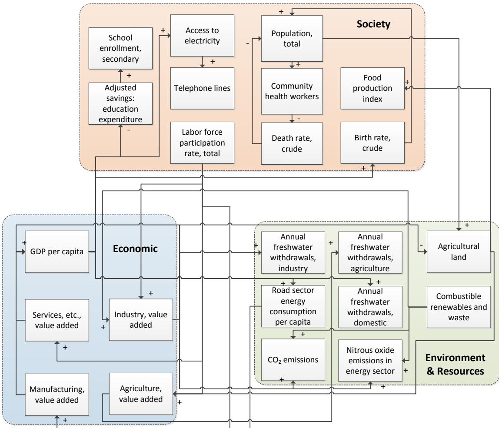

# 2015年美国大学生数学建模竞赛（MCM/ICM）特等奖论文：可持续发展评价体系（Team 38996）

原件为竞赛论文。补充：文中的阅读练习及“参考解答”为整理时增加，原件图文保留出处。

本资料整理自《2015年美国大学生数学建模竞赛（MCM/ICM）特等奖论文：可持续发展评价体系》第1部分（共9部分），由识别工具读取并整理。

## 一、摘要与目录

### 摘要

Sustainable development has attracted plenty of attention from all over the word for recent decades. While the definition of sustainable development is very comprehensive.

To evaluate sustainability of a country, devise an evaluation model for sustainable development. Based on our analysis of sustainable development, we depart the meaning of sustainable development into two dimension: social-economic development and environmentresource development. We design the index system by expanding ecological footprint into our model, and then we invoke entropy evaluation method and the subject-object weighting method based on CRITIC to derive the calculation process of two overall indices. By scaling the indices in coordinate system and calculate the direction by regression analysis, we devise the harmonious development (included angle between actual development direction and ideal development direction) and valid development (projection of actual development on standard development pattern) of a country to evaluate the sustainability thought two aspects. Their product, a hyperbolic sustainable distance, is the final result of our model, which represent the hyperbolic distance between the current development and goal development point. We show an implementation of our model that takes America, China, France, Nepal and South Africa as example. It turns out that America, France (the Best one) and South Africa are all sustainable, while the others are not. We also compare our model with other possible approaches, which turns out that our model is more appropriate for sustainable development.

We choose Nepal in our further investigation, where we invoke ARIMA model to forecast without intervention and system dynamics to forecast with intervention. Because of the limited data resources, we estimate the parameters of structure equations in each subsystem by Three-Stage Least Squares method, then we list the exact formulas of dynamic equations. After exploring the current development situation and geological characteristics of Nepal, we utilize sensitivity analysis and our forecast results to propose a sustainable development plan for Nepal, among which modernization program performs best according to our systemdynamics simulation results.

Finally, we discuss the strengths and weaknesses of our model.

更多数学建模资料请关注微店店铺“数学建模学习交流” https://k.weidian.com/RHO6PSpA

知识点：[可持续发展指数 SDI 的构建与指标体系结构](../../../topics/数学建模/kechixu_zhibiao.md)、[生态足迹（Ecological Footprint）与社会可持续性指数 SSI](../../../topics/数学建模/shengtai_zuji.md)、[敏感性分析方法（Sensitivity Analysis，单参数与多参数变动）](../../../topics/数学建模/minganxing_fenxi.md)

### 目录

1. Introduction......2
   1.1. Background......2
   1.2. Our Work......2
2. Assumption......3
3. Sustainability of a Country and Policy......4
   3.1. Analysis of Sustainable Development......4
   3.2. Ecological Footprint......5
      3.2.1. Calculation......5
      3.2.2. Discussion on EF Model......5
   3.3. The Model......6
      3.3.1. Index System......6
      3.3.2. Sustainability Measurement......8
      3.3.3. An Implementation of Our model......10
      3.3.4. Further Discussion......12
4. Sustainability Development Plan......13
   4.1. Current Situation and Forecast without intervention......13
   4.2. Details of the Plan......14
      4.2.1. Effectiveness Judgment by Sensitivity Analysis......14
      4.2.2. Reasonability Judgment by Actual Conditions......15
      4.2.3. Ultimate Plan for Sustainable development......15
5. Dynamic Improvement......16
   5.1. System Dynamics and Structure Equations......16
   5.2. Simulation Run and Results......18
   5.3. Conclusion......19
6. Analysis of the Model......19
   6.1. Strengths......19
   6.2. Weaknesses......20
References......20

Team # 38996

Page 1 of 20

## 二、引言

知识点：[文献综述与研究背景撰写方法](../../../topics/数学建模/wenxian_zongshu.md)、[一般假设及其合理性说明（Assumptions and Justifications）](../../../topics/数学建模/jiaben_shezhi.md)、[模型优缺点分析（Strengths and Weaknesses）](../../../topics/数学建模/youque_dian.md)

### 1.1.背景

Broadly speaking, Defined by the 1987 Brundtland Report Our Common World [1], sustainable development meets the needs of the present without compromising the ability of future generations to meet their own needs. Sustainable development can we developed into various aspect such as nature, society, ecology, policy and so on. To be specific, sustainable development is to balance the development of nature, society, ecology, population and economy.

In terms of the profound definition of sustainable development, scientist have already come up with some essential principal of sustainable develop, and they are principal of equality, principal of sustainability and principal of commonality. The principal of equality refers to the fair and equitable resources between generations, intergenerational equity allocation and utilization. While the principal of sustainability indicates that economic and social development of mankind cannot exceed the carrying capacity of resources and the environment. And the principal of commonality represents that although national sustainable development patterns are different, the principles of equality and sustainability are common.

Unfortunately, many developing countries are suffering from the unsustainable development as they lack sufficient international aids and technological path pattern to cope with the intense contradiction between the pressing needs of contemporary citizens and the responsibility of protecting the environment. Meanwhile, numerous international organizations do not equip with scientific enough methods to evaluate the sustainability of each country. Nor can they efficiently figure out which country is most worth providing aids to.

The International Conglomerate of Money (ICM) wants to use their extensive financial resources and influence to create a more sustainable world. They are particularly interested in developing countries, where they believe they can see the greatest results of their investments.

知识点：[可持续发展指数 SDI 的构建与指标体系结构](../../../topics/数学建模/kechixu_zhibiao.md)、[影响因素评估指标体系构建（温度、湿度、经济、教育等）](../../../topics/数学建模/yingxiang_zhibiao.md)、[文献综述与研究背景撰写方法](../../../topics/数学建模/wenxian_zongshu.md)

### 1.2.我们的工作

We devise a mathematical model to measure the sustainability of given countries and policy after analyzing the concept of sustainable development. To be specific, we invoke the emergy based ecological footprint in our model after finding its drawbacks while measuring the sustainability of a country. Then we design a new evaluation system to perfect the objects that have been taken into consider. We also show our model results in a coordinate system so that they can be understood by any people who are interested in the issue but do not equip with much background knowledge. The model can tell when and how a country is sustainable or unsustainable explicitly. We also have some further discussion on approaches to sharpen our model.

Team # 38996

Page 2 of 20

# 可持续发展评价体系（Team 38996）

整理自《2015年美国大学生数学建模竞赛（MCM/ICM）特等奖论文：可持续发展评价体系》第 4–5 页内容，修正了部分识别错误和断行。

## 一、模型验证与敏感性分析

知识点：[生态足迹（Ecological Footprint）与社会可持续性指数 SSI](../../../topics/数学建模/shengtai_zuji.md)、[模型参数的确定（基于数据拟合或实验选择）](../../../topics/数学建模/canshu_queding.md)、[模型优缺点分析（Strengths and Weaknesses）](../../../topics/数学建模/youque_dian.md)

### 选择 1

Having devised a model for sustainability, we investigate Nepal from 48 LDC list. We first explore the current situation of Nepal by means of non-interference prediction with ARIMA model. Base on the results we derived from the analysis, we propose a 20-year sustainable development plan for Nepal, and the plan includes programs, policies, and a direction that indicates what ICM should do according to a specific state within Nepal.

We eventually devise a dynamic version of our model for the purpose to forecast the effect of each program and policy. The improved model comes back to the previous one if no programs or policies are carried out. We run the simulation each program and policy and draw the conclusion about which suggestions we had given are the highly effective strategies to be implemented by ICM.

Finally, we test the sensitivity of our model and discuss the strengths and weakness of our model.

## 二、假设

知识点：[可持续发展指数 SDI 的构建与指标体系结构](../../../topics/数学建模/kechixu_zhibiao.md)、[影响因素评估指标体系构建（温度、湿度、经济、教育等）](../../../topics/数学建模/yingxiang_zhibiao.md)、[模型参数的确定（基于数据拟合或实验选择）](../../../topics/数学建模/canshu_queding.md)

### 假设 1

The consumption of resources and production of waste are determined and can be measured by statistic method. As the consumption of resources and production of waste includes countless details which is hard to measure accurately, and the main purpose of our model is to measure the sustainability of a country or policy instead of measuring the explicit statistic data.

知识点：[一般假设及其合理性说明（Assumptions and Justifications）](../../../topics/数学建模/jiaben_shezhi.md)、[可持续发展指数 SDI 的构建与指标体系结构](../../../topics/数学建模/kechixu_zhibiao.md)

### 假设 2

The country measured is relatively stable. That is to say, extremely dramatic change does not happen in the chosen country while we are measuring its sustainability. For example, devastating natural disasters and devastating war which might possibly exterminate the country will not be taken into consideration.

知识点：[一般假设及其合理性说明（Assumptions and Justifications）](../../../topics/数学建模/jiaben_shezhi.md)、[数学建模的基本步骤（问题分析、模型假设、建立、求解、检验、推广）](../../../topics/数学建模/jianmo_buzhou.md)

### 假设 3

The economic state, demographics, resource consumption data and environment data of each the chosen country is available. The complicated situations in all developing country make it impracticable to investigate one by one, so we mainly focus on using these data to estimate whether a country is sustainably developing.

知识点：[可持续发展指数 SDI 的构建与指标体系结构](../../../topics/数学建模/kechixu_zhibiao.md)、[影响因素评估指标体系构建（温度、湿度、经济、教育等）](../../../topics/数学建模/yingxiang_zhibiao.md)、[人口密度修正系数与新公式](../../../topics/数学建模/renkou_midu.md)

### 假设 4

The statistical data is valid. We suppose that the true value of every index locates right nearby the statistic data. Consequently, we assume that the data is believable.

知识点：[一般假设及其合理性说明（Assumptions and Justifications）](../../../topics/数学建模/jiaben_shezhi.md)、[参数合理性验证](../../../topics/数学建模/canshu_heli_xing.md)

### 假设 5

The operating property and mechanism of a country is relatively independent from others. We hypothesize that every country all over the world respects the state sovereignty each other. In another word, the institutional structure and the operating mechanism within each country depends on the country itself only and will not be interfered by others. It is because every country has its sovereignty to determine which economic structure or political system to implement. And the inner political and economic structure will, to a great extent, determines various economic operating property and mechanism.

## 三、国家与政策的可持续性

知识点：[一般假设及其合理性说明（Assumptions and Justifications）](../../../topics/数学建模/jiaben_shezhi.md)、[文献综述与研究背景撰写方法](../../../topics/数学建模/wenxian_zongshu.md)、[问题重述与分析（Problem Restatement and Analysis）](../../../topics/数学建模/wenti_chongshu.md)

### 3.1 可持续发展分析

Sustainable development should takes care of two basic concepts: the contemporary people’s need and their descendants’ ability to meet their needs. To meet the requirement, we should economize natural resource, protect the environment and develop our society and economic at the same time. What is more important is to keep these aspects in a relatively balanced relation and position. Only if we succeed in balance them all, can we satisfy contemporary needs without depriving our offspring of their ability to meet their needs in the future, and make sure of the development of our posterity without sacrificing contemporary social and economic development. In a word, three dimensions of human development (economic, society, and environment) should develop in a balance state.

Recall the fishing model which derives an ideal point of fishing amount. At this point, the fish will keep reproducing at a highest rate so that the entire fishing industry can keep doing so for a long time. We can actually regard this point as a situation that meets a sustainable development. It is because both contemporary people’s needs and the interest of their posterity are satisfied as much as possible. That is to say, with the highest reproduction of fish, people can get most amount of fish from fishing, and the entire ecosystem is protect from ecological degradation. In another word, the fish ecosystem and fishing economic (which fosters and flourishes social development) keeps a balance relationship. We can also say the three dimensions meet an equilibrium state at this good point.

It is, however, very hard to find this balanced point in reality. We can merely describe this situation in a fuzzy word. Therefore, we must clarify some main factors that typically contribute to these three dimensions.

To start with, we explore social development of a country. It is clear that the population (including gross, density, and rate of change), public service (including medical treatment and public health, telecom service, transport service, etc.), and culture (including education, science, and technology) all contribute to level of social development. The higher level of the public service and culture, the better social development, while the population is a crucial control variate that provides the average level of these two components above.

We also seek principal factors that represent the development of social economy, which is the foundation of social development. We invoke some basic results of economics, and we figure the principal elements as follow: Gross Domestic Product, added value of agriculture, industry (including heavy industry, manufacture, service, and investment), laboring population, technology and so on. The more prosperous these elements are, the better a country’s economy is.

Last but not least, we will discuss some variates that can well indicate the level of environment and natural resources consumption in Section 3.2 in detail.

知识点：[可持续发展指数 SDI 的构建与指标体系结构](../../../topics/数学建模/kechixu_zhibiao.md)、[影响因素评估指标体系构建（温度、湿度、经济、教育等）](../../../topics/数学建模/yingxiang_zhibiao.md)、[文献综述与研究背景撰写方法](../../../topics/数学建模/wenxian_zongshu.md)

### 3.2. Ecological Footprint

Ecological footprint (EF) is originally proposed by Rees (1992) and improved by Wackernagel [2] to measure the sustainability. According to the thought of ecological footprint, every individual or group of units can consume natural resources and produce waste back into ecology system. The natural resources consumption and produced waste can be converse into biologically productive area. Subtracting appropriated carrying capacity, the positive result indicates sustainable development while the negative one means the development is unsustainable and the ecology is in a deficit state (ecological deficit).

#### 3.2.1. Calculation

The computational formula of ecological footprint is

$$
E F = N \times d f = \sum r _ {j} \times A _ {i} = \sum r _ {j} \times \frac {P _ { i } - I _ { i } - E _ { i }}{Y _ { i } \times N}, (j = 1, 2, \ldots)
$$

where $EF$ is ecological footprint; $ef$ is per capita ecological footprint; $i$ is consumption item; $Y _ { i }$ is per capita biologically productive area’s output for item $i$ per annum; $A _ { i }$ is the conversed per capita biological productive area’s output for item $i$ per annum; $P _ { i }$ is the production amount of item $i$ per annum; $I _ { i }$ is the import volume of item $i$; $E _ { i }$ is the export volume of item $i$; $N$ is population; and $r _ { j }$ is balance factor.

The computational formula of appropriated carrying capacity is

$$
E C = N \times e c = a _ {j} \times r _ {j} \times y _ {j}, (j = 1, 2, \ldots)
$$

where $EC$ is total appropriated carrying capacity; $ec$ is per capita EC; $a _ { j }$ is per capita biologically productive area; $r _ { j }$ is equivalence factor; $y _ { i }$ is productive factor.

Let $A = E F - E C$, then EF model evaluates the sustainability by value of $A$. If $A < 0$, then the country is sustainable, otherwise unsustainable.

#### 3.2.2. Discussion on EF Model

**The balance factor lacks enough explanation**

From the computational formula, we find that the balancing factor represents ratio of the productivity of a certain biologically productive area to overall average productivity biologically productive area. That means different type of land with similar balance factor can replace each other. What’s more, the balance factors are constant which is obviously irrational.

**The calculation of EF may be extremely hard and may lead to huge error**

For example, EF model converts the consumption of fossil fuel into the area that can absorb the ${ \mathrm { C O } } _ { 2 }$ produced by burning them. However, the waste gas produced while burning the fossil fuel is not merely limited to carbon dioxide, and $\mathsf { S O } _ { 2 }$ is another important pollutant that cannot be neglected.

In order to make the computational process more accurate, we can invoke the thought of emergy analysis. Emergy analysis theory is original proposed by H. T. Odum (1988) [3] and its main idea is to converse every items considered into a single form, emergy which is measured by solar energy, so that enhance the accuracy of EF calculation, compared with the traditional one.

**Controversy representative of sustainability**

Ecological footprint only takes the environmental and natural resources factor into consideration, but economic and social development are neglected. As a consequent, EF model is not necessarily sufficient to measure the sustainability of a country or policy. What’s more, EF model does not reflect the balance concept of sustainable development according to the analysis in Section 3.1.

In what follows, we devise a model for sustainable development that makes up the drawbacks of EF model and equips with strong visible and understandable results.

知识点：[生态足迹（Ecological Footprint）与社会可持续性指数 SSI](../../../topics/数学建模/shengtai_zuji.md)、[可持续发展指数 SDI 的构建与指标体系结构](../../../topics/数学建模/kechixu_zhibiao.md)、[模型优缺点分析（Strengths and Weaknesses）](../../../topics/数学建模/youque_dian.md)

### 3.3. The Model

#### 3.3.1. Index System

According to the analysis in Section 3.1, we divide diverse aspects of a country development level into two overall indices: SE (Society-Economy) indices and ER (Environment-natural Resources) indices. To measure these indices, we design an index system.

First, we invoke principal component analysis to create a set of each overall indices respectively. We rank all the indices decreasingly by sum of the first two principal component loadings. Then we choose the indices on the top of the list on condition that their practical implications are reasonable. Meanwhile, the process must make sure that each overall indices have approximate number of indices.

Second, we inverse the negative indices and scale all the chosen indices as follow:

$$
\mathrm{Positive:} x ^ {*} = \frac {x - x _ {\min}}{x _ {\max} - x _ {\min}},
$$

$$
\mathrm{Negative:} x ^ {*} = \frac {x _ {\max} - x}{x _ {\max} - x _ {\min}}.
$$

## 三、模型建立与求解

知识点：[可持续发展指数 SDI 的构建与指标体系结构](../../../topics/数学建模/kechixu_zhibiao.md)、[影响因素评估指标体系构建（温度、湿度、经济、教育等）](../../../topics/数学建模/yingxiang_zhibiao.md)

### 3.2 指标体系构建（续）

例如，二氧化碳排放是一个负向指标，因此在缩放数据时我们对其统计量进行了取逆处理。

至此，我们已经获得了所有需要的指标。接下来需要建立基于这些指标的层次体系。我们调用现有模型（如 Cobb-Douglas 生产函数）来设计一个四级指标体系。指标体系如图 1 所示。为了阐明第 2 级指标的计算过程，我们以农业指数为例进行详细说明。

在工业方面，Cobb-Douglas 生产函数的形式为：

$$
Y = A L ^ {\alpha} K ^ {\beta} P ^ {1 - \alpha - \beta}
$$

其中 $Y$、$A$、$L$、$K$、$P$ 分别代表工业生产、技术因素、劳动力、投资和土地投入。$\alpha, \beta$ 为参数。对于农业而言，投资不一定与农业产出相关。因此，我们设计的农业指数可由下式计算：

$$
Y = A L ^ {\alpha} P ^ {1 - \alpha}
$$

其中 $Y$、$A$、$L$、$P$ 分别代表农业生产、技术因素、劳动力和土地投入。$\alpha$ 为参数，其值可通过历史数据的回归分析获得。

当涉及从第 2 级到第 3 级的计算时，我们将熵权法 [5] 和基于 CRITIC [6] 的主客观赋权方法相结合，以制定计算流程。

首先，定义信息熵为：

$$
e _ {j} = - K \sum_ {i = 1} ^ {m} y _ {i j} \ln y _ {i j}
$$

其中 $K = 1/ \ln m$ 是与样本大小 $m$ 相关的常数。令 $d _ { j } = 1 - e _ { j }$ 表示信息的有效值。然后通过对 $d _ { j }$ 进行归一化得到每个指标的初始权重：

$$
\omega_ {j} = \frac {d _ {j}}{\sum_ {j = 1} ^ {m} d _ {j}}
$$

由于权重系统具有强烈的专业背景，我们不能仅通过统计方法确定它们。因此，这里引入主客观赋权方法。考虑到 ICM 独有的财务资源和影响力，我们可以邀请众多专家对这些复合指数进行评估，并为 $k = 1 , 2 , \dots , l$ 创建权重集 $\overrightarrow { C _ { k } } = \left( c _ { k _ { 1 } } , c _ { k _ { 2 } } , \ldots , c _ { k _ { n } } \right)$，其中 $l$ 是 CRITIC 权重集的大小（包括熵权）。整个计算流程如表 1 所示。

| Step | Description |
| :--- | :--- |
| Step 1 | Create the weighting set $\overrightarrow { C _ { k } } = \left( c _ { k _ { 1 } } , c _ { k _ { 2 } } , \ldots , c _ { k _ { n } } \right)$ |
| Step 2 | Run Kendall’s consistency coefficient test [7] for each weighting proposal by CRITIC and entropy weights. If the result is significant, we accept the mean of weight set $\vec {C} = \frac {1}{l} \sum_ {k = 1} ^ {l} \overrightarrow {C _ {k}}$, and go to Step 4; |
| Step 3 | Let $C = \theta _ { 1 } C _ { 1 } + \theta _ { 2 } C _ { 2 } + \cdots + \theta _ { l } C _ { l } ,$ where $\theta _ { i } = \frac { \sigma _ { i } \displaystyle \sum _ { j } ( 1 - r _ { i j } ) } { \displaystyle \sum _ { i } \left( \sigma _ { i } \displaystyle \sum _ { j } ( 1 - r _ { i j } ) \right) } , ~ r _ { i j }$ is the correlation coefficient of index $x _ { i }$ and $x _ { j }$ , and $\sigma _ { i }$ is the variance of index $x _ { j }$ |
| Step 4 | Run Spearman’s [8] post hoc test for rank correlation coefficient. |

**Table 1 The process of calculation of weighting process**

至此，我们完成了指标体系的建立工作。接下来是在坐标系中进行多维标度分析。

知识点：[影响因素评估指标体系构建（温度、湿度、经济、教育等）](../../../topics/数学建模/yingxiang_zhibiao.md)、[层次分析法 AHP（Analytic Hierarchy Process）用于综合评价](../../../topics/数学建模/ahp_fangfa.md)

### 3.3.2 可持续性度量

根据第 3.1 节对可持续发展的分析和指标体系，我们可以进一步确定每个国家在特定年份的精确坐标 $A ( x , y )$，如图 2 所示。纵坐标指代 ER 指数，横坐标指代 SE 指数。坐标越高，表现越好。回顾一下，数据篮包含全球几个典型国家的数据，因此对角线实际上代表了发展的相对平衡状态。因此，我们可以合理地将对角线向量 $\overrightarrow { O S } = ( { \bf 1 } , { \bf 1 } )$ 视为每个国家的理想发展（标准可持续发展）模式。在这种情况下，特定国家与目标发展节点 $S$ 之间的连线 $\overrightarrow { A S } = ( 1 - x , 1 - y )$，自然地成为一个国家自身的理想发展方向。

正如我们之前分析的，可持续性指的是一个国家良性发展的状态。为了清晰地衡量一个国家的可持续性，我们从两个方面展示结果。

#### 和谐发展

不幸的是，理想的发展在现实中很少见且难以实现。实际发展通常偏离理想发展。因此，我们必须通过将实际发展方向与理想方向进行比较来评估实际发展方向。我们调用回归分析来估计特定时期的方向向量。

我们可以通过使用贝塞尔样条函数拟合一系列坐标来更准确地计算每个切线角。贝塞尔样条函数在拟合具有平滑曲率的不连续函数时更为精确，因此它在此任务中表现更好，并能告诉我们每年的确切曲率（切线角）。如果我们需要指出一个国家何时变得可持续，这有助于我们确定确切的时间点。

和谐发展是指一个国家的发展接近理想模式的程度。我们将和谐发展衡量为理想发展方向与实际发展方向之间夹角 $\theta$ 的大小。它描绘了一个国家的发展方向偏离理想方向的程度。图 3 显示了这两个方向与夹角之间的关系。显然，较小的 $\theta$ 表示良好的和谐发展。

值得注意的是，理想发展方向始终是第一象限中的向量。这意味着 ER 指数和 SE 指数都应得到优化。由此可知，可持续的发展方向应始终指向右上角……

知识点：[可持续发展指数 SDI 的构建与指标体系结构](../../../topics/数学建模/kechixu_zhibiao.md)、[模型优缺点分析（Strengths and Weaknesses）](../../../topics/数学建模/youque_dian.md)、[模型验证方法概述（随机模型与确定性模型验证）](../../../topics/数学建模/moxing_yanzheng.md)

### Valid Development

Given that ideal development is hardly exist in reality, some countries might develop in an unhealthy way which runs more and more away from the standard sustainable development pattern. A perpendicular deviation, for example, should actually be treat as in vain in terms of valid development.

Valid development is the degree that a country’s development that can reflect on standard development pattern line. In another word, the valid development is the projection vector $\overrightarrow { O A ^ { \prime } }$ of actual development vector $\overrightarrow { O S }$ on vector $\overrightarrow { O A }$ (Figure 2). The module of $\overrightarrow { O A ^ { \prime } }$ is defined as valid development level.

In a similar way, we can define the potential development as module of vector ${ \overrightarrow { A ^ { \prime } S } } .$ . We can infer from its magnitude about the potential sustainable development in the future (in another word, the weakness of current development), and bigger its magnitude, the more passive the current development is.

知识点：[可持续发展指数 SDI 的构建与指标体系结构](../../../topics/数学建模/kechixu_zhibiao.md)、[影响因素评估指标体系构建（温度、湿度、经济、教育等）](../../../topics/数学建模/yingxiang_zhibiao.md)

### When and How

We have define two possible methods to evaluate sustainability so far, and each one will perform perfectly as we verify the concept of sustainable development. To combine these methods and make the meaning of our measurement standard more clear. We further develop these to method by multiplying them together, whose product $D _ { t }$ is a hyperbolic distance, and call it sustainable distance

$$
D _ {t} = \theta \cdot | \overrightarrow {A ^ {\prime} S} |,
$$

where $t$ represents the time.

We have so far attained explicit evaluation system for sustainable development on condition that we determine a threshold value $D _ { 0 } = \pi / 3 \times 0 . 7 5 = 0 . 7 8 5 4$ for sustainable distance $D _ { t } .$ If the hyperbolic sustainable distance $D _ { t } \leq D _ { 0 }$ , then we assert that the country develops sustainably at that time, otherwise unsustainably. In this way, we can determine when and how a country is sustainable development.

知识点：[可持续发展指数 SDI 的构建与指标体系结构](../../../topics/数学建模/kechixu_zhibiao.md)、[人类发展指数 HDI 的局限性与社会经济调整指数的构建](../../../topics/数学建模/hdi_zhibiao.md)、[模型优缺点分析（Strengths and Weaknesses）](../../../topics/数学建模/youque_dian.md)

### An Implementation of Our model

As an illustration of our model, we choose 5 diverse countries (America, China, France, Nepal, and South Africa) to show our model’s performance. We will show some significant results with diagrams and explanation. We omit 4 indices in the implementation because of lacks of data for these indices.

#### Missing Data

We use the data from the World Bank [9] to implement our model, among which there are a few missing data. In order to make sure that our model functions well and make full use of existing data. We invoke Multiple Imputation to supplement the missing data.

Based on Bayes estimation, Multiple Imputation treats the supplement data as random one, which we can derive from observed data. We invoke Monte Carlo method to create the simulate set of missing data with R 3.1.2 and package “mi” and “mice”.

#### Sustainability of five countries

We evaluate the development of five countries from 2003 to 2012, and Figure 4 shows our implementation result, and we label the first year and the last year of our data in the figure to clarify the development direction of each country. Invoking regression analysis, we draw the development direction of each country, which implies the harmonious development. We can also draw an auxiliary diagonal line indicating the standard development pattern. Then we can evaluate the valid development of each country by projecting their center coordinate (mean coordinate) vector on the auxiliary line. It follows their hyperbolic distance from the ideal development.

Specifically, although America is in a bad ER situation (manifesting the bad performance in environment and natural resources development in the past), its development direction is heading right at ideal direction (the huge fluctuation in 2009 might because of economic depression), in another word, America develops harmoniously. The valid development is by and large okay for development in America. By means of calculation, the hyperbolic distance turns out $D _ { t } = 0 . 7 6 4 7 < D _ { 0 }$ , so we draw the conclusion that American development is sustainable in this period.

Table 2 Sustainable Distance of five countries from 2003 to 2012

| Country | America | China | France | Nepal | South Africa |
| :--- | :--- | :--- | :--- | :--- | :--- |
| Sustainable Distance | 0.764749 | 1.401829 | 0.570225 | 1.114179 | 0.685853 |

We invoke the same method to evaluate remaining countries’ development. It turns out that both France and South Africa develops sustainably. Meanwhile, by calculating the sustainable distance of each country (Table 2), we draw the conclusion that France is the most sustainable development country among these five countries. On the other hand,

# 2015年美国大学生数学建模竞赛（MCM/ICM）特等奖论文：可持续发展评价体系（Team 38996）

本部分整理自《2015年美国大学生数学建模竞赛（MCM/ICM）特等奖论文：可持续发展评价体系（Team 38996）》第 6 部分（共 9 部分），对应原件第 13–14 页内容。主要涉及模型动态过程讨论、政策可持续性评估、与其他方法的对比，以及尼泊尔案例的现状分析与无干预预测。

## 一、模型进一步讨论

知识点：[可持续发展指数 SDI 的构建与指标体系结构](../../../topics/数学建模/kechixu_zhibiao.md)、[模型参数的确定（基于数据拟合或实验选择）](../../../topics/数学建模/canshu_queding.md)、[模型优缺点分析（Strengths and Weaknesses）](../../../topics/数学建模/youque_dian.md)

### 选择 1

**题干：** 针对未来20年的国家可持续性预测，该模型将任务分为哪两种情况？

- A. 静态评估与动态评估
- B. 有干预预测与无干预预测
- C. 短期预测与长期预测
- D. 线性回归预测与非线性回归预测

答案：B。
知识点：[可持续发展指数 SDI 的构建与指标体系结构](../../../topics/数学建模/kechixu_zhibiao.md)、[影响因素评估指标体系构建（温度、湿度、经济、教育等）](../../../topics/数学建模/yingxiang_zhibiao.md)、[模型参数的确定（基于数据拟合或实验选择）](../../../topics/数学建模/canshu_queding.md)

### 简答 1

**题干：** 请简述“无干预预测”和“有干预预测”所采用的具体方法及其理由。

知识点：[可持续发展指数 SDI 的构建与指标体系结构](../../../topics/数学建模/kechixu_zhibiao.md)、[模型参数的确定（基于数据拟合或实验选择）](../../../topics/数学建模/canshu_queding.md)、[数学建模的基本步骤（问题分析、模型假设、建立、求解、检验、推广）](../../../topics/数学建模/jianmo_buzhou.md)

### 简答 2

**题干：** 在评估特定政策时，该模型将其视为何种概念？

知识点：[药物干预模型（开发疫苗提高治愈率、降低死亡率）](../../../topics/数学建模/yaowu_ganyu.md)

### 简答 3

**题干：** 该模型与传统统计加权方法（如主成分法、AHP等）相比有何优势？

知识点：[层次分析法 AHP（Analytic Hierarchy Process）用于综合评价](../../../topics/数学建模/ahp_fangfa.md)、[可持续发展指数 SDI 的构建与指标体系结构](../../../topics/数学建模/kechixu_zhibiao.md)、[TOPSIS 模型构建步骤（逼近理想解排序法）](../../../topics/数学建模/topsis_moxing.md)

### 简答 4

**题干：** 该模型与启发式搜索算法（如遗传算法、模拟退火等）相比有何优势？

知识点：[多目标优化模型（药物相对充足阶段的配送策略）](../../../topics/数学建模/duo_mubiao_youhua.md)、[可持续发展指数 SDI 的构建与指标体系结构](../../../topics/数学建模/kechixu_zhibiao.md)、[文献综述与研究背景撰写方法](../../../topics/数学建模/wenxian_zongshu.md)

### 计算 1

**题干：** 根据图5（Figure 5）的分析，如何判断尼泊尔在2003年至2012年间的可持续发展状态？

知识点：[可持续发展指数 SDI 的构建与指标体系结构](../../../topics/数学建模/kechixu_zhibiao.md)、[符号说明与术语定义（Nomenclature / Symbols and Definitions）](../../../topics/数学建模/fuhao_shuoming.md)、[参数合理性验证](../../../topics/数学建模/canshu_heli_xing.md)

### 计算 2

**题干：** 在预测尼泊尔人均GDP时，图6中灰色区域和浅蓝色区域分别代表什么含义？

知识点：[长期预测模型（如20年可持续发展计划预测）](../../../topics/数学建模/nian_yuce.md)、[模型参数的确定（基于数据拟合或实验选择）](../../../topics/数学建模/canshu_queding.md)

### 简答 5

**题干：** 根据对尼泊尔人均GDP的预测结果（图6），其发展趋势呈现何种特征？这预示着什么？

知识点：[长期预测模型（如20年可持续发展计划预测）](../../../topics/数学建模/nian_yuce.md)、[可持续发展指数 SDI 的构建与指标体系结构](../../../topics/数学建模/kechixu_zhibiao.md)

### 选择 有效 (Effective)

在任务1的模型中，我们包含了多个指标来判断一个国家何时以及如何实现可持续发展。我们将应用**敏感性分析**来获取一组比其他指标更有效的指数集。也就是说，改变这些指数的值将有效提升可持续发展水平。我们的计划将基于这套有效指数集来制定。

知识点：[敏感性分析方法（Sensitivity Analysis，单参数与多参数变动）](../../../topics/数学建模/minganxing_fenxi.md)、[可持续发展指数 SDI 的构建与指标体系结构](../../../topics/数学建模/kechixu_zhibiao.md)

### 选择 合理 (Reasonable)

仅基于有效指数的计划并不一定适合所选国家。因此，我们需要从成本、资源和政治条件等多个方面来评判一个计划。只有合理的计划才会被纳入我们的最终计划中。

接下来介绍如何利用这两个标准推导出最终计划。

## 二、基于敏感性分析的有效性判定

敏感性分析通常用于测试模型的稳健性。我们利用敏感性分析来评估每个指数对结果的影响能力。换句话说，我们根据可持续距离 $D_t$ 对指数 $x_i$ 的差商绝对值大小，对指数进行降序排列：

$$
d _ {i} (D _ {t}) = \frac {D _ {t} (x + \Delta_ {i} x) - D _ {t} (x)}{\Delta_ {i} x},
$$

其中 $x$ 代表原始数据，$\Delta _ { i } x$ 是指数 $x_i$ 的变化量。

通过这种方法，我们得到了尼泊尔（2003~2012年）的有效指数列表（见表3），图7展示了每个指数的分析结果。

**表 3 有效指数列表**

| 排名 | 指数名称 | 排名 | 指数名称 | 排名 | 指数名称 |
| :--- | :--- | :--- | :--- | :--- | :--- |
| 16 | CO2 emissions (二氧化碳排放) | 4 | education expenditure (教育支出) | 19 | access to electricity (电力接入) |
| 7 | Technology index (技术指数) | 2 | GINI coefficient (基尼系数) | 12 | Services (added) (服务业增加值) |
| 10 | Industry (added) (工业增加值) | 11 | Manufacturing (added) (制造业增加值) | | |

基于这些具有影响力的指数，我们提出了以下最终计划的可能方向：

*   减少 $\mathrm { C O } _ { 2 }$ 排放（指数 16）
*   教育项目（指数 4）
*   现代化支持（指数 19 和 7）
*   努力缩小贫富差距（指数 2）
*   经济援助（指数 10, 11, 12）

## 三、基于实际情况的合理性判定

鉴于我们的模型提供了几条粗略的计划方向，剩下的工作是根据现实情况对其进行细化和充实。为此，我们列出了尼泊尔的一些基本特征：落后的农业国、中等程度的政治不稳定（2009-2010年尼泊尔政治不稳定指数为7.5）、独特的旅游资源（珠穆朗玛峰、南亚最大的森林公园、众多珍稀动物）。此外，尼泊尔1971年的教育计划加快了教育的发展，目前的教育状况已得到显著改善。基于这些情况，我们在表4中做出了关于可能解决方案的决策。

**表 4 可能的提案权衡**

| 可能方向 | 实际要求 (成本) | 实际要求 (政治稳定性) | 实际要求 (资源) | 需求程度 | 决策 |
| :--- | :--- | :--- | :--- | :--- | :--- |
| Reduce CO2 emissions (减少碳排放) | High (高) | High (高) | Medium (中) | Low (低) | Rejected (拒绝) |
| Education program (教育项目) | Flexible (灵活) | Medium (中) | - | Medium (中) | Accepted (接受) |
| Modernization program (现代化项目) | Flexible (灵活) | Medium (中) | - | High (高) | Accepted (接受) |
| Reduce GINI index (降低基尼系数) | High (高) | Medium (中) | Medium (中) | High (高) | Accepted (接受) |
| Economic assistance (经济援助) | High (高) | Medium (中) | Medium (中) | High (高) | Accepted (接受) |

## 四、可持续发展的最终计划

我们针对尼泊尔提出了包含项目和援助在内的可持续发展计划：

知识点：[敏感性分析方法（Sensitivity Analysis，单参数与多参数变动）](../../../topics/数学建模/minganxing_fenxi.md)、[可持续发展指数 SDI 的构建与指标体系结构](../../../topics/数学建模/kechixu_zhibiao.md)、[任务分解与目标明确](../../../topics/数学建模/renwu_fenjie.md)

### 1. 教育项目

2012年尼泊尔中学入学率为 65.82%。尽管尼泊尔的教育状况取得了巨大进步，但低收入人群、妇女和土著居民仍难以获得平等的受教育机会。该教育项目将为这些人群提供受教育机会，并提高中学入学率。该项目预计每年将教育支出提高 1.4%。

知识点：[可持续发展指数 SDI 的构建与指标体系结构](../../../topics/数学建模/kechixu_zhibiao.md)、[人类发展指数 HDI 的局限性与社会经济调整指数的构建](../../../topics/数学建模/hdi_zhibiao.md)、[影响因素评估指标体系构建（温度、湿度、经济、教育等）](../../../topics/数学建模/yingxiang_zhibiao.md)

### 2. 现代化项目

我们提议一项旨在支持尼泊尔现代化的项目，特别是基础设施服务。它将支持尼泊尔建立广泛的电力配电网和电话网络，提高电力接入率和电信服务比例。该项目预计每年人均电力接入增加 11.7%，或每百人电话线路数增加 14.8%。

> **注**：文中提到的“政治不稳定指数”数据来源参考自 *Social unrest – ViewsWire* (http://viewswire.eiu.com/site_info.asp?info_name=social_unrest_table)。

# 2015年美国大学生数学建模竞赛（MCM/ICM）特等奖论文：可持续发展评价体系（Team 38996）

## 一、经济援助与动态改进模型

知识点：[可持续发展指数 SDI 的构建与指标体系结构](../../../topics/数学建模/kechixu_zhibiao.md)、[影响因素评估指标体系构建（温度、湿度、经济、教育等）](../../../topics/数学建模/yingxiang_zhibiao.md)、[确定模型的定点与稳定性分析](../../../topics/数学建模/dingdian_wending.md)

### 选择 1

**题干：** 根据论文内容，尼泊尔拥有丰富的旅游资源。经济援助将支持尼泊尔的旅游业和轻工业，从而提供更多就业机会，降低基尼系数并促进经济发展。该项目将为尼泊尔工业提供 5.6% 的经济投资。

- A. 该援助仅用于基础设施建设
- B. 该援助支持旅游业和轻工业，提供就业机会，降低基尼系数
- C. 该援助主要用于军事发展
- D. 该援助导致通货膨胀加剧

答案：B。
知识点：[可持续发展指数 SDI 的构建与指标体系结构](../../../topics/数学建模/kechixu_zhibiao.md)、[影响因素评估指标体系构建（温度、湿度、经济、教育等）](../../../topics/数学建模/yingxiang_zhibiao.md)、[模型参数的确定（基于数据拟合或实验选择）](../../../topics/数学建模/canshu_queding.md)

### 简答 1

**题干：** 请简述系统动力学（System Dynamics）在本模型中的作用及其构成子系统。

**正文：**
如前所述，我们使用系统动力学来改进模型，以便在干预下预测可持续性。

系统动力学模型用于预测子系统之间的相互作用后果，并分析不同政策和计划的影响 [12]。在我们的案例中，可持续发展系统由三个子系统组成：环境资源（ER）系统、社会系统和经济系统。这些子系统相互影响。例如，经济指标和环境指标会对政策变化做出反应。同时，它们也会反过来相互影响。动态系统中的这些交互不仅复杂，因为它们同时涉及各种因素，而且因为它们随时间动态变化。因此，系统动力学是改进我们模型的适当方法。此外，它便于分析我们对国家发展可持续性的建议。

我们设计了针对我们指标的动态系统，并在图 8 中展示了这些指标之间的关系。值得注意的是，由于缺乏数据，动态系统并不完整。也就是说，系统是不封闭的，我们调用回归分析来弥补。为了定量计算指标之间的相互作用，我们调用结构方程建模的概念，并使用三阶段最小二乘法（3SLS）估计动态系统方程中的参数，使用的是 R 3.1.2 和包 “systemfit”。

参数估计结果如表 5 所示，其中：
- $POP$ - population (人口)
- $BR$ - birth rate (出生率)
- $DR$ - death rate (死亡率)
- $GDP$ - GDP per capita (人均 GDP)
- $CHW$ - community health workers (社区健康工作者)
- $SSER$ - secondary school enrollment rate (中学入学率)
- $ASEE$ - adjusted savings: education expenditure (调整储蓄：教育支出)
- $RSEC$ - road sector energy consumption per capita (道路交通部门人均能耗)
- $TL$ - telephone lines (电话线)
- $AE$ - access to electricity (通电率)
- $CRW$ - combustible renewables and waste (可燃可再生资源和废物)
- $I$ - industry (added value) (工业增加值)
- $M$ - manufacturing (added value) (制造业增加值)
- $LFPR$ - labor force participation rate (劳动参与率)
- $S$ - service (added value) (服务业增加值)
- $A$ - agriculture (added value) (农业增加值)
- $AL$ - agricultural land (农业用地)
- $FPI$ - food production index (粮食生产指数)
- $CDE$ - carbon dioxide emissions (二氧化碳排放量)
- $NOE$ - nitrous oxide emissions (氧化亚氮排放量)
- $AFWD$ - annual freshwater withdrawals domestic (年度国内淡水抽取量)
- $AFWI$ - annual freshwater withdrawals industry (年度工业淡水抽取量)
- $AFWA$ - annual freshwater withdrawals agriculture (年度农业淡水抽取量)

Table 5 Estimated equations of each subsystem

| Economic Subsystem | Society Subsystem | Environment & Resources Subsystem |
| :--- | :--- | :--- |
| $I = -4.1019 + 0.0804 \times CRW$ $M = -31.7202 + 0.3703 \times LFPR + 0.0949 RSEC$ $S = 73.3006 - 0.7910 \times LFPR$ $\Delta GDP = 170.5256 + 23.7031 \times A + 17.0251 \times I + 3.098 \times M$ $A = 46.2932 - 0.0319 \times AL - 1.354 \times LPR$ | $POP = POP/1000 \times (BR - DR)$ $BR = 34.1109 - 0.0183 \times GDP$ $DR = 6.7491 + 0.0799 \times DN$ $CHW = 11.0975 - 0.0714 \times SSER$ $SER = 24.9289 + 8.4137 \times ASEE$ $ASEE = 1.4993 + 0.0042 \times GDP$ $TL = -72.8756 + 1.0145 \times AE - 0.0021 \times GDP$ $FPI = 887.6671 - 26.3282 \times AL$ $AE = 72.8242 + 0.0054 \times GDP$ $LFPR = 87.8768 - 0.0033 \times GDP$ | $RSEC = 0.6841 + 0.0342 \times GDP$ $AL = 30.0478 - 0.0010 \times GDP + 0.0090 \times I$ $CRW = 90.4809 + 0.0762 \times I - 0.0093 \times GDP$ $CDE = 0.1249 - 0.0005 \times I$ $NOE = 1858.4 - 14.3 \times CRW$ $AFWD = 2.0305 - 0.0008 \times GDP$ $AFWI = 0.3366 - 0.0013 \times I$ $AFWA = 98.0524 - 0.0135 \times A$ |

It is worth noticing that the simulation without intervention of our improved model should perform right identical to the forecast result in Section 4.1. We depict these two methods in one coordinate system in Figure 9. It turns out that our dynamic improvement is reasonable, and we can use the dynamic model to predict effects of each policy.

知识点：[可持续发展指数 SDI 的构建与指标体系结构](../../../topics/数学建模/kechixu_zhibiao.md)、[模型参数的确定（基于数据拟合或实验选择）](../../../topics/数学建模/canshu_queding.md)、[数学建模的基本步骤（问题分析、模型假设、建立、求解、检验、推广）](../../../topics/数学建模/jianmo_buzhou.md)

### 综合 1

**题干：** 请描述如何通过模拟运行验证动态改进模型的合理性，并说明最终如何确定对 ICM（国际赛）最有效的方案。

**正文：**
我们通过 MATLAB 逐一模拟我们的提议来实现模型的改进。我们将每五年的可持续性距离与其他年份进行比较，并最终确定对 ICM 最有效的提议。

我们将计划中每个项目的预期成就（教育项目、现代化项目和经济援助）应用于动态系统，然后预测 20 年的发展趋势。为了使模拟结果具有可比性，我们在图 10 的同一坐标系中绘制了每个提议的发展轨迹，并在表 6 中显示了每五年的可持续性距离 $D_t$。

# 2015年美国大学生数学建模竞赛（MCM/ICM）特等奖论文：可持续发展评价体系（Team 38996）

本文档整理自《2015年美国大学生数学建模竞赛（MCM/ICM）特等奖论文：可持续发展评价体系（Team 38996）》的第 9 部分（共 9 部分），主要包含模型实施结果分析、结论、模型优缺点分析及参考文献。内容涉及可持续发展距离的比较、现代计划的有效性论证以及模型的稳健性评估。

## 一、模型实施结果与结论

知识点：[模型验证方法概述（随机模型与确定性模型验证）](../../../topics/数学建模/moxing_yanzheng.md)、[长期预测模型（如20年可持续发展计划预测）](../../../topics/数学建模/nian_yuce.md)

### 5.3. Conclusion

**题干：**
总结上述分析，根据现代化计划在和谐发展和有效发展方面的表现，论证其为何在最小化可持续发展距离方面表现更佳，并基于表 6 的数据断言该提案对模型可持续性指标产生最大影响。

**正文整理：**
综上所述，由于现代化计划在和谐发展和有效发展两方面均表现更佳，它在最小化可持续发展距离方面理应表现更好。我们对比了表 6 中的可持续发展距离，并断言现代化提案对我们的模型可持续性指标产生了最大的影响。因此，它是 ICM 应实施的最具高效性的策略。

知识点：[可持续发展指数 SDI 的构建与指标体系结构](../../../topics/数学建模/kechixu_zhibiao.md)、[Summary Sheet（摘要页）的撰写规范](../../../topics/数学建模/zhaiyao_xiezuo.md)、[模型优缺点分析（Strengths and Weaknesses）](../../../topics/数学建模/youque_dian.md)

### Table 6 Sustainable distance of each proposal (every five year)

| Proposal | 2015 | 2020 | 2025 | 2030 |
| :--- | :--- | :--- | :--- | :--- |
| No Intervention | 0.852894 | 0.984006 | 0.964756 | 0.29873 |
| Economic Aid | 0.853072 | 0.984272 | 0.965149 | 0.299622 |
| Education Program | 0.852192 | 0.982975 | 0.96332 | 0.294641 |
| Modernization Program | 0.848138 | 0.977041 | 0.955021 | 0.272045 |

**参考解答/分析：**
表格展示了四种不同提案（无干预、经济援助、教育计划、现代化计划）在每五年间隔（2015-2030年）的可持续发展距离数值。
- **观察趋势**：从图 10（文中提及，此处未提供图像）可以看出，代表现代化计划的绿色线条纵坐标始终高于其他线条，表明其在环境友好型发展方面更具优势，和谐发展程度更好。
- **社会经济推动**：现代化计划最有力地推动了社会经济发展，意味着通过现代化计划实现的有效发展提升最为显著。
- **数据对比**：在 2030 年，现代化计划的可持续发展距离（0.272045）低于其他所有提案，进一步佐证了其作为最具效策略的地位。

## 二、模型分析

知识点：[可持续发展指数 SDI 的构建与指标体系结构](../../../topics/数学建模/kechixu_zhibiao.md)、[TOPSIS 模型构建步骤（逼近理想解排序法）](../../../topics/数学建模/topsis_moxing.md)、[模型优缺点分析（Strengths and Weaknesses）](../../../topics/数学建模/youque_dian.md)

### 6.1. Strengths

**题干：**
列举本模型的主要优点，包括概念扩展、求解过程、结果可视化、专业背景支持、高维扩展能力及动态追踪机制。

**正文整理：**
我们的模型调用并扩展了生态足迹的概念。我们将经济发展、社会发展、环境和自然资源发展纳入考量，而不仅仅是环境和自然资源。

1.  **求解过程简便且解稳定**。（见第 3.3.4 节）
2.  **结果直观易懂**：我们在坐标系中展示模型的结果，结果可以通过几何关系轻松理解。因此，任何人在没有任何背景知识的情况下都能理解评估结果。
3.  **强烈的专业背景感**：我们的模型基于主观和客观方法估算指标体系，为模型提供了专业支持。
4.  **可拓展至高维空间**：由于坐标系可以扩展到三维或更高维度，我们的模型可以更明确地解释可持续性。
5.  **动态改进易于逐年追踪**：系统动力学机制提供了一种便捷的方式来确定每个关键指标。

知识点：[模型优缺点分析（Strengths and Weaknesses）](../../../topics/数学建模/youque_dian.md)、[可持续发展指数 SDI 的构建与指标体系结构](../../../topics/数学建模/kechixu_zhibiao.md)、[符号说明与术语定义（Nomenclature / Symbols and Definitions）](../../../topics/数学建模/fuhao_shuoming.md)

### 6.2. Weaknesses

**题干：**
指出模型的局限性，包括未考虑自然灾害和战争、数据获取的不完整性、以及线性回归假设对非线性关系的处理限制。

**正文整理：**
1.  **未考虑毁灭性自然灾害和战争**：模型没有将毁灭性的自然灾害和战争纳入考量。模型无法预测国家面临的毁灭性灾难，因此在这些不可预测因素方面，可持续性并非绝对精确。
2.  **统计数据不完整**：模型实施所使用的统计数据并非完全可得。我们无法找到实现可持续性（4个指标）所需的所有数据。幸运的是，ICM 广泛的财务资源和影响力将肯定有助于 ICM 获取这些数据。
3.  **动态系统仅能解释线性部分**：动态系统只能解释指标体系的线性部分。我们调用 3SLS（三阶段最小二乘法）来解决模型，通过线性回归估计参数。因此，在我们的模拟中仅利用了指标关系的线性部分。同时，由于缺乏数据，动态系统并不完整。

## 三、参考文献

**题干：**
列出文中引用的 13 条参考文献，涵盖生态足迹、熵权法、CRITIC 方法、认知疗法、时间序列分析及系统动力学等领域。

**正文整理：**

[1] Burton I. Report on Reports: Our Common Future: The World Commission on Environment and Development[J]. Environment: Science and Policy for Sustainable Development, 1987, 29(5): 25-29.

[2] Wackernagel M. An evaluation of the ecological footprint[J]. Ecological Economics, 1999, 31(3): 317-318.

[3] Odum H T, Nilsson P O. Environmental Accounting--EMERGY and Environmental Decision Making[J]. Forest Science, 1997, 43(2): 305-305.

[4] Zhang F Y, Pu L J, Zhang J. A modified model of ecological footprint calculation based on the theory of emergy analysis—Taking Jiangsu Province as an example[J]. Journal of Natural Resources, 2006, 21(4): 653-660.

[5] Zou Z H, Yi Y, Sun J N. Entropy method for determination of weight of evaluating indicators in fuzzy synthetic evaluation for water quality assessment[J]. Journal of Environmental Sciences, 2006, 18(5): 1020-1023.

[6] Diakoulaki D, Mavrotas G, Papayannakis L. Determining objective weights in multiple criteria problems: the CRITIC method[J]. Computers & Operations Research, 1995, 22(7): 763-770.

[7] Hollon S D, Kendall P C. Cognitive self-statements in depression: Development of an automatic thoughts questionnaire[J]. Cognitive therapy and research, 1980, 4(4): 383- 395.

[8] Fieller E C, Hartley H O, Pearson E S. Tests for rank correlation coefficients. I[J]. Biometrika, 1957: 470-481.

[9] World Bank Data (http://data.worldbank.org )

[10] Box J, Jenkins G M. Reinsel. Time Series Analysis, Forecasting and Control[J]. 1994.

[11] Forrester J W. Industrial dynamics: a major breakthrough for decision makers[J]. Harvard business review, 1958, 36(4): 37-66.

[12] Guo H C, Liu L, Huang G H, et al. A system dynamics approach for regional environmental planning and management: a study for the Lake Erhai Basin.[J]. Journal of Environmental Management, 2001, 61(1):93–111.

[13] Deepak Raj Parajuli , Tapash Das. "Performanc e Of Community Schools In Nepal : A Macro Level Analysis". International Journal of Scientific and Technology Research. Retrieved 9 Feb 2015

知识点：[模型优缺点分析（Strengths and Weaknesses）](../../../topics/数学建模/youque_dian.md)、[数学建模的基本步骤（问题分析、模型假设、建立、求解、检验、推广）](../../../topics/数学建模/jianmo_buzhou.md)、[模型参数的确定（基于数据拟合或实验选择）](../../../topics/数学建模/canshu_queding.md)
