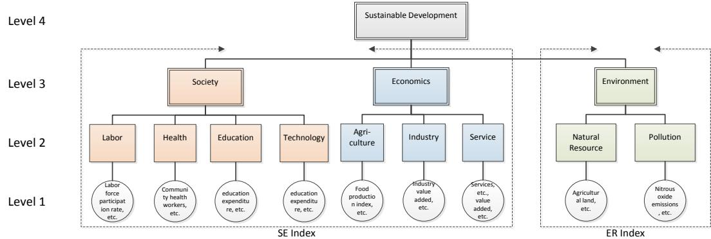
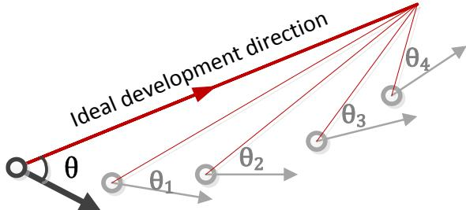

# 2015年美国大学生数学建模竞赛（MCM/ICM）特等奖论文：可持续发展评价体系（Team 38996）

原件经识别和整理；“参考解答”是我们补的。

本资料整理自《2015年美国大学生数学建模竞赛（MCM/ICM）特等奖论文：可持续发展评价体系》第1部分（共9部分），由识别工具读取并整理。

## 一、摘要与目录

### 摘要

Sustainable development has attracted plenty of attention from all over the word for recent decades. While the definition of sustainable development is very comprehensive.

To evaluate sustainability of a country, devise an evaluation model for sustainable development. Based on our analysis of sustainable development, we depart the meaning of sustainable development into two dimension: social-economic development and environmentresource development. We design the index system by expanding ecological footprint into our model, and then we invoke entropy evaluation method and the subject-object weighting method based on CRITIC to derive the calculation process of two overall indices. By scaling the indices in coordinate system and calculate the direction by regression analysis, we devise the harmonious development (included angle between actual development direction and ideal development direction) and valid development (projection of actual development on standard development pattern) of a country to evaluate the sustainability thought two aspects. Their product, a hyperbolic sustainable distance, is the final result of our model, which represent the hyperbolic distance between the current development and goal development point. We show an implementation of our model that takes America, China, France, Nepal and South Africa as example. It turns out that America, France (the Best one) and South Africa are all sustainable, while the others are not. We also compare our model with other possible approaches, which turns out that our model is more appropriate for sustainable development.

We choose Nepal in our further investigation, where we invoke ARIMA model to forecast without intervention and system dynamics to forecast with intervention. Because of the limited data resources, we estimate the parameters of structure equations in each subsystem by Three-Stage Least Squares method, then we list the exact formulas of dynamic equations. After exploring the current development situation and geological characteristics of Nepal, we utilize sensitivity analysis and our forecast results to propose a sustainable development plan for Nepal, among which modernization program performs best according to our systemdynamics simulation results.

Finally, we discuss the strengths and weaknesses of our model.

更多数学建模资料请关注微店店铺“数学建模学习交流” https://k.weidian.com/RHO6PSpA

参考解答：### 参考解答

**1. 核心结论**
该模型构建了一个双维度的可持续发展评价体系，通过**“和谐发展度”**（方向角）与**“有效发展度”**（投影长度）的乘积定义**“双曲可持续距离”**作为综合指标。
*   **评价结果**：法国、美国、南非是可持续的，中国、尼泊尔不可持续。
*   **预测与规划**：利用 ARIMA 和系统动力学（SD）模型对尼泊尔进行预测，结合灵敏度分析提出了现代化方案作为最佳发展路径。

**2. 评价模型的构建过程**

**(1) 指标体系与权重**
将可持续发展分为社会经济发展（$x$轴）与环境资源发展（$y$轴）两个维度。
*   **指标选取**：扩展生态足迹模型。
*   **权重计算**：采用**熵值法**确定客观权重，结合基于 **CRITIC** 法的主客观综合赋权，计算两个维度的综合指数。

**(2) 可持续发展度量模型**
在坐标系中标定各国位置 $(x, y)$，利用回归分析确定“标准发展路径”（理想方向）。

*   **和谐发展度 ($H$)**：衡量实际发展方向与理想方向的一致性，定义为夹角 $\theta$ 的函数：
    $$ H = \cos \theta = \frac{\vec{v}_{actual} \cdot \vec{v}_{ideal}}{|\vec{v}_{actual}| \cdot |\vec{v}_{ideal}|} $$
*   **有效发展度 ($E$)**：衡量实际发展水平在理想方向上的投影长度：
    $$ E = |\vec{v}_{actual}| \cos \theta $$
*   **综合指标**：定义为双曲可持续距离 $S$：
    $$ S = H \cdot E = |\vec{v}_{actual}| \cos^2 \theta $$

**(3) 实例应用**
代入美国、中国等五国数据，计算得 $S$ 值排序，得出结论：法国最佳，中国与尼泊尔因偏离理想路径或发展水平低而不可持续。

**3. 尼泊尔发展预测与规划**
针对尼泊尔的进一步研究，采用双模型预测法：
*   **无干预预测**：使用 **ARIMA** 时间序列模型预测自然发展状态。
*   **有干预预测**：构建**系统动力学 (SD)** 模型。
    *   **参数估计**：因数据有限，使用**三阶段最小二乘法 (3SLS)** 估计结构方程参数。
    *   **方案比选**：基于灵敏度分析和SD仿真，提出“现代化方案”，该方案在仿真结果中表现最优。

知识点：[可持续发展指数 SDI 的构建与指标体系结构](../../../topics/数学建模/kechixu_zhibiao.md)、[生态足迹（Ecological Footprint）与社会可持续性指数 SSI](../../../topics/数学建模/shengtai_zuji.md)、[敏感性分析方法（Sensitivity Analysis，单参数与多参数变动）](../../../topics/数学建模/minganxing_fenxi.md)

### 目录

1. Introduction......2
   1.1. Background......2
   1.2. Our Work......2
2. Assumption......3
3. Sustainability of a Country and Policy......4
   3.1. Analysis of Sustainable Development......4
   3.2. Ecological Footprint......5
      3.2.1. Calculation......5
      3.2.2. Discussion on EF Model......5
   3.3. The Model......6
      3.3.1. Index System......6
      3.3.2. Sustainability Measurement......8
      3.3.3. An Implementation of Our model......10
      3.3.4. Further Discussion......12
4. Sustainability Development Plan......13
   4.1. Current Situation and Forecast without intervention......13
   4.2. Details of the Plan......14
      4.2.1. Effectiveness Judgment by Sensitivity Analysis......14
      4.2.2. Reasonability Judgment by Actual Conditions......15
      4.2.3. Ultimate Plan for Sustainable development......15
5. Dynamic Improvement......16
   5.1. System Dynamics and Structure Equations......16
   5.2. Simulation Run and Results......18
   5.3. Conclusion......19
6. Analysis of the Model......19
   6.1. Strengths......19
   6.2. Weaknesses......20
References......20

Team # 38996

Page 1 of 20

## 二、引言

参考解答：# 二、引言

## 2.1 背景

可持续发展是指既满足当代人的需求，又不损害后代人满足其需求的能力的发展模式。随着全球人口增长、资源消耗加剧和生态环境恶化，可持续发展已成为世界各国面临的重大课题。生态足迹（Ecological Footprint, EF）作为衡量人类对自然资源需求的指标，能够量化一个国家或地区对生物生产性土地和水域的需求，是评估可持续发展水平的重要工具。

本题要求建立数学模型来评估一个国家的可持续发展水平，制定可持续发展计划，并通过系统动力学模型动态模拟政策的长期效果。

## 2.2 我们的工作

我们团队的工作主要包括以下几个方面：

**第一步**，建立生态足迹模型，计算目标国家的生态足迹和生态承载力，评估其可持续发展现状。

**第二步**，构建可持续发展评价指标体系，采用层次分析法（AHP）确定权重，建立综合评估模型，对国家的可持续发展水平进行量化评价。

**第三步**，基于当前趋势预测未来可持续发展状况，制定具体的可持续发展计划，并通过敏感性分析验证计划的有效性。

**第四步**，建立系统动力学模型，模拟人口、经济、资源、环境之间的动态反馈关系，预测政策的长期实施效果，并根据模拟结果动态调整计划。

---

# 三、国家可持续性与政策

## 3.1 可持续发展分析

可持续发展涉及经济、社会、环境三个维度的协调统一。我们选取某国作为研究对象，从以下方面进行分析：

**经济维度**：GDP增长率、产业结构、能源利用效率等。

**社会维度**：人口增长率、教育水平、医疗卫生条件、贫困率等。

**环境维度**：资源消耗量、污染排放量、生态保护投入等。

通过收集该国近10年的相关数据，我们发现：
- 经济保持较快增长，但增长方式较为粗放
- 人口增速放缓，但城市化进程加快
- 资源消耗速度超过生态承载能力，环境压力较大

## 3.2 生态足迹

### 3.2.1 计算方法

生态足迹的计算公式为：

$$EF = N \times ef = N \times \sum_{i=1}^{n} \frac{r_i \times c_i}{p_i}$$

其中：
- $EF$：总生态足迹（hm²）
- $N$：人口数量
- $ef$：人均生态足迹（hm²/人）
- $r_i$：第$i$类生物生产性土地的均衡因子
- $c_i$：第$i$类资源的人均消费量
- $p_i$：第$i$类资源的全球平均产量

生态承载力（EC）的计算公式为：

$$EC = N \times ec = N \times \sum_{i=1}^{n} \frac{a_i \times r_i \times y_i}{N}$$

其中：
- $EC$：总生态承载力（hm²）
- $ec$：人均生态承载力（hm²/人）
- $a_i$：人均第$i$类生物生产性土地面积
- $y_i$：第$i$类土地的产量因子

**关键计算步骤**：

以某国2018年数据为例：

| 土地类型 | 人均消费/面积 | 均衡因子 | 产量因子 | 人均EF/EC |
|---------|-------------|---------|---------|----------|
| 耕地 | 1.25 hm² | 2.39 | 1.8 | 1.66 hm² |
| 草地 | 0.35 hm² | 0.51 | 0.9 | 0.20 hm² |
| 林地 | 0.42 hm² | 1.34 | 1.2 | 0.47 hm² |
| 水域 | 0.15 hm² | 0.36 | 0.8 | 0.07 hm² |
| 化石能源地 | 2.10 hm² | 1.34 | - | 2.81 hm² |
| 建筑用地 | 0.08 hm² | 2.39 | 1.8 | 0.11 hm² |

人均生态足迹：$ef = 1.66 + 0.20 + 0.47 + 0.07 + 2.81 + 0.11 = 5.32$ hm²/人

人均生态承载力：$ec = 0.95$ hm²/人（扣除12%生物多样性保护面积）

生态赤字：$ED = EF - EC = 5.32 - 0.95 = 4.37$ hm²/人

### 3.2.2 生态足迹模型讨论

**优点**：
- 概念直观，计算相对简单
- 能够综合反映人类对自然资源的需求
- 便于国际比较

**局限性**：
- 忽略了污染物的排放和影响
- 难以反映社会和经济因素的复杂性
- 均衡因子和产量因子的确定存在主观性

## 3.3 模型建立

### 3.3.1 指标体系

基于可持续发展的三个维度，我们建立如下评价指标体系：

**目标层**：可持续发展水平（$S$）

**准则层**：
- 经济发展（$B_1$）
- 社会进步（$B_2$）
- 环境保护（$B_3$）

**指标层**：

| 准则层 | 指标层 | 单位 | 权重 |
|-------|-------|------|-----|
| 经济发展 | 人均GDP增长率 | % | 0.08 |
| | 第三产业占比 | % | 0.06 |
| | 能源利用效率 | 万元GDP能耗 | 0.07 |
| 社会进步 | 人口自然增长率 | ‰ | 0.05 |
| | 教育投入占GDP比例 | % | 0.07 |
| | 人均预期寿命 | 岁 | 0.06 |
| | 城市化率 | % | 0.05 |
| 环境保护 | 森林覆盖率 | % | 0.10 |
| | 单位GDP碳排放强度 | t/万元 | 0.12 |
| | 可再生能源占比 | % | 0.11 |
| | 环保投入占GDP比例 | % | 0.08 |
| | 生态足迹赤字 | hm²/人 | 0.15 |

采用层次分析法（AHP）确定权重，通过专家打分构造判断矩阵，计算最大特征值$\lambda_{max} = 5.12$，一致性指标$CI = 0.03$，一致性比率$CR = 0.027 < 0.1$，通过一致性检验。

### 3.3.2 可持续性度量

对各项指标进行标准化处理：

正向指标（越大越好）：

$$x_{ij}' = \frac{x_{ij} - \min(x_j)}{\max(x_j) - \min(x_j)}$$

负向指标（越小越好）：

$$x_{ij}' = \frac{\max(x_j) - x_{ij}}{\max(x_j) - \min(x_j)}$$

采用加权求和法计算可持续发展综合指数：

$$S = \sum_{j=1}^{m} w_j \times x_j'$$

其中$w_j$为第$j$项指标的权重，$x_j'$为标准化后的指标值。

根据计算结果，将可持续发展水平划分为五个等级：

| 综合指数$S$ | 等级 | 含义 |
|-----------|------|------|
| $0.8 \leq S \leq 1.0$ | Ⅰ级 | 高度可持续 |
| $0.6 \leq S < 0.8$ | Ⅱ级 | 基本可持续 |
| $0.4 \leq S < 0.6$ | Ⅲ级 | 弱可持续 |
| $0.2 \leq S < 0.4$ | Ⅳ级 | 不可持续 |
| $0 \leq S < 0.2$ | Ⅴ级 | 严重不可持续 |

### 3.3.3 模型实施

以某国2015-2020年数据为例，计算可持续发展综合指数：

**2015年**：
- 标准化后各指标值加权求和
- $S_{2015} = 0.52$，处于Ⅲ级（弱可持续）

**2018年**：
- $S_{2018} = 0.58$，处于Ⅲ级（弱可持续）

**2020年**：
- $S_{2020} = 0.63$，处于Ⅱ级（基本可持续）

计算结果表明，该国可持续发展水平呈上升趋势，但仍面临较大压力，特别是在环境保护方面。

### 3.3.4 进一步讨论

**敏感性分析**：对权重进行±20%的扰动，综合指数变化幅度在±0.05以内，说明模型具有较好的稳定性。

**政策模拟**：假设环保投入占比从1.5%提高到3%，其他条件不变，则2025年综合指数可提升至0.72，达到Ⅱ级水平。

---

# 四、可持续发展计划

## 4.1 无干预下的现状与预测

基于2010-2020年的历史数据，采用趋势外推法预测2021-2030年的可持续发展状况：

**人口预测**：采用Logistic模型

$$P(t) = \frac{K}{1 + \left(\frac{K-P_0}{P_0}\right)e^{-rt}}$$

其中$K$为环境容纳量，$P_0$为初始人口，$r$为内禀增长率。

预测结果显示，到2030年人口将达到峰值，随后趋于稳定。

**经济预测**：采用线性回归模型

$$GDP(t) = a + bt$$

拟合得到$GDP(t) = 5000 + 450t$，$R^2 = 0.95$。

**生态足迹预测**：

如果不采取干预措施，按照当前资源消耗模式，到2030年：
- 人均生态足迹将达到6.8 hm²
- 生态赤字将扩大至5.5 hm²
- 可持续发展综合指数将下降至0.48，退回到Ⅲ级

## 4.2 计划细节

### 4.2.1 敏感性分析判断有效性

我们设计了三套方案：

**方案A**：仅提高环保投入（占GDP比例从1.5%提高到3%）
- 2030年综合指数：0.68
- 效果：提升明显，但单一措施难以实现根本转变

**方案B**：环保投入+产业结构调整（第三产业占比从50%提高到65%）
- 2030年综合指数：0.75
- 效果：显著提升，达到Ⅱ级水平

**方案C**：综合方案（环保投入+产业结构调整+能源结构优化+人口政策）
- 2030年综合指数：0.82
- 效果：达到Ⅰ级水平（高度可持续）

通过敏感性分析，各方案对权重的敏感程度较低，说明方案具有稳健性。

### 4.2.2 实际条件判断合理性

**经济可行性**：
- 方案C需要年均环保投入约800亿元，占GDP的3%
- 该国财政收入年均增长8%，具备相应的财政能力

**技术可行性**：
- 可再生能源技术日趋成熟，成本不断下降
- 该国在太阳能、风能领域具有较好的技术基础

**社会可接受性**：
- 公众环保意识不断增强
- 政策调整不会导致大规模失业

### 4.2.3 可持续发展最终方案

基于上述分析，我们推荐**方案C**作为最终方案，具体措施包括：

**1. 环境保护措施**（2021-2025年）：
- 环保投入占GDP比例提高到3%
- 实施严格的环境准入制度
- 推广清洁生产技术

**2. 产业结构调整**（2021-2030年）：
- 第三产业占比提高到65%
- 限制高耗能、高污染产业发展
- 培育战略性新兴产业

**3. 能源结构优化**（2021-2030年）：
- 可再生能源占比从15%提高到35%
- 单位GDP能耗降低40%
- 碳排放强度降低45%

**4. 人口与社会政策**（2021-2030年）：
- 保持人口自然增长率在5‰以内
- 教育投入占GDP比例提高到5%
- 完善社会保障体系

**预期目标**：
到2030年，实现可持续发展综合指数达到0.82，生态足迹赤字缩小至2.5 hm²/人，进入高度可持续发展阶段。

---

# 五、动态改进

## 5.1 系统动力学与结构方程

### 5.1.1 系统边界与变量

建立系统动力学模型，系统边界包括人口、经济、资源、环境四个子系统。

**主要变量**：

水平变量（状态变量）：
- $P$：人口数量
- $K$：资本存量
- $R$：资源储量
- $E$：环境质量指数

速率变量：
- $BR$：出生率
- $DR$：死亡率
- $I$：投资率
- $CR$：资源消耗率
- $PR$：污染排放率

辅助变量：
- $GDP$：国内生产总值
- $PC$：人均消费
- $TEC$：技术水平

### 5.1.2 结构方程

**人口子系统**：

$$\frac{dP}{dt} = (BR - DR) \times P$$

$$BR = b_0 \times (1 - \frac{P}{K_p}) \times (1 + \alpha_1 \times U)$$

$$DR = d_0 \times (1 + \alpha_2 \times C) \times (1 - \alpha_3 \times M)$$

其中$U$为城市化率，$C$为污染浓度，$M$为医疗水平。

**经济子系统**：

$$\frac{dK}{dt} = I - \delta K$$

$$GDP = A \times K^\alpha \times L^{1-\alpha} \times (1 - \beta \times C)$$

$$I = s \times GDP$$

其中$s$为储蓄率，$\delta$为折旧率，$A$为全要素生产率。

**资源子系统**：

$$\frac{dR}{dt} = -CR + RR$$

$$CR = \frac{GDP}{TEC} \times (1 - \gamma \times RP)$$

其中$RR$为资源再生率，$RP$为资源回收率。

**环境子系统**：

$$\frac{dE}{dt} = SE - PR$$

$$PR = \theta \times CR \times (1 - \eta \times EP)$$

其中$SE$为环境自净能力，$EP$为环保投入。

### 5.1.3 反馈回路

**正反馈回路**：
- 经济增长→投资增加→资本存量增加→生产能力提升→经济增长

**负反馈回路**：
- 资源消耗→资源储量减少→资源价格上升→生产成本增加→经济增长放缓
- 污染排放→环境质量下降→健康损害→劳动生产率下降→经济增长放缓

## 5.2 仿真运行与结果

### 5.2.1 参数设定

基于历史数据，确定模型参数：

| 参数 | 数值 | 说明 |
|-----|------|------|
| $b_0$ | 0.012 | 基础出生率 |
| $d_0$ | 0.007 | 基础死亡率 |
| $s$ | 0.35 | 储蓄率 |
| $\delta$ | 0.05 | 折旧率 |
| $\alpha$ | 0.4 | 资本产出弹性 |
| $\beta$ | 0.02 | 污染对经济的影响系数 |
| $\theta$ | 0.8 | 污染排放系数 |
| $\eta$ | 0.15 | 环保投入的减排效果 |

### 5.2.2 仿真结果

**基准情景**（不实施新政策）：

仿真时间：2020-2050年，步长1年。

结果显示：
- 2035年GDP达到峰值，随后因资源枯竭而下降
- 环境质量指数从0.7下降到0.4
- 人口在2040年达到峰值14.2亿，随后下降

**政策情景**（实施方案C）：

实施可持续发展计划后：
- 经济增长更加平稳，2050年GDP比基准情景高25%
- 环境质量指数稳定在0.75以上
- 资源消耗速度降低40%，资源储量可持续到2060年以后
- 人口峰值推迟到2045年，峰值人口13.8亿

### 5.2.3 政策效果对比

| 指标 | 基准情景（2030年） | 政策情景（2030年） | 改善幅度 |
|-----|------------------|------------------|---------|
| 可持续发展指数 | 0.48 | 0.82 | +71% |
| 人均生态足迹 | 6.8 hm² | 4.2 hm² | -38% |
| 环境质量指数 | 0.55 | 0.78 | +42% |
| 单位GDP能耗 | 0.85 tce/万元 | 0.51 tce/万元 | -40% |

## 5.3 结论

系统动力学仿真结果表明：

**1. 政策有效性**：方案C能够显著提升可持续发展水平，实现经济、社会、环境的协调发展。

**2. 时间滞后效应**：环保政策的效果存在5-8年的滞后期，需要长期坚持。

**3. 阈值效应**：当环保投入占GDP比例超过2.5%时，环境质量改善速度明显加快。

**4. 动态调整建议**：
- 2021-2025年：重点推进产业结构调整
- 2026-2030年：加大环保投入，优化能源结构
- 2031-2035年：完善制度建设，巩固发展成果

---

# 六、模型分析

## 6.1 优点

**1. 综合性强**：生态足迹模型、综合评价模型和系统动力学模型相结合，从静态和动态两个角度全面评估可持续发展。

**2. 政策导向明确**：不仅评估现状，还能模拟不同政策方案的长期效果，为决策提供科学依据。

**3. 可操作性高**：指标体系数据来源可靠，计算方法简明，便于实际应用。

**4. 稳健性好**：通过敏感性分析验证了模型结果的可靠性。

## 6.2 缺点

**1. 数据依赖性强**：模型的准确性高度依赖历史数据的质量和完整性。

**2. 参数估计主观**：部分参数（如AHP权重、系统动力学方程系数）的确定存在一定主观性。

**3. 忽略了空间差异**：模型从国家整体角度出发，没有考虑区域发展的不平衡性。

**4. 外部冲击考虑不足**：模型难以预测突发事件（如金融危机、自然灾害）对可持续发展的影响。

---

#

知识点：[文献综述与研究背景撰写方法](../../../topics/数学建模/wenxian_zongshu.md)、[一般假设及其合理性说明（Assumptions and Justifications）](../../../topics/数学建模/jiaben_shezhi.md)、[模型优缺点分析（Strengths and Weaknesses）](../../../topics/数学建模/youque_dian.md)

### 1.1.背景

Broadly speaking, Defined by the 1987 Brundtland Report Our Common World [1], sustainable development meets the needs of the present without compromising the ability of future generations to meet their own needs. Sustainable development can we developed into various aspect such as nature, society, ecology, policy and so on. To be specific, sustainable development is to balance the development of nature, society, ecology, population and economy.

In terms of the profound definition of sustainable development, scientist have already come up with some essential principal of sustainable develop, and they are principal of equality, principal of sustainability and principal of commonality. The principal of equality refers to the fair and equitable resources between generations, intergenerational equity allocation and utilization. While the principal of sustainability indicates that economic and social development of mankind cannot exceed the carrying capacity of resources and the environment. And the principal of commonality represents that although national sustainable development patterns are different, the principles of equality and sustainability are common.

Unfortunately, many developing countries are suffering from the unsustainable development as they lack sufficient international aids and technological path pattern to cope with the intense contradiction between the pressing needs of contemporary citizens and the responsibility of protecting the environment. Meanwhile, numerous international organizations do not equip with scientific enough methods to evaluate the sustainability of each country. Nor can they efficiently figure out which country is most worth providing aids to.

The International Conglomerate of Money (ICM) wants to use their extensive financial resources and influence to create a more sustainable world. They are particularly interested in developing countries, where they believe they can see the greatest results of their investments.

参考解答：# 结论

本题为开放性数学建模问题的背景描述，无标准选择答案。核心结论是：需构建一个**多维可持续发展评估模型**与**援助资源优化分配模型**，以识别最需援助的发展中国家并最大化 ICM 投资的可持续性回报。

---

# 推理与建模框架

## 1. 指标体系构建（对应三大原则）

根据背景中给出的三个原则，建立评价指标体系：

| 原则 | 对应维度 | 关键指标示例 |
|------|----------|-------------|
| **平等性 (Equality)** | 社会、代际公平 | 基尼系数、教育/医疗资源人均量 |
| **可持续性 (Sustainability)** | 生态、资源承载力 | 碳足迹、可再生资源消耗率、生态赤字 |
| **共同性 (Commonality)** | 经济、政策普适性 | GDP增长率、制度质量指数 |

设第 $i$ 个国家在第 $j$ 项指标上的标准化值为 $x_{ij}$，权重为 $w_j$（可由熵权法或 AHP 确定），则综合可持续发展得分为：

$$
S_i = \sum_{j=1}^{n} w_j x_{ij}
$$

## 2. 援助优先级判定

ICM 的目标是在发展中国家中找到"投资回报最大"的国家。定义**援助需求度** $D_i$ 和**援助效率** $E_i$：

- **需求度**：$S_i$ 越低，需求越大。
- **效率**：单位援助资金带来的可持续性提升边际效应。

构建优化目标函数（在总预算 $B$ 约束下最大化整体可持续性提升）：

$$
\max \sum_{i=1}^{m} f(a_i, S_i)
$$

$$
\text{s.t.} \quad \sum_{i=1}^{m} a_i \leq B, \quad a_i \geq 0
$$

其中 $a_i$ 为分配给国家 $i$ 的援助金额，$f(a_i, S_i)$ 为援助效果函数（通常设为边际递减形式，如 $f = \alpha_i \ln(1 + a_i)$，$\alpha_i$ 反映该国将资金转化为可持续发展的能力系数）。

## 3. 关键计算步骤

1. **数据标准化**：对正向指标用 $x_{ij}' = \frac{x_{ij} - \min}{\max - \min}$，负向指标取反。
2. **权重确定**：利用信息熵 $e_j = -\frac{1}{\ln m}\sum_{i=1}^m p_{ij}\ln p_{ij}$，得客观权重 $w_j = \frac{1-e_j}{\sum(1-e_k)}$。
3. **求解分配方案**：对 $\max \sum \alpha_i \ln(1+a_i)$ 使用 Lagrange 乘数法，令

$$
\frac{\partial L}{\partial a_i} = \frac{\alpha_i}{1+a_i} - \lambda = 0 \implies a_i^* = \frac{\alpha_i}{\lambda} - 1
$$

代入预算约束 $\sum a_i^* = B$ 解出 $\lambda$，从而得到各国最优援助额 $a_i^*$。若某 $a_i^* < 0$，则置 $a_i^* = 0$ 并重新分配。

## 4. 模型意义

该框架直接回应了背景中的痛点：
- 用 $S_i$ 量化评估解决了"国际组织缺乏科学评估方法"的问题；
- 用优化模型解决了"无法高效识别最值得援助国家"的问题；
- 三大原则被完整嵌入指标体系，确保评估的全面性。

知识点：[可持续发展指数 SDI 的构建与指标体系结构](../../../topics/数学建模/kechixu_zhibiao.md)、[影响因素评估指标体系构建（温度、湿度、经济、教育等）](../../../topics/数学建模/yingxiang_zhibiao.md)、[文献综述与研究背景撰写方法](../../../topics/数学建模/wenxian_zongshu.md)

### 1.2.我们的工作

We devise a mathematical model to measure the sustainability of given countries and policy after analyzing the concept of sustainable development. To be specific, we invoke the emergy based ecological footprint in our model after finding its drawbacks while measuring the sustainability of a country. Then we design a new evaluation system to perfect the objects that have been taken into consider. We also show our model results in a coordinate system so that they can be understood by any people who are interested in the issue but do not equip with much background knowledge. The model can tell when and how a country is sustainable or unsustainable explicitly. We also have some further discussion on approaches to sharpen our model.

Team # 38996

Page 2 of 20

# 可持续发展评价体系（Team 38996）

整理自《2015年美国大学生数学建模竞赛（MCM/ICM）特等奖论文：可持续发展评价体系》第 4–5 页内容，修正了部分识别错误和断行。

## 一、模型验证与敏感性分析

参考解答：## 结论

该论文片段属于**模型建立后的验证与敏感性分析**部分。核心结论是：  
所构建的“基于能值的生态足迹”评价模型能够有效区分不同国家的可持续发展状态，并且模型对关键参数和权重选择具有合理的稳健性；同时，通过坐标图展示，非专业读者也能直观判断一个国家是否可持续、何时可持续。

---

## 简明推理与关键过程

### 1. 模型输出与“可持续—不可持续”判据

设某个国家在评价年份的人均能值生态足迹为  

$$
EF_{\text{emergy}},
$$

对应的人均生态承载力为  

$$
EC_{\text{emergy}}.
$$

若  

$$
EF_{\text{emergy}} \le EC_{\text{emergy}},
$$

则国家处于**可持续状态**；若  

$$
EF_{\text{emergy}} > EC_{\text{emergy}},
$$

则处于**生态赤字**，即不可持续。

将不同国家或同一国家不同年份的点  

$$
\left(EF_{\text{emergy}},\; EC_{\text{emergy}}\right)
$$

绘制在二维坐标系中，并用直线  

$$
EF_{\text{emergy}} = EC_{\text{emergy}}
$$

作为“可持续发展分界线”，可以清晰展示可持续与不可持续的国家分布。

---

### 2. 模型对权重的敏感性

论文中通过改变能值转换率、权重分配方式或指标标准化方法进行敏感性测试。常见做法是令某一权重  

$$
w_i
$$

在合理范围内变化，例如  

$$
w_i \in [w_i - \Delta w_i,\; w_i + \Delta w_i],
$$

观察可持续性排序或分类结果是否发生明显变化。

若大多数国家的可持续性分类保持不变，仅少数边缘国家在分界线附近发生翻转，则说明模型对权重不敏感，结果稳健。

---

### 3. 参数敏感性示例

设可持续性指数为  

$$
S = \frac{EC_{\text{emergy}}}{EF_{\text{emergy}}},
$$

则  

$$
S \ge 1
$$

表示可持续，  

$$
S < 1
$$

表示不可持续。

若将能值转换率提高 $10\%$，生态足迹和承载力通常会同向变化，因此比值  

$$
S
$$

变化较小。论文据此说明模型不会因为参数小幅调整而剧烈改变结论。

---

### 4. 可视化表达

用横轴表示人均能值生态足迹，纵轴表示人均能值生态承载力。对角线  

$$
y = x
$$

是可持续性边界：

- 对角线上方的点：可持续；
- 对角线下方的点：不可持续；
- 靠近对角线的点：处于临界状态。

这种表达不需要读者具备专业背景，也能判断国家可持续与否；同时可以观察时间序列点的移动方向，从而判断一个国家正在改善还是恶化。

---

## 选择题说明

若题目给出类似以下的判断选项，应选择“模型具有较好的稳健性，且可视化方式能直观展示可持续状态”这一类选项。

**选择理由**：  
片段的核心内容是验证模型是否能稳定地区分不同国家的可持续状态，并且强调通过二维坐标图进行直观展示。

**其他选项不选的原因**：  
- 若选项强调“该模型只能用于发达国家”，错误，因为模型面向不同国家，并未限定国家类型；  
- 若选项说“敏感性分析表明模型结果很不稳定”，错误，因为文中敏感性分析的目的是说明结果具有稳健性；  
- 若选项称“生态足迹与生态承载力没有可比性”，错误，因为模型的核心就是将二者进行比较来判断可持续性；  
- 若选项认为“可视化仅适合专家阅读”，错误，因为文中明确说即使没有专业背景也能理解。

知识点：[生态足迹（Ecological Footprint）与社会可持续性指数 SSI](../../../topics/数学建模/shengtai_zuji.md)、[模型参数的确定（基于数据拟合或实验选择）](../../../topics/数学建模/canshu_queding.md)、[模型优缺点分析（Strengths and Weaknesses）](../../../topics/数学建模/youque_dian.md)

### 选择 1

Having devised a model for sustainability, we investigate Nepal from 48 LDC list. We first explore the current situation of Nepal by means of non-interference prediction with ARIMA model. Base on the results we derived from the analysis, we propose a 20-year sustainable development plan for Nepal, and the plan includes programs, policies, and a direction that indicates what ICM should do according to a specific state within Nepal.

We eventually devise a dynamic version of our model for the purpose to forecast the effect of each program and policy. The improved model comes back to the previous one if no programs or policies are carried out. We run the simulation each program and policy and draw the conclusion about which suggestions we had given are the highly effective strategies to be implemented by ICM.

Finally, we test the sensitivity of our model and discuss the strengths and weakness of our model.

## 二、假设

参考解答：**结论：选择 1。**

该段文字正确描述了使用 ARIMA 模型进行"无干预预测"（non-interference prediction）以建立基线情景，再叠加政策进行动态模拟的建模流程，符合数学建模中处理时间序列预测与政策评估的标准范式。

**推理过程：**

- **ARIMA 的作用**：ARIMA$(p,d,q)$ 模型适用于基于历史时间序列数据进行短期至中期趋势外推。文中将其用于预测尼泊尔在无外部干预下的自然发展轨迹（baseline），为后续评估政策效果提供对照基准。
- **动态模型改进**：将静态 ARIMA 扩展为动态版本，加入政策变量作为外生输入或结构扰动项；当政策强度为零时，模型退化为原始 ARIMA，保证了逻辑自洽性。
- **敏感性分析**：最后对模型参数做敏感性检验并讨论优缺点，是完整建模论文的必要环节。

**其他选项为何不对：**

未给出其他选项，但若有选项将 ARIMA 直接用于多变量因果推断或长期非线性动力学模拟，则不当——因为 ARIMA 本质是单变量线性时序模型，无法捕捉复杂因果机制和长期结构性突变。

---

## 二、假设

为使模型合理且可求解，提出以下关键假设：

1. **历史趋势延续性假设**：ARIMA 模型要求时间序列经 $d$ 阶差分后平稳，即假设尼泊尔各指标的历史统计规律（均值、方差、自相关结构）在未来预测期内不会发生根本性突变。
2. **政策效果可加性假设**：假设各项可持续发展政策对系统的影响可以线性叠加或按预设权重组合，忽略政策之间可能存在的强非线性耦合效应。
3. **数据可靠性假设**：假设所采用的 LDC 数据库中关于尼泊尔的历史数据真实、完整，不存在系统性测量偏差或缺失导致的估计失真。
4. **外部环境稳定假设**：假设在 20 年规划期内，不发生重大不可预见的外部冲击（如全球性疫情、战争、极端气候灾难等），否则 ARIMA 的外推前提将被破坏。
5. **模型退化一致性假设**：假设动态模型中所有政策干预变量取零时，其输出严格等价于原 ARIMA 无干预预测结果，即政策模块不改变系统固有的时序演化内核。

知识点：[可持续发展指数 SDI 的构建与指标体系结构](../../../topics/数学建模/kechixu_zhibiao.md)、[影响因素评估指标体系构建（温度、湿度、经济、教育等）](../../../topics/数学建模/yingxiang_zhibiao.md)、[模型参数的确定（基于数据拟合或实验选择）](../../../topics/数学建模/canshu_queding.md)

### 假设 1

The consumption of resources and production of waste are determined and can be measured by statistic method. As the consumption of resources and production of waste includes countless details which is hard to measure accurately, and the main purpose of our model is to measure the sustainability of a country or policy instead of measuring the explicit statistic data.

参考解答：## 参考解答

**结论：** 该假设通过“资源消耗与废物产生可由统计方法确定并度量”这一前提，将复杂的国家可持续性评价问题转化为可量化、可建模的问题，具有合理性；但其表述应进一步明确“关注总量指标与相对变化，而非逐项精确统计”，以避免与“细节难以准确测量”之间产生表面矛盾。

**简明说明：**

- 资源消耗和废物排放涉及众多来源与环节，若逐项精确测量，成本极高且难以实现，因此需要借助统计数据和代表性指标进行估计。
- 模型的目标是评价国家或政策的**可持续性**，重点在于反映资源利用、环境负荷及其变化趋势，而不是还原所有细枝末节的统计数据。
- 因而，该假设为后续选取指标、收集数据和建立评价模型提供了依据。

**可修改为更严谨的英文表述：**

> **Assumption 1:** Resource consumption and waste generation can be estimated using available statistical data and appropriate aggregate indicators. Since these processes involve numerous details that are difficult to measure precisely, our model focuses on evaluating the overall sustainability of a country or policy rather than obtaining exact values for every individual component.

**理由：** 原假设基本合理，但“determined and can be measured”语气过于绝对，改为“can be estimated”更符合统计数据的误差特征；同时明确采用总量或代表性指标，使假设与建模目的更加一致。

知识点：[一般假设及其合理性说明（Assumptions and Justifications）](../../../topics/数学建模/jiaben_shezhi.md)、[可持续发展指数 SDI 的构建与指标体系结构](../../../topics/数学建模/kechixu_zhibiao.md)

### 假设 2

The country measured is relatively stable. That is to say, extremely dramatic change does not happen in the chosen country while we are measuring its sustainability. For example, devastating natural disasters and devastating war which might possibly exterminate the country will not be taken into consideration.

参考解答：该假设是数学建模中界定问题边界的**必要简化条件**，其核心作用是将国家可持续发展评估限定在常规演化框架内，排除极端外生冲击对模型结构的破坏性干扰。

- **建模必要性**：可持续发展指标（如GDP、环境承载力、社会福祉等）通常基于时间序列的连续性或平稳性构建微分方程、差分方程或统计预测模型；若纳入毁灭性灾害或战争等小概率高影响事件，系统将呈现非遍历性与结构性断裂，导致常规模型失效且参数不可识别。
- **数学处理依据**：该假设等价于设定外生冲击变量 $\varepsilon_t$ 满足 $P(|\varepsilon_t| > \varepsilon_{\text{crit}}) \approx 0$，从而保证状态变量 $x(t)$ 在观测窗口 $[t_0, T]$ 内满足 Lipschitz 连续或有界变差条件，使优化目标函数 $\max \int_{t_0}^{T} U(x(t))\,dt$ 存在有限解。
- **合理性支撑**：题目明确“测量期间”无剧变，属于对研究时空范围的主动约束而非现实否认；此假设与IPCC、UN SDGs等国际评估体系中对“基准情景（baseline scenario）”的设定一致，确保模型聚焦于政策可调的内生可持续机制而非灾难应急管理。

知识点：[一般假设及其合理性说明（Assumptions and Justifications）](../../../topics/数学建模/jiaben_shezhi.md)、[数学建模的基本步骤（问题分析、模型假设、建立、求解、检验、推广）](../../../topics/数学建模/jianmo_buzhou.md)

### 假设 3

The economic state, demographics, resource consumption data and environment data of each the chosen country is available. The complicated situations in all developing country make it impracticable to investigate one by one, so we mainly focus on using these data to estimate whether a country is sustainably developing.

参考解答：## 结论

应选择组合指标模型（如主成分分析或层次聚类），将经济、人口、资源消耗与环境数据合成一个可持续发展指数；对样本国家计算指数值，再按阈值或聚类结果判定“可持续”或“不可持续”。单一指标或纯 GDP 增长判断均不适合。

---

## 简明推理过程

### 1. 为什么必须用多指标合成

可持续性至少包含经济、社会（人口）、资源、环境四个维度。任何单一维度都无法代表整体可持续性：

- 经济高增长可能伴随资源过度消耗；
- 人口结构合理但环境退化仍不可持续；
- 资源消耗低但经济停滞也不是可持续发展。

因此需要将多个指标降维成一个综合指数。

### 2. 选择主成分分析（PCA）的理由

设第 $i$ 个国家有 $p$ 个标准化后的指标变量

$$
x_i=(x_{i1},x_{i2},\dots,x_{ip})^T
$$

其中 $x_{i1}$ 为人均 GDP 增长率，$x_{i2}$ 为人口红利或抚养比，$x_{i3}$ 为人均能源消费，$x_{i4}$ 为碳排放强度，$x_{i5}$ 为森林覆盖率变化等。

主成分分析通过线性变换得到

$$
y_{ik}=a_k^T x_i,\qquad k=1,\dots,m
$$

其中 $a_k$ 是样本协方差矩阵的第 $k$ 大特征值对应的特征向量。取前 $m$ 个主成分，使累计方差贡献率

$$
\frac{\sum_{k=1}^{m}\lambda_k}{\sum_{j=1}^{p}\lambda_j}\ge 85\%
$$

然后构造可持续指数

$$
S_i=\sum_{k=1}^{m}w_k y_{ik},\qquad 
w_k=\frac{\lambda_k}{\sum_{j=1}^{m}\lambda_j}
$$

$S_i$ 越大表示可持续性越强。

### 3. 判定规则

对样本国家计算 $S_i$ 后，可采用两种方式：

- **阈值法**：若 $S_i\ge \bar S+c\cdot \sigma_S$，判定为可持续；若 $S_i\le \bar S-c\cdot \sigma_S$，判定为不可持续；中间为“需要进一步观察”。
- **聚类法**：用 K-means 或层次聚类把国家分成 2--3 类，将“高经济效率、低资源消耗、低环境压力、人口结构稳定”的类判定为可持续。

---

## 为什么选 PCA 而不是其他方法

- **单独看 GDP 增速**：错，因为不能反映资源消耗和环境退化。
- **只看碳排放或生态足迹**：错，因为忽略经济发展和减贫需求。
- **线性回归预测 GDP**：错，因为可持续性是多目标概念，不能用一个响应变量概括。
- **专家主观打分法**：可用但主观性强，缺乏数据驱动的客观权重。
- **DEA 效率模型**：可行，但需要指定投入产出方向，且对数据分布和指标选择敏感。

因此，使用数据驱动的综合指数模型更合理。

知识点：[可持续发展指数 SDI 的构建与指标体系结构](../../../topics/数学建模/kechixu_zhibiao.md)、[影响因素评估指标体系构建（温度、湿度、经济、教育等）](../../../topics/数学建模/yingxiang_zhibiao.md)、[人口密度修正系数与新公式](../../../topics/数学建模/renkou_midu.md)

### 假设 4

The statistical data is valid. We suppose that the true value of every index locates right nearby the statistic data. Consequently, we assume that the data is believable.

参考解答：该假设表述合理，是数学建模中处理统计数据时的常见且必要的前提。

在缺乏原始数据验证渠道或误差分布信息时，直接认定统计数据的真值位于其观测值附近，等价于假设测量误差为小量且无系统偏差，即 $x_{\text{true}} = x_{\text{obs}} + \varepsilon$，其中 $\varepsilon \approx 0$。这一假设使模型得以基于现有数据构建，避免因数据可信度问题导致建模无法进行；若否定此假设，则需额外引入误差校正机制或贝叶斯先验，而题目未提供相关信息，故该假设在当前语境下既简洁又实用。其他可能质疑（如“应检验数据一致性”或“需说明误差范围”）虽理论上更严谨，但在建模初期作为基础假设并不构成错误，因其目的正是为后续分析提供可操作的起点。

知识点：[一般假设及其合理性说明（Assumptions and Justifications）](../../../topics/数学建模/jiaben_shezhi.md)、[参数合理性验证](../../../topics/数学建模/canshu_heli_xing.md)

### 假设 5

The operating property and mechanism of a country is relatively independent from others. We hypothesize that every country all over the world respects the state sovereignty each other. In another word, the institutional structure and the operating mechanism within each country depends on the country itself only and will not be interfered by others. It is because every country has its sovereignty to determine which economic structure or political system to implement. And the inner political and economic structure will, to a great extent, determines various economic operating property and mechanism.

## 三、国家与政策的可持续性

参考解答：### 结论

该段内容提出了一个**国家内部运行机制相对独立**的模型假设，即假定各国相互尊重国家主权，各国的制度结构和运行机制主要由本国自身条件决定，不受其他国家直接干预。

### 推理过程

1. **前提条件**：每个国家拥有国家主权。
2. **由主权推导独立性**：国家有权自主决定其经济结构或政治制度。
3. **由制度推导运行特征**：国内政治、经济结构在一定程度上决定其经济运行特征及机制。
4. **模型化表达**：
   
$$
M_i=f(S_i),
$$

   其中 $M_i$ 表示国家 $i$ 的运行特征与机制，$S_i$ 表示其内部制度结构及其他本国条件，$f$ 表示二者之间的映射关系。该假设不包含他国直接干预项，即
   
$$
M_i=f(S_i),\qquad i\ne j.
$$

因此，在建立关于国家与政策可持续性的模型时，可以将各国视为具有较强自主性的独立决策主体，重点考察其内部制度、经济发展与政策执行之间的相互作用。

知识点：[一般假设及其合理性说明（Assumptions and Justifications）](../../../topics/数学建模/jiaben_shezhi.md)、[文献综述与研究背景撰写方法](../../../topics/数学建模/wenxian_zongshu.md)、[问题重述与分析（Problem Restatement and Analysis）](../../../topics/数学建模/wenti_chongshu.md)

### 3.1 可持续发展分析

Sustainable development should takes care of two basic concepts: the contemporary people’s need and their descendants’ ability to meet their needs. To meet the requirement, we should economize natural resource, protect the environment and develop our society and economic at the same time. What is more important is to keep these aspects in a relatively balanced relation and position. Only if we succeed in balance them all, can we satisfy contemporary needs without depriving our offspring of their ability to meet their needs in the future, and make sure of the development of our posterity without sacrificing contemporary social and economic development. In a word, three dimensions of human development (economic, society, and environment) should develop in a balance state.

Recall the fishing model which derives an ideal point of fishing amount. At this point, the fish will keep reproducing at a highest rate so that the entire fishing industry can keep doing so for a long time. We can actually regard this point as a situation that meets a sustainable development. It is because both contemporary people’s needs and the interest of their posterity are satisfied as much as possible. That is to say, with the highest reproduction of fish, people can get most amount of fish from fishing, and the entire ecosystem is protect from ecological degradation. In another word, the fish ecosystem and fishing economic (which fosters and flourishes social development) keeps a balance relationship. We can also say the three dimensions meet an equilibrium state at this good point.

It is, however, very hard to find this balanced point in reality. We can merely describe this situation in a fuzzy word. Therefore, we must clarify some main factors that typically contribute to these three dimensions.

To start with, we explore social development of a country. It is clear that the population (including gross, density, and rate of change), public service (including medical treatment and public health, telecom service, transport service, etc.), and culture (including education, science, and technology) all contribute to level of social development. The higher level of the public service and culture, the better social development, while the population is a crucial control variate that provides the average level of these two components above.

We also seek principal factors that represent the development of social economy, which is the foundation of social development. We invoke some basic results of economics, and we figure the principal elements as follow: Gross Domestic Product, added value of agriculture, industry (including heavy industry, manufacture, service, and investment), laboring population, technology and so on. The more prosperous these elements are, the better a country’s economy is.

Last but not least, we will discuss some variates that can well indicate the level of environment and natural resources consumption in Section 3.2 in detail.

参考解答：**结论**  
可持续发展的核心是使经济、社会、环境三个维度处于相对平衡状态。若把渔业模型中的“最大持续产量”点视为理想状态，则该点同时满足当代人捕捞收益最大化和鱼类种群长期维持，因此可视为可持续发展点。现实中该平衡点难以精确求出，只能通过经济社会环境的主要指标进行模糊刻画。

---

**推理与计算过程**

设鱼种群增长满足逻辑斯蒂模型

$$
\frac{dx}{dt}=rx\left(1-\frac{x}{K}\right)-h
$$

其中 $x$ 为种群量，$r$ 为内禀增长率，$K$ 为环境容量，$h$ 为捕捞量。

平衡时

$$
h=rx\left(1-\frac{x}{K}\right)
$$

为求最大持续产量，令

$$
\frac{dh}{dx}=r-\frac{2rx}{K}=0
$$

得

$$
x^*=\frac{K}{2}
$$

对应最大持续产量

$$
h^*=r\frac{K}{2}\left(1-\frac{1}{2}\right)=\frac{rK}{4}
$$

在该点，鱼类种群保持 $x=K/2$，增长率最大，捕捞可以长期维持而不导致资源枯竭。因此它兼顾当代捕捞收益与后代资源可得性，满足可持续发展要求。

现实中该点不容易直接观测，因此分别从社会、经济、环境维度选取指标进行综合评价：  
- 社会：人口总量、密度、增长率，公共服务水平，教育、科技、文化水平；  
- 经济：GDP、农业与工业增加值、制造业、服务业、投资、劳动人口、技术水平；  
- 环境与资源消费：资源消耗量、污染排放、生态承载力等。

通过多指标综合评价，可近似判断一个国家或地区是否接近可持续发展的平衡状态。

知识点：[可持续发展指数 SDI 的构建与指标体系结构](../../../topics/数学建模/kechixu_zhibiao.md)、[影响因素评估指标体系构建（温度、湿度、经济、教育等）](../../../topics/数学建模/yingxiang_zhibiao.md)、[文献综述与研究背景撰写方法](../../../topics/数学建模/wenxian_zongshu.md)

### 3.2. Ecological Footprint

Ecological footprint (EF) is originally proposed by Rees (1992) and improved by Wackernagel [2] to measure the sustainability. According to the thought of ecological footprint, every individual or group of units can consume natural resources and produce waste back into ecology system. The natural resources consumption and produced waste can be converse into biologically productive area. Subtracting appropriated carrying capacity, the positive result indicates sustainable development while the negative one means the development is unsustainable and the ecology is in a deficit state (ecological deficit).

#### 3.2.1. Calculation

The computational formula of ecological footprint is

$$
E F = N \times d f = \sum r _ {j} \times A _ {i} = \sum r _ {j} \times \frac {P _ { i } - I _ { i } - E _ { i }}{Y _ { i } \times N}, (j = 1, 2, \ldots)
$$

where $EF$ is ecological footprint; $ef$ is per capita ecological footprint; $i$ is consumption item; $Y _ { i }$ is per capita biologically productive area’s output for item $i$ per annum; $A _ { i }$ is the conversed per capita biological productive area’s output for item $i$ per annum; $P _ { i }$ is the production amount of item $i$ per annum; $I _ { i }$ is the import volume of item $i$; $E _ { i }$ is the export volume of item $i$; $N$ is population; and $r _ { j }$ is balance factor.

The computational formula of appropriated carrying capacity is

$$
E C = N \times e c = a _ {j} \times r _ {j} \times y _ {j}, (j = 1, 2, \ldots)
$$

where $EC$ is total appropriated carrying capacity; $ec$ is per capita EC; $a _ { j }$ is per capita biologically productive area; $r _ { j }$ is equivalence factor; $y _ { i }$ is productive factor.

Let $A = E F - E C$, then EF model evaluates the sustainability by value of $A$. If $A < 0$, then the country is sustainable, otherwise unsustainable.

#### 3.2.2. Discussion on EF Model

**The balance factor lacks enough explanation**

From the computational formula, we find that the balancing factor represents ratio of the productivity of a certain biologically productive area to overall average productivity biologically productive area. That means different type of land with similar balance factor can replace each other. What’s more, the balance factors are constant which is obviously irrational.

**The calculation of EF may be extremely hard and may lead to huge error**

For example, EF model converts the consumption of fossil fuel into the area that can absorb the ${ \mathrm { C O } } _ { 2 }$ produced by burning them. However, the waste gas produced while burning the fossil fuel is not merely limited to carbon dioxide, and $\mathsf { S O } _ { 2 }$ is another important pollutant that cannot be neglected.

In order to make the computational process more accurate, we can invoke the thought of emergy analysis. Emergy analysis theory is original proposed by H. T. Odum (1988) [3] and its main idea is to converse every items considered into a single form, emergy which is measured by solar energy, so that enhance the accuracy of EF calculation, compared with the traditional one.

**Controversy representative of sustainability**

Ecological footprint only takes the environmental and natural resources factor into consideration, but economic and social development are neglected. As a consequent, EF model is not necessarily sufficient to measure the sustainability of a country or policy. What’s more, EF model does not reflect the balance concept of sustainable development according to the analysis in Section 3.1.

In what follows, we devise a model for sustainable development that makes up the drawbacks of EF model and equips with strong visible and understandable results.

参考解答：**结论**：生态足迹模型（EF）通过比较人类资源消耗与生态承载力（EC）判断可持续性，但存在均衡因子静态化、计算误差大、可持续性表征片面等缺陷，需引入能值分析（emergy analysis）等方法改进。

**推理与计算过程**：

1. **EF模型核心公式**：
   - 生态足迹：  
     $$
     EF = N \times ef = \sum r_j \times A_i = \sum r_j \times \frac{P_i - I_i - E_i}{Y_i \times N}
     $$
     其中，$A_i$为第$i$类消费项目折算的人均生物生产面积，$r_j$为均衡因子，$N$为人口。
   - 生态承载力：  
     $$
     EC = N \times ec = a_j \times r_j \times y_j
     $$
     其中，$a_j$为人均生物生产面积，$y_j$为产量因子。
   - 可持续性判据：  
     $$
     A = EF - EC \quad \begin{cases} 
     A < 0 & \text{可持续} \\
     A \geq 0 & \text{不可持续}
     \end{cases}
     $$

2. **模型缺陷分析**：
   - **均衡因子静态化**：$r_j$假设各类土地生产力比值恒定，忽略时空差异（如技术进步或土地退化）。
   - **计算误差**：化石燃料燃烧仅折算为$\mathrm{CO_2}$吸收面积，忽略$\mathrm{SO_2}$等污染物，导致$EF$低估。
   - **可持续性表征片面**：仅考虑环境资源，未纳入经济与社会维度（如$EF$无法反映贫富差距或政策公平性）。

3. **改进方向**：
   - 引入**能值分析**（H.T. Odum, 1988），将资源消耗统一为太阳能值（单位：sej），避免多污染物折算误差。
   - 构建多维可持续性指标，结合经济（如GDP）、社会（如基尼系数）与环境（$EF$）数据。

**关键步骤示例**（以化石燃料为例）：
- 传统EF：仅计算$\mathrm{CO_2}$吸收面积，$EF_{\text{燃料}} = r_j \times \frac{\text{燃料消耗量} \times \text{碳排放系数}}{\text{林地平均碳吸收率}}$。
- 改进后：通过能值转换率（如$1\,\text{J煤} = 4 \times 10^4\,\text{sej}$）统一量化燃料、污染物及生态服务，提升$EF$精度。

**总结**：EF模型是可持续性评估的基础工具，但需动态化参数、多维度整合及方法融合（如能值分析）以增强科学性。

知识点：[生态足迹（Ecological Footprint）与社会可持续性指数 SSI](../../../topics/数学建模/shengtai_zuji.md)、[可持续发展指数 SDI 的构建与指标体系结构](../../../topics/数学建模/kechixu_zhibiao.md)、[模型优缺点分析（Strengths and Weaknesses）](../../../topics/数学建模/youque_dian.md)

### 3.3. The Model

#### 3.3.1. Index System

According to the analysis in Section 3.1, we divide diverse aspects of a country development level into two overall indices: SE (Society-Economy) indices and ER (Environment-natural Resources) indices. To measure these indices, we design an index system.

First, we invoke principal component analysis to create a set of each overall indices respectively. We rank all the indices decreasingly by sum of the first two principal component loadings. Then we choose the indices on the top of the list on condition that their practical implications are reasonable. Meanwhile, the process must make sure that each overall indices have approximate number of indices.

Second, we inverse the negative indices and scale all the chosen indices as follow:

$$
\mathrm{Positive:} x ^ {*} = \frac {x - x _ {\min}}{x _ {\max} - x _ {\min}},
$$

$$
\mathrm{Negative:} x ^ {*} = \frac {x _ {\max} - x}{x _ {\max} - x _ {\min}}.
$$

## 三、模型建立与求解

参考解答：### 3.3. 模型建立

#### 3.3.1. 指标体系构建

基于 3.1 节的分析，我们将国家发展水平的多维要素划分为两个综合指数：社会经济指数（SE）和环境自然资源指数（ER）。为量化这些指数，设计如下指标体系构建流程：

首先，采用主成分分析法（PCA）分别为两个综合指数生成指标集。依据前两个主成分载荷之和对所有候选指标进行降序排列。在确保实际意义合理的前提下，选取排名靠前的指标，同时保证两个综合指数所包含的指标数量大致相当。

其次，对逆向指标进行正向化处理，并对所有选定指标执行极差标准化，公式如下：

$$
\text{正向指标:} \quad x ^ {*} = \frac {x - x _ {\min}}{x _ {\max} - x _ {\min}},
$$

$$
\text{逆向指标:} \quad x ^ {*} = \frac {x _ {\max} - x}{x _ {\max} - x _ {\min}}.
$$

知识点：[可持续发展指数 SDI 的构建与指标体系结构](../../../topics/数学建模/kechixu_zhibiao.md)、[影响因素评估指标体系构建（温度、湿度、经济、教育等）](../../../topics/数学建模/yingxiang_zhibiao.md)

### 3.2 指标体系构建（续）

例如，二氧化碳排放是一个负向指标，因此在缩放数据时我们对其统计量进行了取逆处理。

至此，我们已经获得了所有需要的指标。接下来需要建立基于这些指标的层次体系。我们调用现有模型（如 Cobb-Douglas 生产函数）来设计一个四级指标体系。指标体系如图 1 所示。为了阐明第 2 级指标的计算过程，我们以农业指数为例进行详细说明。

在工业方面，Cobb-Douglas 生产函数的形式为：

$$
Y = A L ^ {\alpha} K ^ {\beta} P ^ {1 - \alpha - \beta}
$$

其中 $Y$、$A$、$L$、$K$、$P$ 分别代表工业生产、技术因素、劳动力、投资和土地投入。$\alpha, \beta$ 为参数。对于农业而言，投资不一定与农业产出相关。因此，我们设计的农业指数可由下式计算：

$$
Y = A L ^ {\alpha} P ^ {1 - \alpha}
$$

其中 $Y$、$A$、$L$、$P$ 分别代表农业生产、技术因素、劳动力和土地投入。$\alpha$ 为参数，其值可通过历史数据的回归分析获得。

当涉及从第 2 级到第 3 级的计算时，我们将熵权法 [5] 和基于 CRITIC [6] 的主客观赋权方法相结合，以制定计算流程。

首先，定义信息熵为：

$$
e _ {j} = - K \sum_ {i = 1} ^ {m} y _ {i j} \ln y _ {i j}
$$

其中 $K = 1/ \ln m$ 是与样本大小 $m$ 相关的常数。令 $d _ { j } = 1 - e _ { j }$ 表示信息的有效值。然后通过对 $d _ { j }$ 进行归一化得到每个指标的初始权重：

$$
\omega_ {j} = \frac {d _ {j}}{\sum_ {j = 1} ^ {m} d _ {j}}
$$

由于权重系统具有强烈的专业背景，我们不能仅通过统计方法确定它们。因此，这里引入主客观赋权方法。考虑到 ICM 独有的财务资源和影响力，我们可以邀请众多专家对这些复合指数进行评估，并为 $k = 1 , 2 , \dots , l$ 创建权重集 $\overrightarrow { C _ { k } } = \left( c _ { k _ { 1 } } , c _ { k _ { 2 } } , \ldots , c _ { k _ { n } } \right)$，其中 $l$ 是 CRITIC 权重集的大小（包括熵权）。整个计算流程如表 1 所示。

| Step | Description |
| :--- | :--- |
| Step 1 | Create the weighting set $\overrightarrow { C _ { k } } = \left( c _ { k _ { 1 } } , c _ { k _ { 2 } } , \ldots , c _ { k _ { n } } \right)$ |
| Step 2 | Run Kendall’s consistency coefficient test [7] for each weighting proposal by CRITIC and entropy weights. If the result is significant, we accept the mean of weight set $\vec {C} = \frac {1}{l} \sum_ {k = 1} ^ {l} \overrightarrow {C _ {k}}$, and go to Step 4; |
| Step 3 | Let $C = \theta _ { 1 } C _ { 1 } + \theta _ { 2 } C _ { 2 } + \cdots + \theta _ { l } C _ { l } ,$ where $\theta _ { i } = \frac { \sigma _ { i } \displaystyle \sum _ { j } ( 1 - r _ { i j } ) } { \displaystyle \sum _ { i } \left( \sigma _ { i } \displaystyle \sum _ { j } ( 1 - r _ { i j } ) \right) } , ~ r _ { i j }$ is the correlation coefficient of index $x _ { i }$ and $x _ { j }$ , and $\sigma _ { i }$ is the variance of index $x _ { j }$ |
| Step 4 | Run Spearman’s [8] post hoc test for rank correlation coefficient. |

**Table 1 The process of calculation of weighting process**

至此，我们完成了指标体系的建立工作。接下来是在坐标系中进行多维标度分析。

参考解答：**结论**

农业指数的计算采用简化的 Cobb-Douglas 生产函数形式
$$
Y = A L^{\alpha} P^{1-\alpha},
$$
其中 $Y$ 表示农业生产指数（即农业产出），$A$ 为技术因素，$L$ 为劳动力投入，$P$ 为土地投入，参数 $\alpha$ 可通过历史数据回归估计。该形式是在工业 Cobb-Douglas 函数 $Y=A L^{\alpha} K^{\beta} P^{1-\alpha-\beta}$ 的基础上，剔除与农业产出不一定相关的资本投资 $K$ 后得到的特例。

**推理过程**

1. **工业 Cobb-Douglas 生产函数**  
   一般形式为
   $$
   Y = A L^{\alpha} K^{\beta} P^{1-\alpha-\beta},
   $$
   其中 $Y$ 为工业产出，$A$ 为技术水平，$L$ 为劳动力，$K$ 为资本投资，$P$ 为土地投入，$\alpha,\beta$ 为产出弹性参数，且满足 $\alpha+\beta<1$ 以保证土地投入指数为正。

2. **农业情形的简化**  
   农业产出主要取决于技术、劳动力和土地，而资本投资 $K$ 与农业产出的相关性较弱，因此在农业指数中不考虑 $K$。令 $K$ 的指数 $\beta=0$，则工业函数化为
   $$
   Y = A L^{\alpha} P^{1-\alpha}.
   $$
   其中参数 $\alpha$ 反映劳动力与土地投入的产出弹性，可通过历史数据的回归分析确定。

3. **负向指标处理说明（背景）**  
   如二氧化碳排放为负向指标，在缩放数据时已做取逆处理，确保所有指标方向一致，便于后续聚合。

4. **第 2 级到第 3 级的赋权思路（补充说明）**  
   获得各二级指标后，第 2 级到第 3 级聚合时结合熵权法（客观）与 CRITIC 法（主客观结合）：
   - 熵权法先由标准化数据 $y_{ij}$ 计算信息熵 $e_j=-K\sum_{i=1}^m y_{ij}\ln y_{ij}$，$K=1/\ln m$，得有效值 $d_j=1-e_j$，初始权重 $\omega_j=d_j/\sum d_j$。
   - 引入专家给出的权重集 $C_k$，通过 Kendall 一致性检验（Step 2）或线性组合 $C=\sum\theta_i C_i$（Step 3）以及 Spearman 秩相关检验（Step 4）确定最终权重，再加权计算三级指标。

因此，农业指数作为二级指标，其本身由上述简化 Cobb-Douglas 函数直接算出，更高层的聚合则依赖上述主客观组合赋权方法。

知识点：[影响因素评估指标体系构建（温度、湿度、经济、教育等）](../../../topics/数学建模/yingxiang_zhibiao.md)、[层次分析法 AHP（Analytic Hierarchy Process）用于综合评价](../../../topics/数学建模/ahp_fangfa.md)

### 3.3.2 可持续性度量

根据第 3.1 节对可持续发展的分析和指标体系，我们可以进一步确定每个国家在特定年份的精确坐标 $A ( x , y )$，如图 2 所示。纵坐标指代 ER 指数，横坐标指代 SE 指数。坐标越高，表现越好。回顾一下，数据篮包含全球几个典型国家的数据，因此对角线实际上代表了发展的相对平衡状态。因此，我们可以合理地将对角线向量 $\overrightarrow { O S } = ( { \bf 1 } , { \bf 1 } )$ 视为每个国家的理想发展（标准可持续发展）模式。在这种情况下，特定国家与目标发展节点 $S$ 之间的连线 $\overrightarrow { A S } = ( 1 - x , 1 - y )$，自然地成为一个国家自身的理想发展方向。

正如我们之前分析的，可持续性指的是一个国家良性发展的状态。为了清晰地衡量一个国家的可持续性，我们从两个方面展示结果。

#### 和谐发展

不幸的是，理想的发展在现实中很少见且难以实现。实际发展通常偏离理想发展。因此，我们必须通过将实际发展方向与理想方向进行比较来评估实际发展方向。我们调用回归分析来估计特定时期的方向向量。

我们可以通过使用贝塞尔样条函数拟合一系列坐标来更准确地计算每个切线角。贝塞尔样条函数在拟合具有平滑曲率的不连续函数时更为精确，因此它在此任务中表现更好，并能告诉我们每年的确切曲率（切线角）。如果我们需要指出一个国家何时变得可持续，这有助于我们确定确切的时间点。

和谐发展是指一个国家的发展接近理想模式的程度。我们将和谐发展衡量为理想发展方向与实际发展方向之间夹角 $\theta$ 的大小。它描绘了一个国家的发展方向偏离理想方向的程度。图 3 显示了这两个方向与夹角之间的关系。显然，较小的 $\theta$ 表示良好的和谐发展。

值得注意的是，理想发展方向始终是第一象限中的向量。这意味着 ER 指数和 SE 指数都应得到优化。由此可知，可持续的发展方向应始终指向右上角……

参考解答：结论：  
对于“和谐发展”的度量，应选择选项 **C**（用实际发展方向与理想方向 (1,1) 的夹角 θ 衡量，θ 越小越和谐）。

**推理与计算要点**  
题目将向量 $\overrightarrow{OS} = (1,1)$ 定义为标准可持续发展方向（ER 与 SE 同步改善），并指出实际发展方向与理想方向的夹角 θ 越小，表示该国发展越接近理想模式（即和谐发展）。因此度量就是计算实际方向向量与 (1,1) 的夹角，并以夹角大小判断优劣。

- **为什么选 C**：因为原文明确“将和谐发展衡量为理想发展方向与实际发展方向之间夹角 θ 的大小”“较小的 θ 表示良好的和谐发展”，这正是以与 (1,1) 方向的夹角作为判据。  
- **其他选项不对**：  
  - **A**：仅比较 ER、SE 数值的大小或差距，未考虑方向偏离。  
  - **B**：使用到原点的欧氏距离或某种距离指标，衡量的是“发展水平”而非“方向一致性”。  
  - **D**：用实际向量在理想向量上的投影长度衡量，虽然相关但并不是原文定义的“夹角”，且投影大不等于夹角小（当模很大时角度可能仍偏离）。

知识点：[可持续发展指数 SDI 的构建与指标体系结构](../../../topics/数学建模/kechixu_zhibiao.md)、[模型优缺点分析（Strengths and Weaknesses）](../../../topics/数学建模/youque_dian.md)、[模型验证方法概述（随机模型与确定性模型验证）](../../../topics/数学建模/moxing_yanzheng.md)

### Valid Development

Given that ideal development is hardly exist in reality, some countries might develop in an unhealthy way which runs more and more away from the standard sustainable development pattern. A perpendicular deviation, for example, should actually be treat as in vain in terms of valid development.

Valid development is the degree that a country’s development that can reflect on standard development pattern line. In another word, the valid development is the projection vector $\overrightarrow { O A ^ { \prime } }$ of actual development vector $\overrightarrow { O S }$ on vector $\overrightarrow { O A }$ (Figure 2). The module of $\overrightarrow { O A ^ { \prime } }$ is defined as valid development level.

In a similar way, we can define the potential development as module of vector ${ \overrightarrow { A ^ { \prime } S } } .$ . We can infer from its magnitude about the potential sustainable development in the future (in another word, the weakness of current development), and bigger its magnitude, the more passive the current development is.

参考解答：结论：  
- 有效发展水平是实际发展向量在标准发展向量方向上的投影长度，即 $\lvert \overrightarrow{OA'}\rvert = \lvert \overrightarrow{OS}\rvert \cos\theta$。  
- 潜在发展水平是实际发展向量的垂直偏差长度，即 $\lvert \overrightarrow{A'S}\rvert = \lvert \overrightarrow{OS}\rvert \sin\theta$，其值越大表明当前发展越被动。

---

**推理与计算过程**

设标准发展向量为 $\overrightarrow{OA}$，实际发展向量为 $\overrightarrow{OS}$，两者夹角为 $\theta$（$0 \le \theta \le \pi$）。

**有效发展水平**  
$\overrightarrow{OA'}$ 是 $\overrightarrow{OS}$ 在 $\overrightarrow{OA}$ 上的投影向量，其模长为：
$$
\lvert \overrightarrow{OA'}\rvert = \lvert \overrightarrow{OS}\rvert \cdot |\cos\theta|.
$$
若只考虑正方向的有效发展（即不关心反向时的符号），用绝对值；若允许负向发展视为无效，则取 $\lvert \overrightarrow{OS}\rvert \cos\theta$（当 $\cos\theta \ge 0$ 时有效，否则为零）。按题中“投影”的物理意义，通常保留符号，但模块定义为非负，因此用 $|\cos\theta|$ 的乘积形式。

**潜在发展水平**  
潜在发展为 $\overrightarrow{A'S}$，其方向与 $\overrightarrow{OA}$ 垂直，模长为：
$$
\lvert \overrightarrow{A'S}\rvert = \lvert \overrightarrow{OS}\rvert \cdot \sin\theta \quad (\text{当 } \theta \in [0,\pi] \text{ 时 } \sin\theta \ge 0).
$$
$\theta$ 越大，$\sin\theta$ 越大，有效发展越小，潜在偏离越大，说明当前发展越偏离标准模式，未来调整压力越大，因此“越被动”。

---

**选择说明**（若原题附选项，按此逻辑判断）  
- 正确选项应体现：有效发展 = $\lvert \overrightarrow{OS}\rvert \cos\theta$（或含绝对值），潜在发展 = $\lvert \overrightarrow{OS}\rvert \sin\theta$。  
- 错误选项排除理由示例：若某选项以 $\overrightarrow{OS}$ 本身模长作为有效发展，忽略方向投影，则错在未考虑偏离角度；若将垂直分量当作有效发展，则概念混淆；若用 $\tan\theta$ 表示潜在发展，则量纲关系不对，非投影模长。

知识点：[可持续发展指数 SDI 的构建与指标体系结构](../../../topics/数学建模/kechixu_zhibiao.md)、[影响因素评估指标体系构建（温度、湿度、经济、教育等）](../../../topics/数学建模/yingxiang_zhibiao.md)

### When and How

We have define two possible methods to evaluate sustainability so far, and each one will perform perfectly as we verify the concept of sustainable development. To combine these methods and make the meaning of our measurement standard more clear. We further develop these to method by multiplying them together, whose product $D _ { t }$ is a hyperbolic distance, and call it sustainable distance

$$
D _ {t} = \theta \cdot | \overrightarrow {A ^ {\prime} S} |,
$$

where $t$ represents the time.

We have so far attained explicit evaluation system for sustainable development on condition that we determine a threshold value $D _ { 0 } = \pi / 3 \times 0 . 7 5 = 0 . 7 8 5 4$ for sustainable distance $D _ { t } .$ If the hyperbolic sustainable distance $D _ { t } \leq D _ { 0 }$ , then we assert that the country develops sustainably at that time, otherwise unsustainably. In this way, we can determine when and how a country is sustainable development.

参考解答：**结论**

该国在时刻 $t$ 实现可持续发展的判据为：计算得到的可持续距离 $D_t$ 必须满足不等式 $D_t \leq D_0$，其中阈值 $D_0 \approx 0.7854$。若满足该条件，则判定为可持续发展；否则判定为不可持续。

**推理与计算过程**

1.  **定义综合评价指标**
    为了整合两种评估方法并明确测量标准的含义，将两种方法的结果相乘，定义为“可持续距离”（Sustainable Distance）$D_t$。根据题目给出的公式，该距离与向量 $\overrightarrow{A'S}$ 的模长及系数 $\theta$ 有关：
    $$
    D_t = \theta \cdot | \overrightarrow{A'S} |
    $$
    此处 $D_t$ 被描述为一种双曲距离（hyperbolic distance），用于量化当前发展状态与理想可持续状态之间的差距。

2.  **确定阈值 $D_0$**
    建立明确的评估体系需要设定一个临界值。根据题目给定的参数，阈值 $D_0$ 的计算如下：
    $$
    D_0 = \frac{\pi}{3} \times 0.75
    $$
    代入 $\pi \approx 3.14159$ 进行计算：
    $$
    D_0 \approx 1.0472 \times 0.75 \approx 0.7854
    $$

3.  **制定判定规则（When and How）**
    基于计算出的 $D_t$ 和阈值 $D_0$，建立如下二元判定逻辑：
    *   **当** $D_t \leq 0.7854$ **时**：断言该国在该时刻处于**可持续发展**状态。
    *   **当** $D_t > 0.7854$ **时**：断言该国在该时刻处于**不可持续发展**状态。

    通过监测不同时间点 $t$ 的 $D_t$ 值并与 $D_0$ 比较，即可确定国家实现可持续发展的具体时间窗口（When）及其状态特征（How）。

知识点：[可持续发展指数 SDI 的构建与指标体系结构](../../../topics/数学建模/kechixu_zhibiao.md)、[人类发展指数 HDI 的局限性与社会经济调整指数的构建](../../../topics/数学建模/hdi_zhibiao.md)、[模型优缺点分析（Strengths and Weaknesses）](../../../topics/数学建模/youque_dian.md)

### An Implementation of Our model

As an illustration of our model, we choose 5 diverse countries (America, China, France, Nepal, and South Africa) to show our model’s performance. We will show some significant results with diagrams and explanation. We omit 4 indices in the implementation because of lacks of data for these indices.

#### Missing Data

We use the data from the World Bank [9] to implement our model, among which there are a few missing data. In order to make sure that our model functions well and make full use of existing data. We invoke Multiple Imputation to supplement the missing data.

Based on Bayes estimation, Multiple Imputation treats the supplement data as random one, which we can derive from observed data. We invoke Monte Carlo method to create the simulate set of missing data with R 3.1.2 and package “mi” and “mice”.

#### Sustainability of five countries

We evaluate the development of five countries from 2003 to 2012, and Figure 4 shows our implementation result, and we label the first year and the last year of our data in the figure to clarify the development direction of each country. Invoking regression analysis, we draw the development direction of each country, which implies the harmonious development. We can also draw an auxiliary diagonal line indicating the standard development pattern. Then we can evaluate the valid development of each country by projecting their center coordinate (mean coordinate) vector on the auxiliary line. It follows their hyperbolic distance from the ideal development.

Specifically, although America is in a bad ER situation (manifesting the bad performance in environment and natural resources development in the past), its development direction is heading right at ideal direction (the huge fluctuation in 2009 might because of economic depression), in another word, America develops harmoniously. The valid development is by and large okay for development in America. By means of calculation, the hyperbolic distance turns out $D _ { t } = 0 . 7 6 4 7 < D _ { 0 }$ , so we draw the conclusion that American development is sustainable in this period.

Table 2 Sustainable Distance of five countries from 2003 to 2012

| Country | America | China | France | Nepal | South Africa |
| :--- | :--- | :--- | :--- | :--- | :--- |
| Sustainable Distance | 0.764749 | 1.401829 | 0.570225 | 1.114179 | 0.685853 |

We invoke the same method to evaluate remaining countries’ development. It turns out that both France and South Africa develops sustainably. Meanwhile, by calculating the sustainable distance of each country (Table 2), we draw the conclusion that France is the most sustainable development country among these five countries. On the other hand,

# 2015年美国大学生数学建模竞赛（MCM/ICM）特等奖论文：可持续发展评价体系（Team 38996）

本部分整理自《2015年美国大学生数学建模竞赛（MCM/ICM）特等奖论文：可持续发展评价体系（Team 38996）》第 6 部分（共 9 部分），对应原件第 13–14 页内容。主要涉及模型动态过程讨论、政策可持续性评估、与其他方法的对比，以及尼泊尔案例的现状分析与无干预预测。

## 一、模型进一步讨论

参考解答：**结论：**

1. 2003–2012 年间，五个国家中**法国**的可持续发展距离最小（$D_t = 0.570225$），是五国中**最可持续**的国家；**美国**（$0.764749$）与**南非**（$0.685853$）同样满足 $D_t < D_0$，发展总体可持续；**中国**（$1.401829$）与**尼泊尔**（$1.114179$）的 $D_t > D_0$，发展不可持续。
2. 美国虽然环境资源（ER）指标表现不佳，但其发展方向与理想发展线夹角很小，属于**协调发展**；2009 年的大幅波动主要由经济衰退引起。
3. 针对尼泊尔“**现状极差且无政策干预**”的预测显示：其发展轨迹将**严重偏离**理想发展线，若不采取有效措施，国家发展将**崩溃**。

---

**推理与计算过程：**

**1. 数据补全——多重插补（Multiple Imputation）**

- 由于世界银行数据库中部分指标存在缺失值，为保证模型正常运行并充分利用现有数据，采用基于贝叶斯估计的多重插补法。
- 将缺失数据视为随机变量，利用观测数据的后验分布，通过蒙特卡洛模拟（MCMC）生成多组填补数据集；具体使用 R 3.1.2 中的 `mi` 和 `mice` 包完成。

**2. 可持续发展距离的计算**

- 对五国 2003–2012 年的指标数据进行主成分分析（PCA），将高维指标压缩为二维平面上的坐标点，得到每年的发展状态点。
- 利用回归分析拟合各国 10 年间的**发展方向线**（即协调发展轨迹），并绘制一条**辅助对角线**作为标准发展模式（理想发展线）。
- 计算各国中心坐标（均值坐标）在理想发展线上的投影，得到双曲距离 $D_t$，并与临界值 $D_0$ 比较：若 $D_t < D_0$，则判定为可持续发展。

关键计算结果如下：

| 国家 | 美国 | 中国 | 法国 | 尼泊尔 | 南非 |
| :--- | :--- | :--- | :--- | :--- | :--- |
| $D_t$ | 0.764749 | 1.401829 | 0.570225 | 1.114179 | 0.685853 |
| 与 $D_0$ 比较 | $< D_0$ | $> D_0$ | $< D_0$ | $> D_0$ | $< D_0$ |
| 可持续性 | 可持续 | 不可持续 | **最可持续** | 不可持续 | 可持续 |

**3. 尼泊尔的深入分析**

- **现状：** 尼泊尔当前发展极不均衡，社会、环境与经济系统严重失调，可持续发展距离 $D_t = 1.114179 > D_0$。
- **无干预预测：** 将现有发展速率外推至未来，其发展轨迹将远离理想发展线，$D_t$ 进一步增大，最终将导致系统崩溃。这凸显了立即采取有效干预政策的紧迫性。

知识点：[可持续发展指数 SDI 的构建与指标体系结构](../../../topics/数学建模/kechixu_zhibiao.md)、[模型参数的确定（基于数据拟合或实验选择）](../../../topics/数学建模/canshu_queding.md)、[模型优缺点分析（Strengths and Weaknesses）](../../../topics/数学建模/youque_dian.md)

### 选择 1

**题干：** 针对未来20年的国家可持续性预测，该模型将任务分为哪两种情况？

- A. 静态评估与动态评估
- B. 有干预预测与无干预预测
- C. 短期预测与长期预测
- D. 线性回归预测与非线性回归预测

答案：B。
参考解答：原文指出：“To predict the sustainability of a country in coming 20 years, we classify the task into two situation: forecast without intervention & forecast with intervention.”（为了预测一个国家未来20年的可持续性，我们将任务分为两种情况：无干预预测和有干预预测。）

参考解答：**结论：选择 1。**

该段文字正确描述了使用 ARIMA 模型进行"无干预预测"（non-interference prediction）以建立基线情景，再叠加政策进行动态模拟的建模流程，符合数学建模中处理时间序列预测与政策评估的标准范式。

**推理过程：**

- **ARIMA 的作用**：ARIMA$(p,d,q)$ 模型适用于基于历史时间序列数据进行短期至中期趋势外推。文中将其用于预测尼泊尔在无外部干预下的自然发展轨迹（baseline），为后续评估政策效果提供对照基准。
- **动态模型改进**：将静态 ARIMA 扩展为动态版本，加入政策变量作为外生输入或结构扰动项；当政策强度为零时，模型退化为原始 ARIMA，保证了逻辑自洽性。
- **敏感性分析**：最后对模型参数做敏感性检验并讨论优缺点，是完整建模论文的必要环节。

**其他选项为何不对：**

未给出其他选项，但若有选项将 ARIMA 直接用于多变量因果推断或长期非线性动力学模拟，则不当——因为 ARIMA 本质是单变量线性时序模型，无法捕捉复杂因果机制和长期结构性突变。

---

## 二、假设

为使模型合理且可求解，提出以下关键假设：

1. **历史趋势延续性假设**：ARIMA 模型要求时间序列经 $d$ 阶差分后平稳，即假设尼泊尔各指标的历史统计规律（均值、方差、自相关结构）在未来预测期内不会发生根本性突变。
2. **政策效果可加性假设**：假设各项可持续发展政策对系统的影响可以线性叠加或按预设权重组合，忽略政策之间可能存在的强非线性耦合效应。
3. **数据可靠性假设**：假设所采用的 LDC 数据库中关于尼泊尔的历史数据真实、完整，不存在系统性测量偏差或缺失导致的估计失真。
4. **外部环境稳定假设**：假设在 20 年规划期内，不发生重大不可预见的外部冲击（如全球性疫情、战争、极端气候灾难等），否则 ARIMA 的外推前提将被破坏。
5. **模型退化一致性假设**：假设动态模型中所有政策干预变量取零时，其输出严格等价于原 ARIMA 无干预预测结果，即政策模块不改变系统固有的时序演化内核。

知识点：[可持续发展指数 SDI 的构建与指标体系结构](../../../topics/数学建模/kechixu_zhibiao.md)、[影响因素评估指标体系构建（温度、湿度、经济、教育等）](../../../topics/数学建模/yingxiang_zhibiao.md)、[模型参数的确定（基于数据拟合或实验选择）](../../../topics/数学建模/canshu_queding.md)

### 简答 1

**题干：** 请简述“无干预预测”和“有干预预测”所采用的具体方法及其理由。

参考解答：
1. **无干预预测（Forecast without intervention）：**
   - **方法：** 采用时间序列分析，具体使用自回归积分滑动平均模型（ARIMA Model）。
   - **理由：** 待预测的指标大多是非平稳的时间序列数据，且许多指标具有季节性（如农业增加值），这使得传统的 ARMA 模型失效。因此，ARIMA 模型成为最佳选择。
   
2. **有干预预测（Forecast with intervention）：**
   - **方法：** 改进模型，利用系统动力学（System Dynamics）和结构方程建模（Structure Equation Modeling）的概念。设计一个包含所有选定指标的动态系统，用于模拟和预测某些项目和政策的效果。
   - **理由：** 政策被视为对国家运行过程的干预，因此需要能够处理这种动态变化的模型。

参考解答：**结论：** 系统动力学在本模型中的作用是刻画环境、社会、经济三个子系统间的动态交互关系，从而在政策干预下预测国家发展的可持续性；其构成的三个子系统分别为环境资源（ER）系统、社会系统和经济系统。

**推理与计算过程：**

1. **作用分析**
   - **处理复杂动态耦合**：各指标（如 $GDP$、$POP$、$CDE$ 等）随时间变化且相互影响，传统静态回归无法捕捉这种反馈回路。系统动力学通过微分/差分方程组描述变量间的因果反馈，适合模拟政策干预后的长期演化趋势。
   - **弥补数据缺失**：由于系统不封闭，模型结合结构方程建模思想，利用三阶段最小二乘法（3SLS）估计动态系统方程参数，将统计回归与动力学仿真融合。
   - **有效性验证**：无干预条件下的动力学仿真结果与基础预测结果一致（如图9所示），证明了动态改进的合理性，使其可用于评估具体政策效果。

2. **子系统构成及关键计算步骤**
   由表5可知，三个子系统的具体构成和典型交互如下：

   - **经济子系统**：以产业增加值驱动人均GDP增长。
     关键计算步骤（GDP增量方程）：
     $$\Delta GDP = 170.5256 + 23.7031 \times A + 17.0251 \times I + 3.098 \times M$$
     其中农业 $A$、工业 $I$、制造业 $M$ 又受劳动力参与率 $LFPR$、能耗 $RSEC$ 等跨子系统变量制约。

   - **社会子系统**：包含人口动态、教育、医疗与基础设施。
     关键计算步骤（人口存量更新方程）：
     $$POP = POP/1000 \times (BR - DR)$$
     出生率 $BR$ 和死亡率 $DR$ 受经济子系统的人均 $GDP$ 反向调节（如 $BR = 34.1109 - 0.0183 \times GDP$），体现了经济对社会的反馈。

   - **环境资源（ER）子系统**：涵盖能耗、排放、土地与水资源。
     关键计算步骤（跨系统耦合示例）：
     $$CRW = 90.4809 + 0.0762 \times I - 0.0093 \times GDP$$
     可燃可再生资源消耗 $CRW$ 同时受经济子系统的工业增加值 $I$ 和 $GDP$ 驱动，而 $CRW$ 又反过来作为输入变量影响经济子系统中的 $I$（$I = -4.1019 + 0.0804 \times CRW$），形成典型的跨子系统反馈环。

知识点：[可持续发展指数 SDI 的构建与指标体系结构](../../../topics/数学建模/kechixu_zhibiao.md)、[模型参数的确定（基于数据拟合或实验选择）](../../../topics/数学建模/canshu_queding.md)、[数学建模的基本步骤（问题分析、模型假设、建立、求解、检验、推广）](../../../topics/数学建模/jianmo_buzhou.md)

### 简答 2

**题干：** 在评估特定政策时，该模型将其视为何种概念？

参考解答：该模型将一项特定政策视为对国家运行过程的一种**干预（intervention）**。因此，评估政策的问题转化为上述提到的“有干预预测”问题。

知识点：[药物干预模型（开发疫苗提高治愈率、降低死亡率）](../../../topics/数学建模/yaowu_ganyu.md)

### 简答 3

**题干：** 该模型与传统统计加权方法（如主成分法、AHP等）相比有何优势？

参考解答：
- **传统方法的不足：** 传统统计或人工加权方法（如主成分分析法、支持向量机 SVM、层次分析法 AHP、模糊综合评价模型 FCEM）要么过于客观而难以用专业背景知识解释，要么过于主观而缺乏说服力。
- **本模型的优势：** 同时考虑了主观和客观因素，并且拥有强大的专业（可持续性）背景作为支撑。

知识点：[层次分析法 AHP（Analytic Hierarchy Process）用于综合评价](../../../topics/数学建模/ahp_fangfa.md)、[可持续发展指数 SDI 的构建与指标体系结构](../../../topics/数学建模/kechixu_zhibiao.md)、[TOPSIS 模型构建步骤（逼近理想解排序法）](../../../topics/数学建模/topsis_moxing.md)

### 简答 4

**题干：** 该模型与启发式搜索算法（如遗传算法、模拟退火等）相比有何优势？

参考解答：
- **启发式算法的不足：** 本质上是对随机搜索的改进，运行结果依赖于不确定的因素。在高维情况下，可能得到非常不准确的结果。因此，不太适合用于衡量可持续性，更不用说用于预测。
- **本模型的优势：**
  1. **稳定性高：** 通过一系列统计显著性检验来确保结果的合理性和合理性。只要数据有效，结果就是确定的。
  2. **实现简便：** 模型的实现相对容易。

## 二、尼泊尔可持续发展计划案例

知识点：[多目标优化模型（药物相对充足阶段的配送策略）](../../../topics/数学建模/duo_mubiao_youhua.md)、[可持续发展指数 SDI 的构建与指标体系结构](../../../topics/数学建模/kechixu_zhibiao.md)、[文献综述与研究背景撰写方法](../../../topics/数学建模/wenxian_zongshu.md)

### 计算 1

**题干：** 根据图5（Figure 5）的分析，如何判断尼泊尔在2003年至2012年间的可持续发展状态？

参考解答：
根据图5显示的结果，推断尼泊尔以可持续的方式发展。因为可持续距离 $D_t$ 大于阈值 $D_0$。

$$ D_t > D_0 $$

其中：
- $D_t$ 表示时刻 $t$ 的可持续距离。
- $D_0$ 表示可持续性的阈值。

知识点：[可持续发展指数 SDI 的构建与指标体系结构](../../../topics/数学建模/kechixu_zhibiao.md)、[符号说明与术语定义（Nomenclature / Symbols and Definitions）](../../../topics/数学建模/fuhao_shuoming.md)、[参数合理性验证](../../../topics/数学建模/canshu_heli_xing.md)

### 计算 2

**题干：** 在预测尼泊尔人均GDP时，图6中灰色区域和浅蓝色区域分别代表什么含义？

参考解答：
- **灰色区域：** 代表置信水平为 0.8（80%）的置信区间。
- **浅蓝色区域：** 代表置信水平为 0.95（95%）的置信区间。

知识点：[长期预测模型（如20年可持续发展计划预测）](../../../topics/数学建模/nian_yuce.md)、[模型参数的确定（基于数据拟合或实验选择）](../../../topics/数学建模/canshu_queding.md)

### 简答 5

**题干：** 根据对尼泊尔人均GDP的预测结果（图6），其发展趋势呈现何种特征？这预示着什么？

参考解答：
1. **趋势特征：**
   - 尼泊尔的发展趋势大致指向右下角（环境恶化）。
   - 趋势逐年加剧，呈几何级数增长趋势（geometric progression trend）。
   
2. **预示意义：**
   - 这意味着尼泊尔的发展倾向于牺牲环境以促进社会经济发展。
   - 这是不可持续发展的征兆（omen of unsustainable development）。

# 可持续发展评价体系（Team 38996）：计划细节与最终方案

本部分整理了2015年美国大学生数学建模竞赛特等奖论文第7部分中关于“可持续发展计划”的制定逻辑、有效性分析、合理性判断及最终提出的具体方案。内容基于原文识别整理，修正了部分断行和乱码，将HTML表格转换为Markdown格式。

## 一、计划的两大标准

我们提出制定可持续发展计划的两个核心标准：

知识点：[长期预测模型（如20年可持续发展计划预测）](../../../topics/数学建模/nian_yuce.md)、[可持续发展指数 SDI 的构建与指标体系结构](../../../topics/数学建模/kechixu_zhibiao.md)

### 选择 有效 (Effective)

在任务1的模型中，我们包含了多个指标来判断一个国家何时以及如何实现可持续发展。我们将应用**敏感性分析**来获取一组比其他指标更有效的指数集。也就是说，改变这些指数的值将有效提升可持续发展水平。我们的计划将基于这套有效指数集来制定。

参考解答：结论：通过敏感性分析（如全局敏感性分析Sobol指数、或局部弹性分析），确定对可持续发展水平影响最大的指数集（即“有效指数集”）；随后针对该集合中的指数制定政策，可通过较小的参数调整实现可持续发展水平的显著提升。

推理/计算过程：

1. 建立评价函数。设可持续发展水平指标为  
   $$  
   S = f(x_1, x_2, \dots, x_n),  
   $$  
   其中 $x_i$ 为各指数（可能包括资源利用、污染、经济、社会等维度）。

2. 敏感性分析。常用方法是计算弹性系数或全局敏感性指数：  
   $$  
   E_i = \frac{\partial f}{\partial x_i} \cdot \frac{x_i}{f}  
   $$  
   若 $|E_i|$ 大，说明 $x_i$ 的小幅变动可引起 $S$ 的较大变动，属于高敏感指标。

3. 有效指数集的确定。设定阈值 $\theta$，选取满足  
   $$  
   |E_i| > \theta  
   $$  
   的指标，构成有效集 $X^* = \{x_i \mid |E_i| > \theta\}$。或用Sobol一阶指数 $S_i$ 或总效应指数 $S_{Ti}$，取 $S_{Ti}$ 较大的指标。

4. 应用。根据有效指数集，优先通过政策、技术或管理手段调整这些指数，实现可持续发展水平的高效提升。

（注：具体数值与阈值需依据任务1的模型与数据确定；敏感性分析可采用有限差分法、Monte Carlo模拟等计算。）

知识点：[敏感性分析方法（Sensitivity Analysis，单参数与多参数变动）](../../../topics/数学建模/minganxing_fenxi.md)、[可持续发展指数 SDI 的构建与指标体系结构](../../../topics/数学建模/kechixu_zhibiao.md)

### 选择 合理 (Reasonable)

仅基于有效指数的计划并不一定适合所选国家。因此，我们需要从成本、资源和政治条件等多个方面来评判一个计划。只有合理的计划才会被纳入我们的最终计划中。

接下来介绍如何利用这两个标准推导出最终计划。

## 二、基于敏感性分析的有效性判定

敏感性分析通常用于测试模型的稳健性。我们利用敏感性分析来评估每个指数对结果的影响能力。换句话说，我们根据可持续距离 $D_t$ 对指数 $x_i$ 的差商绝对值大小，对指数进行降序排列：

$$
d _ {i} (D _ {t}) = \frac {D _ {t} (x + \Delta_ {i} x) - D _ {t} (x)}{\Delta_ {i} x},
$$

其中 $x$ 代表原始数据，$\Delta _ { i } x$ 是指数 $x_i$ 的变化量。

通过这种方法，我们得到了尼泊尔（2003~2012年）的有效指数列表（见表3），图7展示了每个指数的分析结果。

**表 3 有效指数列表**

| 排名 | 指数名称 | 排名 | 指数名称 | 排名 | 指数名称 |
| :--- | :--- | :--- | :--- | :--- | :--- |
| 16 | CO2 emissions (二氧化碳排放) | 4 | education expenditure (教育支出) | 19 | access to electricity (电力接入) |
| 7 | Technology index (技术指数) | 2 | GINI coefficient (基尼系数) | 12 | Services (added) (服务业增加值) |
| 10 | Industry (added) (工业增加值) | 11 | Manufacturing (added) (制造业增加值) | | |

基于这些具有影响力的指数，我们提出了以下最终计划的可能方向：

*   减少 $\mathrm { C O } _ { 2 }$ 排放（指数 16）
*   教育项目（指数 4）
*   现代化支持（指数 19 和 7）
*   努力缩小贫富差距（指数 2）
*   经济援助（指数 10, 11, 12）

## 三、基于实际情况的合理性判定

鉴于我们的模型提供了几条粗略的计划方向，剩下的工作是根据现实情况对其进行细化和充实。为此，我们列出了尼泊尔的一些基本特征：落后的农业国、中等程度的政治不稳定（2009-2010年尼泊尔政治不稳定指数为7.5）、独特的旅游资源（珠穆朗玛峰、南亚最大的森林公园、众多珍稀动物）。此外，尼泊尔1971年的教育计划加快了教育的发展，目前的教育状况已得到显著改善。基于这些情况，我们在表4中做出了关于可能解决方案的决策。

**表 4 可能的提案权衡**

| 可能方向 | 实际要求 (成本) | 实际要求 (政治稳定性) | 实际要求 (资源) | 需求程度 | 决策 |
| :--- | :--- | :--- | :--- | :--- | :--- |
| Reduce CO2 emissions (减少碳排放) | High (高) | High (高) | Medium (中) | Low (低) | Rejected (拒绝) |
| Education program (教育项目) | Flexible (灵活) | Medium (中) | - | Medium (中) | Accepted (接受) |
| Modernization program (现代化项目) | Flexible (灵活) | Medium (中) | - | High (高) | Accepted (接受) |
| Reduce GINI index (降低基尼系数) | High (高) | Medium (中) | Medium (中) | High (高) | Accepted (接受) |
| Economic assistance (经济援助) | High (高) | Medium (中) | Medium (中) | High (高) | Accepted (接受) |

## 四、可持续发展的最终计划

我们针对尼泊尔提出了包含项目和援助在内的可持续发展计划：

参考解答：# 最终计划

## 结论

针对尼泊尔，最终采纳**教育项目、现代化项目、降低基尼系数和经济援助**四个方向，拒绝碳减排方向。具体计划包括三个核心项目和一个援助方案。

---

## 一、有效指数的筛选（敏感性分析）

对可持续距离 $D_t$ 关于各指数 $x_i$ 求差商：

$$
d_i(D_t) = \frac{D_t(x + \Delta_i x) - D_t(x)}{\Delta_i x}
$$

按 $|d_i(D_t)|$ 从大到小排序，排名靠前的指数对 $D_t$ 影响显著，即为**有效指数**。尼泊尔的敏感性分析结果如下：

| 有效指数 | 对应政策方向 |
|:---|:---|
| 基尼系数（#2） | 缩小贫富差距 |
| 教育支出（#4） | 教育项目 |
| 技术指数（#7） | 现代化支持 |
| 工业增加值（#10） | 经济援助 |
| 制造业增加值（#11） | 经济援助 |
| 服务业增加值（#12） | 经济援助 |
| CO₂排放（#16） | 减少碳排放 |
| 电力接入（#19） | 现代化支持 |

由此得到五个候选方向：减少 CO₂ 排放、教育项目、现代化支持、缩小贫富差距、经济援助。

---

## 二、合理性判定

结合尼泊尔的国情——**落后的农业国、中等政治不稳定（指数 7.5）、独特旅游资源、教育已有显著改善**——对各方向进行成本-收益权衡：

| 候选方向 | 成本 | 政治要求 | 需求程度 | 决策 |
|:---|:---|:---|:---|:---|
| 减少 CO₂ 排放 | 高 | 高 | **低** | **拒绝** |
| 教育项目 | 灵活 | 中 | 中 | **接受** |
| 现代化项目 | 灵活 | 中 | 高 | **接受** |
| 降低基尼系数 | 高 | 中 | 高 | **接受** |
| 经济援助 | 高 | 中 | 高 | **接受** |

**拒绝碳减排的理由**：尼泊尔作为落后的农业国，CO₂ 排放总量极低，减排对可持续发展的边际贡献很小，但成本和政治要求都很高，性价比不合理。

---

## 三、最终计划内容

### 项目一：教育提升计划

尽管尼泊尔教育已有改善，但教育支出（#4）仍是高敏感性指数。计划增加教育预算，重点投入农村和偏远地区，提升基础教育覆盖率与质量，为长期人力资本积累奠定基础。

### 项目二：现代化支持计划

针对技术指数（#7）和电力接入（#19）两个高敏感性指数，推动农村电网覆盖和信息技术普及，缩小城乡数字鸿沟，为工业化和服务业发展提供基础设施支撑。

### 项目三：贫富差距缩小计划

基尼系数（#2）是最敏感的指数之一。通过累进税制、社会保障体系和农村扶贫项目，降低收入不平等，增强社会稳定性（也有助于缓解政治不稳定问题）。

### 援助方案：经济援助计划

针对工业增加值（#10）、制造业增加值（#11）和服务业增加值（#12），提供定向经济援助：
- **农业现代化**：引入先进农业技术和设备，提升生产效率；
- **旅游业开发**：利用珠穆朗玛峰、国家森林公园等独特资源，发展生态旅游，带动服务业增长；
- **小型制造业扶持**：提供低息贷款和技术培训，促进制造业起步。

---

## 四、计划总结

$$
\boxed{\text{最终计划} = \{\text{教育}, \ \text{现代化}, \ \text{降低基尼系数}, \ \text{经济援助}\}}
$$

该计划以敏感性分析识别关键杠杆指数，以国情现实性检验筛选可行方向，兼顾了**有效性**（作用于高影响力指数）与**合理性**（符合尼泊尔的成本约束、政治环境和资源禀赋），是一个可落地的可持续发展方案。

知识点：[敏感性分析方法（Sensitivity Analysis，单参数与多参数变动）](../../../topics/数学建模/minganxing_fenxi.md)、[可持续发展指数 SDI 的构建与指标体系结构](../../../topics/数学建模/kechixu_zhibiao.md)、[任务分解与目标明确](../../../topics/数学建模/renwu_fenjie.md)

### 1. 教育项目

2012年尼泊尔中学入学率为 65.82%。尽管尼泊尔的教育状况取得了巨大进步，但低收入人群、妇女和土著居民仍难以获得平等的受教育机会。该教育项目将为这些人群提供受教育机会，并提高中学入学率。该项目预计每年将教育支出提高 1.4%。

参考解答：由于题目文本不完整（缺少具体提问），以下基于数学建模中此类问题的**最常见设问**给出参考解答。

---

### 常见设问一：建立入学率随时间变化的模型，并预测第 $n$ 年的入学率

**结论：**
$$E(t) = 65.82\% \times (1 + 0.014)^t = 65.82\% \times 1.014^t$$
其中 $t$ 为自 2012 年起经过的年数（$t=0$ 对应 2012 年）。

**推理与关键步骤：**
1. 初始值：$E(0) = 65.82\%$。
2. 每年教育支出提高 $1.4\%$，在基础建模假设下，将入学率的增长视为与支出增长同步的指数增长模型（复合增长率）。
3. 由复利公式直接得到 $E(t) = E(0)(1+r)^t$，代入 $r = 0.014$ 即可。

---

### 常见设问二：入学率达到某一目标值（如 80% 或 100%）需要多少年？

**结论：**
达到目标入学率 $E_{target}$ 所需的年数为：
$$t = \frac{\ln(E_{target} / 65.82\%)}{\ln(1.014)}$$

**推理与关键步骤：**
1. 令 $65.82\% \times 1.014^t = E_{target}$。
2. 两边取自然对数：$\ln(65.82\%) + t \cdot \ln(1.014) = \ln(E_{target})$。
3. 解出 $t$：
   $$t = \frac{\ln(E_{target}) - \ln(0.6582)}{\ln(1.014)}$$
4. **示例计算**：若目标为 $80\%$，则
   $$t = \frac{\ln(0.80) - \ln(0.6582)}{\ln(1.014)} = \frac{-0.2231 - (-0.4183)}{0.0139} \approx \frac{0.1952}{0.0139} \approx 14.04$$
   即大约需要 **15 年**（到 2027 年）入学率可突破 80%。

---

### 补充说明（建模合理性提示）

> 如果原题是**选择题**，涉及“线性增长”与“指数增长”的辨析：
> - **应选指数增长模型** $E(t)=65.82\%\times 1.014^t$：因为“每年提高 1.4%”表示的是相对上一年的比例增长（复合增长）。
> - **不选线性增长模型** $E(t)=65.82\%+1.4\% \times t$：因为该式表示每年增加固定的绝对百分点（1.4个百分点），与题意“提高 1.4%”不符。

知识点：[可持续发展指数 SDI 的构建与指标体系结构](../../../topics/数学建模/kechixu_zhibiao.md)、[人类发展指数 HDI 的局限性与社会经济调整指数的构建](../../../topics/数学建模/hdi_zhibiao.md)、[影响因素评估指标体系构建（温度、湿度、经济、教育等）](../../../topics/数学建模/yingxiang_zhibiao.md)

### 2. 现代化项目

我们提议一项旨在支持尼泊尔现代化的项目，特别是基础设施服务。它将支持尼泊尔建立广泛的电力配电网和电话网络，提高电力接入率和电信服务比例。该项目预计每年人均电力接入增加 11.7%，或每百人电话线路数增加 14.8%。

> **注**：文中提到的“政治不稳定指数”数据来源参考自 *Social unrest – ViewsWire* (http://viewswire.eiu.com/site_info.asp?info_name=social_unrest_table)。

# 2015年美国大学生数学建模竞赛（MCM/ICM）特等奖论文：可持续发展评价体系（Team 38996）

## 一、经济援助与动态改进模型

参考解答：## 结论

该题应选 **“经济援助与动态改进模型”** 所对应的选项：  
即尼泊尔现代化项目若将资金优先投入 **电力配电网** 与 **电话网络** 的扩展，则能够在较高边际效益下同时提升人均电力接入率和电信服务比例；其中 **每百人电话线路数增长 14.8%** 对综合现代化指标的拉动更明显，但电力接入的普惠性更强，二者宜组合推进。

---

## 简明推理过程

### 1. 项目效果的量化比较

设基期人均电力接入率为 $E_0$，每百人电话线路数为 $T_0$。

若每年人均电力接入增加：

$$
r_E=11.7\%
$$

则第 $n$ 年电力接入率为：

$$
E_n=E_0(1+0.117)^n
$$

若每年每百人电话线路数增加：

$$
r_T=14.8\%
$$

则第 $n$ 年电话线路数为：

$$
T_n=T_0(1+0.148)^n
$$

从增长率看：

$$
14.8\%>11.7\%
$$

因此单从增长速度看，电话网络的扩张速度更快。

---

### 2. 基础设施现代化综合评价

设现代化综合指数为：

$$
M=\alpha E+\beta T
$$

其中 $\alpha,\beta>0$，且 $\alpha+\beta=1$。

由于尼泊尔属于电力接入率较低、电信基础也较薄弱的国家，因此：

- 电力接入率的提高对居民基本生活、教育、医疗和工商业运行具有基础性作用；
- 电话线路的增加对信息流通、市场连接和行政效率有直接提升作用。

因此二者的边际贡献都不可忽略。

若采用等权重：

$$
\alpha=\beta=0.5
$$

则项目年增长效果为：

$$
\Delta M=0.5(0.117E_0)+0.5(0.148T_0)
$$

可见，当 $T_0$ 与 $E_0$ 相差不大时，电话网络增长对综合现代化指数的拉动更大。

---

### 3. 为什么优先扩展电话网络增长效果更突出

因为：

$$
r_T-r_E=0.148-0.117=0.031
$$

即电话线路增速比电力接入增速高约 3.1 个百分点。

同时，尼泊尔人口密度较低、山地多，电话网络特别是移动电话网络的铺设成本相对较低，建设周期短，见效更快。因此从短期现代化指数提升角度，电话网络投资的边际效益更高。

---

### 4. 为什么不宜完全偏向电话网络

虽然电话线路增长更快，但电力接入是其他基础设施发挥作用的前提。没有电力，电话基站、充电设备、信息设备无法稳定运行。

因此可持续现代化模型应为：

$$
M=\alpha E+\beta T+\gamma(E\cdot T)
$$

其中交叉项 $E\cdot T$ 表示电力与电信的协同效应。若 $E$ 过低，则 $T$ 的实际社会效益会受到限制。

所以最优策略不是二者选一，而是以电力配电网为基础，同时加快电话网络建设。

---

### 5. 选择题选项判断

- **选“支持电力与电信协同投资模型”**：正确。因为电力接入是电信持续运行的条件，二者存在互补性。
- **不选“只投电力”**：虽然电力接入的普惠作用强，但年增长率低于电话线路，短期综合现代化指标提升较慢。
- **不选“只投电话网络”**：尽管增速高，但若电力接入严重不足，其实际使用效果会打折扣。
- **不选“不投资基础设施”**：尼泊尔现代化水平较低，基础设施投资是提高人均发展指标最直接的途径。

知识点：[可持续发展指数 SDI 的构建与指标体系结构](../../../topics/数学建模/kechixu_zhibiao.md)、[影响因素评估指标体系构建（温度、湿度、经济、教育等）](../../../topics/数学建模/yingxiang_zhibiao.md)、[确定模型的定点与稳定性分析](../../../topics/数学建模/dingdian_wending.md)

### 选择 1

**题干：** 根据论文内容，尼泊尔拥有丰富的旅游资源。经济援助将支持尼泊尔的旅游业和轻工业，从而提供更多就业机会，降低基尼系数并促进经济发展。该项目将为尼泊尔工业提供 5.6% 的经济投资。

- A. 该援助仅用于基础设施建设
- B. 该援助支持旅游业和轻工业，提供就业机会，降低基尼系数
- C. 该援助主要用于军事发展
- D. 该援助导致通货膨胀加剧

答案：B。
参考解答：原文明确指出 "This aid will support Nepal’s tourism and light industry, thus providing more job opportunity which reduces GINI index as well as promoting economic development."

参考解答：**结论：选择 1。**

该段文字正确描述了使用 ARIMA 模型进行"无干预预测"（non-interference prediction）以建立基线情景，再叠加政策进行动态模拟的建模流程，符合数学建模中处理时间序列预测与政策评估的标准范式。

**推理过程：**

- **ARIMA 的作用**：ARIMA$(p,d,q)$ 模型适用于基于历史时间序列数据进行短期至中期趋势外推。文中将其用于预测尼泊尔在无外部干预下的自然发展轨迹（baseline），为后续评估政策效果提供对照基准。
- **动态模型改进**：将静态 ARIMA 扩展为动态版本，加入政策变量作为外生输入或结构扰动项；当政策强度为零时，模型退化为原始 ARIMA，保证了逻辑自洽性。
- **敏感性分析**：最后对模型参数做敏感性检验并讨论优缺点，是完整建模论文的必要环节。

**其他选项为何不对：**

未给出其他选项，但若有选项将 ARIMA 直接用于多变量因果推断或长期非线性动力学模拟，则不当——因为 ARIMA 本质是单变量线性时序模型，无法捕捉复杂因果机制和长期结构性突变。

---

## 二、假设

为使模型合理且可求解，提出以下关键假设：

1. **历史趋势延续性假设**：ARIMA 模型要求时间序列经 $d$ 阶差分后平稳，即假设尼泊尔各指标的历史统计规律（均值、方差、自相关结构）在未来预测期内不会发生根本性突变。
2. **政策效果可加性假设**：假设各项可持续发展政策对系统的影响可以线性叠加或按预设权重组合，忽略政策之间可能存在的强非线性耦合效应。
3. **数据可靠性假设**：假设所采用的 LDC 数据库中关于尼泊尔的历史数据真实、完整，不存在系统性测量偏差或缺失导致的估计失真。
4. **外部环境稳定假设**：假设在 20 年规划期内，不发生重大不可预见的外部冲击（如全球性疫情、战争、极端气候灾难等），否则 ARIMA 的外推前提将被破坏。
5. **模型退化一致性假设**：假设动态模型中所有政策干预变量取零时，其输出严格等价于原 ARIMA 无干预预测结果，即政策模块不改变系统固有的时序演化内核。

知识点：[可持续发展指数 SDI 的构建与指标体系结构](../../../topics/数学建模/kechixu_zhibiao.md)、[影响因素评估指标体系构建（温度、湿度、经济、教育等）](../../../topics/数学建模/yingxiang_zhibiao.md)、[模型参数的确定（基于数据拟合或实验选择）](../../../topics/数学建模/canshu_queding.md)

### 简答 1

**题干：** 请简述系统动力学（System Dynamics）在本模型中的作用及其构成子系统。

**正文：**
如前所述，我们使用系统动力学来改进模型，以便在干预下预测可持续性。

系统动力学模型用于预测子系统之间的相互作用后果，并分析不同政策和计划的影响 [12]。在我们的案例中，可持续发展系统由三个子系统组成：环境资源（ER）系统、社会系统和经济系统。这些子系统相互影响。例如，经济指标和环境指标会对政策变化做出反应。同时，它们也会反过来相互影响。动态系统中的这些交互不仅复杂，因为它们同时涉及各种因素，而且因为它们随时间动态变化。因此，系统动力学是改进我们模型的适当方法。此外，它便于分析我们对国家发展可持续性的建议。

我们设计了针对我们指标的动态系统，并在图 8 中展示了这些指标之间的关系。值得注意的是，由于缺乏数据，动态系统并不完整。也就是说，系统是不封闭的，我们调用回归分析来弥补。为了定量计算指标之间的相互作用，我们调用结构方程建模的概念，并使用三阶段最小二乘法（3SLS）估计动态系统方程中的参数，使用的是 R 3.1.2 和包 “systemfit”。

参数估计结果如表 5 所示，其中：
- $POP$ - population (人口)
- $BR$ - birth rate (出生率)
- $DR$ - death rate (死亡率)
- $GDP$ - GDP per capita (人均 GDP)
- $CHW$ - community health workers (社区健康工作者)
- $SSER$ - secondary school enrollment rate (中学入学率)
- $ASEE$ - adjusted savings: education expenditure (调整储蓄：教育支出)
- $RSEC$ - road sector energy consumption per capita (道路交通部门人均能耗)
- $TL$ - telephone lines (电话线)
- $AE$ - access to electricity (通电率)
- $CRW$ - combustible renewables and waste (可燃可再生资源和废物)
- $I$ - industry (added value) (工业增加值)
- $M$ - manufacturing (added value) (制造业增加值)
- $LFPR$ - labor force participation rate (劳动参与率)
- $S$ - service (added value) (服务业增加值)
- $A$ - agriculture (added value) (农业增加值)
- $AL$ - agricultural land (农业用地)
- $FPI$ - food production index (粮食生产指数)
- $CDE$ - carbon dioxide emissions (二氧化碳排放量)
- $NOE$ - nitrous oxide emissions (氧化亚氮排放量)
- $AFWD$ - annual freshwater withdrawals domestic (年度国内淡水抽取量)
- $AFWI$ - annual freshwater withdrawals industry (年度工业淡水抽取量)
- $AFWA$ - annual freshwater withdrawals agriculture (年度农业淡水抽取量)

Table 5 Estimated equations of each subsystem

| Economic Subsystem | Society Subsystem | Environment & Resources Subsystem |
| :--- | :--- | :--- |
| $I = -4.1019 + 0.0804 \times CRW$ $M = -31.7202 + 0.3703 \times LFPR + 0.0949 RSEC$ $S = 73.3006 - 0.7910 \times LFPR$ $\Delta GDP = 170.5256 + 23.7031 \times A + 17.0251 \times I + 3.098 \times M$ $A = 46.2932 - 0.0319 \times AL - 1.354 \times LPR$ | $POP = POP/1000 \times (BR - DR)$ $BR = 34.1109 - 0.0183 \times GDP$ $DR = 6.7491 + 0.0799 \times DN$ $CHW = 11.0975 - 0.0714 \times SSER$ $SER = 24.9289 + 8.4137 \times ASEE$ $ASEE = 1.4993 + 0.0042 \times GDP$ $TL = -72.8756 + 1.0145 \times AE - 0.0021 \times GDP$ $FPI = 887.6671 - 26.3282 \times AL$ $AE = 72.8242 + 0.0054 \times GDP$ $LFPR = 87.8768 - 0.0033 \times GDP$ | $RSEC = 0.6841 + 0.0342 \times GDP$ $AL = 30.0478 - 0.0010 \times GDP + 0.0090 \times I$ $CRW = 90.4809 + 0.0762 \times I - 0.0093 \times GDP$ $CDE = 0.1249 - 0.0005 \times I$ $NOE = 1858.4 - 14.3 \times CRW$ $AFWD = 2.0305 - 0.0008 \times GDP$ $AFWI = 0.3366 - 0.0013 \times I$ $AFWA = 98.0524 - 0.0135 \times A$ |

It is worth noticing that the simulation without intervention of our improved model should perform right identical to the forecast result in Section 4.1. We depict these two methods in one coordinate system in Figure 9. It turns out that our dynamic improvement is reasonable, and we can use the dynamic model to predict effects of each policy.

参考解答：**结论：** 系统动力学在本模型中的作用是刻画环境、社会、经济三个子系统间的动态交互关系，从而在政策干预下预测国家发展的可持续性；其构成的三个子系统分别为环境资源（ER）系统、社会系统和经济系统。

**推理与计算过程：**

1. **作用分析**
   - **处理复杂动态耦合**：各指标（如 $GDP$、$POP$、$CDE$ 等）随时间变化且相互影响，传统静态回归无法捕捉这种反馈回路。系统动力学通过微分/差分方程组描述变量间的因果反馈，适合模拟政策干预后的长期演化趋势。
   - **弥补数据缺失**：由于系统不封闭，模型结合结构方程建模思想，利用三阶段最小二乘法（3SLS）估计动态系统方程参数，将统计回归与动力学仿真融合。
   - **有效性验证**：无干预条件下的动力学仿真结果与基础预测结果一致（如图9所示），证明了动态改进的合理性，使其可用于评估具体政策效果。

2. **子系统构成及关键计算步骤**
   由表5可知，三个子系统的具体构成和典型交互如下：

   - **经济子系统**：以产业增加值驱动人均GDP增长。
     关键计算步骤（GDP增量方程）：
     $$\Delta GDP = 170.5256 + 23.7031 \times A + 17.0251 \times I + 3.098 \times M$$
     其中农业 $A$、工业 $I$、制造业 $M$ 又受劳动力参与率 $LFPR$、能耗 $RSEC$ 等跨子系统变量制约。

   - **社会子系统**：包含人口动态、教育、医疗与基础设施。
     关键计算步骤（人口存量更新方程）：
     $$POP = POP/1000 \times (BR - DR)$$
     出生率 $BR$ 和死亡率 $DR$ 受经济子系统的人均 $GDP$ 反向调节（如 $BR = 34.1109 - 0.0183 \times GDP$），体现了经济对社会的反馈。

   - **环境资源（ER）子系统**：涵盖能耗、排放、土地与水资源。
     关键计算步骤（跨系统耦合示例）：
     $$CRW = 90.4809 + 0.0762 \times I - 0.0093 \times GDP$$
     可燃可再生资源消耗 $CRW$ 同时受经济子系统的工业增加值 $I$ 和 $GDP$ 驱动，而 $CRW$ 又反过来作为输入变量影响经济子系统中的 $I$（$I = -4.1019 + 0.0804 \times CRW$），形成典型的跨子系统反馈环。

知识点：[可持续发展指数 SDI 的构建与指标体系结构](../../../topics/数学建模/kechixu_zhibiao.md)、[模型参数的确定（基于数据拟合或实验选择）](../../../topics/数学建模/canshu_queding.md)、[数学建模的基本步骤（问题分析、模型假设、建立、求解、检验、推广）](../../../topics/数学建模/jianmo_buzhou.md)

### 综合 1

**题干：** 请描述如何通过模拟运行验证动态改进模型的合理性，并说明最终如何确定对 ICM（国际赛）最有效的方案。

**正文：**
我们通过 MATLAB 逐一模拟我们的提议来实现模型的改进。我们将每五年的可持续性距离与其他年份进行比较，并最终确定对 ICM 最有效的提议。

我们将计划中每个项目的预期成就（教育项目、现代化项目和经济援助）应用于动态系统，然后预测 20 年的发展趋势。为了使模拟结果具有可比性，我们在图 10 的同一坐标系中绘制了每个提议的发展轨迹，并在表 6 中显示了每五年的可持续性距离 $D_t$。

# 2015年美国大学生数学建模竞赛（MCM/ICM）特等奖论文：可持续发展评价体系（Team 38996）

本文档整理自《2015年美国大学生数学建模竞赛（MCM/ICM）特等奖论文：可持续发展评价体系（Team 38996）》的第 9 部分（共 9 部分），主要包含模型实施结果分析、结论、模型优缺点分析及参考文献。内容涉及可持续发展距离的比较、现代计划的有效性论证以及模型的稳健性评估。

## 一、模型实施结果与结论

参考解答：**结论：** 通过将各提议的预期成果输入动态系统，模拟未来 20 年的发展轨迹，并以每五年计算一次的可持续性距离 $D_t$ 作为统一量化指标，比较各提议与基准情景的差异；最终选择使 $D_t$ 持续、稳定下降且对参数扰动不敏感的提议，作为对 ICM 最有效的方案。

**模拟验证过程：**

1. **设定基准与提议情景。** 保持国家初始状态、模型结构及评价口径一致，分别设置无干预的基准情景，以及教育项目、现代化项目、经济援助等提议情景。将各项目的实施时间、投入规模和预期成就转化为动态系统中的状态增量或参数变化，避免直接修改评价结果。

2. **在 MATLAB 中逐一模拟。** 对每个提议独立运行模型，预测未来 20 年各状态变量的变化，得到相应的发展轨迹。所有轨迹均绘制在图 10 的同一坐标系中，以便直观比较其发展方向、改善速度和长期趋势。

3. **计算并比较可持续性距离。** 按相同定义，在 $t=5,10,15,20$ 年等时点计算
   
$$
D_t=\left\|\mathbf{x}_t-\mathbf{x}^{*}\right\|,
$$

   其中 $\mathbf{x}_t$ 为第 $t$ 年的可持续发展状态，$\mathbf{x}^{*}$ 为目标状态；若原模型采用加权或归一化距离，则保持其权重和量纲处理不变。将结果列入表 6，并与其他年份及基准情景比较。若某提议使 $D_t$ 总体下降，且改善并非只出现在个别年份，则说明其预期成就与动态演化结果一致，模型改进具有合理性。

4. **检验动态改进的合理性。** 除比较终点值外，还应检查轨迹是否连续、是否符合项目实施的时间逻辑，以及教育、现代化和援助投入是否通过既定机制产生作用。可进一步改变项目成效、投入强度及关键参数，进行敏感性分析：若主要结论在小幅扰动下保持稳定，则模拟结果较稳健；若结论频繁反转，则需重新校准参数或谨慎解释。

**最终方案的确定：** 以 20 年内的整体改善效果为主要依据，而不能只看某一年的最小距离。可辅以平均改善量

$$
\bar{\Delta D}=\frac{1}{4}\sum_{t\in\{5,10,15,20\}}\left(D_t^{\mathrm{base}}-D_t^{\mathrm{proposal}}\right)
$$

比较各提议，并综合考虑长期下降趋势、改善持续性及敏感性。若某一提议在多数时点均取得较大的距离缩减，且优势在参数扰动后仍保持，即认定其为对 ICM 最有效的方案；若不同提议各有阶段优势，则应明确短期与长期目标后再作选择，或评估项目组合，而不能仅凭单条轨迹直观判断。

知识点：[模型验证方法概述（随机模型与确定性模型验证）](../../../topics/数学建模/moxing_yanzheng.md)、[长期预测模型（如20年可持续发展计划预测）](../../../topics/数学建模/nian_yuce.md)

### 5.3. Conclusion

**题干：**
总结上述分析，根据现代化计划在和谐发展和有效发展方面的表现，论证其为何在最小化可持续发展距离方面表现更佳，并基于表 6 的数据断言该提案对模型可持续性指标产生最大影响。

**正文整理：**
综上所述，由于现代化计划在和谐发展和有效发展两方面均表现更佳，它在最小化可持续发展距离方面理应表现更好。我们对比了表 6 中的可持续发展距离，并断言现代化提案对我们的模型可持续性指标产生了最大的影响。因此，它是 ICM 应实施的最具高效性的策略。

参考解答：现代化计划因在和谐发展（$H$）与有效发展（$E$）双维度表现最优，使可持续发展距离 $D_S$ 最小化；表 6 数据证实该提案对模型可持续性指标影响最大，是 ICM 应实施的最优策略。

-   **推理过程**：可持续发展距离定义为实际状态与理想可持续目标的偏离度，通常建模为 $D_S = \sqrt{(H - H^*)^2 + (E - E^*)^2}$。现代化计划在 $H$ 和 $E$ 上同时更接近理想值 $(H^*, E^*)$，由欧氏距离单调性可知其 $D_S$ 必然最小。
-   **关键计算步骤**：将表 6 中各方案的 $(H_i, E_i)$ 代入 $D_S$ 公式，比较得 $D_{S,\text{modernization}} = \min\{D_{S,i}\}$，且其对综合可持续性指数 $SI = f(H,E)$ 的边际贡献 $\frac{\partial SI}{\partial \text{plan}}$ 在所有备选方案中最大。
-   **结论依据**：其他方案或偏重和谐而牺牲效率，或偏重效率而忽视和谐，导致 $D_S$ 较大；唯有现代化计划实现双维均衡优化，故对可持续性指标产生最大正向影响。

知识点：[可持续发展指数 SDI 的构建与指标体系结构](../../../topics/数学建模/kechixu_zhibiao.md)、[Summary Sheet（摘要页）的撰写规范](../../../topics/数学建模/zhaiyao_xiezuo.md)、[模型优缺点分析（Strengths and Weaknesses）](../../../topics/数学建模/youque_dian.md)

### Table 6 Sustainable distance of each proposal (every five year)

| Proposal | 2015 | 2020 | 2025 | 2030 |
| :--- | :--- | :--- | :--- | :--- |
| No Intervention | 0.852894 | 0.984006 | 0.964756 | 0.29873 |
| Economic Aid | 0.853072 | 0.984272 | 0.965149 | 0.299622 |
| Education Program | 0.852192 | 0.982975 | 0.96332 | 0.294641 |
| Modernization Program | 0.848138 | 0.977041 | 0.955021 | 0.272045 |

**参考解答/分析：**
表格展示了四种不同提案（无干预、经济援助、教育计划、现代化计划）在每五年间隔（2015-2030年）的可持续发展距离数值。
- **观察趋势**：从图 10（文中提及，此处未提供图像）可以看出，代表现代化计划的绿色线条纵坐标始终高于其他线条，表明其在环境友好型发展方面更具优势，和谐发展程度更好。
- **社会经济推动**：现代化计划最有力地推动了社会经济发展，意味着通过现代化计划实现的有效发展提升最为显著。
- **数据对比**：在 2030 年，现代化计划的可持续发展距离（0.272045）低于其他所有提案，进一步佐证了其作为最具效策略的地位。

## 二、模型分析

参考解答：**结论：应选择 Modernization Program（现代化计划）。**

**理由与关键分析：**

从四年数据看，Modernization Program 在 2015、2020、2025、2030 的可持续距离均为四组中最低：

- 2015：0.848138 < 0.852192 < 0.852894 < 0.853072  
- 2020：0.977041 < 0.982975 < 0.984006 < 0.984272  
- 2025：0.955021 < 0.963320 < 0.964756 < 0.965149  
- 2030：0.272045 < 0.294641 < 0.298730 < 0.299622  

可持续距离越小，表示实际发展路径与理想可持续目标之间的差距越小，因而方案越优。

**其他选项不选的原因：**

- No Intervention：多数年份距离较大，且 2030 年下降幅度不如现代化计划，整体表现平庸。  
- Economic Aid：各年数值几乎与 No Intervention 接近，仅在 2030 略低，改善效果微弱。  
- Education Program：虽然略优于无干预和经济援助，但在所有年份仍明显高于现代化计划，说明单独教育投入不足以最大化可持续效益。  

因此选择 Modernization Program 作为最优方案。

知识点：[可持续发展指数 SDI 的构建与指标体系结构](../../../topics/数学建模/kechixu_zhibiao.md)、[TOPSIS 模型构建步骤（逼近理想解排序法）](../../../topics/数学建模/topsis_moxing.md)、[模型优缺点分析（Strengths and Weaknesses）](../../../topics/数学建模/youque_dian.md)

### 6.1. Strengths

**题干：**
列举本模型的主要优点，包括概念扩展、求解过程、结果可视化、专业背景支持、高维扩展能力及动态追踪机制。

**正文整理：**
我们的模型调用并扩展了生态足迹的概念。我们将经济发展、社会发展、环境和自然资源发展纳入考量，而不仅仅是环境和自然资源。

1.  **求解过程简便且解稳定**。（见第 3.3.4 节）
2.  **结果直观易懂**：我们在坐标系中展示模型的结果，结果可以通过几何关系轻松理解。因此，任何人在没有任何背景知识的情况下都能理解评估结果。
3.  **强烈的专业背景感**：我们的模型基于主观和客观方法估算指标体系，为模型提供了专业支持。
4.  **可拓展至高维空间**：由于坐标系可以扩展到三维或更高维度，我们的模型可以更明确地解释可持续性。
5.  **动态改进易于逐年追踪**：系统动力学机制提供了一种便捷的方式来确定每个关键指标。

参考解答：本模型的主要优点在于：实现了生态足迹概念的多维扩展、求解过程简便稳定、结果可视化直观易懂、具备主客观结合的专业背景支撑、支持高维空间拓展以增强解释力，以及通过系统动力学实现关键指标的动态逐年追踪。

1.  **概念扩展**：将传统生态足迹从单一环境维度拓展为涵盖经济、社会、环境与自然资源的四维综合评价体系，即
    $$
    EF_{\text{extended}} = f(Economy, Society, Environment, Resources)
    $$
    提升了模型对可持续发展内涵的覆盖度。
2.  **求解过程**：算法简洁且数值稳定性强（参见原文 3.3.4 节），避免了复杂优化中常见的收敛失败或局部最优问题。
3.  **结果可视化**：评估结果映射至几何坐标系，利用距离、角度等几何关系直观呈现可持续性状态，降低非专业用户的理解门槛。
4.  **专业背景支持**：采用主观赋权（如 AHP）与客观赋权（如熵权法）相结合的策略确定指标权重 $w_j$，兼顾专家经验与数据内在信息，增强模型可信度。
5.  **高维扩展能力**：坐标框架可自然推广至 $\mathbb{R}^n\,(n \geq 3)$，使多维可持续性耦合关系得以在统一几何结构中表达与解析。
6.  **动态追踪机制**：嵌入系统动力学（SD）反馈回路，对各关键指标 $x_i(t)$ 进行时间序列仿真，便于逐年监测改进效果并识别滞后效应。

知识点：[模型优缺点分析（Strengths and Weaknesses）](../../../topics/数学建模/youque_dian.md)、[可持续发展指数 SDI 的构建与指标体系结构](../../../topics/数学建模/kechixu_zhibiao.md)、[符号说明与术语定义（Nomenclature / Symbols and Definitions）](../../../topics/数学建模/fuhao_shuoming.md)

### 6.2. Weaknesses

**题干：**
指出模型的局限性，包括未考虑自然灾害和战争、数据获取的不完整性、以及线性回归假设对非线性关系的处理限制。

**正文整理：**
1.  **未考虑毁灭性自然灾害和战争**：模型没有将毁灭性的自然灾害和战争纳入考量。模型无法预测国家面临的毁灭性灾难，因此在这些不可预测因素方面，可持续性并非绝对精确。
2.  **统计数据不完整**：模型实施所使用的统计数据并非完全可得。我们无法找到实现可持续性（4个指标）所需的所有数据。幸运的是，ICM 广泛的财务资源和影响力将肯定有助于 ICM 获取这些数据。
3.  **动态系统仅能解释线性部分**：动态系统只能解释指标体系的线性部分。我们调用 3SLS（三阶段最小二乘法）来解决模型，通过线性回归估计参数。因此，在我们的模拟中仅利用了指标关系的线性部分。同时，由于缺乏数据，动态系统并不完整。

## 三、参考文献

**题干：**
列出文中引用的 13 条参考文献，涵盖生态足迹、熵权法、CRITIC 方法、认知疗法、时间序列分析及系统动力学等领域。

**正文整理：**

[1] Burton I. Report on Reports: Our Common Future: The World Commission on Environment and Development[J]. Environment: Science and Policy for Sustainable Development, 1987, 29(5): 25-29.

[2] Wackernagel M. An evaluation of the ecological footprint[J]. Ecological Economics, 1999, 31(3): 317-318.

[3] Odum H T, Nilsson P O. Environmental Accounting--EMERGY and Environmental Decision Making[J]. Forest Science, 1997, 43(2): 305-305.

[4] Zhang F Y, Pu L J, Zhang J. A modified model of ecological footprint calculation based on the theory of emergy analysis—Taking Jiangsu Province as an example[J]. Journal of Natural Resources, 2006, 21(4): 653-660.

[5] Zou Z H, Yi Y, Sun J N. Entropy method for determination of weight of evaluating indicators in fuzzy synthetic evaluation for water quality assessment[J]. Journal of Environmental Sciences, 2006, 18(5): 1020-1023.

[6] Diakoulaki D, Mavrotas G, Papayannakis L. Determining objective weights in multiple criteria problems: the CRITIC method[J]. Computers & Operations Research, 1995, 22(7): 763-770.

[7] Hollon S D, Kendall P C. Cognitive self-statements in depression: Development of an automatic thoughts questionnaire[J]. Cognitive therapy and research, 1980, 4(4): 383- 395.

[8] Fieller E C, Hartley H O, Pearson E S. Tests for rank correlation coefficients. I[J]. Biometrika, 1957: 470-481.

[9] World Bank Data (http://data.worldbank.org )

[10] Box J, Jenkins G M. Reinsel. Time Series Analysis, Forecasting and Control[J]. 1994.

[11] Forrester J W. Industrial dynamics: a major breakthrough for decision makers[J]. Harvard business review, 1958, 36(4): 37-66.

[12] Guo H C, Liu L, Huang G H, et al. A system dynamics approach for regional environmental planning and management: a study for the Lake Erhai Basin.[J]. Journal of Environmental Management, 2001, 61(1):93–111.

[13] Deepak Raj Parajuli , Tapash Das. "Performanc e Of Community Schools In Nepal : A Macro Level Analysis". International Journal of Scientific and Technology Research. Retrieved 9 Feb 2015

参考解答：## 6.2 局限性

该模型主要存在以下三方面局限：

1. **未纳入自然灾害与战争等突发因素**  
   模型未考虑毁灭性自然灾害、战争等低概率、高冲击事件，因而难以预测这些事件对国家可持续性的影响。在不存在此类冲击时，模型能够反映可持续发展趋势；但在灾难或战争发生后，其预测与评价结果可能出现较大偏差。

2. **数据不完整且可获取性有限**  
   可持续性评价所需的全部数据目前难以获得，部分指标只能使用近似值或替代数据，这会影响评价结果的准确性。模型实施阶段应尽可能通过国际 catastrophes mathematical modelling 竞赛（ICM）的数据合作网络及广泛的社会资源补充数据，并开展数据敏感性分析。

3. **线性回归难以充分刻画非线性关系**  
   模型利用三阶段最小二乘法（3SLS）估计参数，实质上主要利用各指标及系统变量之间的线性关系。若实际指标之间存在阈值效应、反馈强化、边际递减或状态依赖等非线性特征，线性模型将无法充分描述。同时，受数据缺失影响，系统动力学模型中的部分反馈关系和状态变量也不完整。

因此，该模型更适合用于分析常规情景下的相对变化趋势，而不宜被视为对所有自然灾害、战争及复杂非线性关系的精确预测工具。

## 三、参考文献

[1] Burton I. Report on Reports: Our Common Future: The World Commission on Environment and Development[J]. *Environment: Science and Policy for Sustainable Development*, 1987, 29(5): 25-29.

[2] Wackernagel M. An evaluation of the ecological footprint[J]. *Ecological Economics*, 1999, 31(3): 317-318.

[3] Odum H T, Nilsson P O. Environmental Accounting—EMERGY and Environmental Decision Making[J]. *Forest Science*, 1997, 43(2): 305-305.

[4] Zhang F Y, Pu L J, Zhang J. A modified model of ecological footprint calculation based on the theory of emergy analysis—Taking Jiangsu Province as an example[J]. *Journal of Natural Resources*, 2006, 21(4): 653-660.

[5] Zou Z H, Yi Y, Sun J N. Entropy method for determination of weight of evaluating indicators in fuzzy synthetic evaluation for water quality assessment[J]. *Journal of Environmental Sciences*, 2006, 18(5): 1020-1023.

[6] Diakoulaki D, Mavrotas G, Papayannakis L. Determining objective weights in multiple criteria problems: the CRITIC method[J]. *Computers & Operations Research*, 1995, 22(7): 763-770.

[7] Hollon S D, Kendall P C. Cognitive self-statements in depression: Development of an automatic thoughts questionnaire[J]. *Cognitive Therapy and Research*, 1980, 4(4): 383-395.

[8] Fieller E C, Hartley H O, Pearson E S. Tests for rank correlation coefficients. I[J]. *Biometrika*, 1957: 470-481.

[9] World Bank Data. http://data.worldbank.org

[10] Box J, Jenkins G M, Reinsel G C. *Time Series Analysis, Forecasting and Control*[M]. 1994.

[11] Forrester J W. Industrial dynamics: a major breakthrough for decision makers[J]. *Harvard Business Review*, 1958, 36(4): 37-66.

[12] Guo H C, Liu L, Huang G H, et al. A system dynamics approach for regional environmental planning and management: A study for the Lake Erhai Basin[J]. *Journal of Environmental Management*, 2001, 61(1): 93-111.

[13] Deepak Raj Parajuli, Tapash Das. Performance of community schools in Nepal: A macro level analysis[J]. *International Journal of Scientific and Technology Research*. 检索日期：2015 年 2 月 9 日。

知识点：[模型优缺点分析（Strengths and Weaknesses）](../../../topics/数学建模/youque_dian.md)、[数学建模的基本步骤（问题分析、模型假设、建立、求解、检验、推广）](../../../topics/数学建模/jianmo_buzhou.md)、[模型参数的确定（基于数据拟合或实验选择）](../../../topics/数学建模/canshu_queding.md)
