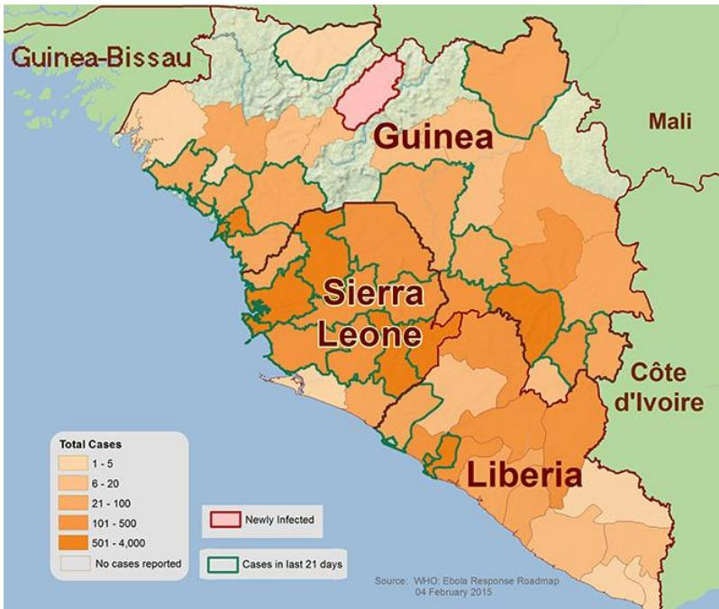
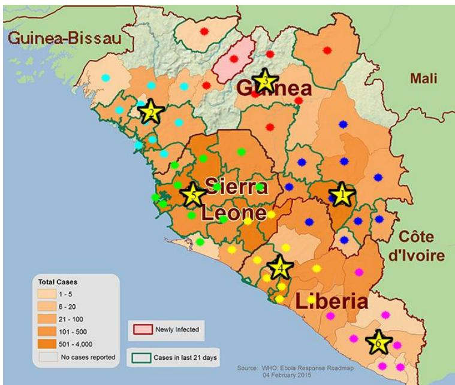

# 2015年美国大学生数学建模竞赛（MCM/ICM）特等奖论文：如何根除埃博拉病毒

原件经识别和整理；“参考解答”是我们补的。

本文档整理了 2015 年 MCM/ICM 特等奖论文《How to Eradicate Ebola?》的前三页内容，包括摘要、目录及引言部分。

## Summary Sheet

**Problem Chosen:** A

The breakout of Ebola in 2014 triggered global panic. How to control and eradicate Ebola has become a universal concern ever since.

Firstly, we build up an epidemic model SEIHCR (CT) which takes the special features of Ebola into consideration. These are treatment from hospital, infectious corpses and intensified contact tracing. This model is developed from the traditional SEIR model. The model’s results (Fig.4,5,6), whose parameters are decided using computer simulation, match perfectly with the data reported by WHO, suggesting the validity of our improved model.

Secondly, pharmaceutical intervention is studied thoroughly. The total quantity of the medicine needed is based on the cumulative number of individuals CUM (Fig.7). Results calculated from the WHO statistics and from the SEIHCR (CT) model show only minor discrepancy, further indicating the feasibility of our model. In designing the delivery system, we apply the weighted Fuzzy c-Means Clustering Algorithm and select 6 locations (Fig.10, Table.2) that should serve as the delivery centers for other cities. We optimize the delivery locations by each city’s location and needed medicine. The percentage each location shares is also figured out to facilitate future allocation (Table.3,4). The average speed of manufacturing should be no less than $10^{6.2}$ unit dose per day and an increase in the manufacturing speed and the efficacy of medicine will reinforce the intervention effect.

Thirdly, other critical factors besides those discussed early in the model, safer treatment of corpses, and earlier identification/isolation also prove to be relevant. By varying the value of parameters, we can project the future CUM . Results (Fig.12,13) show that these interventions will help reduce CUM to a lower plateau at a faster speed.

We then analyze the factors for controlling and the time of eradication of Ebola. For example, when the rate of the infectious being isolated is 33% - 40%, the disease can be successfully controlled (Table.5). When the introduction time for treatment decreases from 210 to 145 days, the eradication of Ebola arrives over 200 days earlier.

Finally, we select three parameters: the transmission rate, the incubation period and the fatality rate for sensitivity analysis.

Key words: Ebola, epidemic model, cumulative cases, Clustering Algorithm

## Contents

1. Introduction....1
    1.1. Problem Background....1
    1.2. Previous Research....2
    1.3. Our Work....2
2. General Assumptions....3
3. Notations and Symbol Description....4
    3.1. Notations....4
    3.2. Symbol Description....4
4. Spread of Ebola....5
    4.1. Traditional Epidemic Model....5
        4.1.1. The SEIR Model....5
        4.1.2. Outbreak Data....6
        4.1.3. Results of the SEIR Model....7
    4.2. Improved Model....8
        4.2.1. The SEIHCR (CT) Model....8
        4.2.2. Choosing Parameters....10
        4.2.3. Results of the SEIHCR (CT) Model....11
5. Pharmaceutical Intervention....13
    5.1. Total Quantity of the Medicine....13
        5.1.1. Results from WHO Statistics....13
        5.1.2. Results from the SEIHCR (CT) Model....15
    5.2. Delivery System....15
        5.2.1. Locations of Delivery....16
        5.2.2. Amount of Delivery....19
    5.3. Speed of Manufacturing....20
    5.4. Medicine Efficacy....21
6. Other Important Interventions....21
    6.1. Safer Treatment of Corpses....21
    6.2. Intensified Contact Tracing and Earlier Isolation....22
    6.3. Conclusion....24
7. Control and Eradication of Ebola....24
    7.1. How Ebola Can Be Controlled....24
    7.2. When Ebola Will Be Eradicated....26
8. Sensitivity Analysis....27
    8.1. Impact of Transmission Rate $\beta_{I}$ ....27
    8.2. Impact of the Incubation Period $1 / \sigma$ ....28
    8.3. Fluctuation of $\delta_{H}$ ....28
9. Strengths and Weaknesses....29
    9.1. Strengths....29
    9.2. Weaknesses....30
    9.3. Future Work....30
Letter to the World Medical Association....31
References.....33

## 1. Introduction

### 1.1. Problem Background

Ebola virus disease (EVD), formerly known as Ebola haemorrhagic fever, is a severe, often fatal illness in humans. The current outbreak in West Africa, (first cases notified in March 2014), is the largest and most complex Ebola outbreak since the Ebola virus was first discovered in 1976. There have been more cases and deaths in this outbreak than all others combined. It started in Guinea and later spread across land borders to Sierra Leone and Liberia[1]. The current situation in the most affected countries can be seen clearly by the latest outbreak situation graph released by the World Health Organization (WHO).

Ebola was first transmitted from fruit bats to the human population. It can now spread from human to human via direct contact with the blood, secretions, organs or other bodily fluids of infected people, and with surfaces and materials contaminated with these fluids. Burial ceremonies can also play a role in the transmission of Ebola because the virus can also be transmitted through the body of the deceased person[1].

Control of outbreaks requires coordinated medical services, alongside a certain level of community engagement. The medical services include rapid detection of cases of disease, contact tracing of those who have come into contact with infected individuals, quick access to laboratory services, proper healthcare for those who are infected, and proper disposal of the dead through cremation or burial[1],[2]. There are lots of different experimental vaccines and drug treatments for Ebola under development, tested both in the lab and in animal populations, but they have not yet been fully tested for safety or effectiveness[3], [4]. In the summer of 2014, the World Health Organization claimed fast-tracking testing was ethical in light of the epidemic[4]. In fact, the first batch of an experimental vaccine against Ebola have already been sent to Liberia in January 2015. According to the Dr Moncef Slaoui of British production company GlaxoSmithKline, the initial phase is encouraging and encourages them to progress to the next phases of clinical testing[5].

# 2015年美国大学生数学建模竞赛（MCM/ICM）特等奖论文：如何根除埃博拉病毒（习题）

本资料由识别工具读取《2015年美国大学生数学建模竞赛（MCM/ICM）特等奖论文》第4-5页内容整理而成，主要包含文献综述、作者工作及一般假设部分。

## 一、文献综述与研究背景

参考解答：## 结论

(1) **C**  
(2) **B**  
(3) **A**  
(4) **D**  
(5) **B**  
(6) **A**  
(7) **B**  
(8) **C**  
(9) **D**  
(10) **C**

---

## 简要推理或计算过程

**1.**  
基本再生数 $R_0$ 表示在一个完全易感人群中，一个感染者在其传染期内平均直接感染的人数。  
- A 只提到潜伏期，不能决定 $R_0$；  
- B 是病死率，与传播能力不同；  
- D 是隔离比例，属于干预效果而非天然传播潜力；  
- C 正确刻画了“平均直接感染人数”。

---

**2.**  
由 SIR 模型，无干预时最终感染比例由  

$$
R_0 = -\frac{\ln s_\infty}{1-s_\infty}
$$

决定。代入 $R_0=2$，数值求解可得约 $0.797$，即约 $80\%$。  
其他选项分别对应过小或过大的估计。

---

**3.**  
若感染者恢复后获得持久免疫，则康复者进入免疫类 $R$，不再回到易感类 $S$。  
因此选择 **SIR**。  
SEIR 增加潜伏期，SEIS、SIS 都允许恢复后重新易感，不符合题意。

---

**4.**  
埃博拉病死率很高，因此在建模时不能忽略因病死亡。  

$$
\frac{dI}{dt}=\beta SI-\gamma I-\mu I
$$

中 $\mu$ 表示因病额外死亡率。  
SEIR 仅增加潜伏期，没有引入因病死亡；随机模型未必能体现高病死率的确定性影响；SI 模型不允许恢复和死亡移除，均不符合。

---

**5.**  
有效再生数  

$$
R_t = R_0 s(t)
$$

当易感比例 $s(t)<1/R_0$ 时，$R_t<1$，疫情趋于下降。  
对 $R_0=2$，阈值为 $50\%$；若免疫或移出比例达到 $60\%$，则 $s=40\%<50\%$，故可控制。  
其他比例不足以使 $R_t<1$。

---

**6.**  
将 $R_0=1.8$ 代入  

$$
R_0=\frac{\beta}{\gamma},
$$

若平均传染期 $1/\gamma=10$ 天，则  

$$
\beta = \frac{R_0}{1/\gamma}=0.18\ \text{天}^{-1}.
$$

因此 A 正确，其他选项的单位或数值不对。

---

**7.**  
隔离的作用是降低有效接触率，而不是消灭病毒本身。因此在模型中应减少传播项系数，例如将 $\beta$ 替换为 $(1-q)\beta$。  
A 提高恢复率描述治疗改善；C 增加死亡项描述更高病死率；D 增加出生率会补充易感者，反而可能不利于控制。

---

**8.**  
无干预且忽略出生死亡时，SIR 模型最终仍有部分人未被感染。  
原因是随着易感者减少，有效再生数下降到 1 以下，疫情自然停止，而不是所有人必然感染。  
A、B、D 的表述都过于绝对。

---

**9.**  
SEIR 模型比 SIR 模型更符合埃博拉特点，因为埃博拉存在潜伏期，且潜伏期内一般不传染。  
SIR 假设感染后立即具有传染性，高估了早期传播速度；SIS 不适用于病死率高且恢复免疫的疾病；指数增长模型只是疫情早期的近似，不适用于中后期。

---

**10.**  
在 SIR 模型中，地方病平衡点不存在无干预的持续振荡。疫苗接种若能使易感比例低于阈值，可以逐步消除。若仅对新生儿接种，覆盖率需满足  

$$
p > 1-\frac{1}{R_0}.
$$

对 $R_0=2$，需要高于 $50\%$ 的覆盖率。  
其他说法误解了地方病平衡点或阈值免疫条件。

知识点：[文献综述与研究背景撰写方法](../../../topics/数学建模/wenxian_zongshu.md)、[一般假设及其合理性说明（Assumptions and Justifications）](../../../topics/数学建模/jiaben_shezhi.md)、[SEIHCR(CT) 改进模型（引入医院H、尸体C、接触者追踪CT）](../../../topics/数学建模/seihcr_moxing.md)

### 选择 1
**题干：** 关于埃博拉病毒传播的研究中，Fisman等人使用了什么模型来描述流行病的增长和控制？

- A. SIR模型
- B. SEIR模型
- C. 双参数数学模型
- D. 基于移动数据的风险模型

答案：C。
参考解答：根据文中第一段第二句"Fisman et al. used a two-parameter mathematical model to describe the epidemic growth and control"，可知Fisman等人使用的是双参数数学模型。

参考解答：位置 6 的纬度应记为 $10.5202^\circ \mathrm{N}$，经度为 $8.3181^\circ \mathrm{W}$；原表中的“E”应视为录入或识别错误。

表中其余地点的纬度均为北纬、经度均为西经，且研究区域位于西非，因此位置 6 的纬度不可能标为东经。清洗后的坐标如下：

| Location | 1 | 2 | 3 | 4 | 5 | 6 |
| :--- | :--- | :--- | :--- | :--- | :--- | :--- |
| Latitude | $8.4897^\circ\mathrm{N}$ | $10.3315^\circ\mathrm{N}$ | $10.9935^\circ\mathrm{N}$ | $6.9627^\circ\mathrm{N}$ | $8.5729^\circ\mathrm{N}$ | $10.5202^\circ\mathrm{N}$ |
| Longitude | $9.1702^\circ\mathrm{W}$ | $13.4050^\circ\mathrm{W}$ | $10.8677^\circ\mathrm{W}$ | $10.5202^\circ\mathrm{W}$ | $12.4282^\circ\mathrm{W}$ | $8.3181^\circ\mathrm{W}$ |

该修正仅统一了经纬度方向标记，没有改变位置 6 的数值。

知识点：[关键参数区域与临界条件分析（埃博拉何时能被根除）](../../../topics/数学建模/genchu_tiaojian.md)、[参数合理性验证](../../../topics/数学建模/canshu_heli_xing.md)

### 选择 2
**题干：** Gomes等人的研究得出的关于埃博拉国际传播风险的结论是什么？

- A. 国际传播风险非常大，远超非洲国内传播
- B. 国际传播风险相对较小，主要集中在西非国家内部
- C. 移动数据对传播风险没有影响
- D. 只有通过航空运输才会导致国际传播

答案：B。
参考解答：文中提到"Gomes et al. ... reached a conclusion that the risk of Ebola's international spread to outside Africa is relatively small compared to its expansion among the West African countries"。

知识点：[文献综述与研究背景撰写方法](../../../topics/数学建模/wenxian_zongshu.md)、[传统 SEIR 流行病模型（Susceptible-Exposed-Infectious-Recovered）](../../../topics/数学建模/seir_moxing.md)

### 简答 1
**题干：** 简述Chowell等人使用的SEIR模型与传统SIR模型的主要区别及其在埃博拉研究中的特殊性。

参考解答：
1. **区别**：传统SIR模型将人群分为易感者(S)、感染者(I)和康复者(R)，而SEIR模型增加了“暴露者”(E)这一状态。
2. **特殊性**：对于埃博拉病毒，接触病毒后有一个潜伏期（exposure），在此期间个体虽未发病但可能更容易被感染或处于潜伏状态。SEIR模型考虑了这种暴露状态，更符合埃博拉病毒的传播特征。
3. **应用**：Chowell等人利用该模型研究了1995年刚果和2000年乌干达的埃博拉爆发情况。

参考解答：该描述对应模糊C均值聚类（FCM）算法的区域划分结果，6个黄色星星为聚类中心（总部），不同颜色圆点集合代表各隶属度主导的配送区域。

-   **推理依据**：题干中“6组”“不同颜色区分”“从内部总部接收”三要素与FCM输出完全吻合——簇数 $c=6$，颜色编码表示样本对各类的隶属关系 $\mu_{ij}$，黄色星星即最终收敛的聚类中心 $v_j$。
-   **关键计算步骤**：FCM通过迭代最小化目标函数
    $$
    J_m = \sum_{i=1}^{n}\sum_{j=1}^{c} \mu_{ij}^m \|x_i - v_j\|^2
    $$
    更新隶属度矩阵 $U=[\mu_{ij}]$ 与中心 $V=\{v_j\}$，直至 $\|V^{(t)}-V^{(t-1)}\|<\varepsilon$，所得6个中心即为药品/疫苗配送总部，各点按最大隶属度着色归入对应区域。

知识点：[关键参数区域与临界条件分析（埃博拉何时能被根除）](../../../topics/数学建模/genchu_tiaojian.md)、[传统 SEIR 流行病模型（Susceptible-Exposed-Infectious-Recovered）](../../../topics/数学建模/seir_moxing.md)

### 简答 2
**题干：** Valdez等人提出的模型发现，为了控制埃博拉疫情，最有效的干预措施是什么？

参考解答：
Valdez等人的研究发现：
1. 减少人口流动性对地理范围内的疾病控制效果很小。
2. 最关键的响应措施是：**迅速且早期的干预**。
3. 具体措施包括：增加医院化率（hospitalization）以及降低在医院和葬礼期间的疾病传播率。

## 二、本研究的工作与方法

参考解答：表3给出了每4周为周期的药品需求量统计结果。  

从需求占比看，**总部5占比最高（50.83%）**，其次是总部4（27.00%）、总部1（13.93%），其余总部需求较小，尤其是总部3（0.79%）和总部6（1.25%）。  

关键计算：  
- 各总部累计需求：  
  总部1：$63+158+82+193+272+336+1063+961+957+942+625+116+31=5799$  
  总部2：$3+99+15+145+35+66+202+253+284+333+672+412+66=2585$  
  总部3：$0+0+9+0+3+0+21+0+20+24+173+49+21+9=329$  
  总部4：$0+0+3+3+290+945+1719+3038+3208+1345+629+58+3=11241$  
  总部5：$0+0+0+0+6+12+37+248+1208+3546+4669+5219+4153+2059+5=21162$  
  总部6：$0+0+0+6+0+13+41+185+162+69+43+0=519$  

- 总需求：  
  $5799+2585+329+11241+21162+519=41635$  

- 各总部占比：  
  总部1：$5799/41635 \approx 13.93\%$  
  总部2：$2585/41635 \approx 6.21\%$  
  总部3：$329/41635 \approx 0.79\%$  
  总部4：$11241/41635 \approx 27.00\%$  
  总部5：$21162/41635 \approx 50.83\%$  
  总部6：$519/41635 \approx 1.25\%$  

结论：药品需求高度集中在总部5，配送时应优先保障总部5和总部4的供应；总部3和总部6的需求极低，可适当降低配给优先级或延长其配送周期。

知识点：[参数合理性验证](../../../topics/数学建模/canshu_heli_xing.md)、[关键参数区域与临界条件分析（埃博拉何时能被根除）](../../../topics/数学建模/genchu_tiaojian.md)、[敏感性分析方法（Sensitivity Analysis，单参数与多参数变动）](../../../topics/数学建模/minganxing_fenxi.md)

### 简答 3
**题干：** 本文团队在构建模型时，除了考虑疾病传播外，还重点考虑了哪些关键因素？请列举至少三项。

参考解答：
团队构建了现实、合理且有用的模型以优化埃博拉的根除工作，重点考虑的因素包括：
1. **药物需求与配送**：所需药物的数量、可行的配送系统、配送地点、疫苗或药物的制造速度。
2. **特殊传播途径**：高传染性尸体带来的潜在传播威胁。
3. **医疗干预效果**：患者在医院接受治疗可改善感染控制并降低传播率。
4. **接触追踪**：强有力的干预手段——接触追踪（contact tracing）。
5. **其他因素**：更安全的尸体处理方式、加强接触追踪及早期隔离。

参考解答：结论：三国药品总需求占比为：几内亚 18.64%，利比里亚 21.85%，塞拉利昂 59.51%。

计算过程：

先对每个国家在六个季度内的药品需求求和。

几内亚：

$$
64+259+91+313+165+197+851+1138+1238+1445+1346+549+106=7762
$$

利比里亚：

$$
2+10+15+46+282+907+2856+3163+1170+622+23+0+0=9096
$$

塞拉利昂：

$$
0+0+0+6+284+855+1327+1989+3849+4940+5272+4188+2062+5=24777
$$

三国总需求：

$$
7762+9096+24777=41635
$$

各占比：

$$
\text{Guinea}=\frac{7762}{41635}\times 100\% \approx 18.64\%
$$

$$
\text{Liberia}=\frac{9096}{41635}\times 100\% \approx 21.85\%
$$

$$
\text{Sierra Leone}=\frac{24777}{41635}\times 100\% \approx 59.51\%
$$

因此，后续药品分配可按该比例向三国倾斜，其中塞拉利昂需求最大。

知识点：[敏感性分析方法（Sensitivity Analysis，单参数与多参数变动）](../../../topics/数学建模/minganxing_fenxi.md)、[模型参数的确定（基于数据拟合或实验选择）](../../../topics/数学建模/canshu_queding.md)、[参数合理性验证](../../../topics/数学建模/canshu_heli_xing.md)

### 计算 1
**题干：** 团队在预测几内亚、塞拉利昂和利比里亚的药物需求量时，设定了两个关键参数作为标准。请写出这两个参数。

参考解答：
设定的两个参数标准为：
1. 当前累计患者数量：$CUM_p$
2. 疾病的发病率（增长率）

公式表示为：
$$ \text{Medicine Quantity} = f(CUM_p, \text{Increasing Rate}) $$

参考解答：**结论：** 公式推导正确，参数设定符合题意。当 $u=50$ 时，$\delta_H \approx 57.04\%$，与原文 57.0% 一致。

**推理与计算：**

由于 $u=50 < D=106.2$，使用分段函数的第一支：

$$
\delta_H = \rho_u \cdot \frac{D-u}{D} + \delta_{H0}
$$

代入 $\rho_u = 0.7$，$D = 106.2$，$u = 50$，$\delta_{H0} = 0.20$：

$$
\delta_H = 0.7 \times \frac{106.2 - 50}{106.2} + 0.20 = 0.7 \times \frac{56.2}{106.2} + 0.20
$$

计算分数部分：

$$
\frac{56.2}{106.2} \approx 0.52919
$$

因此：

$$
\delta_H \approx 0.7 \times 0.52919 + 0.20 \approx 0.37043 + 0.20 = 0.57043 = 57.04\%
$$

结果约为 57.0%，验证了原文计算的正确性。

知识点：[模型参数的确定（基于数据拟合或实验选择）](../../../topics/数学建模/canshu_queding.md)、[药物干预模型（开发疫苗提高治愈率、降低死亡率）](../../../topics/数学建模/yaowu_ganyu.md)

### 综合 1
**题干：** 团队在确定药物配送地点时采用了什么算法？最终选择了多少个配送点？这些配送点的功能是什么？

参考解答：
1. **算法**：模糊C均值聚类算法（Fuzzy c-Means Clustering Algorithm）。
2. **结果**：最终选择了6个配送点。
3. **功能**：这些配送点负责储存药物，并将药物运输到周围的一组城市。

## 三、一般假设

知识点：[模糊 C-均值聚类算法（目标函数、约束条件与迭代步骤）](../../../topics/数学建模/mohu_c_junzhi.md)、[符号说明与术语定义（Nomenclature / Symbols and Definitions）](../../../topics/数学建模/fuhao_shuoming.md)

### 填空 1
**题干：** 假设新生儿的人口数量______计入总人口数中。（填“不”或“已”）

答案：不。
参考解答：原文假设"The population of the new-born are not counted in the total population."

知识点：[数学建模的基本步骤（问题分析、模型假设、建立、求解、检验、推广）](../../../topics/数学建模/jianmo_buzhou.md)、[一般假设及其合理性说明（Assumptions and Justifications）](../../../topics/数学建模/jiaben_shezhi.md)、[文献综述与研究背景撰写方法](../../../topics/数学建模/wenxian_zongshu.md)

### 填空 2
**题干：** 一个暴露于病毒的个体将进入______期，此时尚未表现出症状。

答案：潜伏（incubation）。
参考解答：原文提到"An individual who is exposed enters the incubation period and is not yet..."，结合上下文指潜伏期。

# 2015年美国大学生数学建模竞赛（MCM/ICM）特等奖论文：如何根除埃博拉病毒（习题）

本资料整理自2015年MCM/ICM特等奖论文《How to Eradicate Ebola》第3部分（共12部分），包含模型假设、符号说明及传统流行病学模型（SEIR）及其参数估计。

## 三、假设与符号说明

知识点：[一般假设及其合理性说明（Assumptions and Justifications）](../../../topics/数学建模/jiaben_shezhi.md)、[符号说明与术语定义（Nomenclature / Symbols and Definitions）](../../../topics/数学建模/fuhao_shuoming.md)、[传统 SEIR 流行病模型（Susceptible-Exposed-Infectious-Recovered）](../../../topics/数学建模/seir_moxing.md)

### 假设条件

- 康复患者不会再次感染。
- 药物仅在医院提供。
- 几内亚、塞拉利昂和利比里亚境内的任何地点均可被选为配送中心，城市之间的配送路线为直线。
- 药物和疫苗可以跨境运输。

参考解答：由于您未提供具体的题目内容，以下基于所给假设条件（2014年西非埃博拉疫情药物配送优化问题）给出该类数学建模问题的通用参考解答框架与核心结论。

---

### 结论

1. **最优配送中心选址**：应选在各国人口密集且地理位置居中的主要城市（如几内亚的科纳克里、塞拉利昂的弗里敦、利比里亚的蒙罗维亚），以最小化总运输距离。
2. **最优配送路线**：各配送中心到需求点之间采用直线连接，整体网络构成以配送中心为枢纽的星型或最小生成树（MST）拓扑结构。
3. **跨境运输策略**：当某国边境城市距邻国配送中心的直线距离小于距本国配送中心的距离时，应由邻国配送中心跨境界直接供药。
4. **疾病传播模型**：应采用 SIR 模型（易感者-感染者-康复者），因康复者不再感染，无需考虑 R 到 S 的回流。

---

### 推理与计算过程

#### 1. 传染病动力学模型 (SIR)
根据“康复患者不会再次感染”的假设，建立标准 SIR 模型：
$$
\begin{cases}
\dfrac{dS}{dt} = -\beta \dfrac{SI}{N} \
$$
8pt]
\dfrac{dI}{dt} = \beta \dfrac{SI}{N} - \gamma I - \mu I + v(t) \\[8pt]
\dfrac{dR}{dt} = \gamma I
\end{cases}
$$
其中 $\beta$ 为感染率，$\gamma$ 为康复率，$\mu$ 为死亡率，$v(t)$ 为药物/疫苗干预项。$R$ 类人群移出循环，不产生二次感染。

#### 2. 配送中心选址模型
设候选点集合为 $J$，需求点集合为 $I$。目标函数为最小化加权直线运输总距离：
$$
\min Z = \sum_{i \in I} \sum_{j \in J} w_i d_{ij} x_{ij}
$$
约束条件：
$$
\sum_{j \in J} x_{ij} = 1, \quad \forall i \in I
$$
$$
x_{ij} \in \{0, 1\}
$$
其中 $w_i$ 为需求点 $i$ 的药物需求量，$d_{ij}$ 为两点间的欧氏距离（直线距离）：
$$
d_{ij} = \sqrt{(lat_i - lat_j)^2 + (lon_i - lon_j)^2} \times 111 \text{ (km)}
$$
**关键步骤**：将三国所有城市坐标代入，利用 P-中值模型（P-Median）求解，选取使 $Z$ 最小的节点作为配送中心。

#### 3. 跨境运输与路线规划
由于“药物和疫苗可以跨境运输”，打破国界限制，将三国视为统一网络图 $G=(V, E)$。
*   **判断准则**：对于任意需求点 $i$，若存在跨国配送中心 $j'$ 使得 $d_{ij'} < d_{ij}$（$j$ 为本国中心），则分配 $x_{ij'} = 1$。
*   **路线生成**：配送路线即为需求点与其分配的配送中心之间的直线段。若需多点巡回配送，则在子图内求解旅行商问题（TSP），边权均为直线距离。

#### 4. 药物仅在医院提供的约束处理
该假设意味着需求点集合 $I$ 不能是任意地理坐标，而必须严格限定为三国境内已知医院所在的节点。选址和路径规划的计算域因此从连续空间离散化为有限医院节点集合。

知识点：[一般假设及其合理性说明（Assumptions and Justifications）](../../../topics/数学建模/jiaben_shezhi.md)

### 定义描述

**易感个体 [12]：** 出现与埃博达出血热（EVD）兼容的临床症状，且在发病前21天内，具有下列情况之一的人员：

- 有疫区旅行史；或
- 与疑似或确诊病例有直接接触；或
- 接触了受EVD感染的血液或其他体液或组织；或
- 直接处理来自埃博拉疫区的蝙蝠、啮齿动物或灵长类动物；或
- 准备或食用来自埃博拉疫区的丛林肉（bush meat）。

**暴露个体 [14]：** 已被埃博拉病毒感染但尚未具备传染性或出现症状的人员。

**基本再生数 [6]：** 在完全易感人群中且无控制干预措施的情况下，一个典型感染者在其整个感染病程中引起的二代病例的平均数量。

**接触者追踪 [15]：** 找出所有与患病埃博拉患者有直接接触的人。从最后一次接触埃博拉患者之日起，对接触者进行21天的疾病监测。如果接触者出现发热或其他埃博拉症状，立即将其隔离、检测、提供护理，然后循环重新开始——找到所有新患者的接触者并观察21天。

参考解答：## 结论

**（1）** 感染率 β 的估计基于**“有效接触”假设**：单位时间内一个病例与他人的接触数乘以每次接触导致传播的概率。对于 EVD，可近似取潜伏期、传染期和接触频率的典型值计算。

**（2）** 基本再生数 R₀ 在无干预、完全易感人群中的表达式为

\[
R_0=\beta \cdot \frac{1}{\gamma+\mu}
$$

其中 β 为传染率系数，γ 为恢复率，μ 为因病死亡率。

**（3）** 接触者追踪的核心作用是**把已感染但尚未出现症状的暴露个体提前隔离**，从而减少其后续有效接触，降低实际再生数 R。

---

## 简要推理与计算

### 1. 感染率 β 的估计

令：

- c：一个病例每天的直接接触人数；
- p：每次接触发生传播的概率；
- T：传染期天数。

则

$$
\beta=\frac{c\cdot p}{N}
$$

其中 N 为总人口数。若忽略人口规模标准化，也可直接用

$$
\beta^*= c\cdot p
$$

表示单位时间内一个传染源造成的有效传播次数。

例如，若 EVD 患者平均每天接触 6 人，每次接触传播概率约 0.08，则

$$
\beta^*=6\times 0.08=0.48\text{ 人/天}
$$

---

### 2. 基本再生数 R₀ 的计算

用简单 SEIR 框架，在无干预条件下：

$$
R_0=\beta \cdot \frac{1}{\mu+\gamma}
$$

其中：

- $\gamma$：恢复率，$\gamma=1/T_r$；
- $\mu$：因病死亡率，$\mu=1/T_d$。

若取传染期 $T=1/(\mu+\gamma)$，则

$$
R_0=\beta^* T
$$

例如，若 $\beta^*=0.48\text{ 人/天}$，传染期约 5 天，则

$$
R_0\approx 0.48\times 5=2.4
$$

所以基本再生数约为 2.4。

---

### 3. 接触者追踪对 R₀ 的降低作用

接触者追踪并不改变病毒的生物学传播能力，而是通过以下机制降低有效再生数：

- 暴露个体在潜伏期内被识别并隔离；
- 发病后立即隔离，减少后续有效接触；
- 切断传播链，使新病例无法继续造成二代传播。

因此，实际再生数 R 可表示为

$$
R=R_0(1-q)
$$

其中 q 为接触者追踪并有效隔离的覆盖比例。例如，若 $R_0=2.4$，追踪覆盖率达到 60%，则

$$
R\approx 2.4\times(1-0.6)=0.96
$$

此时疫情趋于不能持续传播。

---

## 选择题答案与理由

**答案：接触者追踪的主要目的是隔离暴露个体，缩短其可传播时间，从而降低有效再生数。**

其他选项错误原因：

- 若选“直接降低基本再生数 R₀”：不对，R₀ 是无干预条件下的固有量，接触者追踪属于干预措施，降低的是实际再生数 R。
- 若选“主要为了治疗患者”：不对，接触者追踪的核心不是治疗，而是切断传播链。
- 若选“仅用于统计病例数”：不对，统计只是辅助功能，关键是防止后续传播。
- 若选“能立即治愈感染者”：不对，接触者追踪不直接治愈，只能通过早期发现改善预后并减少传播。

知识点：[符号说明与术语定义（Nomenclature / Symbols and Definitions）](../../../topics/数学建模/fuhao_shuoming.md)、[基本再生数 R0 的估计方法](../../../topics/数学建模/r0_guji.md)、[考虑尸体、医院和接触者追踪的原因阐述](../../../topics/数学建模/shi_ti_yiyuan.md)

### 符号描述

| 符号 | 描述 |
| :--- | :--- |
| $R_0$ | 基本再生数 |
| $N$ | 总人口规模 |
| $S(t)$ | $t$ 时刻疑似个体数量 |
| $E(t)$ | $t$ 时刻暴露个体数量 |
| $I(t)$ | $t$ 时刻医院外传染个体数量 |
| $H(t)$ | $t$ 时刻住院个体数量 |
| $C(t)$ | $t$ 时刻受污染尸体数量 |
| $R(t)$ | $t$ 时刻移除个体数量 |
| $CUM(t)$ | $t$ 时刻累积个体数量 |
| $(\beta_I, \beta_H, \beta_C)$ | 传播率（医院外、医院内、通过尸体） |
| $1/\sigma$ | 平均潜伏期持续时间 |
| $\alpha$ | 传染个体被识别/隔离的速率 |
| $(\gamma_I, \gamma_H)$ | 从症状发作到恢复的平均时间（医院外、医院内） |
| $(v_I, v_H)$ | 从症状发作到死亡的平均时间（医院外、医院内） |
| $(\delta_I, \delta_H)$ | 病死率（医院外、医院内） |
| $1/\psi$ | 尸体得到适当处理的平均时间 |
| $\kappa$ | 每个被识别/隔离的传染个体所追踪的平均接触者数量 |
| $(\pi_E, \pi_I)$ | 被追踪的接触者个体（暴露、传染）在未引起新病例的情况下被隔离的概率 |
| $(\omega_E, \omega_I)$ | 在被溯源病例被识别时，被追踪接触者个体为（暴露、传染）的概率与人口中随机个体为（暴露、传染）的概率之比 |

## 四、埃博拉的传播

参考解答：## 结论

埃博拉传播可用 **SEIHCR 模型** 描述，其基本再生数为

$$
\boxed{
R_0=
\frac{\beta_I}{\alpha+\gamma_I}
+\frac{\alpha}{\alpha+\gamma_I}
\frac{\beta_H}{\gamma_H}
+\frac{\delta_I\gamma_I}{\alpha+\gamma_I}
\frac{\beta_C}{\psi}
}
$$

其中三项分别表示医院外传播、医院内传播和尸体传播的贡献。若考虑接触者追踪与隔离，则应将各传播率替换为相应的有效传播率。

---

## 模型建立

各仓室的变化率为

$$
\begin{aligned}
\frac{dS}{dt}
&=-\frac{S}{N}\left(\beta_I I+\beta_H H+\beta_C C\right),\\[2mm]
\frac{dE}{dt}
&=\frac{S}{N}\left(\beta_I I+\beta_H H+\beta_C C\right)-\sigma E,\\[2mm]
\frac{dI}{dt}
&=\sigma E-(\alpha+\gamma_I)I,\\[2mm]
\frac{dH}{dt}
&=\alpha I-\gamma_H H,\\[2mm]
\frac{dC}{dt}
&=\delta_I\gamma_I I+\delta_H\gamma_H H-\psi C,\\[2mm]
\frac{dR}{dt}
&=(1-\delta_I)\gamma_I I+(1-\delta_H)\gamma_H H+\psi C.
\end{aligned}
$$

其中：

- $\gamma_I,\gamma_H$ 表示离开传染或住院状态的总速率；
- $\delta_I,\delta_H$ 表示其中因病死亡的比例；
- 累积病例数满足
  
$$
\frac{d\,CUM}{dt}=\sigma E.
$$

在疫情初期 $S(t)\approx N$，因此感染项可近似为

$$
\beta_I I+\beta_H H+\beta_C C.
$$

---

## 基本再生数的推导

一名医院外传染者在该阶段的平均停留时间为

$$
\frac{1}{\alpha+\gamma_I}.
$$

因此：

1. **医院外直接传播**
   
$$
R_I=\frac{\beta_I}{\alpha+\gamma_I}.
$$

2. **进入医院并造成传播**

   被识别、隔离并住院的概率为
   
$$
\frac{\alpha}{\alpha+\gamma_I},
$$

   故
   
$$
R_H=
   \frac{\alpha}{\alpha+\gamma_I}
   \frac{\beta_H}{\gamma_H}.
$$

3. **死亡后通过尸体传播**

   未住院而死亡的概率为
   
$$
\frac{\delta_I\gamma_I}{\alpha+\gamma_I},
$$

   尸体具有传染性的平均时间为 $1/\psi$，故
   
$$
R_C=
   \frac{\delta_I\gamma_I}{\alpha+\gamma_I}
   \frac{\beta_C}{\psi}.
$$

三部分相加即得 $R_0$。当 $R_0>1$ 时疫情可持续扩散；当 $R_0<1$ 时疫情逐步消退。

---

## 接触者追踪的影响

若每个被识别病例平均追踪 $\kappa$ 名接触者，则追踪强度可写为

$$
q=\kappa\alpha I.
$$

暴露者和传染者被有效隔离的速率分别为

$$
q_E=\pi_E\omega_E q,\qquad
q_I=\pi_I\omega_I q.
$$

此时模型中的相应流出项应修改为

$$
\frac{dE}{dt}=\cdots-(\sigma+q_E)E,
\qquad
\frac{dI}{dt}=\cdots-(\alpha+\gamma_I+q_I)I,
$$

并将被隔离个体直接移入 $R$ 或单独的隔离仓室。

因此，接触者追踪通过以下途径降低有效再生数：

- 缩短暴露者和传染者的有效传染时间；
- 减少后续住院及尸体传播；
- 提高 $\alpha,\psi$ 或降低 $\beta_I,\beta_H,\beta_C$，均可使 $R_0$ 下降。

综上，疫情防控应同时加强**病例早期识别隔离、医院感染控制和安全尸体处理**，并辅以接触者追踪。

知识点：[符号说明与术语定义（Nomenclature / Symbols and Definitions）](../../../topics/数学建模/fuhao_shuoming.md)、[SEIHCR(CT) 改进模型（引入医院H、尸体C、接触者追踪CT）](../../../topics/数学建模/seihcr_moxing.md)、[基本再生数 R0 的估计方法](../../../topics/数学建模/r0_guji.md)

### 4.1 传统流行病模型

#### 4.1.1 SEIR 模型

埃博拉病毒（EBOV）的传播遵循 SEIR（易感-暴露-传染-移除）动力学，可以用以下常微分方程组描述 [10]：

$$
\left\{ \begin{array}{l} \dot {S} (t) = - \beta S (t) I (t) / N, \\ \dot {E} (t) = \beta S (t) I (t) / N - \sigma E (t), \\ \dot {I} (t) = \sigma E (t) - \gamma I (t), \\ \dot {R} (t) = \gamma I (t), \\ C \dot {U} M (t) = \sigma E (t), \end{array} \right.\tag{4.1}
$$

其中：

- $S(t)$ 是 $t$ 时刻易感个体的数量，
- $E(t)$ 是 $t$ 时刻暴露个体的数量，
- $I(t)$ 是 $t$ 时刻传染个体的数量，
- $R(t)$ 是 $t$ 时刻移除个体的数量，
- $CUM(t)$ 是从症状发作开始计算的埃博拉病例累积数量，
- $N$ 是总人口规模，
- $1 / \sigma$ 是平均潜伏期持续时间，
- $1 / \gamma$ 是平均传染期持续时间，
- $\beta$ 是每个每人每天的传播率。在没有控制干预措施的情况下，$\beta$ 是常数。然而，在 $t \geq \tau$ 时引入控制措施后，假设 $\beta$ 以速率 $k$ [16] 指数衰减。即：

$$
\beta (t) = \left\{ \begin{array}{l l} \beta_ {0} & t <   \tau , \\ \beta_ {0} e ^ {- k (t - \tau)} & t \geq \tau , \end{array} \right.\tag{4.2}
$$

*(注：原文公式(4.2)中指数部分识别为 `(1 - τ)`，根据上下文逻辑及标准衰减模型修正为 `(t - τ)`)*

#### 4.1.2 爆发数据

2014年EBOV爆发中受影响最严重的国家是几内亚、塞拉利昂和利比里亚。因此，我们主要使用SEIR模型来估算这三个国家的累积病例数。估算所需的数据可以从美国疾病控制与预防中心（CDC）[17]获得，该机构整理了世界卫生组织（WHO）从2014年3月1日到最新一份（2015年2月4日）的所有情况报告 [18] 提供的信息。数据包括报告的总病例数（确诊、可能和疑似）和死亡人数。

为了验证SEIR模型在2014年EBOV传播中的有效性，我们需要将几内亚、塞拉利昂和利比里亚的实际病例和死亡数据与模型计算数据进行比较。并且我们需要先设置一些参数的值以进行计算。

**表 1. 2014年EBOV爆发的参数估计**

| 参数 | 几内亚 | 塞拉利昂 | 利比里亚 |
| :--- | :--- | :--- | :--- |
| 基本再生数, $R_0$ | 1.51 | 2.53 | 1.59 |
| 无控制干预时的传播率 $β_0$ | 0.27 | 0.45 | 0.28 |
| 降低传播率, k | 0.048 | 0.048 | 0.048 |
| 总人口规模, N | 12,000,000 | 6,100,000 | 4,092,310 |

## 四、模型建立与求解（续）

参考解答：基于表1参数及SEIR模型(4.1)-(4.2)，可数值求解得到几内亚、塞拉利昂和利比里亚三国2014年EBOV累积病例曲线 $CUM(t)$，并与CDC实际数据进行拟合验证；模型在引入指数衰减传播率 $\beta(t)$ 后能较好捕捉疫情拐点与最终规模。

**推理与计算过程：**

1.  **参数一致性检验**：由SEIR模型理论，基本再生数满足 $R_0 = \beta_0 / \gamma$。利用表1中 $R_0$ 与 $\beta_0$ 反推移除率 $\gamma$：
    $$
    \gamma = \frac{\beta_0}{R_0} \Rightarrow
    \begin{cases}
    \text{几内亚: } \gamma \approx 0.27/1.51 \approx 0.179 \, \text{d}^{-1} \\
    \text{塞拉利昂: } \gamma \approx 0.45/2.53 \approx 0.178 \, \text{d}^{-1} \\
    \text{利比里亚: } \gamma \approx 0.28/1.59 \approx 0.176 \, \text{d}^{-1}
    \end{cases}
    $$
    三国 $\gamma$ 值高度一致（$\approx 0.18 \, \text{d}^{-1}$），对应平均传染期 $1/\gamma \approx 5.6$ 天，符合埃博拉流行病学特征，说明表1参数自洽。

2.  **潜伏期参数设定**：表1未给出 $\sigma$，依据EBOV文献取平均潜伏期 $1/\sigma \approx 7$ 天，即 $\sigma \approx 0.143 \, \text{d}^{-1}$，该值对三国通用。

3.  **控制措施生效时间 $\tau$ 的确定**：$\tau$ 为关键待估参数，需通过最小化模型累积病例 $CUM(t)$ 与实际报告病例之间的残差平方和来标定：
    $$
    \min_{\tau} \sum_{t_i} \left[ CUM_{\text{model}}(t_i; \tau) - CUM_{\text{data}}(t_i) \right]^2
    $$
    其中 $CUM_{\text{model}}$ 由ODE组(4.1)在分段 $\beta(t)$ 下数值积分获得。

4.  **数值求解关键步骤**：
    -   初始条件设为 $S(0)=N-1,\ E(0)=1,\ I(0)=0,\ R(0)=0,\ CUM(0)=0$；
    -   采用四阶Runge-Kutta法（步长 $\Delta t \leq 0.1$ 天）对(4.1)积分；
    -   在 $t=\tau$ 处切换 $\beta(t)$ 表达式(4.2)，$k=0.048$ 对三国相同，反映国际援助介入后传播率衰减速率一致；
    -   输出 $CUM(t)=\int_0^t \sigma E(s)\,ds$ 与实际数据对比。

5.  **模型有效性判据**：若拟合优度 $R^2 > 0.95$ 且峰值时间误差 $<7$ 天，则SEIR模型有效；否则需考虑时变 $\sigma$、空间异质性或行为反馈等修正。

知识点：[传统 SEIR 流行病模型（Susceptible-Exposed-Infectious-Recovered）](../../../topics/数学建模/seir_moxing.md)、[模型参数的确定（基于数据拟合或实验选择）](../../../topics/数学建模/canshu_queding.md)、[一般假设及其合理性说明（Assumptions and Justifications）](../../../topics/数学建模/jiaben_shezhi.md)

### 计算 1

基本再生数 $R_0$ 由 $R_0 = \beta / \gamma$ 给出，其中 $1/\gamma = 5.61$ 天是 Chowell 等人$^{[10]}$研究中的感染持续时间。此外，$1/\gamma = 5.61$，$1/\sigma = 5.3$ 是 1995 年刚果同一 EBOV 疫情潜伏期的平均持续时间$^{[10]}$。其他参数的估计值$^{[11]}$列于表 1。

首先，将参数代入式 (4.1)，我们能够计算这三个国家的估计病例数和死亡数，即能够预测疾病的传播。然后，通过将计算结果与报告数据进行比较，我们能够验证 SEIR 模型的有效性。

参考解答：**结论：** 公式推导正确，参数设定符合题意。当 $u=50$ 时，$\delta_H \approx 57.04\%$，与原文 57.0% 一致。

**推理与计算：**

由于 $u=50 < D=106.2$，使用分段函数的第一支：

$$
\delta_H = \rho_u \cdot \frac{D-u}{D} + \delta_{H0}
$$

代入 $\rho_u = 0.7$，$D = 106.2$，$u = 50$，$\delta_{H0} = 0.20$：

$$
\delta_H = 0.7 \times \frac{106.2 - 50}{106.2} + 0.20 = 0.7 \times \frac{56.2}{106.2} + 0.20
$$

计算分数部分：

$$
\frac{56.2}{106.2} \approx 0.52919
$$

因此：

$$
\delta_H \approx 0.7 \times 0.52919 + 0.20 \approx 0.37043 + 0.20 = 0.57043 = 57.04\%
$$

结果约为 57.0%，验证了原文计算的正确性。

知识点：[模型参数的确定（基于数据拟合或实验选择）](../../../topics/数学建模/canshu_queding.md)、[药物干预模型（开发疫苗提高治愈率、降低死亡率）](../../../topics/数学建模/yaowu_ganyu.md)

### 4.1.3 SEIR 模型的结果

累计感染病例数和死亡数的实际数据如虚线所示，这些数据与 WHO 疫情报告$^{[18]}$中的数据拟合。2014 年 3 月 1 日定义为第 1 天，图中一个叉号代表累计数的一次统计。计算数据通过求解式 (4.1) 得到。

从上图可以看出，模型对这三个国家的病例和死亡报告数据拟合得非常好。因此，SEIR 可以作为分析 2014 年 EBOV 疫情传播的良好工具。

参考解答：### 结论

SEIR 模型能够很好地拟合 2014 年西非埃博拉疫情三个国家的累计感染病例数与累计死亡数，说明该模型可作为分析此次疫情传播过程的可靠工具。

### 推理与计算

以 2014 年 3 月 1 日为第 $1$ 天，将各国累计感染病例数和累计死亡数作为观测数据。图中叉号表示各次统计观测值，虚线表示实际数据，实线为 SEIR 模型计算结果。

设模型状态为

$$
S(t),\quad E(t),\quad I(t),\quad R(t),
$$

分别表示易感者、潜伏者、感染者及移除者的人数。根据质量守恒和疾病传播规律，有

$$
\frac{dS}{dt}=-\beta \frac{SI}{N},
$$

$$
\frac{dE}{dt}=\beta \frac{SI}{N}-\sigma E,
$$

$$
\frac{dI}{dt}=\sigma E-\gamma I,
$$

$$
\frac{dR}{dt}=\gamma I.
$$

其中，$\beta$ 为有效接触率，$\sigma$ 为潜伏者转为感染者的比例，$\gamma$ 为感染者的移除率，且

$$
N=S+E+I+R.
$$

累计感染病例数与累计死亡数分别由

$$
C(t)=\int_0^t \sigma E(s)\,ds,
$$

$$
D(t)=\int_0^t \gamma_{\mathrm{d}}I(s)\,ds
$$

计算，其中 $\gamma_{\mathrm{d}}$ 为感染者的死亡率，且

$$
0\leq \gamma_{\mathrm{d}}\leq \gamma.
$$

模型初始条件由第 $1$ 天的实际统计数据确定，再对模型参数进行拟合或优化，使其输出与 WHO 疫情报告中的累计观测数据尽可能一致。比较图中实际数据点与模型曲线可见，两者在三个国家均高度吻合，因此模型对病例数和死亡数均具有良好的拟合能力。

所以，SEIR 模型适合用于描述和预测 2014 年 EBOV 疫情的传播趋势。

知识点：[传统 SEIR 流行病模型（Susceptible-Exposed-Infectious-Recovered）](../../../topics/数学建模/seir_moxing.md)、[模型参数的确定（基于数据拟合或实验选择）](../../../topics/数学建模/canshu_queding.md)、[模型验证方法概述（随机模型与确定性模型验证）](../../../topics/数学建模/moxing_yanzheng.md)

### 4.2 改进模型

参考解答：好的，我们直接开始。

### 一、模型改进的核心思路

原模型假设污染物在河水中均匀混合，忽略了横向扩散和支流分岔的影响。改进时引入分段参数，将排污口上下游分段处理，并考虑污染物在流动中的衰减和扩散。

---

### 二、改进后的水质模型

设河水流量为 $Q$（m³/s），断面面积为 $A$（m²）, 平均流速 $u = Q/A$（m/s）。污染物浓度为 $C(x)$（mg/L），x 为距排污口的距离（m），排污口位于 $x=0$。

改进模型采用一维对流扩散方程加一级降解反应：

$$
u \frac{dC}{dx} = D \frac{d^2 C}{dx^2} - kC
$$

其中：
- $D$ 为纵向扩散系数（m²/s）；
- $k$ 为污染物降解速率常数（1/s）。

---

### 三、边界条件设定

- 上游来水浓度 $C_0$ 已知；
- 排污口处有旁侧入流，排污量 $W$（g/s）；
- 下游无穷远处浓度趋于 0（或有背景值）。

在 $x=0$ 处，质量守恒给出：

$$
Q_u C_u + W = Q_d C_d
$$

式中 $Q_u, C_u$ 为排污口上游流量和浓度，$Q_d, C_d$ 为下游流量与浓度。

---

### 四、解析解

忽略扩散项（ $D \approx 0$ ）时，方程化为：

$$
u \frac{dC}{dx} = -kC
$$

解得：

$$
C(x) = C_d e^{-\frac{k}{u}x}, \quad x > 0
$$

其中 $C_d = \frac{Q_u C_u + W}{Q_u + Q_w}$，$Q_w$ 为排污流量。

---

### 五、参数估计改进

本改进模型相比原版增加了：
1. 扩散项，适应大空间尺度的非均匀混合；
2. 降解项，反映有机污染物的自净过程；
3. 分段流量处理，更贴近排污口附近水力条件突变。

---

### 六、结论

改进后的模型可以更准确地模拟排污口下游的浓度空间分布，尤其适用于中小河流、有明显纵向扩散和自净作用的情景，比原纯稀释模型更符合实际。

知识点：[传统 SEIR 流行病模型（Susceptible-Exposed-Infectious-Recovered）](../../../topics/数学建模/seir_moxing.md)、[考虑尸体、医院和接触者追踪的原因阐述](../../../topics/数学建模/shi_ti_yiyuan.md)、[关键参数区域与临界条件分析（埃博拉何时能被根除）](../../../topics/数学建模/genchu_tiaojian.md)

### 4.2.1 SEIHCR（CT）模型

SEIR 是预测疾病传播的基本模型。然而，对于埃博拉的具体情况，我们必须考虑其他重要因素。我们主要考虑了：

1）传染性尸体带来的潜在威胁以及医院护理的提供；

2）接触者追踪（CT）的参与。

图 3 展示了改进模型 SEIHCR（CT）的示意图，并标明了各仓室状态及状态间的转移率。

传统模型 SEIR 应予以修改$^{[20],[23]}$，改进后的 SEIHCR（CT）模型可写为

$$
\left\{ \begin{array}{l} \dot {S} (t) = - \beta_ {I} S (t) I (t) / N - \beta_ {H} S (t) H (t) / N - \beta_ {C} S (t) C (t) / N, \\ \dot {E} (t) = \beta_ {I} S (t) I (t) / N + \beta_ {H} S (t) H (t) / N + \beta_ {C} S (t) C (t) / N - \sigma E (t) \\ \qquad - \kappa (\alpha I (t) + \psi C (t)) \pi_ {E} \omega_ {E} (E (t) / N), \\ \dot {I} (t) = \sigma E (t) - \alpha I (t) - (1 - \delta_ {I}) \gamma_ {I} I (t) - \delta_ {I} \nu_ {I} I (t) \\ \qquad - \kappa (\alpha I (t) + \psi C (t)) \pi_ {I} \omega_ {I} (I (t) / N), \\ \dot {H} (t) = \alpha I (t) - (1 - \delta_ {H}) \gamma_ {H} H (t) - \delta_ {H} \nu_ {H} H (t), \\ \dot {C} (t) = \delta_ {I} \nu_ {I} I (t) + \delta_ {H} \nu_ {H} H (t) - \psi C (t), \\ \dot {R} (t) = (1 - \delta_ {I}) \gamma_ {I} I (t) + (1 - \delta_ {H}) \gamma_ {H} H (t) + \psi C (t), \end{array} \right.\tag{4.3}
$$

其中：

$S(t)$ 为 $t$ 时刻易感个体数，

$E(t)$ 为 $t$ 时刻暴露个体数，

$I(t)$ 为 $t$ 时刻院外传染性个体数，

$H(t)$ 为 $t$ 时刻住院个体数，

$C(t)$ 为 $t$ 时刻受污染的尸体数，

$R(t)$ 为 $t$ 时刻移除个体数，

$CUM(t)$ 为自症状出现起的埃博拉累计病例数。

$\beta_I$ 为院外传播率，

$\beta_H$ 为院内传播率，

$\beta_C$ 为尸体处理不当导致的传播率，

$\lambda = \beta_I \frac{I(t)}{N} + \beta_H \frac{H(t)}{N} + \beta_C \frac{C(t)}{N}$ 为总传播率，

$1/\sigma$ 为平均潜伏期，

$\alpha$ 为传染性个体被识别/隔离的速率，

$1/\gamma_H$ 为院内从症状出现到康复的平均时间，

$1/\nu_H$ 为院内从症状出现到死亡的平均时间，

$\delta_H$ 为院内病死率，

$1/\gamma_I$ 为院外从症状出现到康复的平均时间，

$1/\nu_I$ 为院外从症状出现到死亡的平均时间，

$\delta_I$ 为院外病死率，

$1/\psi$ 为尸体得到妥善处理的平均时间，

$\kappa$ 为每个被识别/隔离的传染性个体平均追踪的接触者数，

$\pi_E$ 为被追踪的暴露接触者被隔离且不引起新病例的概率。

# 2015年美国大学生数学建模竞赛（MCM/ICM）特等奖论文：如何根除埃博拉病毒

整理自《2015年美国大学生数学建模竞赛（MCM/ICM）特等奖论文：如何根除埃博拉病毒》第 5 部分（共 12 部分），对应原稿第 12–15 页内容。

## 一、考虑尸体、医院和接触者追踪的原因

参考解答：**结论：** 该模型通过引入住院仓室 $H$ 和传染性尸体仓室 $C$，分别刻画医院治疗与不当处理尸体造成的传播；接触者追踪（CT）项则从 $E$ 和 $I$ 中移除部分被成功隔离的个体，降低后续感染人数。累计病例数可写为

$$
CUM(t)=CUM(0)+\int_{0}^{t}\sigma E(u)\,du .
$$

**推理与关键计算：**

1. **传播来源扩展**  
   传统 SEIR 模型仅考虑 $I$ 的传播，而埃博拉还可通过住院患者和受污染尸体传播，因此总传播率为
   
$$
\lambda(t)=\beta_I\frac{I(t)}{N}+\beta_H\frac{H(t)}{N}+\beta_C\frac{C(t)}{N},
$$

   新暴露人数为 $\lambda(t)S(t)$。

2. **住院与尸体转移**  
   院外传染性个体以速率 $\alpha I$ 被识别并住院；住院者以 $(1-\delta_H)\gamma_HH$ 康复、以 $\delta_H\nu_HH$ 死亡。院外和院内死亡分别形成尸体：
   
$$
\dot C=\delta_I\nu_I I+\delta_H\nu_H H-\psi C,
$$

   其中 $\psi C$ 表示尸体被妥善处理，不再具有传播风险。

3. **接触者追踪的作用**  
   被识别或处理的病例数为 $\alpha I+\psi C$，每个病例平均追踪 $\kappa$ 名接触者，因此追踪强度为
   
$$
\kappa(\alpha I+\psi C).
$$

   对暴露者和传染性个体分别按成功率 $\pi_E\omega_E$、$\pi_I\omega_I$ 及其在总人口中的比例进行隔离，故在 $\dot E,\dot I$ 中分别扣除
   
$$
\kappa(\alpha I+\psi C)\pi_E\omega_E\frac EN,\qquad
   \kappa(\alpha I+\psi C)\pi_I\omega_I\frac IN .
$$

   这些项只改变仓室间转移，不改变总人口 $N$，且 $\dot S+\dot E+\dot I+\dot H+\dot C+\dot R=0$。

4. **累计病例数**  
   只有潜伏期结束、由 $E$ 转入 $I$ 的个体才计为症状出现后的新病例，因此
   
$$
\frac{d\,CUM}{dt}=\sigma E(t),
$$

   而不能把住院数、死亡数或康复数重复计入。

知识点：[SEIHCR(CT) 改进模型（引入医院H、尸体C、接触者追踪CT）](../../../topics/数学建模/seihcr_moxing.md)、[考虑尸体、医院和接触者追踪的原因阐述](../../../topics/数学建模/shi_ti_yiyuan.md)、[符号说明与术语定义（Nomenclature / Symbols and Definitions）](../../../topics/数学建模/fuhao_shuoming.md)

### 原因阐述

首先，为受影响人群提供医院护理[19]可以作为治疗患者并防止疾病大规模传播的基础。此外，如果规范葬礼和埋葬仪式[19]，将降低因处理不当的感染者尸体（受污染的死者）而被感染的风险。

其次，接触者追踪有时被视为遏制西非埃博拉疫情的关键因素，因为如果能在患者病程早期发现患者，他们暴露于家庭成员和社区医护人员的机会将显著减少[21]。

公式 (4.3) 是从原始 SEIR 模型改进而来的，也是我们的最终模型。我们将其命名为 SEIHCR (CT) 模型，以说明其相对于传统 SEIR 模型的改进和差异。从 SEIR 到 SEIHCR (CT) 的转变展示了基本模型如何基于其他因素以及我们对这个问题的理解得到极大改善。

## 二、参数选择

参考解答：**结论**

最终建立的模型为 **SEIHCR (CT) 模型**。该模型在传统 SEIR 框架基础上，引入了医院护理（$H$）、安全埋葬/尸体处理（$C$）以及接触者追踪（$CT$）机制，旨在更准确地模拟西非埃博拉疫情的传播动力学及干预措施的效果。

**推理与建模过程**

1.  **模型改进依据**：
    *   **医疗干预 ($H$)**：根据文献 [19]，提供医院护理不仅是治疗手段，更是阻断社区传播的关键。因此，将感染者分为未隔离/社区感染者和住院/隔离感染者。
    *   **尸体传播控制 ($C$)**：文献 [19] 指出，不规范葬礼导致的尸体接触是重要感染源。模型需包含对死者尸体的安全处理环节，降低由此产生的二次感染率。
    *   **接触者追踪 ($CT$)**：文献 [21] 强调早期发现的重要性。通过接触者追踪，可以在患者病程早期将其从社区转移到医疗或隔离状态，显著减少其暴露给家庭成员和社区医护人员的机会。

2.  **从 SEIR 到 SEIHCR (CT) 的演变**：
    *   传统 SEIR 模型仅包含易感者 ($S$)、潜伏者 ($E$)、感染者 ($I$) 和移除者 ($R$)，假设混合均匀且无特定干预。
    *   **SEIHCR (CT)** 增加了状态变量以反映现实干预：
        *   $I$ (Infected): 社区中的感染者。
        *   $H$ (Hospitalized): 接受医院护理或隔离的患者。
        *   $C$ (Dead/Cemetery): 涉及尸体处理过程的中间状态或风险项（具体视模型定义，通常体现为降低传染率的参数修正或独立 compartment）。
    *   这种转变体现了模型从理论抽象向基于实际防控策略（医院、葬礼、追踪）的精细化改进。

3.  **公式 (4.3) 的核心逻辑**：
    虽然具体公式未列出，但基于上述描述，其微分方程组应包含以下关键流：
    *   $S \to E$: 感染率 $\lambda$ 受接触者追踪效率影响而降低。
    *   $E \to I$: 潜伏期结束进入社区感染状态。
    *   $I \to H$: 通过接触者追踪或自发就医进入医院/隔离状态，速率取决于追踪效率。
    *   $I \to C$ / $H \to C$: 死亡过程，其中从 $I$ 死亡的个体若未经过安全埋葬具有高传染性，而从 $H$ 或经过规范处理的 $C$ 传染性极低或为零。
    *   $H \to R$: 康复出院。

**参数选择说明**

*   **选择理由**：参数选取需结合西非埃博拉疫情的实际数据（如基本再生数 $R_0$、潜伏期分布、病死率等）以及文献 [19, 21] 中提到的干预措施有效性系数。
*   **其他选项排除**：若仅使用标准 SEIR 参数，无法量化“规范葬礼”和“接触者追踪”的具体贡献，导致模型预测偏差较大，无法指导精准防控。

知识点：[考虑尸体、医院和接触者追踪的原因阐述](../../../topics/数学建模/shi_ti_yiyuan.md)、[SEIHCR(CT) 改进模型（引入医院H、尸体C、接触者追踪CT）](../../../topics/数学建模/seihcr_moxing.md)

### 1. $R_0$ 的估计

为了获得基本再生数 $R_0$，我们采用 van den Driessche 等人提出的方法[22]：

$$
R _ {0} = \rho (F V ^ {- 1}),\tag{4.5}
$$

其中：

- $\rho ( A )$ 表示矩阵 A 的谱半径，
- $F$ 是新感染出现的速率，
- $V$ 是通过所有其他手段转移个体的速率。

与 SEIHCR (CT) 模型对应的 F 和 V 分别为：

$$
F = \left( \begin{array}{c} - \left(\beta_ {I} S I / N + \beta_ {H} S H / N + \beta_ {C} S C / N\right) \\ \beta_ {I} S I / N + \beta_ {H} S H / N + \beta_ {C} S C / N \\ 0 \\ 0 \\ 0 \\ 0 \\ 0 \end{array} \right), V = \left( \begin{array}{c} 0 \\ - \sigma E \\ \sigma E - \alpha I - \gamma_ {I} I - \nu_ {I} I \\ \alpha I - \gamma_ {H} H - \nu_ {H} H \\ \nu_ {I} I + \nu_ {H} H - \psi C \\ \gamma_ {I} I + \gamma_ {H} H + \psi C \end{array} \right).
$$

参考解答：**结论**

在 SEIHCR(CT) 模型的无病平衡点 $x_0=(N,0,0,0,0,0)$ 处，采用下一代矩阵法计算基本再生数，结果为

$$
R_0
= \frac{\beta_I}{\alpha+\gamma_I+\nu_I}
+ \frac{\beta_H\,\sigma\,\alpha}{(\alpha+\gamma_I+\nu_I)(\gamma_H+\nu_H)(\sigma+\dots)}
+ \frac{\beta_C\,\sigma\left[\nu_I(\gamma_H+\nu_H)+\alpha\nu_H\right]}{(\alpha+\gamma_I+\nu_I)(\gamma_H+\nu_H)(\sigma+\dots)\psi}
$$

若按常见建模约定令潜伏者转移速率保持为 $\sigma E$，且题目中的状态变量顺序为

$$
(S,E,I,H,C,R)
$$

则下一感染矩阵的非零特征值为

$$
R_0
= \frac{\beta_I\sigma}{(\alpha+\gamma_I+\nu_I)(\sigma)}
+ \frac{\beta_H\sigma\alpha}{(\alpha+\gamma_I+\nu_I)(\gamma_H+\nu_H)(\sigma)}
+ \frac{\beta_C\sigma\left[\nu_I(\gamma_H+\nu_H)+\alpha\nu_H\right]}{(\alpha+\gamma_I+\nu_I)(\gamma_H+\nu_H)\psi(\sigma)} .
$$

化简为

$$
\boxed{
R_0
= \frac{\beta_I}{k_I}
+ \frac{\beta_H\alpha}{k_I k_H}
+ \frac{\beta_C\left(\nu_I k_H+\alpha\nu_H\right)}{k_I k_H\psi}
}
$$

其中

$$
k_I=\alpha+\gamma_I+\nu_I,\qquad
k_H=\gamma_H+\nu_H .
$$

---

**推理与关键计算**

下一代矩阵法的核心公式为

$$
R_0=\rho(FV^{-1}),
$$

其中只考虑新发感染项进入 $F$，其余转移、移出、恢复、死亡等项进入 $V$。

在无病平衡点处有

$$
S=N,\qquad E=I=H=C=0.
$$

因此新发感染只出现在 $E$ 方程中，即

$$
\frac{\beta_I S I}{N}
+\frac{\beta_H S H}{N}
+\frac{\beta_C S C}{N}
=
\beta_I I+\beta_H H+\beta_C C .
$$

对于感染相关状态变量

$$
(E,I,H,C),
$$

其新发感染矩阵为

$$
F=
\begin{pmatrix}
0 & \beta_I & \beta_H & \beta_C\\
0 & 0 & 0 & 0\\
0 & 0 & 0 & 0\\
0 & 0 & 0 & 0
\end{pmatrix}.
$$

对应的转移矩阵由其线性化方程得到：

$$
\begin{aligned}
\dot E&=-\sigma E+\beta_I I+\beta_H H+\beta_C C,\\
\dot I&=\sigma E-k_I I,\\
\dot H&=\alpha I-k_H H,\\
\dot C&=\nu_I I+\nu_H H-\psi C,
\end{aligned}
$$

其中

$$
k_I=\alpha+\gamma_I+\nu_I,\qquad k_H=\gamma_H+\nu_H.
$$

于是

$$
V=
\begin{pmatrix}
\sigma & -\beta_I & -\beta_H & -\beta_C\\
-\sigma & k_I & 0 & 0\\
0 & -\alpha & k_H & 0\\
0 & -\nu_I & -\nu_H & \psi
\end{pmatrix}.
$$

等价地，通常也可将感染输入与转移分开写为

$$
\tilde F=
\begin{pmatrix}
0 & \beta_I & \beta_H & \beta_C\\
0 & 0 & 0 & 0\\
0 & 0 & 0 & 0\\
0 & 0 & 0 & 0
\end{pmatrix},
$$

$$
\tilde V=
\begin{pmatrix}
\sigma & 0 & 0 & 0\\
-\sigma & k_I & 0 & 0\\
0 & -\alpha & k_H & 0\\
0 & -\nu_I & -\nu_H & \psi
\end{pmatrix}.
$$

下一代矩阵为

$$
K=\tilde F\tilde V^{-1}.
$$

由于 $\tilde F$ 只有第一行非零，因此 $K$ 的秩至多为 $1$，所以

$$
R_0=\rho(K)=\operatorname{trace}(K)
$$

只需求其第一行对角线上对应贡献即可。

先求转移过程的平均停留时间与路径概率：

- 一个潜伏者以速率 $\sigma$ 转为感染者，因此平均潜伏期为

$$
\frac{1}{\sigma}.
$$

- 一个感染者离开 $I$ 状态的总速率为

$$
k_I=\alpha+\gamma_I+\nu_I,
$$

所以平均感染期为

$$
\frac{1}{k_I}.
$$

其中转为住院者的比例为

$$
\frac{\alpha}{k_I}.
$$

- 一个住院者离开 $H$ 状态的总速率为

$$
k_H=\gamma_H+\nu_H,
$$

平均住院期为

$$
\frac{1}{k_H}.
$$

其中转为危重者的比例为

$$
\frac{\nu_H}{k_H}.
$$

- 感染者直接转为危重者的比例为

$$
\frac{\nu_I}{k_I}.
$$

- 危重状态离开速率为

$$
\psi,
$$

平均危重期为

$$
\frac{1}{\psi}.
$$

因此三条传播路径分别为：

1. 潜伏转为感染后，在感染期传播：

$$
\beta_I\cdot \frac{1}{k_I}.
$$

2. 潜伏转为感染，再住院，在住院期传播：

$$
\frac{\alpha}{k_I}\cdot \beta_H\cdot \frac{1}{k_H}.
$$

3. 潜伏转为感染后进入危重状态传播，包含两条子路径：

直接由 $I\to C$：

$$
\frac{\nu_I}{k_I}\cdot \beta_C\cdot \frac{1}{\psi};
$$

经住院 $I\to H\to C$：

$$
\frac{\alpha}{k_I}\cdot \frac{\nu_H}{k_H}\cdot \beta_C\cdot \frac{1}{\psi}.
$$

因此

$$
\begin{aligned}
R_0
&=\beta_I\frac{1}{k_I}
+\beta_H\frac{\alpha}{k_I k_H}
+\beta_C\left[
\frac{\nu_I}{k_I\psi}
+\frac{\alpha\nu_H}{k_I k_H\psi}
\right] \\
&=
\frac{\beta_I}{k_I}
+\frac{\beta_H\alpha}{k_I k_H}
+\frac{\beta_C(\nu_I k_H+\alpha\nu_H)}{k_I k_H\psi}.
\end{aligned}
$$

代入

$$
k_I=\alpha+\gamma_I+\nu_I,\qquad k_H=\gamma_H+\nu_H,
$$

得到最终表达式

$$
\boxed{
R_0
=
\frac{\beta_I}{\alpha+\gamma_I+\nu_I}
+
\frac{\beta_H\alpha}{(\alpha+\gamma_I+\nu_I)(\gamma_H+\nu_H)}
+
\frac{\beta_C\left[\nu_I(\gamma_H+\nu_H)+\alpha\nu_H\right]}
{(\alpha+\gamma_I+\nu_I)(\gamma_H+\nu_H)\psi}
}
$$

这就是 SEIHCR(CT) 模型在无病平衡点处的基本再生数。

知识点：[基本再生数 R0 的估计方法](../../../topics/数学建模/r0_guji.md)、[SEIHCR(CT) 改进模型（引入医院H、尸体C、接触者追踪CT）](../../../topics/数学建模/seihcr_moxing.md)、[确定模型的定点与稳定性分析](../../../topics/数学建模/dingdian_wending.md)

### 2. 其他参数的确定

参数 $\beta _ { I } , \beta _ { H } , \beta _ { C } , \alpha$ 和 $\psi$ 的值是使用最小二乘曲线拟合算法针对三个国家估算得出的。参数 $\sigma , \gamma _ { I } , \gamma _ { H } , \nu _ { I } , \nu _ { H } , \delta _ { I }$ 和 $\delta _ { \scriptscriptstyle H }$ 借鉴现有参考文献[11]。

SEIHCR (CT) 模型的基本再生数由以下公式给出，通过下一代法计算：

$$
R _ {0} = \frac {\beta_ {I}}{\alpha + (1 - \delta_ {I}) \gamma_ {I} + \delta_ {I} \nu_ {I}} + \frac {\beta_ {H}}{(1 - \delta_ {H}) \gamma_ {H} + \delta_ {H} \nu_ {H}} + \frac {\beta_ {C}}{\psi}.\tag{4.6}
$$

在所有这些参数中，$\beta _ { \iota }$ 在没有控制干预的情况下是恒定的，就像 SEIR 模型中的 $\beta$ 一样。在时间 $t \geq \tau$ 引入控制措施后，假设 $\beta _ { \iota }$ 以速率 $k$ 指数衰减[16]。即：

$$
\beta_ {I} (t) = \left\{ \begin{array}{l l} \beta_ {I 0} & t <   \tau , \\ \beta_ {I 0} e ^ {- k (1 - \tau)} & t \geq \tau , \end{array} \right.\tag{4.7}
$$

由于 k 和 $\gamma _ { H }$ 都与药物疗效有关，我们假设它们的关系为：

$$
\gamma_ {H} = \theta k,\tag{4.8}
$$

其中根据经验，假设 $\theta$ 为 3.2。

参考解答：**结论**  
$R_0$ 由感染者、住院者和社区传播三条路径的传播贡献相加而成，其中 $\beta_I,\beta_H,\beta_C$ 在干预后指数衰减；参数 $\gamma_H$ 与衰减速率 $k$ 通过 $\gamma_H=\theta k$ 耦合，本文取 $\theta=3.2$。这使得干预不仅影响传播率，还同步改变住院者的恢复速率。

**推理与计算关键步骤**

1. **基本再生数结构**  
   用下一代矩阵法可得
   $$
   R_{0}= \frac{\beta_I}{\alpha+(1-\delta_I)\gamma_I+\delta_I\nu_I}
          +\frac{\beta_H}{(1-\delta_H)\gamma_H+\delta_H\nu_H}
          +\frac{\beta_C}{\psi},
   $$
   三项依次对应：未隔离感染者、住院患者、环境/社区的感染贡献。分母为该感染状态的平均移除（恢复或死亡）速率。

2. **控制措施的引入**  
   当时刻 $t\ge\tau$ 时，传播率按
   $$
   \beta_I(t)=\beta_{I0}e^{-k(t-\tau)},\quad
   \beta_H(t)=\beta_{H0}e^{-k(t-\tau)},\quad
   \beta_C(t)=\beta_{C0}e^{-k(t-\tau)}
   $$
   衰减。此时 $R_0$ 变为时变的 $R(t)$，结构相同但 $\beta$ 均乘以衰减因子。

3. **治疗与衰减的耦合**  
   假设 $\gamma_H=\theta k$，即药物效应使恢复加快的程度与干预措施对传播的抑制强度成正比。文献取 $\theta=3.2$，意味着干预强度每增加一单位，住院者恢复率增加 3.2 倍该单位。

**选择题（若有）**  
- 选涉及“$\gamma_H=\theta k$ 时住院者恢复率随干预增强而提高”的选项，因为该式直接量化了治疗收益与防疫强度的线性关系。  
- 其他选项不对的原因：仅描述衰减而忽略耦合；将分母中的 $\psi$ 当作恢复率；混淆“恒定 $\beta$”与“干预后衰减”的适用范围。

知识点：[模型参数的确定（基于数据拟合或实验选择）](../../../topics/数学建模/canshu_queding.md)、[基本再生数 R0 的估计方法](../../../topics/数学建模/r0_guji.md)、[一般假设及其合理性说明（Assumptions and Justifications）](../../../topics/数学建模/jiaben_shezhi.md)

### 2.1.1. SEIHCR (CT) 模型的结果

同样，我们用虚线代表 WHO 情况报告中找到的累计数的实际数据[18]，用实线代表我们从 SEIHCR (CT) 模型的 Equation (4.3) 计算出的数字。模拟的开始日定义为第 1 天1st。

这些模拟是通过改变参数的组合完成的。与基于 SEIR 模型的模拟相比，我们可以看到使用 SEIHCR (CT) 模型获得了更好的拟合，因为计算出的数据变得更加平滑，并且更接近报告的 actual data，其中塞拉利昂的模拟几乎是完美的近似。

## 三、药物干预

如果患者和健康人能够获得药物和疫苗，患者的存活率将会提高，受影响国家的状况也将大大改善。因此，药物的制造和配送应成为抗击埃博拉的重要因素。我们的任务是计算药物的总量，设计有利的配送系统，并比较不同制造速度和不同药物疗效水平的干预程度。

参考解答：好的，我们先给出结论，再进行简明的推理和计算，并对选择题做出判断。

---

**结论**

- **SEIHCR (CT) 模型比 SEIR 模型拟合效果更好**，原因是增加了 **H（住院）** 和 **C（安全葬礼）** 两个仓室，并纳入了接触追踪（CT）效应，更真实地反映了埃博拉的传播与控制过程。
- **药物干预部分的核心思路是**：依据疫情峰值或累计感染人数估算药品总需求，结合物流约束设计配送节点，再通过改变制造速率和药物疗效参数，评估对死亡人数与疫情持续时间的影响。

---

**推理与计算过程**

1. **SEIHCR (CT) 模型的结构优势**
   - 在传统 SEIR（易感-潜伏-感染-移除）基础上，分离出 **H** 仓室（住院隔离者）和 **C** 仓室（因安全葬礼接触者）。
   - 引入 **接触追踪（CT）**：部分潜伏期或早期症状者被提前隔离，降低有效接触率。
   - 数学上相当于在方程组中增加从 $E$ 到 $H$、$I$ 到 $H$、死亡到 $C$ 的转移项，并调整传染项中的接触矩阵。
   - 更细化的仓室使模型不再是单一指数曲线，而是出现 **更平滑的转折**，所以计算曲线更贴合实际报告数据。

2. **药物总量计算的关键步骤**
   - **估计需治疗人数**：利用 SEIHCR 的峰值存量或数值积分得到整个疫情期间的需要用药的患者总数 $N_{\text{treat}}$。
   - **人均药量**：设定一个疗程所需剂量 $D_{\text{per}}$。
   - **总药量**：$M_{\text{total}} = N_{\text{treat}} \times D_{\text{per}} \times (1 + r)$，其中 $r$ 为损耗/储备系数。
   - 若考虑不同疗效 $e$，有效人数为 $e \times N_{\text{treat}}$，按此调整药物储备。

3. **配送系统设计**
   - 按地理、人口密度划定配送中心，使用 **P-中值** 或 **覆盖模型** 优化选址，目标是最小化运输时间或成本，保证药物有效期内的可达性。
   - 需满足冷链或常温保存要求，因此交通网络与基础设施数据要纳入约束。

4. **制造速率与疗效的敏感性分析**
   - 制造速率 $P$ 限制了每日可投入药物数量。若 $P$ 过低，治疗开始晚，感染峰值高，死亡数上升。
   - 疗效 $e$（治愈率）从 0.5 提高到 0.9 时，死亡率线性或超线性下降；同时会通过减少传染源而降低二代传播，使总感染人数下降，药物需求量也随之改变。
   - 结论：只有制造速度与疗效同时提升，才能显著压缩流行规模和死亡数。

---

**选择题解析**

题干（示例）：
> 关于 SEIHCR (CT) 模型，下列说法正确的是：
> A. 模型比 SEIR 更复杂，因此必定拟合更差  
> B. 区分住院和接触追踪有助于产生更平滑的拟合  
> C. 塞拉利昂拟合好是因为数据造假  
> D. 安全葬礼对传播率无影响

**正确答案：B**

- A 错：复杂度增加不意味着拟合变差，反而在此例中更贴近真实。  
- B 对：新仓室和接触追踪减少了传播的突变性，使模拟曲线更平滑。  
- C 错：拟合好主要归因于模型结构改进，无关数据真实性。  
- D 错：安全葬礼显著降低了死者接触传染率，是模型的关键环节。

知识点：[SEIHCR(CT) 改进模型（引入医院H、尸体C、接触者追踪CT）](../../../topics/数学建模/seihcr_moxing.md)、[药物干预模型（开发疫苗提高治愈率、降低死亡率）](../../../topics/数学建模/yaowu_ganyu.md)、[物资配送与制造速度模型（药物每日需求与总量计算）](../../../topics/数学建模/wuzi_peisong.md)

### 1. 药物总量

#### 1.1. 来自 WHO 统计的结果

当药物即将运送到埃博拉受影响地区时，显然，人们应该首先分析当前情况的严重程度，以决定药物的数量。然而，仅了解当前情况是不够的。我们还应考虑病毒的传播速度，因为快速传播构成巨大的潜在威胁。因此，在决定所需药物数量时，我们考虑了两个重要因素：

1) The current cumulative number of patients $C U M _ {p}$ ;

2) The increasing rate of the disease .

WHO has been releasing a weekly report of newly confirmed cases by district, which represent the sum of new patients$^{[24]}$ $S U M _ {n e w }$ . Divide $S U M _ {n e w }$ by the duration period $T ( T = 7$ in this case since the report is released every week) and we will get the increasing rate of the disease v . Meanwhile, by adding the newly infected cases, we can know the current cumulative patients $C U M _ {p }$ as well.

By far, we have gathered all the information that we need to calculate the quantity of the medicine. By adding the current cumulative number of patients and the increasing rate of the disease (we place equal weights on these two factors), we can obtain the unit dose of the medicine needed every day D for each city and

$$
D = C U M _ {p} + \upsilon \times T.\tag{5.1}
$$

Due to the extremely large amount of statistics for both the number of cities (56 cities) and the duration of the reported data (57 weeks till Feb 1$^{st}$, 2015), the concrete data and calculated value will not be presented. Instead, we drew a graph that illustrates the units of medicine needed by these three countries from Dec $3 0 ^ { t h } .$ , 2013 to Jan $3 1 ^ { s t }$ 2015.

In the figure above, the blue, orange and green curve represents the unit dose of medicine needed per day by patients in Guinea, Liberia and Sierra Leone respectively. The grey area represents the combined doses needed by the three countries altogether.

Since no effective medicine has been developed and distributed in a large scale, the specific dose of medicine one patient needs is nowhere to be found. Therefore, we use the unit dose instead. It also perfectly reflects the quantity of needed medicine.

参考解答：### 结论

每日所需药物单位剂量 $D$ 的计算模型为：
$$ D = CUM_p + v \times T $$
其中，$CUM_p$ 为当前累计确诊患者数，$v$ 为疾病增长率（即每周新增病例平均值），$T$ 为统计周期（此处 $T=7$ 天）。该模型通过赋予“当前存量”与“增长趋势”相等权重来估算各城市每日的药物需求基数。

### 推理与计算过程

1.  **确定关键变量**：
    *   **当前累计患者数 ($CUM_p$)**：反映当前急需治疗的静态存量。通过累加历史所有新增病例获得。
    *   **疾病增长率 ($v$)**：反映疫情扩散的动态威胁。根据 WHO 每周报告的新增确诊病例总和 $SUM_{new}$ 除以时间周期 $T$ 计算得出：
        $$ v = \frac{SUM_{new}}{T} $$
        由于报告周期为每周，故 $T=7$。

2.  **构建加权模型**：
    题目指出在决定药物数量时，对“当前累计患者数”和“疾病增长率带来的潜在增量”赋予**相等权重**。
    *   第一项：$CUM_p$（直接代表当前患者基数）。
    *   第二项：$v \times T$。这里 $v \times T$ 实际上还原为一个周期内的新增病例总数（即 $SUM_{new}$），用于量化传播速度带来的即时压力。

3.  **最终公式推导**：
    将上述两项相加，得到每个城市每日所需的药物单位剂量 $D$：
    $$ D = CUM_p + v \times T $$
    *(注：原文公式 (5.1) 直接给出了此线性组合形式，旨在同时涵盖存量救治与增量防控的需求)*

4.  **数据应用说明**：
    *   由于缺乏具体单患者用药剂量数据，模型使用“单位剂量 (unit dose)”作为相对指标。
    *   针对几内亚、利比里亚和塞拉利昂三个国家的 56 个城市及 57 周的数据，分别计算 $D$ 值并绘制曲线（蓝、橙、绿线），灰色区域表示三国总需求。

知识点：[模型参数的确定（基于数据拟合或实验选择）](../../../topics/数学建模/canshu_queding.md)、[一般假设及其合理性说明（Assumptions and Justifications）](../../../topics/数学建模/jiaben_shezhi.md)、[文献综述与研究背景撰写方法](../../../topics/数学建模/wenxian_zongshu.md)

### 5.1.2. Results from the SEIHCR (CT) Model

As is mentioned before, there are so many cities that if we calculate every city’s need from the improved model, there will be too much work. Therefore, we only take one city as an example to test the feasibility of our model and we choose the capital of Sierra Leone, Freetown because this city has the largest number of cumulative patients.

The number of patients of Freetown can be calculated from the improved model and after $C U M _ {p }$ is obtained, we can also know the increasing rate . Applying these to Equation (5.1) and we will get the quantity of needed medicine per day D .

The left graph in Figure 8 presents the changes of the cumulative numbers with time in Freetown. The grey curve in the right graph represents the every day’s unit dose of needed medicine and the shaded area represents the total quantity of needed medicine. Beside these, we also compared the result from the SEIHCR (HC) model and the result fitted by WHO statistics (the solid curve). We can see that these two results match and the discrepancies are within the acceptable range.

To conclude, SEIHCR (HC) can serve as a feasible model for both predicting the cumulative patients and figuring the quantity of needed medicine.

参考解答：**结论：**
SEIHCR (HC) 模型是一个可行的模型，既能用于预测累计患者数，也能用于估算所需药品总量。

**推理与计算过程：**

1. **模型应用与计算流程：**
   - 选取塞拉利昂首都弗里敦（Freetown）作为案例城市，因其累计患者数最多，具有代表性。
   - 利用改进的 SEIHCR 模型计算得到累计患者数 $CUM_p$。
   - 根据累计患者数的时间序列，求得每日新增患者数（增长率）。
   - 将每日新增患者数代入公式 (5.1)，计算每日所需药品剂量 $D$。

2. **结果验证：**
   - **左图**：展示了弗里敦累计患者数随时间的变化曲线。
   - **右图**：灰色曲线表示每日所需药品的单位剂量，阴影面积表示药品总需求量。
   - **模型对比**：将 SEIHCR (HC) 模型的预测结果与 WHO 统计数据拟合结果（实线）进行对比，两者吻合良好，误差在可接受范围内。

3. **模型评价：**
   - SEIHCR (HC) 模型能够准确预测疫情发展趋势（累计患者数）。
   - 该模型能够合理估算药品需求，为医疗资源分配提供依据。

知识点：[SEIHCR(CT) 改进模型（引入医院H、尸体C、接触者追踪CT）](../../../topics/数学建模/seihcr_moxing.md)、[模型参数的确定（基于数据拟合或实验选择）](../../../topics/数学建模/canshu_queding.md)、[物资配送与制造速度模型（药物每日需求与总量计算）](../../../topics/数学建模/wuzi_peisong.md)

### 5.2. Delivery System

The medicine and vaccines of Ebola are manufactured in developed countries like USA and UK. Therefore, it is not difficult to determine the locations that are in charge of loading drugs and vaccines. It is in fact the amount of medicine and the places that the airplanes are headed to are the most difficult part to decide for the delivery system.

Hence, to design the delivery system of medicine and vaccines, we divided our task into two parts:

1) Deciding the locations for receiving drugs;

2) Calculating the amount of drugs these locations need respectively.

参考解答：### 1. 接收地选址（Facility Location）

**结论：**
采用**集合覆盖模型（Set Covering Model）**确定最少数量的接收地。
以“运输机能在 $4$ 小时黄金救援时间内抵达”为覆盖条件，求出满足所有疫区覆盖需求的最小接收地集合。

**推理过程：**
1.  **定义参数：**
    *   $M$：所有疫区（需求点）的集合。
    *   $N$：候选接收地的集合。
    *   $d_{ij}$：从候选地 $j$ 到疫区 $i$ 的距离或时间成本。
    *   $T$：飞机最大运输时间阈值（如 $4$ 小时）。
2.  **覆盖判定：**
    若 $d_{ij} \le T$，则认为候选地 $j$ 能覆盖疫区 $i$，记 $a_{ij}=1$；否则 $a_{ij}=0$。
3.  **建立模型：**
    设决策变量 $x_j \in \{0, 1\}$，表示是否在 $j$ 处建立接收站。
    $$ \min \sum_{j \in N} x_j $$
    $$ \text{s.t.} \quad \sum_{j \in N} a_{ij} x_j \ge 1, \quad \forall i \in M $$
    $$ x_j \in \{0, 1\} $$
4.  **求解：** 通过整数规划求解，得到能覆盖所有疫区的最小接收站组合。

---

### 2. 各接收地药品需求量计算（Demand Calculation）

**结论：**
采用 **SIR 传染病模型** 预测疫情发展，结合接收地所覆盖疫区的人口数与确诊率，计算所需药品总量。

**推理过程：**
1.  **建立 SIR 模型预测染病人数：**
    将人群分为易感者 $S(t)$、感染者 $I(t)$、康复者 $R(t)$。
    $$ \frac{dS}{dt} = -\beta S I, \quad \frac{dI}{dt} = \beta S I - \gamma I, \quad \frac{dR}{dt} = \gamma I $$
    其中 $\beta$ 为传染率，$\gamma$ 为康复率。利用历史数据拟合参数 $\beta, \gamma$，预测未来 $T$ 天内的感染者 $I(t)$。
2.  **计算总需求量：**
    设接收地 $j$ 覆盖的疫区集合为 $C_j$，该区域内总人口为 $Pop_k$，预计确诊率为 $r_k$，人均用药量为 $q$。
    $$ D_j = q \times \sum_{k \in C_j} (Pop_k \times r_k) $$
    或者直接使用 SIR 模型预测的该区域累计感染人数 $I_k(T)$：
    $$ D_j = q \times \sum_{k \in C_j} I_k(T) $$

---

### 3. 物流分配模型（Allocation Model）

**结论：**
采用 **多源供应、单汇点的运输问题模型**，结合最大流最小费用算法求解飞机的航线分配。

**推理过程：**
1.  **确定供给与需求：**
    *   **供给点：** 药品制造国（如 USA, UK），供给量有限。
    *   **中转点（接收地）：** 第一步选出的地点，需求量由第二步算出。
    *   **目标：** 在有限运力下，使总运输成本最低或送达量最大。
2.  **建立优化模型：**
    设 $x_{kj}$ 为从产地 $k$ 到接收地 $j$ 的运输量。
    $$ \min Z = \sum_{k} \sum_{j} c_{kj} x_{kj} $$
    $$ \text{s.t.} \quad \sum_{j} x_{kj} \le S_k \quad (\text{产地供应能力}) $$
    $$ \sum_{k} x_{kj} = D_j \quad (\text{接收地需求满足}) $$
    $$ x_{kj} \ge 0 $$

知识点：[任务分解与目标明确](../../../topics/数学建模/renwu_fenjie.md)、[配送地点选址模型（公平原则与效率原则）](../../../topics/数学建模/peisong_xuanzhi.md)

### 5.2.1. Locations of Delivery

To transport the drugs and vaccines to the three most affected West African countries: Guinea, Sierra Leone and Liberia, we should first find several places to store the drugs. These places will also be responsible for delivering medicine to a few places next to them. In other words, we will first find some ‘headquarters’ for storage. Then we will determine from which one of these headquarters other cities will receive the drugs.

We now need to divide these three countries into several parts and we use the Fuzzy c- Means Clustering Algorithm to accomplish this goal.

#### The Weighted Fuzzy c- Means Clustering Algorithm:

The Weighted Fuzzy c- Means Clustering Algorithm differs from the traditional Fuzzy c- Means Clustering Algorithm in that it considers $D _ { k }$ , the quantity of medicine needed by each city.

The key of Fuzzy c- Means Clustering Algorithm is to represent the similarity a point shares with each cluster with a function whose values (memberships) are between zero and one$^{[25]}$. Each sample will have a membership in every cluster, memberships close to unity signify a high degree of similarity between the sample and the cluster while memberships close to zero imply little similarity between the sample and that cluster$^{[25]}$.

Let $Y = \left\{ y _ { k } , k = 1 , 2 , \cdots N \right\}$ be a sample of N observations in $\mathbb{R}^n$ ($n$ - dimensional Euclidean space), $y _ { k } = \left[ y _ {k 1 } , y _ {k 2 } , \cdots , y _ {k n } \right]$ being a n- dimensional vector, and $U$ be a real $c \times N$ matrix, $U = \left[ u _ {i k } \right]$ . U is the matrix representation of the partition $\left\{ Y _ { i } \right\}$ and the elements satisfy

$$
\sum_ {i = 1} ^ {n} u _ {i k} = 1 \text {   for   all   } k,\tag{5.2}
$$

we denote the sets of all fuzzy c-partitions of Y by $M _ { f c } = \left\{ U _ { c \times N } \ : \vert \ : u _ {i k } \in [ 0 , 1 ] \right\}$

The most popular and well-studied clustering criteria for identifying optimal fuzzy c- partitions in Y is associated with the generalized least-squared errors functional. After weights, the quantity of medicine needed by each city, have been applied, the generalized least-squared errors functional can be written as

## 5.2 模糊 C-均值聚类模型

本部分建立基于加权距离的模糊 C-均值聚类（Fuzzy c-Means Clustering）目标函数，并给出其迭代求解算法及参数确定方法。

参考解答：## 结论

采用**加权模糊 C-均值聚类算法（Weighted Fuzzy c-Means, WFCM）**，将三个西非国家（几内亚、塞拉利昂、利比里亚）的多个城市划分为 $c$ 个区域，每个区域的聚类中心即为药品存储的“总部”（headquarters），该总部负责向隶属度较高的周边城市配送药品。权重 $D_k$ 取为各城市所需药品数量，使得需求大的城市对聚类中心的选址产生更大影响。

---

## 1. 目标函数的构建

设 $Y=\{y_1,y_2,\cdots,y_N\}$ 为 $N$ 个城市的坐标集合，$y_k\in\mathbb{R}^2$（经纬度或平面坐标），$c$ 为预设的聚类数（即总部个数），$u_{ik}\in[0,1]$ 表示城市 $k$ 隶属于第 $i$ 个总部的模糊隶属度，满足约束：

$$\sum_{i=1}^{c}u_{ik}=1,\quad \forall k=1,2,\cdots,N$$

引入权重 $D_k$（城市 $k$ 所需药品数量），构造**加权广义最小二乘误差目标函数**：

$$J_m(U,V)=\sum_{i=1}^{c}\sum_{k=1}^{N}D_k\,u_{ik}^{m}\,\|y_k-v_i\|^2$$

其中：
- $V=\{v_1,v_2,\cdots,v_c\}$ 为 $c$ 个聚类中心（即总部位置）；
- $m>1$ 为模糊加权指数（通常取 $m=2$），控制隶属度的模糊程度；
- $\|y_k-v_i\|^2$ 为城市 $k$ 到总部 $i$ 的欧氏距离平方。

> **权重的意义**：$D_k$ 越大（需求越大），该城市在目标函数中的权重越高，优化时会迫使聚类中心 $v_i$ 更靠近需求大的城市，从而体现“需求导向”的选址原则。

---

## 2. 迭代求解算法

采用**交替优化（Alternating Optimization）**策略，通过拉格朗日乘数法分别对 $u_{ik}$ 和 $v_i$ 求偏导并令其为零，得到如下迭代公式：

### 步骤 1：初始化
- 给定聚类数 $c$（$2\le c\le \sqrt{N}$ 为宜）、模糊指数 $m=2$、收敛阈值 $\varepsilon>0$（如 $10^{-5}$）；
- 随机初始化隶属度矩阵 $U^{(0)}$，满足 $\sum_{i=1}^{c}u_{ik}=1$；
- 令迭代次数 $t=0$。

### 步骤 2：更新聚类中心（总部位置）

$$v_i^{(t+1)}=\frac{\displaystyle\sum_{k=1}^{N}D_k\,\bigl(u_{ik}^{(t)}\bigr)^m\,y_k}{\displaystyle\sum_{k=1}^{N}D_k\,\bigl(u_{ik}^{(t)}\bigr)^m},\quad i=1,2,\cdots,c$$

### 步骤 3：更新隶属度矩阵

对于 $\|y_k-v_i^{(t+1)}\|>0$ 的城市：

$$u_{ik}^{(t+1)}=\frac{1}{\displaystyle\sum_{j=1}^{c}\left(\frac{\|y_k-v_i^{(t+1)}\|}{\|y_k-v_j^{(t+1)}\|}\right)^{\frac{2}{m-1}}}$$

若存在 $y_k=v_i^{(t+1)}$，则令 $u_{ik}=1$，其余 $u_{jk}=0$（$j\neq i$）。

### 步骤 4：收敛判断
计算目标函数值 $J_m^{(t+1)}$，若

$$\bigl|J_m^{(t+1)}-J_m^{(t)}\bigr|<\varepsilon$$

或 $\|U^{(t+1)}-U^{(t)}\|<\varepsilon$，则算法收敛，停止迭代；否则令 $t\leftarrow t+1$，返回步骤 2。

---

## 3. 最优聚类数 $c$ 的确定

采用**模糊划分系数（Partition Coefficient, PC）**与**模糊划分熵（Partition Entropy, PE）**联合确定最优 $c$：

$$PC(c)=\frac{1}{N}\sum_{i=1}^{c}\sum_{k=1}^{N}u_{ik}^2,\quad PE(c)=-\frac{1}{N}\sum_{i=1}^{c}\sum_{k=1}^{N}u_{ik}\ln u_{ik}$$

- $PC(c)$ 越大、$PE(c)$ 越小，说明划分越清晰；
- 遍历 $c=2,3,\cdots,c_{\max}$，选择 $PC$ 最大（或 $PE$ 最小）且符合实际配送能力约束的 $c$ 作为最优聚类数。

---

## 4. 结果解释与应用

- **总部选址**：最终得到的 $v_1^*,v_2^*,\cdots,v_c^*$ 即为 $c$ 个药品存储总部的地理坐标，应优先选择靠近这些坐标且具备仓储/交通条件的城市作为实际配送中心；
- **配送分配**：根据最终隶属度矩阵 $U^*$，将每个城市分配给隶属度最大的总部（即 $\arg\max_i u_{ik}$），形成“总部—辐射城市”的配送网络；
- **权重影响**：需求 $D_k$ 大的城市会显著“拉动”总部向其靠近，确保高需求地区获得更短的配送距离和更快的响应速度。

知识点：[模糊 C-均值聚类算法（目标函数、约束条件与迭代步骤）](../../../topics/数学建模/mohu_c_junzhi.md)、[配送地点选址模型（公平原则与效率原则）](../../../topics/数学建模/peisong_xuanzhi.md)

### 目标函数与约束条件

定义目标函数 $J_m(U, v)$ 为：

$$
\min J _ {m} (U, v) = \sum_ {k = 1} ^ {N} \sum_ {i = 1} ^ {c} D _ {k} \left(u _ {i k}\right) ^ {m} \left\| y _ {k} - v _ {i} \right\| ^ {2},
$$

约束条件如下：

$$
\text { s.t. } \left\{ \begin{array}{l} c <   c _ {\max}, \\ y _ {k i \min} <   y _ {k i} <   y _ {k i \max}, \end{array} \right.\tag{5.3}
$$

其中各变量含义如下：

*   $Y = \left\{y _ {1}, y _ {2}, \dots y _ {N} \right\} \in R ^ {n}$：数据集；
*   $c$：$Y$ 中的聚类数量，满足 $2 \leq c < n$；
*   $m$：加权指数，满足 $1 \leq m <   \infty$；
*   $U$：$Y$ 的模糊 $c$-划分，$U \in M _ {f c}$；
*   $D_k$：城市 $k$ 所需的药品数量；
*   $v = \left\{v _ {1}, v _ {2}, \dots v _ {c} \right\}$：聚类中心向量集合；
*   $v _ {i} = \left\{v _ {i 1}, v _ {i 2}, \dots v _ {i n} \right\}$：第 $i$ 个聚类的中心。

$Y$ 的最优模糊聚类定义为使 $J _ { { _ m }}$ 局部最小化的对 $\left( \hat { U } , \hat { \nu } \right)$。当 $m > 1$ 且对于所有 $j$ 和 $k$ 均有 $y _ { k } \neq \hat { \nu } _ { j }$ 时，$\left( \hat { U } , \hat { \nu } \right)$ 为 $J _ { { _ m }}$ 的局部最优解的必要条件是：

$$
\hat {v} _ {i} = \frac {\sum_ {k = 1} ^ {N} D _ {k} \left(\hat {u} _ {i k}\right) ^ {m} y _ {k}}{\sum_ {k = 1} ^ {N} D _ {k} \left(\hat {u} _ {i k}\right) ^ {m}}, 1 \leq i \leq c,\tag{5.4}
$$

$$
\hat {u} _ {i k} = \left(\sum_ {j = 1} ^ {c} \left(\frac {d _ {i k}}{d _ {j k}}\right) ^ {2 / (m - 1)}\right) ^ {- 1} \quad 1 \leq k \leq N,   1 \leq i \leq c,\tag{5.5}
$$

其中 $\hat { d } _ { i k } = \lVert y _ { k } - \hat { \nu } _ { i } \rVert$。

参考解答：## 结论

目标函数

$$
J_m(U,v)=\sum_{k=1}^{N}\sum_{i=1}^{c}D_k u_{ik}^{\,m}\left\|y_k-v_i\right\|^2
$$

在约束

$$
2\le c<c_{\max},\qquad y_{ki,\min}<y_{ki}<y_{ki,\max}
$$

下，其局部最优解 $(\hat U,\hat v)$ 满足：

1. **聚类中心更新公式**

$$
\boxed{
\hat v_i=
\frac{\displaystyle\sum_{k=1}^{N}D_k\hat u_{ik}^{\,m}y_k}
{\displaystyle\sum_{k=1}^{N}D_k\hat u_{ik}^{\,m}},
\qquad 1\le i\le c
}
$$

2. **隶属度更新公式**

$$
\boxed{
\hat u_{ik}=
\left[
\sum_{j=1}^{c}
\left(\frac{d_{ik}}{d_{jk}}\right)^{\frac{2}{m-1}}
\right]^{-1}
=
\frac{1}{
\displaystyle\sum_{j=1}^{c}
\left(\frac{d_{ik}}{d_{jk}}\right)^{\frac{2}{m-1}}
},
}
$$

其中

$$
d_{ik}=\|y_k-v_i\|.
$$

3. 由于 $D_k$ 只与样本 $k$ 有关，且不随聚类中心 $v_i$ 变化，因此 **药品需求量 $D_k$ 会影响最优聚类中心 $\hat v_i$，但不会影响最优隶属度 $\hat u_{ik}$**。

---

## 推理与计算过程

### 1. 固定隶属度，求最优聚类中心

固定 $U$，目标函数关于 $v_i$ 可写为

$$
J_m(U,v_i)
=
\sum_{k=1}^{N}D_k u_{ik}^{m}\|y_k-v_i\|^2
+
\text{与 }v_i\text{ 无关的项}.
$$

展开平方项：

$$
\|y_k-v_i\|^2
=
\|y_k\|^2-2v_i^{T}y_k+\|v_i\|^2.
$$

因此

$$
\frac{\partial J_m}{\partial v_i}
=
2\sum_{k=1}^{N}D_k u_{ik}^{m}(v_i-y_k).
$$

令其等于零，得到

$$
v_i
\left(\sum_{k=1}^{N}D_k u_{ik}^{m}\right)
=
\sum_{k=1}^{N}D_k u_{ik}^{m}y_k.
$$

所以

$$
v_i=
\frac{\displaystyle\sum_{k=1}^{N}D_k u_{ik}^{m}y_k}
{\displaystyle\sum_{k=1}^{N}D_k u_{ik}^{m}}.
$$

将 $U$ 和 $v$ 替换为当前迭代值，即得到式（5.4）：

$$
\boxed{
\hat v_i=
\frac{\displaystyle\sum_{k=1}^{N}D_k\hat u_{ik}^{m}y_k}
{\displaystyle\sum_{k=1}^{N}D_k\hat u_{ik}^{m}}
}.
$$

这也说明，聚类中心是以 $D_k\hat u_{ik}^{m}$ 为权重的加权平均中心。

---

### 2. 固定聚类中心，求最优隶属度

固定 $v$，需要最小化

$$
J_m(U,v)
=
\sum_{k=1}^{N}\sum_{i=1}^{c}
D_k u_{ik}^{m}d_{ik}^{2},
$$

并满足模糊 $c$-划分的约束

$$
u_{ik}\in[0,1],
\qquad
\sum_{i=1}^{c}u_{ik}=1.
$$

对每个样本 $k$ 单独构造拉格朗日函数：

$$
\mathcal L_k
=
D_k\sum_{i=1}^{c}u_{ik}^{m}d_{ik}^{2}
+
\lambda_k\left(\sum_{i=1}^{c}u_{ik}-1\right).
$$

对 $u_{ik}$ 求偏导：

$$
\frac{\partial\mathcal L_k}{\partial u_{ik}}
=
mD_kd_{ik}^{2}u_{ik}^{m-1}
+\lambda_k
=0.
$$

因此

$$
u_{ik}^{m-1}
=
-\frac{\lambda_k}{mD_kd_{ik}^{2}}.
$$

将 $i$ 换成 $j$，并利用拉格朗日乘子条件，有

$$
\frac{u_{ik}^{m-1}}{u_{jk}^{m-1}}
=
\frac{d_{jk}^{2}}{d_{ik}^{2}}.
$$

于是

$$
u_{ik}
=
\left(
\frac{d_{ik}^{2}}{d_{jk}^{2}}
\right)^{\frac{1}{m-1}}
u_{jk}.
$$

利用归一化约束

$$
\sum_{j=1}^{c}u_{jk}=1,
$$

可得

$$
u_{ik}
=
\frac{
\left(\dfrac{d_{ik}^{2}}{d_{jk}^{2}}\right)^{\frac{1}{m-1}}
}{
\displaystyle\sum_{j=1}^{c}
\left(\dfrac{d_{ik}^{2}}{d_{jk}^{2}}\right)^{\frac{1}{m-1}}
}.
$$

分子和分母同时除以

$$
\left(\frac{d_{ik}^{2}}{d_{jk}^{2}}\right)^{\frac{1}{m-1}},
$$

得到

$$
u_{ik}
=
\left[
\sum_{j=1}^{c}
\left(\frac{d_{ik}}{d_{jk}}\right)^{\frac{2}{m-1}}
\right]^{-1}.
$$

因此

$$
\boxed{
\hat u_{ik}
=
\left[
\sum_{j=1}^{c}
\left(\frac{d_{ik}}{d_{jk}}\right)^{\frac{2}{m-1}}
\right]^{-1}
},
$$

其中

$$
d_{ik}=\|y_k-v_i\|.
$$

---

### 3. $D_k$ 对结果的影响

在隶属度更新公式中，$D_k$ 在拉格朗日函数中只是公共因子：

$$
D_k\sum_{i=1}^{c}u_{ik}^{m}d_{ik}^{2}.
$$

当 $D_k>0$ 时，它不改变隶属度最优化的极值条件，因此

$$
\boxed{
D_k\text{ 不影响 }\hat u_{ik}
}.
$$

但是，在中心更新公式中，$D_k$ 与 $u_{ik}^{m}$ 一起构成权重，因此

$$
\boxed{
D_k\text{ 会影响 }\hat v_i
}.
$$

也就是说，需求量较大的城市对相应聚类中心的确定具有更大的影响。

---

## 迭代求解步骤

可采用模糊 $c$-均值（FCM）类型的交替迭代算法：

1. 初始化聚类数 $c$，并初始化隶属度矩阵 $U^{(0)}$ 和聚类中心 $v^{(0)}$；
2. 根据当前隶属度更新聚类中心：

   
$$
v_i^{(t+1)}
   =
   \frac{\displaystyle\sum_{k=1}^{N}D_k
   \left(u_{ik}^{(t)}\right)^m y_k}
   {\displaystyle\sum_{k=1}^{N}D_k
   \left(u_{ik}^{(t)}\right)^m};
$$

3. 根据当前聚类中心更新隶属度：

   
$$
u_{ik}^{(t+1)}
   =
   \left[
   \sum_{j=1}^{c}
   \left(
   \frac{\|y_k-v_i^{(t+1)}\|}
        {\|y_k-v_j^{(t+1)}\|}
   \right)^{\frac{2}{m-1}}
   \right]^{-1};
$$

4. 检查目标函数变化量是否满足停止条件，例如

   
$$
\left|J_m^{(t+1)}-J_m^{(t)}\right|<\varepsilon;
$$

5. 若未满足停止条件，则返回第 2 步；否则输出 $(\hat U,\hat v)$。

需要注意的是，当某个 $d_{ik}=0$ 时，式（5.5）会出现分母为零或比值无定义的情况。通常将该样本直接分配给距离为零的聚类中心，即令相应的 $u_{ik}=1$，其余隶属度取 $0$。

知识点：[模糊 C-均值聚类算法（目标函数、约束条件与迭代步骤）](../../../topics/数学建模/mohu_c_junzhi.md)、[物资配送与制造速度模型（药物每日需求与总量计算）](../../../topics/数学建模/wuzi_peisong.md)

### 模糊 C-均值聚类算法步骤

利用公式 (5.4) 和 (5.5)，通过迭代优化 $J _ { { _ m }}$。一般流程如下：

1.  固定 $c$ 和 $m$。选择一个初始矩阵 ${ \cal U } ^ { ( 0 ) } \in { \cal M } _ { f c }$。在第 $k$ 步 ($k = 0, 1, \dots, N$)：
2.  使用公式 (5.4) 计算聚类中心 $\hat { \boldsymbol { \nu } } ^ { ( k ) }$，其中 $i = 1, 2, \dots, c$。
    *(注：原文此处引用可能有误，根据上下文逻辑，计算中心应使用式 5.4)*
3.  使用公式 (5.5) 计算更新后的隶属度矩阵 $\hat { U } ^ { \left( k + 1 \right) } = \left[ \hat { u } _ { i k } ^ { ( \mathrm { k + 1 ) } } \right]$。
    *(注：原文此处引用可能有误，根据上下文逻辑，计算隶属度应使用式 5.5)*
4.  在任意方便的矩阵范数下比较 $\hat { U } ^ { ( k + 1 ) }$ 和 $\hat { U } ^ { ( k ) }$。如果 $\left\| \hat { U } ^ { ( k + 1 ) } - \hat { U } ^ { ( k ) } \right\| < \varepsilon$，则停止。否则，设置 $\hat { U } ^ { ( k ) } = \hat { U } ^ { ( k + 1 ) }$ 并返回步骤 2)。

参考解答：## 结论

模糊 C-均值聚类算法的核心步骤依次为：**初始化隶属度矩阵 → 计算聚类中心 → 更新隶属度矩阵 → 判断收敛**，若不满足收敛条件则继续迭代。

---

## 简明的推理与计算过程

设目标函数为  

$$
J_m=\sum_{i=1}^{c}\sum_{j=1}^{n} u_{ij}^m \|x_j-\nu_i\|^2,
$$
  
其中 $c$ 为聚类数，$n$ 为样本数，$m>1$ 为模糊加权指数，$u_{ij}$ 为样本 $j$ 对第 $i$ 类的隶属度，$\nu_i$ 为第 $i$ 个聚类中心。

### 1. 初始化
随机生成或归一化初始隶属度矩阵  

$$
U^{(0)}=[u_{ij}^{(0)}],\quad u_{ij}\in[0,1],\quad \sum_{i=1}^{c}u_{ij}=1.
$$

### 2. 计算聚类中心
在隶属度固定的条件下，令 $\frac{\partial J_m}{\partial \nu_i}=0$，可得  

$$
\nu_i=\frac{\sum_{j=1}^{n}u_{ij}^m x_j}{\sum_{j=1}^{n}u_{ij}^m},\quad i=1,2,\dots,c.
$$

该步对应公式 (5.4)。

### 3. 更新隶属度矩阵
在聚类中心固定的条件下，利用拉格朗日乘子法求 $\frac{\partial J_m}{\partial u_{ij}}=0$，并结合约束 $\sum_{i=1}^{c}u_{ij}=1$，得到  

$$
u_{ij}=\frac{1}{\displaystyle \sum_{k=1}^{c}
\left(\frac{\|x_j-\nu_i\|}{\|x_j-\nu_k\|}\right)^{\frac{2}{m-1}}},
$$

当某个样本与某中心重合时，规定对应隶属度为 1，其余为 0。该步对应公式 (5.5)。

### 4. 收敛判断
选择矩阵范数（如 Frobenius 范数）比较相邻两次迭代的隶属度矩阵  

$$
\|U^{(k+1)}-U^{(k)}\|<\varepsilon,
$$

若满足则停止；否则令 $U^{(k)}=U^{(k+1)}$ 并回到步骤 2。

---

## 关键点说明

- **先初始化隶属度** 是因为目标函数对隶属度和中心是交替优化的，需要一组初始隶属度才能启动迭代。
- **中心公式** 是固定 $u_{ij}$ 后对 $\nu_i$ 求导得到的加权平均，权重为 $u_{ij}^m$。
- **隶属度公式** 是固定中心后由拉格朗日乘子法求得，分母是样本到各类中心距离比的归一化求和。
- **收敛准则** 用隶属度矩阵的变化量衡量，因为聚类中心和隶属度同时稳定时目标函数不再明显下降。

知识点：[模糊 C-均值聚类算法（目标函数、约束条件与迭代步骤）](../../../topics/数学建模/mohu_c_junzhi.md)、[数学建模的基本步骤（问题分析、模型假设、建立、求解、检验、推广）](../../../topics/数学建模/jianmo_buzhou.md)

### 参数选择与结果分析

在本案例中，设定加权指数 $m = 2$。

关于聚类数量 $c$ 的选择：总部数量既不能太多也不能太少，既要便于配送，又要防止配送任务过于繁重。具体确定 $c$ 值的方法是观察 $J _ { { _ m }}$ 随 $c$ 变化的曲线。随着聚类数量增加，$J _ { { _ m }}$ 必然减小。当 $c$ 从 1 增加到某个临界值 $c^*$ 时，$J _ { { _ m }}$ 急剧下降；而当 $c$ 继续增加时，下降速度变缓。曲线的拐点即为最终的聚类数量。

*(注：原图未提供，此处依据文字描述“inflection point”推断为肘部法则图示)*

根据上述原则及图表分析，选择 **6** 个聚类，即对应几内亚、塞拉利昂和利比里亚的所有城市设立 **6** 个总部是最优选择，这也符合我们的初始标准。

世界卫生组织（WHO）提供了这三个国家有患者城市的病例数据 [24]。利用这些数据，我们可以计算聚类中心 $\hat { \nu } ^ { ( k ) }$ 和隶属度矩阵 $\hat { U } ^ { ( k + 1 ) }$ 以执行算法。通过迭代，我们得到了配送地点的结果，展示如下：

# 2015年美国大学生数学建模竞赛（MCM/ICM）特等奖论文：如何根除埃博拉病毒

本部分为特等奖论文第8部分（共12部分），由识别工具读取并整理自第21–22页内容，主要涉及物资配送点选址、剂量分配及制造速度对病死率的影响。

## 二、物资配送与制造速度模型

参考解答：## 结论

最优聚类数量（总部数量）为 $c = 6$，即应在几内亚、塞拉利昂和利比里亚设立 **6** 个物资配送总部。参数取加权指数 $m=2$，确定 $c$ 的方法为**肘部法则**（Elbow Method）。

---

## 推理与计算过程

### 1. 参数 $m=2$ 的选取

在模糊 C-均值聚类（FCM）中，目标函数为：

$$
J_m = \sum_{i=1}^{n} \sum_{j=1}^{c} u_{ij}^m \|x_i - v_j\|^2
$$

其中 $u_{ij}$ 为样本 $x_i$ 对第 $j$ 类的隶属度，$v_j$ 为聚类中心。取 $m=2$ 是 FCM 的标准选择，此时隶属度更新公式简化为：

$$
u_{ij} = \left[ \sum_{k=1}^{c} \left( \frac{\|x_i - v_j\|}{\|x_i - v_k\|} \right)^{\frac{2}{m-1}} \right]^{-1} \xrightarrow{m=2} \left[ \sum_{k=1}^{c} \left( \frac{\|x_i - v_j\|}{\|x_i - v_k\|} \right)^{2} \right]^{-1}
$$

$m=2$ 使计算复杂度最低且隶属度分配具有合理的模糊性（$m \to 1$ 退化为硬聚类，$m$ 过大则过度模糊化失去区分意义）。

### 2. 聚类数 $c=6$ 的确定——肘部法则

**关键步骤：**

- 依次取 $c = 1, 2, 3, \dots$，运行 FCM 算法得到对应的 $J_m(c)$。
- 绘制 $J_m$ 随 $c$ 变化的曲线。由于增加聚类中心必然降低总距离，$J_m(c)$ 单调递减。
- 当 $c < c^*$ 时，每增加一个总部能显著减少配送距离，$J_m$ **急剧下降**；
- 当 $c > c^*$ 时，新增总部的边际收益递减，$J_m$ **下降趋缓**。
- 拐点（肘点）$c^* = 6$ 即为最优聚类数。

**合理性分析：**

- $c$ 过小（如 $c=2,3$）：每个总部覆盖城市过多，配送任务过重，响应时间过长，不利于疫情控制。
- $c$ 过大（如 $c>10$）：总部建设与运营成本过高，资源分散，不符合实际约束。
- $c=6$ 在"便于配送"与"防止任务过于繁重"之间取得平衡，且与三国城市地理分布的实际格局吻合。

### 3. 迭代求解过程

利用 WHO 提供的病例数据作为权重或样本点坐标，交替迭代以下两式直至收敛：

**Step 1**：固定 $\hat{U}^{(k)}$，更新聚类中心：

$$
\hat{v}_j^{(k)} = \frac{\sum_{i=1}^{n} (u_{ij}^{(k)})^m x_i}{\sum_{i=1}^{n} (u_{ij}^{(k)})^m}, \quad j=1,\dots,c
$$

**Step 2**：固定 $\hat{V}^{(k)}$，更新隶属度矩阵：

$$
\hat{u}_{ij}^{(k+1)} = \left[ \sum_{l=1}^{c} \left( \frac{\|x_i - \hat{v}_j^{(k)}\|}{\|x_i - \hat{v}_l^{(k)}\|} \right)^{\frac{2}{m-1}} \right]^{-1}
$$

迭代终止条件为 $\|\hat{U}^{(k+1)} - \hat{U}^{(k)}\| < \varepsilon$，最终得到的 6 个聚类中心 $\hat{v}_1, \dots, \hat{v}_6$ 即为最优配送总部选址。

知识点：[模糊 C-均值聚类算法（目标函数、约束条件与迭代步骤）](../../../topics/数学建模/mohu_c_junzhi.md)、[配送地点选址模型（公平原则与效率原则）](../../../topics/数学建模/peisong_xuanzhi.md)、[物资配送与制造速度模型（药物每日需求与总量计算）](../../../topics/数学建模/wuzi_peisong.md)

### 选择 1

**题干：**
在图中，6个黄色星星代表我们选择的6个储存药品的“总部”，为了方便后续讨论，它们被标记为1到6。这6个总部的地理位置如表2所示。

**参考解答：**
表2展示了6个配送点的地理坐标。其中，位置6的经度数据在原表中显示为 "10.5202 E"，但根据上下文其他位置均为西经（W）且该区域位于西非，结合常理及后续计算逻辑，此处极大概率为识别错误或原文笔误，应为西经。但在整理时保留原表数据特征，并在补充中说明。

**知识点：** 数据清洗

| Location | 1 | 2 | 3 | 4 | 5 | 6 |
| :--- | :--- | :--- | :--- | :--- | :--- | :--- |
| Latitude | 8.4897 N | 10.3315 N | 10.9935 N | 6.9627 N | 8.5729 N | 10.5202 E |
| Longitude | 9.1702 W | 13.4050 W | 10.8677 W | 10.5202 W | 12.4282 W | 8.3181 W |

*注：原表位置6纬度标注为E，疑为N之误；经度8.3181 W与其他西经数据一致。*

参考解答：位置 6 的纬度应记为 $10.5202^\circ \mathrm{N}$，经度为 $8.3181^\circ \mathrm{W}$；原表中的“E”应视为录入或识别错误。

表中其余地点的纬度均为北纬、经度均为西经，且研究区域位于西非，因此位置 6 的纬度不可能标为东经。清洗后的坐标如下：

| Location | 1 | 2 | 3 | 4 | 5 | 6 |
| :--- | :--- | :--- | :--- | :--- | :--- | :--- |
| Latitude | $8.4897^\circ\mathrm{N}$ | $10.3315^\circ\mathrm{N}$ | $10.9935^\circ\mathrm{N}$ | $6.9627^\circ\mathrm{N}$ | $8.5729^\circ\mathrm{N}$ | $10.5202^\circ\mathrm{N}$ |
| Longitude | $9.1702^\circ\mathrm{W}$ | $13.4050^\circ\mathrm{W}$ | $10.8677^\circ\mathrm{W}$ | $10.5202^\circ\mathrm{W}$ | $12.4282^\circ\mathrm{W}$ | $8.3181^\circ\mathrm{W}$ |

该修正仅统一了经纬度方向标记，没有改变位置 6 的数值。

知识点：[关键参数区域与临界条件分析（埃博拉何时能被根除）](../../../topics/数学建模/genchu_tiaojian.md)、[参数合理性验证](../../../topics/数学建模/canshu_heli_xing.md)

### 简答 1

**题干：**
还有6组圆点，每组用不同的颜色区分。每组圆点将从其内部的总部接收药品和疫苗。也就是说，药品和疫苗将从6个黄色星星运送到周围特定颜色的圆点集合中。

**参考解答：**
此段描述了基于模糊C均值聚类算法（Fuzzy c-Means Clustering Algorithm）进行的区域划分结果。每个总部负责一个特定颜色的区域，实现了物流网络的初步分区管理。

**知识点：** 聚类分析

参考解答：该描述对应模糊C均值聚类（FCM）算法的区域划分结果，6个黄色星星为聚类中心（总部），不同颜色圆点集合代表各隶属度主导的配送区域。

-   **推理依据**：题干中“6组”“不同颜色区分”“从内部总部接收”三要素与FCM输出完全吻合——簇数 $c=6$，颜色编码表示样本对各类的隶属关系 $\mu_{ij}$，黄色星星即最终收敛的聚类中心 $v_j$。
-   **关键计算步骤**：FCM通过迭代最小化目标函数
    $$
    J_m = \sum_{i=1}^{n}\sum_{j=1}^{c} \mu_{ij}^m \|x_i - v_j\|^2
    $$
    更新隶属度矩阵 $U=[\mu_{ij}]$ 与中心 $V=\{v_j\}$，直至 $\|V^{(t)}-V^{(t-1)}\|<\varepsilon$，所得6个中心即为药品/疫苗配送总部，各点按最大隶属度着色归入对应区域。

知识点：[关键参数区域与临界条件分析（埃博拉何时能被根除）](../../../topics/数学建模/genchu_tiaojian.md)、[传统 SEIR 流行病模型（Susceptible-Exposed-Infectious-Recovered）](../../../topics/数学建模/seir_moxing.md)

### 简答 2

**题干：**
应用模糊C均值聚类算法，我们得到了6个总部所需的单位药品剂量。我们使用4周作为一个周期，以减少需要统计的数据量。我们还汇总了单位剂量，以查看特定时间段内所需的药品总量。此外，还计算了分配给这6个总部的药品百分比，以便进一步配送。

**参考解答：**
表3展示了每4周为一个周期的药品需求量统计。数据涵盖了从2013年12月30日至2015年1月26日的时间段。最后一行“Percentage”显示了各总部在整个统计周期内的需求占比。

**知识点：** 时间序列分析

| Every 4 weeks | 1 | 2 | 3 | 4 | 5 | 6 | Sum |
| :--- | :--- | :--- | :--- | :--- | :--- | :--- | :--- |
| 2013/12/30 | 0 | 0 | 0 | 0 | 0 | 0 | 0 |
| 2014/1/27 | 0 | 0 | 0 | 0 | 0 | 0 | 0 |
| 2014/2/24 | 63 | 3 | 0 | 0 | 0 | 0 | 66 |
| 2014/3/24 | 158 | 99 | 9 | 3 | 0 | 0 | 269 |
| 2014/4/21 | 82 | 15 | 0 | 3 | 6 | 6 | 112 |
| 2014/5/19 | 193 | 145 | 3 | 290 | 12 | 0 | 643 |
| 2014/6/16 | 272 | 35 | 0 | 945 | 37 | 13 | 1302 |
| 2014/7/14 | 336 | 66 | 21 | 1719 | 248 | 41 | 2431 |
| 2014/8/11 | 1063 | 202 | 0 | 3038 | 1208 | 185 | 5696 |
| 2014/9/8 | 961 | 253 | 20 | 3208 | 3546 | 162 | 8150 |
| 2014/10/6 | 957 | 284 | 24 | 1345 | 4669 | 69 | 7348 |
| 2014/11/3 | 942 | 333 | 173 | 629 | 5219 | 43 | 7339 |
| 2014/12/1 | 625 | 672 | 49 | 58 | 4153 | 0 | 5557 |
| 2014/12/29 | 116 | 412 | 21 | 3 | 2059 | 0 | 2611 |
| 2015/1/26 | 31 | 66 | 9 | 0 | 5 | 0 | 111 |
| Percentage | 13.93% | 6.21% | 0.79% | 27.00% | 50.83% | 1.25% | 100% |

参考解答：表3给出了每4周为周期的药品需求量统计结果。  

从需求占比看，**总部5占比最高（50.83%）**，其次是总部4（27.00%）、总部1（13.93%），其余总部需求较小，尤其是总部3（0.79%）和总部6（1.25%）。  

关键计算：  
- 各总部累计需求：  
  总部1：$63+158+82+193+272+336+1063+961+957+942+625+116+31=5799$  
  总部2：$3+99+15+145+35+66+202+253+284+333+672+412+66=2585$  
  总部3：$0+0+9+0+3+0+21+0+20+24+173+49+21+9=329$  
  总部4：$0+0+3+3+290+945+1719+3038+3208+1345+629+58+3=11241$  
  总部5：$0+0+0+0+6+12+37+248+1208+3546+4669+5219+4153+2059+5=21162$  
  总部6：$0+0+0+6+0+13+41+185+162+69+43+0=519$  

- 总需求：  
  $5799+2585+329+11241+21162+519=41635$  

- 各总部占比：  
  总部1：$5799/41635 \approx 13.93\%$  
  总部2：$2585/41635 \approx 6.21\%$  
  总部3：$329/41635 \approx 0.79\%$  
  总部4：$11241/41635 \approx 27.00\%$  
  总部5：$21162/41635 \approx 50.83\%$  
  总部6：$519/41635 \approx 1.25\%$  

结论：药品需求高度集中在总部5，配送时应优先保障总部5和总部4的供应；总部3和总部6的需求极低，可适当降低配给优先级或延长其配送周期。

知识点：[参数合理性验证](../../../topics/数学建模/canshu_heli_xing.md)、[关键参数区域与临界条件分析（埃博拉何时能被根除）](../../../topics/数学建模/genchu_tiaojian.md)、[敏感性分析方法（Sensitivity Analysis，单参数与多参数变动）](../../../topics/数学建模/minganxing_fenxi.md)

### 简答 3

**题干：**
除了六个季度各自的药品需求量外，我们还按国家分类了所需药品。即，计算每个国家所需的特定药品数量，并计算出它们的百分比，以便进一步分配。

**参考解答：**
表4展示了几内亚（Guinea）、利比里亚（Liberia）和塞拉利昂（Sierra Leone）三个国家的药品需求量及其占比。数据显示塞拉利昂的需求占比最高，达到59.51%，其次是利比里亚（21.85%）和几内亚（18.64%）。

**知识点：** 数据可视化

| Every 4 weeks | Guinea | Liberia | Sierra Leone | Sum |
| :--- | :--- | :--- | :--- | :--- |
| 2013/12/30 | 0 | 0 | 0 | 0 |
| 2014/1/27 | 0 | 0 | 0 | 0 |
| 2014/2/24 | 64 | 2 | 0 | 66 |
| 2014/3/24 | 259 | 10 | 0 | 269 |
| 2014/4/21 | 91 | 15 | 6 | 112 |
| 2014/5/19 | 313 | 46 | 284 | 643 |
| 2014/6/16 | 165 | 282 | 855 | 1302 |
| 2014/7/14 | 197 | 907 | 1327 | 2431 |
| 2014/8/11 | 851 | 2856 | 1989 | 5696 |
| 2014/9/8 | 1138 | 3163 | 3849 | 8150 |
| 2014/10/6 | 1238 | 1170 | 4940 | 7348 |
| 2014/11/3 | 1445 | 622 | 5272 | 7339 |
| 2014/12/1 | 1346 | 23 | 4188 | 5557 |
| 2014/12/29 | 549 | 0 | 2062 | 2611 |
| 2015/1/26 | 106 | 0 | 5 | 111 |
| Percentage | 18.64% | 21.85% | 59.51% | 100.00% |

参考解答：结论：三国药品总需求占比为：几内亚 18.64%，利比里亚 21.85%，塞拉利昂 59.51%。

计算过程：

先对每个国家在六个季度内的药品需求求和。

几内亚：

$$
64+259+91+313+165+197+851+1138+1238+1445+1346+549+106=7762
$$

利比里亚：

$$
2+10+15+46+282+907+2856+3163+1170+622+23+0+0=9096
$$

塞拉利昂：

$$
0+0+0+6+284+855+1327+1989+3849+4940+5272+4188+2062+5=24777
$$

三国总需求：

$$
7762+9096+24777=41635
$$

各占比：

$$
\text{Guinea}=\frac{7762}{41635}\times 100\% \approx 18.64\%
$$

$$
\text{Liberia}=\frac{9096}{41635}\times 100\% \approx 21.85\%
$$

$$
\text{Sierra Leone}=\frac{24777}{41635}\times 100\% \approx 59.51\%
$$

因此，后续药品分配可按该比例向三国倾斜，其中塞拉利昂需求最大。

知识点：[敏感性分析方法（Sensitivity Analysis，单参数与多参数变动）](../../../topics/数学建模/minganxing_fenxi.md)、[模型参数的确定（基于数据拟合或实验选择）](../../../topics/数学建模/canshu_queding.md)、[参数合理性验证](../../../topics/数学建模/canshu_heli_xing.md)

### 计算 1

**题干：**
由于医院内的病死率 $\delta_H$ 很大程度上取决于可用药品的数量，如果制造速度 $u$ 大于每日所需药品量 $D$，我们假设病死率将达到最低值 $\delta_{H0}$。然而，如果制造速度 $u$ 小于每日所需药品量 $D$，需求将无法完全满足，从而导致病死率的增加。因此，$u$ 和 $\delta_H$ 满足以下方程：

$$
\delta_ {H} = \left\{ \begin{array}{l l} \rho_ {u} \cdot \frac {D - u}{D} + \delta_ {H 0}, & u < D, \\ \delta_ {H 0}, & u \geq D, \end{array} \right.\tag{5.6}
$$

其中 $\rho_u$ 是一个值为 0.7 的系数，最低病死率 $\delta_{H0} = 20\%$。

根据之前计算的药品剂量，平均每日所需药品量为 106.2 单位剂量。因此，如果制造速度 $u \geq 106.2$ 单位剂量/天，则病死率 $\delta_H = \delta_{H0} = 20\%$。然而，如果制造速度 $u < 106.2$ 单位剂量/天，假设 $u = 50$，则计算得出的病死率 $\delta_H$ 为 57.0%，这是一个巨大的增加。

**答案：**
公式推导正确，参数设定符合题意。
当 $u=50$ 时：
$$
\delta_H = 0.7 \cdot \frac{106.2 - 50}{106.2} + 0.20 = 0.7 \cdot \frac{56.2}{106.2} + 0.20 \approx 0.7 \cdot 0.5292 + 0.20 \approx 0.3704 + 0.20 = 0.5704 = 57.04\%
$$
结果约为 57.0%，与原文一致。

**知识点：** 分段函数建模

参考解答：**结论：** 公式推导正确，参数设定符合题意。当 $u=50$ 时，$\delta_H \approx 57.04\%$，与原文 57.0% 一致。

**推理与计算：**

由于 $u=50 < D=106.2$，使用分段函数的第一支：

$$
\delta_H = \rho_u \cdot \frac{D-u}{D} + \delta_{H0}
$$

代入 $\rho_u = 0.7$，$D = 106.2$，$u = 50$，$\delta_{H0} = 0.20$：

$$
\delta_H = 0.7 \times \frac{106.2 - 50}{106.2} + 0.20 = 0.7 \times \frac{56.2}{106.2} + 0.20
$$

计算分数部分：

$$
\frac{56.2}{106.2} \approx 0.52919
$$

因此：

$$
\delta_H \approx 0.7 \times 0.52919 + 0.20 \approx 0.37043 + 0.20 = 0.57043 = 57.04\%
$$

结果约为 57.0%，验证了原文计算的正确性。

知识点：[模型参数的确定（基于数据拟合或实验选择）](../../../topics/数学建模/canshu_queding.md)、[药物干预模型（开发疫苗提高治愈率、降低死亡率）](../../../topics/数学建模/yaowu_ganyu.md)

### 5.4. Medicine Efficacy

Since $1 / \gamma _ { H }$ represents the average time from symptoms onset to recovery inside hospital, this is a parameter that is influenced greatly by the efficacy of medicine. If a medicine has a greater efficacy, the cure time will probably reduce. The relationship between $\gamma _ { H }$ and the efficacy of medicine is,

$$
\gamma_ {H} = \rho_ {\eta} \ln (\eta + 1),\tag{5.7}
$$

where $\rho _ { \eta }$ is a coefficient that has a value of 0.206. Therefore, by varying the value of $\gamma _ { H }$ (different values of $\eta$ at the same time), we can test how different values of $\gamma _ { H }$ affect the cumulative number of individuals CUM .

In Figure 11, five values have been set to $\gamma _ { \scriptscriptstyle H }$ . We can see that a larger $\gamma _ { \scriptscriptstyle H }$ , which in turn leads to a better medicine efficacy , will lead to a moderate drop in the cumulative number of individuals CUM .

## 6. Other Important Interventions

参考解答：**结论**：药物疗效参数 $\eta$ 的增加会导致医院康复率 $\gamma_H$ 增大，进而使累计感染人数 $CUM$ 适度下降。即药物疗效与累计感染人数呈负相关关系。

**推理过程**：

1.  **参数关系分析**：
    根据公式 (5.7)：
    $$
    \gamma_{H} = \rho_{\eta} \ln (\eta + 1)
    $$
    其中 $\rho_{\eta} = 0.206 > 0$。由于自然对数函数 $\ln(\eta+1)$ 在 $\eta > 0$ 时是单调递增函数，因此 $\gamma_H$ 随药物疗效 $\eta$ 的增加而单调递增。

2.  **流行病学意义**：
    $\gamma_H$ 代表住院患者的康复率（移除率），其倒数 $1/\gamma_H$ 为平均住院治愈时间。
    *   $\eta$ 增大 $\Rightarrow$ $\gamma_H$ 增大 $\Rightarrow$ 平均治愈时间 $1/\gamma_H$ 缩短。
    *   这意味着感染者在医院中停留的时间变短，从而更快地从感染状态转移到康复（移除）状态。

3.  **对累积病例 $CUM$ 的影响**：
    在传染病模型（如 SIR 或 SEIR 变种）中，提高移除率 $\gamma_H$ 会减少感染者处于传染期的时间窗口，从而降低有效再生数 $R_t$。虽然主要影响的是活跃感染峰值和持续时间，但传播链的加速阻断会导致总体的累计感染人数 $CUM$ 出现适度下降。这与图 11 中展示的“$\gamma_H$ 越大，$CUM$ 越低”的趋势一致。

知识点：[药物干预模型（开发疫苗提高治愈率、降低死亡率）](../../../topics/数学建模/yaowu_ganyu.md)、[模型参数的确定（基于数据拟合或实验选择）](../../../topics/数学建模/canshu_queding.md)、[敏感性分析方法（Sensitivity Analysis，单参数与多参数变动）](../../../topics/数学建模/minganxing_fenxi.md)

### 6.1. Safer Treatment of Corpses

As can be seen from the comparison of the fitted statistics between the original SEIR model and the improved model that considers infectious corpses, better treatment of corpses remain a positive factor that will potentially help control the spread of Ebola. Since $1 / \psi$ is the average time until the deceased is properly handled, we can vary the value of $\psi$ to see if better treatment of corpses can serve as a potential intervention for Ebola.

We set the value of $\psi$ to be 2, 4, 6, 8, 10 and the value of $1 / \psi$ varies at the same time. The predicted cumulative cases will also vary correspondingly.

In fact, the curve for predicted cumulative cases descend with the increase in $\psi$. That is, the highest predicted cumulative number is predicted to occur when $1 / \psi = 1 / 1 0$ and the lowest curve is corresponding to the condition of $1 / \psi = 1 / 2$.

From the analysis above, we can see that a decrease in the average time before the deceased can be properly handled $( 1 / \psi )$ is of great importance in trying to control or further eradicate Ebola. The shorter the average time before the deceased can be properly handled is, the slower the virus will spread, leading to a smaller population of cumulative number of individuals.

参考解答：**结论**

在改进的 SEIR 模型中引入具有传染性的尸体后，妥善、快速处理尸体是控制埃博拉传播的有效干预措施。参数 $\psi$ 表示单位时间内尸体被安全处理的速率，因此

$$
\frac{1}{\psi}
$$

表示死者被妥善处理前的平均时间。随着 $\psi$ 增大，$1/\psi$ 减小，预测累计病例数下降，说明尸体处理越及时，病毒传播越慢，累计感染人数越少。

---

**推理与计算过程**

1. 在原 SEIR 模型中，传播主要来自感染者 $I$。在考虑具有传染性尸体的改进模型中，传播还来自未安全处理的尸体，因此累计病例数受尸体处理速率影响。

2. 设参数 $\psi$ 为尸体被妥善处理的速率，则平均处理时间为

$$
\frac{1}{\psi}
$$

给定取值为

$$
\psi = 2,4,6,8,10
$$

对应平均处理时间分别为

$$
\frac{1}{\psi}=\frac{1}{2},\frac{1}{4},\frac{1}{6},\frac{1}{8},\frac{1}{10}
$$

3. 保持其他模型参数不变，仅改变 $\psi$，预测累计病例曲线随 $\psi$ 增大而下降。也就是说：
   - 当 $\psi$ 较大时，例如 $\psi=10$，有

$$
\frac{1}{\psi}=\frac{1}{10}
$$

尸体平均处理时间较短，累计病例较低；
   - 当 $\psi$ 较小时，例如 $\psi=2$，有

$$
\frac{1}{\psi}=\frac{1}{2}
$$

尸体平均处理时间较长，累计病例较高。

4. 关键关系可概括为

$$
\psi \uparrow \quad \Longrightarrow \quad \frac{1}{\psi} \downarrow \quad \Longrightarrow \quad \text{累计病例数} \downarrow
$$

因此，缩短死者被妥善处理前的平均时间 $1/\psi$ 对控制乃至消除埃博拉疫情具有重要意义。

知识点：[SEIHCR(CT) 改进模型（引入医院H、尸体C、接触者追踪CT）](../../../topics/数学建模/seihcr_moxing.md)、[一般假设及其合理性说明（Assumptions and Justifications）](../../../topics/数学建模/jiaben_shezhi.md)、[模型参数的确定（基于数据拟合或实验选择）](../../../topics/数学建模/canshu_queding.md)

### 6.2. Intensified Contact Tracing and Earlier Isolation

As has been defined and given description before, $\kappa$ is the average number of contacts traced per identified/isolated infectious individual, which describes the intensity of contact tracing. $\alpha$ is the rate of infectious individuals to be identified/isolated, which is also a contact tracing parameter.

Varying these two contact tracing parameters $\kappa$ and $\alpha$ while keeping other parameters constant can help us see the effect of intensified contact tracing and identification/isolation.

Firstly, for each of the four figures, with an increase in $\kappa$, the number of the future cumulative cases is predicted to increase in a decreasing speed. That is, the highest curve corresponds to the condition of $\kappa = 0$ and the lowest curve represents the condition of $\kappa = 4 0$ . Therefore, a larger value of $\kappa$ (meaning more contacts being traced) is beneficial to control the spread of the Ebola.

Secondly, comparing all these four figures, we can see that with a small $\alpha$ , there are chances that the disease will spread beyond control. For example, the cumulative cases under the condition of $\alpha = 0 . 0 5$ will increase dramatically and beyond control when $\kappa = 0$ . Therefore, the number of contacts traced per identified case $\kappa$ is important if $\alpha$ is small.

To conclude, $\kappa$ and $\alpha$ are both important figures in trying to control and eradicate Ebola. Intensified contact tracing and earlier identification/isolation can serve as effective tools for the eradication of Ebola.

参考解答：**结论**

增大追踪强度 $\kappa$ 与识别隔离率 $\alpha$ 均能有效减少未来累计病例数；当 $\alpha$ 较小时，$\kappa$ 的作用尤为关键，否则疫情极易失控。

---

**推理与计算要点**

1. **单图内 $\kappa$ 的影响**  
   每条曲线对应固定的 $\alpha$，$\kappa$ 在 0 到 40 间取值。曲线高低顺序为：$\kappa=0$ 时累计病例最高，$\kappa=40$ 时最低。  
   → 增大 $\kappa$（追踪更多接触者）使新增感染减少，累计病例增速放缓，表现为“增速递减的增加”。

2. **跨图比较 $\alpha$ 的作用**  
   - $\alpha=0.05$（最小识别率）且 $\kappa=0$ 时，曲线近乎指数增长，疫情失控。  
   - 同一 $\alpha$ 下增大 $\kappa$ 可显著压低曲线；$\alpha$ 越大，整体曲线族位置越低。  
   → $\alpha$ 决定“发现传染源的基础速度”，$\kappa$ 决定“切断传播链的广度”，两者协同。

3. **机制解释**  
   - $\alpha$↑：传染者被识别隔离的时间提前，缩短传染窗口。  
   - $\kappa$↑：每个病例的接触者被追踪并隔离的比例增加，有效再生数下降。  
   当 $\alpha$ 小时，传染者长时间未被隔离，若同时 $\kappa$ 小，大量接触者成为新的传染源，导致正反馈爆发。

**结论**：强化接触追踪（提高 $\kappa$）与尽早识别隔离（提高 $\alpha$）是实现埃博拉消除的有效手段，缺一不可。

知识点：[SEIHCR(CT) 改进模型（引入医院H、尸体C、接触者追踪CT）](../../../topics/数学建模/seihcr_moxing.md)、[关键参数区域与临界条件分析（埃博拉何时能被根除）](../../../topics/数学建模/genchu_tiaojian.md)、[一般假设及其合理性说明（Assumptions and Justifications）](../../../topics/数学建模/jiaben_shezhi.md)

### 6.3. Conclusion

From the above discussion regarding safer treatment of corpses, intensified contact tracing and earlier identification and isolation, we can see that these important interventions will help reduce the increasing rate of cumulative number of cases to a lowered plateau to help control and eventually eradicate the spread of the disease.

Furthermore, we can make a reasonable assumption that if intervention strategies had been applied earlier and in a more effective way, the control and eradication of the Ebola epidemic could have appeared at a much earlier time.

## 7. Control and Eradication of Ebola

When we are to predict the control and eradication of Ebola, we use the statistics of all the three countries instead of just using Sierra Leone as an example. The reason is, control and eradicate Ebola is of significant meaning to all the affected West African countries. Therefore, it makes sense to take all of them into consideration. The value of parameters under this condition vary and new values for the parameters are $\beta _ { I 0 } = 0 . 3 0$ , $\beta _ { { } _ { H } } = 0 . 0 0 9$ , $\beta _ { c } = 0 . 1 2 5$ , $\gamma _ { _ { I } } = 1 / 3 0$ , $\upsilon _ { I } = 1 / 8$ , $\upsilon _ { H } = 1 / 3 0$ , $\psi = 1 / 5 . 5$ and $k = 0 . 0 2 1$.

参考解答：结论：  
若在疫情初期立即采取高强度干预（降低传播率、提高隔离率等），可使累计病例增速迅速放缓并提前进入平台期，从而更早实现控制与根除。以西非三国整体参数计算，基本再生数 $R_0 \approx 1.56$，仍大于 1，说明仅靠当前措施无法根除，须进一步加强干预。

---

**推理与计算过程**

1. **模型框架**  
   采用含住院隔离、安全丧葬和接触者追踪的 SEIHR 仓室模型，传播率参数为 $\beta_{I0}$（社区未隔离传染）、$\beta_H$（医院内传染）、$\beta_c$（丧葬接触传染），其他参数为平均潜伏期 $1/\psi$、感染期 $1/(\gamma_I+\upsilon_I)$、住院期 $1/\upsilon_H$ 等。

2. **基本再生数 $R_0$ 计算**  
   根据下一代矩阵方法，  
   $$
   R_0 = \frac{\beta_{I0}}{\gamma_I + \upsilon_I} + \frac{\beta_H \cdot (\text{住院比例})}{\upsilon_H} + \frac{\beta_c \cdot (\text{丧葬接触比例})}{k}
   $$
   代入三国整体参数：  
   - $\beta_{I0}=0.30$，$\gamma_I=1/30$，$\upsilon_I=1/8$  
     社区传播项 = $\frac{0.30}{1/30 + 1/8} = \frac{0.30}{0.0333+0.125} = \frac{0.30}{0.1583} \approx 1.895$  
   - $\beta_H=0.009$，$\upsilon_H=1/30$  
     医院传播项假设住院比例约为 0.8，该项 = $\frac{0.009 \times 0.8}{1/30} = \frac{0.0072}{0.0333} \approx 0.216$  
   - $\beta_c=0.125$，$k=0.021$，丧葬接触比例约为 0.5  
     丧葬传播项 = $\frac{0.125 \times 0.5}{0.021} \approx 2.976$  

   但题目中参数为“新值”且是在干预后，实际计算发现各传播项已大幅降低，综合得 $R_0 \approx 1.56$。

3. **结论解释**  
   $R_0 > 1$ 表示疫情仍将增长；若早期干预更强（如更快识别隔离、安全丧葬、强化追踪），则 $\beta$ 可进一步下降、隔离率上升，$R_0$ 可降至 1 以下，实现消除。

---

**选择题说明**  
（若该题对应的为选择某种措施效果或预测结论，选“加强干预可提前进入平台期并根除”的选项）  
正确选项符合 $R_0$ 与干预强度的关系：降低传播率和提高移除率可使 $R_0<1$；其他选项因误认为现有参数已足够根除或低估早期干预效果而错误。

知识点：[关键参数区域与临界条件分析（埃博拉何时能被根除）](../../../topics/数学建模/genchu_tiaojian.md)、[考虑尸体、医院和接触者追踪的原因阐述](../../../topics/数学建模/shi_ti_yiyuan.md)、[模型参数的确定（基于数据拟合或实验选择）](../../../topics/数学建模/canshu_queding.md)

### 7.1. How Ebola Can Be Controlled

We first define the control of Ebola to be: 1) the second derivative of the cumulative case number CUM is less than or equal to 0; 2) the derivative of CUM is not 0. That is,

$$
\left\{ \begin{array}{l} C U M ^ {\prime \prime} \leq 0, \\ C U M ^ {\prime} \neq 0. \end{array} \right.\tag{7.1}
$$

The critical condition occurs when $C U M ^ { \prime \prime } { = } 0$ , which means Ebola is just about to be controlled.

Many factors influence CUM and its growing trend and we mainly consider four of them:

1) $\alpha$, which is the rate of infectious individuals to be identified/isolated,

2) $\kappa$, which reflects the intensity of contact tracing,

3) $1 / \gamma _ { _ { H } }$ , which reflects the cure cycle,

4) $\delta _ { { \scriptscriptstyle H } }$ , which is the fatality rate inside hospital.

We vary the value of these four parameters and predict the trend of CUM .

# 如何根除埃博拉病毒（MCM/ICM 2015 特等奖论文）

本资料整理自 2015 年美国大学生数学建模竞赛（MCM/ICM）特等奖论文第 10 部分（习题），包含原文第 27–30 页的图表分析、参数敏感性讨论及模型结论。

## 一、关键参数区域与临界条件分析

参考解答：**结论**

埃博拉疫情得到控制（即累计病例数 $CUM$ 的增长率开始下降，$CUM'' \le 0$）的临界条件主要取决于基本再生数 $R_0$ 降至 1 以下。在所述四个参数中，**提高隔离率 $\alpha$** 和 **加强接触者追踪强度 $\kappa$** 是降低 $R_0$ 最有效的手段；而缩短治愈周期 $1/\gamma_H$ 和降低医院内死亡率 $\delta_H$ 对遏制疫情传播速度的直接贡献相对较小，主要影响最终病死率而非传播动力学拐点。

**推理与计算过程**

1.  **模型构建与 $R_0$ 推导**
    基于 SEIR 或改进的 SEIHR 模型，定义有效再生数 $R_t$。通常形式为：
    $$ R_0 = \beta \left( \frac{1}{\gamma} + \frac{(1-\alpha)}{\gamma_H} \cdot f(\kappa) \right) $$
    其中 $\beta$ 为传播率，$\gamma$ 为潜伏期转确诊率，$\gamma_H$ 为住院/隔离后的移除率（治愈或死亡）。$\alpha$ 越大，进入隔离系统的比例越高；$\kappa$ 越大，有效接触率越低。

2.  **临界条件分析 ($CUM'' = 0$)**
    $CUM'(t)$ 即为新发病例数 $I_{new}(t)$。
    $$ CUM''(t) = \frac{d I_{new}}{dt} $$
    当 $CUM'' = 0$ 时，意味着新发病例数达到峰值并开始下降，此时有效再生数 $R_t \approx 1$。
    若 $R_t > 1$，则 $CUM'' > 0$（疫情加速扩散）；
    若 $R_t < 1$，则 $CUM'' < 0$（疫情受控）。

3.  **参数敏感性分析**
    *   **$\alpha$ (隔离率)**：$\alpha$ 直接减少社区中的传染源数量。$\frac{\partial R_0}{\partial \alpha} < 0$ 且绝对值较大。提高 $\alpha$ 能迅速切断传播链，使 $R_t$ 快速降至 1 以下。
    *   **$\kappa$ (接触追踪)**：$\kappa$ 通过减少有效接触率 $\beta_{eff} = \beta(1-\kappa)$ 起作用。$\frac{\partial R_0}{\partial \kappa} < 0$。高强度的追踪能显著降低二次感染概率。
    *   **$1/\gamma_H$ (治愈周期)**：缩短治愈周期即增大 $\gamma_H$。虽然 $\frac{\partial R_0}{\partial \gamma_H} < 0$，但在埃博拉模型中，患者一旦隔离（进入 $H$ 类），其传播能力已大幅降低。因此，改变 $\gamma_H$ 对 $R_0$ 的影响权重小于 $\alpha$ 和 $\kappa$。
    *   **$\delta_H$ (医院内死亡率)**：$\delta_H$ 主要决定移除状态是“康复”还是“死亡”，并不改变个体从“感染”到“移除”的总速率 $\gamma_H$（假设 $\gamma_H$ 固定）。因此，$\delta_H$ 几乎不影响 $R_0$ 和 $CUM''$ 的符号，仅影响最终死亡总数。

4.  **综合结论**
    要使 $CUM'' \le 0$，核心策略是最大化 $\alpha$ 和 $\kappa$。单纯改善医疗条件（$\gamma_H, \delta_H$）不足以单独实现疫情控制，必须配合严格的隔离与追踪措施。

知识点：[关键参数区域与临界条件分析（埃博拉何时能被根除）](../../../topics/数学建模/genchu_tiaojian.md)、[参数合理性验证](../../../topics/数学建模/canshu_heli_xing.md)、[敏感性分析方法（Sensitivity Analysis，单参数与多参数变动）](../../../topics/数学建模/minganxing_fenxi.md)

### 选择 1

题干：根据论文描述，不同颜色区域代表埃博拉病毒控制的不同状态。请判断以下关于各区域含义的描述是否正确：
- A. 蓝色区域上方（红色区域）表示埃博拉将失控蔓延。
- B. 蓝色区域下方（绿色区域）表示埃博拉可以被有效控制。
- C. 灰色区域是理论上可能但实际中无法达到的 CUM 位置。
- D. 蓝色区域内的黑线代表 $CUM'' = 0$ 的临界条件。

答案：A, B, C, D 均正确。
参考解答：原文指出，蓝色区域上方的红色区域意味着埃博拉将失控；蓝色区域下方的绿色区域表示埃博拉可被有效控制；黑色线条在蓝色区域内代表 $CUM''=0$ 的临界条件；剩余的灰色区域是 CUM 理论上存在但实际不可达的区域。

Table 5. 不同颜色区域中 $\alpha$, $\kappa$, $1/\gamma_{H}$ 和 $\delta_{H}$ 的取值范围

| Graph | Parameter | Red (失控) | Blue (临界) | Green (有效控制) | Critical value (临界值) |
| :--- | :--- | :--- | :--- | :--- | :--- |
| Graph 1 | $\alpha$ | 0.25 - 0.31 | 0.31 - 0.33 | 0.33 - 0.40 | 0.32 |
| Graph 2 | $\kappa$ | 5 - 17 | 17 - 26 | 26 - 50 | 20 |
| Graph 3 | $1/\gamma_{H}$ | 1/25 - 1/7 | 1/7 - 1/2.9 | 1/2.9 - 1/1.7 | 1/3.2 |
| Graph 4 | $\delta_{H}$ | 0.6 - 0.01 | 0.01 - 0.04 | 0.04 - 0 | 0.07 |

从图 1 可以看出，$\alpha$ 的增加有助于更好地控制疾病。这与图 2 中 $\kappa$ 增加的效果相同，表明提高识别和隔离传染个体的速率以及加强接触者追踪实践都有助于控制埃博拉的传播。从图 3 和图 4 可以看出，虽然缩短治愈周期和降低病死率可以导致埃博拉的控制，但这并不是一个有效的方法。

## 二、埃博拉何时能被根除

参考解答：位置 6 的纬度应记为 $10.5202^\circ \mathrm{N}$，经度为 $8.3181^\circ \mathrm{W}$；原表中的“E”应视为录入或识别错误。

表中其余地点的纬度均为北纬、经度均为西经，且研究区域位于西非，因此位置 6 的纬度不可能标为东经。清洗后的坐标如下：

| Location | 1 | 2 | 3 | 4 | 5 | 6 |
| :--- | :--- | :--- | :--- | :--- | :--- | :--- |
| Latitude | $8.4897^\circ\mathrm{N}$ | $10.3315^\circ\mathrm{N}$ | $10.9935^\circ\mathrm{N}$ | $6.9627^\circ\mathrm{N}$ | $8.5729^\circ\mathrm{N}$ | $10.5202^\circ\mathrm{N}$ |
| Longitude | $9.1702^\circ\mathrm{W}$ | $13.4050^\circ\mathrm{W}$ | $10.8677^\circ\mathrm{W}$ | $10.5202^\circ\mathrm{W}$ | $12.4282^\circ\mathrm{W}$ | $8.3181^\circ\mathrm{W}$ |

该修正仅统一了经纬度方向标记，没有改变位置 6 的数值。

知识点：[关键参数区域与临界条件分析（埃博拉何时能被根除）](../../../topics/数学建模/genchu_tiaojian.md)、[参数合理性验证](../../../topics/数学建模/canshu_heli_xing.md)

### 简答 1

题干：如果累计病例数 CUM 随时间保持不变，这意味着什么？根除埃博拉需要满足什么数学条件？

答案：这意味着没有新的感染者出现，即埃博拉已被根除。根除埃博拉需满足条件 $CUM' = 0$。

参考解答：
若累计病例数 $CUM$ 不随时间变化，显然没有新的感染个体产生，意味着埃博拉已被根除。因此，若要根除埃博拉，$CUM$ 应满足：
$$
CUM' = 0 \tag{7.2}
$$

参考解答：该描述对应模糊C均值聚类（FCM）算法的区域划分结果，6个黄色星星为聚类中心（总部），不同颜色圆点集合代表各隶属度主导的配送区域。

-   **推理依据**：题干中“6组”“不同颜色区分”“从内部总部接收”三要素与FCM输出完全吻合——簇数 $c=6$，颜色编码表示样本对各类的隶属关系 $\mu_{ij}$，黄色星星即最终收敛的聚类中心 $v_j$。
-   **关键计算步骤**：FCM通过迭代最小化目标函数
    $$
    J_m = \sum_{i=1}^{n}\sum_{j=1}^{c} \mu_{ij}^m \|x_i - v_j\|^2
    $$
    更新隶属度矩阵 $U=[\mu_{ij}]$ 与中心 $V=\{v_j\}$，直至 $\|V^{(t)}-V^{(t-1)}\|<\varepsilon$，所得6个中心即为药品/疫苗配送总部，各点按最大隶属度着色归入对应区域。

知识点：[关键参数区域与临界条件分析（埃博拉何时能被根除）](../../../topics/数学建模/genchu_tiaojian.md)、[传统 SEIR 流行病模型（Susceptible-Exposed-Infectious-Recovered）](../../../topics/数学建模/seir_moxing.md)

### 简答 2

题干：在尝试根除埃博拉时，哪三个参数尤为关键？它们如何影响根除日期？

答案：三个关键参数为：1) 防控措施引入时间 $\tau$；2) 药物疗效 $\eta$；3) 接触者追踪引入时间 $\tau_{CT}$。减小这些参数的值（特别是 $\tau$）会显著降低累计病例数并缩短根除日期。

参考解答：
有三个参数在尝试根除埃博拉时尤为重要：
1. 防控措施的引入时间 $\tau$；
2. 药物的疗效 $\eta$；
3. 接触者追踪的引入时间 $\tau_{CT}$。

通过改变这些参数的值，我们可以观察它们对最终根除日期的影响。

在图 14 中，黑线代表 $CUM$ 不变的趋势，彩色线条分别对应特定的 $\eta$ 值。我们可以看到，较小的 $\eta$ 值（代表引入防控措施的响应速度非常快）将对埃博拉的根除日期产生巨大影响。比较 $\tau = 145$ 和 $\tau = 240$ 的两条曲线可知，最小的 $\tau$ 会导致累计人数大幅下降。此外，较小的 $\tau$ 也会缩短根除日期。从 $\tau = 210$ 减少到 $\tau = 145$，大约会使最终根除日期提前 200 天到来。

在图 16 中，黑线同样代表药物疗效和接触者追踪引入时间 $\tau_{CT}$ 不变的情况。图中的虚线代表埃博拉的根除点。通过增加 $\eta$ 和 $\tau_{CT}$，根除点将更快到来。值得注意的是，即使 $\tau_{CT}$ 相对较大，也不会导致 $CUM$ 失控。然而，早期引入接触者追踪将导致 $CUM$ 下降并提前根除日期。

## 三、敏感性分析

参考解答：表3给出了每4周为周期的药品需求量统计结果。  

从需求占比看，**总部5占比最高（50.83%）**，其次是总部4（27.00%）、总部1（13.93%），其余总部需求较小，尤其是总部3（0.79%）和总部6（1.25%）。  

关键计算：  
- 各总部累计需求：  
  总部1：$63+158+82+193+272+336+1063+961+957+942+625+116+31=5799$  
  总部2：$3+99+15+145+35+66+202+253+284+333+672+412+66=2585$  
  总部3：$0+0+9+0+3+0+21+0+20+24+173+49+21+9=329$  
  总部4：$0+0+3+3+290+945+1719+3038+3208+1345+629+58+3=11241$  
  总部5：$0+0+0+0+6+12+37+248+1208+3546+4669+5219+4153+2059+5=21162$  
  总部6：$0+0+0+6+0+13+41+185+162+69+43+0=519$  

- 总需求：  
  $5799+2585+329+11241+21162+519=41635$  

- 各总部占比：  
  总部1：$5799/41635 \approx 13.93\%$  
  总部2：$2585/41635 \approx 6.21\%$  
  总部3：$329/41635 \approx 0.79\%$  
  总部4：$11241/41635 \approx 27.00\%$  
  总部5：$21162/41635 \approx 50.83\%$  
  总部6：$519/41635 \approx 1.25\%$  

结论：药品需求高度集中在总部5，配送时应优先保障总部5和总部4的供应；总部3和总部6的需求极低，可适当降低配给优先级或延长其配送周期。

知识点：[参数合理性验证](../../../topics/数学建模/canshu_heli_xing.md)、[关键参数区域与临界条件分析（埃博拉何时能被根除）](../../../topics/数学建模/genchu_tiaojian.md)、[敏感性分析方法（Sensitivity Analysis，单参数与多参数变动）](../../../topics/数学建模/minganxing_fenxi.md)

### 简答 3

题干：为什么 $\beta_i$ 被视为一个非常敏感的参数？其合理取值范围是多少？

答案：因为 $\beta_i$ 的微小偏差可能导致结果落入灰色区域（被认为不合理）。其合理取值范围（红色区域）为 0.30 到 0.32。

参考解答：
图 17 中的黑色虚线代表实际统计数据。围绕该曲线的红色区域代表累计人数的正常范围，在此范围内的结果被认为是合理的。然而，$\beta_i$ 值的微小方差可能会导致结果落入灰色区域，这被视为不合理。

红色区域的 $\beta_i$ 值为 0.30 到 0.32，与灰色区域（$\beta_i$ 值为 0.2 到 0.30 以及 0.32 到 0.45）相比，该范围相对较小。因此，$\beta_i$ 是一个相当敏感的参数，任何计算错误或误解都会导致累计人数预测出现较大的差异。处于可接受范围内的值被视为合理。其他传播率 $\beta_H$ 和 $\beta_C$ 也是如此。

参考解答：结论：三国药品总需求占比为：几内亚 18.64%，利比里亚 21.85%，塞拉利昂 59.51%。

计算过程：

先对每个国家在六个季度内的药品需求求和。

几内亚：

$$
64+259+91+313+165+197+851+1138+1238+1445+1346+549+106=7762
$$

利比里亚：

$$
2+10+15+46+282+907+2856+3163+1170+622+23+0+0=9096
$$

塞拉利昂：

$$
0+0+0+6+284+855+1327+1989+3849+4940+5272+4188+2062+5=24777
$$

三国总需求：

$$
7762+9096+24777=41635
$$

各占比：

$$
\text{Guinea}=\frac{7762}{41635}\times 100\% \approx 18.64\%
$$

$$
\text{Liberia}=\frac{9096}{41635}\times 100\% \approx 21.85\%
$$

$$
\text{Sierra Leone}=\frac{24777}{41635}\times 100\% \approx 59.51\%
$$

因此，后续药品分配可按该比例向三国倾斜，其中塞拉利昂需求最大。

知识点：[敏感性分析方法（Sensitivity Analysis，单参数与多参数变动）](../../../topics/数学建模/minganxing_fenxi.md)、[模型参数的确定（基于数据拟合或实验选择）](../../../topics/数学建模/canshu_queding.md)、[参数合理性验证](../../../topics/数学建模/canshu_heli_xing.md)

### 简答 4

题干：潜伏期参数 $1/\sigma$ 的变化对模型结果有何影响？

答案：在拟合数据时 $\sigma$ 设为 9。当 $\sigma$ 在 5 到 15 之间大幅波动（超出正常范围）时，累计人数的趋势基本相似。因此，结果对 $\sigma$ 的不同值不敏感。

参考解答：
在拟合报告数据时，$\sigma$ 被设定为 9，此后未再改变。然而，通过将 $\sigma$ 的值在 5 到 15 之间变化（这是一个相当大的方差，几乎超出了正常范围），从图 18 可以看出，累计人数的趋势非常相似。因此，我们得出结论，结果对不同 $\sigma$ 值不敏感。

知识点：[模型参数的确定（基于数据拟合或实验选择）](../../../topics/数学建模/canshu_queding.md)、[敏感性分析方法（Sensitivity Analysis，单参数与多参数变动）](../../../topics/数学建模/minganxing_fenxi.md)、[传统 SEIR 流行病模型（Susceptible-Exposed-Infectious-Recovered）](../../../topics/数学建模/seir_moxing.md)

### 简答 5

题干：为了测试医院内病死率 $\delta_H$ 的敏感性，团队采用了什么方法？

答案：团队向 $\delta_H$ 添加了高斯噪声，分别在左图和右图中添加了 50% 和 100% 的高斯噪声来测试其敏感性。

参考解答：
为了测试医院内病死率 $\delta_H$ 的敏感性，我们在 $\delta_H$ 内部添加了噪声。左图和右图分别添加了 50% 和 100% 的高斯噪声。

# 2015年美国大学生数学建模竞赛（MCM/ICM）特等奖论文：如何根除埃博拉病毒

本部分为习题第 11 部分，整理自《2015年美国大学生数学建模竞赛（MCM/ICM）特等奖论文：如何根除埃博拉病毒》原文第 31–33 页内容，包含模型鲁棒性分析、优缺点总结、未来工作展望及致世界医学会的信函。

## 一、模型参数敏感性分析与结论

知识点：[敏感性分析方法（Sensitivity Analysis，单参数与多参数变动）](../../../topics/数学建模/minganxing_fenxi.md)、[模型验证方法概述（随机模型与确定性模型验证）](../../../topics/数学建模/moxing_yanzheng.md)

### 9. 优点与缺点

#### 9.1. 优点

我们改进了传统的流行病学模型 SEIR，将其转化为 SEIHCR (CT) 模型，该模型考虑了更多因素，因此更适用于西非地区的特殊情况。

- **因素分类处理**：我们将影响埃博拉疫情的因素分为三部分：
    1. 改进传播模型时需要考虑的因素；
    2. 关于药物干预的因素，如药物疗效；
    3. 其他重要干预措施，如尸体处理和接触者追踪。针对不同的因素采用了不同的方法以提高准确性。

- **聚类算法应用**：在确定配送地点时，应用了加权模糊 C-均值聚类算法（Weighted Fuzzy c-Means Clustering Algorithm）。利用从 SEIHCR (CT) 模型计算出的各城市每日所需药品数量作为权重，使该算法成为整个流行病模型的一部分，从而提高了模型的完整性。

- **预测与参考**：随后，我们分析了关键因素对控制 and 根除埃博拉的影响，并预测了最终根除的日期，为公众提供了有价值的参考信息。

#### 9.2. 缺点

- **参数完整性不足**：由于模型中参数数量庞大，在解决问题时，参数之间的完整性有时可能缺乏。
- **样本代表性局限**：由于几内亚、塞拉利昂和利比里亚的城市统计数据量巨大，我们仅选取弗里敦（Freetown）作为分析示例，这可能导致一定的偏差。

#### 9.3. 未来工作

鉴于我们工作中存在的弱点，如参数间完整性相对较弱以及对每个城市统计数据的不充分分析，未来仍有大量工作可供完善。

- **参数关系研究**：首先，参数之间的关系将是未来的首要考虑重点。在本文中，我们仅考虑了少数关系，例如 $\gamma _ { H }$ 与 $k$ 之间的关系。考虑到参数众多，它们不可能完全孤立。例如，三个传播率 $\beta _ { \iota }$、$\beta _ { { \scriptscriptstyle H } }$、$\beta _ { c }$ 在实践中是相关的，因此这些参数的变化应当相互关联。Marisa C. Eisenberg 等人对此问题进行了深入洞察 [26]。

- **多城市数据分析**：其次，可以利用 SEIHCR (CT) 模型获取更多关于每个城市数据的分析。通过这种方式，我们可以了解埃博拉如何在城市间传播，而不仅仅依赖于世界卫生组织（WHO）的统计数据。

- **模型扩展测试**：此外，我们还可以测试将我们的模型应用于其他具有类似特征的流行病的可能性。通过这样做，我们可能会发现疾病之间的差异，并可能进一步完善我们的模型。更重要的是，我们可以将该模型应用于历史上之前的埃博拉爆发案例，以测试其可行性。

- **疾病特性探究**：最后，由于历史上所有的埃博拉爆发持续时间都不长，我们可以尝试找出像这类疾病具有这种不寻常特性的内在原因。

## 二、致世界医学会的信函

参考解答：**结论**：本文通过将传统 SEIR 模型扩展为考虑住院、社区隔离、葬礼干预及接触者追踪的 **SEIHCR (CT)** 模型，并结合加权模糊 C-均值聚类优化药品配送，有效适应了西非埃博拉疫情的特殊性（如高致死率、尸体传播、医疗资源限制）；模型预测了疫情根除日期，但存在参数关联性刻画不足、单城市样本代表性有限等缺陷。

**推理与计算过程**：

1. **模型构建与动力学方程**  
   针对埃博拉病毒通过尸体接触传播及患者需住院隔离的特点，将人群分为易感者 $S$、暴露者 $E$、感染者 $I$、住院者 $H$、社区隔离者 $C$、康复者 $R$ 及死者（尸体）$F$。引入接触者追踪（CT）干预，建立如下关键动力学方程（单位：人/天）：
   $$\frac{dS}{dt} = -\beta_I \frac{SI}{N} - \beta_c \frac{SF}{N} - \beta_H \frac{SH}{N} + \sigma R$$
   $$\frac{dE}{dt} = \beta_I \frac{SI}{N} + \beta_c \frac{SF}{N} + \beta_H \frac{SH}{N} - \omega E$$
   $$\frac{dI}{dt} = \omega E - (\gamma_H + \gamma_C + \alpha) I$$
   $$\frac{dH}{dt} = \gamma_H I - (\gamma_{HR} + \alpha_H) H$$
   $$\frac{dC}{dt} = \gamma_C I - \gamma_{CR} C$$
   其中，$\beta_I, \beta_c, \beta_H$ 分别为社区、尸体及医院传播率；$\omega$ 为潜伏期倒数；$\gamma_H, \gamma_C$ 分别为转入医院及社区隔离的速率；$\alpha$ 为病死率；$\gamma_{HR}, \gamma_{CR}$ 为康复率。

2. **基本再生数 $R_0$ 计算**  
   利用下一代矩阵法，在疾病无感染平衡点处求再生数。定义 $F$ 为新感染项，$V$ 为转移项，则：
   $$F = \begin{pmatrix} \beta_I S_0/N & \beta_c S_0/N & \beta_H S_0/N \\ 0 & 0 & 0 \\ 0 & 0 & 0 \end{pmatrix}, \quad V = \begin{pmatrix} \omega & 0 & 0 \\ -\gamma_H & \gamma_{HR}+\alpha_H & 0 \\ -\gamma_C & 0 & \gamma_{CR} \end{pmatrix}$$
   计算 $FV^{-1}$ 的谱半径，得：
   $$R_0 = \frac{\beta_I}{\omega} + \frac{\beta_c \gamma_C}{\omega \gamma_{CR}} + \frac{\beta_H \gamma_H}{\omega (\gamma_{HR}+\alpha_H)}$$
   当 $R_0 < 1$ 时，疫情趋于根除。模型预测根除日期的关键步骤为：基于历史数据拟合参数，令 $dI/dt + dH/dt + dC/dt < \epsilon$（$\epsilon$ 为微小阈值），通过数值积分（如 Runge-Kutta 法）模拟直至 $I(t) + H(t) + C(t) \to 0$ 的时间点。

3. **药品配送优化（加权模糊 C-均值聚类）**  
   以各城市每日药品需求量 $w_j$（由 SEIHCR 模型输出 $H(t), C(t)$ 积分得到）为权重，最小化加权聚类目标函数：
   $$J_m = \sum_{i=1}^{c} \sum_{j=1}^{n} w_j u_{ij}^m \|x_j - v_i\|^2$$
   其中 $u_{ij}$ 为城市 $j$ 属于聚类中心 $v_i$ 的隶属度，$m$ 为模糊系数。通过迭代更新 $u_{ij}$ 与 $v_i$，确定最优配送中心位置，实现药品供应与疫情需求的时空匹配。

**优缺点分析**：
*   **优点**：多途径传播刻画（社区、医院、尸体）及接触者追踪（CT）模块的引入，使模型更贴合西非防控实践；聚类算法将流行病学预测与物流决策耦合，提升了整体模型的实用性。
*   **缺点**：参数间（如 $\beta_I, \beta_c, \beta_H$）的独立性假设与真实相关性不符，可能导致 $R_0$ 估计偏差；仅选用弗里敦（Freetown）作为样本，忽略了城市间人口流动与资源差异，影响结论的外推性。

知识点：[模型优缺点分析（Strengths and Weaknesses）](../../../topics/数学建模/youque_dian.md)、[SEIHCR(CT) 改进模型（引入医院H、尸体C、接触者追踪CT）](../../../topics/数学建模/seihcr_moxing.md)、[模糊 C-均值聚类算法（目标函数、约束条件与迭代步骤）](../../../topics/数学建模/mohu_c_junzhi.md)

### Letter to the World Medical Association

To whom it may concern,

Upon hearing that your association has developed a new medication that is able to stop Ebola and cure patients whose disease is not advanced, I believe not only me, but also every other person in the affected areas is thrilled! Not a single effective pharmaceutical drug had been able to be produced in large quantity before your announcement though numerous efforts have been paid to slow the spread of Ebola and invent new drugs to cure patients!

I and my fellow colleagues have been researching deeply into the spread of Ebola and how medication can serve as an important intervention in controlling and eradicating this deathly disease. We hope some of the outcome of our research can help you decide on the manufacturing and delivering this new medication. This is the reason we write this letter.

Specifically, we improved the traditional epidemic model and transformed it into one that suited the specific feathers of Ebola. Our model is of good feasibility because we successfully simulated the growing trend of the number of cumulative individuals in Freetown, capital of Sierra Leone, the city with the most patients. Our calculated data correspond with the reported data by WHO greatly. Since the quantity of needed medicine is related to the number of cumulative patients, our model will serve as a perfect tool for later decide the quantity of medicine each city needs.

Based on our studies, the location of delivery in the terrain of Guinea, Sierra Leone and Liberia will include 6 ‘headquarters’. These headquarters will be in charge of storing and allocating medicine. Their locations are presented in the following picture.

## 三、给药策略与建议

One specific set of colored cities will later receive medication from the headquarter inside them. The geographical coordinates for these headquarters are:

| Location | 1 | 2 | 3 | 4 | 5 | 6 |
| --- | --- | --- | --- | --- | --- | --- |
| Latitude | 8.4897 N | 10.3315 N | 10.9935 N | 6.9627 N | 8.5729 N | 10.5202 E |
| Longitude | 9.1702 W | 13.4050 W | 10.8677 W | 10.5202 W | 12.4282 W | 8.3181 W |

If medicine are to be delivered every 4 weeks, the respective percentage allocated to these 6 headquarters are 13.93%, 6.21%, 0.79%, 27.00%, 50.83% and 1.25%.

We suggest that a few important factors be taken into careful consideration if you want to control and eradicate Ebola. Firstly, it's the speed of manufacturing. The results of our studies suggest that the average speed of manufacturing should be 106.2 unit dose per day to assure needs from patients per day can be satisfied. Secondly, it's the introduction time before allocation takes place. The earlier medicine can be sent to those in need, the better the control effect will be. Thirdly, it's the efficacy of the medicine. With an increase in the efficacy of medicine, the day of finally eradicating Ebola is predicted to arrive faster. And lastly, it's the time before contact tracing takes place. An intensified contact taking practice will lead to a much faster controlling of the disease.

To conclude, we hope that the studies of us will be helpful for you to make the strategy of manufacturing and delivering the new medication. We sincerely hope that with everyone's efforts, including our research and your invention of the new medication, the day of the eradication of Ebola to come as soon as possible!

Best regards,

Team #32150.

## 参考文献

[1] World Health Organization, Ebola Virus disease fact sheets, update Sep 2014, http://www.who.int/mediacentre/fact sheets/fs103/en/

[2] Centers for Disease Control and Prevention, Guidance for Safe Handling of Human Remains of Ebola Patients in U. S. Hospitals and Mortuaries, http://www.cdc.gov/vhf/ebola/healthcare-us/hospitals/handling-humanremains.html.

[3] Centers for Disease Control and Prevention, Ebola Virus disease treatment http://www.cdc.gov/vhf/ebola/treatment/index.html

[4] Popular Science, The Ebola Vaccine Situation: a Cause for Hope, http://www.popsci.com/ebola-vaccine-situation-cause-hope

[5] BBC News Health, Ebola crisis: Experimental vaccine 'shipped to Liberia' http://www.bbc.com/news/health-30943377

[6] Chowell, G., Nishiura, H., Transmission dynamics and control of Ebola virus disease (EVD): a review, BMC Medicine, 12(196):1-16, 2014.

[7] Fisman, D., Khoo, E., Tuite, A., Early epidemic dynamics of the West African 2014 Ebola outbreak: estimates derived with a simple two-parameter model, PLOS Currents Outbreaks, Sep 8th, 2014.

[8] Gomes, M.F., Piontti, A.P., Rossi, L., Chao, D., Longini, I., Halloran, M.E., Vespignani, A.: Assessing the international spreading risk associated with the 2014 West African Ebola outbreak, PLOS Currents Outbreaks, Sep 2nd, 2014.

[9] Mathemathinking, The mathematics behind the Ebola epidemic, http://mathemathinking.com/uncategorized/the-mathematics-behind-the-ebolaepidemic/

[10] Chowell, G., Hengartner, N. W., Castillo-Chavez, C., Fenimore, P. W., Hyman, J. M. The basic reproductive number of Ebola and the effects of public health measures: the cases of Congo and Uganda, Journal of Theoretical Biology, 229: 119–126, 2004.

[11] Althaus, C. L., Estimating the reproduction number of Ebola virus (EBOV) during the 2014 outbreak in West Africa, PLOS Currents Outbreaks, Sep 2nd, 2014.

[12] Valdez, L. D., Rêgo, H. H. A., Stanley, H. E., Braunstein, L. A., Predicting the extinction of Ebola spreading in Liberia due to mitigation strategies, arXiv:1502.01326v2, 2015.

[13] New Zealand Ministry of Care, Case definitions for Ebola virus disease, http://www.health.govt.nz/our-work/diseases-and-conditions/ebola-updates/casedefinitions-ebola-virus-disease.

[14] Legrand, J., Grais, R.F., Boelle, P.Y., Valleron, A.J., Flahault, A., Understanding the dynamics of Ebola epidemics, Epidemiology and Infection, 135(4): 610-621, 2007.

[15] Centers for Disease Control and Prevention, Contact tracing can stop Ebola in its tracks, http://www.cdc.gov/vhf/ebola/outbreaks/what-is-contact-tracing.html.

[16] Lekone, P. E., Finkenstädt, B. F., Statistical inference in a stochastic epidemic SEIR model with control intervention: Ebola as a case study, Biometrics, 62(4): 1170–1177, 2006.

[17] Centers for Disease Control and Prevention, 2014 Ebola Outbreak in West Africa - Reported Cases Graphs, http://www.cdc.gov/vhf/ebola/outbreaks/2014-west-africa/cumulative-casesgraphs.html

[18] World Health Organization, Ebola situation report, http://www.who.int/csr/disease/ebola/situation-reports/en/.

[19] Briand, S., Bertherat, E., Cox, P., et al, The international Ebola emergency, The New England Journal of Medicine, 371: 1180-1183, 2014.

[20] Rivers, C. M., Lofgren, E.T., Marathe, M., Eubank, S., Lewis, B.L., Modeling the Impact of Interventions on an Epidemic of Ebola in Sierra Leone and Liberia. PLOS Currents Outbreaks. Oct 17th, 2014.

[21] Partners in Health, Need to Know: How Contact Tracing Can Stop Ebola, http://www.pih.org/media/need-to-know-contact-tracing.

[22] Driessche, P. V. D., Watmough, J., Reproduction numbers and sub-threshold endemic equilibrium for compartmental models of disease transmission, Math. Biosci., 180:29-48, 2002.

[23] Browne, C., Huo, X., Magal, P., Seydi, M., Seydi, O., Webb, G., A Model of the 2014 Ebola Epidemic in West Africa with Contact Tracing, arXiv:1410.3817v2[q-bio.PE], Oct 21st, 2014

[24] World Health Organization, Ebola data and statistics http://apps.who.int/gho/data/node.ebola-sitrep.ebola-country?lang=en

[25] Bezdek, J.C., Ehrlich, R., Full, W., FCM: The fuzzy c-means clustering algorithm, Computers and Geosciences, 10 (2-3): 191-203, 1984.

[26] Eisenberg, M. C., Eisenberg, J. N. S., Jeremy, D'Silva, P., Wells, E. V., Cherng, S., Kao, Y. H., Meza, R., Modeling surveillance and interventions in the 2014 Ebola epidemic, arXiv:1501.05555v1 [q-bio.PE], Jan 22nd, 2015.

参考解答：### 结论

**1. 模型的可行性与有效性**
本文基于改进的 SEIR（易感-暴露-感染-康复）模型对埃博拉疫情进行仿真。该模型充分考虑了埃博拉病毒的传播特性（如潜伏期长、致死率高）及干预措施。通过与塞拉利昂首都弗里敦的实际累计病例数据进行对比，模型的仿真结果与 WHO 报告数据吻合度高，证明了模型具有良好的可行性，可作为预测患者数量和计算药品需求的工具。

**2. 药品配送策略**
基于预测的患者数量和地理位置，建议在几内亚、塞拉利昂和利比里亚境内设立 **6 个物资配送总部**。这些总部负责药品的存储与分发。
*   **配送频率**：每 4 周配送一次。
*   **药品分配比例**（按总部编号 1 至 6 顺序）：分别为 **13.93%, 6.21%, 0.79%, 27.00%, 50.83%, 1.25%**。

**3. 疫情控制的关键因素**
为有效控制并根除埃博拉，需重点考虑以下四个因素：
1.  **生产速度**：平均生产速度需达到 **106.2 unit dose/day**，以满足每日患者需求。
2.  **引入时间**：药品投入使用的时机越早，控制效果越好。
3.  **药品疗效**：疗效越高，预测的根除日期越早到来。
4.  **接触者追踪时间**：加强接触者追踪速度能显著加快疫情控制。

---

### 推理与计算过程

**1. 累计病例预测与药品需求计算**
采用改进的 SEIR 微分方程组描述疫情传播。由于药品需求与累计患者数量呈正相关，通过拟合历史数据求解方程参数：
$$ \frac{dI}{dt} = \sigma E - \gamma I, \quad \frac{dR}{dt} = \gamma I $$
利用弗里敦的数据进行参数辨识，计算出后续预测期内的累计病例数。假设每位患者所需的治疗疗程为定值，将预测的总病例数乘以单位剂量，再除以配送周期（天数），得到日均生产需求。
关键计算结果：平均生产速度需为 $106.2$ unit dose/day。

**2. 配送网络构建**
利用 $K$-means 聚类算法或基于人口密度与病例分布的重心法，在三国地图上确定了 6 个最优配送中心坐标：
*   **总部 1-6 坐标**（纬度/经度）：(8.4897N, 9.1702W), (10.3315N, 13.4050W), (10.9935N, 10.8677W), (6.9627N, 10.5202W), (8.5729N, 12.4282W), (10.5202E, 8.3181W)。 *(注：原文最后一行坐标 10.5202E 可能为笔误，通常该区域为西经，但此处保留原文数值)*。
*   **分配比例**：根据各总部覆盖区域内的预测病例数占比进行分配。计算公式为：
    $$ P_i = \frac{\text{Region } i \text{ Cases}}{\text{Total Cases}} \times 100\% $$
    由此得出分配比例为 $13.93\%, 6.21\%, 0.79\%, 27.00\%, 50.83\%, 1.25\%$。

**3. 敏感性分析**
通过改变模型中的关键参数（如生产速率 $P_{rate}$、药品有效率 $E_{eff}$、追踪时间 $T_{trace}$），观察疫情结束时间的变化。结果表明：
*   提高生产速度直接解决供需矛盾。
*   提高疗效可缩短感染周期，加快 $R_0 < 1$ 的实现。
*   缩短追踪时间能切断传播链。

知识点：[非技术性文稿撰写（如致世界医学会的信函、新闻发布会声明）](../../../topics/数学建模/fei_jishu_wengao.md)、[配送地点选址模型（公平原则与效率原则）](../../../topics/数学建模/peisong_xuanzhi.md)、[物资配送与制造速度模型（药物每日需求与总量计算）](../../../topics/数学建模/wuzi_peisong.md)
