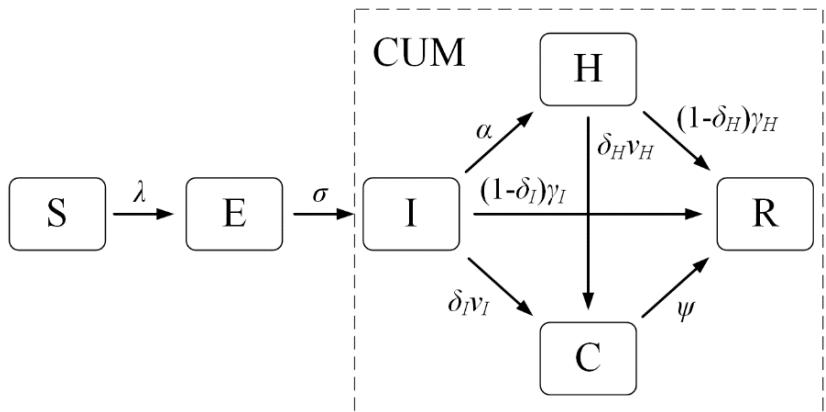
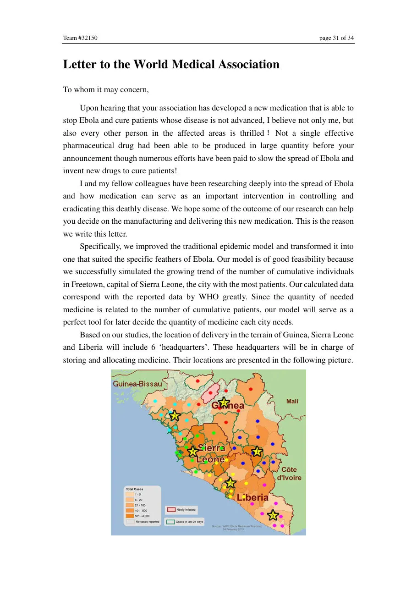

# 2015年美国大学生数学建模竞赛（MCM/ICM）特等奖论文：如何根除埃博拉病毒

原件为竞赛论文。补充：文中的阅读练习及“参考解答”为整理时增加，原件图文保留出处。

本文档整理了 2015 年 MCM/ICM 特等奖论文《How to Eradicate Ebola?》的前三页内容，包括摘要、目录及引言部分。

## Summary Sheet

**Problem Chosen:** A

The breakout of Ebola in 2014 triggered global panic. How to control and eradicate Ebola has become a universal concern ever since.

Firstly, we build up an epidemic model SEIHCR (CT) which takes the special features of Ebola into consideration. These are treatment from hospital, infectious corpses and intensified contact tracing. This model is developed from the traditional SEIR model. The model’s results (Fig.4,5,6), whose parameters are decided using computer simulation, match perfectly with the data reported by WHO, suggesting the validity of our improved model.

Secondly, pharmaceutical intervention is studied thoroughly. The total quantity of the medicine needed is based on the cumulative number of individuals CUM (Fig.7). Results calculated from the WHO statistics and from the SEIHCR (CT) model show only minor discrepancy, further indicating the feasibility of our model. In designing the delivery system, we apply the weighted Fuzzy c-Means Clustering Algorithm and select 6 locations (Fig.10, Table.2) that should serve as the delivery centers for other cities. We optimize the delivery locations by each city’s location and needed medicine. The percentage each location shares is also figured out to facilitate future allocation (Table.3,4). The average speed of manufacturing should be no less than $10^{6.2}$ unit dose per day and an increase in the manufacturing speed and the efficacy of medicine will reinforce the intervention effect.

Thirdly, other critical factors besides those discussed early in the model, safer treatment of corpses, and earlier identification/isolation also prove to be relevant. By varying the value of parameters, we can project the future CUM . Results (Fig.12,13) show that these interventions will help reduce CUM to a lower plateau at a faster speed.

We then analyze the factors for controlling and the time of eradication of Ebola. For example, when the rate of the infectious being isolated is 33% - 40%, the disease can be successfully controlled (Table.5). When the introduction time for treatment decreases from 210 to 145 days, the eradication of Ebola arrives over 200 days earlier.

Finally, we select three parameters: the transmission rate, the incubation period and the fatality rate for sensitivity analysis.

Key words: Ebola, epidemic model, cumulative cases, Clustering Algorithm

## Contents

1. Introduction....1
    1.1. Problem Background....1
    1.2. Previous Research....2
    1.3. Our Work....2
2. General Assumptions....3
3. Notations and Symbol Description....4
    3.1. Notations....4
    3.2. Symbol Description....4
4. Spread of Ebola....5
    4.1. Traditional Epidemic Model....5
        4.1.1. The SEIR Model....5
        4.1.2. Outbreak Data....6
        4.1.3. Results of the SEIR Model....7
    4.2. Improved Model....8
        4.2.1. The SEIHCR (CT) Model....8
        4.2.2. Choosing Parameters....10
        4.2.3. Results of the SEIHCR (CT) Model....11
5. Pharmaceutical Intervention....13
    5.1. Total Quantity of the Medicine....13
        5.1.1. Results from WHO Statistics....13
        5.1.2. Results from the SEIHCR (CT) Model....15
    5.2. Delivery System....15
        5.2.1. Locations of Delivery....16
        5.2.2. Amount of Delivery....19
    5.3. Speed of Manufacturing....20
    5.4. Medicine Efficacy....21
6. Other Important Interventions....21
    6.1. Safer Treatment of Corpses....21
    6.2. Intensified Contact Tracing and Earlier Isolation....22
    6.3. Conclusion....24
7. Control and Eradication of Ebola....24
    7.1. How Ebola Can Be Controlled....24
    7.2. When Ebola Will Be Eradicated....26
8. Sensitivity Analysis....27
    8.1. Impact of Transmission Rate $\beta_{I}$ ....27
    8.2. Impact of the Incubation Period $1 / \sigma$ ....28
    8.3. Fluctuation of $\delta_{H}$ ....28
9. Strengths and Weaknesses....29
    9.1. Strengths....29
    9.2. Weaknesses....30
    9.3. Future Work....30
Letter to the World Medical Association....31
References.....33

## 1. Introduction

### 1.1. Problem Background

Ebola virus disease (EVD), formerly known as Ebola haemorrhagic fever, is a severe, often fatal illness in humans. The current outbreak in West Africa, (first cases notified in March 2014), is the largest and most complex Ebola outbreak since the Ebola virus was first discovered in 1976. There have been more cases and deaths in this outbreak than all others combined. It started in Guinea and later spread across land borders to Sierra Leone and Liberia[1]. The current situation in the most affected countries can be seen clearly by the latest outbreak situation graph released by the World Health Organization (WHO).

Ebola was first transmitted from fruit bats to the human population. It can now spread from human to human via direct contact with the blood, secretions, organs or other bodily fluids of infected people, and with surfaces and materials contaminated with these fluids. Burial ceremonies can also play a role in the transmission of Ebola because the virus can also be transmitted through the body of the deceased person[1].

Control of outbreaks requires coordinated medical services, alongside a certain level of community engagement. The medical services include rapid detection of cases of disease, contact tracing of those who have come into contact with infected individuals, quick access to laboratory services, proper healthcare for those who are infected, and proper disposal of the dead through cremation or burial[1],[2]. There are lots of different experimental vaccines and drug treatments for Ebola under development, tested both in the lab and in animal populations, but they have not yet been fully tested for safety or effectiveness[3], [4]. In the summer of 2014, the World Health Organization claimed fast-tracking testing was ethical in light of the epidemic[4]. In fact, the first batch of an experimental vaccine against Ebola have already been sent to Liberia in January 2015. According to the Dr Moncef Slaoui of British production company GlaxoSmithKline, the initial phase is encouraging and encourages them to progress to the next phases of clinical testing[5].

# 2015年美国大学生数学建模竞赛（MCM/ICM）特等奖论文：如何根除埃博拉病毒（习题）

本资料由识别工具读取《2015年美国大学生数学建模竞赛（MCM/ICM）特等奖论文》第4-5页内容整理而成，主要包含文献综述、作者工作及一般假设部分。

## 一、文献综述与研究背景

知识点：[文献综述与研究背景撰写方法](../../../topics/数学建模/wenxian_zongshu.md)、[一般假设及其合理性说明（Assumptions and Justifications）](../../../topics/数学建模/jiaben_shezhi.md)、[SEIHCR(CT) 改进模型（引入医院H、尸体C、接触者追踪CT）](../../../topics/数学建模/seihcr_moxing.md)

### 选择 1
**题干：** 关于埃博拉病毒传播的研究中，Fisman等人使用了什么模型来描述流行病的增长和控制？

- A. SIR模型
- B. SEIR模型
- C. 双参数数学模型
- D. 基于移动数据的风险模型

答案：C。
知识点：[关键参数区域与临界条件分析（埃博拉何时能被根除）](../../../topics/数学建模/genchu_tiaojian.md)、[参数合理性验证](../../../topics/数学建模/canshu_heli_xing.md)

### 选择 2
**题干：** Gomes等人的研究得出的关于埃博拉国际传播风险的结论是什么？

- A. 国际传播风险非常大，远超非洲国内传播
- B. 国际传播风险相对较小，主要集中在西非国家内部
- C. 移动数据对传播风险没有影响
- D. 只有通过航空运输才会导致国际传播

答案：B。
知识点：[文献综述与研究背景撰写方法](../../../topics/数学建模/wenxian_zongshu.md)、[传统 SEIR 流行病模型（Susceptible-Exposed-Infectious-Recovered）](../../../topics/数学建模/seir_moxing.md)

### 简答 1
**题干：** 简述Chowell等人使用的SEIR模型与传统SIR模型的主要区别及其在埃博拉研究中的特殊性。

知识点：[关键参数区域与临界条件分析（埃博拉何时能被根除）](../../../topics/数学建模/genchu_tiaojian.md)、[传统 SEIR 流行病模型（Susceptible-Exposed-Infectious-Recovered）](../../../topics/数学建模/seir_moxing.md)

### 简答 2
**题干：** Valdez等人提出的模型发现，为了控制埃博拉疫情，最有效的干预措施是什么？

知识点：[参数合理性验证](../../../topics/数学建模/canshu_heli_xing.md)、[关键参数区域与临界条件分析（埃博拉何时能被根除）](../../../topics/数学建模/genchu_tiaojian.md)、[敏感性分析方法（Sensitivity Analysis，单参数与多参数变动）](../../../topics/数学建模/minganxing_fenxi.md)

### 简答 3
**题干：** 本文团队在构建模型时，除了考虑疾病传播外，还重点考虑了哪些关键因素？请列举至少三项。

知识点：[敏感性分析方法（Sensitivity Analysis，单参数与多参数变动）](../../../topics/数学建模/minganxing_fenxi.md)、[模型参数的确定（基于数据拟合或实验选择）](../../../topics/数学建模/canshu_queding.md)、[参数合理性验证](../../../topics/数学建模/canshu_heli_xing.md)

### 计算 1
**题干：** 团队在预测几内亚、塞拉利昂和利比里亚的药物需求量时，设定了两个关键参数作为标准。请写出这两个参数。

知识点：[模型参数的确定（基于数据拟合或实验选择）](../../../topics/数学建模/canshu_queding.md)、[药物干预模型（开发疫苗提高治愈率、降低死亡率）](../../../topics/数学建模/yaowu_ganyu.md)

### 综合 1
**题干：** 团队在确定药物配送地点时采用了什么算法？最终选择了多少个配送点？这些配送点的功能是什么？

知识点：[模糊 C-均值聚类算法（目标函数、约束条件与迭代步骤）](../../../topics/数学建模/mohu_c_junzhi.md)、[符号说明与术语定义（Nomenclature / Symbols and Definitions）](../../../topics/数学建模/fuhao_shuoming.md)

### 填空 1
**题干：** 假设新生儿的人口数量______计入总人口数中。（填“不”或“已”）

答案：不。
知识点：[数学建模的基本步骤（问题分析、模型假设、建立、求解、检验、推广）](../../../topics/数学建模/jianmo_buzhou.md)、[一般假设及其合理性说明（Assumptions and Justifications）](../../../topics/数学建模/jiaben_shezhi.md)、[文献综述与研究背景撰写方法](../../../topics/数学建模/wenxian_zongshu.md)

### 填空 2
**题干：** 一个暴露于病毒的个体将进入______期，此时尚未表现出症状。

答案：潜伏（incubation）。
知识点：[一般假设及其合理性说明（Assumptions and Justifications）](../../../topics/数学建模/jiaben_shezhi.md)、[符号说明与术语定义（Nomenclature / Symbols and Definitions）](../../../topics/数学建模/fuhao_shuoming.md)、[传统 SEIR 流行病模型（Susceptible-Exposed-Infectious-Recovered）](../../../topics/数学建模/seir_moxing.md)

### 假设条件

- 康复患者不会再次感染。
- 药物仅在医院提供。
- 几内亚、塞拉利昂和利比里亚境内的任何地点均可被选为配送中心，城市之间的配送路线为直线。
- 药物和疫苗可以跨境运输。

知识点：[一般假设及其合理性说明（Assumptions and Justifications）](../../../topics/数学建模/jiaben_shezhi.md)

### 定义描述

**易感个体 [12]：** 出现与埃博达出血热（EVD）兼容的临床症状，且在发病前21天内，具有下列情况之一的人员：

- 有疫区旅行史；或
- 与疑似或确诊病例有直接接触；或
- 接触了受EVD感染的血液或其他体液或组织；或
- 直接处理来自埃博拉疫区的蝙蝠、啮齿动物或灵长类动物；或
- 准备或食用来自埃博拉疫区的丛林肉（bush meat）。

**暴露个体 [14]：** 已被埃博拉病毒感染但尚未具备传染性或出现症状的人员。

**基本再生数 [6]：** 在完全易感人群中且无控制干预措施的情况下，一个典型感染者在其整个感染病程中引起的二代病例的平均数量。

**接触者追踪 [15]：** 找出所有与患病埃博拉患者有直接接触的人。从最后一次接触埃博拉患者之日起，对接触者进行21天的疾病监测。如果接触者出现发热或其他埃博拉症状，立即将其隔离、检测、提供护理，然后循环重新开始——找到所有新患者的接触者并观察21天。

知识点：[符号说明与术语定义（Nomenclature / Symbols and Definitions）](../../../topics/数学建模/fuhao_shuoming.md)、[基本再生数 R0 的估计方法](../../../topics/数学建模/r0_guji.md)、[考虑尸体、医院和接触者追踪的原因阐述](../../../topics/数学建模/shi_ti_yiyuan.md)

### 符号描述

| 符号 | 描述 |
| :--- | :--- |
| $R_0$ | 基本再生数 |
| $N$ | 总人口规模 |
| $S(t)$ | $t$ 时刻疑似个体数量 |
| $E(t)$ | $t$ 时刻暴露个体数量 |
| $I(t)$ | $t$ 时刻医院外传染个体数量 |
| $H(t)$ | $t$ 时刻住院个体数量 |
| $C(t)$ | $t$ 时刻受污染尸体数量 |
| $R(t)$ | $t$ 时刻移除个体数量 |
| $CUM(t)$ | $t$ 时刻累积个体数量 |
| $(\beta_I, \beta_H, \beta_C)$ | 传播率（医院外、医院内、通过尸体） |
| $1/\sigma$ | 平均潜伏期持续时间 |
| $\alpha$ | 传染个体被识别/隔离的速率 |
| $(\gamma_I, \gamma_H)$ | 从症状发作到恢复的平均时间（医院外、医院内） |
| $(v_I, v_H)$ | 从症状发作到死亡的平均时间（医院外、医院内） |
| $(\delta_I, \delta_H)$ | 病死率（医院外、医院内） |
| $1/\psi$ | 尸体得到适当处理的平均时间 |
| $\kappa$ | 每个被识别/隔离的传染个体所追踪的平均接触者数量 |
| $(\pi_E, \pi_I)$ | 被追踪的接触者个体（暴露、传染）在未引起新病例的情况下被隔离的概率 |
| $(\omega_E, \omega_I)$ | 在被溯源病例被识别时，被追踪接触者个体为（暴露、传染）的概率与人口中随机个体为（暴露、传染）的概率之比 |

## 四、埃博拉的传播

知识点：[符号说明与术语定义（Nomenclature / Symbols and Definitions）](../../../topics/数学建模/fuhao_shuoming.md)、[SEIHCR(CT) 改进模型（引入医院H、尸体C、接触者追踪CT）](../../../topics/数学建模/seihcr_moxing.md)、[基本再生数 R0 的估计方法](../../../topics/数学建模/r0_guji.md)

### 4.1 传统流行病模型

#### 4.1.1 SEIR 模型

埃博拉病毒（EBOV）的传播遵循 SEIR（易感-暴露-传染-移除）动力学，可以用以下常微分方程组描述 [10]：

$$
\left\{ \begin{array}{l} \dot {S} (t) = - \beta S (t) I (t) / N, \\ \dot {E} (t) = \beta S (t) I (t) / N - \sigma E (t), \\ \dot {I} (t) = \sigma E (t) - \gamma I (t), \\ \dot {R} (t) = \gamma I (t), \\ C \dot {U} M (t) = \sigma E (t), \end{array} \right.\tag{4.1}
$$

其中：

- $S(t)$ 是 $t$ 时刻易感个体的数量，
- $E(t)$ 是 $t$ 时刻暴露个体的数量，
- $I(t)$ 是 $t$ 时刻传染个体的数量，
- $R(t)$ 是 $t$ 时刻移除个体的数量，
- $CUM(t)$ 是从症状发作开始计算的埃博拉病例累积数量，
- $N$ 是总人口规模，
- $1 / \sigma$ 是平均潜伏期持续时间，
- $1 / \gamma$ 是平均传染期持续时间，
- $\beta$ 是每个每人每天的传播率。在没有控制干预措施的情况下，$\beta$ 是常数。然而，在 $t \geq \tau$ 时引入控制措施后，假设 $\beta$ 以速率 $k$ [16] 指数衰减。即：

$$
\beta (t) = \left\{ \begin{array}{l l} \beta_ {0} & t <   \tau , \\ \beta_ {0} e ^ {- k (t - \tau)} & t \geq \tau , \end{array} \right.\tag{4.2}
$$

*(注：原文公式(4.2)中指数部分识别为 `(1 - τ)`，根据上下文逻辑及标准衰减模型修正为 `(t - τ)`)*

#### 4.1.2 爆发数据

2014年EBOV爆发中受影响最严重的国家是几内亚、塞拉利昂和利比里亚。因此，我们主要使用SEIR模型来估算这三个国家的累积病例数。估算所需的数据可以从美国疾病控制与预防中心（CDC）[17]获得，该机构整理了世界卫生组织（WHO）从2014年3月1日到最新一份（2015年2月4日）的所有情况报告 [18] 提供的信息。数据包括报告的总病例数（确诊、可能和疑似）和死亡人数。

为了验证SEIR模型在2014年EBOV传播中的有效性，我们需要将几内亚、塞拉利昂和利比里亚的实际病例和死亡数据与模型计算数据进行比较。并且我们需要先设置一些参数的值以进行计算。

**表 1. 2014年EBOV爆发的参数估计**

| 参数 | 几内亚 | 塞拉利昂 | 利比里亚 |
| :--- | :--- | :--- | :--- |
| 基本再生数, $R_0$ | 1.51 | 2.53 | 1.59 |
| 无控制干预时的传播率 $β_0$ | 0.27 | 0.45 | 0.28 |
| 降低传播率, k | 0.048 | 0.048 | 0.048 |
| 总人口规模, N | 12,000,000 | 6,100,000 | 4,092,310 |

## 四、模型建立与求解（续）

知识点：[传统 SEIR 流行病模型（Susceptible-Exposed-Infectious-Recovered）](../../../topics/数学建模/seir_moxing.md)、[模型参数的确定（基于数据拟合或实验选择）](../../../topics/数学建模/canshu_queding.md)、[一般假设及其合理性说明（Assumptions and Justifications）](../../../topics/数学建模/jiaben_shezhi.md)

### 计算 1

基本再生数 $R_0$ 由 $R_0 = \beta / \gamma$ 给出，其中 $1/\gamma = 5.61$ 天是 Chowell 等人$^{[10]}$研究中的感染持续时间。此外，$1/\gamma = 5.61$，$1/\sigma = 5.3$ 是 1995 年刚果同一 EBOV 疫情潜伏期的平均持续时间$^{[10]}$。其他参数的估计值$^{[11]}$列于表 1。

首先，将参数代入式 (4.1)，我们能够计算这三个国家的估计病例数和死亡数，即能够预测疾病的传播。然后，通过将计算结果与报告数据进行比较，我们能够验证 SEIR 模型的有效性。

知识点：[模型参数的确定（基于数据拟合或实验选择）](../../../topics/数学建模/canshu_queding.md)、[药物干预模型（开发疫苗提高治愈率、降低死亡率）](../../../topics/数学建模/yaowu_ganyu.md)

### 4.1.3 SEIR 模型的结果

累计感染病例数和死亡数的实际数据如虚线所示，这些数据与 WHO 疫情报告$^{[18]}$中的数据拟合。2014 年 3 月 1 日定义为第 1 天，图中一个叉号代表累计数的一次统计。计算数据通过求解式 (4.1) 得到。

从上图可以看出，模型对这三个国家的病例和死亡报告数据拟合得非常好。因此，SEIR 可以作为分析 2014 年 EBOV 疫情传播的良好工具。

知识点：[传统 SEIR 流行病模型（Susceptible-Exposed-Infectious-Recovered）](../../../topics/数学建模/seir_moxing.md)、[模型参数的确定（基于数据拟合或实验选择）](../../../topics/数学建模/canshu_queding.md)、[模型验证方法概述（随机模型与确定性模型验证）](../../../topics/数学建模/moxing_yanzheng.md)

### 4.2 改进模型

知识点：[传统 SEIR 流行病模型（Susceptible-Exposed-Infectious-Recovered）](../../../topics/数学建模/seir_moxing.md)、[考虑尸体、医院和接触者追踪的原因阐述](../../../topics/数学建模/shi_ti_yiyuan.md)、[关键参数区域与临界条件分析（埃博拉何时能被根除）](../../../topics/数学建模/genchu_tiaojian.md)

### 4.2.1 SEIHCR（CT）模型

SEIR 是预测疾病传播的基本模型。然而，对于埃博拉的具体情况，我们必须考虑其他重要因素。我们主要考虑了：

1）传染性尸体带来的潜在威胁以及医院护理的提供；

2）接触者追踪（CT）的参与。

图 3 展示了改进模型 SEIHCR（CT）的示意图，并标明了各仓室状态及状态间的转移率。

传统模型 SEIR 应予以修改$^{[20],[23]}$，改进后的 SEIHCR（CT）模型可写为

$$
\left\{ \begin{array}{l} \dot {S} (t) = - \beta_ {I} S (t) I (t) / N - \beta_ {H} S (t) H (t) / N - \beta_ {C} S (t) C (t) / N, \\ \dot {E} (t) = \beta_ {I} S (t) I (t) / N + \beta_ {H} S (t) H (t) / N + \beta_ {C} S (t) C (t) / N - \sigma E (t) \\ \qquad - \kappa (\alpha I (t) + \psi C (t)) \pi_ {E} \omega_ {E} (E (t) / N), \\ \dot {I} (t) = \sigma E (t) - \alpha I (t) - (1 - \delta_ {I}) \gamma_ {I} I (t) - \delta_ {I} \nu_ {I} I (t) \\ \qquad - \kappa (\alpha I (t) + \psi C (t)) \pi_ {I} \omega_ {I} (I (t) / N), \\ \dot {H} (t) = \alpha I (t) - (1 - \delta_ {H}) \gamma_ {H} H (t) - \delta_ {H} \nu_ {H} H (t), \\ \dot {C} (t) = \delta_ {I} \nu_ {I} I (t) + \delta_ {H} \nu_ {H} H (t) - \psi C (t), \\ \dot {R} (t) = (1 - \delta_ {I}) \gamma_ {I} I (t) + (1 - \delta_ {H}) \gamma_ {H} H (t) + \psi C (t), \end{array} \right.\tag{4.3}
$$

其中：

$S(t)$ 为 $t$ 时刻易感个体数，

$E(t)$ 为 $t$ 时刻暴露个体数，

$I(t)$ 为 $t$ 时刻院外传染性个体数，

$H(t)$ 为 $t$ 时刻住院个体数，

$C(t)$ 为 $t$ 时刻受污染的尸体数，

$R(t)$ 为 $t$ 时刻移除个体数，

$CUM(t)$ 为自症状出现起的埃博拉累计病例数。

$\beta_I$ 为院外传播率，

$\beta_H$ 为院内传播率，

$\beta_C$ 为尸体处理不当导致的传播率，

$\lambda = \beta_I \frac{I(t)}{N} + \beta_H \frac{H(t)}{N} + \beta_C \frac{C(t)}{N}$ 为总传播率，

$1/\sigma$ 为平均潜伏期，

$\alpha$ 为传染性个体被识别/隔离的速率，

$1/\gamma_H$ 为院内从症状出现到康复的平均时间，

$1/\nu_H$ 为院内从症状出现到死亡的平均时间，

$\delta_H$ 为院内病死率，

$1/\gamma_I$ 为院外从症状出现到康复的平均时间，

$1/\nu_I$ 为院外从症状出现到死亡的平均时间，

$\delta_I$ 为院外病死率，

$1/\psi$ 为尸体得到妥善处理的平均时间，

$\kappa$ 为每个被识别/隔离的传染性个体平均追踪的接触者数，

$\pi_E$ 为被追踪的暴露接触者被隔离且不引起新病例的概率。

# 2015年美国大学生数学建模竞赛（MCM/ICM）特等奖论文：如何根除埃博拉病毒

整理自《2015年美国大学生数学建模竞赛（MCM/ICM）特等奖论文：如何根除埃博拉病毒》第 5 部分（共 12 部分），对应原稿第 12–15 页内容。

## 一、考虑尸体、医院和接触者追踪的原因

知识点：[SEIHCR(CT) 改进模型（引入医院H、尸体C、接触者追踪CT）](../../../topics/数学建模/seihcr_moxing.md)、[考虑尸体、医院和接触者追踪的原因阐述](../../../topics/数学建模/shi_ti_yiyuan.md)、[符号说明与术语定义（Nomenclature / Symbols and Definitions）](../../../topics/数学建模/fuhao_shuoming.md)

### 原因阐述

首先，为受影响人群提供医院护理[19]可以作为治疗患者并防止疾病大规模传播的基础。此外，如果规范葬礼和埋葬仪式[19]，将降低因处理不当的感染者尸体（受污染的死者）而被感染的风险。

其次，接触者追踪有时被视为遏制西非埃博拉疫情的关键因素，因为如果能在患者病程早期发现患者，他们暴露于家庭成员和社区医护人员的机会将显著减少[21]。

公式 (4.3) 是从原始 SEIR 模型改进而来的，也是我们的最终模型。我们将其命名为 SEIHCR (CT) 模型，以说明其相对于传统 SEIR 模型的改进和差异。从 SEIR 到 SEIHCR (CT) 的转变展示了基本模型如何基于其他因素以及我们对这个问题的理解得到极大改善。

## 二、参数选择

知识点：[考虑尸体、医院和接触者追踪的原因阐述](../../../topics/数学建模/shi_ti_yiyuan.md)、[SEIHCR(CT) 改进模型（引入医院H、尸体C、接触者追踪CT）](../../../topics/数学建模/seihcr_moxing.md)

### 1. $R_0$ 的估计

为了获得基本再生数 $R_0$，我们采用 van den Driessche 等人提出的方法[22]：

$$
R _ {0} = \rho (F V ^ {- 1}),\tag{4.5}
$$

其中：

- $\rho ( A )$ 表示矩阵 A 的谱半径，
- $F$ 是新感染出现的速率，
- $V$ 是通过所有其他手段转移个体的速率。

与 SEIHCR (CT) 模型对应的 F 和 V 分别为：

$$
F = \left( \begin{array}{c} - \left(\beta_ {I} S I / N + \beta_ {H} S H / N + \beta_ {C} S C / N\right) \\ \beta_ {I} S I / N + \beta_ {H} S H / N + \beta_ {C} S C / N \\ 0 \\ 0 \\ 0 \\ 0 \\ 0 \end{array} \right), V = \left( \begin{array}{c} 0 \\ - \sigma E \\ \sigma E - \alpha I - \gamma_ {I} I - \nu_ {I} I \\ \alpha I - \gamma_ {H} H - \nu_ {H} H \\ \nu_ {I} I + \nu_ {H} H - \psi C \\ \gamma_ {I} I + \gamma_ {H} H + \psi C \end{array} \right).
$$

知识点：[基本再生数 R0 的估计方法](../../../topics/数学建模/r0_guji.md)、[SEIHCR(CT) 改进模型（引入医院H、尸体C、接触者追踪CT）](../../../topics/数学建模/seihcr_moxing.md)、[确定模型的定点与稳定性分析](../../../topics/数学建模/dingdian_wending.md)

### 2. 其他参数的确定

参数 $\beta _ { I } , \beta _ { H } , \beta _ { C } , \alpha$ 和 $\psi$ 的值是使用最小二乘曲线拟合算法针对三个国家估算得出的。参数 $\sigma , \gamma _ { I } , \gamma _ { H } , \nu _ { I } , \nu _ { H } , \delta _ { I }$ 和 $\delta _ { \scriptscriptstyle H }$ 借鉴现有参考文献[11]。

SEIHCR (CT) 模型的基本再生数由以下公式给出，通过下一代法计算：

$$
R _ {0} = \frac {\beta_ {I}}{\alpha + (1 - \delta_ {I}) \gamma_ {I} + \delta_ {I} \nu_ {I}} + \frac {\beta_ {H}}{(1 - \delta_ {H}) \gamma_ {H} + \delta_ {H} \nu_ {H}} + \frac {\beta_ {C}}{\psi}.\tag{4.6}
$$

在所有这些参数中，$\beta _ { \iota }$ 在没有控制干预的情况下是恒定的，就像 SEIR 模型中的 $\beta$ 一样。在时间 $t \geq \tau$ 引入控制措施后，假设 $\beta _ { \iota }$ 以速率 $k$ 指数衰减[16]。即：

$$
\beta_ {I} (t) = \left\{ \begin{array}{l l} \beta_ {I 0} & t <   \tau , \\ \beta_ {I 0} e ^ {- k (1 - \tau)} & t \geq \tau , \end{array} \right.\tag{4.7}
$$

由于 k 和 $\gamma _ { H }$ 都与药物疗效有关，我们假设它们的关系为：

$$
\gamma_ {H} = \theta k,\tag{4.8}
$$

其中根据经验，假设 $\theta$ 为 3.2。

知识点：[模型参数的确定（基于数据拟合或实验选择）](../../../topics/数学建模/canshu_queding.md)、[基本再生数 R0 的估计方法](../../../topics/数学建模/r0_guji.md)、[一般假设及其合理性说明（Assumptions and Justifications）](../../../topics/数学建模/jiaben_shezhi.md)

### 2.1.1. SEIHCR (CT) 模型的结果

同样，我们用虚线代表 WHO 情况报告中找到的累计数的实际数据[18]，用实线代表我们从 SEIHCR (CT) 模型的 Equation (4.3) 计算出的数字。模拟的开始日定义为第 1 天1st。

这些模拟是通过改变参数的组合完成的。与基于 SEIR 模型的模拟相比，我们可以看到使用 SEIHCR (CT) 模型获得了更好的拟合，因为计算出的数据变得更加平滑，并且更接近报告的 actual data，其中塞拉利昂的模拟几乎是完美的近似。

## 三、药物干预

如果患者和健康人能够获得药物和疫苗，患者的存活率将会提高，受影响国家的状况也将大大改善。因此，药物的制造和配送应成为抗击埃博拉的重要因素。我们的任务是计算药物的总量，设计有利的配送系统，并比较不同制造速度和不同药物疗效水平的干预程度。

知识点：[SEIHCR(CT) 改进模型（引入医院H、尸体C、接触者追踪CT）](../../../topics/数学建模/seihcr_moxing.md)、[药物干预模型（开发疫苗提高治愈率、降低死亡率）](../../../topics/数学建模/yaowu_ganyu.md)、[物资配送与制造速度模型（药物每日需求与总量计算）](../../../topics/数学建模/wuzi_peisong.md)

### 1. 药物总量

#### 1.1. 来自 WHO 统计的结果

当药物即将运送到埃博拉受影响地区时，显然，人们应该首先分析当前情况的严重程度，以决定药物的数量。然而，仅了解当前情况是不够的。我们还应考虑病毒的传播速度，因为快速传播构成巨大的潜在威胁。因此，在决定所需药物数量时，我们考虑了两个重要因素：

1) The current cumulative number of patients $C U M _ {p}$ ;

2) The increasing rate of the disease .

WHO has been releasing a weekly report of newly confirmed cases by district, which represent the sum of new patients$^{[24]}$ $S U M _ {n e w }$ . Divide $S U M _ {n e w }$ by the duration period $T ( T = 7$ in this case since the report is released every week) and we will get the increasing rate of the disease v . Meanwhile, by adding the newly infected cases, we can know the current cumulative patients $C U M _ {p }$ as well.

By far, we have gathered all the information that we need to calculate the quantity of the medicine. By adding the current cumulative number of patients and the increasing rate of the disease (we place equal weights on these two factors), we can obtain the unit dose of the medicine needed every day D for each city and

$$
D = C U M _ {p} + \upsilon \times T.\tag{5.1}
$$

Due to the extremely large amount of statistics for both the number of cities (56 cities) and the duration of the reported data (57 weeks till Feb 1$^{st}$, 2015), the concrete data and calculated value will not be presented. Instead, we drew a graph that illustrates the units of medicine needed by these three countries from Dec $3 0 ^ { t h } .$ , 2013 to Jan $3 1 ^ { s t }$ 2015.

In the figure above, the blue, orange and green curve represents the unit dose of medicine needed per day by patients in Guinea, Liberia and Sierra Leone respectively. The grey area represents the combined doses needed by the three countries altogether.

Since no effective medicine has been developed and distributed in a large scale, the specific dose of medicine one patient needs is nowhere to be found. Therefore, we use the unit dose instead. It also perfectly reflects the quantity of needed medicine.

知识点：[模型参数的确定（基于数据拟合或实验选择）](../../../topics/数学建模/canshu_queding.md)、[一般假设及其合理性说明（Assumptions and Justifications）](../../../topics/数学建模/jiaben_shezhi.md)、[文献综述与研究背景撰写方法](../../../topics/数学建模/wenxian_zongshu.md)

### 5.1.2. Results from the SEIHCR (CT) Model

As is mentioned before, there are so many cities that if we calculate every city’s need from the improved model, there will be too much work. Therefore, we only take one city as an example to test the feasibility of our model and we choose the capital of Sierra Leone, Freetown because this city has the largest number of cumulative patients.

The number of patients of Freetown can be calculated from the improved model and after $C U M _ {p }$ is obtained, we can also know the increasing rate . Applying these to Equation (5.1) and we will get the quantity of needed medicine per day D .

The left graph in Figure 8 presents the changes of the cumulative numbers with time in Freetown. The grey curve in the right graph represents the every day’s unit dose of needed medicine and the shaded area represents the total quantity of needed medicine. Beside these, we also compared the result from the SEIHCR (HC) model and the result fitted by WHO statistics (the solid curve). We can see that these two results match and the discrepancies are within the acceptable range.

To conclude, SEIHCR (HC) can serve as a feasible model for both predicting the cumulative patients and figuring the quantity of needed medicine.

知识点：[SEIHCR(CT) 改进模型（引入医院H、尸体C、接触者追踪CT）](../../../topics/数学建模/seihcr_moxing.md)、[模型参数的确定（基于数据拟合或实验选择）](../../../topics/数学建模/canshu_queding.md)、[物资配送与制造速度模型（药物每日需求与总量计算）](../../../topics/数学建模/wuzi_peisong.md)

### 5.2. Delivery System

The medicine and vaccines of Ebola are manufactured in developed countries like USA and UK. Therefore, it is not difficult to determine the locations that are in charge of loading drugs and vaccines. It is in fact the amount of medicine and the places that the airplanes are headed to are the most difficult part to decide for the delivery system.

Hence, to design the delivery system of medicine and vaccines, we divided our task into two parts:

1) Deciding the locations for receiving drugs;

2) Calculating the amount of drugs these locations need respectively.

知识点：[任务分解与目标明确](../../../topics/数学建模/renwu_fenjie.md)、[配送地点选址模型（公平原则与效率原则）](../../../topics/数学建模/peisong_xuanzhi.md)

### 5.2.1. Locations of Delivery

To transport the drugs and vaccines to the three most affected West African countries: Guinea, Sierra Leone and Liberia, we should first find several places to store the drugs. These places will also be responsible for delivering medicine to a few places next to them. In other words, we will first find some ‘headquarters’ for storage. Then we will determine from which one of these headquarters other cities will receive the drugs.

We now need to divide these three countries into several parts and we use the Fuzzy c- Means Clustering Algorithm to accomplish this goal.

#### The Weighted Fuzzy c- Means Clustering Algorithm:

The Weighted Fuzzy c- Means Clustering Algorithm differs from the traditional Fuzzy c- Means Clustering Algorithm in that it considers $D _ { k }$ , the quantity of medicine needed by each city.

The key of Fuzzy c- Means Clustering Algorithm is to represent the similarity a point shares with each cluster with a function whose values (memberships) are between zero and one$^{[25]}$. Each sample will have a membership in every cluster, memberships close to unity signify a high degree of similarity between the sample and the cluster while memberships close to zero imply little similarity between the sample and that cluster$^{[25]}$.

Let $Y = \left\{ y _ { k } , k = 1 , 2 , \cdots N \right\}$ be a sample of N observations in $\mathbb{R}^n$ ($n$ - dimensional Euclidean space), $y _ { k } = \left[ y _ {k 1 } , y _ {k 2 } , \cdots , y _ {k n } \right]$ being a n- dimensional vector, and $U$ be a real $c \times N$ matrix, $U = \left[ u _ {i k } \right]$ . U is the matrix representation of the partition $\left\{ Y _ { i } \right\}$ and the elements satisfy

$$
\sum_ {i = 1} ^ {n} u _ {i k} = 1 \text {   for   all   } k,\tag{5.2}
$$

we denote the sets of all fuzzy c-partitions of Y by $M _ { f c } = \left\{ U _ { c \times N } \ : \vert \ : u _ {i k } \in [ 0 , 1 ] \right\}$

The most popular and well-studied clustering criteria for identifying optimal fuzzy c- partitions in Y is associated with the generalized least-squared errors functional. After weights, the quantity of medicine needed by each city, have been applied, the generalized least-squared errors functional can be written as

## 5.2 模糊 C-均值聚类模型

本部分建立基于加权距离的模糊 C-均值聚类（Fuzzy c-Means Clustering）目标函数，并给出其迭代求解算法及参数确定方法。

知识点：[模糊 C-均值聚类算法（目标函数、约束条件与迭代步骤）](../../../topics/数学建模/mohu_c_junzhi.md)、[配送地点选址模型（公平原则与效率原则）](../../../topics/数学建模/peisong_xuanzhi.md)

### 目标函数与约束条件

定义目标函数 $J_m(U, v)$ 为：

$$
\min J _ {m} (U, v) = \sum_ {k = 1} ^ {N} \sum_ {i = 1} ^ {c} D _ {k} \left(u _ {i k}\right) ^ {m} \left\| y _ {k} - v _ {i} \right\| ^ {2},
$$

约束条件如下：

$$
\text { s.t. } \left\{ \begin{array}{l} c <   c _ {\max}, \\ y _ {k i \min} <   y _ {k i} <   y _ {k i \max}, \end{array} \right.\tag{5.3}
$$

其中各变量含义如下：

*   $Y = \left\{y _ {1}, y _ {2}, \dots y _ {N} \right\} \in R ^ {n}$：数据集；
*   $c$：$Y$ 中的聚类数量，满足 $2 \leq c < n$；
*   $m$：加权指数，满足 $1 \leq m <   \infty$；
*   $U$：$Y$ 的模糊 $c$-划分，$U \in M _ {f c}$；
*   $D_k$：城市 $k$ 所需的药品数量；
*   $v = \left\{v _ {1}, v _ {2}, \dots v _ {c} \right\}$：聚类中心向量集合；
*   $v _ {i} = \left\{v _ {i 1}, v _ {i 2}, \dots v _ {i n} \right\}$：第 $i$ 个聚类的中心。

$Y$ 的最优模糊聚类定义为使 $J _ { { _ m }}$ 局部最小化的对 $\left( \hat { U } , \hat { \nu } \right)$。当 $m > 1$ 且对于所有 $j$ 和 $k$ 均有 $y _ { k } \neq \hat { \nu } _ { j }$ 时，$\left( \hat { U } , \hat { \nu } \right)$ 为 $J _ { { _ m }}$ 的局部最优解的必要条件是：

$$
\hat {v} _ {i} = \frac {\sum_ {k = 1} ^ {N} D _ {k} \left(\hat {u} _ {i k}\right) ^ {m} y _ {k}}{\sum_ {k = 1} ^ {N} D _ {k} \left(\hat {u} _ {i k}\right) ^ {m}}, 1 \leq i \leq c,\tag{5.4}
$$

$$
\hat {u} _ {i k} = \left(\sum_ {j = 1} ^ {c} \left(\frac {d _ {i k}}{d _ {j k}}\right) ^ {2 / (m - 1)}\right) ^ {- 1} \quad 1 \leq k \leq N,   1 \leq i \leq c,\tag{5.5}
$$

其中 $\hat { d } _ { i k } = \lVert y _ { k } - \hat { \nu } _ { i } \rVert$。

知识点：[模糊 C-均值聚类算法（目标函数、约束条件与迭代步骤）](../../../topics/数学建模/mohu_c_junzhi.md)、[物资配送与制造速度模型（药物每日需求与总量计算）](../../../topics/数学建模/wuzi_peisong.md)

### 模糊 C-均值聚类算法步骤

利用公式 (5.4) 和 (5.5)，通过迭代优化 $J _ { { _ m }}$。一般流程如下：

1.  固定 $c$ 和 $m$。选择一个初始矩阵 ${ \cal U } ^ { ( 0 ) } \in { \cal M } _ { f c }$。在第 $k$ 步 ($k = 0, 1, \dots, N$)：
2.  使用公式 (5.4) 计算聚类中心 $\hat { \boldsymbol { \nu } } ^ { ( k ) }$，其中 $i = 1, 2, \dots, c$。
    *(注：原文此处引用可能有误，根据上下文逻辑，计算中心应使用式 5.4)*
3.  使用公式 (5.5) 计算更新后的隶属度矩阵 $\hat { U } ^ { \left( k + 1 \right) } = \left[ \hat { u } _ { i k } ^ { ( \mathrm { k + 1 ) } } \right]$。
    *(注：原文此处引用可能有误，根据上下文逻辑，计算隶属度应使用式 5.5)*
4.  在任意方便的矩阵范数下比较 $\hat { U } ^ { ( k + 1 ) }$ 和 $\hat { U } ^ { ( k ) }$。如果 $\left\| \hat { U } ^ { ( k + 1 ) } - \hat { U } ^ { ( k ) } \right\| < \varepsilon$，则停止。否则，设置 $\hat { U } ^ { ( k ) } = \hat { U } ^ { ( k + 1 ) }$ 并返回步骤 2)。

知识点：[模糊 C-均值聚类算法（目标函数、约束条件与迭代步骤）](../../../topics/数学建模/mohu_c_junzhi.md)、[数学建模的基本步骤（问题分析、模型假设、建立、求解、检验、推广）](../../../topics/数学建模/jianmo_buzhou.md)

### 参数选择与结果分析

在本案例中，设定加权指数 $m = 2$。

关于聚类数量 $c$ 的选择：总部数量既不能太多也不能太少，既要便于配送，又要防止配送任务过于繁重。具体确定 $c$ 值的方法是观察 $J _ { { _ m }}$ 随 $c$ 变化的曲线。随着聚类数量增加，$J _ { { _ m }}$ 必然减小。当 $c$ 从 1 增加到某个临界值 $c^*$ 时，$J _ { { _ m }}$ 急剧下降；而当 $c$ 继续增加时，下降速度变缓。曲线的拐点即为最终的聚类数量。

*(注：原图未提供，此处依据文字描述“inflection point”推断为肘部法则图示)*

根据上述原则及图表分析，选择 **6** 个聚类，即对应几内亚、塞拉利昂和利比里亚的所有城市设立 **6** 个总部是最优选择，这也符合我们的初始标准。

世界卫生组织（WHO）提供了这三个国家有患者城市的病例数据 [24]。利用这些数据，我们可以计算聚类中心 $\hat { \nu } ^ { ( k ) }$ 和隶属度矩阵 $\hat { U } ^ { ( k + 1 ) }$ 以执行算法。通过迭代，我们得到了配送地点的结果，展示如下：

# 2015年美国大学生数学建模竞赛（MCM/ICM）特等奖论文：如何根除埃博拉病毒

本部分为特等奖论文第8部分（共12部分），由识别工具读取并整理自第21–22页内容，主要涉及物资配送点选址、剂量分配及制造速度对病死率的影响。

## 二、物资配送与制造速度模型

知识点：[模糊 C-均值聚类算法（目标函数、约束条件与迭代步骤）](../../../topics/数学建模/mohu_c_junzhi.md)、[配送地点选址模型（公平原则与效率原则）](../../../topics/数学建模/peisong_xuanzhi.md)、[物资配送与制造速度模型（药物每日需求与总量计算）](../../../topics/数学建模/wuzi_peisong.md)

### 选择 1

**题干：**
在图中，6个黄色星星代表我们选择的6个储存药品的“总部”，为了方便后续讨论，它们被标记为1到6。这6个总部的地理位置如表2所示。

**参考解答：**
表2展示了6个配送点的地理坐标。其中，位置6的经度数据在原表中显示为 "10.5202 E"，但根据上下文其他位置均为西经（W）且该区域位于西非，结合常理及后续计算逻辑，此处极大概率为识别错误或原文笔误，应为西经。但在整理时保留原表数据特征，并在补充中说明。

**知识点：** 数据清洗

| Location | 1 | 2 | 3 | 4 | 5 | 6 |
| :--- | :--- | :--- | :--- | :--- | :--- | :--- |
| Latitude | 8.4897 N | 10.3315 N | 10.9935 N | 6.9627 N | 8.5729 N | 10.5202 E |
| Longitude | 9.1702 W | 13.4050 W | 10.8677 W | 10.5202 W | 12.4282 W | 8.3181 W |

*注：原表位置6纬度标注为E，疑为N之误；经度8.3181 W与其他西经数据一致。*

知识点：[关键参数区域与临界条件分析（埃博拉何时能被根除）](../../../topics/数学建模/genchu_tiaojian.md)、[参数合理性验证](../../../topics/数学建模/canshu_heli_xing.md)

### 简答 1

**题干：**
还有6组圆点，每组用不同的颜色区分。每组圆点将从其内部的总部接收药品和疫苗。也就是说，药品和疫苗将从6个黄色星星运送到周围特定颜色的圆点集合中。

**参考解答：**
此段描述了基于模糊C均值聚类算法（Fuzzy c-Means Clustering Algorithm）进行的区域划分结果。每个总部负责一个特定颜色的区域，实现了物流网络的初步分区管理。

**知识点：** 聚类分析

知识点：[关键参数区域与临界条件分析（埃博拉何时能被根除）](../../../topics/数学建模/genchu_tiaojian.md)、[传统 SEIR 流行病模型（Susceptible-Exposed-Infectious-Recovered）](../../../topics/数学建模/seir_moxing.md)

### 简答 2

**题干：**
应用模糊C均值聚类算法，我们得到了6个总部所需的单位药品剂量。我们使用4周作为一个周期，以减少需要统计的数据量。我们还汇总了单位剂量，以查看特定时间段内所需的药品总量。此外，还计算了分配给这6个总部的药品百分比，以便进一步配送。

**参考解答：**
表3展示了每4周为一个周期的药品需求量统计。数据涵盖了从2013年12月30日至2015年1月26日的时间段。最后一行“Percentage”显示了各总部在整个统计周期内的需求占比。

**知识点：** 时间序列分析

| Every 4 weeks | 1 | 2 | 3 | 4 | 5 | 6 | Sum |
| :--- | :--- | :--- | :--- | :--- | :--- | :--- | :--- |
| 2013/12/30 | 0 | 0 | 0 | 0 | 0 | 0 | 0 |
| 2014/1/27 | 0 | 0 | 0 | 0 | 0 | 0 | 0 |
| 2014/2/24 | 63 | 3 | 0 | 0 | 0 | 0 | 66 |
| 2014/3/24 | 158 | 99 | 9 | 3 | 0 | 0 | 269 |
| 2014/4/21 | 82 | 15 | 0 | 3 | 6 | 6 | 112 |
| 2014/5/19 | 193 | 145 | 3 | 290 | 12 | 0 | 643 |
| 2014/6/16 | 272 | 35 | 0 | 945 | 37 | 13 | 1302 |
| 2014/7/14 | 336 | 66 | 21 | 1719 | 248 | 41 | 2431 |
| 2014/8/11 | 1063 | 202 | 0 | 3038 | 1208 | 185 | 5696 |
| 2014/9/8 | 961 | 253 | 20 | 3208 | 3546 | 162 | 8150 |
| 2014/10/6 | 957 | 284 | 24 | 1345 | 4669 | 69 | 7348 |
| 2014/11/3 | 942 | 333 | 173 | 629 | 5219 | 43 | 7339 |
| 2014/12/1 | 625 | 672 | 49 | 58 | 4153 | 0 | 5557 |
| 2014/12/29 | 116 | 412 | 21 | 3 | 2059 | 0 | 2611 |
| 2015/1/26 | 31 | 66 | 9 | 0 | 5 | 0 | 111 |
| Percentage | 13.93% | 6.21% | 0.79% | 27.00% | 50.83% | 1.25% | 100% |

知识点：[参数合理性验证](../../../topics/数学建模/canshu_heli_xing.md)、[关键参数区域与临界条件分析（埃博拉何时能被根除）](../../../topics/数学建模/genchu_tiaojian.md)、[敏感性分析方法（Sensitivity Analysis，单参数与多参数变动）](../../../topics/数学建模/minganxing_fenxi.md)

### 简答 3

**题干：**
除了六个季度各自的药品需求量外，我们还按国家分类了所需药品。即，计算每个国家所需的特定药品数量，并计算出它们的百分比，以便进一步分配。

**参考解答：**
表4展示了几内亚（Guinea）、利比里亚（Liberia）和塞拉利昂（Sierra Leone）三个国家的药品需求量及其占比。数据显示塞拉利昂的需求占比最高，达到59.51%，其次是利比里亚（21.85%）和几内亚（18.64%）。

**知识点：** 数据可视化

| Every 4 weeks | Guinea | Liberia | Sierra Leone | Sum |
| :--- | :--- | :--- | :--- | :--- |
| 2013/12/30 | 0 | 0 | 0 | 0 |
| 2014/1/27 | 0 | 0 | 0 | 0 |
| 2014/2/24 | 64 | 2 | 0 | 66 |
| 2014/3/24 | 259 | 10 | 0 | 269 |
| 2014/4/21 | 91 | 15 | 6 | 112 |
| 2014/5/19 | 313 | 46 | 284 | 643 |
| 2014/6/16 | 165 | 282 | 855 | 1302 |
| 2014/7/14 | 197 | 907 | 1327 | 2431 |
| 2014/8/11 | 851 | 2856 | 1989 | 5696 |
| 2014/9/8 | 1138 | 3163 | 3849 | 8150 |
| 2014/10/6 | 1238 | 1170 | 4940 | 7348 |
| 2014/11/3 | 1445 | 622 | 5272 | 7339 |
| 2014/12/1 | 1346 | 23 | 4188 | 5557 |
| 2014/12/29 | 549 | 0 | 2062 | 2611 |
| 2015/1/26 | 106 | 0 | 5 | 111 |
| Percentage | 18.64% | 21.85% | 59.51% | 100.00% |

知识点：[敏感性分析方法（Sensitivity Analysis，单参数与多参数变动）](../../../topics/数学建模/minganxing_fenxi.md)、[模型参数的确定（基于数据拟合或实验选择）](../../../topics/数学建模/canshu_queding.md)、[参数合理性验证](../../../topics/数学建模/canshu_heli_xing.md)

### 计算 1

**题干：**
由于医院内的病死率 $\delta_H$ 很大程度上取决于可用药品的数量，如果制造速度 $u$ 大于每日所需药品量 $D$，我们假设病死率将达到最低值 $\delta_{H0}$。然而，如果制造速度 $u$ 小于每日所需药品量 $D$，需求将无法完全满足，从而导致病死率的增加。因此，$u$ 和 $\delta_H$ 满足以下方程：

$$
\delta_ {H} = \left\{ \begin{array}{l l} \rho_ {u} \cdot \frac {D - u}{D} + \delta_ {H 0}, & u < D, \\ \delta_ {H 0}, & u \geq D, \end{array} \right.\tag{5.6}
$$

其中 $\rho_u$ 是一个值为 0.7 的系数，最低病死率 $\delta_{H0} = 20\%$。

根据之前计算的药品剂量，平均每日所需药品量为 106.2 单位剂量。因此，如果制造速度 $u \geq 106.2$ 单位剂量/天，则病死率 $\delta_H = \delta_{H0} = 20\%$。然而，如果制造速度 $u < 106.2$ 单位剂量/天，假设 $u = 50$，则计算得出的病死率 $\delta_H$ 为 57.0%，这是一个巨大的增加。

**答案：**
公式推导正确，参数设定符合题意。
当 $u=50$ 时：
$$
\delta_H = 0.7 \cdot \frac{106.2 - 50}{106.2} + 0.20 = 0.7 \cdot \frac{56.2}{106.2} + 0.20 \approx 0.7 \cdot 0.5292 + 0.20 \approx 0.3704 + 0.20 = 0.5704 = 57.04\%
$$
结果约为 57.0%，与原文一致。

**知识点：** 分段函数建模

知识点：[模型参数的确定（基于数据拟合或实验选择）](../../../topics/数学建模/canshu_queding.md)、[药物干预模型（开发疫苗提高治愈率、降低死亡率）](../../../topics/数学建模/yaowu_ganyu.md)

### 5.4. Medicine Efficacy

Since $1 / \gamma _ { H }$ represents the average time from symptoms onset to recovery inside hospital, this is a parameter that is influenced greatly by the efficacy of medicine. If a medicine has a greater efficacy, the cure time will probably reduce. The relationship between $\gamma _ { H }$ and the efficacy of medicine is,

$$
\gamma_ {H} = \rho_ {\eta} \ln (\eta + 1),\tag{5.7}
$$

where $\rho _ { \eta }$ is a coefficient that has a value of 0.206. Therefore, by varying the value of $\gamma _ { H }$ (different values of $\eta$ at the same time), we can test how different values of $\gamma _ { H }$ affect the cumulative number of individuals CUM .

In Figure 11, five values have been set to $\gamma _ { \scriptscriptstyle H }$ . We can see that a larger $\gamma _ { \scriptscriptstyle H }$ , which in turn leads to a better medicine efficacy , will lead to a moderate drop in the cumulative number of individuals CUM .

## 6. Other Important Interventions

知识点：[药物干预模型（开发疫苗提高治愈率、降低死亡率）](../../../topics/数学建模/yaowu_ganyu.md)、[模型参数的确定（基于数据拟合或实验选择）](../../../topics/数学建模/canshu_queding.md)、[敏感性分析方法（Sensitivity Analysis，单参数与多参数变动）](../../../topics/数学建模/minganxing_fenxi.md)

### 6.1. Safer Treatment of Corpses

As can be seen from the comparison of the fitted statistics between the original SEIR model and the improved model that considers infectious corpses, better treatment of corpses remain a positive factor that will potentially help control the spread of Ebola. Since $1 / \psi$ is the average time until the deceased is properly handled, we can vary the value of $\psi$ to see if better treatment of corpses can serve as a potential intervention for Ebola.

We set the value of $\psi$ to be 2, 4, 6, 8, 10 and the value of $1 / \psi$ varies at the same time. The predicted cumulative cases will also vary correspondingly.

In fact, the curve for predicted cumulative cases descend with the increase in $\psi$. That is, the highest predicted cumulative number is predicted to occur when $1 / \psi = 1 / 1 0$ and the lowest curve is corresponding to the condition of $1 / \psi = 1 / 2$.

From the analysis above, we can see that a decrease in the average time before the deceased can be properly handled $( 1 / \psi )$ is of great importance in trying to control or further eradicate Ebola. The shorter the average time before the deceased can be properly handled is, the slower the virus will spread, leading to a smaller population of cumulative number of individuals.

知识点：[SEIHCR(CT) 改进模型（引入医院H、尸体C、接触者追踪CT）](../../../topics/数学建模/seihcr_moxing.md)、[一般假设及其合理性说明（Assumptions and Justifications）](../../../topics/数学建模/jiaben_shezhi.md)、[模型参数的确定（基于数据拟合或实验选择）](../../../topics/数学建模/canshu_queding.md)

### 6.2. Intensified Contact Tracing and Earlier Isolation

As has been defined and given description before, $\kappa$ is the average number of contacts traced per identified/isolated infectious individual, which describes the intensity of contact tracing. $\alpha$ is the rate of infectious individuals to be identified/isolated, which is also a contact tracing parameter.

Varying these two contact tracing parameters $\kappa$ and $\alpha$ while keeping other parameters constant can help us see the effect of intensified contact tracing and identification/isolation.

Firstly, for each of the four figures, with an increase in $\kappa$, the number of the future cumulative cases is predicted to increase in a decreasing speed. That is, the highest curve corresponds to the condition of $\kappa = 0$ and the lowest curve represents the condition of $\kappa = 4 0$ . Therefore, a larger value of $\kappa$ (meaning more contacts being traced) is beneficial to control the spread of the Ebola.

Secondly, comparing all these four figures, we can see that with a small $\alpha$ , there are chances that the disease will spread beyond control. For example, the cumulative cases under the condition of $\alpha = 0 . 0 5$ will increase dramatically and beyond control when $\kappa = 0$ . Therefore, the number of contacts traced per identified case $\kappa$ is important if $\alpha$ is small.

To conclude, $\kappa$ and $\alpha$ are both important figures in trying to control and eradicate Ebola. Intensified contact tracing and earlier identification/isolation can serve as effective tools for the eradication of Ebola.

知识点：[SEIHCR(CT) 改进模型（引入医院H、尸体C、接触者追踪CT）](../../../topics/数学建模/seihcr_moxing.md)、[关键参数区域与临界条件分析（埃博拉何时能被根除）](../../../topics/数学建模/genchu_tiaojian.md)、[一般假设及其合理性说明（Assumptions and Justifications）](../../../topics/数学建模/jiaben_shezhi.md)

### 6.3. Conclusion

From the above discussion regarding safer treatment of corpses, intensified contact tracing and earlier identification and isolation, we can see that these important interventions will help reduce the increasing rate of cumulative number of cases to a lowered plateau to help control and eventually eradicate the spread of the disease.

Furthermore, we can make a reasonable assumption that if intervention strategies had been applied earlier and in a more effective way, the control and eradication of the Ebola epidemic could have appeared at a much earlier time.

## 7. Control and Eradication of Ebola

When we are to predict the control and eradication of Ebola, we use the statistics of all the three countries instead of just using Sierra Leone as an example. The reason is, control and eradicate Ebola is of significant meaning to all the affected West African countries. Therefore, it makes sense to take all of them into consideration. The value of parameters under this condition vary and new values for the parameters are $\beta _ { I 0 } = 0 . 3 0$ , $\beta _ { { } _ { H } } = 0 . 0 0 9$ , $\beta _ { c } = 0 . 1 2 5$ , $\gamma _ { _ { I } } = 1 / 3 0$ , $\upsilon _ { I } = 1 / 8$ , $\upsilon _ { H } = 1 / 3 0$ , $\psi = 1 / 5 . 5$ and $k = 0 . 0 2 1$.

知识点：[关键参数区域与临界条件分析（埃博拉何时能被根除）](../../../topics/数学建模/genchu_tiaojian.md)、[考虑尸体、医院和接触者追踪的原因阐述](../../../topics/数学建模/shi_ti_yiyuan.md)、[模型参数的确定（基于数据拟合或实验选择）](../../../topics/数学建模/canshu_queding.md)

### 7.1. How Ebola Can Be Controlled

We first define the control of Ebola to be: 1) the second derivative of the cumulative case number CUM is less than or equal to 0; 2) the derivative of CUM is not 0. That is,

$$
\left\{ \begin{array}{l} C U M ^ {\prime \prime} \leq 0, \\ C U M ^ {\prime} \neq 0. \end{array} \right.\tag{7.1}
$$

The critical condition occurs when $C U M ^ { \prime \prime } { = } 0$ , which means Ebola is just about to be controlled.

Many factors influence CUM and its growing trend and we mainly consider four of them:

1) $\alpha$, which is the rate of infectious individuals to be identified/isolated,

2) $\kappa$, which reflects the intensity of contact tracing,

3) $1 / \gamma _ { _ { H } }$ , which reflects the cure cycle,

4) $\delta _ { { \scriptscriptstyle H } }$ , which is the fatality rate inside hospital.

We vary the value of these four parameters and predict the trend of CUM .

# 如何根除埃博拉病毒（MCM/ICM 2015 特等奖论文）

本资料整理自 2015 年美国大学生数学建模竞赛（MCM/ICM）特等奖论文第 10 部分（习题），包含原文第 27–30 页的图表分析、参数敏感性讨论及模型结论。

## 一、关键参数区域与临界条件分析

知识点：[关键参数区域与临界条件分析（埃博拉何时能被根除）](../../../topics/数学建模/genchu_tiaojian.md)、[参数合理性验证](../../../topics/数学建模/canshu_heli_xing.md)、[敏感性分析方法（Sensitivity Analysis，单参数与多参数变动）](../../../topics/数学建模/minganxing_fenxi.md)

### 选择 1

题干：根据论文描述，不同颜色区域代表埃博拉病毒控制的不同状态。请判断以下关于各区域含义的描述是否正确：
- A. 蓝色区域上方（红色区域）表示埃博拉将失控蔓延。
- B. 蓝色区域下方（绿色区域）表示埃博拉可以被有效控制。
- C. 灰色区域是理论上可能但实际中无法达到的 CUM 位置。
- D. 蓝色区域内的黑线代表 $CUM'' = 0$ 的临界条件。

答案：A, B, C, D 均正确。
知识点：[关键参数区域与临界条件分析（埃博拉何时能被根除）](../../../topics/数学建模/genchu_tiaojian.md)、[参数合理性验证](../../../topics/数学建模/canshu_heli_xing.md)

### 简答 1

题干：如果累计病例数 CUM 随时间保持不变，这意味着什么？根除埃博拉需要满足什么数学条件？

答案：这意味着没有新的感染者出现，即埃博拉已被根除。根除埃博拉需满足条件 $CUM' = 0$。

知识点：[关键参数区域与临界条件分析（埃博拉何时能被根除）](../../../topics/数学建模/genchu_tiaojian.md)、[传统 SEIR 流行病模型（Susceptible-Exposed-Infectious-Recovered）](../../../topics/数学建模/seir_moxing.md)

### 简答 2

题干：在尝试根除埃博拉时，哪三个参数尤为关键？它们如何影响根除日期？

答案：三个关键参数为：1) 防控措施引入时间 $\tau$；2) 药物疗效 $\eta$；3) 接触者追踪引入时间 $\tau_{CT}$。减小这些参数的值（特别是 $\tau$）会显著降低累计病例数并缩短根除日期。

知识点：[参数合理性验证](../../../topics/数学建模/canshu_heli_xing.md)、[关键参数区域与临界条件分析（埃博拉何时能被根除）](../../../topics/数学建模/genchu_tiaojian.md)、[敏感性分析方法（Sensitivity Analysis，单参数与多参数变动）](../../../topics/数学建模/minganxing_fenxi.md)

### 简答 3

题干：为什么 $\beta_i$ 被视为一个非常敏感的参数？其合理取值范围是多少？

答案：因为 $\beta_i$ 的微小偏差可能导致结果落入灰色区域（被认为不合理）。其合理取值范围（红色区域）为 0.30 到 0.32。

知识点：[敏感性分析方法（Sensitivity Analysis，单参数与多参数变动）](../../../topics/数学建模/minganxing_fenxi.md)、[模型参数的确定（基于数据拟合或实验选择）](../../../topics/数学建模/canshu_queding.md)、[参数合理性验证](../../../topics/数学建模/canshu_heli_xing.md)

### 简答 4

题干：潜伏期参数 $1/\sigma$ 的变化对模型结果有何影响？

答案：在拟合数据时 $\sigma$ 设为 9。当 $\sigma$ 在 5 到 15 之间大幅波动（超出正常范围）时，累计人数的趋势基本相似。因此，结果对 $\sigma$ 的不同值不敏感。

知识点：[模型参数的确定（基于数据拟合或实验选择）](../../../topics/数学建模/canshu_queding.md)、[敏感性分析方法（Sensitivity Analysis，单参数与多参数变动）](../../../topics/数学建模/minganxing_fenxi.md)、[传统 SEIR 流行病模型（Susceptible-Exposed-Infectious-Recovered）](../../../topics/数学建模/seir_moxing.md)

### 简答 5

题干：为了测试医院内病死率 $\delta_H$ 的敏感性，团队采用了什么方法？

答案：团队向 $\delta_H$ 添加了高斯噪声，分别在左图和右图中添加了 50% 和 100% 的高斯噪声来测试其敏感性。

知识点：[敏感性分析方法（Sensitivity Analysis，单参数与多参数变动）](../../../topics/数学建模/minganxing_fenxi.md)、[模型验证方法概述（随机模型与确定性模型验证）](../../../topics/数学建模/moxing_yanzheng.md)

### 9. 优点与缺点

#### 9.1. 优点

我们改进了传统的流行病学模型 SEIR，将其转化为 SEIHCR (CT) 模型，该模型考虑了更多因素，因此更适用于西非地区的特殊情况。

- **因素分类处理**：我们将影响埃博拉疫情的因素分为三部分：
    1. 改进传播模型时需要考虑的因素；
    2. 关于药物干预的因素，如药物疗效；
    3. 其他重要干预措施，如尸体处理和接触者追踪。针对不同的因素采用了不同的方法以提高准确性。

- **聚类算法应用**：在确定配送地点时，应用了加权模糊 C-均值聚类算法（Weighted Fuzzy c-Means Clustering Algorithm）。利用从 SEIHCR (CT) 模型计算出的各城市每日所需药品数量作为权重，使该算法成为整个流行病模型的一部分，从而提高了模型的完整性。

- **预测与参考**：随后，我们分析了关键因素对控制 and 根除埃博拉的影响，并预测了最终根除的日期，为公众提供了有价值的参考信息。

#### 9.2. 缺点

- **参数完整性不足**：由于模型中参数数量庞大，在解决问题时，参数之间的完整性有时可能缺乏。
- **样本代表性局限**：由于几内亚、塞拉利昂和利比里亚的城市统计数据量巨大，我们仅选取弗里敦（Freetown）作为分析示例，这可能导致一定的偏差。

#### 9.3. 未来工作

鉴于我们工作中存在的弱点，如参数间完整性相对较弱以及对每个城市统计数据的不充分分析，未来仍有大量工作可供完善。

- **参数关系研究**：首先，参数之间的关系将是未来的首要考虑重点。在本文中，我们仅考虑了少数关系，例如 $\gamma _ { H }$ 与 $k$ 之间的关系。考虑到参数众多，它们不可能完全孤立。例如，三个传播率 $\beta _ { \iota }$、$\beta _ { { \scriptscriptstyle H } }$、$\beta _ { c }$ 在实践中是相关的，因此这些参数的变化应当相互关联。Marisa C. Eisenberg 等人对此问题进行了深入洞察 [26]。

- **多城市数据分析**：其次，可以利用 SEIHCR (CT) 模型获取更多关于每个城市数据的分析。通过这种方式，我们可以了解埃博拉如何在城市间传播，而不仅仅依赖于世界卫生组织（WHO）的统计数据。

- **模型扩展测试**：此外，我们还可以测试将我们的模型应用于其他具有类似特征的流行病的可能性。通过这样做，我们可能会发现疾病之间的差异，并可能进一步完善我们的模型。更重要的是，我们可以将该模型应用于历史上之前的埃博拉爆发案例，以测试其可行性。

- **疾病特性探究**：最后，由于历史上所有的埃博拉爆发持续时间都不长，我们可以尝试找出像这类疾病具有这种不寻常特性的内在原因。

## 二、致世界医学会的信函

知识点：[模型优缺点分析（Strengths and Weaknesses）](../../../topics/数学建模/youque_dian.md)、[SEIHCR(CT) 改进模型（引入医院H、尸体C、接触者追踪CT）](../../../topics/数学建模/seihcr_moxing.md)、[模糊 C-均值聚类算法（目标函数、约束条件与迭代步骤）](../../../topics/数学建模/mohu_c_junzhi.md)

### Letter to the World Medical Association

To whom it may concern,

Upon hearing that your association has developed a new medication that is able to stop Ebola and cure patients whose disease is not advanced, I believe not only me, but also every other person in the affected areas is thrilled! Not a single effective pharmaceutical drug had been able to be produced in large quantity before your announcement though numerous efforts have been paid to slow the spread of Ebola and invent new drugs to cure patients!

I and my fellow colleagues have been researching deeply into the spread of Ebola and how medication can serve as an important intervention in controlling and eradicating this deathly disease. We hope some of the outcome of our research can help you decide on the manufacturing and delivering this new medication. This is the reason we write this letter.

Specifically, we improved the traditional epidemic model and transformed it into one that suited the specific feathers of Ebola. Our model is of good feasibility because we successfully simulated the growing trend of the number of cumulative individuals in Freetown, capital of Sierra Leone, the city with the most patients. Our calculated data correspond with the reported data by WHO greatly. Since the quantity of needed medicine is related to the number of cumulative patients, our model will serve as a perfect tool for later decide the quantity of medicine each city needs.

Based on our studies, the location of delivery in the terrain of Guinea, Sierra Leone and Liberia will include 6 ‘headquarters’. These headquarters will be in charge of storing and allocating medicine. Their locations are presented in the following picture.

## 三、给药策略与建议

One specific set of colored cities will later receive medication from the headquarter inside them. The geographical coordinates for these headquarters are:

| Location | 1 | 2 | 3 | 4 | 5 | 6 |
| --- | --- | --- | --- | --- | --- | --- |
| Latitude | 8.4897 N | 10.3315 N | 10.9935 N | 6.9627 N | 8.5729 N | 10.5202 E |
| Longitude | 9.1702 W | 13.4050 W | 10.8677 W | 10.5202 W | 12.4282 W | 8.3181 W |

If medicine are to be delivered every 4 weeks, the respective percentage allocated to these 6 headquarters are 13.93%, 6.21%, 0.79%, 27.00%, 50.83% and 1.25%.

We suggest that a few important factors be taken into careful consideration if you want to control and eradicate Ebola. Firstly, it's the speed of manufacturing. The results of our studies suggest that the average speed of manufacturing should be 106.2 unit dose per day to assure needs from patients per day can be satisfied. Secondly, it's the introduction time before allocation takes place. The earlier medicine can be sent to those in need, the better the control effect will be. Thirdly, it's the efficacy of the medicine. With an increase in the efficacy of medicine, the day of finally eradicating Ebola is predicted to arrive faster. And lastly, it's the time before contact tracing takes place. An intensified contact taking practice will lead to a much faster controlling of the disease.

To conclude, we hope that the studies of us will be helpful for you to make the strategy of manufacturing and delivering the new medication. We sincerely hope that with everyone's efforts, including our research and your invention of the new medication, the day of the eradication of Ebola to come as soon as possible!

Best regards,

Team #32150.

## 参考文献

[1] World Health Organization, Ebola Virus disease fact sheets, update Sep 2014, http://www.who.int/mediacentre/fact sheets/fs103/en/

[2] Centers for Disease Control and Prevention, Guidance for Safe Handling of Human Remains of Ebola Patients in U. S. Hospitals and Mortuaries, http://www.cdc.gov/vhf/ebola/healthcare-us/hospitals/handling-humanremains.html.

[3] Centers for Disease Control and Prevention, Ebola Virus disease treatment http://www.cdc.gov/vhf/ebola/treatment/index.html

[4] Popular Science, The Ebola Vaccine Situation: a Cause for Hope, http://www.popsci.com/ebola-vaccine-situation-cause-hope

[5] BBC News Health, Ebola crisis: Experimental vaccine 'shipped to Liberia' http://www.bbc.com/news/health-30943377

[6] Chowell, G., Nishiura, H., Transmission dynamics and control of Ebola virus disease (EVD): a review, BMC Medicine, 12(196):1-16, 2014.

[7] Fisman, D., Khoo, E., Tuite, A., Early epidemic dynamics of the West African 2014 Ebola outbreak: estimates derived with a simple two-parameter model, PLOS Currents Outbreaks, Sep 8th, 2014.

[8] Gomes, M.F., Piontti, A.P., Rossi, L., Chao, D., Longini, I., Halloran, M.E., Vespignani, A.: Assessing the international spreading risk associated with the 2014 West African Ebola outbreak, PLOS Currents Outbreaks, Sep 2nd, 2014.

[9] Mathemathinking, The mathematics behind the Ebola epidemic, http://mathemathinking.com/uncategorized/the-mathematics-behind-the-ebolaepidemic/

[10] Chowell, G., Hengartner, N. W., Castillo-Chavez, C., Fenimore, P. W., Hyman, J. M. The basic reproductive number of Ebola and the effects of public health measures: the cases of Congo and Uganda, Journal of Theoretical Biology, 229: 119–126, 2004.

[11] Althaus, C. L., Estimating the reproduction number of Ebola virus (EBOV) during the 2014 outbreak in West Africa, PLOS Currents Outbreaks, Sep 2nd, 2014.

[12] Valdez, L. D., Rêgo, H. H. A., Stanley, H. E., Braunstein, L. A., Predicting the extinction of Ebola spreading in Liberia due to mitigation strategies, arXiv:1502.01326v2, 2015.

[13] New Zealand Ministry of Care, Case definitions for Ebola virus disease, http://www.health.govt.nz/our-work/diseases-and-conditions/ebola-updates/casedefinitions-ebola-virus-disease.

[14] Legrand, J., Grais, R.F., Boelle, P.Y., Valleron, A.J., Flahault, A., Understanding the dynamics of Ebola epidemics, Epidemiology and Infection, 135(4): 610-621, 2007.

[15] Centers for Disease Control and Prevention, Contact tracing can stop Ebola in its tracks, http://www.cdc.gov/vhf/ebola/outbreaks/what-is-contact-tracing.html.

[16] Lekone, P. E., Finkenstädt, B. F., Statistical inference in a stochastic epidemic SEIR model with control intervention: Ebola as a case study, Biometrics, 62(4): 1170–1177, 2006.

[17] Centers for Disease Control and Prevention, 2014 Ebola Outbreak in West Africa - Reported Cases Graphs, http://www.cdc.gov/vhf/ebola/outbreaks/2014-west-africa/cumulative-casesgraphs.html

[18] World Health Organization, Ebola situation report, http://www.who.int/csr/disease/ebola/situation-reports/en/.

[19] Briand, S., Bertherat, E., Cox, P., et al, The international Ebola emergency, The New England Journal of Medicine, 371: 1180-1183, 2014.

[20] Rivers, C. M., Lofgren, E.T., Marathe, M., Eubank, S., Lewis, B.L., Modeling the Impact of Interventions on an Epidemic of Ebola in Sierra Leone and Liberia. PLOS Currents Outbreaks. Oct 17th, 2014.

[21] Partners in Health, Need to Know: How Contact Tracing Can Stop Ebola, http://www.pih.org/media/need-to-know-contact-tracing.

[22] Driessche, P. V. D., Watmough, J., Reproduction numbers and sub-threshold endemic equilibrium for compartmental models of disease transmission, Math. Biosci., 180:29-48, 2002.

[23] Browne, C., Huo, X., Magal, P., Seydi, M., Seydi, O., Webb, G., A Model of the 2014 Ebola Epidemic in West Africa with Contact Tracing, arXiv:1410.3817v2[q-bio.PE], Oct 21st, 2014

[24] World Health Organization, Ebola data and statistics http://apps.who.int/gho/data/node.ebola-sitrep.ebola-country?lang=en

[25] Bezdek, J.C., Ehrlich, R., Full, W., FCM: The fuzzy c-means clustering algorithm, Computers and Geosciences, 10 (2-3): 191-203, 1984.

[26] Eisenberg, M. C., Eisenberg, J. N. S., Jeremy, D'Silva, P., Wells, E. V., Cherng, S., Kao, Y. H., Meza, R., Modeling surveillance and interventions in the 2014 Ebola epidemic, arXiv:1501.05555v1 [q-bio.PE], Jan 22nd, 2015.

知识点：[非技术性文稿撰写（如致世界医学会的信函、新闻发布会声明）](../../../topics/数学建模/fei_jishu_wengao.md)、[配送地点选址模型（公平原则与效率原则）](../../../topics/数学建模/peisong_xuanzhi.md)、[物资配送与制造速度模型（药物每日需求与总量计算）](../../../topics/数学建模/wuzi_peisong.md)
