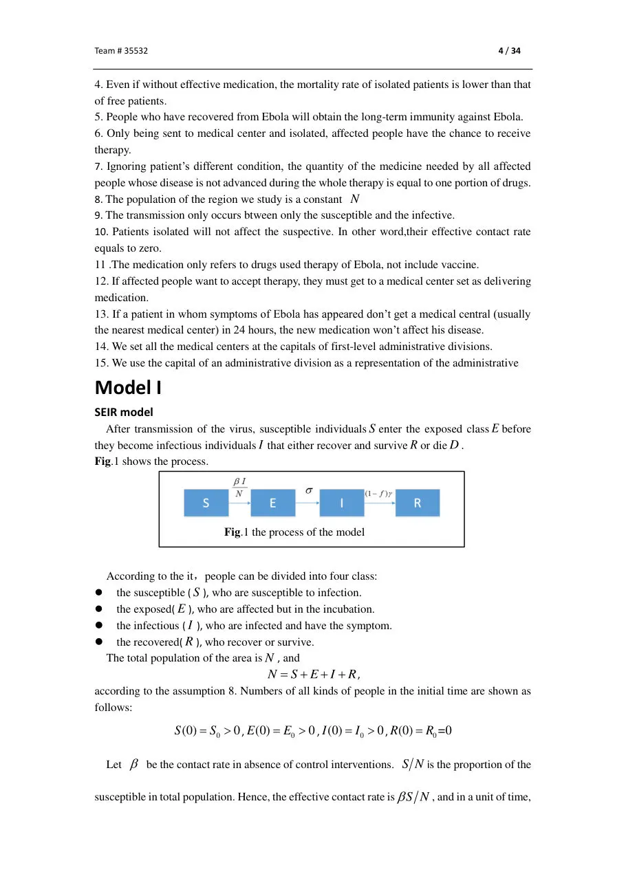
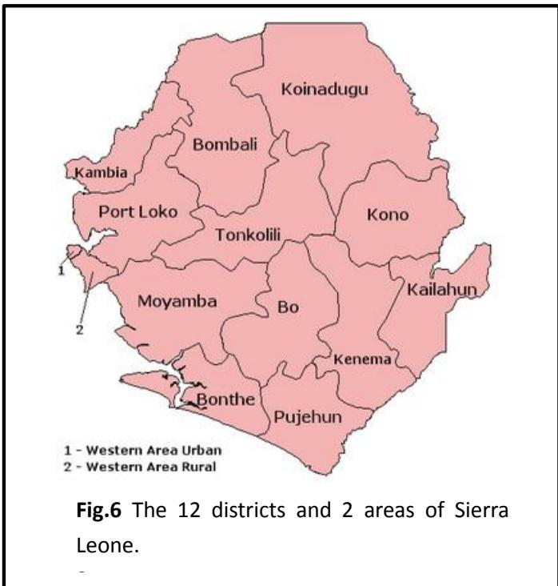
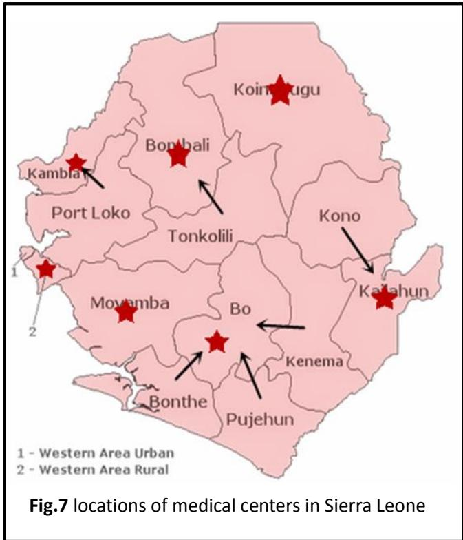

# 2015年美国大学生数学建模竞赛（MCM）特等奖论文：Ebola疫情传播与药物配送优化模型

原件为竞赛论文。补充：文中的阅读练习及“参考解答”为整理时增加，原件图文保留出处。

## 一、摘要 (Summary)

针对扎伊尔埃博拉病毒在西非造成的复杂疫情，本文建立了一系列现实、合理且实用的数学模型，用于描述埃博拉病毒的传播及药物配送策略，旨在根除该疾病。

首先，我们将疾病传播过程划分为三个阶段：自然传播阶段、隔离但无有效药物的传播阶段、以及有有效药物治疗的传播阶段。在第一阶段，我们建立了 SEIR（易感 - 暴露 - 感染 - 康复）模型来模拟疾病的传播；随后将模型改进为 SEIQR（易感 - 暴露 - 感染 - 隔离 - 康复）模型，以适应第二和第三阶段，并预测几内亚、塞拉利昂和利比里亚的未来趋势。

根据我们的计划，药物通过航空运输分送至需求国家，再通过公路运送到医疗中心，用于治疗患者。为解决医疗中心选址问题（属于集合覆盖问题），我们建立了一个多目标优化模型。该模型的目标是在确保所有患者都能及时到达医疗中心的条件下，最小化医疗中心的数量和患者的总路途时间成本。我们利用遗传算法求解该模型，得到了包含7个医疗中心的近似最优解。

接着，我们构建了逻辑块增长模型来描述药物制造速度的变化。将其与 SEIIR 模型结合，考虑了两种情况：一是药物严重短缺，二是药物相对充足。针对这两种情况，我们分别建立了两个优化模型。优化目标分别是：在第一种情况下最小化死亡病例数，在第二种情况下最小化感染者人数。决策变量是各国的药物分配量，约束条件是药物产量。

最后，通过综合分析，我们为几内亚、利比里亚和塞拉利昂制定了为期六个月的药物配送计划，并预测了在高效药物阻断下未来六个月的埃博拉传播趋势。

模型的灵敏度分析指出，传播率和初始值设定会对结果产生巨大影响。我们发现，药物制造的增长速度可能控制着疫情的蔓延。药物最小日产量 $G_m$ 必须大于 4000。否则，疫情将失控。

更多数学建模资料请关注微店店铺“数学建模学习交流” https://k.weidian.com/RHO6PSpA

## 二、引言 (Introduction)

### 2.1 问题背景

自 2013 年 12 月左右以来，一种复杂的扎伊尔埃博拉病毒（EBOV）疫情一直在影响西非地区。首例病例很可能发生在几内亚南部[1]，导致该地区的几条传播链基本 unchecked（未受控）地发展，并通过多孔边境跨越邻国塞拉利昂和利比里亚，于 2014 年 7 月 20 日通过商业飞机在尼日利亚引发了一次有限的爆发[2]。随后，新发病例数呈指数级增长。虽然所有受影响的国家都采取了公共卫生干预措施，但由于缺乏有效药物，埃博拉病毒的感染人数和死亡人数持续增加。截至 2015 年 2 月 4 日，世界卫生组织报告的总病例数为 22,495 例，死亡人数为 8,981 人[3]。

知识点：[传统 SEIR 流行病模型（Susceptible-Exposed-Infectious-Recovered）](../../../topics/数学建模/seir_moxing.md)、[基本再生数 R0 的估计方法](../../../topics/数学建模/r0_guji.md)、[一般假设及其合理性说明（Assumptions and Justifications）](../../../topics/数学建模/jiaben_shezhi.md)

### 2.2 我们的工作

由于新型抗埃博拉药物已被开发出来，建立关于药物分配和配送的现实、合理且实用的数学模型显得十分必要。根据目标不同，我们将疾病传播分为三个阶段：自然传播阶段、干预下的传播阶段和有有效药物治疗的阶段。基于感染人数和死亡人数的变化趋势，我们在第一阶段建立了 SEIR（易感 - 暴露 - 感染 - 康复）模型来模拟疾病传播。最终，将模型改进为 SEIIR（易感 - 暴露 - 感染 - 隔离 - 康复）模型，以适应第二和第三阶段，并预测几内亚、塞拉利昂和利比里亚的未来趋势。

配送系统包括两个主要部分：决定医疗中心的数量和位置以配送药物，以及每个医疗中心的药物分配。为此，我们建立了一套评估各国长期疫情状况的评价体系，并分别构建了两个多目标优化模型。通过我们的模型，我们制定了一份详细的计划。

## 三、符号与定义 (Symbols and definitions)

知识点：[传统 SEIR 流行病模型（Susceptible-Exposed-Infectious-Recovered）](../../../topics/数学建模/seir_moxing.md)、[SEIIR 模型（考虑不同感染阶段）](../../../topics/数学建模/seiir_moxing.md)、[符号说明与术语定义（Nomenclature / Symbols and Definitions）](../../../topics/数学建模/fuhao_shuoming.md)

### 3.1 带有效药物的 SEIIR 模型符号

| Symbol | Definitions |
| :--- | :--- |
| S | susceptible individuals (易感人群) |
| E | exposed individuals (暴露人群) |
| I | infectious individuals (感染人群) |
| $I_{isolated}$ | isolated infectious individuals (隔离的感染人群) |
| $I_{free}$ | non-isolated infectious individuals (非隔离的感染人群) |
| R | recover and survive individuals (康复并存活的人群) |
| D | death case (死亡病例) |
| N | total population of the area (该地区总人口) |
| $\beta$ | The transmission rate of EBOV (埃博拉病毒的传播率) |
| $1/\sigma$ | the average durations of incubation (平均潜伏期) |
| $1/\gamma$ | the average durations of infectiousness (平均传染期) |
| f | the case fatality rate (病例死亡率) |
| $\mu$ | the ratio of new non-isolated infective patients (新发非隔离感染患者的比例) |
| f1 | the non-isolated individuals fatality rate (非隔离人群的死亡率) |
| f2 | the isolated individuals fatality rate (隔离人群的死亡率) |
| G(t) | number of drug supply (药物供应量) |

# Ebola疫情传播与药物配送优化模型

## 一、符号说明

知识点：[符号说明与术语定义（Nomenclature / Symbols and Definitions）](../../../topics/数学建模/fuhao_shuoming.md)、[SEIIR 模型（考虑不同感染阶段）](../../../topics/数学建模/seiir_moxing.md)、[药物干预模型（开发疫苗提高治愈率、降低死亡率）](../../../topics/数学建模/yaowu_ganyu.md)

### 模型 II 符号定义

| Symbol | Definitions |
| :--- | :--- |
| $p$ | the number of capitals of first-level administrative divisions in a country |
| $q$ | the number of medical centers for EVD set in a country; |
| $V = \{v_1, v_2, \cdots, v_i, \cdots, v_p\}$ | the set of capitals |
| $X = \{x_1, x_2, \cdots, x_j, \cdots, x_q\}$ | the set of medical centers |
| $d(x,y)$ | he shortest distance from x to y |
| $h_i$ | the metric of quantity of drug needed of the i th administrative in the coming period |
| $R_n$ | the population of the nth administrative division |
| $M_n$ | the area of the nth administrative division |
| $r_n$ | the population of the main city of the nth administrative division. |
| $m_n$ | the area of the main city of the nth administrative division. |
| $B_n$ | the temperature of the nth administrative division |
| $I_n$ | the Infected people number of the nth administrative division is represented |
| $F_n$ | open degree of Ebola treatment centers |
| $C_n$ | the temperature of the nth administrative division |
| $c_{open}$ | the number of open ETCs in the country |
| $c_{all}$ | the number of cities in the country |
| $E_n$ | The economy of the n th country |
| $J_n$ | The education level of the n th country i |
| $K$ | age coefficient |

知识点：[符号说明与术语定义（Nomenclature / Symbols and Definitions）](../../../topics/数学建模/fuhao_shuoming.md)、[物资配送与制造速度模型（药物每日需求与总量计算）](../../../topics/数学建模/wuzi_peisong.md)、[影响因素评估指标体系构建（温度、湿度、经济、教育等）](../../../topics/数学建模/yingxiang_zhibiao.md)

### 模型 III 符号定义

| Symbol | Definitions |
| :--- | :--- |
| $G$ | The average daily production of drugs. |
| $G_m$ | the maximum production rate of the drugs. |
| $rt$ | growth trends in drug production speed |
| $P_{t_n}$ | the aggregate of drug |
| $t_n$ | the first day of the time period of drug delivery. |
| $T_p$ | the time period of drug delivery |
| $I_{i,free}$ | the number of non-isolated infectious individuals |
| $G_i(t)$ | $i$ th country’s number of the drug |
| $N_i$ | $i$ th country’s the total population |
| $D_i$ | $i$ th country’s death cases |

## 二、假设

知识点：[符号说明与术语定义（Nomenclature / Symbols and Definitions）](../../../topics/数学建模/fuhao_shuoming.md)、[一般假设及其合理性说明（Assumptions and Justifications）](../../../topics/数学建模/jiaben_shezhi.md)

### 假设 1

In early transmission period, EBOV spread in absence of control interventions.

知识点：[数学建模的基本步骤（问题分析、模型假设、建立、求解、检验、推广）](../../../topics/数学建模/jianmo_buzhou.md)、[一般假设及其合理性说明（Assumptions and Justifications）](../../../topics/数学建模/jiaben_shezhi.md)、[传统 SEIR 流行病模型（Susceptible-Exposed-Infectious-Recovered）](../../../topics/数学建模/seir_moxing.md)

### 假设 2

The average duration of the incubation and infectious period were fixed to previous estimates from an outbreak of the same EBOV subtype in Congo in 1995 $( 1 / \sigma \ = 5 \ . 3$ days and $1 / \gamma \ =$ 5 .61 days) [3].

知识点：[模型参数的确定（基于数据拟合或实验选择）](../../../topics/数学建模/canshu_queding.md)、[一般假设及其合理性说明（Assumptions and Justifications）](../../../topics/数学建模/jiaben_shezhi.md)、[传统 SEIR 流行病模型（Susceptible-Exposed-Infectious-Recovered）](../../../topics/数学建模/seir_moxing.md)

### 假设 3

Infection only occurs between the patients who are not isolated and susceptible.

知识点：[一般假设及其合理性说明（Assumptions and Justifications）](../../../topics/数学建模/jiaben_shezhi.md)、[传统 SEIR 流行病模型（Susceptible-Exposed-Infectious-Recovered）](../../../topics/数学建模/seir_moxing.md)

### 假设 4

Even if without effective medication, the mortality rate of isolated patients is lower than that of free patients.

知识点：[一般假设及其合理性说明（Assumptions and Justifications）](../../../topics/数学建模/jiaben_shezhi.md)

### 假设 5

People who have recovered from Ebola will obtain the long-term immunity against Ebola.

知识点：[一般假设及其合理性说明（Assumptions and Justifications）](../../../topics/数学建模/jiaben_shezhi.md)、[传统 SEIR 流行病模型（Susceptible-Exposed-Infectious-Recovered）](../../../topics/数学建模/seir_moxing.md)

### 假设 6

Only being sent to medical center and isolated, affected people have the chance to receive therapy.

知识点：[数学建模的基本步骤（问题分析、模型假设、建立、求解、检验、推广）](../../../topics/数学建模/jianmo_buzhou.md)、[一般假设及其合理性说明（Assumptions and Justifications）](../../../topics/数学建模/jiaben_shezhi.md)

### 假设 7

Ignoring patient’s different condition, the quantity of the medicine needed by all affected people whose disease is not advanced during the whole therapy is equal to one portion of drugs.

知识点：[一般假设及其合理性说明（Assumptions and Justifications）](../../../topics/数学建模/jiaben_shezhi.md)、[问题重述与分析（Problem Restatement and Analysis）](../../../topics/数学建模/wenti_chongshu.md)

### 假设 8

The population of the region we study is a constant

知识点：[数学建模的基本步骤（问题分析、模型假设、建立、求解、检验、推广）](../../../topics/数学建模/jianmo_buzhou.md)、[一般假设及其合理性说明（Assumptions and Justifications）](../../../topics/数学建模/jiaben_shezhi.md)、[文献综述与研究背景撰写方法](../../../topics/数学建模/wenxian_zongshu.md)

### 假设 9

The transmission only occurs btween only the susceptible and the infective.

知识点：[传统 SEIR 流行病模型（Susceptible-Exposed-Infectious-Recovered）](../../../topics/数学建模/seir_moxing.md)、[一般假设及其合理性说明（Assumptions and Justifications）](../../../topics/数学建模/jiaben_shezhi.md)、[模型参数的确定（基于数据拟合或实验选择）](../../../topics/数学建模/canshu_queding.md)

### 假设 10

Patients isolated will not affect the suspective. In other word,their effective contact rate equals to zero.

知识点：[数学建模的基本步骤（问题分析、模型假设、建立、求解、检验、推广）](../../../topics/数学建模/jianmo_buzhou.md)、[一般假设及其合理性说明（Assumptions and Justifications）](../../../topics/数学建模/jiaben_shezhi.md)

### 假设 11

The medication only refers to drugs used therapy of Ebola, not include vaccine.

知识点：[一般假设及其合理性说明（Assumptions and Justifications）](../../../topics/数学建模/jiaben_shezhi.md)

### 假设 12

If affected people want to accept therapy, they must get to a medical center set as delivering medication.

知识点：[SEIHCR(CT) 改进模型（引入医院H、尸体C、接触者追踪CT）](../../../topics/数学建模/seihcr_moxing.md)、[考虑尸体、医院和接触者追踪的原因阐述](../../../topics/数学建模/shi_ti_yiyuan.md)、[一般假设及其合理性说明（Assumptions and Justifications）](../../../topics/数学建模/jiaben_shezhi.md)

### 假设 13

If a patient in whom symptoms of Ebola has appeared don’t get a medical central (usually the nearest medical center) in 24 hours, the new medication won’t affect his disease.

知识点：[考虑尸体、医院和接触者追踪的原因阐述](../../../topics/数学建模/shi_ti_yiyuan.md)、[模型参数的确定（基于数据拟合或实验选择）](../../../topics/数学建模/canshu_queding.md)、[关键参数区域与临界条件分析（埃博拉何时能被根除）](../../../topics/数学建模/genchu_tiaojian.md)

### 假设 14

We set all the medical centers at the capitals of first-level administrative divisions.

知识点：[一般假设及其合理性说明（Assumptions and Justifications）](../../../topics/数学建模/jiaben_shezhi.md)、[文献综述与研究背景撰写方法](../../../topics/数学建模/wenxian_zongshu.md)、[任务分解与目标明确](../../../topics/数学建模/renwu_fenjie.md)

### 假设 15

We use the capital of an administrative division as a representation of the administrative

## 三、模型 I：SEIR 模型

After transmission of the virus, susceptible individuals enter the exposed class before they become infectious individuals that either recover and survive or die.

Fig.1 shows the process.

According to the it，people can be divided into four class:

- the susceptible ($S$), who are susceptible to infection.
- the exposed($E$), who are affected but in the incubation.
- the infectious ($I$), who are infected and have the symptom.
- the recovered($R$), who recover or survive.

The total population of the area is $N$ , and

$$
N = S + E + I + R,
$$

according to the assumption 8. Numbers of all kinds of people in the initial time are shown as follows:

$$
S (0) = S _ {0} > 0, E (0) = E _ {0} > 0, I (0) = I _ {0} > 0, R (0) = R _ {0} = 0
$$

Let $\beta$ be the contact rate in absence of control interventions. $S / N$ is the proportion of the

susceptible in total population. Hence, the effective contact rate is $\beta S / N$ , and in a unit of time, the number of new patients is $\beta S I / N$ .In other words, the rate of change in the number of the susceptible is

## SEIR 模型

$$
\frac{dS}{dt} = -\frac{\beta SI}{N} \tag{1}
$$

我们假设 $\sigma E$ 为每天新进入感染期的人数，因此 $1/\sigma$ 为平均潜伏期。每天新进入暴露期的人数可计算如下：

$$
\frac{dE}{dt} = \frac{\beta SI}{N} - \sigma E \tag{2}
$$

同理，计算感染者的增量：

$$
\frac{dI}{dt} = \sigma E - \gamma I
$$

其中 $\gamma$ 为感染者的自然痊愈率与死亡率之和，$1/\gamma$ 可视为平均感染期。设病死率为 $f$，则 $(1-f)\gamma I$ 为每日死亡人数。因此，康复者和死亡者随时间的变化率分别为：

$$
\frac{dR}{dt} = (1-f)\gamma I \tag{3}
$$

$$
\frac{dD}{dt} = f\gamma I
$$

由上述分析，我们将 EBOV 的早期传播描述为 SEIR（易感—暴露—感染—康复）动力学模型。

知识点：[传统 SEIR 流行病模型（Susceptible-Exposed-Infectious-Recovered）](../../../topics/数学建模/seir_moxing.md)、[一般假设及其合理性说明（Assumptions and Justifications）](../../../topics/数学建模/jiaben_shezhi.md)、[符号说明与术语定义（Nomenclature / Symbols and Definitions）](../../../topics/数学建模/fuhao_shuoming.md)

### 结果

潜伏期与感染期的平均时长固定为 1995 年刚果同一 EBOV 亚型暴发的已有估计值（$1/\sigma = 5.3$ 天，$1/\gamma = 5.61$ 天）。其余参数取自 Chowell 等人 [4]。所有重要参数的取值列于表 1。

表 1. 2014 年 EBOV 暴发的参数估计

| 参数 | 几内亚 | 塞拉利昂 | 利比里亚 |
| --- | --- | --- | --- |
| 平均潜伏期，$1/\sigma$ | 5.3 | 5.3 | 5.3 |
| 平均感染期，$1/\gamma$ | 5.61 | 5.61 | 5.61 |
| 传播率，$\beta$ | 0.27 | 0.43 | 0.29 |
| 病死率，$f$ | 0.75 | 0.49 | 0.69 |
| 首例感染病例出现日期，$T$ | 2013 年 12 月 2 日 | 2014 年 4 月 19 日 | 2014 年 4 月 16 日 |

根据实际情况，我们设各类人群的初始数量如下：

$$
S(0) = N - E_0 - I_0,\quad E(0) = 10,\quad I(0) = 1,\quad R(0) = 0
$$

由于微分方程组的复杂性，我们无法求得其解析解。因此，我们使用 MATLAB 2014B 中的 ode 工具箱对三个国家（几内亚、塞拉利昂和利比里亚）进行数值求解，并将结果与 EBOV 早期传播阶段的数据进行比较（见图 2），因为该阶段 EBOV 在无控制干预的情况下传播。

病例（确诊、可能和疑似）与死亡数据来自世界卫生组织（WHO）[5]。

可以看出，该模型对几内亚、塞拉利昂和利比里亚报告的病例与死亡数据拟合良好。

知识点：[模型参数的确定（基于数据拟合或实验选择）](../../../topics/数学建模/canshu_queding.md)、[传统 SEIR 流行病模型（Susceptible-Exposed-Infectious-Recovered）](../../../topics/数学建模/seir_moxing.md)、[参数合理性验证](../../../topics/数学建模/canshu_heli_xing.md)

### SEIIR 模型

一般而言，当受影响人数足够多时，会引起政府注意，疫情将被宣布为公共卫生紧急事件，EVBO 也是如此。根据 WHO 的建议 [6]，政府应采取的第一项措施是隔离患者，这将明显阻碍疫情传播。SEIR（易感—暴露—感染—康复）模型拟合了疾病的早期传播，但未考虑这一点。因此，需要对其进行改进。为此，我们在 SEIR 模型基础上，考虑隔离人群且无有效药物的情况，建立了一个新的 SEIIR（易感—暴露—感染—隔离—康复）模型。

在该模型中，随着病毒传播，易感个体进入暴露类 $E$，之后成为隔离感染者 $I_{isolated}$ 或未受控感染者 $I_{free}$，后者或康复存活或死亡。图 3 展示了这一过程。

$$
N = S + E + I_{free} + I_{isolated} + R
$$

考虑假设 10，式 (1) 变为：

$$
\frac{dS}{dt} = -\frac{\beta S I_{free}}{N}
$$

类似地，式 (2) 和 (3) 变为：

$$
\frac{dE}{dt} = \frac{\beta S I_{free}}{N} - \sigma E
$$

$$
\frac{dI_{free}}{dt} = \sigma \mu E - \gamma I_{free} \tag{7}
$$

隔离患者数量的变化率为：

$$
\frac{dI_{isolated}}{dt} = \sigma(1-\mu)E - \gamma I_{isolated} \tag{8}
$$

式 (7) 和 (8) 中的系数 $\mu$ 表示新增感染者中未隔离感染者的比例，因为并非所有患者都因不同原因愿意被隔离。$\mu$ 的取值主要取决于医疗系统的发展水平。假设：

$$
(1-\mu) > \mu
$$

若所有隔离患者都能治愈，则所有感染者都愿意被隔离，此时 $\mu = 0$。

隔离患者的死亡率越低，$\mu$ 的取值越小。

据此，我们可以用函数描述 $\mu$ 与 $f_2$ 的关系：

$$
\mu = e^{-f_2}
$$

显然，隔离患者的死亡率 $f_1$ 远低于未隔离患者的死亡率 $f_2$。

因此，康复者可依据是否被隔离分为两部分。于是，康复者和死亡者随时间的变化率分别为：

$$
\frac{dR}{dt} = (1-f_1)\gamma I_{free} + (1-f_2)\gamma I_{isolated}
$$

$$
\frac{dD}{dt} = f_1\gamma I_{free} + f_2\gamma I_{isolated}
$$

初始值为 $S(0) > 0$，$E(0) = E_0 > 0$，$I_{isolated}(0) > 0$，$I_{free}(0) > 0$，$R(0) > 0$。

模拟结果：

根据 WHO 的报告，埃博拉病死率在 0.6 至 0.8 之间。令 $f_1 = 0.8$，$f_2 = 0.6$，其余系数不变。

由于采取隔离措施前处于自然传播阶段，我们以第 $100$ 天的数据设定初始值如下：

$$
S_0 = 12219576,\quad E_0 = 2209,\quad I_{0,free} = 822,\quad I_{0,quarantined} = 822,\quad R_0 = 971,\quad D_0 = 2912
$$

同理，我们使用 Matlab201 中的 ode 工具箱求得数值解，结果如图 4 所示。

## SEIIR model with effective medication

Now since the World Medical Association has developed a new medication which could stop Ebola and cures patients whose disease is not advanced. Outside of isolation, we can eradicate Ebola with the mediation, which has more effect on Ebola’s spreading. Base on this former work, we improve our model once again and get the SEIIR model with effective medication. The model can be described by a system of differential equations as follows

$$
\frac {d S}{d t} = - \frac {\beta S I _ {f r e e}}{N},
$$

$$
\frac {d E}{d t} = \frac {\beta S I _ {f r e e}}{N} - \sigma E,
$$

$$
\frac {d I _ {\text {free}}}{d t} = \sigma \mu E - \gamma I _ {\text {free}},
$$

$$
\frac {d I _ {\text {isolated}}}{d t} = \sigma (1 - \mu) E - \gamma I _ {\text {isolated}} - M (t),
$$

$$
\frac {d R}{d t} = (1 - f _ {1}) \gamma I _ {\text {free}} + (1 - f _ {2}) \gamma I _ {\text {isolated}} + M (t),
$$

$$
\frac {d D}{d t} = f _ {1} \gamma I _ {\text {free}} + f _ {2} \gamma I _ {\text {isolated}} - M (t),
$$

$$
S (0) > 0, E (0) = E _ {0} > 0, I _ {i s o l a t e d} (0) > 0, I _ {f r e e} (0) > 0, R (0) > 0
$$

Where $M(t)$ is the number of people who can receive the medication in a unit of time. According assumption 12, the $M(t)$ have no effect on the changing rate of $I _ { f r e e }$ . And other parameters and coefficients’ definition are the same as before.

In addition, as $M(t)$ increase, more and more patients will be being isolated, in other word,

知识点：[SEIIR 模型（考虑不同感染阶段）](../../../topics/数学建模/seiir_moxing.md)、[考虑尸体、医院和接触者追踪的原因阐述](../../../topics/数学建模/shi_ti_yiyuan.md)

### Model II

Since the new medication still cannot be manufactured on a large scale, which indicates a shortage of the drug, a feasible delivery system is necessary based on epidemic situation of countries and districts.

The setting of the delivery system can be divided into two main parts:

- the medical center number and location decision
- and the medication allocation for every affected countries and districts.

知识点：[配送地点选址模型（公平原则与效率原则）](../../../topics/数学建模/peisong_xuanzhi.md)、[物资配送与制造速度模型（药物每日需求与总量计算）](../../../topics/数学建模/wuzi_peisong.md)

### Number and location decision

#### Assumption:

Affected people must get to a medical center within a specified time because the new medication can only cure patients whose disease is not advanced. According to Wikipedia, we assume that if a patient in whom symptoms of Ebola has appeared don’t get a medical central (usually the nearest medical center) in 24 hours, the new medication won’t affect his disease. Accounting for the poor transport facilities in West Africa and convenience of drug managing, we set all the medical centers at the capitals of first-level administrative divisions.

We simplify the distance from everywhere in an administrative division to a medical center as the distance from the capital of the administrative division to the medical center. In other words, we use the capital of an administrative division as a representation of the administrative. It’s feasible because most of people in the West Africa tend to gather in several big cities.

#### Model:

Generally, the aid work in the charged of some international organizations, like WHO. They, rather than every country separately, assign the medical workers and allocate the medication and other medical source.

Therefore, the new medication is delivered to countries in need separately by air, then to medical centers by highway and be used for therapy of patients there.

Our first goal is decide the number and locations of medical centers.

Due to the assumption, there must be at least one medical center within a specified distance from every administrative division to ensure patients can get to a medical center. This suggests the number and location decision is a set covering problem. In set covering problems, the objective is to minimize the number or cost of facility location such that a specified level of coverage is obtained.

To describe the issue more clearly, we define some parameters as follows:

$p$ , the number of capitals of first-level administrative divisions in a country;

$q$ , the number of medical centers for EVD set in a country;

$V = \left\{ \nu _ { 1 } , \nu _ { 2 } , \cdots , \nu _ { i } , \cdots , \nu _ { p } \right\}$ , the set of capitals;

$X = \left\{ x _ { 1 } , x _ { 2 } , \cdots x _ { j } \cdots , x _ { q } \right\}$ , the set of medical centers;

$d ( x , y )$ , the shortest distance from $x$ to $y$;

Due to the assumption,

$$
X \subset V.
$$

Therefore,

$$
x _ {j} \in V, j = 1, 2, \dots , q.
$$

Then we let $d ( \nu _ { i } , X _ { q } )$ be the distance from the $i$ th administrative division to the nearest medical central:

$$
d (v _ {i}, X _ {q}) = \min _ {1 \leq j \leq q} \left\{d (v _ {i}, x _ {j}) \right\}.
$$

If there is a medical central in it,

$$
d (v _ {i}, X _ {q}) = 0
$$

Suppose that the distance patients can moved within 24h is $\lambda$ , because the assumption,

$$
\max _ {1 \leq i \leq p} \left\{d \left(v _ {i}, X _ {q}\right) \right\} \leq \lambda .
$$

Considering that healthcare works, financial resources and devices are limited, we should minimize the number of medical centers for EVD, $q$, on the premise of meeting the coverage requirement.

In addition, administrative division’s need in medication vary from each other. Obviously, the larger an administrative division’s quantity of the medicine needed, the closer the nearest medical center should be. So, we also should

$$
\operatorname{Min} \sum_ {1} ^ {p} h _ {i} d (v _ {i}, X _ {q}),
$$

Where $h _ { i }$ is the metric of quantity of drug needed of the $i$ th administrative in the coming period.

In next part, we will clarify how to calculate $h _ { i }$ .

知识点：[配送地点选址模型（公平原则与效率原则）](../../../topics/数学建模/peisong_xuanzhi.md)、[符号说明与术语定义（Nomenclature / Symbols and Definitions）](../../../topics/数学建模/fuhao_shuoming.md)、[一般假设及其合理性说明（Assumptions and Justifications）](../../../topics/数学建模/jiaben_shezhi.md)

### 模型总结与多目标优化

综上所述，我们将医疗中心数量与选址决策问题建模为多目标优化问题。该模型的公式如下：

$$
\mathrm{Min} \sum_ {i = 1} ^ {p} h _ {i} d (v _ {i}, X _ {q})
$$

Min $q$

$$
s. t. \max _ {1 \leq i \leq p} \left\{d \left(v _ {i}, X _ {q}\right) \right\} \leq \lambda
$$

$$
X _ {q} = \left\{x _ {1}, x _ {2}, \dots , x _ {q} \right\}
$$

$$
x _ {j} \in V, f o r i = 1, 2, \dots , q
$$

#### 求解过程

不失一般性，我们以受疫情最严重的塞拉利昂为例，为其确定医疗中心的位置。

塞拉利昂共和国由四个地区组成：北区、南区、东区以及西区（Western Area）。前三个省份进一步划分为 12 个区。图 6 展示了这一划分情况。

根据我们的模型，我们将每个区替换为其首府（西区被视为一个区，弗里敦是其首府）。因此，$p$ 的值为 13。

我们通过 Google 地图搜索并计算了任意两个首府之间的最短路径和距离，结果如表 2 所示。

**表 2：任意两个首府之间的最短路径和距离**

| | Kailahun | Kenema | Koidu | Makeni | Kambia | Port Loko | Kabala | Magburaka | Bo | Bonthe | Moyamba | Pujehun | Freetown |
| :--- | :--- | :--- | :--- | :--- | :--- | :--- | :--- | :--- | :--- | :--- | :--- | :--- | :--- |
| **Kailahun** | 0 | 112 | 46.4 | 204 | 353 | 300 | 321 | 179 | 169 | 261 | 284 | 222 | 417 |
| **Kenema** | 112 | 0 | 113 | 192 | 330 | 227 | 309 | 167 | 68.5 | 149 | 173 | 110 | 305 |
| **Koidu** | 46.4 | 113 | 0 | 159 | 308 | 253 | 276 | 133 | 162 | 256 | 253 | 213 | 340 |
| **Makeni** | 204 | 192 | 159 | 0 | 152 | 97.7 | 118 | 26.8 | 133 | 217 | 124 | 206 | 185 |
| **Kambia** | 353 | 330 | 308 | 152 | 0 | 51.1 | 269 | 176 | 263 | 298 | 181 | 337 | 126 |
| **Port Loko** | 300 | 227 | 253 | 97.7 | 51.1 | 0 | 216 | 122 | 210 | 244 | 128 | 284 | 119 |
| **Kabala** | 321 | 309 | 276 | 118 | 269 | 216 | 0 | 105.9 | 144 | 334 | 242 | 323 | 302 |
| **Magburaka** | 179 | 167 | 133 | 26.8 | 176 | 122 | 105.9 | 0 | 108 | 191 | 100 | 216 | 208 |
| **Bo** | 169 | 68.5 | 162 | 133 | 263 | 210 | 144 | 108 | 0 | 82.4 | 106 | 75.3 | 174.66 |
| **Bonthe** | 261 | 149 | 256 | 217 | 298 | 244 | 334 | 191 | 82.4 | 0 | 130 | 98.5 | 237 |
| **Moyamba** | 284 | 173 | 253 | 124 | 181 | 128 | 242 | 100 | 106 | 130 | 0 | 179 | 114 |
| **Pujehun** | 222 | 110 | 213 | 206 | 337 | 284 | 323 | 216 | 75.3 | 98.5 | 179 | 0 | 312 |
| **Freetown** | 417 | 305 | 340 | 185 | 126 | 119 | 302 | 208 | 174.66 | 237 | 114 | 312 | 0 |

关于 $\lambda$ 的取值，考虑到初步判断所需的时间以及落后的交通设施，一个合理的值是 92.1 km。

测量每个区的需求量 $h_i$

**表 3：城市需求系数**

| 区域 | $h$ | 区域 | $h$ | 区域 | $h$ |
| :--- | :--- | :--- | :--- | :--- | :--- |
| Kailahun | 0.512665 | Koinadugu | 0.379487 | Kambia | 0.341398 |
| Kenema | 0.553363 | Tonkolili | 0.294881 | Port Loko | 0.53602 |
| Kono | 0.22831 | Bo | 0.504783 | Pujehun | 0.334563 |
| Bombali | 0.441547 | Bonthe | 0.271492 | Western Area | 0.436276 |
| Moyamba | 0.505654 | | | | |

此优化问题属于 NP-hard 问题，无法在多项式时间内求解。因此，我们只能使用启发式算法（如遗传算法、模拟退火等）获得近似解。这里，我们选择遗传算法并使用 Matlab 2014 编写程序。

反复运行程序后，我们获得了相对较好的结果并制定了计划：共有七个医疗中心分别位于 Kailahun、Makeni、Kambia、Kabala、Bo、Moyamba 和 Freetown。图 7 展示了每个医疗中心的管理范围。

知识点：[多目标优化模型（药物相对充足阶段的配送策略）](../../../topics/数学建模/duo_mubiao_youhua.md)、[遗传算法优化人力资本管理（染色体表示与适应度函数）](../../../topics/数学建模/yichuan_suanfa.md)、[配送地点选址模型（公平原则与效率原则）](../../../topics/数学建模/peisong_xuanzhi.md)

### Part III

知识点：[一般假设及其合理性说明（Assumptions and Justifications）](../../../topics/数学建模/jiaben_shezhi.md)、[传统 SEIR 流行病模型（Susceptible-Exposed-Infectious-Recovered）](../../../topics/数学建模/seir_moxing.md)、[敏感性分析方法（Sensitivity Analysis，单参数与多参数变动）](../../../topics/数学建模/minganxing_fenxi.md)

### 1. 指定评估标准

对于易感人群标准的评估，主要考虑以下几个方面：人口密度、温度、湿度、当前疾病感染状况、开放或在建状态、经济、国家教育和年龄。以下章节将详细讨论这八个方面。

#### 人口密度：

人口密度无疑在药物评估的需求水平中占据关键比例。因为埃博拉是一种烈性传染病，不仅患者，尸体也可以是传染源。因此，如果人口密度高，一般情况下疾病传播速度会很快。然而，在某些地区，该地区的人口密度较低，但几乎所有人都居住在一个中心城市（事实上，该城市的人口密度很高），我们对数据进行了预处理，使该方面更符合合理的评估模型。该地区的人口密度可以按以下方式计算：

$$
a _ {1 n} = \frac {R _ {n}}{M _ {n}}
$$

其中 $R _ { n }$ 是第 $n$ 个区域的人口数量。

$M _ { n }$ 是第 $n$ 个区域的面积。

该地区主要城市的人口密度可以按以下方式计算：

# 2015年美国大学生数学建模竞赛（MCM）特等奖论文：Ebola疫情传播与药物配送优化模型

## 一、人口密度修正系数

知识点：[影响因素评估指标体系构建（温度、湿度、经济、教育等）](../../../topics/数学建模/yingxiang_zhibiao.md)、[符号说明与术语定义（Nomenclature / Symbols and Definitions）](../../../topics/数学建模/fuhao_shuoming.md)、[一般假设及其合理性说明（Assumptions and Justifications）](../../../topics/数学建模/jiaben_shezhi.md)

### 计算背景

为了更合理、准确地评估模型中的人口密度，定义了一个新的种群密度指标。该指标基于主城市 $n$ 区域的污染程度和面积进行初步计算，并结合其他权重因子进行调整。

首先定义基础变量：

- $a_{2n}$：主城市 $n$ 区域的污染程度除以面积。
- $m_n$：主城市 $n$ 区域的面积。

其基础关系为：

$$
a_{2n} = \frac{r_n}{m_n}
$$

其中 $r_n$ 为主城市 $n$ 区域的污染量。

知识点：[符号说明与术语定义（Nomenclature / Symbols and Definitions）](../../../topics/数学建模/fuhao_shuoming.md)、[一般假设及其合理性说明（Assumptions and Justifications）](../../../topics/数学建模/jiaben_shezhi.md)、[模型参数的确定（基于数据拟合或实验选择）](../../../topics/数学建模/canshu_queding.md)

### 新人口密度公式

定义的新人口密度 $A_n$ 计算公式如下：

$$
A_n = a_{1n} \cdot b_1 + a_{2n} \cdot b_2 + \frac{(a_{2n} - a_{1n})}{a_{2n}} \cdot b_3
$$

约束条件为权重之和为1：

$$
b_1 + b_2 + b_3 = 1
$$

数值大小取决于 $(a_{2n} - a_{1n})$ 的差异。通过上述计算，模型中的人口密度评估更加合理和准确。

## 二、影响因素评估指标

在药物需求评估模型中，以下因素被选为重要指标：

知识点：[人口密度修正系数与新公式](../../../topics/数学建模/renkou_midu.md)、[影响因素评估指标体系构建（温度、湿度、经济、教育等）](../../../topics/数学建模/yingxiang_zhibiao.md)

### Temperature（温度）

根据过去信息和数据，埃博拉疫情通常在夏季爆发，而在冬季疫情得到有效控制。非洲主要爆发区位于低纬度地区，这表明温度是药物需求评估中的一个重要方面。

区域温度表示为：

$$
B_n
$$

知识点：[影响因素评估指标体系构建（温度、湿度、经济、教育等）](../../../topics/数学建模/yingxiang_zhibiao.md)

### Humidity（湿度）

埃博拉在疫情爆发地区年降水量高且和谐（原文如此，意指湿润适宜），特别是在覆盖率高的热带雨林地区。世界卫生组织报告显示，潮湿的气候有利于病毒的传播。因此，选择湿度作为评估模型的一个方面。

区域湿度表示为：

$$
C_n
$$

知识点：[影响因素评估指标体系构建（温度、湿度、经济、教育等）](../../../topics/数学建模/yingxiang_zhibiao.md)、[数学建模的基本步骤（问题分析、模型假设、建立、求解、检验、推广）](../../../topics/数学建模/jianmo_buzhou.md)

### Current Disease Infection（当前疾病感染情况）

当前的感染状况对未来疫情有巨大影响。拥有大量感染者的国家在未来面临挑战，需要世界卫生组织的支持。由于埃博拉是一种高度传染性疾病，每位患者都需要大量的资金投入。因此，我们认为使用患者数量来衡量一个国家整体疫情的严重程度是合理的。

区域感染人数表示为：

$$
I_n
$$

知识点：[SEIHCR(CT) 改进模型（引入医院H、尸体C、接触者追踪CT）](../../../topics/数学建模/seihcr_moxing.md)、[考虑尸体、医院和接触者追踪的原因阐述](../../../topics/数学建模/shi_ti_yiyuan.md)、[问题重述与分析（Problem Restatement and Analysis）](../../../topics/数学建模/wenti_chongshu.md)

### Open or under construction（开放或封闭状态）

众所周知，控制人员流动是防止传染病进一步恶化的有效措施。一方面，封闭措施可以控制感染向未感染地区的扩散；另一方面，它有能力降低感染区内健康人的感染风险。

在一个国家中，有些城市处于开放状态，而有些城市处于封闭状态（我们只考虑该国的大城市）。

定义开放系数 $F_n$，计算公式如下：

$$
F_n = \frac{c_{open}}{c_{all}}
$$

其中：
- $c_{open}$：该国开放城市的数量
- $c_{all}$：该国所有城市的数量

知识点：[一般假设及其合理性说明（Assumptions and Justifications）](../../../topics/数学建模/jiaben_shezhi.md)、[任务分解与目标明确](../../../topics/数学建模/renwu_fenjie.md)、[数学建模的基本步骤（问题分析、模型假设、建立、求解、检验、推广）](../../../topics/数学建模/jianmo_buzhou.md)

### Economy（经济水平）

一般情况下，经济越落后的国家，控制疾病就越困难。因此，一个国家的经济状况是决定其医疗设施水平的重要指标。GDP越低，意味着由于医疗基础设施不发达，控制埃博拉感染的难度越大。我们用人均GDP作为展示该地区经济水平的指标。

区域经济指标表示为：

$$
E_n
$$

知识点：[模型参数的确定（基于数据拟合或实验选择）](../../../topics/数学建模/canshu_queding.md)、[影响因素评估指标体系构建（温度、湿度、经济、教育等）](../../../topics/数学建模/yingxiang_zhibiao.md)、[一般假设及其合理性说明（Assumptions and Justifications）](../../../topics/数学建模/jiaben_shezhi.md)

### National Education（国民教育水平）

非洲的土葬习俗不符合当地传统卫生观念，这是埃博拉大规模爆发的一个重要原因。埃博拉可以通过尸体传播，导致葬礼上大量人员感染。调查显示，受教育程度越高，接受火葬的比例越大。因此，我们选择每个国家接受高等教育的人数比例作为衡量该国教育水平的指标。

区域国民教育指标表示为：

$$
J_n
$$

知识点：[文献综述与研究背景撰写方法](../../../topics/数学建模/wenxian_zongshu.md)、[影响因素评估指标体系构建（温度、湿度、经济、教育等）](../../../topics/数学建模/yingxiang_zhibiao.md)、[模型参数的确定（基于数据拟合或实验选择）](../../../topics/数学建模/canshu_queding.md)

### Age（年龄结构）

根据世界卫生组织的报告，14岁以上成年人的患病概率是14岁以下儿童的三倍，65岁及以上老年人的患病概率是14岁以下儿童的四倍。由此可见，14岁以上人口比例越高，总体患病概率越大。

定义年龄系数 $K$，计算公式如下：

$$
K = \frac{K_{14 \sim 65} + K_{65}}{K_{all}}
$$

其中：
- $K_{14 \sim 65}$：14至65岁人口数量
- $K_{65}$：65岁以上人口数量
- $K_{all}$：总人口数量

# 2015年美国大学生数学建模竞赛（MCM）特等奖论文：Ebola疫情传播与药物配送优化模型

本文整理了2015年MCM特等奖论文中关于TOPSIS模型用于药物需求评估及数据收集的第七部分内容，对识别产生的格式错误、断行及乱码进行了修正，并将HTML表格转换为Markdown格式。

## 一、TOPSIS模型构建步骤

知识点：[TOPSIS 模型构建步骤（逼近理想解排序法）](../../../topics/数学建模/topsis_moxing.md)、[影响因素评估指标体系构建（温度、湿度、经济、教育等）](../../../topics/数学建模/yingxiang_zhibiao.md)、[问题重述与分析（Problem Restatement and Analysis）](../../../topics/数学建模/wenti_chongshu.md)

### 选择 1

**背景说明**：TOPSIS（Technique for Order Performance by Similarity to Ideal Solution）是一种处理现实世界多属性或多准则决策问题（MADM/MCDM）的有效方法。它帮助决策者组织待解决的问题，并对备选方案进行分析、比较和排序，从而选出合适的方案。然而，组织内的许多决策往往是协作完成的。因此，本模型将扩展TOPSIS以评估药物需求，并提供一套完整高效的决策程序。

- **第一步：数据归一化**
  由于不同因素的数值量级差异巨大，我们需要对这些因素的值进行归一化处理。决策矩阵 $X$ 中第 $i$ 行第 $j$ 列元素的归一化值 $X_{ij}^k$ 可以是任意线性缩放变换，以保持 $0 \leq X_{ij}^k \leq 1$。
  
  我们将 $X_{ij}^k$ 的归一化值定义为对应元素 $X_{ij}^k$ 除以其所在列所有元素的运算结果（即向量归一化）。以该因素为例：
  $$
  X_{m1}^k = \frac{A_n}{\sqrt{A_1^2 + A_2^2 + \cdots + A_n^2}}
  $$

- **第二步：构建决策矩阵 $X$**
  矩阵的结构可以表示如下：
  $$
  X = \left[ \begin{array}{c c c c c c} 
  & X_1 & X_2 & \dots & X_j & \dots & X_n \\ 
  x_1 & X_{11}^k & X_{12}^k & \dots & X_{1j}^k & \dots & X_{1n}^k \\ 
  x_2 & X_{21}^k & X_{22}^k & \dots & X_{2j}^k & \dots & X_{2n}^k \\ 
  \vdots & \vdots & \vdots & \dots & \vdots & \dots & \vdots \\ 
  x_i & X_{i1}^k & X_{i2}^k & \dots & X_{ij}^k & \dots & X_{in}^k \\ 
  \vdots & \vdots & \vdots & \dots & \vdots & \dots & \vdots \\ 
  x_m & X_{m1}^k & X_{m2}^k & \dots & X_{mj}^k & \dots & X_{mn}^k 
  \end{array} \right]
  $$
  其中 $x_i$ ($i=1, 2, \dots, m$) 代表备选方案（alternative），$X_j$ ($j=1, 2, \dots, n$) 代表属性或准则（attribute or criterion）。
  
  在模型中，$x_i$ 代表不同的国家，$X_j$ 代表评估中的不同因素。
  
  观察发现，我们也可以将每个备选方案的定性属性结果设为离散值（例如1到10或语言值），以便将定量值放入上述决策矩阵中。例如，“当前疾病感染情况”是一个我们无法直接评估的因素，我们可以使用某个指数来展示它 [10]。

- **第三步：确定理想解和负理想解**
  确定正理想解 $V_k^+$ 和负理想解 $V_k^-$：
  $$
  V_k^+ = \left\{X_1^{k+}, \dots, X_n^{k+}\right\} = \left\{\left(\max_{i} X_{ij}^k \mid j = 1, 2, \dots, m\right)\right\}
  $$
  $$
  V_k^- = \left\{X_1^{k-}, \dots, X_n^{k-}\right\} = \left\{\left(\min_{i} X_{ij}^k \mid j = 1, 2, \dots, m\right)\right\}
  $$
  *(注：原文此处公式推导逻辑为取各列的最大值和最小值)*

- **第四步：计算分离度**
  分别计算各组相对于理想解和负理想解的分离度 $S_i^+$ 和 $S_i^-$：
  $$
  S_i^+ = \sqrt{\sum_{j=1}^n (v_{ij}^k - v_j^{k+})^2}, \quad \text{for alternative } i, i=1, \dots, m
  $$
  $$
  S_i^- = \sqrt{\sum_{j=1}^n (v_{ij}^k - v_j^{k-})^2}, \quad \text{for alternative } i, i=1, \dots, m
  $$
  *(注：原文第二步公式中 $S_i^-$ 的减数项误写为 $v_j^{k+}$，根据上下文逻辑应为负理想解 $v_j^{k-}$，此处已按正确逻辑修正)*

- **第五步：计算相对接近度**
  计算组内相对于理想解的相对接近度 $C$。
  计算相对于理想解的相对接近度并按降序排列备选方案。第 $i$ 个备选方案 $A_i$ 相对于正理想解的相对接近度可表示为：
  $$
  C = \frac{S_i^-}{S_i^+ + S_i^-}, \quad i=1, \dots, m
  $$
  其中 $0 \leq C \leq 1$。该指标值越大，备选方案的性能越好。

知识点：[非线性规划模型（药物配送阶段划分）](../../../topics/数学建模/feixian_guihua.md)、[多目标优化模型（药物相对充足阶段的配送策略）](../../../topics/数学建模/duo_mubiao_youhua.md)

### 选择 2

**数据来源收集**
为了评估各个地区的情况，需要大量数据。我们可以通过搜索维基百科（Wikipedia）和世界卫生组织（WHO）等网站，找到符合我们特定评估标准的每个地区所需的数据。最终，我们将这些地区的相对统计数据总结并列出如下表。

**表4：不同地区的数据**

| 地区 (District) | 人口密度 (People/km²) | 开放系数 (Open coefficient) | 温度 (°C) | 湿度 (%) | 当前疾病状况 (Current disease situation) |
| :--- | :--- | :--- | :--- | :--- | :--- |
| Kailahun | 458.1595 | 100 | 24 | 94 | 4 |
| Kenema | 4697.336 | 100 | 23 | 94 | 4 |
| Kono | 2618.687 | 0 | 21 | 87 | 3 |
| Bombali | 267.3536 | 100 | 26 | 81 | 2 |
| Kambia | 281.6377 | 50 | 24 | 94 | 3 |
| Port Loko | 860.1828 | 100 | 22 | 89 | 5 |
| Koinadugu | 299.7132 | 50 | 22 | 69 | 4 |
| Tonkolili | 1740.713 | 0 | 23 | 83 | 4 |
| Bo | 266.1477 | 100 | 23 | 94 | 4 |
| Bonthe | 1248.725 | 50 | 24 | 91 | 1 |
| Moyamba | 392.2557 | 100 | 23 | 93 | 4 |
| Pujehun | 1176.208 | 50 | 25 | 89 | 3 |
| Western Area | 25996.65 | 50 | 26 | 81 | 5 |

> **注意**：
> 1. 人口密度的单位是 People/km²（原文识别为 People /per km，根据常规地理统计单位修正）。
> 2. 表中“开放系数”可能指某种开放程度或交通可达性的量化指标。
> 3. “当前疾病状况”为定性数据的量化值（如1-5分制），具体评分标准需参考原文前文定义。

# 2015年美国大学生数学建模竞赛（MCM）特等奖论文：Ebola疫情传播与药物配送优化模型（习题）

本部分为《2015年美国大学生数学建模竞赛（MCM）特等奖论文：Ebola疫情传播与药物配送优化模型》的第 8 部分（共 12 部分），内容涵盖外部因素对传染率 $\beta$ 的影响系数计算、药物生产物流斯模型假设及药物配送量计算。原文存在少量拼写和语法错误，已按上下文修正。

## 一、外部因素对传染率 $\beta$ 的影响分析

知识点：[多目标优化模型（药物相对充足阶段的配送策略）](../../../topics/数学建模/duo_mubiao_youhua.md)、[物资配送与制造速度模型（药物每日需求与总量计算）](../../../topics/数学建模/wuzi_peisong.md)

### 影响系数定义与TOPSIS应用

通过对数据的分析，我们发现传染率 $\beta$ 不仅与疫情本身的性质有关，还受到一些外部因素的影响。这些因素包括人口密度、温度、湿度、当前疫情状况、ETC（埃博拉治疗中心）开放程度、经济水平、国民教育水平和年龄结构。因此，$\beta$ 因国家而异。其中一些因素随时间变化，导致 $\beta$ 也随时间变化。如果我们要为不同国家制定不同的合理长期配送系统，就需要评估外部因素对 $\beta$ 的影响。同样地，我们可以使用 TOPSIS 方法估计外部事实对 $\beta$ 的影响。我们定义一个影响系数 $C$。通常，$C$ 是非负的，随着它的增加，$\beta$ 也呈现增长趋势。

前四个因素：人口密度、温度、湿度、当前疫情状况，定义如前所述。显然，它们的增加会导致 $C$ 的增加。其他因素重新定义或定义如下：

#### 开放度系数（Open degree of ETC）

考虑到一个国家有许多 ETCs，我们重新定义 ETC 的开放度系数 $h_i$，其计算公式如下：

$$
F_n = \frac{c_{all}}{c_{open}}
$$

其中 $c_{open}$ 是该国开放的 ETC 数量，$c_{all}$ 是该国的城市数量。

#### 经济系数（Economy）

在一般情况下，一个国家越不发达，控制疫情就越困难。因此，一个国家的经济状况（以人均 GDP 衡量）是决定医疗水平的重要指标。

第 $n$ 个国家的经济由以下公式表示：

$$
E_n
$$

#### 国民教育系数（National Education）

火葬不符合非洲当地的传统，这是埃博拉大规模爆发的重要原因之一。埃博拉可以通过尸体传播，导致葬礼上大量人员感染。调查显示，受教育程度越高，接受火葬的比例越大。因此，我们选择每个国家接受高等教育的人口比例作为该国教育水平的衡量标准，其增加导致 $\beta$ 的增加。

第 $n$ 个国家的教育水平由以下公式表示：

$$
J_n
$$

#### 年龄系数（Age）

根据世界卫生组织的报告，14岁以上成年人感染埃博拉的概率是14岁以下儿童的三倍，65岁及以上人群的概率是四倍。因此，我们可以看到，14岁以上人口比例越高，$\beta$ 就越大。我们定义年龄系数，其计算公式如下：

$$
K = \frac{K_{14\sim65} + K_{65}}{K_{all}}
$$

然后我们可以使用 TOPSIS 来估计 $\beta$ 的变化。

考虑到疫情主要在塞拉利昂、几内亚和利比里亚蔓延，我们选择这三个国家的数据来解决我们的模型并决定药物分配。通过仔细搜索网络，我们从世界银行网站获得了所需数据。

**表 5：三个国家的数据**

| | current disease situation | Temperature (°C) | Humidity (%) | Open coefficient | Economy (dollar) | education (% of all) | age | Population density |
| :--- | :--- | :--- | :--- | :--- | :--- | :--- | :--- | :--- |
| Guinea | 2917 | 27 | 75 | 25 | 492 | 38.13 | 57.69 | 45.5 |
| Liberia | 8622 | 25 | 91 | 50 | 297 | 45.16 | 57.11 | 35.5 |
| Sierra Leone | 10518 | 27 | 85 | 85 | 366 | 26.44 | 58.44 | 79.4 |

*注：人口密度的单位是 People/km²。*

经过计算，结果如表 6 所示。

**表 6：三个国家的初始影响系数**

| | C |
| :--- | :--- |
| Guinea | 0.28615361 |
| Liberia | 0.467444301 |
| Sierra Leone | 0.728861892 |

$C$ 将在后面使用。

## 二、药物配送优化模型

知识点：[TOPSIS 模型构建步骤（逼近理想解排序法）](../../../topics/数学建模/topsis_moxing.md)、[模型参数的确定（基于数据拟合或实验选择）](../../../topics/数学建模/canshu_queding.md)、[影响因素评估指标体系构建（温度、湿度、经济、教育等）](../../../topics/数学建模/yingxiang_zhibiao.md)

### Part IV 假设

(1) 全球埃博拉药物的年产量可达 $5 \times 10^7$ 剂 [14]，我们可以利用此数据计算生产速度的增长率。

(2) 每日最大药物产量最终可达每年 $2 \times 10^5$ 剂。（*注：此处原文表述可能存在逻辑矛盾或笔误，通常“每日最大产量”应为常数，而“年产”为总量，此处保留原文意思*）

(3) 每位患者需要 1 份剂量进行康复，每份剂量包含 10 剂药物。

(4) 假设每次配送期间分发的药物每天均匀使用。

知识点：[一般假设及其合理性说明（Assumptions and Justifications）](../../../topics/数学建模/jiaben_shezhi.md)、[模型参数的确定（基于数据拟合或实验选择）](../../../topics/数学建模/canshu_queding.md)、[任务分解与目标明确](../../../topics/数学建模/renwu_fenjie.md)

### 药物生产模型（基于 Logistic 增长）

因为：
- 该模型符合初期产量小，中期产量急剧增加，后期产量大且稳定的特征。
- 药物生产速率的导数先增加后减少至零。

因此，我们假设药物产量与时间的关系符合 Logistic 增长模型，列出以下方程：

$$
\begin{array}{l}
\frac{dG}{dt} = r t (1 - \frac{G}{G_m}) \\
G(t_0) = 100
\end{array}
$$

- $\frac{dG}{dt}$：药物的日产量，即生产速度。
- $G_m$：药物的最大生产速度。
- $r$：药物生产速度的增长率。

知识点：[基于 Logistic 增长的药物生产模型](../../../topics/数学建模/luoji_zengzhang.md)、[一般假设及其合理性说明（Assumptions and Justifications）](../../../topics/数学建模/jiaben_shezhi.md)、[模型参数的确定（基于数据拟合或实验选择）](../../../topics/数学建模/canshu_queding.md)

### 每次配送的药物数量

我们的药物配送计划认为，在一个配送周期 $T_p$ 内只有一次药物配送。令 $T = 14$ days，这是合理的，因为它可以节省成本并不会延误对埃博拉的控制。

由于药物运输需要一定的时间，且药物每天都在产出，所以我们需要计算作为配送基础的药物总量。

$$
P_{t_n} = \int_{t_n}^{t_n + T_p} G dt
$$

- $t_n$：药物配送时间段的第一天。
- $T_p$：药物配送周期。

知识点：[物资配送与制造速度模型（药物每日需求与总量计算）](../../../topics/数学建模/wuzi_peisong.md)、[基于 Logistic 增长的药物生产模型](../../../topics/数学建模/luoji_zengzhang.md)、[多目标优化模型（药物相对充足阶段的配送策略）](../../../topics/数学建模/duo_mubiao_youhua.md)

### 配送模型

根据前面的分析，药物生产和药物需求随时间变化。

# 2015年美国大学生数学建模竞赛（MCM）特等奖论文：Ebola疫情传播与药物配送优化模型（习题）第 9 部分

本部分整理自《2015年美国大学生数学建模竞赛（MCM）特等奖论文：Ebola疫情传播与药物配送优化模型》第 24–26 页内容，主要涉及药物短缺阶段和相对充足阶段的配送模型构建及结果分析。

## 一、药物配送阶段划分与非线性规划模型

知识点：[物资配送与制造速度模型（药物每日需求与总量计算）](../../../topics/数学建模/wuzi_peisong.md)、[非线性规划模型（药物配送阶段划分）](../../../topics/数学建模/feixian_guihua.md)、[多目标优化模型（药物相对充足阶段的配送策略）](../../../topics/数学建模/duo_mubiao_youhua.md)

### 选择 1

**题干：**
根据药物生产模型与需求模型的对比，整个持续时间可分为两个阶段：药物严重短缺阶段和药物相对充足阶段。现以第 150 天为时间节点。在第 150 天之前，我们面临严重的药物短缺，目的是控制感染者的增长率。在第 150 天之后，药物产量达到一定数量，目标转变为减少每日死亡人数。

在药物制造的第一阶段，由于药物严重短缺，许多患者无法得到有效治疗，感染者和死亡人数的增加率都很高。此时，应优先考虑降低感染者的增加率，以便尽快控制疫情，这将有利于后续的疫情防控。因此，对于药物制造的第一阶段，建立如下非线性规划模型：

**优化目标：**
最小化所有国家的感染源数量：

$$
\mathrm{Min} \sum_{i = 1} ^ {k} I_{i, free}, \quad i = 1, 2, \dots , k
$$

其中 $k$ 是需要药物援助的国家数量，$I_{i, free}$ 是第 $i$ 个国家在药物配送期间非隔离感染个体的平均数量。

**决策变量：**
分配给每个国家的药物数量，记为 $G_i(t)$，表示第 $i$ 个国家所需的药物剂量。

**约束条件：**
实际药物数量限制：

$$
\sum_{i = 1} ^ {k} G_{i} (t) = P_{t_n}, \quad i = 1, 2, \dots , k
$$

因此，药物分配的非线性规划优化模型建模如下：

$$
\text { Min } \sum_{i = 1} ^ {k} I_{i, f r e e},
$$

$$
\sum_{i = 1} ^ {k} G_{i} (t) = P_{t_n}, \quad i = 1, 2, \dots , k
$$

$$
i = 1, 2 \dots , k.
$$

**知识点：**非线性规划

## 二、药物相对充足阶段的多目标优化模型

知识点：[非线性规划模型（药物配送阶段划分）](../../../topics/数学建模/feixian_guihua.md)、[多目标优化模型（药物相对充足阶段的配送策略）](../../../topics/数学建模/duo_mubiao_youhua.md)

### 选择 2

**题干：**
随着时间的推移，药物制造的速度迅速增长。经过一段时间后，药物供应速度变得足够高，以满足各国控制疾病的需求。此时，我们的目标是在感染者数量稳定的前提下，最小化每日死亡病例数。因此，基于前一个模型，接下来将开发一个多目标优化模型用于第二阶段。

**优化目标描述：**

$$
\text { Min } \sum_{i = 1} ^ {k} \frac {d D_{i}}{d t},
$$

其中 $\frac { d D _ { i } } { d t }$ 是药物配送期间平均每日死亡病例数。

同时保持感染者数量至少稳定：

$$
\mathrm{Min} \sum_{i = 1} ^ {k} I_{i, f r ee},
$$

**约束条件：**
有两个约束条件：
一是药物数量限制：

$$
\sum_{i = 1} ^ {k} G_{i} (t) = P_{t_n}, \quad i = 1, 2, \dots , k.
$$

二是考虑到一定程度的公平性：

$$
\left(\frac {I_{i , f r e e}}{N_{i}} - \frac {1}{k} \sum_{i = 1} ^ {k} \frac {I_{i , f r e e}}{N_{i}}\right) / \frac {1}{k} \sum_{i = 1} ^ {k} \frac {I_{i , f r e e}}{N_{i}} < 0.2 \tag {11}
$$

其中：
$N_i$ 是该国的总人口。
$\frac { I_{i , f r e e } } { N_{i} }$ 是该国未受控感染个体占人口的比例。
$\frac { 1 } { k } \sum_{i = 1} ^ {k} \frac { I_{i , f r e e } } { N_{i} }$ 是所有国家未受控感染个体比例的平均值。

这表明，所有国家中非隔离患者在总人口中的比例与所有国家平均值之差，相对于所有国家平均值的比率小于 20%。这将使药物分配更加均匀。

多目标优化模型可由以下公式描述：

$$
\min \sum_{i = 1} ^ {k} D_{i},
$$

$$
\min \sum_{i = 1} ^ {k} I_{i, f r e e}
$$

$$
s. t. \sum_{i = 1} ^ {k} G_{i} (t) = P_{t_n}
$$

$$
\left(\frac {I_{i , f r e e}}{N_{i}} - \frac {1}{k} \sum_{i = 1} ^ {k} \frac {I_{i , f r e e}}{N_{i}}\right) / \frac {1}{k} \sum_{i = 1} ^ {k} \frac {I_{i , f r e e}}{N_{i}} < 0.2
$$

$$
\begin{array}{c} 
\left(\frac {D_{i , f r e e}}{N_{i}} - \frac {1}{k} \sum_{i = 1} ^ {k} \frac {D_{i , f r e e}}{N_{i}}\right) / \frac {1}{k} \sum_{i = 1} ^ {k} \frac {D_{i , f r e e}}{N_{i}} < 0.2 \\ 
- G_{i} (t) < 0 
\end{array}
$$

**知识点：**多目标优化

## 三、结果与分析

知识点：[多目标优化模型（药物相对充足阶段的配送策略）](../../../topics/数学建模/duo_mubiao_youhua.md)、[物资配送与制造速度模型（药物每日需求与总量计算）](../../../topics/数学建模/wuzi_peisong.md)

### 简答 1

**题干：**
在药物生产模型中，公式 $(1 - G / G_m)$ 代表制造药物有限能力的阻力。显然，随着时间推移，$(1 - G / G_m)$ 变小，药物制造速度的增加取决于两者。根据假设 (1) 和 (2)，并假设在第 100 天时，药物制造速度达到最大值，我们可以知道药物的最大制造速度为：

$$
G_{m} = 2 \times 10^{5}.
$$

使用 Matlab2014 中的 ode 工具箱对模型进行数值求解。结果如图 8 所示。

由于疫情主要在几内亚、利比里亚和塞拉利昂传播，我们考虑将所有药物提供给这三个国家的情况，并制定为期半年的药物配送计划，并使用带有有效药物治疗的 SEIIR 模型预测半年内的传播趋势。

假设我们从疫情爆发后的第 100 天开始分发药物。表 7 展示了相关数据。

**知识点：**微分方程数值解

## 药物配送计划与结果

shows the value of parameters that moment.

Table 7 the value of parameters that moment

| | $S_0$ | $E_0$ | $I_{0,free}$ | $I_{0,isolated}$ | $R_0$ | $D_0$ |
|---|---|---|---|---|---|---|
| Guinea | 12181398 | 4775 | 639 | 1209 | 243 | 1910 |
| Liberia | 4129792 | 9215 | 1228 | 2333 | 453 | 3686 |
| Sierra Leone | 6223952 | 7799 | 1042 | 1079 | 475 | 3199 |

In our plan, the period of drug delivery is 14 days, therefore, we will make the new delivery plan every 14 days. As we know from the former analysis, within the half of year, the value of $\beta$ vary from country to country and will change with time. Due to this, to recalculate the value of $\beta$ after a certain period time is also needed. We recalculate $\beta$ with the TOSIS mentioned above every month.

Solving the optimization model with optimization toolbox in Matlab2014. We get our delivery plan for six month shown as following table and figure.

| | Infected case | Death case | portion | | Infected Case | Death case | portion |
|---|---|---|---|---|---|---|---|
| Guinea | 8380 | 2865 | 108 | Guinea | 8730 | 2984 | 456 |
| Liberia | 19334 | 5529 | 235 | Liberia | 23986 | 5769 | 679 |
| Sierra Leone | 15586 | 4798 | 345 | Sierra Leone | 16142 | 5032 | 589 |

Team # 35532

26 / 34

| | Infected case | Death case | portion | | Infected case | Death case | portion |
|---|---|---|---|---|---|---|---|
| Guinea | 16661 | 3284 | 685 | Guinea | 6905 | 3367 | 986 |
| Liberia | 21805 | 6169 | 891 | Liberia | 18954 | 6398 | 1278 |
| Sierra Leone | 16142 | 5648 | 981 | Sierra Leone | 13834 | 5781 | 1189 |

| | Infected case | Death case | portion | | Infected case | Death case | portion |
|---|---|---|---|---|---|---|---|
| Guinea | 4101 | 3475 | 1230 | Guinea | 1771 | 3586 | 1580 |
| Liberia | 8747 | 6430 | 1806 | Liberia | 2767 | 6529 | 2209 |
| Sierra Leone | 8639 | 5863 | 1698 | Sierra Leone | 3910 | 5965 | 2497 |

The figures show the spreading trends of the Ebola in the three country in the next half of year.

The tables show the total death cases and total infected cases at the moments delivering drugs .and the portions delivered to three country every time. According to the assumption (3), a portion of drugs equals to ten doses of drugs which can be used to cure one patient totally.

知识点：[药物干预模型（开发疫苗提高治愈率、降低死亡率）](../../../topics/数学建模/yaowu_ganyu.md)、[模型参数的确定（基于数据拟合或实验选择）](../../../topics/数学建模/canshu_queding.md)、[传统 SEIR 流行病模型（Susceptible-Exposed-Infectious-Recovered）](../../../topics/数学建模/seir_moxing.md)

### Conclusion

The isolation method and drug intervention can effectively control the EBOV spreading. And Drug manufacturing can also influence epidemic control. The difference between each country will cause the epidemic situation is different. So making epidemic control Strategy need consider a great deal.

Team # 35532

27 / 34

Considering many factors including isolated method, drug intervention, geographical conditions, the differences between different countries, the characteristics of the spread of the virus, we build those models.

Model I can forecast the Infectious disease situation. Model II can determine the location of drug station. Model III can make the optimal choice of each country's number of drug. All of these help eradicating Ebola.

知识点：[一般假设及其合理性说明（Assumptions and Justifications）](../../../topics/数学建模/jiaben_shezhi.md)、[传统 SEIR 流行病模型（Susceptible-Exposed-Infectious-Recovered）](../../../topics/数学建模/seir_moxing.md)、[确定模型的定点与稳定性分析](../../../topics/数学建模/dingdian_wending.md)

### Model extending

In SEIIR with effective drug intervention model, we assume that medication only refers to drugs used therapy of Ebola, not include vaccine; Medications only work on patients but the vaccine can be used for individuals who live in the Susceptible area . Now we consider drugs and vaccines can simultaneously supply. The vaccines production is $F$ dose per day. The drug production is dose per day. Vaccine is able to let the individual to produce antibodies against the virus. So this formula (1) can be rewritten as

$$
\frac {d S}{d t} = - \frac {\beta S I _ {f r e e}}{N} - F (t).
$$

At the same time putting the immune into the survivor population, then this formula (3) can be rewritten as

$$
\frac {d R}{d t} = (1 - f _ {1}) \gamma I _ {\text { free }} + (1 - f _ {2}) \gamma I _ {\text { isolated }} + M (t) + F (t).
$$

SEIIR with effective drug intervention model was extended to SEIIR with effective drug and Vaccine intervention model. At the same time $F$ Consistent with the Logistic block growth model，then

$$
\frac {d F}{d g} = r _ {1} t (1 - \frac {F}{F _ {m}}),
$$

$$
F (t _ {0}) = 1 0 0.
$$

$F _ { m }$ is maximum of the vaccines production rate， $r _ { 1 }$ is vaccines production growth rate.

知识点：[传统 SEIR 流行病模型（Susceptible-Exposed-Infectious-Recovered）](../../../topics/数学建模/seir_moxing.md)、[药物干预模型（开发疫苗提高治愈率、降低死亡率）](../../../topics/数学建模/yaowu_ganyu.md)、[基于 Logistic 增长的药物生产模型](../../../topics/数学建模/luoji_zengzhang.md)

### Sensitivity Analysis

知识点：[数学建模的基本步骤（问题分析、模型假设、建立、求解、检验、推广）](../../../topics/数学建模/jianmo_buzhou.md)、[敏感性分析方法（Sensitivity Analysis，单参数与多参数变动）](../../../topics/数学建模/minganxing_fenxi.md)、[参数合理性验证](../../../topics/数学建模/canshu_heli_xing.md)

### SEIIR with effective drug intervention model

There are some coefficients related to properties of the virus in SEIIR with effective drug intervention model:

$1 / \sigma$ : The average durations of incubation,

$1 / \gamma$ : the average durations of infectiousness,

$\beta$ : the transmission rate.

We analysis the effect of the three factors on the death case by changing them.

Table 8:the three factors on the death case

| | Initial value | Changed value | Changed percent |
|---|---|---|---|
| 1/σ | 5.3 | 6 | 13.21% |
| the death case | 119556 | 124870 | 4.44% |
| $1/\gamma$ | 5.61 | 6.3 | 12.31% |
| the death case | 119556 | 131690 | 10.15% |
| $\beta$ | 0.27 | 0.5 | 46% |
| the death case | 119556 | 9343221 | 681.4% |

Team # 35532

28 / 34

The table 8 shows that $\beta$ is the factor which has the greatest effect on the death case among the properties, and fig.9 shows the result graphicall

In conclusion, $\beta$ is a key factors to control Ebola, we can take some measures, such as control the population density, isolation and so on, to reduce it.

(2) Change the $E _ { 0 }$

When solving the models, we have set initial values of the initial susceptive $S _ { 0 }$ ,exposed $E _ { 0 }$ ,infectious $I _ { 0 }$ ,etc. As for $S _ { 0 } , I _ { 0 }$ , we can get relatively data from the data statistics of WHO.

Team # 35532

29 / 34

But we only can inaccurate $E _ { 0 }$ by estimation. So it is necessary to evaluate the effectiveness by changing $E _ { 0 }$ and observing the change of result. We change $E _ { 0 }$ from 10 to 1000 by step of 10.

As we can see from Fig. 10, the death case increases related to $E _ { 0 }$ increases. In conclusion, the $E _ { 0 }$ can affect the result greatly. When we set model for predicting the future trend, we should determine the value of $E _ { 0 }$ based on the reality situation, which will make the finally forecasting more accurate.

知识点：[敏感性分析方法（Sensitivity Analysis，单参数与多参数变动）](../../../topics/数学建模/minganxing_fenxi.md)、[传统 SEIR 流行病模型（Susceptible-Exposed-Infectious-Recovered）](../../../topics/数学建模/seir_moxing.md)、[模型参数的确定（基于数据拟合或实验选择）](../../../topics/数学建模/canshu_queding.md)

### (2) delivery systems model

When we build the drug delivery systems model, we use the Logistic block growth model describe the change of drug production speed with time. It’s a reasonable assumption. However, in the real world, the relationship between the output of drug and time may vary from it. Not only that, the coefficients and $G _ { m }$ can also influent the results ($r$ is the increase speed of output growth rate; $G _ { m }$ is the maximum daily output). Similarly, we study their influence by changing the value of them separately.

#### The sensitivity to $r$

The results of sensitivity analysis to $r$ is shown on Table 9.

Table 9
| r | The days use to control | The death case |
| :--- | :--- | :--- |
| 50 | 250 | 629128 |
| 100(100%) | 162(35.3%) | 124870(80.1%) |
| 200(400%) | 102(59.2%) | 272934(56.6%) |

From the Table 9, we find an obvious phenomenon that the bigger the value is, the earlier the situation become under control.

#### The sensitivity to $G _ { m }$

The $G _ { m }$ have been changed from 100 to 10000 by step of 100.

We see the needed time to make the epidemic under the control is changed with the change of $G _ { m }$ in the Fig. 11.

Epidemic controlling is very sensitive to the maximal daily output. The more the maximum daily output is, the less the death case is less. When the maximal daily output is under 4000 dose per day, the drug production can’t meet the need of epidemic controlling. When the maximum daily output is smaller, it is more difficult to control the epidemic and the death cases become high.

Therefore, a way to control the epidemic and reduce the death cases is maximize the output every day and improve the increase speed of output growth rate.

知识点：[敏感性分析方法（Sensitivity Analysis，单参数与多参数变动）](../../../topics/数学建模/minganxing_fenxi.md)、[基于 Logistic 增长的药物生产模型](../../../topics/数学建模/luoji_zengzhang.md)

### Weakness and strengths

#### Weakness:

In model 1, according to the sensitivity analysis, the simulation results depend on largely the initial values of parameters and coefficients. But some values of the parameters can be only estimated, which can be inaccurate. In addition, the virus has a large probability of mutation, and some parameters will changed which we ignored, which will decrease the validity of the model.

In model 2, to simplify the problem, we set all the medical centers at the capitals of districts. And when calculating the shortest distance, we represent a district with its capital.

In model 3, we build the optimization model without considering the vaccine.

#### Strengths

In model 1, we considered the influence of isolated people and improved our basic model through adding isolated people and drug intervention, which make the simulation more real and effective. The reasonable setting of the parameter ($\beta$), will bring the model the ability of self-regulation.

In model 2, when choosing locations of medical centers, considering the drug distribution point will not change once selected, we get our result from a long-term perspective. Which will make the results more reasonable.

In model 3, we building a logistic block growth model about drug production. This model is reasonable. We consider two situations. The one is the condition of severe lacking drug, other one is the condition of relatively sufficient drug. At last we assume the disease is under control when the growth rate of infectious individuals develop into zero.

知识点：[模型优缺点分析（Strengths and Weaknesses）](../../../topics/数学建模/youque_dian.md)、[敏感性分析方法（Sensitivity Analysis，单参数与多参数变动）](../../../topics/数学建模/minganxing_fenxi.md)

### Letter for the world medical association

To the world medical association,

Ebola has received wide attention of people all over the world since 2014, and until now, the situation of the Ebola in Africa is still not optimistic. Recently, the number of the infected people appeared an increment again. With the coming warm rainy season, we must pay attention to the development trend of Ebola disease.

To prevent the spread of epidemic, we propose the following suggestion Based on our study:

#### National measures to control the epidemic infection

Build strong and effective isolation to prevent deterioration of the condition, and focus on the patient in the incubation to avoid them a new source of infection before being isolated.

Provide the public with the right to preventive methods by publicity, and reduce large gatherings in the public.

The government should popularize cremation, even take lethal force cremation for death for Ebola patients with known.

The government should control the regional migration.

#### For description of drug distribution

Because the drug is in shortage, the need of each country medicines cannot be met. Therefore: Before drug production reach a certain amount, according to the different circumstances of each country and a reasonable prediction, we set a drug delivery system whose purpose is the overall controlled objectives, and the overall distribution of the situation is adjusted every two weeks. After drug production speed reach the necessary requirement, we use minimizing the number of deaths as the target for distribution.

If you want to know more detailed analysis and the data, welcome to read our paper.

We wish that Ebola will be controlled soon.

Yours sincerely

知识点：[非技术性文稿撰写（如致世界医学会的信函、新闻发布会声明）](../../../topics/数学建模/fei_jishu_wengao.md)、[问题重述与分析（Problem Restatement and Analysis）](../../../topics/数学建模/wenti_chongshu.md)、[物资配送与制造速度模型（药物每日需求与总量计算）](../../../topics/数学建模/wuzi_peisong.md)

### References

[1] Baize S, Pannetier D, Oestereich L, et al. Emergence of Zaire Ebola virus disease in Guinea[J]. New England Journal of Medicine, 2014, 371(15): 1418-1425.

World Health Organization: Ebola Virus Disease, West Africa –Update on 27.July 2014. 2014.

[2] Gire S K, Goba A, Andersen K G, et al. Genomic surveillance elucidates Ebola virus origin and transmission during the 2014 outbreak[J]. Science, 2014, 345(6202): 1369-1372.

# 参考文献与致谢

本文在建模过程中参考了以下文献与数据资源，并在模型构建与验证中使用了相关数据支持。

## 参考文献

1. **Ebola Situation Report - 4 February 2015**. World Health Organization (WHO).  
   http://apps.who.int/ebola/en/ebola-situation-report/situation-reports/ebola-situation-report-4-february-2015

2. **Chowell G, Hengartner N W, Castillo-Chavez C, et al.** The basic reproductive number of Ebola and the effects of public health measures: the cases of Congo and Uganda[J]. *Journal of Theoretical Biology*, 2004, 229(1): 119-126.

3. **Althaus C L.** Estimating the reproduction number of Zaire ebolavirus (EBOV) during the 2014 outbreak in West Africa[J]. *arXiv preprint arXiv:1408.3505*, 2014.

4. **Lekone P E, Finkenstadt B F.** Statistical inference in a stochastic epidemic SEIR model with control intervention: Ebola as a case study. *Biometrics*, 2006, 62: 1170–1177. doi:10.1111/j.1541-0420.2006.00609.x.

5. **Hand hygiene for health workers caring for Ebola patients**. World Health Organization (WHO).  
   http://www.who.int/entity/csr/disease/ebola/hand-hygiene/en/index.html

6. **Owen S H, Daskin M S.** Strategic facility location: A review[J]. *European Journal of Operational Research*, 1998, 111(3): 423-447.

7. **Belenson S M, Kapur K C.** An algorithm for solving multicriterion linear programming problems with examples. *Operational Research Quarterly*, 1973, 24(1): 65–77.

8. **Hwang C L, Yoon K.** Multiple Attribute Decision Making. Springer-Verlag, Berlin, 1981.

9. **Introduction about Ebola**. World Health Organization (WHO).  
   http://www.who.int/csr/disease/ebola/en

10. **National Education Data**. World Bank.  
    https://data.worldbank.org/topic/education

11. **WHO approves Ebola trial drug**. CCTV News.  
    http://english.cntv.cn/2014/08/13/VIDE1407889322218675.shtml

> 注：部分引用来源（如 WHO 疫情报告）在文中多次出现，已合并列出以避免重复。

---

**Team # 35532**  
第 33 / 34 页

知识点：[文献综述与研究背景撰写方法](../../../topics/数学建模/wenxian_zongshu.md)、[基本再生数 R0 的估计方法](../../../topics/数学建模/r0_guji.md)、[传统 SEIR 流行病模型（Susceptible-Exposed-Infectious-Recovered）](../../../topics/数学建模/seir_moxing.md)
