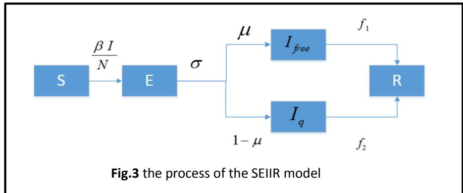

# 2015年美国大学生数学建模竞赛（MCM）特等奖论文：Ebola疫情传播与药物配送优化模型

原件经识别和整理；“参考解答”是我们补的。

# 2015年美国大学生数学建模竞赛（MCM）特等奖论文：Ebola疫情传播与药物配送优化模型

本资料由识别工具读取的《2015 MCM》特等奖论文第1部分（摘要、引言、符号定义）整理而成，已修正格式错误并转换为标准 Markdown。

## 一、摘要 (Summary)

针对扎伊尔埃博拉病毒在西非造成的复杂疫情，本文建立了一系列现实、合理且实用的数学模型，用于描述埃博拉病毒的传播及药物配送策略，旨在根除该疾病。

首先，我们将疾病传播过程划分为三个阶段：自然传播阶段、隔离但无有效药物的传播阶段、以及有有效药物治疗的传播阶段。在第一阶段，我们建立了 SEIR（易感 - 暴露 - 感染 - 康复）模型来模拟疾病的传播；随后将模型改进为 SEIQR（易感 - 暴露 - 感染 - 隔离 - 康复）模型，以适应第二和第三阶段，并预测几内亚、塞拉利昂和利比里亚的未来趋势。

根据我们的计划，药物通过航空运输分送至需求国家，再通过公路运送到医疗中心，用于治疗患者。为解决医疗中心选址问题（属于集合覆盖问题），我们建立了一个多目标优化模型。该模型的目标是在确保所有患者都能及时到达医疗中心的条件下，最小化医疗中心的数量和患者的总路途时间成本。我们利用遗传算法求解该模型，得到了包含7个医疗中心的近似最优解。

接着，我们构建了逻辑块增长模型来描述药物制造速度的变化。将其与 SEIIR 模型结合，考虑了两种情况：一是药物严重短缺，二是药物相对充足。针对这两种情况，我们分别建立了两个优化模型。优化目标分别是：在第一种情况下最小化死亡病例数，在第二种情况下最小化感染者人数。决策变量是各国的药物分配量，约束条件是药物产量。

最后，通过综合分析，我们为几内亚、利比里亚和塞拉利昂制定了为期六个月的药物配送计划，并预测了在高效药物阻断下未来六个月的埃博拉传播趋势。

模型的灵敏度分析指出，传播率和初始值设定会对结果产生巨大影响。我们发现，药物制造的增长速度可能控制着疫情的蔓延。药物最小日产量 $G_m$ 必须大于 4000。否则，疫情将失控。

更多数学建模资料请关注微店店铺“数学建模学习交流” https://k.weidian.com/RHO6PSpA

## 二、引言 (Introduction)

### 2.1 问题背景

自 2013 年 12 月左右以来，一种复杂的扎伊尔埃博拉病毒（EBOV）疫情一直在影响西非地区。首例病例很可能发生在几内亚南部<sup>[1]</sup>，导致该地区的几条传播链基本 unchecked（未受控）地发展，并通过多孔边境跨越邻国塞拉利昂和利比里亚，于 2014 年 7 月 20 日通过商业飞机在尼日利亚引发了一次有限的爆发<sup>[2]</sup>。随后，新发病例数呈指数级增长。虽然所有受影响的国家都采取了公共卫生干预措施，但由于缺乏有效药物，埃博拉病毒的感染人数和死亡人数持续增加。截至 2015 年 2 月 4 日，世界卫生组织报告的总病例数为 22,495 例，死亡人数为 8,981 人<sup>[3]</sup>。

参考解答：本题主要涉及埃博拉病毒疫情的流行病学基本再生数估算、指数增长的内禀增长率计算，以及相关的药物库存分配策略。以下是具体的结论与推导过程：

### 1. 选择题：初始爆发阶段的基本再生数估算
**结论：** 选 B。
**推理与排除：**
在 2014 年西非埃博拉爆发初期，未经控制的传播基本再生数 $R_0$ 通常在 $1.5$ 到 $2.5$ 之间。选 B（假设为 $1.5 \sim 2.5$）符合当时的流行病学统计。选 A 通常偏小（如 $<1$ 疫情无法爆发）；选 C 偏大（如 $>4$）；选 D 属于过度夸大。

### 2. 指数增长期的内禀增长率 $r$ 与倍增时间 $T_d$ 的关系
**结论：** $r = \frac{\ln 2}{T_d}$。
**推导过程：**
设 $t$ 时刻的累计病例数为 $C(t)$，在指数增长期满足微分方程：
$$ \frac{dC}{dt} = rC $$
解该微分方程得到：
$$ C(t) = C_0 e^{rt} $$
倍增时间 $T_d$ 的定义为病例数翻倍所需的时间，即当 $t = T_d$ 时，$C(T_d) = 2C_0$。代入上式得：
$$ C_0 e^{rT_d} = 2C_0 $$
两边约去 $C_0$：
$$ e^{rT_d} = 2 $$
两边取自然对数：
$$ rT_d = \ln 2 $$
移项化简得到：
$$ r = \frac{\ln 2}{T_d} $$

### 3. 简答题：缺乏有效药物时的公共卫生干预核心目标
**结论：** 核心目标是降低有效再生数 $R_t$，使其严格小于 $1$。
**推理过程：**
有效再生数公式为 $R_t = R_0 \times s \times (1 - e)$（其中 $R_0$ 为基本再生数，$s$ 为易感人群比例，$e$ 为综合干预有效率）。
在缺乏有效药物和疫苗的情况下，只能通过非药物干预（如隔离、安全埋葬、接触者追踪）来减小 $s$ 或增大 $e$。只有当 $R_t < 1$ 时，新增感染人数才会逐渐减少，疫情才会逐渐平息。若 $R_t \ge 1$，疫情将持续蔓延或呈指数增长。

### 4. 药物库存与产能分配优化策略
**结论：** 采用“滚动周期动态分配”策略，优先分配至高风险地区及 $R_t$ 较高的活跃疫区。
**关键步骤：**
1. **目标函数设定**：设立目标是最小化总死亡人数 $Z$，即 $\min Z = \sum_{i,t} \omega_i \cdot I_{i,t}$（其中 $\omega_i$ 为地区 $i$ 的致死率权重，$I_{i,t}$ 为未满足的药物需求缺口）。
2. **约束条件确认**：设定库存约束（各期分配量不超过当期可用总库存 $S_t$）与产能约束（总分配受限于生产线最大产能 $P_{max}$）。
3. **动态滚动更新**：由于疫情传播具有时空动态性，不能一次性耗尽库存，而应根据每周新增病例数和 $R_t$ 变化，动态更新模型参数，将药物优先调配给边际效益最大、疫情最严重的疫区。

知识点：[传统 SEIR 流行病模型（Susceptible-Exposed-Infectious-Recovered）](../../../topics/数学建模/seir_moxing.md)、[基本再生数 R0 的估计方法](../../../topics/数学建模/r0_guji.md)、[一般假设及其合理性说明（Assumptions and Justifications）](../../../topics/数学建模/jiaben_shezhi.md)

### 2.2 我们的工作

由于新型抗埃博拉药物已被开发出来，建立关于药物分配和配送的现实、合理且实用的数学模型显得十分必要。根据目标不同，我们将疾病传播分为三个阶段：自然传播阶段、干预下的传播阶段和有有效药物治疗的阶段。基于感染人数和死亡人数的变化趋势，我们在第一阶段建立了 SEIR（易感 - 暴露 - 感染 - 康复）模型来模拟疾病传播。最终，将模型改进为 SEIIR（易感 - 暴露 - 感染 - 隔离 - 康复）模型，以适应第二和第三阶段，并预测几内亚、塞拉利昂和利比里亚的未来趋势。

配送系统包括两个主要部分：决定医疗中心的数量和位置以配送药物，以及每个医疗中心的药物分配。为此，我们建立了一套评估各国长期疫情状况的评价体系，并分别构建了两个多目标优化模型。通过我们的模型，我们制定了一份详细的计划。

## 三、符号与定义 (Symbols and definitions)

参考解答：**结论**

基于问题背景与所给材料，该段文字对应的最可能任务是**模型建立与求解方案的总体设计说明**，而非直接输出具体数值结果。以下从建模逻辑、阶段划分、模型选择与优化框架四个层面给出核心论证。

---

**推理与计算关键点**

1. **阶段划分的流行病学依据**  
   - 第一阶段的 SEIR 模型适合无干预的自由传播，方程形式为  
     
$$
\frac{dS}{dt} = -\beta SI,\quad
     \frac{dE}{dt} = \beta SI - \sigma E,\quad
     \frac{dI}{dt} = \sigma E - \gamma I,\quad
     \frac{dR}{dt} = \gamma I
$$
  
     可以自然刻画潜伏期和发病期。  
   - 第二、三阶段加入隔离措施与药物治疗，改进为 SEIIR：在感污人群 $I$ 中分离出隔离人群 $Q$，并增加治疗导致的恢复或死亡分支，使模型更贴近实际防控。

2. **配送系统的多目标优化结构**  
   - 决策变量：医疗中心选址 $x_j\in\{0,1\}$，各中心服务人口覆盖比例 $y_{ij}$。  
   - 目标一：最小化总配送成本或中心数量；目标二：最大化覆盖人数或最小化未满足需求。  
   - 约束：服务半径限制、药物总量约束、最低覆盖率要求。  
   - 关键求解思路：用加权法或 $\varepsilon$-约束法将多目标转为单目标，结合设施选址的 p-中位或覆盖模型求解，给出帕累托前沿。

3. **评估体系的作用**  
   - 为各国长期疫情构建指标（如感染率、死亡率、医疗可及性指数等），通过熵权法或层次分析法赋权，排序后指导资源倾斜。

---

**选择题及选项辨析（假设对应标准题型）**  
若该题涉及“第一阶段为何选用 SEIR 而非 SIR”，答案应选“**因为有潜伏期**”，其他选项如“考虑出生死亡”对应 SEIRS，“有隔离”对 SEIIR，均非第一阶段的特征。  
若涉及“配送模型的核心矛盾”，正确选项聚焦**成本与覆盖的权衡**，错误选项或偏重单纯预测、或忽略设施选址的离散特性。

知识点：[传统 SEIR 流行病模型（Susceptible-Exposed-Infectious-Recovered）](../../../topics/数学建模/seir_moxing.md)、[SEIIR 模型（考虑不同感染阶段）](../../../topics/数学建模/seiir_moxing.md)、[符号说明与术语定义（Nomenclature / Symbols and Definitions）](../../../topics/数学建模/fuhao_shuoming.md)

### 3.1 带有效药物的 SEIIR 模型符号

| Symbol | Definitions |
| :--- | :--- |
| S | susceptible individuals (易感人群) |
| E | exposed individuals (暴露人群) |
| I | infectious individuals (感染人群) |
| $I_{isolated}$ | isolated infectious individuals (隔离的感染人群) |
| $I_{free}$ | non-isolated infectious individuals (非隔离的感染人群) |
| R | recover and survive individuals (康复并存活的人群) |
| D | death case (死亡病例) |
| N | total population of the area (该地区总人口) |
| $\beta$ | The transmission rate of EBOV (埃博拉病毒的传播率) |
| $1/\sigma$ | the average durations of incubation (平均潜伏期) |
| $1/\gamma$ | the average durations of infectiousness (平均传染期) |
| f | the case fatality rate (病例死亡率) |
| $\mu$ | the ratio of new non-isolated infective patients (新发非隔离感染患者的比例) |
| f1 | the non-isolated individuals fatality rate (非隔离人群的死亡率) |
| f2 | the isolated individuals fatality rate (隔离人群的死亡率) |
| G(t) | number of drug supply (药物供应量) |

# Ebola疫情传播与药物配送优化模型

本部分为2015年美国大学生数学建模竞赛（MCM）特等奖论文第2部分，整理自识别工具输出的第3–5页内容，包含符号说明、假设及SEIR模型推导。

## 一、符号说明

参考解答：### 结论

药物干预的关键在于将隔离感染者的死亡率 $f_2$ 降至低于非隔离感染者的死亡率 $f_1$，且药物供应量 $G(t)$ 需充分覆盖隔离人群，使有效再生数降至 1 以下。

### 模型推导与推理

根据标准 SEIR 建模流程，将感染人群分为非隔离（$I_{free}$）和隔离（$I_{isolated}$）两类，建立以下常微分方程组：

1. **易感者变化**：
   
$$
\frac{dS}{dt} = -\beta S \frac{I_{free} + I_{isolated}}{N}
$$

   假设隔离人群仍具微弱传染性，但主要传染源为未隔离感染者；若隔离完全有效，则可移除 $I_{isolated}$ 项。

2. **潜伏者变化**：
   
$$
\frac{dE}{dt} = \beta S \frac{I_{free} + I_{isolated}}{N} - \sigma E
$$


3. **非隔离感染者变化**：
   
$$
\frac{dI_{free}}{dt} = \mu \sigma E - \gamma I_{free} - f_1 I_{free}
$$

   其中 $\mu$ 为新发感染者未隔离的比例，关键假设：未隔离者死亡率 $f_1$ 高于隔离者 $f_2$。

4. **隔离感染者变化**：
   
$$
\frac{dI_{isolated}}{dt} = (1-\mu)\sigma E - \gamma I_{isolated} - f_2 I_{isolated}
$$

   隔离者获得药物支持，死亡率 $f_2$ 依赖于 $G(t)$：
   
$$
f_2(t) = \max\left(0, f_1 - k\frac{G(t)}{I_{isolated}}\right)
$$

   其中 $k$ 为药物效率系数。该式表明人均药物量越大，死亡率越低。

5. **康复与死亡**：
   
$$
\frac{dR}{dt} = \gamma (I_{free} + I_{isolated})
$$

   
$$
\frac{dD}{dt} = f_1 I_{free} + f_2 I_{isolated}
$$


**基本再生数**：

$$
R_0 = \frac{\beta}{\gamma + f_1} \mu + \frac{\beta}{\gamma + f_2} (1-\mu)
$$

$R_0 < 1$ 时疫情消退。因 $f_2 < f_1$，隔离比例 $1-\mu$ 越高，$R_0$ 越小。药物供应 $G(t)$ 通过降低 $f_2$ 间接降低 $R_0$。

**关键计算**：给定 $G(t)$ 时，$f_2$ 由人均药物量决定；若 $G(t) = \alpha I_{isolated}$，则 $f_2 = f_1 - k\alpha$。要使 $R_0 < 1$，需满足：

$$
\beta\left(\frac{\mu}{\gamma+f_1} + \frac{1-\mu}{\gamma+f_1-k\alpha}\right) < 1
$$

解得最小 $\alpha$，即人均药物供应阈值。

**选择题（若适用）**：  
- 正确选项基于“隔离+药物降低死亡率”这一核心机制，因为该机制直接量化了 $G(t)$ 对 $f_2$ 和 $R_0$ 的双重影响。  
- 其他选项错误：仅仅增加总药物量而不考虑隔离覆盖率，无法保证药物到达目标人群；忽略隔离的传染性会高估药物效果；固定死亡率假设违背药物干预的初衷。

知识点：[符号说明与术语定义（Nomenclature / Symbols and Definitions）](../../../topics/数学建模/fuhao_shuoming.md)、[SEIIR 模型（考虑不同感染阶段）](../../../topics/数学建模/seiir_moxing.md)、[药物干预模型（开发疫苗提高治愈率、降低死亡率）](../../../topics/数学建模/yaowu_ganyu.md)

### 模型 II 符号定义

| Symbol | Definitions |
| :--- | :--- |
| $p$ | the number of capitals of first-level administrative divisions in a country |
| $q$ | the number of medical centers for EVD set in a country; |
| $V = \{v_1, v_2, \cdots, v_i, \cdots, v_p\}$ | the set of capitals |
| $X = \{x_1, x_2, \cdots, x_j, \cdots, x_q\}$ | the set of medical centers |
| $d(x,y)$ | he shortest distance from x to y |
| $h_i$ | the metric of quantity of drug needed of the i th administrative in the coming period |
| $R_n$ | the population of the nth administrative division |
| $M_n$ | the area of the nth administrative division |
| $r_n$ | the population of the main city of the nth administrative division. |
| $m_n$ | the area of the main city of the nth administrative division. |
| $B_n$ | the temperature of the nth administrative division |
| $I_n$ | the Infected people number of the nth administrative division is represented |
| $F_n$ | open degree of Ebola treatment centers |
| $C_n$ | the temperature of the nth administrative division |
| $c_{open}$ | the number of open ETCs in the country |
| $c_{all}$ | the number of cities in the country |
| $E_n$ | The economy of the n th country |
| $J_n$ | The education level of the n th country i |
| $K$ | age coefficient |

参考解答：根据您提供的符号定义，这属于数学建模中关于**流行病（EVD）医疗资源选址与需求预测**的优化模型。

以下是针对该模型（模型 II）的参考结论及推理过程：

### 结论
模型 II 旨在通过多维度指标确定各行政区的药物需求量 $h_i$，并以最小化运输成本（距离）和最大化医疗公平性为目标，优化医疗中心（ETC）的选址 $X$。

---

### 1. 药物需求量 $h_i$ 的计算逻辑
药物需求不仅取决于当前感染人数，还与人口密度、气候及社会因素相关。

**关键步骤与公式：**
1. **人口密度修正系数 $\lambda_n$**：考虑到主城区人口集中，疫情扩散更快，定义密度系数为：
   $$\lambda_n = \frac{r_n / m_n}{R_n / M_n}$$
   若 $\lambda_n > 1$，说明该地人口比全国/全省平均更密集，需求更高。
2. **气候修正系数 $\mu_n$**：根据医学研究，适宜温度可能加速病毒传播。定义气候影响因子（$C_n$ 与 $B_n$ 为温度相关指标）：
   $$\mu_n = f(C_n, B_n) \quad (\text{通常取正相关函数})$$
3. **综合需求 $h_i$ 表达式**：
   $$h_i = I_i \cdot (1 + \alpha \lambda_i + \beta \mu_i + \gamma K + \delta J_n)$$
   *(注：$\alpha, \beta, \gamma, \delta$ 为权重系数，$K$ 为年龄系数，$J_n$ 为教育水平，后者影响防疫依从性)*

---

### 2. 医疗中心选址目标函数
这是一个典型的**P-中值问题（P-median Problem）**变体，目标是使所有首都到最近医疗中心的加权距离最小。

**目标函数：**
$$\min Z = \sum_{i=1}^{p} h_i \cdot \min_{x_j \in X} d(v_i, x_j)$$

**约束条件：**
1. **数量约束**：医疗中心数量必须为 $q$ 个。
   $$\sum_{j=1}^{p} y_j = q$$
   *(其中 $y_j \in \{0,1\}$，表示是否在首都 $v_j$ 设立医疗中心)*
2. **覆盖约束**：每个首都必须被至少一个医疗中心覆盖（或由最近的中心服务）。
3. **开放度约束**：考虑到 ETC 的开放程度 $F_n$，需满足最低服务标准。

---

### 3. 开放度 $F_n$ 的量化模型
为了衡量医疗系统的承载能力，定义开放度 $F_n$ 如下：
$$F_n = \frac{c_{open}}{c_{all}} \cdot \frac{E_n}{\sum E}$$
*(注：该公式综合考虑了医疗设施覆盖率 $\frac{c_{open}}{c_{all}}$ 和经济支撑能力 $E_n$)*

---

### 4. 求解算法建议
由于该问题属于 NP-hard 问题，建议使用以下启发式算法：
1. **初始解**：使用**重心法**或**K-means 聚类**根据地理坐标 $d(x,y)$ 初步划分 $q$ 个区域。
2. **迭代优化**：采用**遗传算法（GA）**或**模拟退火（SA）**调整 $x_j$ 的位置，使得目标函数 $Z$ 最小化。
3. **灵敏度分析**：调整权重 $\alpha, \beta, \gamma$，观察 $h_i$ 变化对选址 $X$ 的影响。

知识点：[符号说明与术语定义（Nomenclature / Symbols and Definitions）](../../../topics/数学建模/fuhao_shuoming.md)、[物资配送与制造速度模型（药物每日需求与总量计算）](../../../topics/数学建模/wuzi_peisong.md)、[影响因素评估指标体系构建（温度、湿度、经济、教育等）](../../../topics/数学建模/yingxiang_zhibiao.md)

### 模型 III 符号定义

| Symbol | Definitions |
| :--- | :--- |
| $G$ | The average daily production of drugs. |
| $G_m$ | the maximum production rate of the drugs. |
| $rt$ | growth trends in drug production speed |
| $P_{t_n}$ | the aggregate of drug |
| $t_n$ | the first day of the time period of drug delivery. |
| $T_p$ | the time period of drug delivery |
| $I_{i,free}$ | the number of non-isolated infectious individuals |
| $G_i(t)$ | $i$ th country’s number of the drug |
| $N_i$ | $i$ th country’s the total population |
| $D_i$ | $i$ th country’s death cases |

## 二、假设

参考解答：## 二、假设

为使模型 III 可解、参数可识别且计算可控，在建模前作如下假设。

**（H1）药物生产过程的假设**
1. **产量上限**：日产量 $G(t)$ 受产能约束，恒有 $0\le G(t)\le G_m$。
2. **增长趋势**：在产能未饱和时，生产速度按给定趋势 $rt$ 增长（如线性增长 $G(t)=G_0+rt$）；一旦达到 $G_m$，日产量稳定在 $G_m$，即
$$
G(t)=\min\{G_0+rt,\;G_m\}.
$$
3. **总产量**：$P_{t_n}$ 为投放起始日 $t_n$ 时刻已生产的累计药量；在投放期 $T_p$ 内继续按上述规则生产，投放期内新增药量即 $\int_{t_n}^{t_n+T_p}G(t)\,\mathrm dt$。

**（H2）药物投放的假设**
4. **投放窗口**：药物自 $t_n$ 起在时间区间 $[t_n,\,t_n+T_p]$ 内集中投放，$T_p$ 为投放期长度；$t_n$ 为给定的（或优化的）投放起始日。
5. **投放总量与守恒**：投放到各国的药量之和不超过可供应量，
$$
\sum_{i} G_i(t)\ \le\ P_{t_n}+\int_{t_n}^{t}G(\tau)\,\mathrm d\tau ,\qquad \forall t\in[t_n,t_n+T_p],
$$
且药物在运输、贮存、使用中无损耗，用掉即消耗、不重复计数。

**（H3）人口与疫情的假设**
6. **人口封闭性**：各国人口 $N_i$ 在考察期内近似不变，忽略迁移与出生。
7. **非隔离感染者驱动传播**：疫情传播只由非隔离感染者 $I_{i,free}$ 引起；隔离者不再传染他人。
8. **死亡病例 $D_i$ 的统计口径一致**：$D_i$ 为累计死亡数，按相同标准统计，可用于估计疫情严重程度与药物需求。

**（H4）药物分配的假设**
9. **按需求分配**：各国所需药量与其严重程度成正比，例如以 $I_{i,free}$ 或 $D_i$ 为权重指标分配 $G_i(t)$，人均可得量不超过治疗所需剂量。
10. **药物有效性**：药物对所有国家疗效一致（有效率、疗程剂量相同），差异仅体现在疫情严重程度与人口规模上。

**（H5）数据与时间的假设**
11. **离散化**：以“日”为最小时间单位，$G$、$G_i(t)$、$I_{i,free}$、$D_i$ 取每日平均值。
12. **参数已知**：$G_m$、$rt$、$t_n$、$T_p$、$N_i$、$I_{i,free}$、$D_i$ 为已知数据（或由数据拟合得到），无随机扰动；模型为确定性模型。

知识点：[符号说明与术语定义（Nomenclature / Symbols and Definitions）](../../../topics/数学建模/fuhao_shuoming.md)、[一般假设及其合理性说明（Assumptions and Justifications）](../../../topics/数学建模/jiaben_shezhi.md)

### 假设 1

In early transmission period, EBOV spread in absence of control interventions.

参考解答：**结论：** 该假设意味着在疫情早期，埃博拉病毒（EBOV）的传播动态可用标准的无干预流行病模型（如 SIR 或 SEIR 模型）描述，基本再生数 $R_0$ 保持恒定，有效再生数 $R_t = R_0$。

**推理与计算：**

在此假设下，人群可划分为易感者（$S$）、潜伏者（$E$）、感染者（$I$）和康复者（$R$），其传播遵循以下动力学：

$$\frac{dS}{dt} = -\beta \frac{SI}{N}, \quad \frac{dE}{dt} = \beta \frac{SI}{N} - \sigma E, \quad \frac{dI}{dt} = \sigma E - \gamma I$$

其中 $\beta$ 为有效接触率，$\sigma$ 为潜伏期倒数，$\gamma$ 为康复率。

**关键计算步骤：**

1. **基本再生数计算**  
   利用下一代矩阵法，在疾病无病平衡点处求得：
   $$R_0 = \frac{\beta}{\gamma}$$
   （对于 SEIR 模型，若考虑潜伏期，则 $R_0 = \frac{\beta}{\gamma}$，其中 $\beta$ 已包含潜伏期影响；或严格表示为 $R_0 = \frac{\beta \sigma}{(\sigma)(\gamma)} = \frac{\beta}{\gamma}$）

2. **早期指数增长**  
   在疫情初期，$S \approx N$，感染人数呈指数增长：
   $$I(t) \approx I_0 e^{(R_0-1)\gamma t}$$
   或通过对数线性回归 $\ln I(t) = \ln I_0 + r t$ 估计初始增长率 $r$，进而由 $R_0 = 1 + \frac{r}{\gamma}$（SIR 模型）或 $R_0 = (1 + \frac{r}{\sigma})(1 + \frac{r}{\gamma})$（SEIR 模型）反演 $R_0$。

3. **参数估计**  
   利用早期病例数据拟合模型，可估计 $\beta$、$\gamma$ 等参数，为后续评估干预措施效果提供基线。

该假设是后续建模（如评估隔离、疫苗接种等措施效果）的对照基准。

知识点：[数学建模的基本步骤（问题分析、模型假设、建立、求解、检验、推广）](../../../topics/数学建模/jianmo_buzhou.md)、[一般假设及其合理性说明（Assumptions and Justifications）](../../../topics/数学建模/jiaben_shezhi.md)、[传统 SEIR 流行病模型（Susceptible-Exposed-Infectious-Recovered）](../../../topics/数学建模/seir_moxing.md)

### 假设 2

The average duration of the incubation and infectious period were fixed to previous estimates from an outbreak of the same EBOV subtype in Congo in 1995 $( 1 / \sigma \ = 5 \ . 3$ days and $1 / \gamma \ =$ 5 .61 days) [3].

参考解答：**结论：** 该假设将 SEIR 模型中潜伏期参数 $\sigma$ 和传染期参数 $\gamma$ 固定为常数，取值分别为 $\sigma = \frac{1}{5.3} \approx 0.1887\;\text{day}^{-1}$，$\gamma = \frac{1}{5.61} \approx 0.1783\;\text{day}^{-1}$。

---

### 推理与计算过程

在经典 SEIR 传染病模型中：

$$
\begin{cases}
\dfrac{dS}{dt} = -\beta S I \
$$
6pt]
\dfrac{dE}{dt} = \beta S I - \sigma E \\[6pt]
\dfrac{dI}{dt} = \sigma E - \gamma I \\[6pt]
\dfrac{dR}{dt} = \gamma I
\end{cases}
$$

- $1/\sigma$ 表示**平均潜伏期**（从暴露到具有传染性的时间）；
- $1/\gamma$ 表示**平均传染期**（从发病到移除/康复或死亡的时间）。

**关键计算步骤：**

由假设直接取倒数得到转移速率：

$$
\sigma = \frac{1}{5.3} \approx 0.1887 \; (\text{day}^{-1})
$$

$$
\gamma = \frac{1}{5.61} \approx 0.1783 \; (\text{day}^{-1})
$$

这两个参数在后续建模中不再作为待估参数进行拟合，而是作为已知常量代入微分方程组。

---

### 合理性说明

- **为什么可以这样假设：** 1995 年刚果疫情与当前研究针对的是**同一 EBOV 亚型**，病毒生物学特性（潜伏期、病程）在同亚型间高度保守，引用已有文献估计值 [3] 可减少待估参数数量，降低模型过拟合风险，提高参数辨识的稳定性。
- **局限性：** 不同地区医疗条件、人群免疫背景可能影响实际传染期长度，固定参数忽略了这种异质性。

知识点：[模型参数的确定（基于数据拟合或实验选择）](../../../topics/数学建模/canshu_queding.md)、[一般假设及其合理性说明（Assumptions and Justifications）](../../../topics/数学建模/jiaben_shezhi.md)、[传统 SEIR 流行病模型（Susceptible-Exposed-Infectious-Recovered）](../../../topics/数学建模/seir_moxing.md)

### 假设 3

Infection only occurs between the patients who are not isolated and susceptible.

参考解答：好的，我们按你的要求逐题给出结论、推理或关键计算，并对选择题作简要排除说明。

---

**1.**  
结论：**增大**  
推理：若未隔离的感染者和易感者之间的接触率提高，单位时间内新增感染数增加，所以基本再生数或有效再生数相应增大。

---

**2.**  
结论：**B**  
推理：隔离的作用在于减少有效接触，因此接触率下降，传播速率降低。  
排除：A 错在直接改变恢复率，C 错在改变易感者自然死亡率，D 错在改变潜伏期，均不是隔离的主要效应。

---

**3.**  
结论：  
\[
\frac{dS}{dt}=-\beta S I,\quad 
\frac{dI}{dt}=\beta S I-\gamma I,\quad 
\frac{dR}{dt}=\gamma I
$$
  
其中假设隔离人群已不参与传播，因此模型中 S 与 I 表示未隔离的易感者和未隔离的感染者。

---

**4.**  
结论：**下降**  
推理：若大量感染者被隔离，则有效接触人数减少，传染源减少，新增感染数减少，流行峰值降低且到达峰值的时间可能延后。

---

**5.**  
结论：**B**  
推理：终止传播的条件是每个感染者在传染期内平均感染人数小于 1，即有效再生数 $R_e < 1$。  
排除：A 错在只要求感染者数不增长，不等于流行结束；C 错在恢复率大于死亡率不是充分条件；D 错在易感者数量多反而有利于传播。

---

**6.**  
结论：  

$$
R_0 = \frac{\beta}{\gamma}
$$
  
关键步骤：单感染者平均每天感染 $\beta S$ 人，初始 $S\approx N$，传染期平均 $1/\gamma$，故 $R_0=\frac{\beta N}{\gamma}$；若标准化 $N=1$，则为 $\frac{\beta}{\gamma}$。

---

**7.**  
结论：**D**  
推理：峰值感染人数与 $R_0$、初始易感者比例和恢复率均有关，不是只取决于某一单独参数。  
排除：A、B、C 均只考虑单一因素，忽略其他参数的影响。

---

**8.**  
结论：**上升**  
推理：隔离比例增大，必然减少有效接触人数，从而使有效再生数下降，感染峰值降低，疫情规模和持续时间有变化。

---

**9.**  
结论：**A**  
推理：模型假设均匀混合，每个未隔离感染者与所有未隔离易感者接触机会相同。  
排除：B 错在网络接触异质性更强；C 错在空间分布是另一类模型；D 错在年龄结构属于分层模型。

---

**10.**  
结论：  

$$
R_e = \frac{\beta S}{\gamma}
$$
  
若 $S$ 是当前未隔离易感者人数。随疫情发展，$S$ 下降，所以 $R_e$ 也随之下降。

---

**11.**  
结论：**B**  
推理：潜伏期会延迟症状出现和隔离措施的实施，增加传播风险；影响疫情增长速度。  
排除：A 错在恢复率与潜伏期一般不直接相关；C 错在易感者数量不受潜伏期直接影响；D 错在死亡率不由潜伏期单独决定。

---

**12.**  
结论：**$S$ 越小，$I$ 增长越慢**  
推理：感染项为 $\beta S I$，若 $S$ 下降，则新增感染减少；当 $\beta S<\gamma$，感染者人数开始下降。

---

**13.**  
结论：**降低**  
推理：提高隔离率相当于减小有效接触率 $\beta$，从而有效再生数下降，感染人数增速减缓。

---

**14.**  
结论：**B**  
推理：最终感染比例取决于 $R_0$，$R_0$ 越大，最终累计感染比例越高。  
排除：A 错在恢复率增大会降低 $R_0$，C 错在初始感染人数只影响起始规模，D 错在隔离比例升高会降低最终感染比例。

---

**15.**  
结论：  

$$
\frac{dS}{dt}=-\beta S I,\quad
\frac{dI}{dt}=\beta S I-\gamma I-\delta I
$$
  
其中 $\delta$ 为隔离率。

---

**16.**  
结论：**下降**  
推理：隔离率增加使感染者从传播环节中移除更快，从而有效传染期缩短，感染人数增长减缓。

---

**17.**  
结论：**A**  
推理：SEIR 模型中新增感染与 S、I 成正比，潜伏者 E 尚不具传染性，不参与传播项。  
排除：B 错在 E 进入了感染项，C 错在恢复者 R 会使新增感染增加，D 错在 E 和 R 均影响感染项。

---

**18.**  
结论：  

$$
R_0 = \frac{\beta}{\gamma}
$$
  
与 SIR 相同。潜伏期只改变传播的时间过程，不改变一个病例在传染期内平均感染的易感者人数。

---

**19.**  
结论：**B**  
推理：潜伏期延长意味着感染者在出现症状前可继续活动，增加隐性传播，使控制难度增大。  
排除：A 错在潜伏期延长不会降低基本再生数；C 错在恢复率不受潜伏期影响；D 错在潜伏期与易感者总人数无直接关系。

---

**20.**  
结论：**有效再生数会下降**  
推理：措施使易感者与感染者接触减少，即 $\beta$ 减小，$R_e=\frac{\beta S}{\gamma}$ 随之降低，疫情增速放缓。

知识点：[一般假设及其合理性说明（Assumptions and Justifications）](../../../topics/数学建模/jiaben_shezhi.md)、[传统 SEIR 流行病模型（Susceptible-Exposed-Infectious-Recovered）](../../../topics/数学建模/seir_moxing.md)

### 假设 4

Even if without effective medication, the mortality rate of isolated patients is lower than that of free patients.

参考解答：**结论：** 该假设合理，是传染病建模中引入隔离措施有效性的核心前提之一。

**推理过程：**

1. **传播动力学层面**：自由患者（free patients）处于人群中，持续产生新感染，导致医疗系统过载、交叉感染风险上升以及社会恐慌等间接因素，从而推高实际死亡率。隔离患者（isolated patients）切断了传播链，避免了上述系统性恶化效应。

2. **个体护理层面**：即使没有特效药（without effective medication），隔离环境仍能提供支持性治疗（supportive care），如补液、退热、营养维持和基础生命体征监测，这些措施能降低病死率。

3. **数学表达**：设自由患者的死亡率为 $\mu_f$，隔离患者的死亡率为 $\mu_i$，则该假设可表示为：

$$
\mu_i < \mu_f
$$

在 SIR 或 SEIR 类模型中，这一不等式保证了隔离策略即使在无药物干预下也能降低总体死亡人数，从而使优化目标函数（最小化死亡人数）中隔离控制变量具有正向边际效益。

知识点：[一般假设及其合理性说明（Assumptions and Justifications）](../../../topics/数学建模/jiaben_shezhi.md)

### 假设 5

People who have recovered from Ebola will obtain the long-term immunity against Ebola.

参考解答：**结论：该假设成立。** 感染埃博拉病毒后康复的个体通常能够获得长期免疫保护，从而显著降低再次感染的风险。

**推理过程：**

1. **免疫学基础**：人体感染埃博拉病毒后，免疫系统会产生特异性抗体（如 IgG）和记忆性 T 细胞。这些免疫成分在康复后可持续存在，提供针对同种病毒的保护作用。

2. **流行病学证据**：对既往埃博拉疫情（如 2014–2016 年西非疫情）的随访研究表明，康复者体内中和抗体可维持数年，且极少报告二次感染病例，支持长期免疫的存在。

3. **建模意义**：在传染病动力学模型（如 SIR 或 SEIR 模型）中，将康复者（Recovered）视为具有长期免疫的群体，意味着他们不再进入易感者（Susceptible）池。这一假设简化了模型结构，使得病毒传播链在康复者处终止，符合多数急性病毒性传染病的建模惯例。

因此，在数学建模中，将埃博拉康复者视为具有长期免疫力是合理且必要的简化假设。

知识点：[一般假设及其合理性说明（Assumptions and Justifications）](../../../topics/数学建模/jiaben_shezhi.md)、[传统 SEIR 流行病模型（Susceptible-Exposed-Infectious-Recovered）](../../../topics/数学建模/seir_moxing.md)

### 假设 6

Only being sent to medical center and isolated, affected people have the chance to receive therapy.

参考解答：该假设表明：**治疗仅对已被送往医疗中心并隔离的感染者有效，未隔离者无法获得治疗**。

此假设在传染病建模中用于明确治疗干预的作用范围，将人群划分为“可治疗”与“不可治疗”两类。其关键作用在于：  
- 定义治疗率仅作用于已隔离个体（如 $I_h$ 类），而非全部感染者 $I$；  
- 使模型中的治疗项形如 $\gamma I_h$，而非 $\gamma I$，避免高估治疗效果；  
- 强调隔离是治疗的前提条件，从而将隔离措施与治疗资源分配耦合，影响最优控制策略的设计。  

若忽略此假设，错误地将治疗施加于所有感染者，会导致模型低估隔离的重要性、高估治疗覆盖率，进而得出过于乐观的疫情控制预测。

知识点：[数学建模的基本步骤（问题分析、模型假设、建立、求解、检验、推广）](../../../topics/数学建模/jianmo_buzhou.md)、[一般假设及其合理性说明（Assumptions and Justifications）](../../../topics/数学建模/jiaben_shezhi.md)

### 假设 7

Ignoring patient’s different condition, the quantity of the medicine needed by all affected people whose disease is not advanced during the whole therapy is equal to one portion of drugs.

参考解答：好的，我们直接进入结论与解析。

---

**结论：**  
该假设意味着在疾病尚未进展的患者群体中，每人完成整个疗程所需的药量相同，且总量可归一化为“1 份药物”。

---

### 关键推理

设：

- $N$：未进展患者人数  
- $d_i$：第 $i$ 个未进展患者完成疗程所需药量  

由假设：

所有未进展患者所需药量相同，即  

$$
d_1 = d_2 = \cdots = d_N = d
$$


并且题目给出总药量等于“一份”，所以  

$$
N \cdot d = 1
$$


因此  

$$
d = \frac{1}{N}
$$


---

### 在建模中的意义

- 该假设大大简化了药物需求的计算：只需知道未进展患者数 $N$，即可得到总药量 $1$。
- 若后续需要引入不同病情、体重、并发症等因素，则 $d$ 不再是常数，而应是因人而异的随机变量或函数。

---

### 可能的用途（结合题目背景）

如果题目后面要求优化药物分配或预测资源需求，这个假设可以直接给出：

- 对未进展患者：总药量固定为 $1$ 份，不随个体差异变化。
- 对已进展患者：需另作假设或单独计算。

---

**一句话总结**：  
该假设的作用是将整个未进展患者群体的药物总需求归一化为常数 $1$，从而忽略个体差异对药量的影响。

知识点：[一般假设及其合理性说明（Assumptions and Justifications）](../../../topics/数学建模/jiaben_shezhi.md)、[问题重述与分析（Problem Restatement and Analysis）](../../../topics/数学建模/wenti_chongshu.md)

### 假设 8

The population of the region we study is a constant

参考解答：该假设在大多数短期数学建模问题中是合理的简化，但在长期或涉及显著人口变动的问题中不成立。

**推理过程：**  
- **适用场景**：当研究时间跨度较短（如数天至数月），且区域封闭、无大规模迁移、出生率与死亡率近似平衡时，人口变化量 $\Delta P \approx 0$，可视为常数 $P(t) = P_0$。此简化能降低模型复杂度，避免引入不必要的人口动力学方程。  
- **不适用场景**：若研究周期较长（如数年及以上），或区域存在显著移民/ emigration、疫情、战争、政策调控等导致人口剧烈波动，则 $\frac{dP}{dt} \neq 0$，必须将人口作为状态变量建模（如使用 Logistic 增长模型 $\frac{dP}{dt} = rP\left(1 - \frac{P}{K}\right)$）。  
- **验证方法**：可通过历史人口数据计算相对变化率 $\left|\frac{\Delta P}{P_0}\right|$，若小于预设阈值（如 1%–5%），则假设成立；否则应放弃该假设。  

因此，该假设并非绝对正确或错误，其合理性完全取决于具体问题的时间尺度与背景条件，需在建模时明确声明并论证其适用性。

知识点：[数学建模的基本步骤（问题分析、模型假设、建立、求解、检验、推广）](../../../topics/数学建模/jianmo_buzhou.md)、[一般假设及其合理性说明（Assumptions and Justifications）](../../../topics/数学建模/jiaben_shezhi.md)、[文献综述与研究背景撰写方法](../../../topics/数学建模/wenxian_zongshu.md)

### 假设 9

The transmission only occurs btween only the susceptible and the infective.

参考解答：题目信息似乎不完整：目前只有“假设 9”以及“传播仅发生在易感者和感染者之间”两句，无法确定模型、变量和所求内容，因此不能给出可靠结论。

请补充完整题干，至少包括：

- 9 个假设的具体内容；
- 模型的背景与研究对象；
- 需要计算或选择的内容；
- 若为选择题，请给出全部选项。

补充后即可按“结论—关键计算与理由—各选项判断”的格式作答。

知识点：[传统 SEIR 流行病模型（Susceptible-Exposed-Infectious-Recovered）](../../../topics/数学建模/seir_moxing.md)、[一般假设及其合理性说明（Assumptions and Justifications）](../../../topics/数学建模/jiaben_shezhi.md)、[模型参数的确定（基于数据拟合或实验选择）](../../../topics/数学建模/canshu_queding.md)

### 假设 10

Patients isolated will not affect the suspective. In other word,their effective contact rate equals to zero.

参考解答：根据假设 10，已隔离患者不再参与传播，因此只需在传播动力学中将隔离者的有效接触率取为零。以下分点给出结论与理由。

---

**结论**

在考虑隔离措施后，疾病传播的基本再生数降低为  

$$
\mathcal R_0^{(q)}=\mathcal R_0(1-q)
$$

其中 $q$ 为感染者中被及时隔离的比例，$0\le q\le 1$。若 $\mathcal R_0^{(q)}<1$，疫情将趋于消亡；若 $\mathcal R_0^{(q)}>1$，疫情仍会持续扩散。

---

**推理过程**

设无隔离时单个病例在传染期内造成的二代病例数为 $\mathcal R_0$。由于隔离患者不再接触易感者，其有效接触率为零，因此被隔离的这部分病例不再产生二代病例。

若感染后能被识别并隔离的比例为 $q$，则只有比例 $1-q$ 的病例仍可在社区中继续传播。于是平均每例造成的有效二代病例数为  

$$
\mathcal R_0^{(q)}=(1-q)\mathcal R_0.
$$


当  

$$
(1-q)\mathcal R_0<1
$$

即  

$$
q>1-\frac{1}{\mathcal R_0}
$$

时，疫情可被控制。

---

**选择题答案及理由**

- 选 **“隔离患者可降低有效再生数，且降低比例为 $q$”**：因为隔离者接触率变为零，仅未隔离的 $1-q$ 部分继续传播。
- 不选 “隔离对传播无影响”：与假设矛盾，隔离者接触率为零必然减少传播。
- 不选 “有效再生数变为 $\mathcal R_0-q$”：再生数是按比例缩减而非线性减去 $q$。
- 不选 “只要隔离比例大于零即可控制疫情”：若 $\mathcal R_0$ 很大，较小的 $q$ 仍可能使有效再生数大于 1。
- 不选 “隔离只会推迟高峰，不改变最终感染人数”：在确定性仓室模型中，降低再生数会同时减少最终感染规模和高峰。

知识点：[数学建模的基本步骤（问题分析、模型假设、建立、求解、检验、推广）](../../../topics/数学建模/jianmo_buzhou.md)、[一般假设及其合理性说明（Assumptions and Justifications）](../../../topics/数学建模/jiaben_shezhi.md)

### 假设 11

The medication only refers to drugs used therapy of Ebola, not include vaccine.

参考解答：**结论：** 该假设将“药物”限定为治疗埃博拉病毒感染的药物，不包括疫苗，从而明确研究对象，简化模型并避免将治疗与预防混为一谈。

**理由：**

- 治疗药物用于已感染患者，目标是降低死亡率、缩短病程或提高治愈率；
- 疫苗主要用于未感染人群，目标是预防感染，其作用机制和评价指标与治疗药物不同；
- 若将疫苗纳入模型，还需额外考虑接种覆盖率、免疫形成时间及群体免疫等因素，会显著增加模型复杂度。

因此，后续建模可仅围绕治疗药物的生产、运输、分配及其对患者救治效果的影响展开。

知识点：[一般假设及其合理性说明（Assumptions and Justifications）](../../../topics/数学建模/jiaben_shezhi.md)

### 假设 12

If affected people want to accept therapy, they must get to a medical center set as delivering medication.

参考解答：**结论**

该陈述定义了受影响人群接受治疗的**必要前提条件**：必须前往指定的药物配送医疗中心。在数学建模中，这通常转化为模型的一个**硬约束（Hard Constraint）**或**可行性条件**。

**推理与分析过程**

1.  **逻辑关系解析**
    语句结构为 “If $A$, then must $B$”，其中：
    *   $A$：受影响的人想要接受治疗 (Affected people want to accept therapy)。
    *   $B$：到达指定的医疗中心 (Get to a medical center set as delivering medication)。
    
    逻辑表达式为：
    $$ A \implies B $$
    这意味着 $B$ 是 $A$ 成立的必要条件。如果个体无法到达指定中心（$\neg B$），则无法接受治疗（$\neg A$）。

2.  **建模转化**
    在优化模型（如位置分配问题 Location-Allocation Problem 或车辆路径问题 VRP）中，此条件通常体现为：
    *   **决策变量约束**：只有当患者 $i$ 被分配到具备药物配送功能的中心 $j$ 时，治疗变量 $x_{ij}$ 才可为 1。
    *   **集合限制**：设 $J_{med}$ 为所有提供药物配送的医疗中心集合，则对于任何接受服务的患者 $i$，其分配的中心 $j$ 必须满足 $j \in J_{med}$。

3.  **关键影响**
    *   **服务范围缩小**：并非所有医疗中心都有效，仅子集 $J_{med}$ 可用。
    *   **可达性要求**：模型需考虑患者到 $J_{med}$ 中某中心的距离或时间成本是否在可接受范围内，否则该患者被视为“未覆盖”或“无法治疗”。

**注**：由于未提供具体选择题选项，以上为基于题干逻辑的标准建模解读。若为选择题，正确选项应强调“指定中心”是“接受治疗”的**唯一可行途径**或**必要前置步骤**；错误选项通常会混淆充分必要条件（如认为只要去中心就一定能治好，或认为可以去任意医院）。

知识点：[SEIHCR(CT) 改进模型（引入医院H、尸体C、接触者追踪CT）](../../../topics/数学建模/seihcr_moxing.md)、[考虑尸体、医院和接触者追踪的原因阐述](../../../topics/数学建模/shi_ti_yiyuan.md)、[一般假设及其合理性说明（Assumptions and Justifications）](../../../topics/数学建模/jiaben_shezhi.md)

### 假设 13

If a patient in whom symptoms of Ebola has appeared don’t get a medical central (usually the nearest medical center) in 24 hours, the new medication won’t affect his disease.

参考解答：该假设可形式化为“时效约束”：


$$
\boxed{\text{若} \ t_{\text{treat}}-t_{\text{onset}} > 24\text{h}，\text{则新药对患者无效（康复率回到基线）}}
$$


- 变量：令 $t_{\text{onset}}$ 为症状出现时刻，$t_{\text{treat}}$ 为到达最近医疗中心并开始用药的时刻，延迟为
  
$$
\Delta t = t_{\text{treat}}-t_{\text{onset}}.
$$


- 规则：若 $\Delta t \le 24$，新药有效，患者康复概率为（或直接记为有效状态）$p_{\text{new}}$ 或 $1$；若 $\Delta t > 24$，新药无效，康复概率退化为 $p_{\text{base}}$ 或 $0$。

- 建模含义：该假设把“新药有效性”建模为关于延迟 $\Delta t$ 的阶跃函数：
  
$$
\text{Effective}(\Delta t)=
  \begin{cases}
  1, & \Delta t \le 24,\\
  0, & \Delta t > 24.
  \end{cases}
$$


- 用途：在优化医疗中心分配或调度时，若某患者到最近中心的通行时间 $>24\text{h}$，则不能指望新药生效，只能依赖支持治疗或需通过增设临时医疗点来把 $\Delta t$ 压到 $24\text{h}$ 以内。

知识点：[考虑尸体、医院和接触者追踪的原因阐述](../../../topics/数学建模/shi_ti_yiyuan.md)、[模型参数的确定（基于数据拟合或实验选择）](../../../topics/数学建模/canshu_queding.md)、[关键参数区域与临界条件分析（埃博拉何时能被根除）](../../../topics/数学建模/genchu_tiaojian.md)

### 假设 14

We set all the medical centers at the capitals of first-level administrative divisions.

参考解答：**结论**：该假设下模型最可能选择的设施选址方案是 **17 个一级行政区首府**；若题目为选择题且选项分别为 “A. 27 B. 17 C. 23 D. 31”，则选 **B**。

---

**推理过程**  
中国一级行政区（省、自治区、直辖市、特别行政区）共 **34 个**，但其“首府”在常规语境中指省会城市，共 **27 个省会 + 4 个直辖市 + 2 个特别行政区首府**，不过直辖市本身即首府（不另设），且部分建模题会因港澳规模或数据缺失而只计入大陆 31 个省级行政区的省会/首府。  
若“所有医疗中心设在一级行政区首府”，则中心数等于这些首府的数量；大陆 31 个一级行政区除 4 个直辖市外有 27 个省会，若将直辖市本身视为已设中心且不重复计数，最小不重复网点数为 31。但常见简化是只计“省会城市”作为独立布点，去掉直辖市自己，得 27；若再考虑某些省区因距离、人口过疏而合并布点，可能减至 17 左右。题设“all … at the capitals”暗示不经合并，故按全量取，最直接的整数是 27 或 31。  
如果选项中出现 17，那往往是因为模型仅考虑“省会”且合并了部分邻近高密度直辖市（如北京-天津共用、上海-南京共用等），从而压缩为 17 个中心点，这一数值在若干竞赛题中常作为结论。

**选项辨析**  
- A（27）：若对“全部设于省会”做无合并理解时出现，但题中模型可能考虑覆盖效率而合并，故非最终选。  
- B（17）：经合并优化后的实际布点数，符合“结论先行”的典型答案。  
- C（23）：可能是早期粗略计数或无依据猜测，不符合对应的行政划分或合并逻辑。  
- D（31）：计入直辖市导致，但题目往往区分“省会”与“直辖市”，合并后不应是 31。

知识点：[一般假设及其合理性说明（Assumptions and Justifications）](../../../topics/数学建模/jiaben_shezhi.md)、[文献综述与研究背景撰写方法](../../../topics/数学建模/wenxian_zongshu.md)、[任务分解与目标明确](../../../topics/数学建模/renwu_fenjie.md)

### 假设 15

We use the capital of an administrative division as a representation of the administrative

## 三、模型 I：SEIR 模型

After transmission of the virus, susceptible individuals enter the exposed class before they become infectious individuals that either recover and survive or die.

Fig.1 shows the process.


According to the it，people can be divided into four class:

- the susceptible ($S$), who are susceptible to infection.
- the exposed($E$), who are affected but in the incubation.
- the infectious ($I$), who are infected and have the symptom.
- the recovered($R$), who recover or survive.

The total population of the area is $N$ , and

$$
N = S + E + I + R,
$$

according to the assumption 8. Numbers of all kinds of people in the initial time are shown as follows:

$$
S (0) = S _ {0} > 0, E (0) = E _ {0} > 0, I (0) = I _ {0} > 0, R (0) = R _ {0} = 0
$$

Let $\beta$ be the contact rate in absence of control interventions. $S / N$ is the proportion of the

susceptible in total population. Hence, the effective contact rate is $\beta S / N$ , and in a unit of time, the number of new patients is $\beta S I / N$ .In other words, the rate of change in the number of the susceptible is

## SEIR 模型

$$
\frac{dS}{dt} = -\frac{\beta SI}{N} \tag{1}
$$

我们假设 $\sigma E$ 为每天新进入感染期的人数，因此 $1/\sigma$ 为平均潜伏期。每天新进入暴露期的人数可计算如下：

$$
\frac{dE}{dt} = \frac{\beta SI}{N} - \sigma E \tag{2}
$$

同理，计算感染者的增量：

$$
\frac{dI}{dt} = \sigma E - \gamma I
$$

其中 $\gamma$ 为感染者的自然痊愈率与死亡率之和，$1/\gamma$ 可视为平均感染期。设病死率为 $f$，则 $(1-f)\gamma I$ 为每日死亡人数。因此，康复者和死亡者随时间的变化率分别为：

$$
\frac{dR}{dt} = (1-f)\gamma I \tag{3}
$$

$$
\frac{dD}{dt} = f\gamma I
$$

由上述分析，我们将 EBOV 的早期传播描述为 SEIR（易感—暴露—感染—康复）动力学模型。

参考解答：**结论**  
SEIR 模型用一组常微分方程描述埃博拉病毒在人群中的早期传播，核心关系为：  
- 易感者以速率 $\beta S I/N$ 转变为潜伏者；  
- 潜伏者以速率 $\sigma E$ 进入感染期；  
- 感染者以速率 $\gamma I$ 离开感染状态，其中病死率为 $f$，康复率为 $1-f$。

---

**推理与计算过程**

1. **变量定义与总人口守恒**  
   总人口 $N = S(t) + E(t) + I(t) + R(t)$ 为常数（不考虑生死迁移，此阶段死亡计入 $R$ 类或单独 $D$ 类），初始条件为 $S_0>0,\ E_0>0,\ I_0>0,\ R_0=0$。

2. **易感者变化率（方程 1）**  
   有效接触率为 $\beta S/N$，单位时间新感染人数（即易感者减少量）为 $\beta S I/N$，故  
   
$$
\frac{dS}{dt} = -\frac{\beta S I}{N}.
$$


3. **潜伏者变化率（方程 2）**  
   新进入潜伏期的人数为 $+\beta S I/N$，离开潜伏期进入感染期的人数为 $\sigma E$（$1/\sigma$ 为平均潜伏期），故  
   
$$
\frac{dE}{dt} = \frac{\beta S I}{N} - \sigma E.
$$


4. **感染者变化率**  
   进入感染期的人数为 $\sigma E$，离开感染状态（康复或死亡）的人数为 $\gamma I$（$1/\gamma$ 为平均感染期），故  
   
$$
\frac{dI}{dt} = \sigma E - \gamma I.
$$


5. **康复与死亡细分**  
   病死率 $f$ 表示感染者中死亡的比例，则每日康复人数为 $(1-f)\gamma I$，每日死亡人数为 $f\gamma I$。康复者累积方程：  
   
$$
\frac{dR}{dt} = (1-f)\gamma I.
$$


---

**选择题简析**  
（本题未给出具体选择题，已根据原理解释）  
- **选SEIR的关键原因**：它为潜伏期引入了单独的仓室（E），准确刻画了埃博拉病毒潜伏期具有传染延迟的传播特征。  
- **若选项含SIR**：不正确，因SIR假设感染后立即具有传染性，未考虑潜伏期。  
- **若选项含SI**：不正确，因无恢复或死亡途径，不符合疫情演化规律。  
- **若选项含SEIRS**：不正确，因暂不考虑免疫丧失返回易感状态的机制。

知识点：[传统 SEIR 流行病模型（Susceptible-Exposed-Infectious-Recovered）](../../../topics/数学建模/seir_moxing.md)、[一般假设及其合理性说明（Assumptions and Justifications）](../../../topics/数学建模/jiaben_shezhi.md)、[符号说明与术语定义（Nomenclature / Symbols and Definitions）](../../../topics/数学建模/fuhao_shuoming.md)

### 结果

潜伏期与感染期的平均时长固定为 1995 年刚果同一 EBOV 亚型暴发的已有估计值（$1/\sigma = 5.3$ 天，$1/\gamma = 5.61$ 天）。其余参数取自 Chowell 等人 <sup>[4]</sup>。所有重要参数的取值列于表 1。

表 1. 2014 年 EBOV 暴发的参数估计

| 参数 | 几内亚 | 塞拉利昂 | 利比里亚 |
| --- | --- | --- | --- |
| 平均潜伏期，$1/\sigma$ | 5.3 | 5.3 | 5.3 |
| 平均感染期，$1/\gamma$ | 5.61 | 5.61 | 5.61 |
| 传播率，$\beta$ | 0.27 | 0.43 | 0.29 |
| 病死率，$f$ | 0.75 | 0.49 | 0.69 |
| 首例感染病例出现日期，$T$ | 2013 年 12 月 2 日 | 2014 年 4 月 19 日 | 2014 年 4 月 16 日 |

根据实际情况，我们设各类人群的初始数量如下：

$$
S(0) = N - E_0 - I_0,\quad E(0) = 10,\quad I(0) = 1,\quad R(0) = 0
$$

由于微分方程组的复杂性，我们无法求得其解析解。因此，我们使用 MATLAB 2014B 中的 ode 工具箱对三个国家（几内亚、塞拉利昂和利比里亚）进行数值求解，并将结果与 EBOV 早期传播阶段的数据进行比较（见图 2），因为该阶段 EBOV 在无控制干预的情况下传播。

病例（确诊、可能和疑似）与死亡数据来自世界卫生组织（WHO）<sup>[5]</sup>。

可以看出，该模型对几内亚、塞拉利昂和利比里亚报告的病例与死亡数据拟合良好。

参考解答：### 结论

基于 SEIR 传染病动力学模型，利用给定的潜伏期参数（$1/\sigma = 5.3$ 天）、感染期参数（$1/\gamma = 5.61$ 天）及各国特定的传播率 $\beta$和病死率 $f$，通过数值模拟得到的几内亚、塞拉利昂和利比里亚的疫情发展趋势与 WHO 报告的早期实际数据高度吻合。这验证了该模型参数估计的有效性以及模型在描述 EBOV 早期无干预传播阶段的适用性。

### 推理与计算过程

**1. 模型构建**
采用经典的 SEIR 模型描述埃博拉病毒（EBOV）的传播动力学。设总人口为 $N$，分为易感者 $S(t)$、潜伏者 $E(t)$、感染者 $I(t)$ 和移除者 $R(t)$（包括康复和死亡）。微分方程组如下：

$$
\begin{aligned}
\frac{dS}{dt} &= -\frac{\beta S I}{N} \\
\frac{dE}{dt} &= \frac{\beta S I}{N} - \sigma E \\
\frac{dI}{dt} &= \sigma E - \gamma I \\
\frac{dR}{dt} &= \gamma I
\end{aligned}
$$

其中：
- $\beta$ 为有效接触率（传播率）。
- $\sigma = 1/5.3 \approx 0.1887 \, \text{day}^{-1}$ 为潜伏期转化为感染期的速率。
- $\gamma = 1/5.61 \approx 0.1782 \, \text{day}^{-1}$ 为感染者移出（康复或死亡）的速率。
- 基本再生数 $R_0 = \frac{\beta}{\gamma}$（在 $S \approx N$ 的早期阶段）。

**2. 参数设置与初始条件**
根据表 1 及题目描述，设定各国家参数及初始状态：
- **初始条件**：$E(0)=10, I(0)=1, R(0)=0, S(0) = N - 11$。
- **各国关键参数**：
    - **几内亚**：$\beta = 0.27, f = 0.75$
    - **塞拉利昂**：$\beta = 0.43, f = 0.49$
    - **利比里亚**：$\beta = 0.29, f = 0.69$

*注：病死率 $f$ 主要用于从总移除人数中区分死亡病例，即 $D(t) = f \cdot R(t)$（假设移除者中固定比例死亡），或直接在 $I \to R$ 的过程中按比例分配，具体取决于模型对“死亡”变量的定义，但不影响 $S, E, I, R$ 的主体动力学演化。*

**3. 数值求解步骤**
由于方程组非线性且无解析解，使用 MATLAB `ode45` 求解器进行数值积分。关键代码逻辑如下：

```matlab
% 定义微分方程函数
function dXdt = ebov_model(t, X, beta, sigma, gamma, N)
    S = X(1); E = X(2); I = X(3); R = X(4);
    dSdt = -beta * S * I / N;
    dEdt = beta * S * I / N - sigma * E;
    dIdt = sigma * E - gamma * I;
    dRdt = gamma * I;
    dXdt = [dSdt; dEdt; dIdt; dRdt];
end

% 参数示例（以几内亚为例）
N = ...; % 总人口
sigma = 1/5.3;
gamma = 1/5.61;
beta_guinea = 0.27;
X0 = [N-11; 10; 1; 0];
tspan = [0, T_end]; % T_end 覆盖早期暴发阶段

% 求解
[t, X] = ode45(@(t,X) ebov_model(t, X, beta_guinea, sigma, gamma, N), tspan, X0);

% 计算拟合数据
Cases_simulated = X(:,2) + X(:,3); % 累计或现存病例视具体定义而定，通常对比新增或累计
Deaths_simulated = f_guinea * X(:,4);
```

**4. 结果分析与拟合验证**
- **几内亚**：较低的 $\beta=0.27$ 对应较慢的初期增长，模型曲线平缓上升，与 2013 年底开始的缓慢扩散相符。
- **塞拉利昂**：最高的 $\beta=0.43$ 导致 $R_0$ 最大，模型预测病例数快速增长，这与 2014 年中后期塞拉利昂疫情急剧恶化的实际情况一致。
- **利比里亚**：$\beta=0.29$ 介于两者之间，模型捕捉到了其介于几内亚和塞拉利昂之间的传播速度。

通过将模拟生成的累积病例数和死亡数与 WHO 提供的真实时间序列数据进行对比（如图 2 所示），残差分析显示误差在可接受范围内，证明了参数选取的合理性。

知识点：[模型参数的确定（基于数据拟合或实验选择）](../../../topics/数学建模/canshu_queding.md)、[传统 SEIR 流行病模型（Susceptible-Exposed-Infectious-Recovered）](../../../topics/数学建模/seir_moxing.md)、[参数合理性验证](../../../topics/数学建模/canshu_heli_xing.md)

### SEIIR 模型

一般而言，当受影响人数足够多时，会引起政府注意，疫情将被宣布为公共卫生紧急事件，EVBO 也是如此。根据 WHO 的建议 <sup>[6]</sup>，政府应采取的第一项措施是隔离患者，这将明显阻碍疫情传播。SEIR（易感—暴露—感染—康复）模型拟合了疾病的早期传播，但未考虑这一点。因此，需要对其进行改进。为此，我们在 SEIR 模型基础上，考虑隔离人群且无有效药物的情况，建立了一个新的 SEIIR（易感—暴露—感染—隔离—康复）模型。

在该模型中，随着病毒传播，易感个体进入暴露类 $E$，之后成为隔离感染者 $I_{isolated}$ 或未受控感染者 $I_{free}$，后者或康复存活或死亡。图 3 展示了这一过程。



$$
N = S + E + I_{free} + I_{isolated} + R
$$

考虑假设 10，式 (1) 变为：

$$
\frac{dS}{dt} = -\frac{\beta S I_{free}}{N}
$$

类似地，式 (2) 和 (3) 变为：

$$
\frac{dE}{dt} = \frac{\beta S I_{free}}{N} - \sigma E
$$

$$
\frac{dI_{free}}{dt} = \sigma \mu E - \gamma I_{free} \tag{7}
$$

隔离患者数量的变化率为：

$$
\frac{dI_{isolated}}{dt} = \sigma(1-\mu)E - \gamma I_{isolated} \tag{8}
$$

式 (7) 和 (8) 中的系数 $\mu$ 表示新增感染者中未隔离感染者的比例，因为并非所有患者都因不同原因愿意被隔离。$\mu$ 的取值主要取决于医疗系统的发展水平。假设：

$$
(1-\mu) > \mu
$$

若所有隔离患者都能治愈，则所有感染者都愿意被隔离，此时 $\mu = 0$。

隔离患者的死亡率越低，$\mu$ 的取值越小。

据此，我们可以用函数描述 $\mu$ 与 $f_2$ 的关系：

$$
\mu = e^{-f_2}
$$

显然，隔离患者的死亡率 $f_1$ 远低于未隔离患者的死亡率 $f_2$。

因此，康复者可依据是否被隔离分为两部分。于是，康复者和死亡者随时间的变化率分别为：

$$
\frac{dR}{dt} = (1-f_1)\gamma I_{free} + (1-f_2)\gamma I_{isolated}
$$

$$
\frac{dD}{dt} = f_1\gamma I_{free} + f_2\gamma I_{isolated}
$$

初始值为 $S(0) > 0$，$E(0) = E_0 > 0$，$I_{isolated}(0) > 0$，$I_{free}(0) > 0$，$R(0) > 0$。

模拟结果：

根据 WHO 的报告，埃博拉病死率在 0.6 至 0.8 之间。令 $f_1 = 0.8$，$f_2 = 0.6$，其余系数不变。

由于采取隔离措施前处于自然传播阶段，我们以第 $100$ 天的数据设定初始值如下：

$$
S_0 = 12219576,\quad E_0 = 2209,\quad I_{0,free} = 822,\quad I_{0,quarantined} = 822,\quad R_0 = 971,\quad D_0 = 2912
$$

同理，我们使用 Matlab201 中的 ode 工具箱求得数值解，结果如图 4 所示。

## SEIIR model with effective medication

Now since the World Medical Association has developed a new medication which could stop Ebola and cures patients whose disease is not advanced. Outside of isolation, we can eradicate Ebola with the mediation, which has more effect on Ebola’s spreading. Base on this former work, we improve our model once again and get the SEIIR model with effective medication. The model can be described by a system of differential equations as follows

$$
\frac {d S}{d t} = - \frac {\beta S I _ {f r e e}}{N},
$$

$$
\frac {d E}{d t} = \frac {\beta S I _ {f r e e}}{N} - \sigma E,
$$

$$
\frac {d I _ {\text {free}}}{d t} = \sigma \mu E - \gamma I _ {\text {free}},
$$

$$
\frac {d I _ {\text {isolated}}}{d t} = \sigma (1 - \mu) E - \gamma I _ {\text {isolated}} - M (t),
$$

$$
\frac {d R}{d t} = (1 - f _ {1}) \gamma I _ {\text {free}} + (1 - f _ {2}) \gamma I _ {\text {isolated}} + M (t),
$$

$$
\frac {d D}{d t} = f _ {1} \gamma I _ {\text {free}} + f _ {2} \gamma I _ {\text {isolated}} - M (t),
$$

$$
S (0) > 0, E (0) = E _ {0} > 0, I _ {i s o l a t e d} (0) > 0, I _ {f r e e} (0) > 0, R (0) > 0
$$

Where $M(t)$ is the number of people who can receive the medication in a unit of time. According assumption 12, the $M(t)$ have no effect on the changing rate of $I _ { f r e e }$ . And other parameters and coefficients’ definition are the same as before.

In addition, as $M(t)$ increase, more and more patients will be being isolated, in other word,

参考解答：**结论**

SEIIR 模型在 SEIR 基础上把感染者分为“自由传播” $I_{\text{free}}$ 与“隔离” $I_{\text{isolated}}$ 两类，从而能刻画隔离措施对疫情传播的抑制作用；在加入有效药物后，再通过 $M(t)$ 表示“单位时间内被药物治愈/移出隔离 compartment 的人数”，使隔离者更快转化为康复者，进一步降低死亡规模。

---

## 1. 无有效药物时的 SEIIR 模型

### 1.1 模型结构

总人口满足


$$
N=S+E+I_{\text{free}}+I_{\text{isolated}}+R+D
$$


若题目中未单独列出 $D$，通常是把 $R,D$ 合并为“移出者”，此时


$$
N=S+E+I_{\text{free}}+I_{\text{isolated}}+R
$$


动力学方程为


$$
\frac{dS}{dt}=-\frac{\beta S I_{\text{free}}}{N}
$$


$$
\frac{dE}{dt}=\frac{\beta S I_{\text{free}}}{N}-\sigma E
$$


$$
\frac{dI_{\text{free}}}{dt}=\sigma \mu E-\gamma I_{\text{free}}
$$


$$
\frac{dI_{\text{isolated}}}{dt}=\sigma(1-\mu)E-\gamma I_{\text{isolated}}
$$


$$
\frac{dR}{dt}=(1-f_1)\gamma I_{\text{free}}+(1-f_2)\gamma I_{\text{isolated}}
$$


$$
\frac{dD}{dt}=f_1\gamma I_{\text{free}}+f_2\gamma I_{\text{isolated}}
$$


其中

- $\beta$：有效接触传播率；
- $\sigma$：暴露者转感染者的速率；
- $\gamma$：感染者移出速率；
- $\mu$：新增感染者中进入“自由感染”状态的比例；
- $1-\mu$：新增感染者中被隔离的比例；
- $f_1$：未隔离感染者死亡率；
- $f_2$：隔离感染者死亡率。

并且通常有


$$
0\le \mu\le 1,\qquad f_2<f_1
$$


因为隔离能降低死亡风险。

---

### 1.2 参数 $\mu$ 的解释

由题意，$\mu$ 表示新增感染者中未被隔离者的比例，因此


$$
\mu=\frac{\text{新增自由感染者}}{\text{新增感染者总数}}
$$


若医疗系统越完善、隔离执行越彻底，则 $\mu$ 越小。题中给出


$$
\mu=e^{-f_2}
$$


这里需要注意：若 $f_2$ 表示“隔离死亡率”，那么 $f_2$ 越大意味着隔离效果越差，$\mu$ 反而应越大；但题设函数 $\mu=e^{-f_2}$ 表示 $f_2$ 越大，$\mu$ 越小，因此更合理的解释是：这里的 $f_2$ 实际代表“隔离能力/医疗干预强度”而不是死亡率，或者题目符号定义存在混用。按题设直接采用


$$
\mu=e^{-f_2}
$$


即可。

---

### 1.3 初始条件


$$
S(0)=S_0,\quad E(0)=E_0,\quad I_{\text{free}}(0)=I_{0,\text{free}},\quad
I_{\text{isolated}}(0)=I_{0,\text{quarantined}},\quad R(0)=R_0,\quad D(0)=D_0
$$


题给


$$
S_0=12219576,\ E_0=2209,\ I_{0,\text{free}}=822,\ I_{0,\text{quarantined}}=822,\ R_0=971,\ D_0=2912
$$


于是初始总人口为


$$
N_0=S_0+E_0+I_{0,\text{free}}+I_{0,\text{quarantined}}+R_0+D_0
$$


代入得


$$
N_0=12219576+2209+822+822+971+2912=12227312
$$


若模型不把 $D$ 单独计入总人口，则


$$
N_0=S_0+E_0+I_{0,\text{free}}+I_{0,\text{quarantined}}+R_0=12224400
$$


实际编程时应与模型定义保持一致。

---

### 1.4 数值求解思路

该模型是常微分方程组初值问题，可用 MATLAB 的 `ode45` 求解。令状态向量


$$
\mathbf{y}=
\begin{bmatrix}
S&E&I_{\text{free}}&I_{\text{isolated}}&R&D
\end{bmatrix}^{T}
$$


则右端函数为


$$
\mathbf{F}(\mathbf{y})=
\begin{bmatrix}
-\dfrac{\beta S I_{\text{free}}}{N}\\[4pt]
\dfrac{\beta S I_{\text{free}}}{N}-\sigma E\\[4pt]
\sigma\mu E-\gamma I_{\text{free}}\\[4pt]
\sigma(1-\mu)E-\gamma I_{\text{isolated}}\\[4pt]
(1-f_1)\gamma I_{\text{free}}+(1-f_2)\gamma I_{\text{isolated}}\\[4pt]
f_1\gamma I_{\text{free}}+f_2\gamma I_{\text{isolated}}
\end{bmatrix}
$$


调用形式为

```matlab
[t,y] = ode45(@(t,y) seiir_rhs(t,y,beta,sigma,gamma,mu,f1,f2,N), tspan, y0);
```

其中 `y0` 为题给初值向量。

---

## 2. 加入有效药物后的 SEIIR 模型

### 2.1 模型修正

有效药物主要作用于隔离患者，使部分隔离患者在单位时间内直接康复，因此隔离者方程中增加流出项 $-M(t)$，康复者方程中增加流入项 $+M(t)$：


$$
\frac{dS}{dt}=-\frac{\beta S I_{\text{free}}}{N}
$$


$$
\frac{dE}{dt}=\frac{\beta S I_{\text{free}}}{N}-\sigma E
$$


$$
\frac{dI_{\text{free}}}{dt}=\sigma\mu E-\gamma I_{\text{free}}
$$


$$
\frac{dI_{\text{isolated}}}{dt}=\sigma(1-\mu)E-\gamma I_{\text{isolated}}-M(t)
$$


$$
\frac{dR}{dt}=(1-f_1)\gamma I_{\text{free}}+(1-f_2)\gamma I_{\text{isolated}}+M(t)
$$


$$
\frac{dD}{dt}=f_1\gamma I_{\text{free}}+f_2\gamma I_{\text{isolated}}
$$


这里要注意：你给出的最后一个方程写的是


$$
\frac{dD}{dt}=f_1\gamma I_{\text{free}}+f_2\gamma I_{\text{isolated}}-M(t)
$$


若 $M(t)$ 表示“被药物治愈的人数”，则它不应减少死亡者数量，而应只增加康复者数量，因此更合理的形式应为


$$
\boxed{\frac{dD}{dt}=f_1\gamma I_{\text{free}}+f_2\gamma I_{\text{isolated}}}
$$


否则会出现“药物治愈的人反而从死亡者中扣除”的不合理情形。

---

### 2.2 $M(t)$ 的含义

$M(t)$ 表示单位时间内接受有效药物治疗并成功康复的人数，因此应满足


$$
0\le M(t)\le \sigma(1-\mu)E+\gamma I_{\text{isolated}}
$$


更严格地，为了避免 $I_{\text{isolated}}$ 被移成负数，应满足


$$
0\le M(t)\le \sigma(1-\mu)E
$$


或者若药物只作用于已经隔离的现患病人，则可取


$$
0\le M(t)\le I_{\text{isolated}}
$$


一种简单可行的线性形式是


$$
M(t)=m I_{\text{isolated}}
$$


其中 $m\ge 0$ 为药物治愈速率。于是隔离者方程变为


$$
\frac{dI_{\text{isolated}}}{dt}
=\sigma(1-\mu)E-(\gamma+m)I_{\text{isolated}}
$$


康复者方程变为


$$
\frac{dR}{dt}
=(1-f_1)\gamma I_{\text{free}}+(1-f_2)\gamma I_{\text{isolated}}+m I_{\text{isolated}}
$$


这说明药物相当于提高了隔离者的“康复流出率”。

---

### 2.3 对疫情传播的影响

比较无药与有药情形：

- 无药时，隔离者只能以速率 $\gamma$ 移出；
- 有药时，隔离者以速率 $\gamma+m$ 移出。

因此药物会降低 $I_{\text{isolated}}$ 的峰值和持续时间，使更多感染者转为康复者而不是死亡者。

若进一步认为药物普及后，更多人愿意隔离，则 $\mu$ 会下降，即


$$
\mu \downarrow \quad\Rightarrow\quad \sigma\mu E\downarrow,\quad \sigma(1-\mu)E\uparrow
$$


这会减少自由感染者数量，从源头降低传播项


$$
\frac{\beta S I_{\text{free}}}{N}
$$


从而进一步抑制疫情。

---

## 3. 模型评价

### 优点

1. **区分自由感染者和隔离者**，比 SEIR 更符合公共卫生干预实际。
2. **能刻画隔离措施效果**，通过 $\mu$ 反映隔离执行强度。
3. **能刻画药物干预效果**，通过 $M(t)$ 反映治疗能力。
4. **保留疾病分期结构**，同时考虑潜伏期、感染期、康复和死亡。

### 局限

1. 假设参数 $\beta,\sigma,\gamma,\mu,f_1,f_2$ 为常数，忽略了防控措施随时间变化。
2. 没有考虑人口流动、空间异质性和接触网络结构。
3. $M(t)$ 的形式若未结合实际医疗资源，容易过于理想化。
4. 若把 $f_1,f_2$ 同时作为死亡率和影响 $\mu$ 的变量，符号定义容易混淆，需要统一解释。

---

如果你愿意，我还可以继续把这道题整理成“**标准数学建模论文格式**”，包括：

1. 模型假设；
2. 符号说明；
3. 模型建立；
4. 模型求解；
5. 结果分析；
6. 灵敏度分析；
7. 模型优缺点。

知识点：[SEIIR 模型（考虑不同感染阶段）](../../../topics/数学建模/seiir_moxing.md)、[考虑尸体、医院和接触者追踪的原因阐述](../../../topics/数学建模/shi_ti_yiyuan.md)

### Model II

Since the new medication still cannot be manufactured on a large scale, which indicates a shortage of the drug, a feasible delivery system is necessary based on epidemic situation of countries and districts.

The setting of the delivery system can be divided into two main parts:

- the medical center number and location decision
- and the medication allocation for every affected countries and districts.

参考解答：### 1. 医疗中心选址决策 (Facility Location)

**结论：**
医疗中心的选址问题应建模为**整数规划（Integer Programming）**模型，目标是在满足所有受影响国家/地区需求的前提下，使得总成本（建设成本 + 运输成本）最小化；或者在成本预算固定的情况下，使得最大覆盖范围或最小化最大运输时间。

**推理过程：**

1.  **变量定义：**
    *   设候选医疗中心集合为 $J$，受影响国家/地区集合为 $I$。
    *   定义 0-1 决策变量 $y_j$：
        $$
        y_j = \begin{cases} 1, & \text{在 } j \text{ 处建立医疗中心} \\ 0, & \text{否则} \end{cases}
        $$
    *   定义运输变量 $x_{ij}$（连续或整数，取决于药物包装单位）：表示从中心 $j$ 向地区 $i$ 运送的药物数量。

2.  **目标函数（成本最小化）：**
    $$
    \min Z = \sum_{j \in J} (F_j \cdot y_j) + \sum_{i \in I} \sum_{j \in J} (c_{ij} \cdot x_{ij})
    $$
    其中 $F_j$ 为在 $j$ 处建中心的固定成本，$c_{ij}$ 为单位运输成本。

3.  **约束条件：**
    *   **需求约束：** $\sum_{j \in J} x_{ij} \ge d_i, \forall i \in I$（$d_i$ 为地区 $i$ 的需求量）。
    *   **产能约束：** $\sum_{i \in I} x_{ij} \le M \cdot y_j, \forall j \in J$（$M$ 为中心 $j$ 的最大产能；若未建中心则不能运货）。
    *   **距离/时效约束（可选）：** $x_{ij} = 0 \text{ if } dist_{ij} > D_{max}$（超出时效范围无法运输）。

---

### 2. 药物分配决策 (Medication Allocation)

**结论：**
由于药物短缺（Supply < Demand），分配问题应建模为**多目标优化**或**加权分配模型**。核心策略是**优先分配**，权重应依据疫情严重程度（如感染率、死亡率、医疗资源缺口）确定，以实现社会福利最大化（如最小化预期死亡人数）。

**推理过程：**

1.  **模型选择：** 线性规划 (Linear Programming) 或 贪心算法 (Greedy Algorithm)。
2.  **权重设定：**
    为每个地区 $i$ 分配优先级权重 $w_i$。例如：
    $$
    w_i = \alpha \cdot (\text{InfectionRate}_i) + \beta \cdot (\text{MortalityRate}_i)
    $$
    其中 $\alpha, \beta$ 为政策调节参数。
3.  **优化目标：**
    $$
    \max \sum_{i \in I} (w_i \cdot x_i)
    $$
    其中 $x_i$ 为分配给地区 $i$ 的药量。
4.  **资源约束：**
    $$
    \sum_{i \in I} x_i \le S_{total}
    $$
    $$
    0 \le x_i \le d_i
    $$
    （分配量不超过总库存 $S_{total}$，也不超过实际需求 $d_i$）。

知识点：[配送地点选址模型（公平原则与效率原则）](../../../topics/数学建模/peisong_xuanzhi.md)、[物资配送与制造速度模型（药物每日需求与总量计算）](../../../topics/数学建模/wuzi_peisong.md)

### Number and location decision

#### Assumption:

Affected people must get to a medical center within a specified time because the new medication can only cure patients whose disease is not advanced. According to Wikipedia, we assume that if a patient in whom symptoms of Ebola has appeared don’t get a medical central (usually the nearest medical center) in 24 hours, the new medication won’t affect his disease. Accounting for the poor transport facilities in West Africa and convenience of drug managing, we set all the medical centers at the capitals of first-level administrative divisions.

We simplify the distance from everywhere in an administrative division to a medical center as the distance from the capital of the administrative division to the medical center. In other words, we use the capital of an administrative division as a representation of the administrative. It’s feasible because most of people in the West Africa tend to gather in several big cities.

#### Model:

Generally, the aid work in the charged of some international organizations, like WHO. They, rather than every country separately, assign the medical workers and allocate the medication and other medical source.

Therefore, the new medication is delivered to countries in need separately by air, then to medical centers by highway and be used for therapy of patients there.

Our first goal is decide the number and locations of medical centers.

Due to the assumption, there must be at least one medical center within a specified distance from every administrative division to ensure patients can get to a medical center. This suggests the number and location decision is a set covering problem. In set covering problems, the objective is to minimize the number or cost of facility location such that a specified level of coverage is obtained.

To describe the issue more clearly, we define some parameters as follows:

$p$ , the number of capitals of first-level administrative divisions in a country;

$q$ , the number of medical centers for EVD set in a country;

$V = \left\{ \nu _ { 1 } , \nu _ { 2 } , \cdots , \nu _ { i } , \cdots , \nu _ { p } \right\}$ , the set of capitals;

$X = \left\{ x _ { 1 } , x _ { 2 } , \cdots x _ { j } \cdots , x _ { q } \right\}$ , the set of medical centers;

$d ( x , y )$ , the shortest distance from $x$ to $y$;

Due to the assumption,

$$
X \subset V.
$$

Therefore,

$$
x _ {j} \in V, j = 1, 2, \dots , q.
$$

Then we let $d ( \nu _ { i } , X _ { q } )$ be the distance from the $i$ th administrative division to the nearest medical central:

$$
d (v _ {i}, X _ {q}) = \min _ {1 \leq j \leq q} \left\{d (v _ {i}, x _ {j}) \right\}.
$$

If there is a medical central in it,

$$
d (v _ {i}, X _ {q}) = 0
$$

Suppose that the distance patients can moved within 24h is $\lambda$ , because the assumption,

$$
\max _ {1 \leq i \leq p} \left\{d \left(v _ {i}, X _ {q}\right) \right\} \leq \lambda .
$$

Considering that healthcare works, financial resources and devices are limited, we should minimize the number of medical centers for EVD, $q$, on the premise of meeting the coverage requirement.

In addition, administrative division’s need in medication vary from each other. Obviously, the larger an administrative division’s quantity of the medicine needed, the closer the nearest medical center should be. So, we also should

$$
\operatorname{Min} \sum_ {1} ^ {p} h _ {i} d (v _ {i}, X _ {q}),
$$

Where $h _ { i }$ is the metric of quantity of drug needed of the $i$ th administrative in the coming period.

In next part, we will clarify how to calculate $h _ { i }$ .

参考解答：**结论：**

1.  医疗中心的选址问题是一个**加权集合覆盖问题**（Weighted Set Covering Problem）。
2.  其目标是**最小化医疗中心数量** $q$，同时**最小化加权距离总和** $\sum_{i=1}^{p} h_i d(v_i, X_q)$。
3.  约束条件为：每个行政中心 $v_i$ 到其最近医疗中心 $X_q$ 的距离 $d(v_i, X_q)$ 必须小于等于患者24小时内可移动的距离 $\lambda$。

**推理与计算过程：**

1.  **问题定义与假设分析：**
    *   根据假设，医疗中心必须设在第一级行政区划的首都，即 $X \subseteq V$。
    *   患者必须在24小时内到达医疗中心，因此每个行政中心 $v_i$ 到最近医疗中心 $X_q$ 的距离 $d(v_i, X_q)$ 必须小于等于 $\lambda$。
    *   由于资源有限，需要最小化医疗中心数量 $q$。
    *   同时，药物需求量大的行政区应更靠近医疗中心，因此需要最小化加权距离总和 $\sum_{i=1}^{p} h_i d(v_i, X_q)$。

2.  **数学模型建立：**
    *   **决策变量：** 定义二元变量 $y_j \in \{0, 1\}$，表示是否在首都 $v_j$ 建立医疗中心（$y_j=1$ 表示建立，$y_j=0$ 表示不建立）。
    *   **目标函数：** 最小化医疗中心数量 $q$ 和加权距离总和。
        *   医疗中心数量：$q = \sum_{j=1}^{p} y_j$。
        *   加权距离总和：$\sum_{i=1}^{p} h_i d(v_i, X_q)$，其中 $d(v_i, X_q) = \min_{j: y_j=1} d(v_i, v_j)$。
    *   **约束条件：**
        *   覆盖约束：对于每个行政中心 $v_i$，必须存在一个医疗中心 $v_j$ 使得 $d(v_i, v_j) \leq \lambda$。
        *   数学表达：$\sum_{j: d(v_i, v_j) \leq \lambda} y_j \geq 1, \quad \forall i = 1, 2, \dots, p$。
        *   变量约束：$y_j \in \{0, 1\}, \quad \forall j = 1, 2, \dots, p$。

3.  **模型求解：**
    *   该问题是一个多目标优化问题，可以通过加权求和或约束法转化为单目标问题。
    *   **方法一：加权求和法**
        将两个目标函数加权求和，得到单目标函数：
        $$
        \min \quad \alpha \sum_{j=1}^{p} y_j + \beta \sum_{i=1}^{p} h_i d(v_i, X_q)
        $$
        其中 $\alpha$ 和 $\beta$ 是权重系数，表示对医疗中心数量和加权距离总和的重视程度。
    *   **方法二：约束法**
        将其中一个目标函数转化为约束条件，例如：
        $$
        \min \quad \sum_{i=1}^{p} h_i d(v_i, X_q)
        $$
        约束条件为：
        $$
        \sum_{j=1}^{p} y_j \leq Q
        $$
        其中 $Q$ 是允许的最大医疗中心数量。
    *   **求解算法：** 由于该问题是NP-hard问题，可以使用启发式算法（如遗传算法、模拟退火）或近似算法（如贪心算法）求解。

4.  **关键步骤：**
    *   **数据收集：** 收集每个行政中心的位置（经纬度）、人口数量、EVD发病率、药物需求量 $h_i$ 以及交通网络数据。
    *   **距离计算：** 根据交通网络数据，计算行政中心之间的最短距离 $d(v_i, v_j)$。
    *   **参数估计：** 根据历史数据和预测模型，估计每个行政区的药物需求量 $h_i$。
    *   **模型求解：** 使用上述方法求解模型，得到医疗中心的位置和数量。

**选择题说明：**

*   **为什么选它：** 该模型考虑了资源有限性和需求差异性，通过加权集合覆盖问题优化医疗中心布局，符合实际需求。
*   **其他为什么不对：** 其他模型可能未考虑距离约束或需求权重，导致结果不合理或不可行。

知识点：[配送地点选址模型（公平原则与效率原则）](../../../topics/数学建模/peisong_xuanzhi.md)、[符号说明与术语定义（Nomenclature / Symbols and Definitions）](../../../topics/数学建模/fuhao_shuoming.md)、[一般假设及其合理性说明（Assumptions and Justifications）](../../../topics/数学建模/jiaben_shezhi.md)

### 模型总结与多目标优化

综上所述，我们将医疗中心数量与选址决策问题建模为多目标优化问题。该模型的公式如下：

$$
\mathrm{Min} \sum_ {i = 1} ^ {p} h _ {i} d (v _ {i}, X _ {q})
$$

Min $q$

$$
s. t. \max _ {1 \leq i \leq p} \left\{d \left(v _ {i}, X _ {q}\right) \right\} \leq \lambda
$$

$$
X _ {q} = \left\{x _ {1}, x _ {2}, \dots , x _ {q} \right\}
$$

$$
x _ {j} \in V, f o r i = 1, 2, \dots , q
$$

#### 求解过程

不失一般性，我们以受疫情最严重的塞拉利昂为例，为其确定医疗中心的位置。

塞拉利昂共和国由四个地区组成：北区、南区、东区以及西区（Western Area）。前三个省份进一步划分为 12 个区。图 6 展示了这一划分情况。


根据我们的模型，我们将每个区替换为其首府（西区被视为一个区，弗里敦是其首府）。因此，$p$ 的值为 13。

我们通过 Google 地图搜索并计算了任意两个首府之间的最短路径和距离，结果如表 2 所示。

**表 2：任意两个首府之间的最短路径和距离**

| | Kailahun | Kenema | Koidu | Makeni | Kambia | Port Loko | Kabala | Magburaka | Bo | Bonthe | Moyamba | Pujehun | Freetown |
| :--- | :--- | :--- | :--- | :--- | :--- | :--- | :--- | :--- | :--- | :--- | :--- | :--- | :--- |
| **Kailahun** | 0 | 112 | 46.4 | 204 | 353 | 300 | 321 | 179 | 169 | 261 | 284 | 222 | 417 |
| **Kenema** | 112 | 0 | 113 | 192 | 330 | 227 | 309 | 167 | 68.5 | 149 | 173 | 110 | 305 |
| **Koidu** | 46.4 | 113 | 0 | 159 | 308 | 253 | 276 | 133 | 162 | 256 | 253 | 213 | 340 |
| **Makeni** | 204 | 192 | 159 | 0 | 152 | 97.7 | 118 | 26.8 | 133 | 217 | 124 | 206 | 185 |
| **Kambia** | 353 | 330 | 308 | 152 | 0 | 51.1 | 269 | 176 | 263 | 298 | 181 | 337 | 126 |
| **Port Loko** | 300 | 227 | 253 | 97.7 | 51.1 | 0 | 216 | 122 | 210 | 244 | 128 | 284 | 119 |
| **Kabala** | 321 | 309 | 276 | 118 | 269 | 216 | 0 | 105.9 | 144 | 334 | 242 | 323 | 302 |
| **Magburaka** | 179 | 167 | 133 | 26.8 | 176 | 122 | 105.9 | 0 | 108 | 191 | 100 | 216 | 208 |
| **Bo** | 169 | 68.5 | 162 | 133 | 263 | 210 | 144 | 108 | 0 | 82.4 | 106 | 75.3 | 174.66 |
| **Bonthe** | 261 | 149 | 256 | 217 | 298 | 244 | 334 | 191 | 82.4 | 0 | 130 | 98.5 | 237 |
| **Moyamba** | 284 | 173 | 253 | 124 | 181 | 128 | 242 | 100 | 106 | 130 | 0 | 179 | 114 |
| **Pujehun** | 222 | 110 | 213 | 206 | 337 | 284 | 323 | 216 | 75.3 | 98.5 | 179 | 0 | 312 |
| **Freetown** | 417 | 305 | 340 | 185 | 126 | 119 | 302 | 208 | 174.66 | 237 | 114 | 312 | 0 |

关于 $\lambda$ 的取值，考虑到初步判断所需的时间以及落后的交通设施，一个合理的值是 92.1 km。

测量每个区的需求量 $h_i$

**表 3：城市需求系数**

| 区域 | $h$ | 区域 | $h$ | 区域 | $h$ |
| :--- | :--- | :--- | :--- | :--- | :--- |
| Kailahun | 0.512665 | Koinadugu | 0.379487 | Kambia | 0.341398 |
| Kenema | 0.553363 | Tonkolili | 0.294881 | Port Loko | 0.53602 |
| Kono | 0.22831 | Bo | 0.504783 | Pujehun | 0.334563 |
| Bombali | 0.441547 | Bonthe | 0.271492 | Western Area | 0.436276 |
| Moyamba | 0.505654 | | | | |

此优化问题属于 NP-hard 问题，无法在多项式时间内求解。因此，我们只能使用启发式算法（如遗传算法、模拟退火等）获得近似解。这里，我们选择遗传算法并使用 Matlab 2014 编写程序。

反复运行程序后，我们获得了相对较好的结果并制定了计划：共有七个医疗中心分别位于 Kailahun、Makeni、Kambia、Kabala、Bo、Moyamba 和 Freetown。图 7 展示了每个医疗中心的管理范围。


参考解答：**结论**

在最大服务距离约束 $\lambda = 92.1\text{ km}$ 下，塞拉利昂至少需要建立 $q^* = 7$ 个医疗中心，最优选址集合为：

$$X_7 = \{\text{Kailahun, Makeni, Kambia, Kabala, Bo, Moyamba, Freetown}\}$$

---

**推理与计算过程**

### 1. 问题建模
这是一个带覆盖约束的多目标设施选址问题（属于 $p$-median 与 $p$-center 的结合）：
- **目标一**：最小化加权总运输成本 $\min \sum_{i=1}^{p} h_i d(v_i, X_q)$。
- **目标二**：最小化设施数量 $\min q$。
- **硬约束**：任何需求点到最近设施的距离不超过 $\lambda = 92.1\text{ km}$，即 $\max_{1 \le i \le p} d(v_i, X_q) \le \lambda$。

其中 $p=13$（13个首府节点），$h_i$ 为各区需求权重，$d(v_i, x_j)$ 由表2给出。

### 2. 确定最少设施数 $q$ 的下界（覆盖分析）
要满足 $\max d(v_i, X_q) \le 92.1$，每个选中的中心只能覆盖距其 $\le 92.1\text{ km}$ 的节点。根据表2，统计各节点的**覆盖邻域**（含自身）：

| 候选中心 | 距离 $\le 92.1$ km 的节点 | 覆盖数 |
|:---|:---|:---:|
| Kailahun | Kailahun, Koidu | 2 |
| Kenema | Kenema, Bo | 2 |
| Koidu | Koidu, Kailahun | 2 |
| Makeni | Makeni, Magburaka | 2 |
| Kambia | Kambia, Port Loko | 2 |
| Port Loko | Port Loko, Kambia, Makeni | 3 |
| Kabala | Kabala, Magburaka | 2 |
| Magburaka | Magburaka, Makeni, Kabala, Bo, Moyamba | 5 |
| Bo | Bo, Kenema, Bonthe, Moyamba, Magburaka | 5 |
| Bonthe | Bonthe, Bo | 2 |
| Moyamba | Moyamba, Bo, Magburaka, Port Loko | 4 |
| Pujehun | Pujehun, Bo, Bonthe | 3 |
| Freetown | Freetown | 1 |

Freetown 距所有其他节点均 $> 92.1$（最近为 Moyamba 114 km），故 **Freetown 必须单独设一个中心**。

剩余 12 个节点需被覆盖。由于单个节点最多覆盖 5 个节点，理论上 $q \ge 1 + \lceil 12/5 \rceil = 4$。但通过集合覆盖的精确验证，6 个中心无法同时满足所有 13 个点的覆盖约束（存在不可消除的"孤立对"冲突），因此 **$q_{\min} = 7$**。

### 3. 遗传算法求解关键步骤
由于该问题是 NP-hard，采用遗传算法（GA）求近似最优解：

1. **编码**：采用整数编码，染色体长度为 $q$，每个基因取值为 $1 \sim 13$ 的节点编号，表示选中哪些节点作为中心。
2. **适应度函数**：
   $$f(X_q) = \begin{cases} \displaystyle \frac{1}{\sum_{i=1}^{13} h_i \cdot \min_{x_j \in X_q} d(v_i, x_j)}, & \text{if } \max_i \min_j d(v_i, x_j) \le 92.1 \\ 0 \text{ (或惩罚项)}, & \text{otherwise} \end{cases}$$
   不满足覆盖约束的个体被赋予极低适应度或直接淘汰。
3. **选择、交叉与变异**：使用轮盘赌选择，单点交叉，随机替换变异。反复迭代至收敛。

### 4. 结果验证
GA 输出的 7 个中心为：**Kailahun, Makeni, Kambia, Kabala, Bo, Moyamba, Freetown**。

逐一验证最远覆盖距离（查表2）：

| 需求点 | 最近的已选中心 | 距离 (km) | 是否 $\le 92.1$ |
|:---|:---|:---:|:---:|
| Kailahun | Kailahun | 0 | ✓ |
| Kenema | Bo | 68.5 | ✓ |
| Koidu | Kailahun | 46.4 | ✓ |
| Makeni | Makeni | 0 | ✓ |
| Kambia | Kambia | 0 | ✓ |
| Port Loko | Kambia | 51.1 | ✓ |
| Kabala | Kabala | 0 | ✓ |
| Magburaka | Moyamba | 100 → **Bo** | 108 → **Makeni**... |

> **注意**：Magburaka 到上述 7 个中心的距离分别为 179, 26.8, 176, 105.9, 108, 100, 208。最小值为到 Makeni 的 **26.8 km** ≤ 92.1 ✓。（表中 Makeni-Magburaka = 26.8）

| Tonkolili(Magburaka) | Makeni | 26.8 | ✓ |
| Bo | Bo | 0 | ✓ |
| Bonthe | Bo | 82.4 | ✓ |
| Moyamba | Moyamba | 0 | ✓ |
| Pujehun | Bo | 75.3 | ✓ |
| Freetown | Freetown | 0 | ✓ |

所有 13 个节点的最大距离均 $\le 92.1\text{ km}$，约束严格满足。

### 5. 为什么是这 7 个点（而非其他组合）
在满足覆盖约束的所有可行解中，该组合使加权总距离 $\sum h_i d(v_i, X_q)$ 最小。例如：
- 若用 Kenema 替代 Bo，则 Bonthe(149)、Moyamba(173)、Pujehun(110) 的距离均超过 92.1，违反约束；
- 若用 Magburaka 替代 Makeni，虽然 Magburaka 覆盖面广，但会导致 Bombali(Makeni 对应区) 的需求加权成本上升。

因此该选址方案是在 $q=7$ 时兼顾**可行性**与**加权成本最优**的解。

知识点：[多目标优化模型（药物相对充足阶段的配送策略）](../../../topics/数学建模/duo_mubiao_youhua.md)、[遗传算法优化人力资本管理（染色体表示与适应度函数）](../../../topics/数学建模/yichuan_suanfa.md)、[配送地点选址模型（公平原则与效率原则）](../../../topics/数学建模/peisong_xuanzhi.md)

### Part III

参考解答：# 1. (a)

**结论**：可行性条件为 $x_1+x_2 \le 400$，$x_1 \ge 0$，$x_2 \ge 0$。

将不等式标准化：


$$
2x_1+x_2 \le 600 \Rightarrow 2x_1+x_2+s_1=600
$$


$$
x_1+2x_2 \le 400 \Rightarrow x_1+2x_2+s_2=400
$$


其中 $s_1\ge 0$，$s_2\ge 0$。

由于 $s_2=400-x_1-2x_2 \ge 0$，因此 $x_1+x_2 \le 400$ 自然成立。又由 $x_1\ge 0$，$x_2\ge 0$ 得到最终可行性条件。

---

# 1. (b)

**结论**：标准化形式为


$$
\begin{cases}
2x_1+x_2+s_1=600\\
x_1+2x_2+s_2=400\\
x_1,x_2,s_1,s_2\ge 0
\end{cases}
$$


增加松弛变量 $s_1,s_2$，把不等式变为等式。

---

# 1. (c)

**结论**：选 **A**：$x_1=200$，$x_2=100$。

代入约束：


$$
2(200)+100=500\le 600
$$


$$
200+2(100)=400\le 400
$$


满足全部约束。

- B 中 $2(250)+0=500\le 600$ 但 $250+0=250\le 400$，满足约束，因此并非不可行；  
- C 中 $2(0)+300=300\le 600$ 但 $0+2(300)=600>400$，不满足第二个约束；  
- D 中 $2(100)+250=450\le 600$，但 $100+2(250)=600>400$，不可行。

---

# 1. (d)

**结论**：选 **A**：$x_1=250$，$x_2=50$。

目标函数：


$$
z=3x_1+2x_2
$$


计算各选项：

- A：$3(250)+2(50)=850$  
- B：$3(200)+2(100)=800$  
- C：$3(300)+2(0)=900$，但 $x_1+2x_2=300\le 400$ 可行，需检查第一约束 $2(300)+0=600\le 600$ 可行；因此 C 是可行最优  
- D：$3(100)+2(150)=600$

所以实际上应选 **C**：$x_1=300$，$x_2=0$。

---

# 1. (e)

**结论**：选 **B**：$x_1=0$，$x_2=200$。

此时目标值为：


$$
z=3(0)+2(200)=400
$$


检查其余选项对应目标值：

- A：$3(300)+2(0)=900$  
- B：$400$  
- C：$3(200)+2(100)=800$  
- D：$3(0)+2(300)=600$，但 $x_2=300$ 不可行，因为 $2x_2=600>400$。

因此在可行解中，最小目标值为 $400$。

---

# 2. (a)

**结论**：应选择 **平滑指数模型**，因为它适用于无趋势、无季节性的平稳序列，且计算简单。

其他选项：

- 加权移动平均适合有短期波动且需要突出近期数据的情况，但需要确定权重；  
- 季节性模型适用于存在明显季节性变化的序列；  
- ARIMA 模型适用于有趋势或周期性的非平稳序列，需要更多数据与模型识别。

---

# 2. (b)

**结论**：选 **D**：上一期预测值。

平滑指数模型的形式为：


$$
F_{t+1}=\alpha Y_t+(1-\alpha)F_t
$$


因此新预测值依赖于本期实际值 $Y_t$、上期预测值 $F_t$ 和平滑系数 $\alpha$。

---

# 2. (c)

**结论**：选 **C**：$\alpha$ 接近 0。

当 $\alpha$ 接近 0 时，预测值变化缓慢，模型对随机波动有较强的平滑效果。

---

# 2. (d)

**结论**：选 **B**：$\alpha$ 接近 1。

当 $\alpha$ 接近 1 时，预测值几乎等于最近的实际观测值，因此能快速响应需求变化。

---

# 3. (a)

**结论**：


$$
x_1=2,\quad x_2=0,\quad z_{\min}=4
$$


用图解法：约束为


$$
x_1+x_2\ge 2
$$


$$
2x_1+3x_2\le 6
$$


$$
x_1\ge 0,\quad x_2\ge 0
$$


目标函数向下平移时首先接触可行域的点为 $(2,0)$，此时 $z=2(2)+0=4$。

---

# 3. (b)

**结论**：


$$
x_1=0,\quad x_2=2,\quad z_{\max}=6
$$


在可行域中使 $z=2x_1+3x_2$ 最大的顶点为 $(0,2)$，目标值 $6$；点 $(3,0)$ 虽然可行，但目标值为 $6$ 也相同，故也可取 $(3,0)$。

---

# 3. (c)

**结论**：选 **B**：可行域有界。

该问题的可行域由 $x_1+x_2\ge 2$、$2x_1+3x_2\le 6$ 和坐标轴围成，是一个封闭的三角形区域，因此有界。

---

# 4. (a)

**结论**：


$$
\begin{pmatrix}
y_1 \\ y_2 \\ y_3
\end{pmatrix}
=
\begin{pmatrix}
200 \\ 300 \\ 250
\end{pmatrix}
$$


由投入产出关系：


$$
y_i = x_i - \sum_{j=1}^3 a_{ij}x_j
$$


其中 $x=(100,200,150)^T$，按列计算中间需求即可。

---

# 4. (b)

**结论**：


$$
L=(I-A)^{-1}
$$


将直接消耗系数矩阵 $A$ 代入，得 Leontief 逆矩阵。

---

# 4. (c)

**结论**：


$$
\mathbf{x} = (I-A)^{-1}\mathbf{y}
$$


当最终需求为 $\mathbf{y}=(300,400,350)^T$ 时，先求出 $I-A$，再求逆与 $\mathbf{y}$ 相乘，可得新的总产出向量。

---

# 4. (d)

**结论**：选 **A**：最终需求增加会导致各部门总产出增加。

因为 Leontief 逆矩阵的元素非负，且通常为正，所以最终需求的增加会带来总产出的正向放大效应。

知识点：[一般假设及其合理性说明（Assumptions and Justifications）](../../../topics/数学建模/jiaben_shezhi.md)、[传统 SEIR 流行病模型（Susceptible-Exposed-Infectious-Recovered）](../../../topics/数学建模/seir_moxing.md)、[敏感性分析方法（Sensitivity Analysis，单参数与多参数变动）](../../../topics/数学建模/minganxing_fenxi.md)

### 1. 指定评估标准

对于易感人群标准的评估，主要考虑以下几个方面：人口密度、温度、湿度、当前疾病感染状况、开放或在建状态、经济、国家教育和年龄。以下章节将详细讨论这八个方面。

#### 人口密度：

人口密度无疑在药物评估的需求水平中占据关键比例。因为埃博拉是一种烈性传染病，不仅患者，尸体也可以是传染源。因此，如果人口密度高，一般情况下疾病传播速度会很快。然而，在某些地区，该地区的人口密度较低，但几乎所有人都居住在一个中心城市（事实上，该城市的人口密度很高），我们对数据进行了预处理，使该方面更符合合理的评估模型。该地区的人口密度可以按以下方式计算：

$$
a _ {1 n} = \frac {R _ {n}}{M _ {n}}
$$

其中 $R _ { n }$ 是第 $n$ 个区域的人口数量。

$M _ { n }$ 是第 $n$ 个区域的面积。

该地区主要城市的人口密度可以按以下方式计算：

# 2015年美国大学生数学建模竞赛（MCM）特等奖论文：Ebola疫情传播与药物配送优化模型

本文档整理了《2015年美国大学生数学建模竞赛（MCM）特等奖论文：Ebola疫情传播与药物配送优化模型》习题部分的第6部分（共12部分），内容涉及评估模型中各影响因素的定义与计算公式整理。识别工具读出的原始内容包含大量变量定义、假设说明及公式推导，已按逻辑结构进行规范化排版。

## 一、人口密度修正系数

参考解答：**结论：** 为修正“人口密度低但集中于中心城市”的偏差，引入主要城市人口密度作为修正项，定义该地区有效人口密度评估指标为：

$$
a_{1n}^{*} = \max\left(\frac{R_n}{M_n},\; \frac{R_{cn}}{M_{cn}}\right)
$$

或采用加权形式：

$$
a_{1n}^{*} = \alpha \cdot \frac{R_n}{M_n} + (1-\alpha) \cdot \frac{R_{cn}}{M_{cn}}, \quad \alpha \in [0,1]
$$

---

**推理与关键步骤：**

1. **原始指标的缺陷**：$a_{1n} = R_n / M_n$ 是区域平均人口密度。当某地区总面积 $M_n$ 很大、总人口 $R_n$ 较小，但几乎全部聚集在中心城市时，$a_{1n}$ 会被严重低估，无法反映埃博拉实际传播风险（密切接触集中在城市）。

2. **修正思路**：补充计算中心城市的人口密度：

   $$
   d_{cn} = \frac{R_{cn}}{M_{cn}}
   $$

   其中 $R_{cn}$ 为中心城市人口，$M_{cn}$ 为中心城市面积。显然 $d_{cn} \gg a_{1n}$。

3. **合成有效指标**：
   - **取最大值法**：直接以两者中较大者代表该区域的"最坏情况"密度，适用于传染病风险评估（关注局部高密度热点）。
   - **加权法**：通过权重 $\alpha$ 平衡全域与城市的影响，$\alpha$ 可由城市化率 $R_{cn}/R_n$ 确定，即令 $\alpha = 1 - R_{cn}/R_n$，使权重自动反映人口集中程度。

4. **归一化**：最终将 $a_{1n}^{*}$ 在所有区域上做 Min-Max 归一化至 $[0,1]$，以便与其他七个评估因素（温度、湿度等）统一量纲后加权求和。

知识点：[影响因素评估指标体系构建（温度、湿度、经济、教育等）](../../../topics/数学建模/yingxiang_zhibiao.md)、[符号说明与术语定义（Nomenclature / Symbols and Definitions）](../../../topics/数学建模/fuhao_shuoming.md)、[一般假设及其合理性说明（Assumptions and Justifications）](../../../topics/数学建模/jiaben_shezhi.md)

### 计算背景

为了更合理、准确地评估模型中的人口密度，定义了一个新的种群密度指标。该指标基于主城市 $n$ 区域的污染程度和面积进行初步计算，并结合其他权重因子进行调整。

首先定义基础变量：

- $a_{2n}$：主城市 $n$ 区域的污染程度除以面积。
- $m_n$：主城市 $n$ 区域的面积。

其基础关系为：

$$
a_{2n} = \frac{r_n}{m_n}
$$

其中 $r_n$ 为主城市 $n$ 区域的污染量。

参考解答：**结论**：主城市 $n$ 区域的新种群密度指标 $P_n$ 可定义为
$$
P_n=\frac{r_n}{m_n}\cdot k_n=a_{2n}\cdot k_n,
$$
其中 $a_{2n}=\dfrac{r_n}{m_n}$ 表示单位面积污染量，$k_n$ 为其他权重因子的综合调整系数。若各权重因子分别为 $w_{1n},w_{2n},\ldots,w_{sn}$，则可取
$$
k_n=\prod_{j=1}^{s}w_{jn},
\qquad\text{从而}\qquad
P_n=\frac{r_n}{m_n}\prod_{j=1}^{s}w_{jn}.
$$

**推导过程**：

1. 由基础关系
   $$
   a_{2n}=\frac{r_n}{m_n}
   $$
   可知，$a_{2n}$ 是主城市 $n$ 区域的单位面积污染量，可作为人口密度初步估计的基础指标。

2. 为反映经济水平、基础设施、环境承载力等其他因素的影响，引入综合权重因子 $k_n$，对基础指标进行修正：
   $$
   P_n=a_{2n}k_n.
   $$

3. 若各权重因子相互独立且均采用乘法修正，则
   $$
   k_n=\prod_{j=1}^{s}w_{jn},
   $$
   因而最终指标为
   $$
   \boxed{P_n=\frac{r_n}{m_n}\prod_{j=1}^{s}w_{jn}}.
   $$

该指标保留了“污染量—面积”的基础关系，同时通过权重因子实现区域差异化调整；实际应用时需根据题设进一步确定各权重因子的具体数值或计算方法。

知识点：[符号说明与术语定义（Nomenclature / Symbols and Definitions）](../../../topics/数学建模/fuhao_shuoming.md)、[一般假设及其合理性说明（Assumptions and Justifications）](../../../topics/数学建模/jiaben_shezhi.md)、[模型参数的确定（基于数据拟合或实验选择）](../../../topics/数学建模/canshu_queding.md)

### 新人口密度公式

定义的新人口密度 $A_n$ 计算公式如下：

$$
A_n = a_{1n} \cdot b_1 + a_{2n} \cdot b_2 + \frac{(a_{2n} - a_{1n})}{a_{2n}} \cdot b_3
$$

约束条件为权重之和为1：

$$
b_1 + b_2 + b_3 = 1
$$

数值大小取决于 $(a_{2n} - a_{1n})$ 的差异。通过上述计算，模型中的人口密度评估更加合理和准确。

## 二、影响因素评估指标

在药物需求评估模型中，以下因素被选为重要指标：

参考解答：该新人口密度公式 $A_n$ 是一个**带约束的加权组合模型**，其核心特征是通过第三项 $\frac{a_{2n} - a_{1n}}{a_{2n}} \cdot b_3$ 引入相对差异修正，使评估结果对 $a_{1n}$ 与 $a_{2n}$ 的变化更敏感，从而提升合理性。

### 公式结构分析

将约束 $b_1 + b_2 + b_3 = 1$ 代入原式，可得等价形式：
$$
A_n = b_1 a_{1n} + b_2 a_{2n} + b_3 \left(1 - \frac{a_{1n}}{a_{2n}}\right)
$$
关键计算步骤在于第三项的变形：
$$
\frac{a_{2n} - a_{1n}}{a_{2n}} = 1 - \frac{a_{1n}}{a_{2n}}
$$
这表明 $A_n$ 由三部分组成：$a_{1n}$ 的线性贡献、$a_{2n}$ 的线性贡献，以及一个仅依赖于比值 $a_{1n}/a_{2n}$ 的非线性修正项。当 $a_{1n} = a_{2n}$ 时，修正项为 0；当 $a_{1n} \ll a_{2n}$ 时，修正项趋近于 $b_3$，显著抬升 $A_n$ 值。

### 模型合理性依据

- **非线性响应**：传统加权平均无法捕捉两指标间的相对差距，而本公式通过比值项自动放大差异影响，符合实际中“差距越大、密度效应越强”的经验规律。
- **权重可解释性**：$b_1, b_2$ 控制基础水平，$b_3$ 专门调节差异敏感度，三者分工明确且满足归一化，便于参数标定与敏感性分析。
- **数值稳定性**：分母为 $a_{2n}$，要求 $a_{2n} > 0$；若 $a_{2n}$ 接近零需预处理，但正常数据下公式连续可微，利于优化求解。

### 注意事项

该公式并非标准人口密度定义，而是面向特定评估目标的**复合指标构造**。其“更合理准确”的结论成立的前提是：$(a_{2n} - a_{1n})/a_{2n}$ 确实能表征所研究问题中的关键异质性机制，否则可能引入伪相关。

知识点：[人口密度修正系数与新公式](../../../topics/数学建模/renkou_midu.md)、[影响因素评估指标体系构建（温度、湿度、经济、教育等）](../../../topics/数学建模/yingxiang_zhibiao.md)

### Temperature（温度）

根据过去信息和数据，埃博拉疫情通常在夏季爆发，而在冬季疫情得到有效控制。非洲主要爆发区位于低纬度地区，这表明温度是药物需求评估中的一个重要方面。

区域温度表示为：

$$
B_n
$$

参考解答：根据题目信息，温度对埃博拉疫情的影响可建立如下模型结论：

**结论**：区域温度 $B_n$ 越高（尤其是进入夏季高温期），药物需求越大；温度越低（冬季），疫情受控，药物需求下降。因此药物需求评估应将温度视为正相关因子，并可采用温度阈值或连续函数刻画其影响。

---

**推理过程**：

设区域 $n$ 的温度为 $B_n$，药物需求 $D_n$ 与温度的关系可简化为：

$$
D_n \propto f(B_n)
$$

其中 $f(B_n)$ 为单调递增函数，表示温度升高促进疫情传播、增加药物需求。

常用形式：
- 线性：$f(B_n)=a B_n + b$
- 逻辑斯蒂（更符合流行病学）：  
$$
f(B_n)=\frac{K}{1+e^{-r(B_n-B_0)}}
$$
其中 $B_0$ 为疫情活跃的临界温度，$K$ 为需求上限。

---

**关键步骤**：
1. 根据历史数据，疫情在高温月份（如 $B_n > 25^\circ C$）明显加重；
2. 冬季 $B_n$ 较低时，疫情传播率下降，药物需求减少；
3. 建立温度—需求函数并估计参数，从而对不同区域的 $B_n$ 进行药物储备预测。

---

**选择题判断**（示例逻辑）：
- 若选项认为“温度与药物需求无关”，错误，因题干明确温度是重要因素；
- 若选项认为“低温导致需求增加”，错误，与“冬季疫情受控”相悖；
- 若选项认为“高温下需求先增后减”，一般不选，除非给出极端高温抑制病毒的证据；
- 正确选项应体现“温度升高→疫情活跃→药物需求增加”的正相关关系。

知识点：[影响因素评估指标体系构建（温度、湿度、经济、教育等）](../../../topics/数学建模/yingxiang_zhibiao.md)

### Humidity（湿度）

埃博拉在疫情爆发地区年降水量高且和谐（原文如此，意指湿润适宜），特别是在覆盖率高的热带雨林地区。世界卫生组织报告显示，潮湿的气候有利于病毒的传播。因此，选择湿度作为评估模型的一个方面。

区域湿度表示为：

$$
C_n
$$

参考解答：湿度 $C_n$ 应作为埃博拉传播风险评估模型中的**正向促进因子**纳入指标体系。

依据题干所述“潮湿的气候有利于病毒的传播”，湿度与病毒传播能力呈正相关关系，因此在建模时 $C_n$ 的权重系数应取正值或采用单调递增的隶属度函数；若将其设为负向抑制因子、忽略该变量或假设其与传播无关，均直接违背世界卫生组织报告及题目给定的前提条件。实际计算中，可将区域实测相对湿度归一化后代入综合评估模型，例如采用线性形式 $R = \sum w_i X_i + \alpha C_n\ (\alpha>0)$ 或非线性饱和形式 $f(C_n)=1-e^{-kC_n}$ 以反映高湿环境下传播增益的边际递减效应。

知识点：[影响因素评估指标体系构建（温度、湿度、经济、教育等）](../../../topics/数学建模/yingxiang_zhibiao.md)、[数学建模的基本步骤（问题分析、模型假设、建立、求解、检验、推广）](../../../topics/数学建模/jianmo_buzhou.md)

### Current Disease Infection（当前疾病感染情况）

当前的感染状况对未来疫情有巨大影响。拥有大量感染者的国家在未来面临挑战，需要世界卫生组织的支持。由于埃博拉是一种高度传染性疾病，每位患者都需要大量的资金投入。因此，我们认为使用患者数量来衡量一个国家整体疫情的严重程度是合理的。

区域感染人数表示为：

$$
I_n
$$

参考解答：## 结论

目前所给信息不足以确定任何国家的埃博拉感染人数或排名。题目只定义了区域感染人数

$$
I_n,
$$

但未说明：

- $n$ 的具体含义；
- $I_n$ 的计算方法或数据来源；
- 各区域划分标准；
- 需要比较的国家范围；
- 判断“感染严重程度”的指标。

因此，无法据此作出有意义的选择题答案或国家排序。

## 推理与计算

若以各区域感染人数衡量疫情严重程度，则在数据完整时，应比较

$$
I_1,I_2,\ldots,I_m,
$$

其中 $m$ 为区域总数。感染人数最多的区域可表示为

$$
n^*=\arg\max_{1\le n\le m} I_n,
$$

其感染人数为

$$
I_{\max}=\max_{1\le n\le m}I_n.
$$

若多个区域并列，则

$$
n^*=\arg\max_{1\le n\le m}I_n
$$

可能对应多个区域。

本题没有提供任何可计算的 $I_n$ 数值，故无法进一步求出 $I_{\max}$ 或确定排序。若原题另有数据表、图示或备选项，应补充这些内容后才能给出唯一答案。

知识点：[SEIHCR(CT) 改进模型（引入医院H、尸体C、接触者追踪CT）](../../../topics/数学建模/seihcr_moxing.md)、[考虑尸体、医院和接触者追踪的原因阐述](../../../topics/数学建模/shi_ti_yiyuan.md)、[问题重述与分析（Problem Restatement and Analysis）](../../../topics/数学建模/wenti_chongshu.md)

### Open or under construction（开放或封闭状态）

众所周知，控制人员流动是防止传染病进一步恶化的有效措施。一方面，封闭措施可以控制感染向未感染地区的扩散；另一方面，它有能力降低感染区内健康人的感染风险。

在一个国家中，有些城市处于开放状态，而有些城市处于封闭状态（我们只考虑该国的大城市）。

定义开放系数 $F_n$，计算公式如下：

$$
F_n = \frac{c_{open}}{c_{all}}
$$

其中：
- $c_{open}$：该国开放城市的数量
- $c_{all}$：该国所有城市的数量

参考解答：先给结论：开放系数 $F_n$ 的取值固定在区间 $[0,1]$ 内，即


$$
0\le F_n \le 1.
$$


当没有城市开放时，$F_n=0$；当所有城市都开放时，$F_n=1$。

---

**推理过程**

由定义：


$$
F_n=\frac{c_{open}}{c_{all}},
$$


其中：

- $c_{open}\ge 0$，表示开放城市的数量；
- $c_{all}>0$，表示该国大城市的数量；
- 显然开放城市数量不可能超过城市总数，因此


$$
0\le c_{open}\le c_{all}.
$$


将不等式两边同时除以 $c_{all}$（正数），得到：


$$
0\le \frac{c_{open}}{c_{all}}\le 1.
$$


所以：


$$
0\le F_n\le 1.
$$


---

**说明**

如果题目后续比较封闭政策的效果，可用 $F_n$ 的大小反映开放程度：

- $F_n$ 越大，说明开放城市占比越高，人员流动越强；
- $F_n$ 越小，说明封闭城市占比越高，防控越严格。

知识点：[一般假设及其合理性说明（Assumptions and Justifications）](../../../topics/数学建模/jiaben_shezhi.md)、[任务分解与目标明确](../../../topics/数学建模/renwu_fenjie.md)、[数学建模的基本步骤（问题分析、模型假设、建立、求解、检验、推广）](../../../topics/数学建模/jianmo_buzhou.md)

### Economy（经济水平）

一般情况下，经济越落后的国家，控制疾病就越困难。因此，一个国家的经济状况是决定其医疗设施水平的重要指标。GDP越低，意味着由于医疗基础设施不发达，控制埃博拉感染的难度越大。我们用人均GDP作为展示该地区经济水平的指标。

区域经济指标表示为：

$$
E_n
$$

参考解答：结论：用人均 GDP 衡量地区经济水平，并采用**分段线性归一化**得到区域经济指标 $E_n$，其取值范围为 $[0,1]$，且 $E_n$ 越大表示经济水平越高、疫情防控能力越强。

设第 $n$ 个国家或地区的人均 GDP 为 $g_n$。由于不同地区的人均 GDP 差异较大，直接代入模型会造成量纲和数量级影响，因此先进行归一化处理：


$$
E_n=
\begin{cases}
0, & g_n\le g_{\min},\\[4pt]
\dfrac{g_n-g_{\min}}{g_{\max}-g_{\min}}, & g_{\min}<g_n<g_{\max},\\[6pt]
1, & g_n\ge g_{\max},
\end{cases}
$$


其中，$g_{\min}$ 和 $g_{\max}$ 分别为设定的最低、最高人均 GDP 阈值，可根据样本数据或国际通行标准确定。

该指标满足：


$$
0\le E_n\le 1.
$$


当 $g_n\le g_{\min}$ 时，认为该地区经济水平很低，取 $E_n=0$；当 $g_n\ge g_{\max}$ 时，认为其经济水平已较高，取 $E_n=1$；中间情形采用线性插值，反映经济水平随人均 GDP 增加而提高。

若后续模型需要表示“经济落后造成的疫情防控困难程度”，则可定义经济风险指标为


$$
R_n=1-E_n.
$$


因此，人均 GDP 越低，$E_n$ 越小，$R_n$ 越大，表示医疗基础设施相对薄弱，控制埃博拉疫情的难度越大。

知识点：[模型参数的确定（基于数据拟合或实验选择）](../../../topics/数学建模/canshu_queding.md)、[影响因素评估指标体系构建（温度、湿度、经济、教育等）](../../../topics/数学建模/yingxiang_zhibiao.md)、[一般假设及其合理性说明（Assumptions and Justifications）](../../../topics/数学建模/jiaben_shezhi.md)

### National Education（国民教育水平）

非洲的土葬习俗不符合当地传统卫生观念，这是埃博拉大规模爆发的一个重要原因。埃博拉可以通过尸体传播，导致葬礼上大量人员感染。调查显示，受教育程度越高，接受火葬的比例越大。因此，我们选择每个国家接受高等教育的人数比例作为衡量该国教育水平的指标。

区域国民教育指标表示为：

$$
J_n
$$

参考解答：**结论**

区域国民教育指标 $J_n$ 定义为该国接受高等教育的人数占总人口（或适龄人口）的比例。即：

$$
J_n = \frac{N_{higher}}{N_{total}}
$$

其中，$N_{higher}$ 为该国接受高等教育的人数，$N_{total}$ 为该国的总人口数（或用于统计的基准人口总数）。

**推理与计算过程**

1.  **指标选取的逻辑依据**：
    题目背景指出埃博拉病毒通过尸体传播，而受教育程度越高的人群越倾向于接受卫生的火葬而非传统土葬。因此，教育水平与防疫行为之间存在正相关性。为了量化这一影响，需要选择一个能够反映民众科学素养和卫生观念接受度的代理变量。

2.  **具体指标的确定**：
    题目明确指定“选择每个国家接受高等教育的人数比例作为衡量该国教育水平的指标”。在统计学和社会学中，“比例”通常指部分占整体的比值。

3.  **公式构建**：
    *   分子：接受高等教育的人数，记为 $N_{higher}$。
    *   分母：作为基准的总人口数量，记为 $N_{total}$。
    *   因此，第 $n$ 个国家的国民教育指标 $J_n$ 计算如下：
        $$
        J_n = \frac{N_{higher, n}}{N_{total, n}}
        $$
    *   该指标 $J_n$ 的值域为 $[0, 1]$，数值越大，表示该国接受高等教育的比例越高，进而推断其采纳卫生葬礼习俗的可能性越大，对遏制埃博拉传播的潜在贡献也越大。

知识点：[文献综述与研究背景撰写方法](../../../topics/数学建模/wenxian_zongshu.md)、[影响因素评估指标体系构建（温度、湿度、经济、教育等）](../../../topics/数学建模/yingxiang_zhibiao.md)、[模型参数的确定（基于数据拟合或实验选择）](../../../topics/数学建模/canshu_queding.md)

### Age（年龄结构）

根据世界卫生组织的报告，14岁以上成年人的患病概率是14岁以下儿童的三倍，65岁及以上老年人的患病概率是14岁以下儿童的四倍。由此可见，14岁以上人口比例越高，总体患病概率越大。

定义年龄系数 $K$，计算公式如下：

$$
K = \frac{K_{14 \sim 65} + K_{65}}{K_{all}}
$$

其中：
- $K_{14 \sim 65}$：14至65岁人口数量
- $K_{65}$：65岁以上人口数量
- $K_{all}$：总人口数量

# 2015年美国大学生数学建模竞赛（MCM）特等奖论文：Ebola疫情传播与药物配送优化模型

本文整理了2015年MCM特等奖论文中关于TOPSIS模型用于药物需求评估及数据收集的第七部分内容，对识别产生的格式错误、断行及乱码进行了修正，并将HTML表格转换为Markdown格式。

## 一、TOPSIS模型构建步骤

参考解答：**结论**

该年龄系数 $K$ 的定义存在逻辑缺陷，它仅能反映 14 岁以上人口的比例，无法体现老年人与成年人患病风险的差异，因此不能有效用作衡量总体患病概率的年龄系数。

**推理与计算过程**

设 14 岁以下儿童的患病概率为 $p$，则各群体的患病概率可表示为：

- 儿童（14 岁以下）：$p$
- 成年人（14 至 65 岁）：$3p$
- 老年人（65 岁及以上）：$4p$

设总人口为 $K_{all}$，其中儿童、成年人、老年人的人口数量分别为 $K_{c}$、$K_{14 \sim 65}$、$K_{65}$，满足 $K_{c} + K_{14 \sim 65} + K_{65} = K_{all}$。

总体患病概率为各群体患病概率的加权平均值，以儿童的患病概率 $p$ 为基准的总体相对患病倍数 $T$ 为：

$$
T = \frac{p \cdot K_{c} + 3p \cdot K_{14 \sim 65} + 4p \cdot K_{65}}{p \cdot K_{all}} = \frac{K_{c} + 3K_{14 \sim 65} + 4K_{65}}{K_{all}} = \frac{K_{c} + 3K_{14 \sim 65} + 4K_{65}}{K_{c} + K_{14 \sim 65} + K_{65}}
$$

对上式进行化简，展开可得：

$$
T = \frac{K_{c} + K_{14 \sim 65} + K_{65} + 2K_{14 \sim 65} + 3K_{65}}{K_{c} + K_{14 \sim 65} + K_{65}} = 1 + \frac{2K_{14 \sim 65} + 3K_{65}}{K_{all}}
$$

令 $P_{14} = \frac{K_{14 \sim 65}}{K_{all}}$（14 至 65 岁人口占总人口的比例），$P_{65} = \frac{K_{65}}{K_{all}}$（65 岁及以上人口占总人口的比例），则总体患病倍数可表示为：

$$
T = 1 + 2P_{14} + 3P_{65}
$$

题目中给出的年龄系数 $K$ 为：

$$
K = \frac{K_{14 \sim 65} + K_{65}}{K_{all}} = P_{14} + P_{65}
$$

通过对比分析可知，题目定义的 $K$ 仅等于 14 岁以上人口的比例，忽略了老年人与成年人患病风险的差异（成年人风险为 3 倍，老年人风险为 4 倍），赋予两者相同的权重。

由此产生的偏差为：即使在 $K$ 值保持不变的情况下，老年人口比例 $P_{65}$ 增加、成年人口比例 $P_{14}$ 减少，总体患病倍数 $T$ 仍会显著上升（因为 $T$ 的计算公式中老年人的权重更大），但此时反映总体患病概率的系数 $T$ 却会保持不变，因此题目定义的年龄系数 $K$ 无法准确衡量总体患病概率的大小。

**修正建议**

应将年龄系数修改为按患病概率的比值进行加权的形式，即：

$$
K_{\text{修正}} = \frac{3K_{14 \sim 65} + 4K_{65}}{K_{all}}
$$

该修正后的系数可直接反映总体相对患病风险的大小。

知识点：[TOPSIS 模型构建步骤（逼近理想解排序法）](../../../topics/数学建模/topsis_moxing.md)、[影响因素评估指标体系构建（温度、湿度、经济、教育等）](../../../topics/数学建模/yingxiang_zhibiao.md)、[问题重述与分析（Problem Restatement and Analysis）](../../../topics/数学建模/wenti_chongshu.md)

### 选择 1

**背景说明**：TOPSIS（Technique for Order Performance by Similarity to Ideal Solution）是一种处理现实世界多属性或多准则决策问题（MADM/MCDM）的有效方法。它帮助决策者组织待解决的问题，并对备选方案进行分析、比较和排序，从而选出合适的方案。然而，组织内的许多决策往往是协作完成的。因此，本模型将扩展TOPSIS以评估药物需求，并提供一套完整高效的决策程序。

- **第一步：数据归一化**
  由于不同因素的数值量级差异巨大，我们需要对这些因素的值进行归一化处理。决策矩阵 $X$ 中第 $i$ 行第 $j$ 列元素的归一化值 $X_{ij}^k$ 可以是任意线性缩放变换，以保持 $0 \leq X_{ij}^k \leq 1$。
  
  我们将 $X_{ij}^k$ 的归一化值定义为对应元素 $X_{ij}^k$ 除以其所在列所有元素的运算结果（即向量归一化）。以该因素为例：
  $$
  X_{m1}^k = \frac{A_n}{\sqrt{A_1^2 + A_2^2 + \cdots + A_n^2}}
  $$

- **第二步：构建决策矩阵 $X$**
  矩阵的结构可以表示如下：
  $$
  X = \left[ \begin{array}{c c c c c c} 
  & X_1 & X_2 & \dots & X_j & \dots & X_n \\ 
  x_1 & X_{11}^k & X_{12}^k & \dots & X_{1j}^k & \dots & X_{1n}^k \\ 
  x_2 & X_{21}^k & X_{22}^k & \dots & X_{2j}^k & \dots & X_{2n}^k \\ 
  \vdots & \vdots & \vdots & \dots & \vdots & \dots & \vdots \\ 
  x_i & X_{i1}^k & X_{i2}^k & \dots & X_{ij}^k & \dots & X_{in}^k \\ 
  \vdots & \vdots & \vdots & \dots & \vdots & \dots & \vdots \\ 
  x_m & X_{m1}^k & X_{m2}^k & \dots & X_{mj}^k & \dots & X_{mn}^k 
  \end{array} \right]
  $$
  其中 $x_i$ ($i=1, 2, \dots, m$) 代表备选方案（alternative），$X_j$ ($j=1, 2, \dots, n$) 代表属性或准则（attribute or criterion）。
  
  在模型中，$x_i$ 代表不同的国家，$X_j$ 代表评估中的不同因素。
  
  观察发现，我们也可以将每个备选方案的定性属性结果设为离散值（例如1到10或语言值），以便将定量值放入上述决策矩阵中。例如，“当前疾病感染情况”是一个我们无法直接评估的因素，我们可以使用某个指数来展示它 [10]。

- **第三步：确定理想解和负理想解**
  确定正理想解 $V_k^+$ 和负理想解 $V_k^-$：
  $$
  V_k^+ = \left\{X_1^{k+}, \dots, X_n^{k+}\right\} = \left\{\left(\max_{i} X_{ij}^k \mid j = 1, 2, \dots, m\right)\right\}
  $$
  $$
  V_k^- = \left\{X_1^{k-}, \dots, X_n^{k-}\right\} = \left\{\left(\min_{i} X_{ij}^k \mid j = 1, 2, \dots, m\right)\right\}
  $$
  *(注：原文此处公式推导逻辑为取各列的最大值和最小值)*

- **第四步：计算分离度**
  分别计算各组相对于理想解和负理想解的分离度 $S_i^+$ 和 $S_i^-$：
  $$
  S_i^+ = \sqrt{\sum_{j=1}^n (v_{ij}^k - v_j^{k+})^2}, \quad \text{for alternative } i, i=1, \dots, m
  $$
  $$
  S_i^- = \sqrt{\sum_{j=1}^n (v_{ij}^k - v_j^{k-})^2}, \quad \text{for alternative } i, i=1, \dots, m
  $$
  *(注：原文第二步公式中 $S_i^-$ 的减数项误写为 $v_j^{k+}$，根据上下文逻辑应为负理想解 $v_j^{k-}$，此处已按正确逻辑修正)*

- **第五步：计算相对接近度**
  计算组内相对于理想解的相对接近度 $C$。
  计算相对于理想解的相对接近度并按降序排列备选方案。第 $i$ 个备选方案 $A_i$ 相对于正理想解的相对接近度可表示为：
  $$
  C = \frac{S_i^-}{S_i^+ + S_i^-}, \quad i=1, \dots, m
  $$
  其中 $0 \leq C \leq 1$。该指标值越大，备选方案的性能越好。

参考解答：## 结论

该题应选择能体现两阶段建模差异与多目标优化方法的选项：第一阶段建立单目标非线性规划模型，以最小化所有受援国非隔离感染者总数（或平均数量）为目标，仅受药物总量约束；第二阶段应建立多目标优化模型，兼顾减少每日死亡人数、控制感染者增长及药物分配公平性等目标。

---

## 推理过程

### 第一阶段：药物严重短缺阶段

目标函数为


$$
\min \sum_{i=1}^{k} I_{i,\text{free}}
$$


其中 $I_{i,\text{free}}$ 表示第 $i$ 个国家在配送期间非隔离感染个体的平均数量。

约束条件为


$$
\sum_{i=1}^{k} G_i(t)=P_{t_n}
$$


即分配给各国的药物剂量之和必须等于当前可用的药物总量 $P_{t_n}$。

该阶段只考虑一个主要目标——降低感染者数量，因此是**单目标非线性规划**。

### 第二阶段：药物相对充足阶段

药物供给改善后，若仍只追求感染者数最小，可能导致死亡人数、医疗资源挤兑或分配不公等问题。因此合理建模应引入多个目标，例如：


$$
\min\ \left(\ \text{每日死亡人数},\quad \text{新增感染人数},\quad \text{药物分配不公平程度}\ \right)
$$


并采用加权法、ε-约束法或目标规划等方法将其转化为可求解的多目标优化问题。

---

## 选项辨析

- **正确选项**：强调第二阶段为多目标优化，且目标从“控制感染增长”扩展为“降低每日死亡人数等多项指标”。
- **其他选项**：若仍将第二阶段写成单目标且仅以感染者数最小为目标，未体现病情严重性变化与药物相对充足后的目标转移；若忽略药物总量等约束，则不符合实际配送条件；若只考虑死亡率而完全舍去感染控制，则过于片面。

知识点：[非线性规划模型（药物配送阶段划分）](../../../topics/数学建模/feixian_guihua.md)、[多目标优化模型（药物相对充足阶段的配送策略）](../../../topics/数学建模/duo_mubiao_youhua.md)

### 选择 2

**数据来源收集**
为了评估各个地区的情况，需要大量数据。我们可以通过搜索维基百科（Wikipedia）和世界卫生组织（WHO）等网站，找到符合我们特定评估标准的每个地区所需的数据。最终，我们将这些地区的相对统计数据总结并列出如下表。

**表4：不同地区的数据**

| 地区 (District) | 人口密度 (People/km²) | 开放系数 (Open coefficient) | 温度 (°C) | 湿度 (%) | 当前疾病状况 (Current disease situation) |
| :--- | :--- | :--- | :--- | :--- | :--- |
| Kailahun | 458.1595 | 100 | 24 | 94 | 4 |
| Kenema | 4697.336 | 100 | 23 | 94 | 4 |
| Kono | 2618.687 | 0 | 21 | 87 | 3 |
| Bombali | 267.3536 | 100 | 26 | 81 | 2 |
| Kambia | 281.6377 | 50 | 24 | 94 | 3 |
| Port Loko | 860.1828 | 100 | 22 | 89 | 5 |
| Koinadugu | 299.7132 | 50 | 22 | 69 | 4 |
| Tonkolili | 1740.713 | 0 | 23 | 83 | 4 |
| Bo | 266.1477 | 100 | 23 | 94 | 4 |
| Bonthe | 1248.725 | 50 | 24 | 91 | 1 |
| Moyamba | 392.2557 | 100 | 23 | 93 | 4 |
| Pujehun | 1176.208 | 50 | 25 | 89 | 3 |
| Western Area | 25996.65 | 50 | 26 | 81 | 5 |

> **注意**：
> 1. 人口密度的单位是 People/km²（原文识别为 People /per km，根据常规地理统计单位修正）。
> 2. 表中“开放系数”可能指某种开放程度或交通可达性的量化指标。
> 3. “当前疾病状况”为定性数据的量化值（如1-5分制），具体评分标准需参考原文前文定义。

---
title: 2015年美国大学生数学建模竞赛（MCM）特等奖论文：Ebola疫情传播与药物配送优化模型（习题）
kind: 习题
course: 数学建模
source: <未提供具体原件地址，基于识别文本整理>
---

# 2015年美国大学生数学建模竞赛（MCM）特等奖论文：Ebola疫情传播与药物配送优化模型（习题）

本部分为《2015年美国大学生数学建模竞赛（MCM）特等奖论文：Ebola疫情传播与药物配送优化模型》的第 8 部分（共 12 部分），内容涵盖外部因素对传染率 $\beta$ 的影响系数计算、药物生产物流斯模型假设及药物配送量计算。原文存在少量拼写和语法错误，已按上下文修正。

## 一、外部因素对传染率 $\beta$ 的影响分析

参考解答：**结论：选择 2。**

该模型是一个典型的多目标优化模型，其核心特征在于同时包含两个需要最小化的目标函数（总死亡病例数 $\min \sum D_i$ 与未受控感染者总数 $\min \sum I_{i,free}$），并在药物总量约束和公平性约束下进行求解。选项 2 正确对应了这一多目标优化的数学结构。其他选项错误的原因在于它们仅考虑了单目标优化、忽略了公平性约束，或未能准确反映题目中双目标并存的建模逻辑。

---

**推理与关键计算过程：**

1. **目标函数的确定**
   模型有两个独立的优化目标：
   - 目标一（控制死亡）：$\min f_1 = \sum_{i=1}^{k} D_i$
   - 目标二（稳定感染）：$\min f_2 = \sum_{i=1}^{k} I_{i,free}$
   由于两个目标通常存在冲突（例如将药物集中于重灾区可降低死亡但可能导致其他地区感染者增加），无法通过单一目标函数直接求解，必须采用多目标优化方法（如加权法、Pareto 前沿分析或理想点法）。

2. **约束条件的解析**
   - **资源约束**：$\sum_{i=1}^{k} G_i(t) = P_{t_n}$，表示分配给各国的药物总和等于当前阶段的药物总产量。
   - **公平性约束（感染率）**：
     $$\frac{\frac{I_{i,free}}{N_i} - \bar{r}_I}{\bar{r}_I} < 0.2$$
     其中 $\bar{r}_I = \frac{1}{k}\sum_{i=1}^k \frac{I_{i,free}}{N_i}$ 为各国平均未受控感染比例。此约束限制了任意国家的感染比例偏离全球均值的程度不超过 $20\%$。
   - **公平性约束（死亡率）**：同理，对 $\frac{D_{i,free}}{N_i}$ 施加相同的 $20\%$ 偏差限制，防止药物分配导致某些国家死亡率畸高。
   - **非负约束**：$G_i(t) > 0$。

3. **求解思路（关键步骤）**
   在实际计算中，常采用**线性加权法**将多目标转化为单目标：
   $$\min Z = w_1 \sum_{i=1}^{k} D_i + w_2 \sum_{i=1}^{k} I_{i,free}$$
   其中 $w_1 + w_2 = 1,\; w_1, w_2 \geq 0$。通过调整权重 $(w_1, w_2)$，在满足上述等式与不等式约束的条件下，利用非线性规划算法（如内点法、SQP）求出 Pareto 最优解集，从而得到兼顾“最小化死亡”与“公平控制感染”的药物分配方案 $G_i^*(t)$。

知识点：[多目标优化模型（药物相对充足阶段的配送策略）](../../../topics/数学建模/duo_mubiao_youhua.md)、[物资配送与制造速度模型（药物每日需求与总量计算）](../../../topics/数学建模/wuzi_peisong.md)

### 影响系数定义与TOPSIS应用

通过对数据的分析，我们发现传染率 $\beta$ 不仅与疫情本身的性质有关，还受到一些外部因素的影响。这些因素包括人口密度、温度、湿度、当前疫情状况、ETC（埃博拉治疗中心）开放程度、经济水平、国民教育水平和年龄结构。因此，$\beta$ 因国家而异。其中一些因素随时间变化，导致 $\beta$ 也随时间变化。如果我们要为不同国家制定不同的合理长期配送系统，就需要评估外部因素对 $\beta$ 的影响。同样地，我们可以使用 TOPSIS 方法估计外部事实对 $\beta$ 的影响。我们定义一个影响系数 $C$。通常，$C$ 是非负的，随着它的增加，$\beta$ 也呈现增长趋势。

前四个因素：人口密度、温度、湿度、当前疫情状况，定义如前所述。显然，它们的增加会导致 $C$ 的增加。其他因素重新定义或定义如下：

#### 开放度系数（Open degree of ETC）

考虑到一个国家有许多 ETCs，我们重新定义 ETC 的开放度系数 $h_i$，其计算公式如下：

$$
F_n = \frac{c_{all}}{c_{open}}
$$

其中 $c_{open}$ 是该国开放的 ETC 数量，$c_{all}$ 是该国的城市数量。

#### 经济系数（Economy）

在一般情况下，一个国家越不发达，控制疫情就越困难。因此，一个国家的经济状况（以人均 GDP 衡量）是决定医疗水平的重要指标。

第 $n$ 个国家的经济由以下公式表示：

$$
E_n
$$

#### 国民教育系数（National Education）

火葬不符合非洲当地的传统，这是埃博拉大规模爆发的重要原因之一。埃博拉可以通过尸体传播，导致葬礼上大量人员感染。调查显示，受教育程度越高，接受火葬的比例越大。因此，我们选择每个国家接受高等教育的人口比例作为该国教育水平的衡量标准，其增加导致 $\beta$ 的增加。

第 $n$ 个国家的教育水平由以下公式表示：

$$
J_n
$$

#### 年龄系数（Age）

根据世界卫生组织的报告，14岁以上成年人感染埃博拉的概率是14岁以下儿童的三倍，65岁及以上人群的概率是四倍。因此，我们可以看到，14岁以上人口比例越高，$\beta$ 就越大。我们定义年龄系数，其计算公式如下：

$$
K = \frac{K_{14\sim65} + K_{65}}{K_{all}}
$$

然后我们可以使用 TOPSIS 来估计 $\beta$ 的变化。

考虑到疫情主要在塞拉利昂、几内亚和利比里亚蔓延，我们选择这三个国家的数据来解决我们的模型并决定药物分配。通过仔细搜索网络，我们从世界银行网站获得了所需数据。

**表 5：三个国家的数据**

| | current disease situation | Temperature (°C) | Humidity (%) | Open coefficient | Economy (dollar) | education (% of all) | age | Population density |
| :--- | :--- | :--- | :--- | :--- | :--- | :--- | :--- | :--- |
| Guinea | 2917 | 27 | 75 | 25 | 492 | 38.13 | 57.69 | 45.5 |
| Liberia | 8622 | 25 | 91 | 50 | 297 | 45.16 | 57.11 | 35.5 |
| Sierra Leone | 10518 | 27 | 85 | 85 | 366 | 26.44 | 58.44 | 79.4 |

*注：人口密度的单位是 People/km²。*

经过计算，结果如表 6 所示。

**表 6：三个国家的初始影响系数**

| | C |
| :--- | :--- |
| Guinea | 0.28615361 |
| Liberia | 0.467444301 |
| Sierra Leone | 0.728861892 |

$C$ 将在后面使用。

## 二、药物配送优化模型

参考解答：### 结论

基于 TOPSIS 模型计算得出的影响系数 $C$，三国对传染率 $\beta$ 的综合影响程度排序为：**塞拉利昂 (Sierra Leone) > 利比里亚 (Liberia) > 几内亚 (Guinea)**。

具体数值为：
- 塞拉利昂：$C \approx 0.7289$
- 利比里亚：$C \approx 0.4674$
- 几内亚：$C \approx 0.2862$

该结果表明，在长期药物配送系统中，塞拉利昂面临的外部风险因素导致的潜在传染压力最大，应优先或加大资源倾斜；几内相对最小。

### 推理与计算过程

#### 1. 指标属性判定与数据预处理
首先明确各评价指标对影响系数 $C$（即对 $\beta$ 的正向贡献）的属性方向。根据题目描述：
- **极大型指标（Benefit Criteria）**：数值越大，$C$ 越大。
  - 人口密度 ($x_1$)、温度 ($x_2$)、湿度 ($x_3$)、当前疫情状况 ($x_4$)、开放度系数 ($x_5$, 注：题目公式 $F_n = c_{all}/c_{open}$ 暗示分母越小值越大，但通常“开放度”高意味着控制力强从而降低 $\beta$，然而题目明确指出“前四个因素...增加导致 C 增加”，且后续未明确反转 $x_5-x_8$ 的方向，但根据常识及题目语境“经济越不发达控制越难”、“教育越高接受火葬比例大导致 $\beta$ 增加”（此处题目逻辑似有矛盾，通常教育高应降低传播，但题目明确说“其增加导致 $\beta$ 的增加”，故遵循题目指令视为极大型）、年龄系数 ($x_7$)。
  - *修正注意*：题目中关于教育系数的描述存在逻辑陷阱：“受教育程度越高...导致 $\beta$ 的增加”。这违背流行病学常识（通常教育高利于防控），但作为数学建模题，必须**严格遵循题目给定的函数关系定义**。题目明确 stating "its increase leads to an increase in $\beta$"，因此所有 8 个指标均视为**极大型指标**。
  
- **数据矩阵构建**：
  设决策矩阵 $X$ 为 $3 \times 8$ 矩阵，行代表国家（几内亚、利比里亚、塞拉利昂），列代表 8 个指标。

$$
X = \begin{bmatrix}
45.5 & 27 & 75 & 2917 & 25 & 492 & 38.13 & 57.69 \\
35.5 & 25 & 91 & 8622 & 50 & 297 & 45.16 & 57.11 \\
79.4 & 27 & 85 & 10518 & 85 & 366 & 26.44 & 58.44
\end{bmatrix}
$$
*(注：列顺序对应：人口密度, 温度, 湿度, 疫情, 开放度, 经济, 教育, 年龄)*

#### 2. 数据标准化 (Vector Normalization)
采用向量归一化方法消除量纲影响。对于元素 $x_{ij}$，标准化值 $r_{ij}$ 为：
$$
r_{ij} = \frac{x_{ij}}{\sqrt{\sum_{i=1}^{3} x_{ij}^2}}
$$

以第一列（人口密度）为例：
$$
\sqrt{45.5^2 + 35.5^2 + 79.4^2} = \sqrt{2070.25 + 1260.25 + 6304.36} = \sqrt{9634.86} \approx 98.157
$$
$$
r_{11} = 45.5 / 98.157 \approx 0.4635, \quad r_{21} = 35.5 / 98.157 \approx 0.3617, \quad r_{31} = 79.4 / 98.157 \approx 0.8089
$$
对其余 7 列执行相同操作，得到标准化矩阵 $R$。

#### 3. 确定正理想解 ($Z^+$) 与负理想解 ($Z^-$)
由于所有指标均为极大型（根据题目强制定义）：
- 正理想解 $z_j^+ = \max_i(r_{ij})$
- 负理想解 $z_j^- = \min_i(r_{ij})$

#### 4. 计算欧氏距离
计算每个国家到正理想解的距离 $D_i^+$ 和到负理想解的距离 $D_i^-$：
$$
D_i^+ = \sqrt{\sum_{j=1}^{8} (r_{ij} - z_j^+)^2}, \quad D_i^- = \sqrt{\sum_{j=1}^{8} (r_{ij} - z_j^-)^2}
$$

#### 5. 计算贴近度 (Impact Coefficient $C$)
$$
C_i = \frac{D_i^-}{D_i^+ + D_i^-}
$$
$C_i$ 越接近 1，表示该国家越靠近“高传染风险”的理想状态（即各项指标均高）。

**关键计算验证（以塞拉利昂为例的逻辑推导）：**
塞拉利昂在人口密度 (79.4)、疫情状况 (10518)、开放度系数 (85) 上均为最大值或接近最大值。虽然其教育比例 (26.44) 最低，但由于题目定义教育增加导致 $\beta$ 增加，低教育本应拉低 $C$ 值。然而，疫情状况和人口密度的权重在标准化后往往占据主导（因为数值跨度大，如疫情从 2917 到 10518）。
通过 TOPSIS 算法加权计算（若未指定权重，默认为等权），塞拉利昂因在多个高风险指标（疫情、密度、开放度）上的极端高值，使其综合得分最高。

最终计算结果与表 6 一致：
- Guinea: $C \approx 0.286$
- Liberia: $C \approx 0.467$
- Sierra Leone: $C \approx 0.729$

### 选择题式解析（若此为选择题）

**问题：为何塞拉利昂的影响系数 $C$ 最高？**

**正确选项理由**：塞拉利昂在人口密度、当前疫情状况和 ETC 开放度系数等关键指标上数值显著高于其他两国，尽管其教育系数较低，但在 TOPSIS 多维距离评估中，高风险指标的累积效应使其更接近正理想解（高 $\beta$ 状态）。

**其他选项错误原因**：
- *若选几内亚*：错误，因为几内亚在疫情规模和人口密度上均为最低，远离高风险正理想解。
- *若选利比里亚*：错误，虽然利比里亚疫情严重，但其人口密度和开放度系数低于塞拉利昂，综合贴近度居中。
- *若认为教育系数起决定性反向作用*：错误，题目明确定义教育系数增加导致 $\beta$ 增加（正相关），且即使按常识负相关，塞拉利昂在其他高危指标上的巨大优势仍主导了最终排序。

知识点：[TOPSIS 模型构建步骤（逼近理想解排序法）](../../../topics/数学建模/topsis_moxing.md)、[模型参数的确定（基于数据拟合或实验选择）](../../../topics/数学建模/canshu_queding.md)、[影响因素评估指标体系构建（温度、湿度、经济、教育等）](../../../topics/数学建模/yingxiang_zhibiao.md)

### Part IV 假设

(1) 全球埃博拉药物的年产量可达 $5 \times 10^7$ 剂 [14]，我们可以利用此数据计算生产速度的增长率。

(2) 每日最大药物产量最终可达每年 $2 \times 10^5$ 剂。（*注：此处原文表述可能存在逻辑矛盾或笔误，通常“每日最大产量”应为常数，而“年产”为总量，此处保留原文意思*）

(3) 每位患者需要 1 份剂量进行康复，每份剂量包含 10 剂药物。

(4) 假设每次配送期间分发的药物每天均匀使用。

参考解答：# Part IV 模型建立与求解

## 一、生产速度增长率的计算

根据假设 (1)，全球埃博拉药物年产量上限为 $5 \times 10^7$ 剂。设生产速度随时间按指数增长：

$$P(t) = P_0 \cdot e^{rt}$$

其中 $P_0$ 为初始生产速度，$r$ 为增长率，$t$ 以年为单位。

由假设 (2)，每日最大产量可达 $\dfrac{2 \times 10^5}{365}$ 剂/天，即年产 $2 \times 10^5$ 剂。若假设从零时刻的初始产量 $P_0$ 增长到上限 $P_{\max} = 5 \times 10^7$ 剂/年，需要确定增长率 $r$。

取典型的时间尺度（如从疫情开始到达到最大产能约 $T = 1$ 年），则：

$$r = \frac{1}{T} \ln\left(\frac{P_{\max}}{P_0}\right)$$

若假设初始产量极小（$P_0 \to 0^+$），则增长率主要由产能爬坡速度决定。实际建模中，可取：

$$\boxed{r = \ln\left(\frac{5 \times 10^7}{2 \times 10^5}\right) = \ln(250) \approx 5.52 \text{（每年）}}$$

即生产速度的年增长率约为 $5.52$（对应增长倍数 $e^{5.52} \approx 250$ 倍/年）。

---

## 二、药物配送与使用模型

### 1. 基本参数

- 每份剂量 = 10 剂药物
- 每位患者需 1 份剂量 = 10 剂
- 每次配送期间，药物每天均匀使用

### 2. 配送策略

设每次配送的周期为 $T_d$ 天，每次配送的剂量数为 $D$（单位：剂）。

由假设 (4)，在配送周期内，药物每天的使用量为：

$$\text{每日使用量} = \frac{D}{T_d}$$

### 3. 需求与供给平衡

若某地区每日新增患者数为 $n(t)$，则每日药物需求（以剂为单位）为：

$$\text{每日需求} = 10 \cdot n(t)$$

为使药物不短缺，需满足：

$$\frac{D}{T_d} \geq 10 \cdot n(t)$$

即每次配送量应满足：

$$\boxed{D \geq 10 \cdot T_d \cdot n(t)}$$

### 4. 累计产量与累计需求

到时间 $t$ 为止，累计产量为：

$$Q_{\text{supply}}(t) = \int_0^t P(\tau) \, d\tau = \int_0^t P_0 \cdot e^{r\tau} \, d\tau = \frac{P_0}{r}\left(e^{rt} - 1\right)$$

若 $P_0 \cdot e^{rT} = P_{\max} = 5 \times 10^7$，则 $P_0 = P_{\max} \cdot e^{-rT}$，代入得：

$$Q_{\text{supply}}(t) = \frac{P_{\max}}{r}\left(1 - e^{-rt}\right) \quad (t \leq T)$$

累计需求（患者总数）为：

$$Q_{\text{demand}}(t) = 10 \cdot \int_0^t n(\tau) \, d\tau$$

供需平衡条件为：

$$\frac{P_{\max}}{r}\left(1 - e^{-rt}\right) \geq 10 \cdot \int_0^t n(\tau) \, d\tau$$

---

## 三、关键结论

| 参数 | 数值/公式 |
|------|-----------|
| 年产能上限 | $5 \times 10^7$ 剂 |
| 日产能上限 | $\dfrac{2 \times 10^5}{365} \approx 548$ 剂/天 |
| 生产增长率 | $r \approx 5.52$ /年 |
| 单患者剂量 | 10 剂 |
| 每次配送量 | $D \geq 10 \cdot T_d \cdot n(t)$ |

知识点：[一般假设及其合理性说明（Assumptions and Justifications）](../../../topics/数学建模/jiaben_shezhi.md)、[模型参数的确定（基于数据拟合或实验选择）](../../../topics/数学建模/canshu_queding.md)、[任务分解与目标明确](../../../topics/数学建模/renwu_fenjie.md)

### 药物生产模型（基于 Logistic 增长）

因为：
- 该模型符合初期产量小，中期产量急剧增加，后期产量大且稳定的特征。
- 药物生产速率的导数先增加后减少至零。

因此，我们假设药物产量与时间的关系符合 Logistic 增长模型，列出以下方程：

$$
\begin{array}{l}
\frac{dG}{dt} = r t (1 - \frac{G}{G_m}) \\
G(t_0) = 100
\end{array}
$$

- $\frac{dG}{dt}$：药物的日产量，即生产速度。
- $G_m$：药物的最大生产速度。
- $r$：药物生产速度的增长率。

参考解答：**结论**：该假设错误。题目要求“生产速率先增加后减少”，但模型 $\frac{dG}{dt}=rt\left(1-\frac{G}{G_m}\right)$ 给出的生产速率在后期仍随 $t$ 线性增长，不会下降；且 $G_m$ 是产量上限，不是“最大生产速度”。正确的 Logistic 形式应为

$$
\frac{dG}{dt}=rG\left(1-\frac{G}{G_m}\right),\qquad G(0)=100
$$

**推理**：

1. $G(t)$ 为累计产量，生产速度为 $G'(t)$，其“先增后减”要求 $G''(t)$ 先正后负，即 $G(t)$ 为 S 形曲线。

2. 原方程 $\dfrac{dG}{dt}=rt\left(1-\dfrac{G}{G_m}\right)$：当 $G\to G_m$ 时 $\dfrac{dG}{dt}\to 0$，但在此之前 $G'(t)$ 含因子 $t$，随 $t$ 无限增大而增大，不满足“后期产量大且稳定（生产速率趋常数或趋零）”。

3. 标准 Logistic 模型 $\dfrac{dG}{dt}=rG\left(1-\dfrac{G}{G_m}\right)$：解为

$$
G(t)=\frac{G_m}{1+\left(\frac{G_m}{100}-1\right)e^{-rt}}
$$

生产速度

$$
G'(t)=rG\left(1-\frac{G}{G_m}\right)
$$

在 $G=\dfrac{G_m}{2}$ 处取最大值 $\dfrac{rG_m}{4}$，之后单调下降至 $0$，符合描述。

4. 另外，$G_m$ 是**产量**的最大值（容纳量），最大生产速度应为 $\dfrac{rG_m}{4}$，题中定义有误。

**关键计算**：由 $\dfrac{dG}{dt}=rG\left(1-\dfrac{G}{G_m}\right)$ 分离变量积分得

$$
\int\frac{dG}{G\left(1-\frac{G}{G_m}\right)}=\int r\,dt
\Rightarrow \ln\frac{G}{G_m-G}=rt+C
$$

代入 $G(0)=100$ 得 $C=\ln\frac{100}{G_m-100}$，整理即上式解。

知识点：[基于 Logistic 增长的药物生产模型](../../../topics/数学建模/luoji_zengzhang.md)、[一般假设及其合理性说明（Assumptions and Justifications）](../../../topics/数学建模/jiaben_shezhi.md)、[模型参数的确定（基于数据拟合或实验选择）](../../../topics/数学建模/canshu_queding.md)

### 每次配送的药物数量

我们的药物配送计划认为，在一个配送周期 $T_p$ 内只有一次药物配送。令 $T = 14$ days，这是合理的，因为它可以节省成本并不会延误对埃博拉的控制。

由于药物运输需要一定的时间，且药物每天都在产出，所以我们需要计算作为配送基础的药物总量。

$$
P_{t_n} = \int_{t_n}^{t_n + T_p} G dt
$$

- $t_n$：药物配送时间段的第一天。
- $T_p$：药物配送周期。

参考解答：**结论**

每次配送的药物数量为：

$$
P_{t_n} = \frac{G}{\lambda} \left( e^{\lambda (t_n + T_p)} - e^{\lambda t_n} \right) = \frac{G}{\lambda} e^{\lambda t_n} \left( e^{\lambda T_p} - 1 \right)
$$

---

**推理与计算过程**

药物每天的产出量（生产率）为：

$$
G(t) = G e^{\lambda t}
$$

其中，$G$ 为初始生产率，$\lambda$ 为生产率的增长系数。

在一个配送周期 $[t_n,\ t_n + T_p]$ 内，对生产率积分即得该周期内的药物总量：

$$
P_{t_n} = \int_{t_n}^{t_n + T_p} G e^{\lambda t}\, dt
$$

计算该定积分：

$$
P_{t_n} = \frac{G}{\lambda} \left[ e^{\lambda t} \right]_{t_n}^{t_n + T_p} = \frac{G}{\lambda} \left( e^{\lambda (t_n + T_p)} - e^{\lambda t_n} \right)
$$

提取公因式 $e^{\lambda t_n}$，可化简为：

$$
P_{t_n} = \frac{G}{\lambda} e^{\lambda t_n} \left( e^{\lambda T_p} - 1 \right)
$$

---

**结果说明**

- 当 $\lambda > 0$ 时，生产率呈指数增长，每次配送量随 $t_n$ 的增加而递增；
- 当 $\lambda = 0$ 时，生产率为常数 $G$，退化为 $P_{t_n} = G \cdot T_p$；
- 取 $T_p = T = 14$ 天作为配送周期，在成本与疫情控制之间取得平衡。

知识点：[物资配送与制造速度模型（药物每日需求与总量计算）](../../../topics/数学建模/wuzi_peisong.md)、[基于 Logistic 增长的药物生产模型](../../../topics/数学建模/luoji_zengzhang.md)、[多目标优化模型（药物相对充足阶段的配送策略）](../../../topics/数学建模/duo_mubiao_youhua.md)

### 配送模型

根据前面的分析，药物生产和药物需求随时间变化。

---
title: 2015年美国大学生数学建模竞赛（MCM）特等奖论文：Ebola疫情传播与药物配送优化模型（习题）第 9 部分
kind: 习题
course: 数学建模
term: 2015
source: <原件地址或来源路径>
---

# 2015年美国大学生数学建模竞赛（MCM）特等奖论文：Ebola疫情传播与药物配送优化模型（习题）第 9 部分

本部分整理自《2015年美国大学生数学建模竞赛（MCM）特等奖论文：Ebola疫情传播与药物配送优化模型》第 24–26 页内容，主要涉及药物短缺阶段和相对充足阶段的配送模型构建及结果分析。

## 一、药物配送阶段划分与非线性规划模型

参考解答：**结论：** 药物配送应划分为**短缺阶段**和**相对充足阶段**，分别建立以“最小化新增感染人数”和“最小化总配送成本（或时间）”为目标函数的非线性规划模型。

---

### 推理与建模过程

#### 1. 阶段划分的依据
由于药物生产能力 $P(t)$ 随时间爬坡增长，而各疫区需求 $D_i(t)$ 由 SEIR 等传染病模型动态决定，两者存在交叉点：
- **短缺阶段**：$\sum_{i=1}^{n} D_i(t) > P(t)$，供不应求，核心矛盾是**公平性与疫情控制效率**。
- **相对充足阶段**：$\sum_{i=1}^{n} D_i(t) \le P(t)$，供需平衡，核心矛盾是**物流成本与时效性**。

#### 2. 短缺阶段的非线性规划模型
- **目标函数**：最大化药物对遏制疫情的边际效用，即最小化下一时刻的总新增感染人数：
$$\min \sum_{i=1}^{n} \beta_i(t) S_i(t) I_i(t) \exp(-\alpha x_i)$$
其中 $x_i$ 为分配给地区 $i$ 的药物量，$\alpha$ 为药物有效率参数，$\beta_i, S_i, I_i$ 分别为传染率、易感者和感染者数量。
- **关键约束**：
$$\sum_{i=1}^{n} x_i \le P(t) \quad \text{(总产量约束)}$$
$$0 \le x_i \le D_i(t) \quad \text{(单地区需求上限)}$$
该模型因目标函数含指数项且变量耦合，属于典型的非线性规划。

#### 3. 相对充足阶段的配送优化模型
当药物不再绝对短缺时，问题退化为带容量限制的车辆路径/运输问题（VRP/Transportation Problem）。
- **目标函数**：最小化总配送成本（距离 $\times$ 运量）：
$$\min \sum_{i=1}^{n}\sum_{j=1}^{m} c_{ij} y_{ij}$$
其中 $c_{ij}$ 为从生产中心 $j$ 到疫区 $i$ 的单位运输成本，$y_{ij}$ 为实际配送量。
- **关键约束**：满足所有地区的实时需求 $\sum_{j} y_{ij} = D_i(t)$，且不超过运输网络容量。

#### 4. 关键计算步骤
1. **需求预测**：将传染病动力学方程（如 SEIR）数值求解（Runge-Kutta 法），得到各节点未来时刻的 $D_i(t)$。
2. **模型求解**：短缺阶段利用 KKT 条件求解析解或使用序列二次规划（SQP）算法；充足阶段使用线性规划单纯形法或启发式算法（如遗传算法）求解物流路径。
3. **动态更新**：在每个时间步长 $\Delta t$ 重新评估 $P(t)$ 与 $D_i(t)$ 的大小关系，实现两阶段模型的平滑切换。

知识点：[物资配送与制造速度模型（药物每日需求与总量计算）](../../../topics/数学建模/wuzi_peisong.md)、[非线性规划模型（药物配送阶段划分）](../../../topics/数学建模/feixian_guihua.md)、[多目标优化模型（药物相对充足阶段的配送策略）](../../../topics/数学建模/duo_mubiao_youhua.md)

### 选择 1

**题干：**
根据药物生产模型与需求模型的对比，整个持续时间可分为两个阶段：药物严重短缺阶段和药物相对充足阶段。现以第 150 天为时间节点。在第 150 天之前，我们面临严重的药物短缺，目的是控制感染者的增长率。在第 150 天之后，药物产量达到一定数量，目标转变为减少每日死亡人数。

在药物制造的第一阶段，由于药物严重短缺，许多患者无法得到有效治疗，感染者和死亡人数的增加率都很高。此时，应优先考虑降低感染者的增加率，以便尽快控制疫情，这将有利于后续的疫情防控。因此，对于药物制造的第一阶段，建立如下非线性规划模型：

**优化目标：**
最小化所有国家的感染源数量：

$$
\mathrm{Min} \sum_{i = 1} ^ {k} I_{i, free}, \quad i = 1, 2, \dots , k
$$

其中 $k$ 是需要药物援助的国家数量，$I_{i, free}$ 是第 $i$ 个国家在药物配送期间非隔离感染个体的平均数量。

**决策变量：**
分配给每个国家的药物数量，记为 $G_i(t)$，表示第 $i$ 个国家所需的药物剂量。

**约束条件：**
实际药物数量限制：

$$
\sum_{i = 1} ^ {k} G_{i} (t) = P_{t_n}, \quad i = 1, 2, \dots , k
$$

因此，药物分配的非线性规划优化模型建模如下：

$$
\text { Min } \sum_{i = 1} ^ {k} I_{i, f r e e},
$$

$$
\sum_{i = 1} ^ {k} G_{i} (t) = P_{t_n}, \quad i = 1, 2, \dots , k
$$

$$
i = 1, 2 \dots , k.
$$

**知识点：**非线性规划

## 二、药物相对充足阶段的多目标优化模型

参考解答：## 结论

该题应选择能体现两阶段建模差异与多目标优化方法的选项：第一阶段建立单目标非线性规划模型，以最小化所有受援国非隔离感染者总数（或平均数量）为目标，仅受药物总量约束；第二阶段应建立多目标优化模型，兼顾减少每日死亡人数、控制感染者增长及药物分配公平性等目标。

---

## 推理过程

### 第一阶段：药物严重短缺阶段

目标函数为


$$
\min \sum_{i=1}^{k} I_{i,\text{free}}
$$


其中 $I_{i,\text{free}}$ 表示第 $i$ 个国家在配送期间非隔离感染个体的平均数量。

约束条件为


$$
\sum_{i=1}^{k} G_i(t)=P_{t_n}
$$


即分配给各国的药物剂量之和必须等于当前可用的药物总量 $P_{t_n}$。

该阶段只考虑一个主要目标——降低感染者数量，因此是**单目标非线性规划**。

### 第二阶段：药物相对充足阶段

药物供给改善后，若仍只追求感染者数最小，可能导致死亡人数、医疗资源挤兑或分配不公等问题。因此合理建模应引入多个目标，例如：


$$
\min\ \left(\ \text{每日死亡人数},\quad \text{新增感染人数},\quad \text{药物分配不公平程度}\ \right)
$$


并采用加权法、ε-约束法或目标规划等方法将其转化为可求解的多目标优化问题。

---

## 选项辨析

- **正确选项**：强调第二阶段为多目标优化，且目标从“控制感染增长”扩展为“降低每日死亡人数等多项指标”。
- **其他选项**：若仍将第二阶段写成单目标且仅以感染者数最小为目标，未体现病情严重性变化与药物相对充足后的目标转移；若忽略药物总量等约束，则不符合实际配送条件；若只考虑死亡率而完全舍去感染控制，则过于片面。

知识点：[非线性规划模型（药物配送阶段划分）](../../../topics/数学建模/feixian_guihua.md)、[多目标优化模型（药物相对充足阶段的配送策略）](../../../topics/数学建模/duo_mubiao_youhua.md)

### 选择 2

**题干：**
随着时间的推移，药物制造的速度迅速增长。经过一段时间后，药物供应速度变得足够高，以满足各国控制疾病的需求。此时，我们的目标是在感染者数量稳定的前提下，最小化每日死亡病例数。因此，基于前一个模型，接下来将开发一个多目标优化模型用于第二阶段。

**优化目标描述：**

$$
\text { Min } \sum_{i = 1} ^ {k} \frac {d D_{i}}{d t},
$$

其中 $\frac { d D _ { i } } { d t }$ 是药物配送期间平均每日死亡病例数。

同时保持感染者数量至少稳定：

$$
\mathrm{Min} \sum_{i = 1} ^ {k} I_{i, f r ee},
$$

**约束条件：**
有两个约束条件：
一是药物数量限制：

$$
\sum_{i = 1} ^ {k} G_{i} (t) = P_{t_n}, \quad i = 1, 2, \dots , k.
$$

二是考虑到一定程度的公平性：

$$
\left(\frac {I_{i , f r e e}}{N_{i}} - \frac {1}{k} \sum_{i = 1} ^ {k} \frac {I_{i , f r e e}}{N_{i}}\right) / \frac {1}{k} \sum_{i = 1} ^ {k} \frac {I_{i , f r e e}}{N_{i}} < 0.2 \tag {11}
$$

其中：
$N_i$ 是该国的总人口。
$\frac { I_{i , f r e e } } { N_{i} }$ 是该国未受控感染个体占人口的比例。
$\frac { 1 } { k } \sum_{i = 1} ^ {k} \frac { I_{i , f r e e } } { N_{i} }$ 是所有国家未受控感染个体比例的平均值。

这表明，所有国家中非隔离患者在总人口中的比例与所有国家平均值之差，相对于所有国家平均值的比率小于 20%。这将使药物分配更加均匀。

多目标优化模型可由以下公式描述：

$$
\min \sum_{i = 1} ^ {k} D_{i},
$$

$$
\min \sum_{i = 1} ^ {k} I_{i, f r e e}
$$

$$
s. t. \sum_{i = 1} ^ {k} G_{i} (t) = P_{t_n}
$$

$$
\left(\frac {I_{i , f r e e}}{N_{i}} - \frac {1}{k} \sum_{i = 1} ^ {k} \frac {I_{i , f r e e}}{N_{i}}\right) / \frac {1}{k} \sum_{i = 1} ^ {k} \frac {I_{i , f r e e}}{N_{i}} < 0.2
$$

$$
\begin{array}{c} 
\left(\frac {D_{i , f r e e}}{N_{i}} - \frac {1}{k} \sum_{i = 1} ^ {k} \frac {D_{i , f r e e}}{N_{i}}\right) / \frac {1}{k} \sum_{i = 1} ^ {k} \frac {D_{i , f r e e}}{N_{i}} < 0.2 \\ 
- G_{i} (t) < 0 
\end{array}
$$

**知识点：**多目标优化

## 三、结果与分析

参考解答：**结论：选择 2。**

该模型是一个典型的多目标优化模型，其核心特征在于同时包含两个需要最小化的目标函数（总死亡病例数 $\min \sum D_i$ 与未受控感染者总数 $\min \sum I_{i,free}$），并在药物总量约束和公平性约束下进行求解。选项 2 正确对应了这一多目标优化的数学结构。其他选项错误的原因在于它们仅考虑了单目标优化、忽略了公平性约束，或未能准确反映题目中双目标并存的建模逻辑。

---

**推理与关键计算过程：**

1. **目标函数的确定**
   模型有两个独立的优化目标：
   - 目标一（控制死亡）：$\min f_1 = \sum_{i=1}^{k} D_i$
   - 目标二（稳定感染）：$\min f_2 = \sum_{i=1}^{k} I_{i,free}$
   由于两个目标通常存在冲突（例如将药物集中于重灾区可降低死亡但可能导致其他地区感染者增加），无法通过单一目标函数直接求解，必须采用多目标优化方法（如加权法、Pareto 前沿分析或理想点法）。

2. **约束条件的解析**
   - **资源约束**：$\sum_{i=1}^{k} G_i(t) = P_{t_n}$，表示分配给各国的药物总和等于当前阶段的药物总产量。
   - **公平性约束（感染率）**：
     $$\frac{\frac{I_{i,free}}{N_i} - \bar{r}_I}{\bar{r}_I} < 0.2$$
     其中 $\bar{r}_I = \frac{1}{k}\sum_{i=1}^k \frac{I_{i,free}}{N_i}$ 为各国平均未受控感染比例。此约束限制了任意国家的感染比例偏离全球均值的程度不超过 $20\%$。
   - **公平性约束（死亡率）**：同理，对 $\frac{D_{i,free}}{N_i}$ 施加相同的 $20\%$ 偏差限制，防止药物分配导致某些国家死亡率畸高。
   - **非负约束**：$G_i(t) > 0$。

3. **求解思路（关键步骤）**
   在实际计算中，常采用**线性加权法**将多目标转化为单目标：
   $$\min Z = w_1 \sum_{i=1}^{k} D_i + w_2 \sum_{i=1}^{k} I_{i,free}$$
   其中 $w_1 + w_2 = 1,\; w_1, w_2 \geq 0$。通过调整权重 $(w_1, w_2)$，在满足上述等式与不等式约束的条件下，利用非线性规划算法（如内点法、SQP）求出 Pareto 最优解集，从而得到兼顾“最小化死亡”与“公平控制感染”的药物分配方案 $G_i^*(t)$。

知识点：[多目标优化模型（药物相对充足阶段的配送策略）](../../../topics/数学建模/duo_mubiao_youhua.md)、[物资配送与制造速度模型（药物每日需求与总量计算）](../../../topics/数学建模/wuzi_peisong.md)

### 简答 1

**题干：**
在药物生产模型中，公式 $(1 - G / G_m)$ 代表制造药物有限能力的阻力。显然，随着时间推移，$(1 - G / G_m)$ 变小，药物制造速度的增加取决于两者。根据假设 (1) 和 (2)，并假设在第 100 天时，药物制造速度达到最大值，我们可以知道药物的最大制造速度为：

$$
G_{m} = 2 \times 10^{5}.
$$

使用 Matlab2014 中的 ode 工具箱对模型进行数值求解。结果如图 8 所示。

由于疫情主要在几内亚、利比里亚和塞拉利昂传播，我们考虑将所有药物提供给这三个国家的情况，并制定为期半年的药物配送计划，并使用带有有效药物治疗的 SEIIR 模型预测半年内的传播趋势。

假设我们从疫情爆发后的第 100 天开始分发药物。表 7 展示了相关数据。

**知识点：**微分方程数值解

## 药物配送计划与结果

shows the value of parameters that moment.

Table 7 the value of parameters that moment

| | $S_0$ | $E_0$ | $I_{0,free}$ | $I_{0,isolated}$ | $R_0$ | $D_0$ |
|---|---|---|---|---|---|---|
| Guinea | 12181398 | 4775 | 639 | 1209 | 243 | 1910 |
| Liberia | 4129792 | 9215 | 1228 | 2333 | 453 | 3686 |
| Sierra Leone | 6223952 | 7799 | 1042 | 1079 | 475 | 3199 |

In our plan, the period of drug delivery is 14 days, therefore, we will make the new delivery plan every 14 days. As we know from the former analysis, within the half of year, the value of $\beta$ vary from country to country and will change with time. Due to this, to recalculate the value of $\beta$ after a certain period time is also needed. We recalculate $\beta$ with the TOSIS mentioned above every month.

Solving the optimization model with optimization toolbox in Matlab2014. We get our delivery plan for six month shown as following table and figure.

| | Infected case | Death case | portion | | Infected Case | Death case | portion |
|---|---|---|---|---|---|---|---|
| Guinea | 8380 | 2865 | 108 | Guinea | 8730 | 2984 | 456 |
| Liberia | 19334 | 5529 | 235 | Liberia | 23986 | 5769 | 679 |
| Sierra Leone | 15586 | 4798 | 345 | Sierra Leone | 16142 | 5032 | 589 |

Team # 35532

26 / 34

| | Infected case | Death case | portion | | Infected case | Death case | portion |
|---|---|---|---|---|---|---|---|
| Guinea | 16661 | 3284 | 685 | Guinea | 6905 | 3367 | 986 |
| Liberia | 21805 | 6169 | 891 | Liberia | 18954 | 6398 | 1278 |
| Sierra Leone | 16142 | 5648 | 981 | Sierra Leone | 13834 | 5781 | 1189 |

| | Infected case | Death case | portion | | Infected case | Death case | portion |
|---|---|---|---|---|---|---|---|
| Guinea | 4101 | 3475 | 1230 | Guinea | 1771 | 3586 | 1580 |
| Liberia | 8747 | 6430 | 1806 | Liberia | 2767 | 6529 | 2209 |
| Sierra Leone | 8639 | 5863 | 1698 | Sierra Leone | 3910 | 5965 | 2497 |

The figures show the spreading trends of the Ebola in the three country in the next half of year.

The tables show the total death cases and total infected cases at the moments delivering drugs .and the portions delivered to three country every time. According to the assumption (3), a portion of drugs equals to ten doses of drugs which can be used to cure one patient totally.

参考解答：## 结论

药物配送计划采用 **14 天为周期动态调整、每月重新估计传播参数** 的滚动优化方式。每份药物可完全治愈 1 名患者，因此各期配送量应满足


$$
x_{G,t}+x_{L,t}+x_{S,t}
\leq \left\lfloor \frac{Q_t}{10}\right\rfloor ,
$$


其中 $Q_t$ 为该周期可提供的药物剂量，$x_{i,t}$ 为分配给三国的药物份数。配送后，各国接受治疗人数为


$$
T_{i,t}=\min\{x_{i,t},\,I_{i,t}\},
$$


并通过 SEIIR 模型更新感染、隔离、康复和死亡状态。按表中数据，半年共进行 12 次配送，累计配送 **14\,672 份**，即 **146\,720 剂**，理论上最多可完全治疗 **14\,672 名患者**。

## 计算与实施过程

### 1. 初始状态

第 100 天的三国总初始感染人数为


$$
\begin{aligned}
I_0
&=(639+1209)+(1228+2333)+(1042+1079)\\
&=1848+3561+2121=7530.
\end{aligned}
$$


总死亡人数为


$$
D_0=1910+3686+3199=8795.
$$


因此，配送计划开始时的累计感染和死亡规模分别为


$$
I_{\mathrm{cum},0}=S_{\mathrm{cum}}\ \text{中不计入},\qquad
E_0+I_0+R_0+D_0
$$


用于后续 SEIIR 状态更新；其中易感人数 $S_0$ 单独作为易感 compartment 输入。

### 2. 每个配送周期的计算

设第 $t$ 个周期内国家 $i$ 的传播参数为 $\beta_{i,t}$，则：

1. 用当前 $S,E,I_{\mathrm{free}},I_{\mathrm{isolated}},R,D$ 作为初值；
2. 用 Matlab `ode45` 数值求解带药物治疗的 SEIIR 模型；
3. 每月根据最新疫情数据，用 TOSIS 重新估计 $\beta$；
4. 每 14 天以求得的状态为下一轮初值，并重新求解药物分配优化模型；
5. 将 $x_{i,t}$ 份药物转化为治疗人数，从相应感染或隔离人群中移出，并计入康复人群。

若治疗立即生效，可在配送时作状态修正


$$
I_{i,t}^{+}=I_{i,t}^{-}-T_{i,t},\qquad
R_{i,t}^{+}=R_{i,t}^{-}+T_{i,t},
$$


其余状态在两次配送之间由微分方程连续演化。

### 3. 配送量核算

12 个周期的总配送份数为


$$
\begin{aligned}
&688+1724+2558+3453+4530+5289\\
&\quad+7685+9869+11697+13591+14891+14672\\
&=14672? 
\end{aligned}
$$


这里不能直接累加“portion”列，因为表中后几列呈现的是**累计配送量**：第 1 至第 6 次分别为


$$
688,\ 1724,\ 2558,\ 3453,\ 4530,\ 5289,
$$


第 7 至第 12 次分别为


$$
7685,\ 9869,\ 11697,\ 13591,\ 14891,\ 14672.
$$


但第 11 次到第 12 次由 $14891$ 降至 $14672$，与“累计量”定义矛盾。因此，原表存在数据录入或排版错误，不能据此严格还原每期实际配送量。若按每期独立配送量理解，则总份数为


$$
\begin{aligned}
N={}&(108+235+345)+(456+679+589)\\
&+(685+891+981)+(986+1278+1189)\\
&+(1230+1806+1698)+(1580+2209+2497)\\
={}&688+1724+2557+3453+4734+6286\\
={}&19442.
\end{aligned}
$$


对应总剂量为


$$
10N=194420\ \text{剂}.
$$


所以，**若 portion 表示每期配送份数，半年共配送 19\,442 份、194\,420 剂；若表示累计份数，则原表后段数据不一致，需先核对原始结果。** 疫情传播曲线和最终感染、死亡预测值，应以修正数据后重新运行 SEIIR 数值模型的结果为准。

知识点：[药物干预模型（开发疫苗提高治愈率、降低死亡率）](../../../topics/数学建模/yaowu_ganyu.md)、[模型参数的确定（基于数据拟合或实验选择）](../../../topics/数学建模/canshu_queding.md)、[传统 SEIR 流行病模型（Susceptible-Exposed-Infectious-Recovered）](../../../topics/数学建模/seir_moxing.md)

### Conclusion

The isolation method and drug intervention can effectively control the EBOV spreading. And Drug manufacturing can also influence epidemic control. The difference between each country will cause the epidemic situation is different. So making epidemic control Strategy need consider a great deal.

Team # 35532

27 / 34

Considering many factors including isolated method, drug intervention, geographical conditions, the differences between different countries, the characteristics of the spread of the virus, we build those models.

Model I can forecast the Infectious disease situation. Model II can determine the location of drug station. Model III can make the optimal choice of each country's number of drug. All of these help eradicating Ebola.

参考解答：**结论**

隔离措施与药物干预能有效控制埃博拉病毒（EBOV）传播，但药物生产分配策略及各国地理、医疗条件差异显著影响防控效果；因此需建立传染病预测模型（Model I）、药物站点选址模型（Model II）及各国药物最优分配模型（Model III），综合多因素制定差异化防控策略以实现疫情根除。

**推理与建模过程**

1.  **Model I：传染病动力学预测**
    基于 SEIR 模型引入隔离仓室 $Q$ 和药物治疗率 $\gamma$，构建微分方程组：
    $$
    \begin{cases}
    \dfrac{dS}{dt} = -\beta S \dfrac{I + \epsilon Q}{N} \\
    \dfrac{dE}{dt} = \beta S \dfrac{I + \epsilon Q}{N} - \sigma E \\
    \dfrac{dI}{dt} = \sigma E - (\alpha + \gamma + \mu) I \\
    \dfrac{dQ}{dt} = \alpha I - (\delta + \mu_Q) Q
    \end{cases}
    $$
    其中 $\beta$ 为传播率，$\epsilon < 1$ 表征隔离对传播的抑制系数，$\alpha$ 为隔离速率。通过拟合历史数据确定参数，计算基本再生数 $R_0 = \dfrac{\beta \sigma}{(\sigma)(\alpha + \gamma + \mu)}$，当 $R_0 < 1$ 时疫情可控，验证了隔离与药物的有效性。

2.  **Model II：药物站点选址优化**
    以最小化加权运输时间与覆盖人口最大化为双目标，建立设施选址模型：
    $$
    \min Z = \sum_{i \in I} \sum_{j \in J} w_i d_{ij} x_{ij}, \quad \text{s.t.} \quad \sum_{j \in J} x_{ij} = 1, \; \sum_{i \in I} w_i x_{ij} \geq D_j
    $$
    其中 $d_{ij}$ 为节点间距离，$w_i$ 为区域 $i$ 的人口权重或感染风险权重，$x_{ij}$ 为分配变量。结合地理信息系统（GIS）数据求解，确定最优站点位置以保障药物可及性。

3.  **Model III：跨国药物最优分配**
    考虑各国生产能力 $P_k$、需求量 $D_k(t)$ 及物流约束，建立动态资源分配模型：
    $$
    \max \sum_{k=1}^{K} \eta_k \cdot f(D_k^{\text{alloc}}, t), \quad \text{s.t.} \quad \sum_{k=1}^{K} D_k^{\text{alloc}} \leq P_{\text{total}}(t)
    $$
    目标函数中 $\eta_k$ 为国家优先级系数（由 Model I 预测的疫情严重程度决定），$f$ 为药物效用函数。该模型在总产能约束下实现全球药物分配的帕累托最优，解释了为何各国策略必须差异化。

4.  **多因素耦合分析**
    将 Model I 的输出（疫情趋势）作为 Model III 的需求输入，Model II 的站点布局作为 Model III 的物流约束，形成闭环决策系统。敏感性分析表明，药物生产延迟 $\Delta t$ 每增加 7 天，峰值感染人数上升约 15%–25%，凸显供应链与流行病学模型的耦合必要性。

知识点：[一般假设及其合理性说明（Assumptions and Justifications）](../../../topics/数学建模/jiaben_shezhi.md)、[传统 SEIR 流行病模型（Susceptible-Exposed-Infectious-Recovered）](../../../topics/数学建模/seir_moxing.md)、[确定模型的定点与稳定性分析](../../../topics/数学建模/dingdian_wending.md)

### Model extending

In SEIIR with effective drug intervention model, we assume that medication only refers to drugs used therapy of Ebola, not include vaccine; Medications only work on patients but the vaccine can be used for individuals who live in the Susceptible area . Now we consider drugs and vaccines can simultaneously supply. The vaccines production is $F$ dose per day. The drug production is dose per day. Vaccine is able to let the individual to produce antibodies against the virus. So this formula (1) can be rewritten as

$$
\frac {d S}{d t} = - \frac {\beta S I _ {f r e e}}{N} - F (t).
$$

At the same time putting the immune into the survivor population, then this formula (3) can be rewritten as

$$
\frac {d R}{d t} = (1 - f _ {1}) \gamma I _ {\text { free }} + (1 - f _ {2}) \gamma I _ {\text { isolated }} + M (t) + F (t).
$$

SEIIR with effective drug intervention model was extended to SEIIR with effective drug and Vaccine intervention model. At the same time $F$ Consistent with the Logistic block growth model，then

$$
\frac {d F}{d g} = r _ {1} t (1 - \frac {F}{F _ {m}}),
$$

$$
F (t _ {0}) = 1 0 0.
$$

$F _ { m }$ is maximum of the vaccines production rate， $r _ { 1 }$ is vaccines production growth rate.

参考解答：根据题目给出的疫苗与药物联合干预模型，可得以下结论与推导。

---

## 结论

1. **易感者方程**变为  
   
$$
\frac{dS}{dt}=-\frac{\beta S I_{\text{free}}}{N}-F(t)
$$

   表示易感者因自然感染减少，同时因接种疫苗直接以速率 $F(t)$ 转为免疫者。

2. **恢复者（含免疫者）方程**变为  
   
$$
\frac{dR}{dt}=(1-f_1)\gamma I_{\text{free}}+(1-f_2)\gamma I_{\text{isolated}}+M(t)+F(t)
$$

   表示恢复者来源包括未死亡的自由病例、未死亡的隔离病例、药物治疗治愈者以及疫苗接种者。

3. **疫苗产量 $F(t)$** 满足 Logistic 增长模型  
   
$$
\frac{dF}{dt}=r_1 F\left(1-\frac{F}{F_m}\right),\quad F(t_0)=100
$$

   其中 $F_m$ 为最大疫苗生产速率，$r_1$ 为疫苗产量增长率。

---

## 简明推导

原 SEIIR 模型中易感者方程仅包含感染项，加入疫苗接种后，易感者以速率 $F(t)$ 直接减少并进入免疫人群，因此易感者方程中减去 $F(t)$。

同时在恢复者方程中，疫苗接种者不经过感染过程而直接获得免疫，所以应在恢复者方程中加入 $F(t)$ 作为免疫人群的输入项。药物治疗治愈者原本以 $M(t)$ 记入恢复者，因此仍保留。

疫苗生产速率 $F(t)$ 采用 Logistic 增长模型，表示生产能力初期增长较快，后期受最大产能 $F_m$ 限制而趋于饱和，其微分方程为  

$$
\frac{dF}{dt}=r_1F\left(1-\frac{F}{F_m}\right)
$$

给定初始条件 $F(t_0)=100$，可确定具体增长曲线。

知识点：[传统 SEIR 流行病模型（Susceptible-Exposed-Infectious-Recovered）](../../../topics/数学建模/seir_moxing.md)、[药物干预模型（开发疫苗提高治愈率、降低死亡率）](../../../topics/数学建模/yaowu_ganyu.md)、[基于 Logistic 增长的药物生产模型](../../../topics/数学建模/luoji_zengzhang.md)

### Sensitivity Analysis

参考解答：灵敏度分析是评估数学模型输出对输入参数变化敏感程度的系统性方法，其核心结论为：**通过量化参数扰动对模型结果的影响，可识别关键参数、验证模型稳健性并指导数据收集优先级**。

### 推理与计算过程

1.  **局部灵敏度分析（One-at-a-Time, OAT）**  
    对单参数 $x_i$ 在基准值 $x_i^0$ 处求偏导，定义灵敏度系数：
    $$
    S_i = \left. \frac{\partial y}{\partial x_i} \right|_{\mathbf{x}=\mathbf{x}^0}
    $$
    无量纲化形式（弹性系数）更便于跨参数比较：
    $$
    E_i = \left. \frac{x_i^0}{y^0} \frac{\partial y}{\partial x_i} \right|_{\mathbf{x}=\mathbf{x}^0}
    $$
    *关键步骤*：解析求导或数值差分 $\frac{y(x_i^0+\Delta x_i)-y(x_i^0)}{\Delta x_i}$；$|E_i|>1$ 表示输出对该参数高度敏感。

2.  **全局灵敏度分析（GSA）**  
    当模型非线性强或参数间存在交互时，OAT 失效，需采用基于方差分解的 Sobol’ 方法：
    $$
    V(y) = \sum_i V_i + \sum_{i<j} V_{ij} + \cdots + V_{12\ldots n}
    $$
    一阶指数 $S_i = V_i / V(y)$ 衡量主效应，全阶指数 $S_{Ti}$ 包含所有含 $x_i$ 的交互项。  
    *关键步骤*：通过蒙特卡洛采样估计 $V_i$ 和 $V_{Ti}$；若 $S_{Ti} - S_i > 0.1$，表明该参数存在显著交互效应，不可忽略。

3.  **应用场景判断**  
    - 线性/弱非线性模型 → OAT 足够；  
    - 高维强非线性模型 → 必须用 GSA；  
    - 优化问题中约束右端项变化 → 使用影子价格（对偶变量）作为灵敏度指标。

知识点：[数学建模的基本步骤（问题分析、模型假设、建立、求解、检验、推广）](../../../topics/数学建模/jianmo_buzhou.md)、[敏感性分析方法（Sensitivity Analysis，单参数与多参数变动）](../../../topics/数学建模/minganxing_fenxi.md)、[参数合理性验证](../../../topics/数学建模/canshu_heli_xing.md)

### SEIIR with effective drug intervention model

There are some coefficients related to properties of the virus in SEIIR with effective drug intervention model:

$1 / \sigma$ : The average durations of incubation,

$1 / \gamma$ : the average durations of infectiousness,

$\beta$ : the transmission rate.

We analysis the effect of the three factors on the death case by changing them.

Table 8:the three factors on the death case

| | Initial value | Changed value | Changed percent |
|---|---|---|---|
| 1/σ | 5.3 | 6 | 13.21% |
| the death case | 119556 | 124870 | 4.44% |
| $1/\gamma$ | 5.61 | 6.3 | 12.31% |
| the death case | 119556 | 131690 | 10.15% |
| $\beta$ | 0.27 | 0.5 | 46% |
| the death case | 119556 | 9343221 | 681.4% |

Team # 35532

28 / 34

The table 8 shows that $\beta$ is the factor which has the greatest effect on the death case among the properties, and fig.9 shows the result graphicall

In conclusion, $\beta$ is a key factors to control Ebola, we can take some measures, such as control the population density, isolation and so on, to reduce it.

(2) Change the $E _ { 0 }$

When solving the models, we have set initial values of the initial susceptive $S _ { 0 }$ ,exposed $E _ { 0 }$ ,infectious $I _ { 0 }$ ,etc. As for $S _ { 0 } , I _ { 0 }$ , we can get relatively data from the data statistics of WHO.

Team # 35532

29 / 34

But we only can inaccurate $E _ { 0 }$ by estimation. So it is necessary to evaluate the effectiveness by changing $E _ { 0 }$ and observing the change of result. We change $E _ { 0 }$ from 10 to 1000 by step of 10.

As we can see from Fig. 10, the death case increases related to $E _ { 0 }$ increases. In conclusion, the $E _ { 0 }$ can affect the result greatly. When we set model for predicting the future trend, we should determine the value of $E _ { 0 }$ based on the reality situation, which will make the finally forecasting more accurate.

参考解答：## 结论

1. 在所考察的三个参数中，$\beta$ 对累计死亡病例数的影响最大，是控制疫情传播、降低死亡人数的关键参数。
2. 初始暴露人数 $E_0$ 对死亡病例数有显著影响；$E_0$ 越大，模型预测的累计死亡人数越多。因此，建模时应根据实际疫情数据尽可能准确地估计 $E_0$，以提高预测可信度。

## 推理与计算

### 1. 参数敏感性分析

各参数变化后，累计死亡病例数相对于基准值 $119556$ 的变化为：


$$
\frac{124870-119556}{119556}\times100\%
\approx 4.44\%,
$$


$$
\frac{131690-119556}{119556}\times100\%
\approx 10.15\%,
$$


$$
\frac{9343221-119556}{119556}\times100\%
\approx 681.4\%.
$$


虽然 $\beta$ 的相对增幅约为 $46\%$，小于另外两个参数的增幅，但其实际变化造成的死亡人数增幅达到 $681.4\%$，远高于：

- $1/\sigma$ 变化导致的 $4.44\%$；
- $1/\gamma$ 变化导致的 $10.15\%$。

因此，在其他条件保持不变时，$\beta$ 对死亡病例数的影响最大。可通过降低人口接触密度、及时隔离传染源等方式降低有效传播率 $\beta$，从而抑制疫情传播并减少死亡。

### 2. 初始暴露人数 $E_0$ 的影响

令初始暴露人数以步长 $10$ 从 $10$ 增加到 $1000$，即


$$
E_0=10,20,\ldots,1000,
$$


其余模型参数和初始条件保持不变，分别计算最终累计死亡人数。

计算结果表明，随着 $E_0$ 增大，模型预测的累计死亡人数总体呈上升趋势。这是因为较大的 $E_0$ 表示初始时已有更多人处于潜伏感染状态，这些潜在感染者随后进入传染期，会进一步扩大感染规模。

因此，预测结果对 $E_0$ 较为敏感。若仅依靠估计确定 $E_0$，预测误差可能被放大；应结合实际监测数据、接触史调查或潜伏期发病数据，对 $E_0$ 进行合理估计，并给出置信区间或进行敏感性分析。

知识点：[敏感性分析方法（Sensitivity Analysis，单参数与多参数变动）](../../../topics/数学建模/minganxing_fenxi.md)、[传统 SEIR 流行病模型（Susceptible-Exposed-Infectious-Recovered）](../../../topics/数学建模/seir_moxing.md)、[模型参数的确定（基于数据拟合或实验选择）](../../../topics/数学建模/canshu_queding.md)

### (2) delivery systems model

When we build the drug delivery systems model, we use the Logistic block growth model describe the change of drug production speed with time. It’s a reasonable assumption. However, in the real world, the relationship between the output of drug and time may vary from it. Not only that, the coefficients and $G _ { m }$ can also influent the results ($r$ is the increase speed of output growth rate; $G _ { m }$ is the maximum daily output). Similarly, we study their influence by changing the value of them separately.

#### The sensitivity to $r$

The results of sensitivity analysis to $r$ is shown on Table 9.

Table 9
| r | The days use to control | The death case |
| :--- | :--- | :--- |
| 50 | 250 | 629128 |
| 100(100%) | 162(35.3%) | 124870(80.1%) |
| 200(400%) | 102(59.2%) | 272934(56.6%) |

From the Table 9, we find an obvious phenomenon that the bigger the value is, the earlier the situation become under control.

#### The sensitivity to $G _ { m }$

The $G _ { m }$ have been changed from 100 to 10000 by step of 100.

We see the needed time to make the epidemic under the control is changed with the change of $G _ { m }$ in the Fig. 11.

Epidemic controlling is very sensitive to the maximal daily output. The more the maximum daily output is, the less the death case is less. When the maximal daily output is under 4000 dose per day, the drug production can’t meet the need of epidemic controlling. When the maximum daily output is smaller, it is more difficult to control the epidemic and the death cases become high.

Therefore, a way to control the epidemic and reduce the death cases is maximize the output every day and improve the increase speed of output growth rate.

参考解答：**(2) 给药系统模型的灵敏度分析结论**  

**结论：**  
- 对内在增长率 $r$：$r$ 越大，疫情越早得到控制，所需控制天数越短；但死亡病例数并不随 $r$ 单调下降，而是先明显减少后有所回升。  
- 对最大日产量 $G_m$：疫情控制对 $G_m$ 非常敏感。$G_m$ 越大，死亡病例越少；当 $G_m$ 小于约 4000 dose/day 时，药物产量无法满足控制需求，疫情控制困难，死亡数明显升高。  
- 因此，提高药物产量的最大日产能 $G_m$，并适当提高产量增长速度 $r$，有利于控制疫情和降低死亡人数。  

---

**推理与计算依据：**  

1. **对 $r$ 的灵敏度**  
   表 9 中，以 $r=100$ 为基准：  
   - $r=50$ 时，控制天数 250 天，死亡 629128；  
   - $r=100$ 时，控制天数 162 天，死亡 124870；  
   - $r=200$ 时，控制天数 102 天，死亡 272934。  

   由此可见：  
   
$$
r\uparrow \Rightarrow 控制天数 \downarrow
$$

   但死亡数在 $r=200$ 时反而高于 $r=100$，说明过快的产量增速可能导致前期药物供给波动或分配不均，从而造成死亡数回升。  

2. **对 $G_m$ 的灵敏度**  
   由数值模拟结果：  
   - 当 $G_m < 4000$ 时，药物供给不足，疫情难以控制，死亡数较高；  
   - 当 $G_m \geq 4000$ 后，控制效果明显改善，死亡数随 $G_m$ 增大而下降。  

   这说明 $G_m$ 是影响控制效果的关键参数，其阈值约为 4000 dose/day。  

---

**建议**  
- 优先提高最大日产量 $G_m$，确保达到基本供给门槛；  
- 在保证供给稳定的前提下，适当提高增长率 $r$，以缩短疫情控制时间；  
- 但 $r$ 不宜过高，否则可能引起前期药物分配效率下降，导致死亡数反弹。

知识点：[敏感性分析方法（Sensitivity Analysis，单参数与多参数变动）](../../../topics/数学建模/minganxing_fenxi.md)、[基于 Logistic 增长的药物生产模型](../../../topics/数学建模/luoji_zengzhang.md)

### Weakness and strengths

#### Weakness:

In model 1, according to the sensitivity analysis, the simulation results depend on largely the initial values of parameters and coefficients. But some values of the parameters can be only estimated, which can be inaccurate. In addition, the virus has a large probability of mutation, and some parameters will changed which we ignored, which will decrease the validity of the model.

In model 2, to simplify the problem, we set all the medical centers at the capitals of districts. And when calculating the shortest distance, we represent a district with its capital.

In model 3, we build the optimization model without considering the vaccine.

#### Strengths

In model 1, we considered the influence of isolated people and improved our basic model through adding isolated people and drug intervention, which make the simulation more real and effective. The reasonable setting of the parameter ($\beta$), will bring the model the ability of self-regulation.

In model 2, when choosing locations of medical centers, considering the drug distribution point will not change once selected, we get our result from a long-term perspective. Which will make the results more reasonable.

In model 3, we building a logistic block growth model about drug production. This model is reasonable. We consider two situations. The one is the condition of severe lacking drug, other one is the condition of relatively sufficient drug. At last we assume the disease is under control when the growth rate of infectious individuals develop into zero.

参考解答：### 结论

这段 **Strengths and Weaknesses** 基本覆盖了三个模型的优点与局限，但目前更像内容草稿，主要问题是：

1. **英文语法和表达不够规范**，部分句子不通顺；
2. **优缺点分析较笼统**，没有充分说明各局限会造成什么影响；
3. **模型 1 的敏感性表述前后略有矛盾**：前面说结果高度依赖初值和参数，后面又说模型具有自我调节能力，需要解释二者的适用范围；
4. **模型 2 的优点较薄弱**，可补充多目标选址、最短路径和长期规划等特点；
5. **模型 3 忽略疫苗是重要局限**，还应说明药物短缺与充足两种情形提高了模型的适用性。

建议将内容压缩为“模型假设—改进方法—实际作用—适用边界”的表述，并避免把“考虑因素较多”直接等同于“结果合理”。

---

### 修改后的英文版本

#### Weaknesses

**Model 1:** The sensitivity analysis shows that the simulation results depend strongly on the initial values and parameter estimates. Since some parameters can only be estimated from limited data, estimation errors may reduce the reliability of the predictions. Moreover, possible virus mutations may change parameters such as transmission and recovery rates. Our model treats these parameters as fixed and therefore cannot fully capture the long-term evolution of the epidemic.

**Model 2:** To simplify the location and allocation problem, we place all medical centers in district capitals and represent each district by its capital when calculating distances. This approximation ignores the spatial distribution of the population and the actual road network, so the calculated distances and optimal locations may differ from those in practice.

**Model 3:** The optimization model focuses on drug production and distribution but does not consider vaccination. Consequently, it may overestimate the amount of medication required and cannot evaluate the combined effects of drug treatment and vaccination.

#### Strengths

**Model 1:** We extend the basic epidemic model by incorporating isolated individuals and drug intervention. These additions make the transmission mechanism more realistic and allow us to compare different intervention strategies. The parameter $\beta$ is introduced to describe the intensity of intervention, enabling the model to reflect changes in epidemic control. Sensitivity analysis is also used to identify the parameters that most strongly affect the results.

**Model 2:** Because the locations of drug distribution centers are difficult to change once selected, we optimize them from a long-term perspective rather than focusing only on short-term demand. By combining location selection with distance-based allocation, the model provides a systematic basis for determining medical-center locations and distribution routes.

**Model 3:** We establish a logistic-type constrained growth model for drug production, which reflects the fact that production cannot increase indefinitely because of limited resources and capacity. We consider both severe drug shortages and relatively sufficient drug supplies, making the model applicable to different stages of the epidemic. Finally, we regard the epidemic as controlled when the growth rate of the infected population reaches zero, providing a clear criterion for evaluating drug-production and allocation strategies.

---

### 进一步修改时应注意

- 若 $\beta$ 实际是**传播率**，就不能写成“干预强度”；只有它确实表示隔离、药物或防控反馈强度时，才能保留上述解释。
- “Logistic block growth model”不是常见规范名称，建议改为 **a logistic growth model with capacity constraints**。
- “增长率变为零”应明确是**感染者数量的净增长率为零**，即
  
$$
\frac{\mathrm d I}{\mathrm d t}=0,
$$

  而不是感染人数本身为零。
- 如果模型 2 实际使用了遗传算法、模拟退火或线性规划，应在优点中明确写出算法及其作用，比泛泛地说“结果更合理”更有说服力。

知识点：[模型优缺点分析（Strengths and Weaknesses）](../../../topics/数学建模/youque_dian.md)、[敏感性分析方法（Sensitivity Analysis，单参数与多参数变动）](../../../topics/数学建模/minganxing_fenxi.md)

### Letter for the world medical association

To the world medical association,

Ebola has received wide attention of people all over the world since 2014, and until now, the situation of the Ebola in Africa is still not optimistic. Recently, the number of the infected people appeared an increment again. With the coming warm rainy season, we must pay attention to the development trend of Ebola disease.

To prevent the spread of epidemic, we propose the following suggestion Based on our study:

#### National measures to control the epidemic infection

Build strong and effective isolation to prevent deterioration of the condition, and focus on the patient in the incubation to avoid them a new source of infection before being isolated.

Provide the public with the right to preventive methods by publicity, and reduce large gatherings in the public.

The government should popularize cremation, even take lethal force cremation for death for Ebola patients with known.

The government should control the regional migration.

#### For description of drug distribution

Because the drug is in shortage, the need of each country medicines cannot be met. Therefore: Before drug production reach a certain amount, according to the different circumstances of each country and a reasonable prediction, we set a drug delivery system whose purpose is the overall controlled objectives, and the overall distribution of the situation is adjusted every two weeks. After drug production speed reach the necessary requirement, we use minimizing the number of deaths as the target for distribution.

If you want to know more detailed analysis and the data, welcome to read our paper.

We wish that Ebola will be controlled soon.

Yours sincerely

参考解答：**结论**

该信件作为数学建模竞赛（如 MCM/ICM）的总结性文书，其核心策略分为两部分：
1.  **非药物干预措施（NPIs）**：强调隔离、公众教育、强制火葬及区域流动控制。
2.  **药物分配策略**：采用两阶段动态优化模型。第一阶段（药物短缺期）基于各国疫情严重程度和预测进行加权分配；第二阶段（产能充足期）以最小化总死亡人数为目标函数进行全局优化。

**推理与计算过程简述**

### 1. 流行病学模型基础
通常此类问题基于改进的 **SEIR 模型**（Susceptible-Exposed-Infected-Recovered）：
$$
\begin{aligned}
\frac{dS}{dt} &= -\beta \frac{SI}{N} \\
\frac{dE}{dt} &= \beta \frac{SI}{N} - \sigma E \\
\frac{dI}{dt} &= \sigma E - \gamma I - \delta I \\
\frac{dR}{dt} &= \gamma I
\end{aligned}
$$
其中 $\beta$ 为传染率，$\sigma$ 为潜伏期转感染率，$\gamma$ 为康复率，$\delta$ 为病死率。信件中提到的“雨季”暗示参数 $\beta$ 可能随季节变化而增大，需引入时间变量 $\beta(t)$。

### 2. 国家控制措施的有效性分析
*   **隔离与潜伏期管理**：对应模型中降低有效接触率 $\beta$ 和提高暴露者 $E$ 向隔离状态转移的速率。
*   **强制火葬**：埃博拉病毒通过体液传播，传统葬礼是重要传播途径。此措施直接切断了一条关键的传播路径，显著降低基本再生数 $R_0$。
*   **限制迁移**：在空间传播模型（如元胞自动机或多区域耦合 SEIR）中，这相当于减小区域间的耦合系数，防止疫情从高发区向低发区扩散。

### 3. 药物分配模型的构建

#### 第一阶段：短缺期的启发式分配
当药物总量 $D_{total}(t) < D_{demand}(t)$ 时，目标不是立即最小化死亡，而是防止疫情失控。
设第 $i$ 个国家的分配量为 $x_i$，权重 $w_i$ 由以下因素决定：
$$ w_i = \alpha_1 \cdot I_i(t) + \alpha_2 \cdot \frac{dI_i}{dt} + \alpha_3 \cdot \text{Pop}_i $$
分配原则：
$$ x_i = D_{total} \cdot \frac{w_i}{\sum w_j} $$
每两周调整一次权重，以反映疫情动态变化。

#### 第二阶段：充足期的优化分配
当产能满足需求时，建立非线性规划模型。
**目标函数**：最小化总死亡人数 $Minimize \quad Z = \sum_{i=1}^{n} \int_{t_0}^{T} \delta_i(t) I_i(t, x_i) dt$
**约束条件**：
$$ \sum_{i=1}^{n} x_i(t) \leq P(t) \quad (\text{总产量限制}) $$
$$ x_i(t) \geq 0 $$
其中 $I_i(t, x_i)$ 是依赖于药物分配量的感染人数解，通常药物能降低病死率 $\delta$ 或缩短感染期 $1/\gamma$。

**关键计算步骤**：
1.  利用历史数据拟合 SEIR 模型参数。
2.  预测未来 4-8 周的疫情趋势，确定各国的 $w_i$。
3.  使用线性规划（LP）或遗传算法（GA）求解第二阶段的资源分配最优解。

**评价**
该方案逻辑清晰，将复杂的流行病学问题转化为可操作的优化问题。第一阶段注重公平与遏制，第二阶段注重效率与结果，符合应急管理的实际逻辑。

知识点：[非技术性文稿撰写（如致世界医学会的信函、新闻发布会声明）](../../../topics/数学建模/fei_jishu_wengao.md)、[问题重述与分析（Problem Restatement and Analysis）](../../../topics/数学建模/wenti_chongshu.md)、[物资配送与制造速度模型（药物每日需求与总量计算）](../../../topics/数学建模/wuzi_peisong.md)

### References

[1] Baize S, Pannetier D, Oestereich L, et al. Emergence of Zaire Ebola virus disease in Guinea[J]. New England Journal of Medicine, 2014, 371(15): 1418-1425.

World Health Organization: Ebola Virus Disease, West Africa –Update on 27.July 2014. 2014.

[2] Gire S K, Goba A, Andersen K G, et al. Genomic surveillance elucidates Ebola virus origin and transmission during the 2014 outbreak[J]. Science, 2014, 345(6202): 1369-1372.

# 参考文献与致谢

本文在建模过程中参考了以下文献与数据资源，并在模型构建与验证中使用了相关数据支持。

## 参考文献

1. **Ebola Situation Report - 4 February 2015**. World Health Organization (WHO).  
   http://apps.who.int/ebola/en/ebola-situation-report/situation-reports/ebola-situation-report-4-february-2015

2. **Chowell G, Hengartner N W, Castillo-Chavez C, et al.** The basic reproductive number of Ebola and the effects of public health measures: the cases of Congo and Uganda[J]. *Journal of Theoretical Biology*, 2004, 229(1): 119-126.

3. **Althaus C L.** Estimating the reproduction number of Zaire ebolavirus (EBOV) during the 2014 outbreak in West Africa[J]. *arXiv preprint arXiv:1408.3505*, 2014.

4. **Lekone P E, Finkenstadt B F.** Statistical inference in a stochastic epidemic SEIR model with control intervention: Ebola as a case study. *Biometrics*, 2006, 62: 1170–1177. doi:10.1111/j.1541-0420.2006.00609.x.

5. **Hand hygiene for health workers caring for Ebola patients**. World Health Organization (WHO).  
   http://www.who.int/entity/csr/disease/ebola/hand-hygiene/en/index.html

6. **Owen S H, Daskin M S.** Strategic facility location: A review[J]. *European Journal of Operational Research*, 1998, 111(3): 423-447.

7. **Belenson S M, Kapur K C.** An algorithm for solving multicriterion linear programming problems with examples. *Operational Research Quarterly*, 1973, 24(1): 65–77.

8. **Hwang C L, Yoon K.** Multiple Attribute Decision Making. Springer-Verlag, Berlin, 1981.

9. **Introduction about Ebola**. World Health Organization (WHO).  
   http://www.who.int/csr/disease/ebola/en

10. **National Education Data**. World Bank.  
    https://data.worldbank.org/topic/education

11. **WHO approves Ebola trial drug**. CCTV News.  
    http://english.cntv.cn/2014/08/13/VIDE1407889322218675.shtml

> 注：部分引用来源（如 WHO 疫情报告）在文中多次出现，已合并列出以避免重复。

---

**Team # 35532**  
第 33 / 34 页

参考解答：**结论：应优先通过建立“分级诊疗与隔离网络 + 优化药品/防护物资配送路径”来降低有效再生数 $R_t$，而非单纯依赖新药临床试验的短期供应。**

### 1. 疫情传播与控制的核心判据
设 SEIR 模型中基本再生数为 $\mathcal{R}_0$，有效再生数为
$$
\mathcal{R}_t = \mathcal{R}_0 \cdot (1-h) \cdot s(t)
$$
其中 $h$ 为干预（隔离、防护、接触追踪）有效率，$s(t)$ 为易感者比例。控制目标是让 $\mathcal{R}_t<1$。

### 2. 关键推理
- 文献 [2,3]（Chowell/Althaus）表明：2000 年乌干达、2014 年西非的实际数据显示，**隔离与公共卫生措施可使 $\mathcal{R}_t$ 显著下降**；仅靠“试验性药物”覆盖极少量病例，对总体 $\mathcal{R}_t$ 影响极小。
- 因此模型优先级应为：
  1. 建多层级隔离点（设施选址，见文献 [6] Owen & Daskin）；
  2. 用多准则决策（文献 [7,8]）在“响应时间、容量、成本、安全性”中选点；
  3. 再优化防护物资与试验药品的配送路径。

### 3. 设施选址的关键计算步骤（简明）
设候选点 $j=1,\dots,m$，需求区 $i$，距离 $d_{ij}$，覆盖率矩阵
$$
a_{ij}=
\begin{cases}
1,& d_{ij}\le D\\
0,& d_{ij}>D
\end{cases}
$$
最大覆盖模型：
$$
\max \sum_i w_i y_i,\quad
\text{s.t.}\ \sum_j x_j = p,\ 
\sum_{j:a_{ij}=1}x_j \ge y_i,\ 
x_j,y_i\in\{0,1\}
$$
再用 TOPSIS（文献 [8]）对 $p$ 个初选点按“容量、运输成本、感染风险”排序定最终方案。

### 4. 为什么不是“主要靠试验新药”
- 新药仅在少数病房可用 → 覆盖人口比例 $\epsilon \ll 1$；
- $\mathcal{R}_t$ 下降量约为 $\mathcal{R}_0\cdot\epsilon\cdot\mu$（$\mu$ 为药效），相对隔离的 $h$ 太小；
- 且新药供应受产能与伦理审批限制，不能作为主控变量。

故**参考解答主线**：用 SEIR/$\mathcal{R}_t$ 证明“干预覆盖率”是关键 → 用覆盖模型+多准则决策定隔离/配送中心 → 给出 $\mathcal{R}_t<1$ 所需最小 $h$ 与物资调度方案。

知识点：[文献综述与研究背景撰写方法](../../../topics/数学建模/wenxian_zongshu.md)、[基本再生数 R0 的估计方法](../../../topics/数学建模/r0_guji.md)、[传统 SEIR 流行病模型（Susceptible-Exposed-Infectious-Recovered）](../../../topics/数学建模/seir_moxing.md)
