# 2015年美国大学生数学建模竞赛（MCM）特等奖论文：Hidden in Plane Sight: Finding Lost Airplanes Before Time Runs Out

原件为竞赛论文。补充：文中的阅读练习及“参考解答”为整理时增加，原件图文保留出处。

本文整理了2015年MCM特等奖论文《Hidden in Plane Sight: Finding Lost Airplanes Before Time Runs Out》的第1部分（共14部分，此处为第1-5页内容），包括摘要、目录及引言部分。原文针对马航MH370失踪事件，探讨如何优化海上飞机失事后的搜索策略。

## 一、摘要与背景

### 选择 1

**题干：** 根据论文摘要，当飞机在偏远水域失踪时，快速确定飞机命运的主要意义是什么？

- A. 为了追究航空公司的责任
- B. 为了获取保险公司的赔偿
- C. 更有可能营救幸存者或给悲痛的家庭带来 closure（了结/安慰）
- D. 为了改进飞机的制造工艺

答案：C。
知识点：[文献综述与研究背景撰写方法](../../../topics/数学建模/wenxian_zongshu.md)

### 简答 1

**题干：** 请简述论文中提出的主要研究思路和方法。

答案：
知识点：[非技术性文稿撰写（如致世界医学会的信函、新闻发布会声明）](../../../topics/数学建模/fei_jishu_wengao.md)、[平行搜索与条纹飞行路径（Descending/Spiral Stripe Flight Path）](../../../topics/数学建模/pingxing_sousuo.md)、[后验概率更新与搜索路径规划](../../../topics/数学建模/houyan_gailv.md)

### 简答 2

**题干：** 根据论文的目录结构，该论文主要分为哪几个核心模块？请列出主要章节标题。

答案：
知识点：[后验概率更新与搜索路径规划](../../../topics/数学建模/houyan_gailv.md)

### 简答 3

**题干：** 论文引言中提到的“困境”（The Dilemma）包含哪些主要目标和挑战？

答案：
知识点：[贝叶斯定理在搜索中的应用（Bayes' Theorem）](../../../topics/数学建模/beiyesi_dingli.md)、[后验概率更新与搜索路径规划](../../../topics/数学建模/houyan_gailv.md)、[发现不确定性模型（Uncertainty Model）与传感器视野](../../../topics/数学建模/faxian_buqueding.md)

### 简答 4

**题干：** 论文在引言中描述的“方法”（The Approach）步骤有哪些？请按顺序列出关键步骤。

答案：
知识点：[模型优缺点分析（Strengths and Weaknesses）](../../../topics/数学建模/youque_dian.md)、[一般假设及其合理性说明（Assumptions and Justifications）](../../../topics/数学建模/jiaben_shezhi.md)、[贝叶斯定理在搜索中的应用（Bayes' Theorem）](../../../topics/数学建模/beiyesi_dingli.md)

### 2.1 Amelia Earhart: A Crash that Haunted History

Mankind resides in a state of perpetual discontent staying static while barriers remain unbroken. We first achieved controlled and sustained flight on December 17, 1903[1]. Although the Wright Brother’s flight only lasted a mere 12 seconds, the barrier of controlled flight is one mankind sought to break from centuries.

Aviators realized sustained flight opened a door to a land of infinite possibilities. Amelia Earhart, renowned for her advocacy of women’s rights, became the first woman to fly across the Atlantic in 1928[2]. Earhart’s thirst for achieving new heights, both socially and aeronautically, became the characteristic that would bring her both fame and, sadly, an untimely death.

On the morning of July 2, 1937, Amelia set off to land on Howland Island, a tiny, remote island in the south Pacific[2]. Her projected flight path, an astounding 2,556 miles, was the most difficult of her career. Historians believe Earhart’s communication antenna broke off mid flight, hindering her ability to receive navigation instructions. Due to a series of storms, her plane ran out of fuel and she crashed into the dark waters of the south Pacific[2].

Although her plane was not the first to crash in open water, the unresolved loss of a celebrated aviation hero captured the attention the world. Earhart’s disappearance yielded one of the largest search parties of all time. Fragments of her plane were finally found last year, 77 years after her initial crash[2]. Though both airplane and search technology have improved drastically since that time, the heartbreaking mysteries of lost planes continue to occur.

知识点：[海洋搜索理论历史与核心概念](../../../topics/数学建模/sousuo_lilun.md)、[贝叶斯定理在搜索中的应用（Bayes' Theorem）](../../../topics/数学建模/beiyesi_dingli.md)、[后验概率更新与搜索路径规划](../../../topics/数学建模/houyan_gailv.md)

### 2.2 Malaysia Flight MH370: A Modern Day Example

Over the last hundred years, there are 89 planes[3] that have gone missing over the ocean, never to be found again. We decided to investigate the disappearance of Malaysia Flight MH370 as it seemed to be the most modern and applicable case study.

On March 4, 2014, MH370 departed from Kuala Lumpur en route to Beijing[4]. Air traffic control lost contact with the plane only 38 minutes after departure, and the last known position and orientation of the plane was less than 2 hours from takeoff. With its fuel capacity nearly full, analysts have determined that the radius of the search area is equal to the maximum distance the plane could have flown with the fuel it had onboard[4]. Fortunately, satellites received signals from MH370 thousands of miles southwest from the last point of contact, effectively narrowing down the search area with high probability.

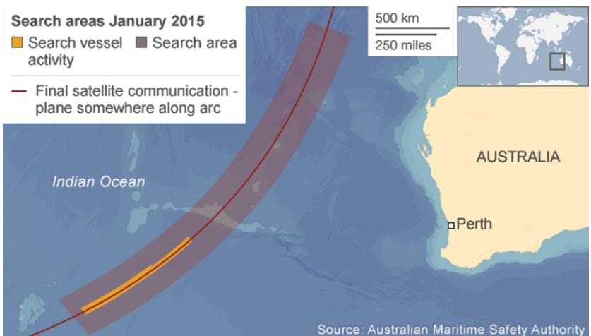

This signal, although not identical to our problem, gave us insight as to how analysts determine search areas and, more specifically, search areas with high probability of success.

From the information from MH370 (Figure 1), we determined the search area to be basically rectangular in shape, with the expected flight path in the middle[4].

知识点：[海洋搜索理论历史与核心概念](../../../topics/数学建模/sousuo_lilun.md)、[坐标变换（经纬度坐标转换与搜索区域离散化网格）](../../../topics/数学建模/zuobiao_bianhuan.md)

### 2.3 Analysis of the History of Ocean Plane Crashes

Obviously, the two case studies we have already discussed are not a firm basis to develop our models around. However, there are 88 other missing plane cases[3] for us to examine. If we examine the Aviation Safety Network’s database of lost flights from 1948-2014, we can determine the most common locations, types of planes, and crash causes upon which to base our models[3].

Locations:

- 31 of the 89 missing flights list the Atlantic Ocean as the place of disappearance, exactly half of the 62 oceanic disappearances[3].
- These flights vary in type from transatlantic to shorter hops between islands (Figure 2).

Considering the abundance of aircraft missing without a trace from the Atlantic region, as well as the diversity of flight paths of those planes, we believe that analyzing this ocean specifically will provide the best representation of possible flights in need of rescue.

知识点：[海洋搜索理论历史与核心概念](../../../topics/数学建模/sousuo_lilun.md)、[问题重述与分析（Problem Restatement and Analysis）](../../../topics/数学建模/wenti_chongshu.md)

### Airplane Categories

- For simplification, we wish to consider only the most common type of missing plane—passenger aircraft—including commercial, business, and privately owned[3].
- We also want the specific examples of each type of plane to be commonly available and frequently used around the Atlantic region.
  - Jumbo Commercial Wide-Body: The twin engine Boeing 777-200, seating a maximum of 440 passengers, often flies the popular transatlantic route from London to New York[5].
  - Large Business Jet: The Gulfstream G450, a long range twin-engine aircraft, is a common choice for companies to take up to 16 passengers between continents[6].

# Hidden in Plane Sight: Finding Lost Airplanes Before Time Runs Out (2015 MCM)

本资料整理自 2015 年美国大学生数学建模竞赛（MCM）特等奖论文《Hidden in Plane Sight》第 3 部分（第 9–12 页），内容涵盖飞机坠毁原因分类、海洋空域通信机制、搜索理论历史及搜索设备传感器特性。

## 一、潜在失踪飞机的模型设定与事故原因分析

知识点：[海洋搜索理论历史与核心概念](../../../topics/数学建模/sousuo_lilun.md)、[发现不确定性模型（Uncertainty Model）与传感器视野](../../../topics/数学建模/faxian_buqueding.md)、[贝叶斯定理在搜索中的应用（Bayes' Theorem）](../../../topics/数学建模/beiyesi_dingli.md)

### 选择 1：模型中考虑的飞机类型

题干：在建立模型时，我们将考虑哪些类型的飞机作为潜在的失踪飞机代表？

- A. 仅考虑军用飞机
- B. 波音 777、湾流 G450 和塞斯纳 172
- C. 所有民用小型飞机
- D. 仅考虑大型客机

答案：B。
补充说明：文中明确指出将 Boeing 777、Gulfstream G450 和 Cessna 172 作为标准示例。其中 Cessna 172 是历史上最畅销的私人飞机，而前两者代表了大型客机和中型公务机。

知识点：[一般假设及其合理性说明（Assumptions and Justifications）](../../../topics/数学建模/jiaben_shezhi.md)

### 简答 1：我们将考虑的坠机类型及其成因

**问题**：根据历史数据，我们将重点考虑哪几种类型的海洋坠机事件？请简述其成因。

**参考解答**：
我们将坠机事件分为以下三类进行考虑：

1.  **失速相关 (Stall-related, 82 例)**：
    *   常见成因包括机翼结冰导致升力丧失。
    *   速度指示器结冰或故障导致飞机陡峭爬升。
    *   副翼或其他稳定设备失效。
2.  **发动机故障/快速下降 (Engine Failure/Quick Descent, 52 例)**：
    *   鸟击、引擎爆炸或故障。
    *   机舱起火。
    *   导航设备故障。
    *   飞行中座舱失压。
3.  **可持续滑翔 (Sustainable Glide, 9 例)**：
    *   这是最罕见的情况。飞行员必须在失去推力能力的同时保持对飞机的控制。
    *   潜在原因包括完全发动机失效和燃油耗尽。

**订正**：原文中“Stall-related”后的括号内数字表示该类案例的数量，整理时已保留该统计信息以体现数据来源的权重。

知识点：[文献综述与研究背景撰写方法](../../../topics/数学建模/wenxian_zongshu.md)、[问题重述与分析（Problem Restatement and Analysis）](../../../topics/数学建模/wenti_chongshu.md)、[数学建模的基本步骤（问题分析、模型假设、建立、求解、检验、推广）](../../../topics/数学建模/jianmo_buzhou.md)

### 简答 2：我们将忽略的事故类型及其理由

**问题**：为什么在模型中不考虑空中交通管制错误和劫机导致的坠机？

**参考解答**：

1.  **空中交通管制 (Air Traffic Control)**：
    *   由 ATC 错误导致的坠机通常发生在起飞和降落阶段。
    *   本文模型仅讨论飞机在水面上方飞行时的中途事故，因此不适用。
2.  **劫机 (Hijacking)**：
    *   被劫持飞机的搜索区域可能极其广阔，因为必须假设飞机仍处于完全操作状态。
    *   如果通讯中断且劫机者控制了飞机，将无法创建可靠的搜索区域。

## 二、海洋空域通信机制

知识点：[数学建模的基本步骤（问题分析、模型假设、建立、求解、检验、推广）](../../../topics/数学建模/jianmo_buzhou.md)、[一般假设及其合理性说明（Assumptions and Justifications）](../../../topics/数学建模/jiaben_shezhi.md)

### 简答 3：雷达跟踪的局限性

**问题**：描述雷达技术在海洋上空追踪飞机的局限性。

**参考解答**：
*   雷达是一种相对古老且经过测试的技术，用于确定船舶和飞机的位置。
*   然而，民用雷达的覆盖范围仅限于海岸线以外 200 英里处。
*   在典型的纽约至伦敦跨大西洋航班中，飞机在飞越海洋期间超过一半的飞行时间都处于雷达盲区之外。

知识点：[海洋搜索理论历史与核心概念](../../../topics/数学建模/sousuo_lilun.md)

### 简答 4：空中交通管制 (ATC) 的通信方式与应急程序

**问题**：海洋飞行中的 ATC 通信是如何进行的？当通讯中断多久会被视为紧急情况？

**参考解答**：
1.  **通信方式**：
    *   **多塔台交接**：海洋飞行涉及不同国家的多个管制塔台交换航空器的控制权。某些事故（如法航 447 号航班）涉及交接失败，导致数小时无人报警，但本模型假设此类情况不会发生。
    *   **老旧系统**：较老的飞机和不发达国家的旧管制塔台使用高频无线电（High Frequency Radio）。当飞机超出常规无线电和雷达范围时，通信频率约为每小时一次。
    *   **现代卫星系统**：美国、欧洲和加拿大使用的基于卫星的现代系统强制要求每 14 分钟更新一次位置，并提供更高的精度。
2.  **应急响应**：
    *   根据美国联邦航空管理局 (FAA) 的海洋紧急程序规定，通讯中断达到或超过 **30 分钟** 即构成升级的紧急状态。
    *   本模型遵循 FAA 指南：若半小时后未收到信号，则推断飞机在此期间开始坠毁并丧失了通讯能力。

## 三、海洋搜索理论历史与核心概念

知识点：[海洋搜索理论历史与核心概念](../../../topics/数学建模/sousuo_lilun.md)

### 简答 5：搜索理论的起源与基本要素

**问题**：简述“搜索理论”的历史背景及其计算发现概率的核心公式。

**参考解答**：
*   **历史背景**：
    *   “搜索理论”这一应用数学分支起源于第二次世界大战，最初用于定位敌方舰船，随后迅速调整为救援在海难迫降的飞行员。
    *   历史上的搜索者拥有优势：人力充足且军事无线电联系频繁，他们通常确切知道飞机坠毁的时间。这使得他们可以从失联点向外径向搜索并快速实施救援。
*   **核心理论**：
    *   我们的模型比早期模型更复杂，但遵循过去搜索理论家发展的概念。
    *   明智的搜索者必须权衡两个要素：
        1.  给定区域包含失踪飞机的概率 (**Probability of Containment**, $P(C)$)。
        2.  搜索者在搜索该区域时发现失踪飞机的概率 (**Probability of Detection**, $P(D)$)。
    *   发现坠毁飞机的总概率是这两者的乘积：

$$
P = P(C) \times P(D) \tag{1}
$$

*   **最佳策略**：
    *   最佳的搜索技术显然应从总概率最高的地方开始，然后继续搜索概率逐渐降低的区域。
    *   我们的模型需要涵盖不同的飞机 containment 概率分布，以发现最准确的分布模型。
    *   $P(D)$ 取决于我们选择的传感器类型。

## 四、搜索飞机与传感器特性

知识点：[海洋搜索理论历史与核心概念](../../../topics/数学建模/sousuo_lilun.md)、[POC（包含概率）更新算法确定搜索模式](../../../topics/数学建模/poc_gengxin.md)

### 简答 6：视觉搜索的排除理由

**问题**：为什么在模型中忽略了视觉搜索方法？

**参考解答**：
*   探测失踪物体最古老的方法是视觉搜索。
*   除了明显地低效（通过肉眼搜索数千平方英里的海洋）外，视觉搜索精度的模型与距离的立方成反比。
*   因此，我们忽略视觉搜索，因为它既太无效，又难以建模。

知识点：[数学建模的基本步骤（问题分析、模型假设、建立、求解、检验、推广）](../../../topics/数学建模/jianmo_buzhou.md)、[一般假设及其合理性说明（Assumptions and Justifications）](../../../topics/数学建模/jiaben_shezhi.md)

### 简答 7：主要搜索机型与传感器策略

**问题**：文中提到的两种主要搜索飞机是什么？在初步模型中采用了何种传感器假设？

**参考解答**：
1.  **主要机型**：
    *   最常见的搜索飞机是军用飞机：较旧的 **P-3 Orion** 和新型的 **P-8 Poseidon**。
    *   **P-3 Orion**：携带旋转多模式雷达，用于大范围扫描探测残骸；同时也配备红外线和声学传感器，用于小范围搜索。
    *   **P-8 Poseidon**：关于其传感能力的详细数据属于机密，但我们可找到其基础传感器的较旧型号规格。
2.  **传感器策略**：
    *   通常流程：一旦雷达搜索发现疑似残骸，更集中的红外扫描将覆盖周围区域，以探测下沉飞机的余热特征。
    *   **模型假设**：为了简化第一个模型，我们专注于雷达搜索，并假设它是一个理想传感器，具有 **100% 的有效检测概率** 且 **无测距不确定性**。

## 3 Foundation of Analysis

知识点：[一般假设及其合理性说明（Assumptions and Justifications）](../../../topics/数学建模/jiaben_shezhi.md)、[有效性参数（Effectiveness Parameter）与搜索模式对比](../../../topics/数学建模/youxiaoxing_canshu.md)、[海洋搜索理论历史与核心概念](../../../topics/数学建模/sousuo_lilun.md)

### 3.1 Variables and Definitions

Lost Plane Variables：

| Name of Variable (Symbol) | Definition (Units) |
|---|---|
| Cruising Speed (v) | The typical speed of an aircraft (mph) |
| Cruising Altitude (α) | The typical altitude of a transatlantic flight for the specific type of aircraft (ft) |
| Total Time Elapsed (T) | The total time from last contact (hr) |
| Time of Last Contact (T=0) | The time an airplane last relayed its heading and coordinates to ground control—the last evidence of normal operations (hr) |
| Point A′ | The plane's coordinates at last contact (mi, mi) |
| Failure | The instant when the plane crashes: communications and normal operations stop, and thrust ceases |
| Glide Range (r) | The max distance a plane can move after failure (mi) |
| Glide Ratio[16] (κ) | The ratio of horizontal distance covered to altitude lost that maximizes total horizontal distance (none) |
| Crash Uncertainty Time (τ) | 0.5 hr, the time window in which the airplane could have crashed |
| Time of First Alert (T=τ) | The time controllers first suspect a problem when the plane misses a routine communication (hr) |
| Point B′ | The plane's expected location if it flew for exactly time τ after last contact but before failure (mi, mi) |
| Distance (L) | The maximum distance an airplane can cover at cruising speed in time τ (mi) |
| Points A and B | The points at the beginning and end of the flight path segment contained in the search area (mi, mi) |

Search Variables：

| Name of Variable (Symbol) | Definition (Units) |
|---|---|
| Searching Speed ($v_s$) | The typical speed of a search aircraft (mph) |
| Sight (d) | The radius of the detection area (mi) |
| Searching Altitude (a) | The vertical height above the water that the search plane flies (ft) |
| Search Time Elapsed (t) | The time from the start of the search to present (hr) |
| Distance to Lost Plane (l) | The straight line distance from the search plane to lost plane debris (mi) |
| Size of Lost Plane (Z) | The approximate rectangular area taken up by the lost plane ($ft^2$) |
| Coordinates (x, y) | The location along the surface of the ocean in the x-y plane (mi, mi) |
| Crash Coordinates ($x_c, y_c$) | The position of the lost plane (mi, mi) |
| Position ($\vec{S}$) | The position vector of the search plane |
| Direction (ε) | The direction of the search plane, either left or right, for striped and sinusoidal solutions (either 1 or -1) |
| Distance from search plane to A ($d_A$) | Distance from the plane to point A (mi) |
| Distance from search plane to B ($d_B$) | Distance from the plane to point B (mi) |
| j | An index used for sequences in striped and sinusoidal solutions |
| Temporary (u) | A temporary variable for the striped and sinusoidal solutions |

知识点：[符号说明与术语定义（Nomenclature / Symbols and Definitions）](../../../topics/数学建模/fuhao_shuoming.md)、[一般假设及其合理性说明（Assumptions and Justifications）](../../../topics/数学建模/jiaben_shezhi.md)、[贝叶斯定理在搜索中的应用（Bayes' Theorem）](../../../topics/数学建模/beiyesi_dingli.md)

### 3.2 Determining a Realistic Scenario

Design of Search Area：

To analyze and effectively develop a maximum search area, we must assume that in some cases the plane will glide perfectly, encountering absolutely no stalls. This will give us the glide range of the aircraft—the maximum distance the plane could have deviated from the flight path.

$$
r = \kappa \alpha\tag{2}
$$

We must also consider the distance the plane traveled between A′ and B′ over the 30 minute time period in which it could have crashed. Because we assume the velocity of the plane is constant, we can conclude:

$$
L = v \tau\tag{3}
$$

It's unknown exactly where the aircraft crashed along the flight path, so we must sweep a circle with radius r along the entire segment of length L to cover every possible crash site. For modeling simplicity, we are also going to include the corners bordering the circles in our search area (Figure 3).

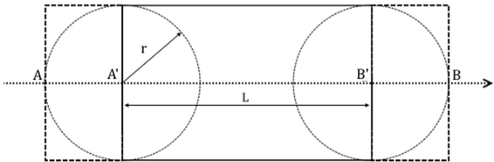

知识点：[坐标变换（经纬度坐标转换与搜索区域离散化网格）](../../../topics/数学建模/zuobiao_bianhuan.md)、[海洋搜索理论历史与核心概念](../../../topics/数学建模/sousuo_lilun.md)、[平行搜索与条纹飞行路径（Descending/Spiral Stripe Flight Path）](../../../topics/数学建模/pingxing_sousuo.md)

### Specifications of Downed Plane

Based on our research, we constructed three different categories of aircraft (as discussed in Section 2.3) and chose one specific model of aircraft for each category based on frequency of transatlantic flights. We compiled their specifications below:

| Types of Potential Lost Planes | Boeing 777[5] | Gulfstream G450[6] | Cessna 172[7] |
|---|---|---|---|
| Average Airspeed v | 640 mph | 610 mph | 140 mph |
| Average Cruising Altitude α | 35,000 ft | 41,000 ft | 8,500 ft |
| Glide Ratio (forward:down) κ | 15:1 | 14:1 | 9:1 |
| Glide Range r | 100 mi | 110 mi | 14.5 mi |
| Size (wingspan x length) | 42,000 ft2 | 7,000 ft2 | 1,000 ft2 |
| Distance Flown in 30 min L | 320 mi | 305 mi | 70 mi |
| Total Estimated Search Area | 104,000 mi2 | 115,500 mi2 | 2,870 mi2 |

We decided to use the Boeing 777 as the specific example to base our model on for several reasons.

- The Boeing 777 was the aircraft involved in the disappearance of Malaysia Flight MH370.
- The 777 has a search area smaller than the Gulfstream but larger than the Cessna, making it a good compromise.
- Out of the three planes, the 777 is by far the largest with the most potential for debris, making it the easiest to detect.
- This type of airplane commonly makes transatlantic flights with many passengers, making it especially important that it is found quickly.

The data we will use for the lost plane in our models is as follows:

$$
\begin{array}{l} L=320\ \text{miles} \\ r=100\ \text{miles} \end{array}
$$

Dimensions of search Area = 520 miles along the x-axis by 200 miles along the y-axis.

# Hidden in Plane Sight: Finding Lost Airplanes Before Time Runs Out

本部分为2015年美国大学生数学建模竞赛（MCM）特等奖论文的第5部分，主要涉及失事飞机概率分布的简化假设、搜索飞机的选择依据以及模型的一般性假设。内容已整理自原始论文第17-20页。

## 一、概率分布与搜索区域简化

知识点：[数学建模的基本步骤（问题分析、模型假设、建立、求解、检验、推广）](../../../topics/数学建模/jianmo_buzhou.md)、[一般假设及其合理性说明（Assumptions and Justifications）](../../../topics/数学建模/jiaben_shezhi.md)、[模型参数的确定（基于数据拟合或实验选择）](../../../topics/数学建模/canshu_queding.md)

### 小节 1：失事飞机概率分布的讨论

根据第2.3节讨论的飞机坠毁信息，我们得出结论：在计算出的矩形搜索区域内，飞机出现在任何特定位置的概率 $P(C)$ 并非处处相等。事实上，能够进行完美滑翔的坠机案例极少。此外，即使具备完美滑翔能力，飞行员也会尝试保持飞机沿原飞行路径飞行，除非完全失去控制。根据记录的坠机数据，我们可以假设大多数飞机会在飞行路径正下方或附近坠入海洋。

回顾我们的搜索区域设计，该区域由以从 $\mathsf { A } '$ 到 $\mathsf { B } '$ 线段为中心、半径为 $r$ 的圆形区域组成。我们必须考虑到，在点 A 和 A’ 之间以及 $\mathsf { B } '$ 和 B 之间的飞行路径上没有飞机故障。这些区域内的任何坠毁飞机都是从沿着 L 的路径滑翔至此的，因此这里的数量应少于飞行路径其余部分附近的数量[12]。不幸的是，考虑这一点会使分布显著复杂化（图4）。

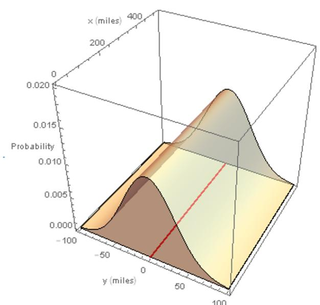
*替代文字：通常分布的3D图形示意图*

为了简化分布以便后续建模，我们将假设点 A 和 A’ 之间以及 $\mathsf { B } '$ 和 B 之间的飞机数量与飞行路径其余部分的飞机数量相同（图5）。因此，我们可以合理得出结论：飞机位置的概率沿飞行路径方向（x轴）均匀分布。垂直于飞行路径方向（y轴），飞机位置的概率可以用以飞行路径为中心的**正态分布**来合理表示[12]。

知识点：[先验概率分布模型（随机下降与初始概率密度函数 PDF）](../../../topics/数学建模/xianyan_gailv.md)、[坐标变换（经纬度坐标转换与搜索区域离散化网格）](../../../topics/数学建模/zuobiao_bianhuan.md)

### 小节 2：传感器视野与搜索飞机确定

我们将使用不同的方法来计算两种潜在搜索飞机的视野半径。

#### P-8 Poseidon

我们决定用于该飞机的传感器的工程报告建议，为了获得最大探测概率，高度应为 1000 ft，平均视野范围为 10 英里[14]。虽然我们要使用的是过时的传感器信息，但我们可以找到飞机本身的规格，其搜索速度列为 400 mph[13]。假设飞机的机密传感器在此高速下至少能达到与旧传感器相同的准确性并不离谱。

*替代文字：P-8 Poseidon 飞机图片*

#### P-3 Orion

我们找到了 P-3 的 AN/APS-115B 雷达的规格表，其中列出搜索范围为 0 到 20 英里可变[16]；然而，我们无法确定关于准确性的建议。P-3 的速度为 375 mph[18]，高度为 650 ft[13]。

| Type of Plane | Speed of Search Plane $v_s$ (mph) | Type of Sensor | Typical Search Altitude a (ft) | Sensor Sight Range d (mi) |
| :--- | :--- | :--- | :--- | :--- |
| P-3 Orion | $375^{[18]}$ | AN/APS-115B radar | $650^{[13]}$ | $0-20^{[16]}$ |
| P-8 Poseidon | $400^{[13]}$ | AN/APS-119 radar $^{[14]}$ | $1,000^{[14]}$ | $10^{[14]}$ |

我们选择 **P-8 Poseidon** 作为特定的搜索飞机，理由如下：
*   P-8 是两款搜索飞机中更现代的一款，具有更高的飞行速度。
*   我们无法找到 P-3 传感器的任何准确性数据，这使得 P-8 成为一个更现实的选择。

我们在模型中将使用的搜索飞机数据如下：

$$
\begin{array}{r l} v _ {s} & = 4 0 0 \text { miles per hour } \\ d & = 1 0 \text { miles } \end{array}
$$

知识点：[发现不确定性模型（Uncertainty Model）与传感器视野](../../../topics/数学建模/faxian_buqueding.md)

### 小节 3：搜索路径

对于模型的每种变体，我们将开发一个或多个解决方案来回答这个问题：我们的搜索飞机应该如何确定路线，才能在最短的时间内找到失事的飞机？

## 二、一般假设汇总

知识点：[海洋搜索理论历史与核心概念](../../../topics/数学建模/sousuo_lilun.md)、[平行搜索与条纹飞行路径（Descending/Spiral Stripe Flight Path）](../../../topics/数学建模/pingxing_sousuo.md)、[贝叶斯调整飞行路径方案](../../../topics/数学建模/bayesi_tiaozheng.md)

### 4.1 环境因素

*   我们将假设地球是平的，因此飞机在地点之间沿直线路径飞行。
*   风和洋流不会影响失事飞机。
*   我们将以大西洋作为模型和解决方案的基础。

所有飞机每半小时必须向空中交通管制（ATC）发送信号。远洋 ATC 塔将负责随时监听飞机的常规通信，并会在飞机停止响应时注意到。

知识点：[一般假设及其合理性说明（Assumptions and Justifications）](../../../topics/数学建模/jiaben_shezhi.md)、[文献综述与研究背景撰写方法](../../../topics/数学建模/wenxian_zongshu.md)

### 4.2 坠机情况

*   飞机将在 A’ 点和 B’ 点之间的水域某处瞬间发生导致坠机的故障，并且在故障发生之前不会偏离飞行路径。
    *   此故障在 A’ 和 B’ 之间的任何位置发生的可能性均等。
*   飞机在故障期间及之后将失去所有通信能力。
*   飞机无法从故障发生点在飞行路径的任何方向上滑行超过其滑翔范围。
*   波音 777 的搜索区域被简化为一个长 520 英里、宽 200 英里的矩形。
    *   我们将此区域设置在坐标系中，其中飞行路径为 x 轴 ($y=0$)，点 A 为原点 $(0, 0)$。

# 2015年美国大学生数学建模竞赛（MCM）特等奖论文：Hidden in Plane Sight: Finding Lost Airplanes Before Time Runs Out（习题）

## 一、模型假设与定义

知识点：[一般假设及其合理性说明（Assumptions and Justifications）](../../../topics/数学建模/jiaben_shezhi.md)、[坐标变换（经纬度坐标转换与搜索区域离散化网格）](../../../topics/数学建模/zuobiao_bianhuan.md)、[贝叶斯定理在搜索中的应用（Bayes' Theorem）](../../../topics/数学建模/beiyesi_dingli.md)

### 章节 1

#### 搜索区域的边界与飞机残骸特性

● 矩形区域由点 $(0, 100)$、$(520, 100)$、$(520, -100)$、$(0, -100)$ 界定。

● 坠毁的飞机将停留在其着陆点正下方的海底。

● 坠机将在海洋表面产生与坠毁飞机大小成比例的可见碎片。

●  containment 概率 $P(C)$ 在搜索区域内服从以飞行路径为中心的三标准差正态分布。

#### 搜索行动的基本设定

● 碎片不会从 submerged plane（沉没飞机）的正上方移动。

○ 找到碎片等同于找到失踪的飞机本身。

搜索工作将由一架 P-8 Poseidon 飞机（除非另有说明）执行，它以 400 mph 的速度持续搜索，直到发现碎片，无需中途加油或休息。

● 天气或海况不会阻碍搜索工作或雷达能见度。

● 成本和燃料不是问题；首要任务是迅速找到失踪的飞机。

● 搜索飞机将使用雷达，其视线范围为 0 到 10 英里，且在整个范围内均匀准确。

● 搜索行动的动员时间可忽略不计，计算总搜索时间时，搜索飞机会瞬时到达搜索区域。

Team #38720

Page 21 of 61

## 二、模型构建与分析

知识点：[贝叶斯定理在搜索中的应用（Bayes' Theorem）](../../../topics/数学建模/beiyesi_dingli.md)、[坐标变换（经纬度坐标转换与搜索区域离散化网格）](../../../topics/数学建模/zuobiao_bianhuan.md)、[后验概率更新与搜索路径规划](../../../topics/数学建模/houyan_gailv.md)

### 章节 2

#### 正态分布模型概述

本节包含所有使用正态分布模型进行的描述和测试。每个解决方案都包含简短描述、模拟中使用的任何方程、解决方案工作原理的图表、示例解决方案试验、模拟数据和结论。

#### 模型特定假设：

● 搜索区域内没有可能被误认为漂浮碎片的虚假目标。

● 雷达在其视线范围内的探测概率 $P(D)$ 为 100%。

#### 坠机模拟技术：

为了测试多种解决方案的有效性，我们基于正态分布模型模拟飞机坠机。以下显示了 5,000 次坠机模拟：

Team #38720

Page 22 of 61

#### 完成的模拟定义

对于本节中的所有解决方案，我们将搜索的完成定义为发现飞机碎片时。在我们所有的模拟中，这是当搜索飞机的位置与坠机碎片的位置之差小于视线范围时进行评估的，并在每个时间步长进行评价：

$$
\vec {S} _ {i} - \langle x _ {c r a s h}, y _ {c r a s h} \rangle < d \tag{4}
$$

本质上，这表明在搜索飞机雷达半径内的任何碎片都会被发现。

#### 统计分析

对于可以生成大量模拟的每个解决方案，我们进行基本的统计分析。计算均值、中位数、标准差、均值的标准误差和 95% 置信区间 (CI)。均值的标准误差是均值抽样分布的标准差，用于计算 95% 置信区间 (CI)。相同大小的样本中有 95% 将落在 CI 内。如果两个解决方案的 CI 重叠，则两个解决方案之间没有统计学上的显著差异。表达此关系的方程如下所示：

$$
95 \% \text { Confidence Interval } (C I) = [ \mu - 2 (S E), \mu + 2 (S E) ] \tag{5}
$$

其中 $\mu$ 是均值，$\sigma$ 是标准差，$n$ 是样本大小，且

$$
\text { Standard Error of the Mean } (S E) = \frac {\sigma}{\sqrt {n}}
$$

Team #38720

Page 23 of 61

## 三、具体方案评估

知识点：[遗传算法优化人力资本管理（染色体表示与适应度函数）](../../../topics/数学建模/yichuan_suanfa.md)、[晋升事件（Promotion Event）算法](../../../topics/数学建模/jinsheng_suanfa.md)、[离职事件（Demission/Turnover Event）定义与算法](../../../topics/数学建模/lizhi_suanfa.md)

### 章节 3

#### 方案 5.1.1：完全随机飞行路径

##### 简要描述：

在我们的第一个解决方案中，我们假设搜索飞机会离开 A 点然后随机旅行。由于对其路线没有严格的限制，飞机可以自由移动，并且不一定留在搜索区域内。

##### 工作原理：

搜索飞机将以恒定速度飞行，并每 15 分钟重新评估其路径，每次选择一个随机的归一化 x 和 y 分量以形成 R。时间步长设置为相对较大的值，因为对于较小的步长，由于生成的数据量巨大，模拟无法完成。因为 R 是归一化的，随机向量的长度为 1。这个随机单位向量将乘以 $v \Delta t$，代表搜索飞机在单个时间步长内可以飞行的距离。

在任何时间，飞机的位置可以通过以下方式确定：

$$
\vec {S} _ {0} = \langle 0, 0 \rangle
$$

$$
\vec {S} _ {i} = \vec {S} _ {i - 1} + \frac {v \Delta t \vec {R}}{| \vec {R} |} \tag{6}
$$

使用公式 (6)，我们开发了一个简单的解决方案，以便与未来更准确的搜索技术进行比较。该关系显示如下：

Team #38720

Page 24 of 61

典型的搜索飞机飞行路径模拟显示，它从 A 点随机移动时，飞出了搜索区域很远。在此比例下，代表坠毁飞机的点被解决方案遮挡。

##### 结论：

上述解决方案的问题在于其基本原理：搜索飞机经常找不到坠毁的飞机，因为其路径是无界的。由于大多数模拟从未完成，因此无法从这个特定模型建立一致的均值。此外，我们可以得出结论，完全随机的搜索方法不是一个可行的选择。

Team #38720

Page 25 of 61

## Solution 5.1.2: Bounded Random Flight Path

知识点：[海洋搜索理论历史与核心概念](../../../topics/数学建模/sousuo_lilun.md)

### A Brief Description:

Expanding from the completely random search solution, we decided to improve it with some “guidance”. We added the boundaries of our calculated search area to the solution in order to keep the search plane in the general vicinity of the crashed plane.

知识点：[贝叶斯定理在搜索中的应用（Bayes' Theorem）](../../../topics/数学建模/beiyesi_dingli.md)、[后验概率更新与搜索路径规划](../../../topics/数学建模/houyan_gailv.md)、[海洋搜索理论历史与核心概念](../../../topics/数学建模/sousuo_lilun.md)

### How It Works:

The search plane will fly at constant velocity and reevaluate its direction every 3 minutes. The time step is reduced to 3 minutes in this solution because these simulations generally finish quickly and the simulator can afford more precision. Just like the last solution, the plane will fly in a random direction; the distance between each position $\vec{S}_i$ will be kept constant by the normalized random vector. The search plane will be allowed to freely fly within the search area along the route described with the same equation used for the completely random solution in Section 5.1.1.

As soon as the plane leaves the box, it will be redirected orthogonally back into the search area in order to improve total search time.

If the plane leaves the search area horizontally, its vector will be determined using the equation:

$$
\text{If } S_{ix} > L + 2r \bigcup S_{ix} < 0, \text{ then } \vec{S}_{i+1} = \vec{S}_i + v \Delta t * \text{Norm}\left[\left\langle \frac{L+2r}{2} - S_{ix}, 0 \right\rangle\right] \tag{7}
$$

If the plane leaves the search area vertically, its vector will be determined using the equation:

$$
\text{If } S_{iy} > r \bigcup S_{iy} < -r, \text{ then } \vec{S}_{i+1} = \vec{S}_i + v \Delta t * \text{Norm}\left[\langle 0, -S_{iy} \rangle\right] \tag{8}
$$

This redirection method is illustrated below:

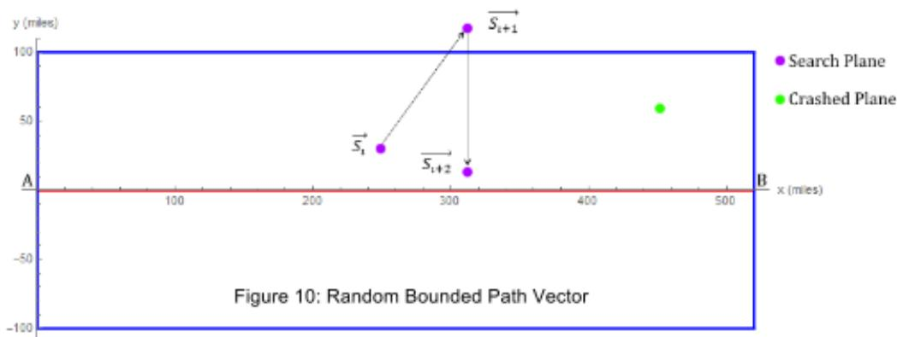

A sample simulation:

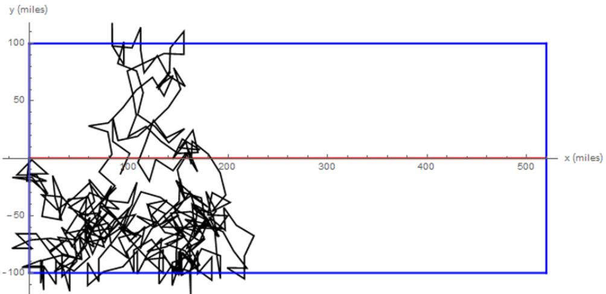

Figure 11 shows a typical solution as it moves according to the bounded random flight path. Although the search plane does have some overlap in its path, this is a vast improvement from the random search method and we can accurately provide statistical data collected from our simulations.

知识点：[贝叶斯调整飞行路径方案](../../../topics/数学建模/bayesi_tiaozheng.md)、[后验概率更新与搜索路径规划](../../../topics/数学建模/houyan_gailv.md)、[海洋搜索理论历史与核心概念](../../../topics/数学建模/sousuo_lilun.md)

### Simulation Data:

This solution was able to complete 100 simulations; the data is listed below. These data describe the amount of time it took each of the simulated planes to find the crashed plane using this solution:

Number of trials = 100

Median = 24.425 hours

Mean = 42.7105 hours

Standard deviation = 47.3783 hours

Standard error = 4.73783 hours

95% Confidence interval about the mean: [33.2348, 52.1862] hours

The distribution within the sample is plotted in the following histogram:

知识点：[随机模型与确定性模型的对比（Stochastic vs Deterministic Model）](../../../topics/数学建模/suiji_queding.md)、[模型验证方法概述（随机模型与确定性模型验证）](../../../topics/数学建模/moxing_yanzheng.md)、[随机模拟产生的不确定效应与主观系数效应分析](../../../topics/数学建模/buqueding_xiaoying.md)

### Conclusion:

The most important of the data above is the 95% confidence interval, which says that the mean time required of a sample of 100 simulations has a 95% chance of falling between 33.2 and 52.2 hours. The difference between the mean (42.7 hours) and the median (24.4 hours) demonstrate the heavy skew within the sample distribution. This skew is visible in the histogram, where a few exceptionally long searches drag out the mean search time. The positive skew reflects well on the model, because most simulations require a low amount of time, with only some outliers that drag out the mean; however, it also has negative implications, because the solution is ineffective at locating some planes.

This solution is crucial, because it establishes a baseline with which to compare other solutions. Ideally, more sophisticated solutions should have a lower average time than this solution.

## Solution 5.1.3: Bounded Weighted Random Flight Path

知识点：[模型优缺点分析（Strengths and Weaknesses）](../../../topics/数学建模/youque_dian.md)、[数学建模的基本步骤（问题分析、模型假设、建立、求解、检验、推广）](../../../topics/数学建模/jianmo_buzhou.md)、[确定模型的定点与稳定性分析](../../../topics/数学建模/dingdian_wending.md)

### A Brief Description:

Expanding on the bounded random solution, this solution slightly weights the plane’s flight toward the endpoints A and B. By encouraging the search plane to fly nearer the downed plane’s flight path, we begin to focus our searches on the area with the highest probability of containment. The path will be mostly random and the plane will be kept inside the search area, as in the previous solution.

知识点：[贝叶斯定理在搜索中的应用（Bayes' Theorem）](../../../topics/数学建模/beiyesi_dingli.md)、[后验概率更新与搜索路径规划](../../../topics/数学建模/houyan_gailv.md)、[海洋搜索理论历史与核心概念](../../../topics/数学建模/sousuo_lilun.md)

### How It Works:

The plane will reevaluate its position every three minutes. Additionally, it measures its distance from points A and B and weights its random direction vector toward the more distant point.

If the distance from point A is larger than the distance from point B, the plane will move in a direction weighted 15 parts random for every 1 part toward A:

$$
\text{If } d_A > d_B, \text{ then } \vec{S}_{i+1} = \vec{S}_i + v \Delta t * \text{Norm}\left[15 \frac{\vec{R}}{|\vec{R}|} + \text{Norm}\left[\overrightarrow{A - S_i}\right]\right] \tag{9}
$$

If the distance from point B is larger than the distance from point A, the plane will move in a direction weighted 15 parts random for every 1 part toward B:

$$
\text{If } d_A \leq d_B, \text{ then } \vec{S}_{i+1} = \vec{S}_i + v \Delta t * \text{Norm}\left[15 \frac{\vec{R}}{|\vec{R}|} + \text{Norm}\left[\overrightarrow{B - S_i}\right]\right] \tag{10}
$$

This method is demonstrated in the diagram below:

知识点：[贝叶斯调整飞行路径方案](../../../topics/数学建模/bayesi_tiaozheng.md)、[后验概率更新与搜索路径规划](../../../topics/数学建模/houyan_gailv.md)、[海洋搜索理论历史与核心概念](../../../topics/数学建模/sousuo_lilun.md)

### A sample simulation:

The path still has a high degree of randomness (15 parts random for every part nonrandom), meaning that the path still shows the chaotic nature evident in earlier solutions.

知识点：[先验概率分布模型（随机下降与初始概率密度函数 PDF）](../../../topics/数学建模/xianyan_gailv.md)、[后验概率更新与搜索路径规划](../../../topics/数学建模/houyan_gailv.md)、[POC（包含概率）更新算法确定搜索模式](../../../topics/数学建模/poc_gengxin.md)

### Simulation Data:

This solution was able to complete 100 simulations, with the important data listed below. These data describe the amount of time it took each of the simulated planes to find the crashed plane using this solution:

Number of trials = 100

Median = 16.6 hours

Mean = 37.5575 hours

Standard deviation = 55.4901 hours

Standard error = 5.54901 hours

95% Confidence interval about the mean: [26.4795, 48.6755] hours

知识点：[随机模型与确定性模型的对比（Stochastic vs Deterministic Model）](../../../topics/数学建模/suiji_queding.md)、[模型验证方法概述（随机模型与确定性模型验证）](../../../topics/数学建模/moxing_yanzheng.md)、[随机模拟产生的不确定效应与主观系数效应分析](../../../topics/数学建模/buqueding_xiaoying.md)

### 结论

加权有界随机路径的模拟数据显示出比有界随机路径更大的偏度，这体现在均值（37.6 小时）和中位数（16.6 小时）之间的差异上。直方图中较大的右尾也表明了这种偏度，其中一些搜索耗时超过 200 小时。这两个统计量均低于有界随机路径的均值（42.7 小时）和中位数（24.4 小时）。这两次试验的置信区间重叠，意味着这两种解决方案之间没有统计学上的显著差异。

该示例模拟显示了此类解决方案的主要问题：搜索飞机的路径经常与其在路径中已经搜索过的区域重叠。更高级的模型应防止这种冗余。

知识点：[螺旋方形搜索模型（Spiral Square Search Model）](../../../topics/数学建模/luoxuan_fangxing.md)、[贝叶斯调整飞行路径方案](../../../topics/数学建模/bayesi_tiaozheng.md)、[平行搜索与条纹飞行路径（Descending/Spiral Stripe Flight Path）](../../../topics/数学建模/pingxing_sousuo.md)

### 解法 5.1.4：下降条纹飞行路径

#### 简要描述：

此解决方案模拟飞机通过直线路径系统地消除搜索区域的条纹。然后我们可以将直线路径搜索与随机路径搜索进行比较，并开始得出关于最有效解决方案的结论。

#### 工作原理：

飞机从搜索区域的左上角开始，平行于 x 轴飞行直到到达边缘。然后它下降 $2d$ 英里，即消除飞行路径重叠所需的距离，接着垂直于 y 轴转向，朝与前一条纹相反的方向飞行。对于本方案及后续两个方案，飞机每 0.001 小时重新评估其位置向量。由于搜索飞机的飞行路径是可预测的，我们可以在不需要显著增加计算时间的情况下获得更高的精度。

搜索区域内的飞行路径由以下公式确定：

$$
\vec {S} _ {i + 1} = \vec {S} _ {i} + v \Delta t \varepsilon \langle 1, 0 \rangle\tag{11}
$$

变量 $\varepsilon$ 描述飞机平行于 x 轴飞行的方向。如果 $\varepsilon$ 等于 1，飞机将向正方向飞行。如果 $\varepsilon$ 等于 -1，飞机将向负方向飞行。每次飞机到达搜索区域边缘时，$\varepsilon$ 改变符号，我们调整 y 位置和飞机方向以启动下一条条纹。

$$
If \ S_{ix} \geq L + 2r \cup S_{ix} \leq 0, \ then \ \varepsilon = - \varepsilon \ and \ \vec {S} _ {i + 1} = \vec {S} _ {i} + \langle 0, - 2 d \rangle\tag{12}
$$

条纹技术如下图所示：

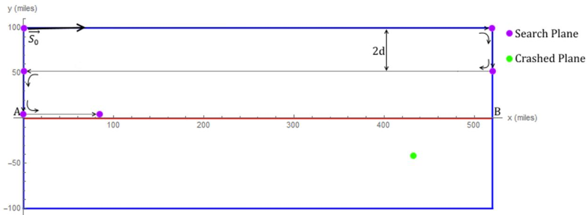

示例模拟：

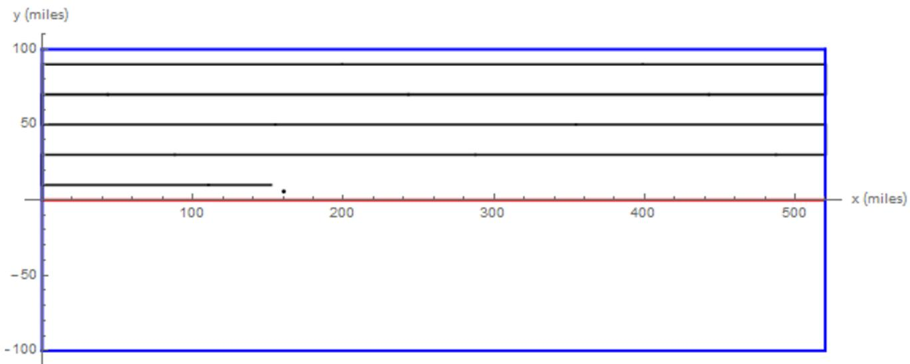

#### 模拟数据：

该解决方案完成了 100 次模拟，重要数据列示如下。这些数据描述了使用此解决方案的每架模拟飞机找到坠毁飞机所需的时间：

*   试验次数 = 100
*   中位数 = 7.031 小时
*   均值 = 7.10273 小时
*   标准差 = 2.41002 小时
*   标准误 = 0.241002 小时
*   均值的 95% 置信区间：[6.62073, 7.58473] 小时

样本内的分布绘制在以下直方图中：

#### 结论：

此解决方案采用非随机方法进行搜索，大大减少了必要的搜索时间。与以前的解决方案不同，此样本模拟显示几乎没有偏度，均值（7.1 小时）和中位数（7.0 小时）大致相等。根据直方图，分布近似正态。这反映了飞机坠毁的正态分布，因为搜索飞机从正态分布的一个尾部开始，移向中心，然后移向另一个尾部。正态分布的优点是定位飞机的一致性；缺点是前几个小时很少发现坠机。

均值的 95% 置信区间 ([6.6, 7.6] 小时) 不与有界随机路径的置信区间 ([33.2, 52.2] 小时) 重叠。因此，下降条纹解决方案与有界随机解决方案之间的差异具有统计学意义，下降条纹解决方案产生的搜索时间更短。

虽然此解决方案明显优于以前的解决方案，但它暗示通过考虑正态分布的影响可以进一步减少搜索时间。

知识点：[平行搜索与条纹飞行路径（Descending/Spiral Stripe Flight Path）](../../../topics/数学建模/pingxing_sousuo.md)、[确定模型的定点与稳定性分析](../../../topics/数学建模/dingdian_wending.md)、[敏感性分析方法（Sensitivity Analysis，单参数与多参数变动）](../../../topics/数学建模/minganxing_fenxi.md)

### 解法 5.1.5：螺旋条纹飞行路径

#### 简要描述：

此解决方案使用与先前模拟相同的基本技术。基于失踪飞机的正态分布，我们确定最有效的技术是从找到飞机的概率最高的区域开始，并向概率逐渐降低的区域移动。

#### 工作原理：

与之前的解决方案类似，搜索飞机将沿平行于 x 轴的水平条纹飞行，同时消除监视区域的重叠。飞机从 A 点开始，沿 x 轴飞行——模仿坠毁飞机的飞行路径。然后它沿 y 轴移动到 $C(u)$ 英里的位置，再开始另一条纹。继续这样做，飞机在搜索区域内形成螺旋图案。

搜索飞机的向量由以下方程确定：

$$
\vec {S} _ {i + 1} = \vec {S} _ {i} + v \Delta t \varepsilon \langle 1, 0 \rangle\tag{13}
$$

当飞机到达搜索区域边缘时，其位置向量 y 坐标的大小由下式确定：

$$
C (u) = 2 (- 1) ^ {u} u\tag{14}
$$

飞机在到达搜索区域边缘后在 y 方向的运动由递增索引 $j$ 并交替 $\varepsilon$ 的符号来改变方向决定：

$$
If \ S_{ix} \geq L + 2r \cup S_{ix} \leq 0, \ then \ \vec {S} _ {i + 1} = \vec {S} _ {i} + \langle 0, \varepsilon * C (j) \rangle \rightarrow (j = j + 1, \varepsilon = - \varepsilon)\tag{15}
$$

This method is demonstrated below:

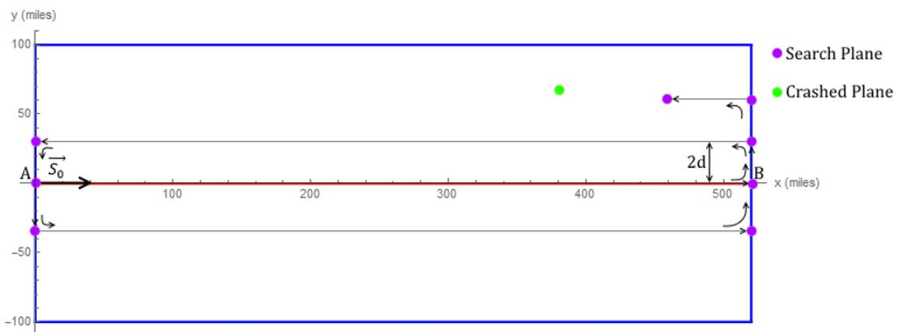

A sample simulation:

知识点：[海洋搜索理论历史与核心概念](../../../topics/数学建模/sousuo_lilun.md)、[螺旋方形搜索模型（Spiral Square Search Model）](../../../topics/数学建模/luoxuan_fangxing.md)、[平行搜索与条纹飞行路径（Descending/Spiral Stripe Flight Path）](../../../topics/数学建模/pingxing_sousuo.md)

### Simulation Data

This solution was able to complete 100 simulations, with the important data listed below. These data describe the amount of time it took each of the simulated planes to find the crashed plane using this solution:

Number of trials = 100

$$
\mathrm{Median} = 3.113 \mathrm{hours}
$$

$$
\mathrm{Mean} = 3.62286 \mathrm{hours}
$$

Standard deviation = 2.85127 hours

Standard error = 0.285127 hours

95% Confidence interval about the mean: [3.05261, 4.19311] hours

The distribution within the sample is plotted in the following histogram:

知识点：[随机模拟产生的不确定效应与主观系数效应分析](../../../topics/数学建模/buqueding_xiaoying.md)、[模型验证方法概述（随机模型与确定性模型验证）](../../../topics/数学建模/moxing_yanzheng.md)

### Conclusion

This solution takes into account the normal distribution of plane crashes and prevents the overlap present in the random models. Unlike the descending stripes solution, it has significant positive skew and does not appear normally distributed. The discrepancy between the mean (3.6 hours) and the median (3.1 hours) is not as large as in the random models, indicating that the skew is not as pronounced.

The 95% confidence interval of [3.0, 4.2] indicates that the difference between the spiral stripes solution and all previous solution is statistically significant, with the spiral stripes solution producing smaller search times. The differences are significant because the confidence intervals do not overlap.

Therefore, this solution is an effective way to reduce search times for this model.

知识点：[发现不确定性模型（Uncertainty Model）与传感器视野](../../../topics/数学建模/faxian_buqueding.md)、[敏感性分析方法（Sensitivity Analysis，单参数与多参数变动）](../../../topics/数学建模/minganxing_fenxi.md)、[模型验证方法概述（随机模型与确定性模型验证）](../../../topics/数学建模/moxing_yanzheng.md)

### Solution 5.1.6: Sinusoidal Flight Path

#### A Brief Description

The success of solution 5.1.5 warrants further investigation. Forming stripes starting at the area of highest probability is both a realistic and effective search method; however, we want to develop a similar solution that approaches the technique differently. Our sinusoidal solution fulfills this by forming wider stripes of surveilled areas in an attempt to maximize the effectiveness of every pass.

#### How It Works

The search plane starts at Point A traveling in a positive direction along the x-axis in a path mirroring a sine curve. This forms a wider stripe than a straight path, reducing the amount of times $C(u)$ is incremented and the distance the search plane must travel along the edge of the search area. Just as in the previous model, as soon as the plane reaches the edge of the search area, its position along the y-axis is reevaluated before starting a new stripe.

Setting the amplitude to the sight range and wavelength to twice the sight range ensures that there are no areas left unsurveyed in between passes. The path of the plane inside the search area is determined by:

$$
\begin{array}{r l} & {\vec {S} _ {i + 1} = \vec {S} _ {i} + v \Delta t \varepsilon * N o r m [ \langle 1, \pi \mathrm{cos} (\frac {2 \pi}{\lambda} \vec {S} _ {i x}) \rangle ]} \\ & {\mathrm{where:} \quad A m p l i t u d e = d \mathrm{and} \lambda = 2 d} \end{array}\tag{16}
$$

When the plane reaches the edge of the search area, the magnitude of the y-coordinate of its position vector is determined by:

$$
C (u) = 2 (- 1) ^ {u - 1} u\tag{17}
$$

The plane’s movement in the y-direction after exiting the search area is determined by incrementing the index $j$ and changing direction by alternating $\varepsilon$:

$$
I f \vec {S} _ {i x} \geq L + 2 r \bigcup \vec {S} _ {i x} \leq 0, t h e n \vec {S} _ {i + 1} = \vec {S} _ {i} + C (j) r \rightarrow (j = j + 1, \varepsilon = - \varepsilon)\tag{18}
$$

The sinusoidal method is illustrated below:

A sample simulation:

知识点：[平行搜索与条纹飞行路径（Descending/Spiral Stripe Flight Path）](../../../topics/数学建模/pingxing_sousuo.md)、[有效性参数（Effectiveness Parameter）与搜索模式对比](../../../topics/数学建模/youxiaoxing_canshu.md)

### Simulation Data

This solution was able to complete 100 simulations, with the important data listed below. These data describe the amount of time it took each of the simulated planes to find the crashed plane using this solution:

Number of trials = 100

Median = 4.489 hours

Mean = 6.44989 hours

Standard deviation = 6.08373 hours

Standard error = 0.608373 hours

95% Confidence interval about the mean: [5.23314, 7.66664] hours

The distribution within the sample is plotted in the following histogram:

知识点：[随机模拟产生的不确定效应与主观系数效应分析](../../../topics/数学建模/buqueding_xiaoying.md)、[模型验证方法概述（随机模型与确定性模型验证）](../../../topics/数学建模/moxing_yanzheng.md)

### Conclusion

Like the spiral striped solution, this solution shows significant positive skew, which is visible on the histogram. The mean (6.4 hours) is greater than the median (4.5 hours), indicative of the skew. This solution is much more vulnerable to extreme values that pull the mean higher than the median.

The 95% CI of [5.2, 7.7] hours does not overlap with that of the spiral striped solution, indicating that the difference between the sinusoidal model and spiral striped solution is statistically significant, with the spiral stripes solution producing smaller search times. The CI overlaps with that of the descending striped solution, meaning that there is no significant difference between the two.

知识点：[发现不确定性模型（Uncertainty Model）与传感器视野](../../../topics/数学建模/faxian_buqueding.md)、[敏感性分析方法（Sensitivity Analysis，单参数与多参数变动）](../../../topics/数学建模/minganxing_fenxi.md)、[模型验证方法概述（随机模型与确定性模型验证）](../../../topics/数学建模/moxing_yanzheng.md)

### Normal Distribution Overall Conclusion

Based on the results from this and the previous 5 solutions, we can conclude that the spiral striped solution offers the lowest search times of those tested.

# 2015年美国大学生数学建模竞赛（MCM）特等奖论文：Hidden in Plane Sight: Finding Lost Airplanes Before Time Runs Out

本节内容源自特等奖论文第 10 部分，主要探讨在发现存在不确定性（即探测概率非 100%）的情况下，如何利用贝叶斯搜索理论调整飞机位置的概率分布及搜索路径。

## 一、发现不确定性模型

知识点：[发现不确定性模型（Uncertainty Model）与传感器视野](../../../topics/数学建模/faxian_buqueding.md)、[贝叶斯定理在搜索中的应用（Bayes' Theorem）](../../../topics/数学建模/beiyesi_dingli.md)、[后验概率更新与搜索路径规划](../../../topics/数学建模/houyan_gailv.md)

### 变量与假设说明

在之前的模型中，我们假设雷达传感器和 P-8 搜索飞机上的操作员对目标的探测概率为 100%。如果改变这一假设，每次沿搜索路线的飞行将不再把受监视区域从失踪飞机的可能位置中完全排除。以下是针对“发现不确定性”模型的特定变量和假设：

| 变量名称 (符号) | 定义 (单位) |
| :--- | :--- |
| 总探测概率 ($P(D_u)$) | 如果飞机在雷达半径范围内，碎片被 spotted 且飞机被找到的概率 (%) |
| 雷达探测概率 ($P(R)$) | 飞机飞过期间雷达检测到碎片的概率 (%) |
| 操作员识别概率 ($P(O)$) | 操作员识别出碎片的概率 (%) |
| 给定雷达探测下的操作员识别概率 ($P(O|R)$) | 在雷达成功检测到碎片的前提下，操作员识别出碎片的概率 (%) |
| 包含概率 ($P(C)$) | 任意给定区域 $C$ 包含失踪飞机的概率，最初由正态分布确定 (%) |
| 在 $C_i$ 中的包含概率 ($P(C_i)$) | 除当前正在搜索的区域 $C$ 外，任何单个其他区域包含失踪飞机的概率 (%) |

## 二、贝叶斯搜索理论简介

我们不再假设雷达和操作员以 100% 的时间识别海洋中的物体。利用贝叶斯搜索理论 [19]，如果我们未在被搜索区域找到碎片，我们可以调整 $P(C)$。在未找到碎片的情况下，碎片存在于任何其他位置的概率会变高 [19]。

在刚搜索完某个区域后，飞机位于该搜索区域的概率记为 $P'(C)$，其计算公式为：

$$
P^{\prime} (C) = \frac {P (C) * (1 - P (D _ {u}))}{(1 - P (C)) + P (C) * (1 - P (D _ {u}))} = P (C) \frac {1 - P (D _ {u})}{1 - P (C) P (D _ {u})} < P (C)\tag{19}
$$

对于任何其他特定区域 $C_i$，在 $P(C)$ 被搜索后，其概率计算如下：

$$
P^{\prime} (C _ {i}) = P (C _ {i}) \frac {1}{1 - P (C) P (D _ {u})} > P (C _ {i})\tag{20}
$$

## 三、确定合理的Uncertainty（不确定性）

模型 5.2 的复杂性增加源于雷达检测碎片能力的不一致性，以及雷达操作员有效扫描雷达屏幕并区分碎片与雷达噪声和海杂波的能力 [14]。

使用条件概率的乘法规则 [20]，并假设我们的唯一不确定性在于雷达和操作员的能力，我们可以得出在每次飞行中 spotting 碎片的总概率为：

$$
P (D _ {u}) = P (R) * P (O | R)\tag{21}
$$

根据 AN/APS-119 雷达进行的测试数据，我们可以准确估计 $P(R)$ 为 80%，前提是搜索飞机在平静海面上空以 1000 ft 高度飞行，且视距为 10 英里 [14]。

由于飞机以 400 mph 的恒定速度行驶，它穿越视距范围——即雷达扫描半径——需要 1.5 分钟。因此，我们可以安全地假设雷达操作员至少有 90 秒的时间来识别失踪飞机的碎片。

模拟操作员观察类似 AN/APS-119 雷达显示屏能力的研究 [14] 得出结论：在 90 秒内发现所有物体的概率为 97% [21]。由于操作员在单次飞行中至少拥有 90 秒来观察每个物体，我们可以近似认为 $P(O)$ 使得：

$$
P (O) \sim 1, P (O | R) \sim 1\tag{22}
$$

给定这些输入，我们可以确定：

$$
P (D _ {u}) = P (R) * P (O | R) \sim 0.8\tag{23}
$$

**假设：**
*   海杂波和雷达噪声形式的虚假目标会降低雷达的检测精度。
*   雷达操作员将有充足的时间（至少 90 秒）来识别雷达看到的碎片。
*   根据雷达和操作员的能力，不确定发现模型的探测概率约为 80%。
    *   我们假设这 80% 的准确性在 10 英里的雷达视距范围内仍然是均匀的。

## 四、限制因素

为了简单起见，搜索时间上限设定为 24 小时。随着每次飞行的进行，贝叶斯解决方案变得指数级难以模拟，因此在大约 24 小时的搜索后推荐行动方案需要大量的计算时间。如果在规定的时间内未找到坠毁的飞机，则记录此情况并减少计算中使用的样本量。由于时间上限导致计算时间减少，我们将样本量增加到 500 以提高精度。

## 五、解决方案 5.2.1：贝叶斯调整飞行路径

知识点：[贝叶斯定理在搜索中的应用（Bayes' Theorem）](../../../topics/数学建模/beiyesi_dingli.md)、[后验概率更新与搜索路径规划](../../../topics/数学建模/houyan_gailv.md)、[发现不确定性模型（Uncertainty Model）与传感器视野](../../../topics/数学建模/faxian_buqueding.md)

### 简要描述

该解决方案利用贝叶斯搜索理论预测最佳飞行路径。该解决方案类似于纯正态模型中使用的螺旋条纹模型，但每次飞行的位置取决于新概率分布峰值所在的位置。

知识点：[发现不确定性模型（Uncertainty Model）与传感器视野](../../../topics/数学建模/faxian_buqueding.md)、[平行搜索与条纹飞行路径（Descending/Spiral Stripe Flight Path）](../../../topics/数学建模/pingxing_sousuo.md)、[模型验证方法概述（随机模型与确定性模型验证）](../../../topics/数学建模/moxing_yanzheng.md)

### 工作原理

在任何飞行之前，概率分布与我们用于更简单模型的正态分布相同。初始分布的三维图（图 25）和二维图（图 26）显示如下：

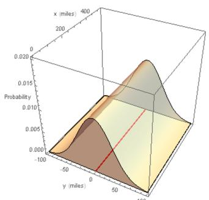

一旦飞机以宽度 $2d$ 穿过最高概率区域——即图的中心——概率不会完全降为零，因为 $P(D_u)$ 不是 100%，失踪飞机可能会 missed。相反，其余未搜索区域的 $P(C)$ 概率通过贝叶斯定理向上调整。飞机进行的下一次飞行将通过新的最高概率区域，在这种情况下，可以是 $y = 20$ mi 中心的条带或 $y = -20$ mi 中心的条带，因为它们等价（图 27）。

# 2015年美国大学生数学建模竞赛（MCM）特等奖论文：Hidden in Plane Sight: Finding Lost Airplanes Before Time Runs Out（习题）

## 五、贝叶斯搜索策略模拟结果

知识点：[数学建模的基本步骤（问题分析、模型假设、建立、求解、检验、推广）](../../../topics/数学建模/jianmo_buzhou.md)、[一般假设及其合理性说明（Assumptions and Justifications）](../../../topics/数学建模/jiaben_shezhi.md)、[文献综述与研究背景撰写方法](../../../topics/数学建模/wenxian_zongshu.md)

### 模拟数据与分析

经过第二次扫描条带未覆盖区域的调整后，第三次扫描的位置被确定为剩余概率分布最高的区域，此处中心位于 $y = -20$ 英里处（图28）。

搜索飞机继续根据贝叶斯定理确定的最高 $P(C)$ 区域选择下一段飞行路径。我们将不再展示该解决方案的进一步重复步骤。根据我们的模拟，后续步骤将遵循以下序列：
$$ y = 0, 20, -20, 40, -40, 60, -60, 0, 20, -20, 40, -40, 80, -80, 60, -60, 0, 20, -20, \dots $$

**模拟数据统计：**
下表描述了使用此解决方案找到坠毁飞机的各架模拟飞机所需的时间量：

| 统计指标 | 数值 |
| :--- | :--- |
| 未找到的飞机数量 | 25 |
| 找到的飞机数量 | 475 |
| 中位数 (Median) | 4.05 小时 |
| 平均值 (Mean) | 6.21463 小时 |
| 标准差 (Standard deviation) | 5.37383 小时 |
| 均值的标准误 (Standard error of the mean) | 0.246568 小时 |
| 95% 置信区间 | [5.57215, 6.70777] 小时 |

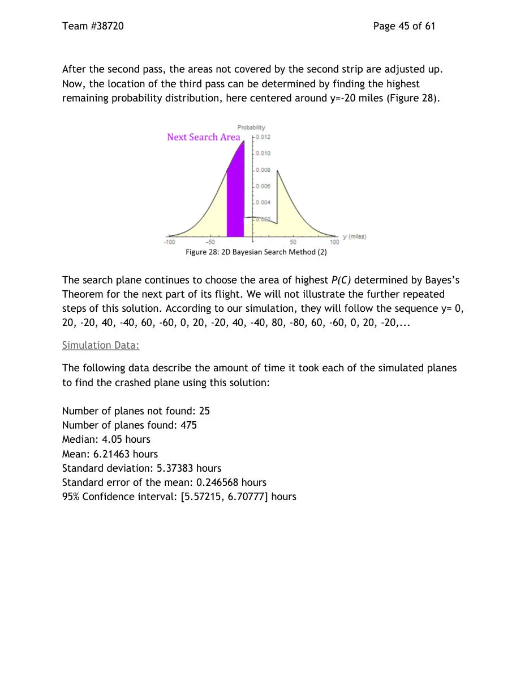 剩余概率分布示意图，中心位于 $y=-20$ 英里。

样本内的分布绘制在下方的直方图中：

 贝叶斯方法搜索时间的样本分布直方图。

知识点：[后验概率更新与搜索路径规划](../../../topics/数学建模/houyan_gailv.md)、[贝叶斯定理在搜索中的应用（Bayes' Theorem）](../../../topics/数学建模/beiyesi_dingli.md)、[模型验证方法概述（随机模型与确定性模型验证）](../../../topics/数学建模/moxing_yanzheng.md)

### 结论

该解决方案的样本显示出高度偏斜，这在直方图中清晰可见。平均值（6.2小时）大于中位数（4.1小时），支持了偏斜的视觉趋势。

在模拟的500架飞机中，有475架在24小时内被发现。贝叶斯方法的发现比例为95%。这一比例看起来是合理的，但必须与其他可能的解决方案进行比较。

该解决方案的置信区间为 [5.6, 6.7] 小时，这意味着100个大小为100的样本中有95%的平均值将介于5.6到6.7小时之间。考虑到在范围内发现坠机的概率小于1，这个范围仍然相当小。为了更好地了解贝叶斯方法的有效性，我们可以将其与“螺旋条纹”方法（Spiral Stripes approach，即我们之前模型最成功的解决方案）进行比较。

## 六、螺旋条纹飞行路径方案（Solution 5.2.2）

知识点：[螺旋方形搜索模型（Spiral Square Search Model）](../../../topics/数学建模/luoxuan_fangxing.md)、[贝叶斯调整飞行路径方案](../../../topics/数学建模/bayesi_tiaozheng.md)、[平行搜索与条纹飞行路径（Descending/Spiral Stripe Flight Path）](../../../topics/数学建模/pingxing_sousuo.md)

### 简要描述

该解决方案本质上与5.1.5节中的螺旋条纹解决方案相同。我们决定在此尝试是为了比较，因为它是正态分布模型中最成功的模型。唯一的区别是，即使残骸在搜索飞机的探测范围内，它也不一定能找到残骸。

知识点：[发现不确定性模型（Uncertainty Model）与传感器视野](../../../topics/数学建模/faxian_buqueding.md)、[平行搜索与条纹飞行路径（Descending/Spiral Stripe Flight Path）](../../../topics/数学建模/pingxing_sousuo.md)、[模型验证方法概述（随机模型与确定性模型验证）](../../../topics/数学建模/moxing_yanzheng.md)

### 工作原理

参考"5.1.5节 工作原理”。

知识点：[数学建模的基本步骤（问题分析、模型假设、建立、求解、检验、推广）](../../../topics/数学建模/jianmo_buzhou.md)、[一般假设及其合理性说明（Assumptions and Justifications）](../../../topics/数学建模/jiaben_shezhi.md)、[文献综述与研究背景撰写方法](../../../topics/数学建模/wenxian_zongshu.md)

### 模拟数据

| 统计指标 | 数值 |
| :--- | :--- |
| 未找到的飞机数量 | 101 |
| 找到的飞机数量 | 399 |
| 中位数 (Median) | 4.05 小时 |
| 平均值 (Mean) | 4.76078 小时 |
| 标准差 (Standard deviation) | 3.24672 小时 |
| 均值的标准误 (Standard error of the mean) | 0.162539 小时 |
| 95% 置信区间 | [4.4357, 5.08586] 小时 |

样本内的分布绘制在下方的直方图中：

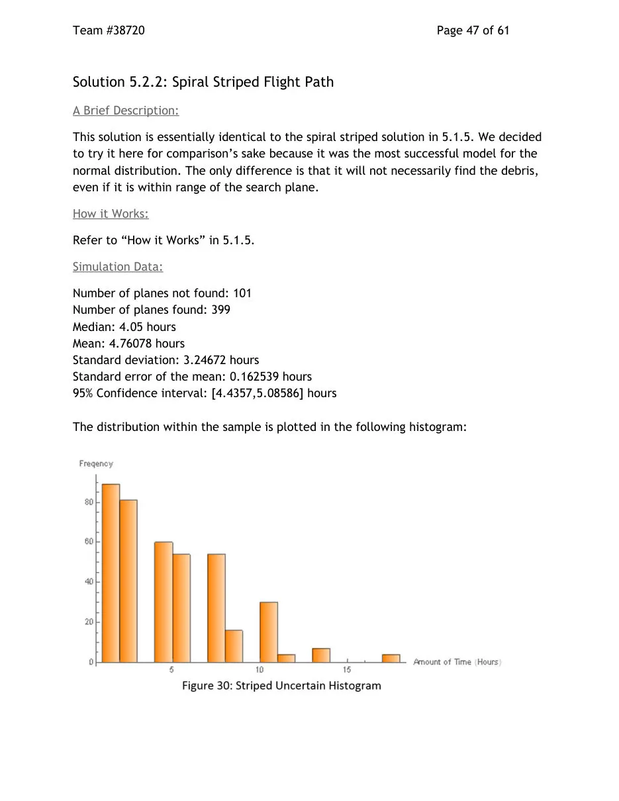 螺旋条纹方法搜索时间的样本分布直方图。

知识点：[坐标变换（经纬度坐标转换与搜索区域离散化网格）](../../../topics/数学建模/zuobiao_bianhuan.md)、[贝叶斯定理在搜索中的应用（Bayes' Theorem）](../../../topics/数学建模/beiyesi_dingli.md)、[平行搜索与条纹飞行路径（Descending/Spiral Stripe Flight Path）](../../../topics/数学建模/pingxing_sousuo.md)

### 结论

该解决方案显示出轻微的正偏斜，中位数（4.1小时）略小于平均值（4.8小时）。

在模拟的500架飞机中，只有399架在24小时内被发现。这一比例为80%，而贝叶斯方案的发现比例为95%。

该解决方案的置信区间为 [4.4, 5.1] 小时，不与贝叶斯方案的置信区间重叠，表明螺旋条纹方案与贝叶斯方案之间的差异具有统计学意义，且贝叶斯方案产生了更长的搜索时间。然而，贝叶斯方案发现的飞机比例更高，因此如果以救援几率为优先考量，贝叶斯方案是更可取的解决方案。

## 七、解决方案的稳定性测试

为了进一步测试模型的灵活性和最佳解决方案，我们决定尝试两个新的场景。

知识点：[螺旋方形搜索模型（Spiral Square Search Model）](../../../topics/数学建模/luoxuan_fangxing.md)、[贝叶斯调整飞行路径方案](../../../topics/数学建模/bayesi_tiaozheng.md)、[平行搜索与条纹飞行路径（Descending/Spiral Stripe Flight Path）](../../../topics/数学建模/pingxing_sousuo.md)

### 7.1 针对失踪 Cessna 172 的贝叶斯调整飞行路径

#### 简要描述

与波音777相反，这种微型飞机的搜索区域仅为29 x 99英里，根据我们在3.2节中的图表，其大小约为波音777的42分之一。在我们的模型中，我们将搜索区域调整为匹配Cessna的尺寸，并将探测概率调整为波音777的四十分之一，即 $P(D) = 2\%$。我们将保持搜索飞机、传感器和其他一切不变，搜索时间为24小时。

#### 工作原理

参考"5.2.1节 工作原理”。

#### 模拟数据

| 统计指标 | 数值 |
| :--- | :--- |
| 未找到的飞机数量 | 89 |
| 找到的飞机数量 | 411 |
| 中位数 (Median) | 6.435 小时 |
| 平均值 (Mean) | 8.38549 小时 |
| 标准差 (Standard deviation) | 6.55782 小时 |
| 均值的标准误 (Standard error of the mean) | 0.322474 小时 |
| 95% 置信区间 | [7.73855, 9.03244] 小时 |

样本内的分布绘制在下方的直方图中：

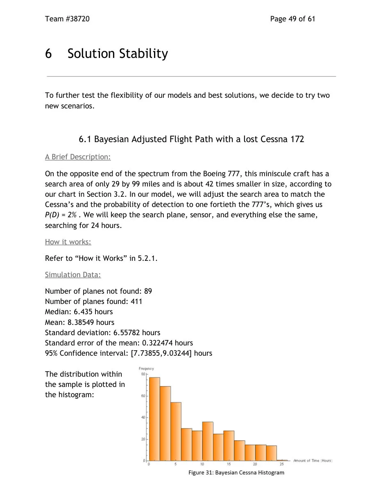 Cessna 172 搜索时间的样本分布直方图。

#### 结论

与其在5.2.1中的对应方案类似，该解决方案显示出轻微的右偏，中位数（6.4小时）略低于平均值（8.4小时）。

在丢失的500架Cessna中，82%在24小时内被发现，虽然较低，但与24小时内发现的95%波音777相比是可比的。

该解决方案的95%置信区间为 [7.7, 9.0] 小时，不与采用贝叶斯路径的波音777的置信区间重叠。因此，发现Cessna 172与发现波音777之间的差异具有统计学意义。这个结论是合理的，因为在单次飞行中发现Cessna的概率非常小（2%）。尽管概率很低，但贝叶斯方案在寻找Cessna方面做得出奇的好。

知识点：[贝叶斯定理在搜索中的应用（Bayes' Theorem）](../../../topics/数学建模/beiyesi_dingli.md)、[后验概率更新与搜索路径规划](../../../topics/数学建模/houyan_gailv.md)、[平行搜索与条纹飞行路径（Descending/Spiral Stripe Flight Path）](../../../topics/数学建模/pingxing_sousuo.md)

### 7.2 两架飞机沿条纹模式飞行

#### 简要描述

现在我们要检查，如果在寻找波音777的努力中添加第二架与第一架相同的搜索飞机会发生什么。常识告诉我们，搜索努力加倍，时间会缩短，但能缩短多少呢？我们将使用成功的条纹方法，但让两架飞机从中心开始向相反方向飞行，完全消除任何重叠。

下方显示了一个样本模拟：

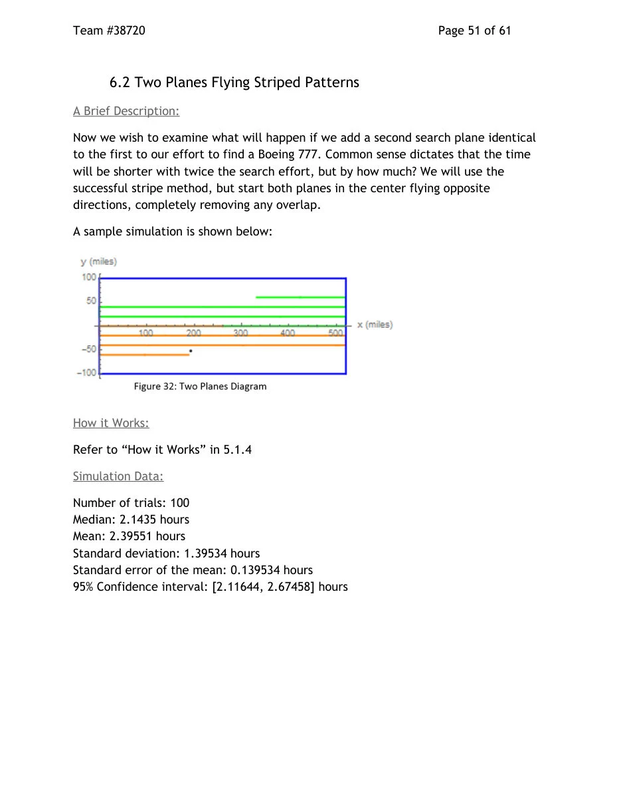 双机反向条纹搜索模拟示意图。

#### 工作原理

参考"5.1.4节 工作原理”。

#### 模拟数据

| 统计指标 | 数值 |
| :--- | :--- |
| 试验次数 (Number of trials) | 100 |
| 中位数 (Median) | 2.1435 小时 |
| 平均值 (Mean) | 2.39551 小时 |
| 标准差 (Standard deviation) | 1.39534 小时 |
| 均值的标准误 (Standard error of the mean) | 0.139534 小时 |
| 95% 置信区间 | [2.11644, 2.67458] 小时 |

样本内的分布绘制在下方的直方图中：

 双机条纹搜索时间的样本分布直方图。

#### 结论

该分布的偏斜在直方图中可见，但在平均值（2.4小时）和中位数（2.1小时）的差异上不那么明显。

毫不奇怪，该解决方案的表现优于其他任何方案。它不仅增加了一架额外的搜索飞机使努力加倍，而且从概率分布最高的区域开始，并排除了任何重叠。

在没有探测不确定性的情况下，该模型缺乏其他模型的真实感，但它仍然是雷达效率达到100%的理想解决方案。逻辑上，添加的搜索飞机越多，时间就会减少得越多。

# 2015年美国大学生数学建模竞赛（MCM）特等奖论文：Hidden in Plane Sight: Finding Lost Airplanes Before Time Runs Out（习题）

整理自《Hidden in Plane Sight: Finding Lost Airplanes Before Time Runs Out》第 7-8 部分（结果与结论），包含正态分布模型、发现不确定性模型的模拟结果分析及最终推荐。

## 一、结果分析

知识点：[平行搜索与条纹飞行路径（Descending/Spiral Stripe Flight Path）](../../../topics/数学建模/pingxing_sousuo.md)、[有效性参数（Effectiveness Parameter）与搜索模式对比](../../../topics/数学建模/youxiaoxing_canshu.md)

### 选择 1

在正态分布模型中，测试了总共 7 种解决方案，包括 6.2 节中的双机搜索方案。完全随机解决方案（5.1.1）不可行，因为大多数模拟最终未能找到飞机。在剩余的 6 种解决方案中，2 种是随机的，4 种是非随机的。这些模型的大样本量模拟为每种解决方案提供了 95% 的置信区间（CI）。由于随机解和非随机解的 CI 之间存在巨大差异，它们分别显示在下图中：

Team #38720

Page 53 of 61

**问题：** 根据随机解和非随机解的置信区间重叠情况，可以得出什么结论？

- A. 随机解和非随机解在搜索时间上没有显著差异。
- B. 非随机解的搜索时间普遍低于随机解。
- C. 随机解的搜索时间普遍低于非随机解。
- D. 无法确定哪种解更优。

答案：B。
知识点：[文献综述与研究背景撰写方法](../../../topics/数学建模/wenxian_zongshu.md)

### 简答 1

**问题：** 比较非随机解的置信区间，可以得出哪些有趣的结论？特别是关于双机条纹解、单机螺旋条纹解以及正弦波与下降条纹解之间的比较。

答案：
1. **双机条纹解表现最佳：** 双机条纹解的平均时间为 2.4 小时，优于任何其他解决方案。
2. **单机情况下螺旋条纹解最佳：** 如果只有一架搜索飞机运行，螺旋条纹解显然是最好的解决方案，平均时间为 3.6 小时，标准差为 2.9 小时。
3. **正弦波与下降条纹解无显著差异但变异性大：** 正弦波解和下降条纹解之间不存在统计学上的显著差异。虽然正弦波模型的平均时间（6.4 小时）低于下降条纹解（7.1 小时），但其标准差很大（6.1 小时）。这意味着正弦波解具有非常高的变异性：如果飞机坠毁地点靠近搜索区域中心，则能很快找到；如果坠毁地点靠近边缘，则需要很长时间。这些大型试验导致了显著的偏斜。

知识点：[非技术性文稿撰写（如致世界医学会的信函、新闻发布会声明）](../../../topics/数学建模/fei_jishu_wengao.md)、[平行搜索与条纹飞行路径（Descending/Spiral Stripe Flight Path）](../../../topics/数学建模/pingxing_sousuo.md)、[后验概率更新与搜索路径规划](../../../topics/数学建模/houyan_gailv.md)

### 简答 2

在发现不确定性模型中，进行了 3 次模拟。每次模拟都完成了大量试验，且 95% 置信区间相对较窄。为了简单起见，将搜索时间限制在 24 小时，并记录未成功的试验次数。这些模拟的置信区间显示如下：

Team #38720

Page 54 of 61

**问题：** 比较波音 777 的两项模拟（5.2.1 和 5.2.2）以及两项贝叶斯模拟（5.2.1 和 6.1），对于丢失的波音 777，螺旋解与贝叶斯解相比如何？为什么最终认为贝叶斯解更可取？

答案：
1. **螺旋解与贝叶斯解的比较：** 对于丢失的波音 777，螺旋解的 CI 不与贝叶斯解的 CI 重叠，这意味着螺旋解通常产生较低的搜索时间。
2. **差异原因及局限性：** 这种差异的一个可能原因是，条纹螺旋解仅在 24 小时内找到 80% 的失事飞机，而贝叶斯解找到 95%。由于未成功的尝试的长时间不计入平均值，这使条纹螺旋解的平均值向左移动（偏低）。
3. **中位数比较与最终结论：** 更有用的比较是基于中位数，两者的中位数相等（均为 4.05 小时）。对于高度偏斜的情况，中位数是分布中心的有用指标。因此，鉴于中位数相等，贝叶斯解（在 24 小时内找到 95% 的失事飞机）比条纹螺旋解（仅找到 80%）更可取。

知识点：[后验概率更新与搜索路径规划](../../../topics/数学建模/houyan_gailv.md)

### 简答 3

**问题：** 比较波音 777 和塞斯纳 172 的贝叶斯解的置信区间差异，可以得出关于这两种飞机搜救难度的什么结论？

答案：
1. **波音 777 的平均搜索时间更低：** 贝叶斯解在波音 777 和塞斯纳 172 之间的 CI 差异表明，波音 777 的平均搜索时间较低。
2. **中位数验证：** 通过比较中位数确认了这一差异（波音 777 为 4.05 小时，塞斯纳 172 为 6.44 小时）。
3. **成功率差异显著：** 在 24 小时时限内找到飞机的百分比存在显著差异，95% 的波音 777 被找到，而只有 82% 的塞斯纳 172 被找到。
4. **结论：** 可以得出结论，即使塞斯纳的搜索区域小得多，定位波音 777 也比定位塞斯纳 172 更容易、更快。

知识点：[贝叶斯定理在搜索中的应用（Bayes' Theorem）](../../../topics/数学建模/beiyesi_dingli.md)、[后验概率更新与搜索路径规划](../../../topics/数学建模/houyan_gailv.md)、[发现不确定性模型（Uncertainty Model）与传感器视野](../../../topics/数学建模/faxian_buqueding.md)

### 简答 4

**问题：** 根据介绍中确立的成功衡量标准，以及在特定情境下（乘客穿着普通衣物漂浮在 ~20℃ 的大西洋中）的生存时间，作者对正态分布解决方案和发现不确定性模型下的解决方案有何建议？最终推荐的是什么？

答案：
1. **成功标准：** 首先是是否找到失踪飞机，其次是在幸存者因暴露死亡之前是否能合理预期救援他们。
2. **生存时间背景：** 在 ~20℃ 的大西洋中，乘客穿着普通衣物（低绝缘）和救生衣，大约 18 小时后低温症开始致命。
3. **对正态分布解决方案的评价：** 尽管所有条纹和正弦正态分布解决方案的平均值很可能都在 8 小时以下（足以拯救乘客），但作者认为它们不够现实，因此不予推荐。
4. **对发现不确定性模型解决方案的评价：** 对于更现实、复杂的发现不确定性模型，贝叶斯解和螺旋条纹解都具有高偏度，因此通过其中位数进行比较，两者均为 4.05 小时，留有充足的救援时间。
5. **最终推荐依据：** 考虑到如果飞机未被找到，搜索就毫无意义，找到飞机的百分比是一个至关重要的因素。贝叶斯解在 24 小时内找到 95% 的波音 777，而螺旋条纹解仅找到 80%。
6. **最终推荐：** 最准确的模型及其最成功的解决方案：带有发现不确定性的正态分布（5.2 节）与贝叶斯搜索飞行路径（5.2.1）相结合。

知识点：[模型优缺点分析（Strengths and Weaknesses）](../../../topics/数学建模/youque_dian.md)、[一般假设及其合理性说明（Assumptions and Justifications）](../../../topics/数学建模/jiaben_shezhi.md)、[贝叶斯定理在搜索中的应用（Bayes' Theorem）](../../../topics/数学建模/beiyesi_dingli.md)

### 综合 1

**题目：** 请总结模型的 Strengths（优势）、Weaknesses（劣势）以及 Limiting Assumptions（限制假设）。

**正文内容：**

#### Strengths（优势）

*   **灵活性：** 我们的模型考虑了多种不同的探测概率、搜索区域和视距，并且可以对此进行调整。
*   **高效性：** 该解决方案能在 24 小时内定位高比例的飞机坠毁地点（波音 777 为 95%，塞斯纳 172 为 82%）。

    波音 777 均值周围的 95% 置信区间 (CI) 为 $[5.6, 6.7]$ 小时，远低于死亡窗口的下限（18 小时）。因此，大多数飞机很可能在乘客幸存窗口关闭之前被找到。

#### Weaknesses（劣势）

*   **计算限制：** 由于计算能力的限制，搜索时间上限设定为 24 小时。因为使用贝叶斯解法来估计下一次飞行的最佳飞行路径变得越来越困难，其复杂度呈指数级增长。
*   **重叠问题：** 虽然方案专注于高概率区域，但在过渡阶段并未完全消除不必要的重叠。

#### Limiting Assumptions（限制假设）

*   **分布简化：** 飞机的正态分布是基于搜索区域设计的简化模型，我们估计的标准差具有高度的不确定性。
*   **轨迹假设：** 我们的模型假设飞机在开始坠落前没有偏离其飞行路径。
*   **忽略因素：** 我们忽略了可能对寻找失踪飞机难度产生重大影响的因素，如飞行路径的曲率、洋流、碎片存在的可疑性、天气以及搜索时的海况。
*   **单步过程：** 我们假设搜索是一个单步过程，即发现碎片意味着找到了飞机，而在现实中这可能需要进行额外的搜索。
*   **动员时间忽略：** 我们忽略了搜索力量动员以及搜索飞机到达搜索区域所需的时间。
*   **成本忽略：** 我们没有将燃料和成本作为限制因素考虑在内。

答案：无（原文为陈述性段落，非标准问答形式）

## 二、新闻发布会声明

知识点：[模型优缺点分析（Strengths and Weaknesses）](../../../topics/数学建模/youque_dian.md)、[一般假设及其合理性说明（Assumptions and Justifications）](../../../topics/数学建模/jiaben_shezhi.md)、[贝叶斯定理在搜索中的应用（Bayes' Theorem）](../../../topics/数学建模/beiyesi_dingli.md)

### 简答 1

**题目：** 模拟航空公司发布的关于马航 MH370 事件的新闻发布会声明，阐述新的紧急搜索程序。

**正文内容：**

**标题：** 新闻发布会文件 (Press Conference Document)

**发言人：** 航空公司代表

**声明内容：**

我们，各航空公司，借此机会对涉及马来西亚航空 MH370 航班的悲剧事件致以最深切和最诚挚的歉意。我们知道，当您在我们的飞机上预订航班时，您将信任托付给我们。违背这种信任对我们来说是不可接受的，因此我们将采取一切可能的措施来减轻未来的灾难。鉴于未能找回 MH370 航班的不有效搜索，我们投入了大量精力修订并更新我们的紧急搜索程序以立即应用。

我们要承认，响应过程中的一些因素超出了我们的控制范围，但我们将努力调整我们的方法以实现最大效果。洋流、天气、海洋杂波和粗糙度都有可能削弱我们的操作，但我们坚信，在这些条件下，我们的新程序仍优于其他程序。

我们的计划大纲如下：一旦飞机未能按时签到，我们将根据其最后传输的信号和飞行路径预测其位置。我们的数学家将为理想搜索区域开发一个矩形边界，以便我们立即部署搜救飞机到失踪飞机最可能出现的区域。

我们的搜索飞机将以平行路径飞越搜索区域，完全覆盖该区域。我们将根据我们预测飞机可能所在的位置来决定这些路径。我们可以利用在搜索过程中收集的数据来更新我们对飞机位置的预测，并相应地调整我们的计划。我们的响应计划将根据不同情况进行快速调整以满足情况需求。在搜索过程中，我们必须确保考虑到设备的不完美性，例如我们的雷达，并确保不会错过飞机。我们将快速查看、彻底查看，并持续查看直到找到飞机。

在未来，我们相信我们可以通过扩展能力更好地应对环境挑战和设备不完美性来进一步完善我们的程序。通过详细且广泛的研究，我们的模型总是可以改进的。这对那些在 MH370 中失去亲人的家庭和朋友们来说是我们应尽的责任。

对于那些现在质疑乘坐飞机明智性的人——我们保证，您和您爱的人的安全无需担忧。

Team #38720

Page 58 of 61

答案：无（原文为模拟文档）

## 三、参考文献

知识点：[非技术性文稿撰写（如致世界医学会的信函、新闻发布会声明）](../../../topics/数学建模/fei_jishu_wengao.md)、[平行搜索与条纹飞行路径（Descending/Spiral Stripe Flight Path）](../../../topics/数学建模/pingxing_sousuo.md)、[后验概率更新与搜索路径规划](../../../topics/数学建模/houyan_gailv.md)

### 选择 1

**题目：** 列出文中引用的主要参考文献来源类型及关键信息。

**正文内容：**

以下是论文引用的参考文献列表：

1.  "The Wright Brothers - First Flight, 1903", EyeWitness to History, www.eyewitnesstohistory.com (2003).
2.  Adler, Jerry. "Will the Search for Amelia Earhart Ever End?" Smithsonian. Smithsonian Magazine, Jan. 2015. Web. 06 Feb. 2015.
3.  "ASN Records over 80 Aircraft Missing since 1948." ASN News. N.p., 18 Mar. 2014. Web. 06 Feb. 2015. <http://news.aviation-safety.net/2014/03/18/asn-records-over-80-aircraft-missing-si nce-1948/>.
4.  "Missing Malaysia Plane: What We Know." BBC News. N.p., 30 Jan. 2015. Web. 02 Feb. 2015.
5.  "777 Family." Boeing: 777-200/-200ER Technical Characteristics. The Boeing Company, n.d. Web. 06 Feb. 2015. <http://www.boeing.com/boeing/commercial/777family/pf/pf_200product.page>.
6.  "Aircraft - G450." Gulfstream Aerospace, n.d. Web. 06 Feb. 2015. <http://www.gulfstream.com/aircraft/gulfstream-g450>.
7.  "Skyhawk Model 172S Specification & Description." Cessna Aircraft Company, Dec. 2012. Web. 6 Feb. 2015. <http://cessna.txtav.com/\~/media/Files/Single%20Engine/skyhawk/Skyhawk%202013 %20172S%20SD.ashx>.
8.  Kebabjian, Richard. "STATISTICS." Accident Statistics. N.p., n.d. Web. 06 Feb. 2015. <http://www.planecrashinfo.com/cause.htm>.
9.  Cox, John. "Ask the Captain: How Do Planes Communicate over Ocean?"USA Today. Gannett, 06 Oct. 2014. Web. 06 Feb. 2015. <http://www.usatoday.com/story/travel/columnist/cox/2014/10/06/air-traffic-contr ol-satellite-radar/16645853/>.
10. McCartney, Scott. "Building a Better Air-Traffic-Control System." The Wall Street Journal. The Wall Street Journal, 22 Oct. 2009. Web. 06 Feb. 2015. <http://www.wsj.com/articles/SB10001424052748703816204574487173981612780>.

答案：无

## 参考文献

[11] United States. U.S. DEPARTMENT OF TRANSPORTATION. FEDERAL AVIATION ADMINISTRATION. Air Traffic Organization Policy. N.p., 03 Apr. 2014. Web. 06 Feb. 2015. <https://www.faa.gov/air_traffic/publications/ATpubs/ATC/atc1006.html>.

[12] United States. US Coast Guard. Office of Search and Rescue. The Theory of Search: A Simplified Explanation. N.p.: n.p., n.d. Print.

[13] Davies, Anne. "Marshalling Forces in the Search for MH370." Sydney Morning Herald, 22 Mar. 2014. Web. 7 Feb. 2015. <http%3A%2F%2Fwww.smh.com.au%2Fworld%2Fmarshalling-forces-in-the-search-for-mh370-20140322-hvll6.html>.

[14] Currie, N. C. Performance Tests on the AN/APS-119 Radar System. Tech. no. AD-787 182. N.p.: Georgia Institute of Technology, 1979. Defense Technical Information Center. Web. 8 Feb. 2015. <http://www.dtic.mil/get-tr-doc/pdf?AD=AD0787182>.

[15] Neuman, Scott. "Sub-Hunting Planes Use High-Tech Gear To Search For Flight 370." NPR. NPR, 20 Mar. 2014. Web. 07 Feb. 2015. <http://www.npr.org/blogs/thetwo-way/2014/03/20/291927968/sub-hunting-planesuse-high-tech-gear-to-search-for-mh370>.

[16] "Radar." RADAR (n.d.): n. pag. Global Security. Web. 8 Feb. 2015. <http://www.globalsecurity.org/military/library/policy/navy/nrtc/14030_ch3.pdf>.

[17] "How Far Can Airplanes Glide?" Aviation - Stack Exchange. N.p., 05 Apr. 2014. Web. 06 Feb. 2015. <http://aviation.stackexchange.com/questions/2999/how-far-can-airplanes-glide>.

[18] "The US Navy." The US Navy. US Navy, 18 Feb. 2009. Web. 07 Feb. 2015. <http://www.navy.mil/navydata/fact_print.asp?cid=1100&tid=1400&ct=1&page=2>.

[19] Simmering, Jacob. "Bayesian Search Models." Rbloggers. N.p., 13 Mar. 2014. Web. 08 Feb. 2015. <http://www.r-bloggers.com/bayesian-search-models/>.

[20] Ross, Sheldon M. "Conditional Probability And Independence." A First Course in Probability. 9th ed. New York: Macmillan, 1976. 59. Print.

[21] Krendel, Erza S., and Jerome Wodinsky. Visual Search in Unstructured Fields. Thesis. U.S. Armed Forces, 1960. N.p.: n.p., n.d. Print.

[22] Piantadosi, Claude. "Prediction of Survival Time in Cold Water." The Biology of Human Survival: Life and Death in Extreme Environments. N.p.: Oxford UP, n.d. 121-23. Print.

## 8.2 图片来源

"ASN Records over 80 Aircraft Missing since 1948." ASN News. N.p., 18 Mar. 2014. Web. 06 Feb. 2015. <http://news.aviation-safety.net/2014/03/18/asn-records-over-80-aircraft-missing-since-1948/>.

McCaskill, Steve. "Air Traffic Control Systems Could Ditch Radar And Release 5G Spectrum." Tech Week. N.p., 13 Feb. 2013. Web. 8 Feb. 2015. <http%253A%252F%252Fwww.techweekeurope.co.uk%252Fworkspace%252F5g-mobile-networks-air-traffic-control-107240%2B>.

"Missing Malaysia Plane: What We Know." BBC News. N.p., 30 Jan. 2015. Web. 02 Feb. 2015.

Paint.net. Computer software. Vers. 4.0.4. DotPDN LLC, n.d. Web. 6 Feb. 2015. <http://www.getpaint.net/>.

Piantadosi, Claude. "Prediction of Survival Time in Cold Water." The Biology of Human Survival: Life and Death in Extreme Environments. N.p.: Oxford UP, n.d. 121-23. Print.

Wolfram Research, Inc., Mathematica, Version 10.0, Champaign, IL (2014).

Microsoft. Microsoft Excel. Redmond, Washington: Microsoft, 2013. Computer Software.

知识点：[文献综述与研究背景撰写方法](../../../topics/数学建模/wenxian_zongshu.md)
