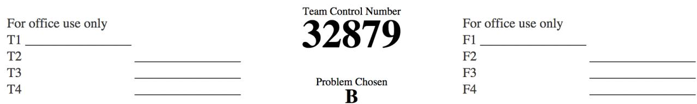
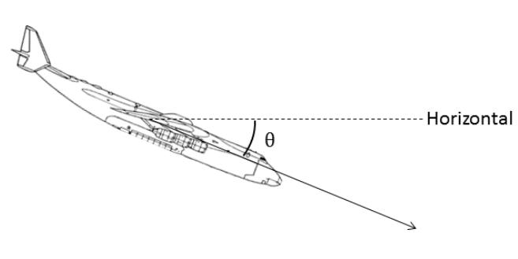
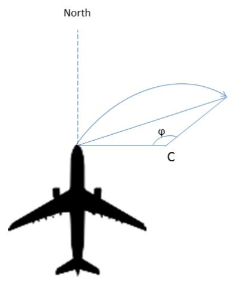
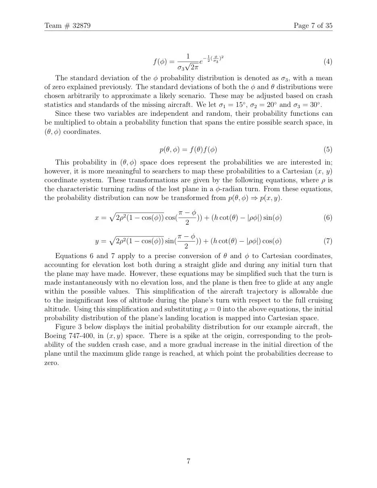
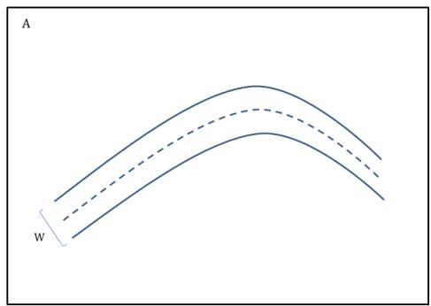
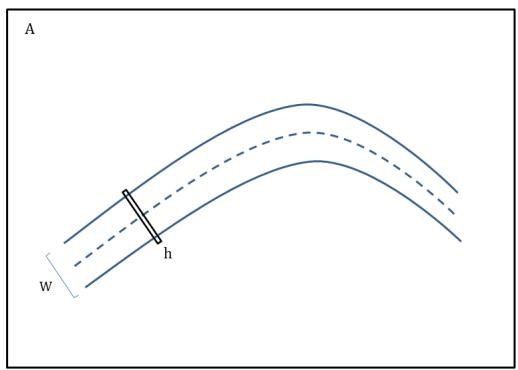
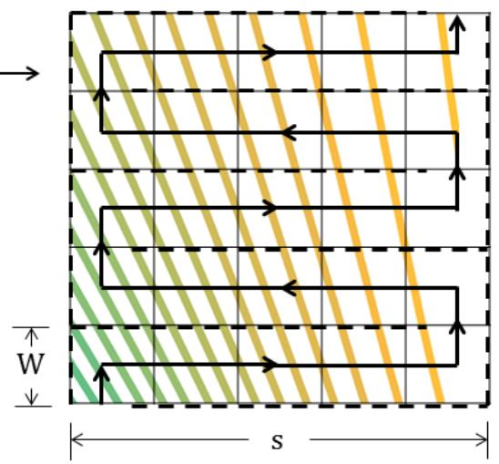
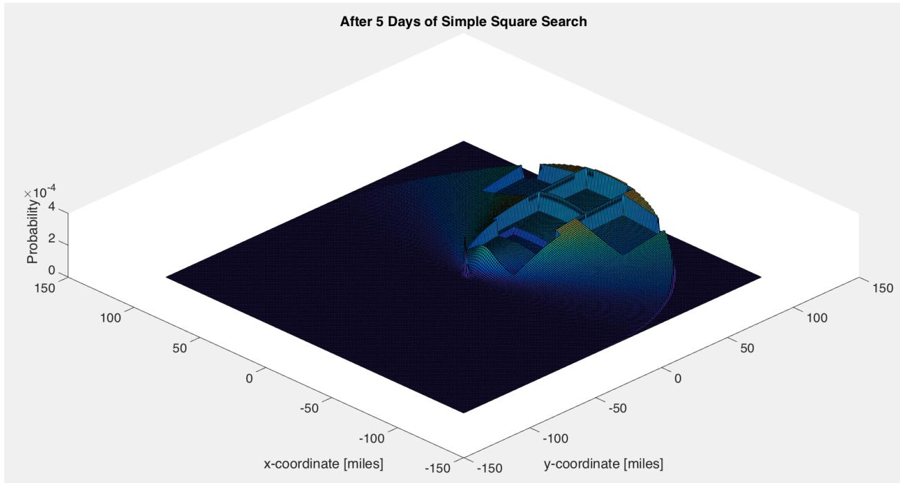
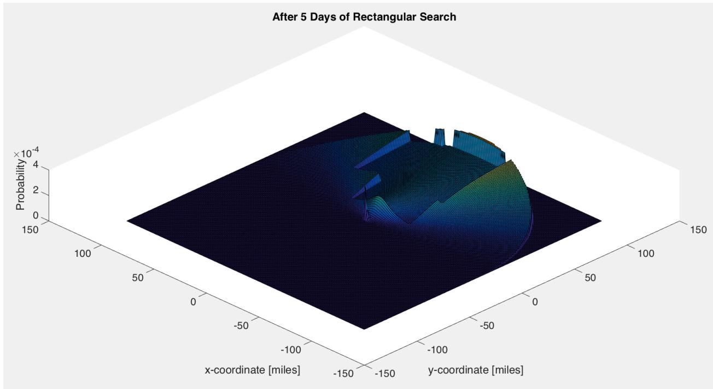
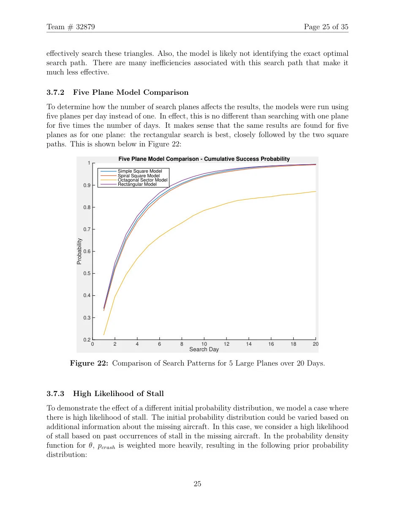

# 2015年美国大学生数学建模竞赛（MCM）特等奖论文：Into the Void: A Probabalistic Approach to the Search for Missing Aircraft

原件为竞赛论文。补充：文中的阅读练习及“参考解答”为整理时增加，原件图文保留出处。

### Into the Void: A Probabalistic Approach to the Search for Missing Aircraft

In recent years, the disappearance of major commercial aircraft over open ocean has led to expensive international search efforts. These searches require the efficient allocation of resources and time in order to find survivors of the crash and the airplane itself.

We develop a generic probabilistic model to not only predict the location of the downed aircraft, but to also aid in optimizing the search in a time effective manner. This model assumes that at the moment of lost signal, the plane experiences a failure and is no longer powered. Specifically, we accomplish the following:

- Initial Probability Distribution: We create a prior probability density function to model the potential locations of the missing plane. This distribution is based solely on the knowledge that we have about the plane at the time of lost contact: its location, bearing, cruise altitude, and lift-to-drag ratio.
- Search Patterns: We implement four independent search patterns and develop a method to measure their effectiveness based on the total probability of finding the aircraft. We construct an optimization algorithm to determine the most effective means of conducting each search.
- Dynamic Probability Model: We employ Bayesian Inference to continuously adjust the probabilities of our distribution as information from the search is collected and processed. This allows us to create a posterior probability distribution which refines the data utilized in subsequent searches.
- Versatility: We explore variations of crash and search scenarios that realistically simulate actual incidents. This adaptability is achieved through the incorporation of adjustable input parameters that reflect unique circumstances.

Ultimately, our model demonstrates that an easily-packed and spacially-efficient pattern, such as the rectangular parallel-sweep, most efficiently maximizes the probability of finding a lost aircraft over time.

知识点：[先验概率分布模型（随机下降与初始概率密度函数 PDF）](../../../topics/数学建模/xianyan_gailv.md)、[贝叶斯定理在搜索中的应用（Bayes' Theorem）](../../../topics/数学建模/beiyesi_dingli.md)、[平行搜索与条纹飞行路径（Descending/Spiral Stripe Flight Path）](../../../topics/数学建模/pingxing_sousuo.md)

### Contents

1 Introduction 3
1.1 Overview . . . . . . . . . . . . . . . . . . . . . . . . . . . . . . . . . . . . . . . . . . . . . . . . . . 3
1.2 Nomenclature . . . . . . . . . . . . . . . . . . . . . . . . . . . . . . . . . . . . . . . . . 3
1.3 Simplifying Assumptions . . . . . . . . . . . . . . . . . . . . . . . . . . . . . . . . . . . . . . . . . . . . 4
2 Model Theory 5
2.1 Prior Probability: Random Descent 5
2.2 Bayes' Theorem 8
2.3 Posterior Probability: Search Paths 9
2.4 Optimization Criteria 11
3 Model Implementation and Results 13
3.1 Prior Probability Model: A Discrete Grid 13
3.2 General Search Model Methods 14
3.3 Simple Square Search Model 15
3.4 Optimized Rectangle Search Model 17
3.5 Spiral Square Search Model 18
3.6 Octagonal Sector Search Model 21
3.7 Model Variation and Comparison 23
3.7.1 Single Plane Search Model Comparison 24
3.7.2 Five Plane Model Comparison 25
3.7.3 High Likelihood of Stall 25
3.7.4 Short Range Search Aircraft 27
3.7.5 Comparison of Varied Search Patterns 28
3.7.6 The Effectiveness Parameter 29
4 Final Remarks 32
4.1 Strengths and Weaknesses 32
4.2 Future Model Development 32
4.3 Conclusions 33

知识点：[海洋搜索理论历史与核心概念](../../../topics/数学建模/sousuo_lilun.md)、[贝叶斯定理在搜索中的应用（Bayes' Theorem）](../../../topics/数学建模/beiyesi_dingli.md)、[后验概率更新与搜索路径规划](../../../topics/数学建模/houyan_gailv.md)

### 1 Introduction

知识点：[数学建模的基本步骤（问题分析、模型假设、建立、求解、检验、推广）](../../../topics/数学建模/jianmo_buzhou.md)、[文献综述与研究背景撰写方法](../../../topics/数学建模/wenxian_zongshu.md)、[一般假设及其合理性说明（Assumptions and Justifications）](../../../topics/数学建模/jiaben_shezhi.md)

### 1.1 Overview

Since the dawn of the aviation age, crashes and other incidents have helped shaped the technology in the aviation industry. Not only have they guided the design of airframes, propulsion systems, wings, and many other components of an aircraft, they have also heavily influenced the technology of the entire industry, including that of search and rescue. In the last decade, worldwide attention has been directed towards the search for missing aircraft, especially over water, due to two major incidents:

- June, 2009: Air France Flight 447 (Airbus A-330) went missing over the Atlantic Ocean without a trace. It took five days for searchers to find any signs of wreckage and nearly two years for the flight data recorders to be recovered[1].
- March, 2014: Malaysian Airlines Flight 370 (Boeing 777) disappeared over the South China Sea. A nearly year-long international search effort has still found no trace of the aircraft[2].

In both of the above cases, all crew and passengers were lost (or are assumed to be lost), and many millions of dollars were spent in the search effort. The efficient search and recovery of aircraft in the future could save lives and money. In this report, we will detail a series of generic mathematical models that describe and optimize the search for a missing aircraft.

知识点：[数学建模的基本步骤（问题分析、模型假设、建立、求解、检验、推广）](../../../topics/数学建模/jianmo_buzhou.md)、[任务分解与目标明确](../../../topics/数学建模/renwu_fenjie.md)

### 1.2 Nomenclature

We will begin by defining a list of the nomenclature used in this report:

| Abbreviation | Description |
| --- | --- |
| $A$ | Area of the search grid |
| $h$ | Cruise altitude for missing aircraft |
| $L/D$ | Lift-to-drag ratio for missing aircraft |
| $n$ | Number of search passes in a search region |
| $p$ | Probability of a grid point containing the aircraft |
| $p^0$ | Posterior probability for a searched location |
| $q$ | Probability of detecting the aircraft given it is within the search region |
| $r$ | Probability of a grid point containing the aircraft, where no search is conducted |
| $r^0$ | Posterior probability for an un-searched location |
| $R$ | Entire search region |
| $s$ | Square region side length |
| $W$ | Lateral search range |
| $x$ | East-West distance from the point of losing contact |
| $y$ | North-South distance from the point of losing contact |
| $z$ | Distance traveled by the search plane within a search area |

知识点：[符号说明与术语定义（Nomenclature / Symbols and Definitions）](../../../topics/数学建模/fuhao_shuoming.md)、[文献综述与研究背景撰写方法](../../../topics/数学建模/wenxian_zongshu.md)、[问题重述与分析（Problem Restatement and Analysis）](../../../topics/数学建模/wenti_chongshu.md)

### 表 1 符号说明

| 符号 | 含义 |
| --- | --- |
| $\alpha$ | 描述找到失踪飞机难易程度的参数 |
| $\beta$ | 描述搜索飞机有效性的参数 |
| $\lambda$ | 有效性参数 |
| $\phi$ | 航向改变角 |
| $\sigma$ | 标准差 |
| $\theta$ | 滑翔角 |

知识点：[符号说明与术语定义（Nomenclature / Symbols and Definitions）](../../../topics/数学建模/fuhao_shuoming.md)、[模型参数的确定（基于数据拟合或实验选择）](../../../topics/数学建模/canshu_queding.md)、[有效性参数（Effectiveness Parameter）与搜索模式对比](../../../topics/数学建模/youxiaoxing_canshu.md)

### 1.3 简化假设

我们模型的准确性依赖于若干关键的简化假设，这些假设列举如下：

- 飞机在失去联系的那一刻之前被精确跟踪；在失去联系的那一刻，飞机不再有动力（即发动机不提供推力，也不发射信号）。
- 飞机在巡航阶段失去联系。
- 飞行员在失去联系后可以立即向任一方向作一次不超过 $180^{\circ}$ 的转向。假定该转向瞬时完成，因为在这一转向过程中理论上损失的距离可以忽略不计。
- 无风。
- 无洋流。
- 飞机/残骸将无限期漂浮。
- 整个搜索区域均为水域（即搜索区域不延伸至陆地）。
- 搜索飞机只在其搜索区域内搜索。虽然搜索飞机从跑道飞往指定搜索区域的过程中可能飞越其他搜索区域，但假定飞机在此期间不进行搜索。
- 搜索飞机可以瞬时转向。
- 不考虑地球的局部曲率——搜索区域是一个完全平坦的二维平面。
- 在给定的搜索日，有 12 小时日光时间可供搜索飞机飞行。

此外，为使本报告呈现一致的结果，还任意定义了若干搜索参数。不过，这些参数很容易调整，以适应某一具体失踪飞机的情况：

- 飞机在失去联系时正朝正北方向飞行。
- 可供搜救工作使用的跑道恰好位于信号丢失点以南 400 英里处。

知识点：[一般假设及其合理性说明（Assumptions and Justifications）](../../../topics/数学建模/jiaben_shezhi.md)

### 2 模型理论

知识点：[数学建模的基本步骤（问题分析、模型假设、建立、求解、检验、推广）](../../../topics/数学建模/jianmo_buzhou.md)

### 2.1 先验概率：随机下降

首先，我们对失踪飞机可能所在的位置及其相关概率进行建模。我们假定飞机在信号丢失后不再有动力，因此用于搜索的信息仅限于飞机的最后已知位置、飞机的飞行方向以及失踪飞机的类型。这一最后已知位置将用于确定飞机可能所在区域 $R$ 的原点。区域 $R$ 定义在笛卡尔坐标系中，北为正 $y$ 方向，东为正 $x$ 方向。失踪飞机的两个性质有助于确定飞机可能所在的位置：升阻比 $(L/D)$ 和高度 $(h)$。我们定义 $\theta$ 为飞机低于水平面的滑翔角，$\phi$ 为飞机相对于其初始航向可能发生的航向改变。这些量如图 1a 和 1b 所示：

无动力滑翔角 $\theta$ 的最小值由飞机的 $L/D$ 确定[3]：

$$
\theta_{\min}=\tan^{-1}\left(\frac{1}{L/D}\right)\tag{1}
$$

波音 747 是一种常用于跨洋长距离飞行的飞机，其服役期间飞行里程已超过 420 亿海里[4]。对于波音 747-400——747 最常见的型号——其升阻比为 17，巡航高度为 35000 英尺[5]。由于 747-400 频繁跨洋飞行，本报告将其作为首个考虑的失踪飞机。需要注意的是，后文描述的概率模型是通用的，因此可应用于任何失踪飞机；只需在模型中更改 $L/D$ 和巡航高度的取值即可。由式 1 可得，747 的最小滑翔角约为 $3.37^{\circ}$。通过对滑翔角进行几何分析（如图 2 所示），可以定义飞机无动力时的最大航程 $r_{\max}$ 的表达式，见式 2。由于假定飞机在巡航阶段失去信号，$h$ 将等于巡航高度。747 的理论最大滑翔航程接近 113 英里，令人印象深刻。

# 2015年美国大学生数学建模竞赛（MCM）特等奖论文：Into the Void: A Probabalistic Approach to the Search for Missing Aircraft

本资料整理自《Into the Void: A Probabalistic Approach to the Search for Missing Aircraft》第 6–8 页内容，主要涉及初始概率密度函数的构建、坐标变换以及基于贝叶斯定理的概率更新模型。

## 二、初始概率分布模型

知识点：[先验概率分布模型（随机下降与初始概率密度函数 PDF）](../../../topics/数学建模/xianyan_gailv.md)、[坐标变换（经纬度坐标转换与搜索区域离散化网格）](../../../topics/数学建模/zuobiao_bianhuan.md)、[贝叶斯定理在搜索中的应用（Bayes' Theorem）](../../../topics/数学建模/beiyesi_dingli.md)

### 章节 2.1 初始概率密度函数

**来源与整理说明**：本节阐述了如何根据失事轨迹的几何参数 $\theta$（下滑角）和 $\phi$（偏航角）构建初始概率密度函数。

由于 $\theta$ 和 $\phi$ 表征了信号丢失后随机飞行路径的不同方面，这两个变量被视为随机且独立的。概率函数的区域 $R$ 由从信号丢失点向所有方向扫过的最大无动力滑翔范围界定。因为两者独立，$\theta$ 和 $\phi$ 被分配各自独立的概率函数。

一个非常接近最小下滑角 $\theta_{min}$ 的 $\theta$ 值代表飞机断电后，飞行员决定以该设定角度滑翔，从而最大化距离并最小化撞击水面时的损坏几率。而更接近 $90^\circ$ 的 $\theta$ 值则 signify catastrophic failures（灾难性故障），例如因失速或爆炸导致的升力突然丧失，这将导致快速下降。

因此，$\theta$ 的概率分布被建模为双峰正态分布，权重偏向于最佳滑翔和灾难性失败这两种极端情况。该分布本身是两个互斥正态分布的和。每种情况的权重如下所示，即突发坠毁概率 $p_{crash}$ 与滑翔概率 $p_{glide} = 1 - p_{crash}$ 之比：

$$
f (\theta) = p _ {c r a s h} * f (\theta_ {c r a s h}) + p _ {g l i d e} * f (\theta_ {g l i d e}) = \frac {p _ {c r a s h}}{\sqrt {2 \pi} \sigma_ {1}} e ^ {- \frac {1}{2} (\frac {\theta - \theta_ {m a x}}{\sigma_ {1}}) ^ {2}} + \frac {p _ {g l i d e}}{\sqrt {2 \pi} \sigma_ {2}} e ^ {- \frac {1}{2} (\frac {\theta - \theta_ {m i n}}{\sigma_ {2}}) ^ {2}}\tag{3}
$$

其中，$\sigma _ { 1 }$ 和 $\sigma _ { 2 }$ 分别对应坠毁分布和滑翔分布的标准差。类似地，坠毁角度分布的均值为 $\theta _ { m a x } = 9 0 ^ { \circ }$，而滑翔角度分布的均值为 $\theta _ { m i n }$。

$\phi$ 要么是一个随机值（如果动力丧失导致失控），要么是一个取决于飞行员决策的值，描述被认为适合减轻事故程度的转弯程度。然而，由于此时对飞行员的决策或飞机的可控性一无所知，$\phi$ 将根据均值为零的正态分布进行变化，这对应于飞机不改变航向的最可能场景。其概率密度函数为：

$$
f (\phi) = \frac {1}{\sigma_ {3} \sqrt {2 \pi}} e ^ {- \frac {1}{2} (\frac {\phi}{\sigma_ {3}}) ^ {2}}\tag{4}
$$

$\phi$ 概率分布的标准差记为 $\sigma _ { 3 }$，均值之前已解释为零。$\phi$ 和 $\theta$ 分布的标准差是任意选择的，以近似可能的场景。这些可以根据缺失飞机的坠机统计数据和标准进行调整。文中设定 $\sigma _ { 1 } = 1 5 ^ { \circ } , \sigma _ { 2 } = 2 0 ^ { \circ }$ 和 $\sigma _ { 3 } = 3 0 ^ { \circ }$。

由于这两个变量是独立且随机的，它们的概率函数可以相乘，以获得覆盖整个可能搜索空间的概率函数，即在 $( \theta , \phi )$ 坐标系中：

$$
p (\theta , \phi) = f (\theta) f (\phi)\tag{5}
$$

知识点：[先验概率分布模型（随机下降与初始概率密度函数 PDF）](../../../topics/数学建模/xianyan_gailv.md)、[多目标优化模型（药物相对充足阶段的配送策略）](../../../topics/数学建模/duo_mubiao_youhua.md)

### 章节 2.1.2 坐标变换

虽然上述在 $( \theta , \phi )$ 空间中的概率代表了我们要关注的概率；但对于搜救人员来说，将这些概率映射到笛卡尔 $( x , y )$ 坐标系中更有意义。这些变换由以下方程给出，其中 $\rho$ 是丢失飞机在 $\phi$ 弧度转弯中的特征转弯半径。通过这些方程，概率分布现在可以从 $p ( \theta , \phi )$ 转换为 $p ( x , y )$：

$$
x = \sqrt {2 \rho^ {2} (1 - \cos (\phi))} \cos (\frac {\pi - \phi}{2})) + (h \cot (\theta) - | \rho \phi |) \sin (\phi)\tag{6}
$$

$$
y = \sqrt {2 \rho^ {2} (1 - \cos (\phi))} \sin (\frac {\pi - \phi}{2})) + (h \cot (\theta) - | \rho \phi |) \cos (\phi)\tag{7}
$$

方程 6 和 7 适用于将 $\theta$ 和 $\phi$ 精确转换为笛卡尔坐标，考虑了在直线滑翔期间以及飞机可能进行的任何初始转弯期间的海拔损失。然而，这些方程可以进行简化，假设转弯是瞬时完成的且没有高度损失，然后飞机可以自由地在可能的任何角度滑翔。这种飞机轨迹的简化是允许的，因为相对于全巡航高度，飞机转弯过程中的高度损失微不足道。使用此简化并将 $\rho = 0$ 代入上述方程，飞机着陆位置的初始概率分布被映射到笛卡尔空间。

图 3 显示了示例飞机波音 747-400 在 $( x , y )$ 空间中的初始概率分布。在原点处有一个尖峰，对应于突发坠毁情况的概率；而在飞机的初始方向上，概率逐渐增加，直到达到最大滑翔范围，此时概率降至零。

 图 3：波音 747-400 在 $(x, y)$ 空间中的初始概率分布示意图

## 三、贝叶斯定理的应用

知识点：[坐标变换（经纬度坐标转换与搜索区域离散化网格）](../../../topics/数学建模/zuobiao_bianhuan.md)、[贝叶斯定理在搜索中的应用（Bayes' Theorem）](../../../topics/数学建模/beiyesi_dingli.md)、[后验概率更新与搜索路径规划](../../../topics/数学建模/houyan_gailv.md)

### 章节 2.2 Bayes’ Theorem

确定初始概率后，我们必须模拟这一概率分布如何受到搜索的影响。为此，我们将搜索前已知信息与搜索过程中收集的信息分开。贝叶斯定理将用于推导找到残骸概率的一般表达式。

贝叶斯定理的数学表述为：

$$
P (A | B) = \frac {P (B | A) P (A)}{P (B)}\tag{8}
$$

对于事件 A 和 B。$P(A)$ 和 $P ( B )$ 分别是 A 和 B 的概率，而 $P ( A | B )$ 是在 B 为真的条件下 A 发生的概率。在我们的案例中，事件 A 是找到飞机，事件 B 是飞机位于我们正在搜索的位置。变量 $q$ 将在后续方程中表示 $P ( A | B )$[6]。

该定理可以重写，以模拟搜索信息如何影响概率分布。如果一个地点被搜索且在该区域内未找到飞机，那么在该搜索区域找到飞机的新概率不应等于零。这是因为仍然存在飞机在那里但未被看见的可能性。贝叶斯定理可以重写，以精确建模在搜索一个地点且未发现任何东西后概率分布应如何变化。对于被搜索的网格点：

$$
p ^ {\prime} = \frac {p (1 - q)}{(1 - p) + p (1 - q)}\tag{9}
$$

## 2.2 后验概率

其中 $p'$ 是后验概率；在我们的情形中，它是在此前于同一位置未找到飞机之后，未来在该位置找到飞机的可能性。类似地，$p$ 是在任意给定位置找到飞机的先验概率。基于这一点，量 $p(1-q)$ 表示该位置包含飞机且飞机未被找到的可能性，而 $(1-p)$ 是飞机不在该位置的可能性。此公式适用于被搜索过的位置，用于降低后验概率 $p'$[7]。

在一个位置被检查过且未找到飞机之后，飞机位于不同位置的可能性必须增加。为修正这些概率，我们使用以下公式：

$$
r' = \frac{r}{1-pq}\tag{10}
$$

$r'$ 与 $r$ 分别是后验概率与先验概率，分别类似于被搜索位置中的 $p'$ 与 $p$[7]。

这些公式使我们能够根据已进行的搜索的新数据，不断对新的概率分布建模。它们还会对概率分布重新归一化，使得在任何时刻，飞机位于整个搜索区域内的概率都是 100%。

## 2.3 后验概率：搜索路径

在已经建立初始概率分布建模的理论以及该分布如何随时间变化之后，我们现在讨论在飞机位于被搜索位置的前提下被探测到的可能性。这一概率 $q$ 将定义为三个变量的函数：横向搜索范围、搜索载具行驶的总距离，以及界定给定位置的区域面积。设横向搜索范围为 $W$，它可以随所用电子设备及感兴趣区域的能见度而变化。搜索飞机在搜索期间行驶的总距离 $z$ 会极大地影响搜索的成功与否。同样，包含网格单元的区域 $A$ 也会影响搜索进行的效率。

为了直观展示搜索路径，下图描绘了一条示例路径：

为推导在该区域 $A$ 中找到飞机的概率表达式，我们首先需要对搜索路径作出更多简化假设。第一，目标分布在该矩形上必须均匀。第二，不相交的航迹段必须在矩形内均匀且独立分布。最后，任何搜索努力都不会落在该搜索区域之外。符合这三条假设即构成随机搜索[8]。

现在考虑该航迹中的某个增量步长 $h$。设 $g(h)$ 为一个函数，描述在先前未找到目标的前提下，在该增量 $h$ 中找到目标的概率。该新增量步长所扫过的矩形如下图所示：

由此可得

$$
g(h) = \frac{Wh}{A}\tag{11}
$$

因为搜索的宽度与距离越大，成功概率越高；而当面积增大时，该概率降低。

为得到我们想要的 $q$ 的表达式，我们将沿用 Stone[8] 给出的推导。设 $b(z)$ 为在行驶某段长度 $z$ 之后探测到目标的概率。那么，由贝叶斯定理，$[1-b(z)][g(h)]$ 是在长度 $z$ 之后未能探测到目标、但在下一步 $h$ 中成功的概率。因此，

$$
b(z+h) = b(z) + [1-b(z)]\frac{W}{A}\tag{12}
$$

其中

$$
b'(z) = \lim_{h\to\infty}\frac{b(z+h)-b(z)}{h} = [1-b(z)]\frac{W}{A}\tag{13}
$$

上述微分方程不过是关于 $b(0)=0$ 的常系数非齐次线性微分方程。其解为

$$
b(z) = 1 - e^{-\frac{zW}{A}}\tag{14}
$$

## 2.4 Optimization Criteria

The primary objective of our model is to maximize the cumulative probability of success for any given search region. This will be accomplished through minimizing the posterior probability $p'$ for some region to be searched, as lower posterior probability correlates to a more thorough search within that region. A thorough search is represented in our model as the maximization of $q$, the probability of finding the plane given that it is located within the region searched. Because our initial model produces an initial density distribution over a two-dimensional plane, we need to integrate over a specified region to find the total probability that a search within that region will be successful. Mathematically, this is stated in Equation 15, where A is the area of the region that has been searched.

$$
p(\mathrm{find\ plane} | \mathrm{plane\ is\ in\ region}) = q(z^*) = \max_{z \in R} \iint_A b(z) \mathrm{d}A \tag{15}
$$

Similarly, through Bayes’ Theorem, the probability of finding the plane in the region is the product of the probability that it is in the region and the probability of finding the plane given it is in the region. This is shown in Equation 16.

$$
p(\text{find plane}) = q(z^*) p(x, y) = \iint_A b(z) * p(x, y) \mathrm{d}A \tag{16}
$$

As seen in the theoretical application of Bayes’ Theorem, Bayesian Inference is used to continuously adjust the probabilities of a distribution as new information is collected and processed [9]. As Bayesian Inference will be used in the optimization of our search methods, we must incorporate both $q$ and the change of probability when a given region has been checked. Essentially, every time a region is checked and the plane is not found there, Bayesian Inference will be applied to reduce the probability of the plane being in that location while simultaneously re-normalizing the rest of the probability distribution to account for this change.

An interesting facet of Bayesian Inference appears when implementing this method across a large area. When searching an area $A$, the probability of that area containing the plane is reduced by the correct factor and every probability outside of that area is renormalized. However, the same results are achieved when the probability change and renormalization occur for an incremental area $dA$ within the larger area $A$. In fact, an entire region of the distribution can be checked for a success one incremental area element at a time. This is very applicable when the process is implemented through a computer simulation where a distribution is mapped to a grid of discrete probabilities. A two-dimensional application of Bayesian Inference is shown below in Figure 6, where the middle section is “searched.”

As the probability of finding the plane at any given point will continuously change with each successive search, the optimal location to search for the plane will change over the course of multiple days. Similarly, the probability of finding the plane on any given day will change. For instance, over the course of many days the probability distribution will be much more uniform as the locations of high probability have already been checked. Meanwhile, the locations of initially low probability have been increasing in relative probability due to the renormalization process. Because of this renormalization, a given day’s probability of success is defined as the product of all of the previous day’s probabilities of failure with the given day’s probability of a success. This probability for success on day N, $P(N)$, is described below in Equation 17.

$$
P(N) = \prod_{k=1}^{N-1} (1 - P(k)) * \iint_A b(z) * p(x, y) \mathrm{d}A \tag{17}
$$

The optimization of this probability is noticeably dependent upon the path length of the search path, $z$. Each of the different types of search paths will have different lengths, as each length will vary due to the range of the search plane and the distance the search plane must travel to reach the search area. Due to this length dependence, the area able to be covered (and therefore maximum probability to be checked) will also vary for each type of search. Through software optimization, the ideal path length for any given path type and search plane range will be determined. As this is an iterative process over the course of multiple days and planes, new regions to be searched and different search paths will be optimized over the course of each day. The details of chosen search paths and the process of our model simulation are detailed below.

## 3 Model Implementation and Results

知识点：[贝叶斯定理在搜索中的应用（Bayes' Theorem）](../../../topics/数学建模/beiyesi_dingli.md)、[后验概率更新与搜索路径规划](../../../topics/数学建模/houyan_gailv.md)、[POC（包含概率）更新算法确定搜索模式](../../../topics/数学建模/poc_gengxin.md)

### 3.1 Prior Probability Model: A Discrete Grid

In order to map the probability density function onto a matrix that can be analyzed, a discrete square grid of points is defined in the $(x, y)$-coordinate system, with each grid section exactly one square mile in area for simplicity. The bounds of this grid are determined based on $r_{max}$, which is based on the properties of the missing aircraft. This yields a square grid; an inscribed circle represents the actual search area, but the matrix must remain square.

After establishing this set of $(x, y)$ grid points, Equation 5, with substitutions from Equations 6 and 7, is overlaid on this grid for each corresponding point $(x, y)$ to produce the discrete initial probability mass distribution.

This choice of grid system will affect later derivations in the model, so we will define $W$ to be the length of a single grid. This is also the lateral search range, and the origin of the coordinate system is the point of lost contact. For simplification, $W := 1$. We will also adjust Equation 16 to be approximated over our grid:

$$
\iint_A p(x, y) \mathrm{d}A \approx \sum_{i=a}^{b} \sum_{j=c}^{d} p_{ij} \tag{18}
$$

知识点：[坐标变换（经纬度坐标转换与搜索区域离散化网格）](../../../topics/数学建模/zuobiao_bianhuan.md)、[先验概率分布模型（随机下降与初始概率密度函数 PDF）](../../../topics/数学建模/xianyan_gailv.md)、[海洋搜索理论历史与核心概念](../../../topics/数学建模/sousuo_lilun.md)

### 3.2 General Search Model Methods

In the following subsections, four different types of search models will be discussed. This section will describe the common aspects of all of the models to avoid redundancy in the explanations. All of the models were developed in MATLAB because it caters very nicely to the process of iterating over a set of Cartesian points.

All of the simulations, unless noted otherwise, are based on one C-130 search plane with a range of 2360 miles[10]. Some of the simulations were run using a different type of search aircraft with a different range. In each case, the actual daily range of the aircraft was calculated using that aircraft’s cruise speed and a 12-hour flight limit. If this range was less than the maximum range to reach the search grid it was used as the range for the calculations.

In each model, the optimal search location and corresponding search size is determined by checking the probability of success for a search centered at every grid point. The central grid point corresponding to the maximum probability of success defines the optimal search location. In order to calculate this maximum probability of success, the following steps are followed for each grid square:

1. Determine the distance to and from the runway (arbitrarily defined 400 miles South of the point of lost contact) and use this value to determine the possible range remaining for the actual search.
2. Convert this usable range into maximum dimensions of the search area.
3. Using this maximum search area and the shape of the search model, calculate the total probability of success over each grid point that is passed over in the path.

The optimal search location is then determined by the location with the maximum probability of success. This location is then “searched” in the model; the probabilities in each searched and un-searched square are adjusted according to Equations 9 & 10. This entire process is repeated for each day of searching. The posterior probability from day one becomes the prior probability for day two, and so on. The cumulative probability is determined using Equation 17 described previously. The only variations within the model for each type of search pattern occur in the calculation of maximum search area from usable range, total probability of success, and conditional probability $q$. These differences, along with the results from each model, are discussed in the next subsections.

知识点：[后验概率更新与搜索路径规划](../../../topics/数学建模/houyan_gailv.md)、[海洋搜索理论历史与核心概念](../../../topics/数学建模/sousuo_lilun.md)、[贝叶斯定理在搜索中的应用（Bayes' Theorem）](../../../topics/数学建模/beiyesi_dingli.md)

### 3.3 Simple Square Search Model

The first type of search path we will consider is a parallel sweep of a square area. Consider a partition of the grid space $R$, with area $A$. If restricted to the set of squares, this region $R$ has a corresponding side length $s$. Suppose that a search plane searches this region with the “parallel sweep” search method [11], with a lateral search range of $W$, allowing it to see the entire grid square:

The parameters of this search provide all of the information in Equation 14, allowing us to compute $q$, the conditional probability that we find the aircraft. Since each square has length $W$, and area $W^2$, $q$ for each of these squares is the same: $1 - e^{-1}$

We now need a way to find the size of a potential search square from a calculated usable search distance. We introduce $n$, the number of passes the plane makes in the grid space.

$$
n = \frac {s}{W}\tag{19}
$$

The total distance $z$ traveled in the search square can be found by taking $n$ horizontal passes with length $(s - W)$ (from figure 8), plus a distance $s$ vertically. This relationship is shown below:

$$
z = n (s - W) + s\tag{20}
$$

Substituting the expression from Equation 19 and solving for $s$, we get that

$$
s = \sqrt {W z}\tag{21}
$$

Using this value of $s$ calculated at each grid point, the largest square search area centered on that grid point is determined. This largest square for each grid point is used in the optimization described in the previous section. After five days of a single plane search with this model, the probability distribution function is shown below:

The optimization is clear; five distinct square regions were removed from the probability distribution function where the probabilities within each associated area were maximized. The cumulative probability of success is also shown below:

This strength of this model lies in its simplicity and computational efficiency; however, as the search area is constrained to a square shape it does not necessarily optimize the parallel-sweep method.

知识点：[螺旋方形搜索模型（Spiral Square Search Model）](../../../topics/数学建模/luoxuan_fangxing.md)、[POC（包含概率）更新算法确定搜索模式](../../../topics/数学建模/poc_gengxin.md)、[贝叶斯定理在搜索中的应用（Bayes' Theorem）](../../../topics/数学建模/beiyesi_dingli.md)

### 3.4 Optimized Rectangle Search Model

A rectangular parallel sweep search pattern is simply a generalization of the square pattern detailed above. The only change is the relationship between the search dimensions and the usable range. The area, which was previously confined to a square, can now be made up by any ordered pair of (length, width) for $A \ge \text{length} * \text{width}$. The more generalized relationship between search size and usable range is shown here:

$$
A = W z\tag{22}
$$

From this area, the optimization code also tested the total probability of success for all possible combinations of (length, width) at each grid point. A constraint in this process was to ensure that the combinations (length, width) were integer multiples of the grid dimensions.

After five days of single plane searching, the probability distribution function is shown below:

This distribution resembles that of the five day square search, but it leaves less gaps, clearly showing that a rectangular search path is generally more effective than a square search path. The cumulative probability of success is also shown below:

# Into the Void: A Probabilistic Approach to the Search for Missing Aircraft (Section 7)

本部分整理自 2015 年美国大学生数学建模竞赛（MCM）特等奖论文第 18–22 页，内容涉及螺旋方形搜索模型与八边形扇区搜索模型的推导、优化及结果分析。识别过程中的拼写错误（如 eficiency, diferent）已根据上下文修正。

## 3.5 螺旋方形搜索模型 (Spiral Square Search Model)

该搜索模型采用扩大的方形螺旋路径。下图描述了“螺旋扫掠”形状的搜索路径：

![图 13：“螺旋扫掠”通过搜索正方形 [12]。](2015年美国大学生数学建模竞赛MCM特等奖论文：Into-the-Void-A-Probabalistic-Appro.assets/原件图1.jpg)

*注：原文图片链接为占位符，实际整理中应保留原图文件名。此处简化为描述性文字。*

螺旋路径关于对角线的对称性简化了推导过程。搜索中的每两组转弯比前一组长 $2W$。这些两组转弯的集合从中心开始，如图 14 箭头所示。此外，螺旋搜索模式被设计为始终结束于搜索模式的右下角。在优化待搜索的正方形区域时，额外允许的距离可以解释为搜索飞机的燃油消耗的安全系数。为了找到总搜索长度，可以对这些线段进行求和：

$$
\begin{array}{r l}
& z = (W + W) + (2 W + 2 W) + \dots + ((l - 1) W + (l - 1) W) + (l - 1) W \\
& \qquad \qquad \qquad \qquad \qquad \qquad = 2 W (\sum_{i = 1}^{l - 1} i) + (l - 1) W \\
& \qquad \qquad \qquad \qquad \qquad \qquad \qquad = (l + 1) (W l - 1) + \frac{l}{\sqrt{2}} \\
& \qquad \qquad \qquad \qquad \qquad \rightarrow l = \frac{1}{4} (- \sqrt{2} + \sqrt{18 - 16 z}))
\end{array} \tag{23}
$$

> [!WARNING]
> **公式修正说明**：原文公式 (23) 中间行及最终解存在明显的排版错误（如 $\frac{l}{\sqrt{2}}$ 项来源不明，且最终解形式与求和公式不匹配）。根据上下文逻辑，该部分旨在建立弧长 $z$ 与边长 $l$ 的关系并反解 $l$。整理时保留了原文公式结构，但需注意其数学推导的严谨性可能存在瑕疵。

在方程 (24) 中进行了 $W=1$ 的简化以反映模型。项 $(l-1)W$ 解释了路径结束于正方形右下角而未延伸正方形边长的事件。随着这些边长的增加，求和内部形成了一种模式，可简化为上述方程，并已纳入前述的 $(l-1)W$ 项。最后，将路径长度 $z$ 作为正方形边长 $l$ 的函数的表达式进行了反转，从而获得了最大可能 $z$ 下的最优 $l$。

使用此关系式和前面详述的相同优化过程，展示了五天内的最优螺旋搜索及累积成功率：

该模型的优势在于其效率。然而，由于其空间效率低于平行扫掠正方形路径，它永远不会表现得优于平行扫掠。

## 3.6 八边形扇区搜索模型 (Octagonal Sector Search Model)

最后介绍的搜索模型是八边形“扇区搜索”，可以在下图中直观看到：

![图 17：区域内的“扇区搜索”[12]。](2015年美国大学生数学建模竞赛MCM特等奖论文：Into-the-Void-A-Probabalistic-Appro.assets/原件图2.jpg)

虽然轮廓几何不再是正方形，但我们仍然寻求 $z$ 和 $l$ 之间的关系，其中 $l$ 是正八边形的边长：

在此，路径长度 $z$ 独立于网格大小 $W$ 的选择。在一次完整搜索中，飞机沿周长飞行一次，每条内部路径飞行两次，意味着中心被经过八次。$l$ 和 $z$ 之间的关系基于基本几何推导得出，如下所示：

$$
l = \frac {z \sin (67 . 5 ^ {\circ})}{8 (\cos (67 . 5 ^ {\circ}) + 1)}\tag{25}
$$

> [!NOTE]
> **参数含义**：$67.5^\circ$ 是正八边形内角的一半（$(8-2)\times 180 / 8 / 2 = 67.5$），用于计算边长与路径长度的几何关系。

由于图案未搜索的内部部分，该方法的优化略有不同。对于正方形或矩形路径，可以使用简单的双重求和来计算整个区域的概率。然而，对于此路径，内部区域未被搜索，因此对全正方形的双重求和进行优化是无效的。相反，搜索位置基于中心区域进行优先级排序，因为该区域被经过了八次。

在寻找最佳网格中心以进行搜索时，模型寻找最高的 3x3 双重求和概率，这在理论上代表了网格的最优中心。然而，由于某些搜索区域距离跑道较远，可用的搜索范围可能较少，这使得搜索效率降低。为了平衡整个搜索的可用范围与中心网格的最高概率总和，优化这两个量的乘积。这种方法最好也是初级的，因为它天真地假设这两个量的简单乘积确实模拟了搜索路径的实际效率。未来应实施更现实的优化模型。

五天后的概率函数以及随时间推移的累积概率如下图所示：

# 2015年美国大学生数学建模竞赛（MCM）特等奖论文：Into the Void: A Probabalistic Approach to the Search for Missing Aircraft（复习要点）

本节整理自《Into the Void: A Probabalistic Approach to the Search for Missing Aircraft》第 8 部分（第 23–27 页）。主要涉及模型的计算效率、局限性分析，以及不同场景下的模型变体与对比结果。

## 一、模型评估与局限

知识点：[海洋搜索理论历史与核心概念](../../../topics/数学建模/sousuo_lilun.md)、[螺旋方形搜索模型（Spiral Square Search Model）](../../../topics/数学建模/luoxuan_fangxing.md)、[平行搜索与条纹飞行路径（Descending/Spiral Stripe Flight Path）](../../../topics/数学建模/pingxing_sousuo.md)

### 简答 1

**问题：** 请简述当前模型的计算效率及其主要局限性。

**正文/说明：**
该模型在计算上是相当高效的（computationally efficient）。然而，其缺点也很显著。如前所述，优化仅基于中心区域进行，这并未对搜索区域和位置进行全局优化。

**知识点：** 数学建模

## 二、模型变体与对比

知识点：[模型优缺点分析（Strengths and Weaknesses）](../../../topics/数学建模/youque_dian.md)、[一般假设及其合理性说明（Assumptions and Justifications）](../../../topics/数学建模/jiaben_shezhi.md)

### 简答 2

**问题：** 在多资源搜索背景下，为什么要进行模型变体与对比？主要对比哪些指标？

**正文/说明：**
如果有足够的资源，失踪飞机的搜索行动可能由数十架飞机在数周甚至数月内执行。优化分配给搜索行动的所有资源的使用效率非常重要。在我们的模型语境下，这意味着模拟许多不同类型的场景，包括搜索天数、可用搜索飞机的类型，甚至根据不同飞机的能力选择不同的搜索模式变体。

不同模型的效率将通过它们的**累积成功概率**（cumulative success probabilities）进行比较。理想的最佳搜索模式和飞机组合应在给定的一天内产生最大的累积找到失踪飞机的概率。

以下部分展示了模型不同变体的结果：
- 一架搜索飞机
- 多架搜索飞机
- 高失速可能性
- 短航程搜索飞机
- 利用多种搜索模式用于不同的搜索飞机
- 具有不同有效性（传感器、电子设备、搜索人员数量）的搜索飞机
- 更容易/更难被发现的失踪飞机
- 失踪飞机的不同参数

这些变体展示了我们模型的一个主要优势：**易于修改**。

**知识点：** 蒙特卡洛模拟

知识点：[有效性参数（Effectiveness Parameter）与搜索模式对比](../../../topics/数学建模/youxiaoxing_canshu.md)、[确定模型的定点与稳定性分析](../../../topics/数学建模/dingdian_wending.md)

### 简答 3

**问题：** 单架飞机搜索模式下，四种搜索模式的效能对比结果如何？

**正文/说明：**
虽然之前分别展示了四种模型的结果，但直接比较每种模型的有效性更有帮助。下面展示了一架飞机在 20 天内搜索的累积成功概率。这是飞行路径最直接比较，因为它模拟了最简单的情况。

**结果分析：**
1. **矩形搜索模式**始终是最好的，紧随其后的是正方形扫描（square sweep）和正方形螺旋（square spiral）。
2. 矩形是正方形的广义情况，因此如果不相同，矩形的成功率应总是优于或等于正方形。
3. **正方形螺旋**比正方形扫描效率略低，因为搜索相同面积需要更长的搜索长度。
4. **八边形扇区搜索**效果差得多，部分原因是搜索性质本身，部分原因是模型的缺陷。搜索留下了大量未搜索的三角形区域，且在随后的日子里，没有有效的方法来搜索这些三角形。此外，模型可能未能识别出确切的最佳搜索路径。与该搜索路径相关的许多低效性使其效果大打折扣。

**知识点：** 优化算法

知识点：[海洋搜索理论历史与核心概念](../../../topics/数学建模/sousuo_lilun.md)、[平行搜索与条纹飞行路径（Descending/Spiral Stripe Flight Path）](../../../topics/数学建模/pingxing_sousuo.md)、[螺旋方形搜索模型（Spiral Square Search Model）](../../../topics/数学建模/luoxuan_fangxing.md)

### 简答 4

**问题：** 当搜索飞机数量从一架增加到五架时，搜索结果有何变化？

**正文/说明：**
为了确定搜索飞机数量对结果的影响，模型使用每天五架飞机而不是每天一架运行。实际上，这与用一架飞机搜索五倍天数没有区别。因此，五架飞机的结果与一架飞机的结果相同是合理的：矩形搜索最好，紧随其后的是两种正方形路径。如图 22 所示。

**知识点：** 概率分布

知识点：[平行搜索与条纹飞行路径（Descending/Spiral Stripe Flight Path）](../../../topics/数学建模/pingxing_sousuo.md)、[海洋搜索理论历史与核心概念](../../../topics/数学建模/sousuo_lilun.md)

### 简答 5

**问题：** 假设存在高失速可能性（High Likelihood of Stall），初始概率分布如何调整？对搜索效果有何影响？

**正文/说明：**
为了展示不同初始概率分布的影响，我们模拟了一种失速可能性较高的情况。初始概率分布可以根据关于失踪飞机的额外信息进行调整。在这种情况下，我们考虑基于失踪飞机过去发生的失速事件的高失速可能性。在 $\theta$ 的概率密度函数中，$p_{crash}$ 被赋予更高的权重，从而产生以下先验概率分布：

$$
\text{Prior Probability Distribution (High Stall Likelihood)}
$$

*(注：原文此处为公式图示，识别文本未提供具体 LaTeX 代码，保留概念描述)*

四种模型均使用该初始概率分布运行，得出以下结果：

在此模型中保持了相同的趋势：**矩形搜索最有效**，**八边形扇区搜索效果最差**，而两种正方形模式居中。

**知识点：** 贝叶斯推断

知识点：[先验概率分布模型（随机下降与初始概率密度函数 PDF）](../../../topics/数学建模/xianyan_gailv.md)、[贝叶斯定理在搜索中的应用（Bayes' Theorem）](../../../topics/数学建模/beiyesi_dingli.md)、[有效性参数（Effectiveness Parameter）与搜索模式对比](../../../topics/数学建模/youxiaoxing_canshu.md)

### 简答 6

**问题：** 对于短航程搜索飞机（如 V-22 Osprey），搜索策略的表现有何特点？

**正文/说明：**
接下来考虑短航程搜索飞机。代替基准情况的 C-130 搜索飞机，考虑使用航程仅为 1011 英里的 V-22 Osprey [13]。对于单架此类飞机，每种搜索模式的累积成功概率如下所示，首先在 20 天内展示，然后放大以仅显示前五天的情况。

**观察到的有趣趋势：**
1. **累积成功概率更加线性**：与使用长航程搜索飞机相比。这是因为搜索区域小得多，所以每天的搜索几乎可以与前一天的搜索一样有效。
2. **随天数增加，简单正方形搜索路径表现优于其他模式**：在前几天，矩形搜索是最优的，但随着时间推移，矩形变得不那么高效，因为之前的矩形搜索以某种方式划分了概率分布，导致未来的矩形难以覆盖。这种现象看起来很奇怪，应在未来的发展中进一步探索。

**知识点：** 数值模拟

## 三、综合结论

知识点：[POC（包含概率）更新算法确定搜索模式](../../../topics/数学建模/poc_gengxin.md)、[螺旋方形搜索模型（Spiral Square Search Model）](../../../topics/数学建模/luoxuan_fangxing.md)、[平行搜索与条纹飞行路径（Descending/Spiral Stripe Flight Path）](../../../topics/数学建模/pingxing_sousuo.md)

### 综合 1

**问题：** 无论搜索飞机类型、初始分布或搜索飞机数量如何，模拟中普遍存在的几个重要趋势是什么？

**正文/说明：**
前面的章节描述了在我们所有模拟中普遍存在的几个重要趋势，无论搜索飞机类型、初始分布还是搜索飞机数量如何：

1. 优化的矩形、简单正方形和螺旋正方形在最大化找到飞机的累积概率方面都是一致且相似的。
2. 优化的矩形在大飞机（大航程）搜索中始终最成功，紧随其后的是简单正方形和螺旋正方形，按成功率递减的顺序排列。八边形扇区搜索的效果远较差。
3. 值得注意的是，所有搜索最终都趋近于累积概率 1，这表明只要有足够的时间，飞机最终会被找到。

**知识点：** 数据分析

知识点：[海洋搜索理论历史与核心概念](../../../topics/数学建模/sousuo_lilun.md)、[平行搜索与条纹飞行路径（Descending/Spiral Stripe Flight Path）](../../../topics/数学建模/pingxing_sousuo.md)、[螺旋方形搜索模型（Spiral Square Search Model）](../../../topics/数学建模/luoxuan_fangxing.md)

### 3.7.5 Comparison of Varied Search Patterns

We now move beyond the comparison of different search patterns and the different search aircraft to investigate the efficiency of different search patterns being employed simultaneously by two aircraft. The plot below displays the cumulative probability of a two plane search over twenty days. Both scenarios utilize a long range (C-130) and a short range (Osprey) search plane. In one scenario both planes utilized the simple square search method, while in the other scenario the long range plane performed a simple square search while the short range plane performed an octagonal sector search.

After observing how relatively ineffective the octagonal sector search is, it may seem a surprising result that the combination of a square and sector search is nearly comparable to that of both squares. This can be explained by observing what occurs with the probability distribution model over the course of multiple search days and how each search pattern works. The simple square seeks out the largest possible square of greatest probability to search, while the sector pattern looks for a small concentration of high probability and builds a wide perimeter about this concentration to search. By using these two patterns in conjunction, the square search pattern is able to reduce large uniform regions, and the sector pattern will target regions of high probability but small area. Thus, using two square search paths is still preferable to one square path and one octagonal sector path, but only slightly. This is our first attempt at testing combinations of search paths; in the future, we would like to test more combinations using different quantities and types of aircraft.

知识点：[确定模型的定点与稳定性分析](../../../topics/数学建模/dingdian_wending.md)、[海洋搜索理论历史与核心概念](../../../topics/数学建模/sousuo_lilun.md)、[平行搜索与条纹飞行路径（Descending/Spiral Stripe Flight Path）](../../../topics/数学建模/pingxing_sousuo.md)

### 3.7.6 The Effectiveness Parameter

After analyzing the various combinations of search plane ranges and search patterns, we introduced another parameter to create a more robust model: the effectiveness parameter. This “effectiveness parameter” is useful in modifying the simulation to more precisely model a realistic scenario. The effectiveness parameter $\lambda$ is defined below in Equation 26 as the product of two other parameters which are determined by the specific search.

$$
\lambda = \alpha * \beta \tag{26}
$$

The $\alpha$ parameter, a value centered around 1, describes the ease of finding a lost plane. For instance, a missing plane such as the large Boeing $747$ would have a larger $\alpha$ than a Cessna because it is theoretically easier to find. The $\beta$ parameter, also centered around 1, describes the effectiveness of the search aircraft. For instance, a small plane with a single searcher performing a visual scan for signs of the lost plane would have a lower $\beta$ value than a C-130 Hercules equipped with multiple observers and electronic sensors such as sonar and infra-red detection.

Using the definition of $\lambda$, we can re-derive a modification of Equation 14. Because $\lambda$ represents how well an area is searched, this modifies Equation 11:

$$
g(h) = \frac{\lambda W h}{A} \tag{27}
$$

The higher the value of $\lambda$ is, the more likely the plane could be found in that incremental area. We then plug this expression for $g(h)$ back into Equation 12 to get

$$
b^{\prime}(z) = [1 - b(z)] \frac{\lambda W}{A} \tag{28}
$$

The solution to this differential equation is no different than from before, except that the exponent now contains the effectiveness parameter:

$$
q = 1 - e^{\frac{-\lambda z W}{A}} \tag{29}
$$

In essence, we have been using an effectiveness parameter of one for all of the preceding models.

The plot below shows the result of doubling the effectiveness parameter between two square searches where every other parameter is held constant:

This illustrates the following results for doubling the effectiveness parameter:

*   There is a noticeable increase of cumulative probability over the course of a 20 day search.
*   The greater effectiveness parameter does not fully double the cumulative probability of the search with lower efficiency.

These results are consistent with what would be expected. The Law of Diminishing Returns states that if only one factor is increased continually, the return rate will decrease over time due to the incremental increase of this factor[8]. As shown above in Equation 29, $q$ decreases non-linearly with an increase of $z$ or $\lambda$. This means that the longer the path (or the longer the search duration), the less probability of success will be accumulated on any given day of searching.

To model a real world application of the effectiveness parameter, we consider the disappearance of a 747 vs. the disappearance of a Cessna 172. The Cessna has a cruise altitude of only 13000ft and a lift-to-drag ratio of 7.5[14]. This not only changes the effectiveness parameter, but also the initial probability distribution. An effectiveness parameter of 1 is used for the 747 search and 0.5 is used for the Cessna search, based on the hypothesis that a Cessna would be about twice as hard for searchers to see. The cumulative probability of success for both of these cases is shown below:

This plot shows a potentially surprising result of our model: it is more likely that a search will result in the finding of a small aircraft, such as a Cessna 172, than a large aircraft, such as a Boeing 747. Though the effectiveness parameter for the Boeing search is larger than that of the Cessna search, the search area for the Cessna is much smaller than the search area for the Boeing, due to the lower cruising altitude and lower lift to drag ratio. This shows that while the effectiveness parameter does influence the probability of success of a search, the initial conditions of the search are also important when considering the overall probability of success. It is also important to note that the values for the effectiveness parameters used in these simulations were entirely hypothetical. To model this more accurately, a better estimate of the effectiveness parameter would be needed.

## 4 Final Remarks

知识点：[有效性参数（Effectiveness Parameter）与搜索模式对比](../../../topics/数学建模/youxiaoxing_canshu.md)、[贝叶斯定理在搜索中的应用（Bayes' Theorem）](../../../topics/数学建模/beiyesi_dingli.md)、[后验概率更新与搜索路径规划](../../../topics/数学建模/houyan_gailv.md)

### 4.1 Strengths and Weaknesses

我们的模型是一种概率方法，用于确定失事飞机可能所在的位置，并尝试在物理约束下优化搜索模式和搜索区域。该模型在设计时特意追求易于定制、适用于多种场景。这种有意的模块化编程与泛化带来了整体模型的一系列优点和缺点。

优点：

- 初始概率分布可以根据失事飞机的特性轻松调整。
- 可以轻松考虑不同类型、数量和效能不同的搜索飞机。
- 可以轻松考虑不同类型的失事飞机。
- 对于正方形和矩形搜索模型，能够找到全局最优的搜索位置和大小/形状。
- 我们的模型可以在现场实际应用。根据具体案例调整初始参数，即可确定最优搜索路径。

缺点：

- 矩形的优化计算量很大。
- 八边形扇区搜索方法未实现全局优化。
- 模型依赖许多假设。为了对真实世界场景建模，需要移除这些假设并将其纳入模型。
- 我们未考虑搜索的成本效益，只对“全力”搜索进行了建模。

知识点：[模型优缺点分析（Strengths and Weaknesses）](../../../topics/数学建模/youque_dian.md)、[先验概率分布模型（随机下降与初始概率密度函数 PDF）](../../../topics/数学建模/xianyan_gailv.md)、[后验概率更新与搜索路径规划](../../../topics/数学建模/houyan_gailv.md)

### 4.2 Future Model Development

如上一节所述，这种泛化模拟产生的许多问题在于，场景中更独特的因素被忽略了。此外，模型的许多假设并不现实。未来，我们将通过以下方式进一步开发模型：

- 进一步探索同时使用多架不同飞机和不同模式进行搜索的优化。
- 确定某些搜索参数更现实的值，例如效能参数。
- 考虑成功率与成本之比，以便在适当时对搜索进行财务限制。
- 考虑飞机/残骸下沉及水下搜索工作。
- 考虑天气和洋流。
- 重新设计优化算法，使其计算效率更高。
- 考虑多个搜救集结地点，以及搜索飞机的空中加油。

知识点：[数学建模的基本步骤（问题分析、模型假设、建立、求解、检验、推广）](../../../topics/数学建模/jianmo_buzhou.md)、[模型优缺点分析（Strengths and Weaknesses）](../../../topics/数学建模/youque_dian.md)

### 4.3 Conclusions

我们通过将问题分解为若干部分来对飞机在海上失踪进行建模：初始概率模型和搜索模型。为建立初始概率模型，我们考虑了失踪飞机的类型以及不同坠毁轨迹的可能性。我们基于常用搜索技术开发了四种独立的飞机搜索模式模型。随后，我们使用贝叶斯搜索理论来计算并优化每条不同搜索路径成功搜索的概率，并在搜索区域未发现飞机时不断更新概率分布。最后，我们测试了模型的变体，包括搜索模式的组合、多架搜索飞机、效能更高的搜索飞机，以及导致信号丢失的不同类型故障。总体而言，我们的模型表明，为优化搜索，应使用正方形和矩形平行扫掠搜索模式，因为它们能最有效地覆盖区域，并使未搜索区域便于在未来几天由类似模式进行搜索。

知识点：[任务分解与目标明确](../../../topics/数学建模/renwu_fenjie.md)、[贝叶斯定理在搜索中的应用（Bayes' Theorem）](../../../topics/数学建模/beiyesi_dingli.md)、[有效性参数（Effectiveness Parameter）与搜索模式对比](../../../topics/数学建模/youxiaoxing_canshu.md)

### References

[1] “Air France 447 - Final Report.” (n.d.): n. pag. BEA, July 2012. Web. 8 Feb. 2015.

[2] “Missing Malaysia Plane: What We Know.” BBC News. BBC, 30 Jan. 2015. Web. 02 Feb. 2015.

[3] Anderson, John David. Introduction to Flight. New York: McGraw-Hill, 1985. Print.

[4] “747 Family.” Boeing: 747 Fun Facts. Boeing, n.d. Web. 08 Feb. 2015.

[5] Pike, John. “Boeing 747.” Military. Global Security, 7 July 2011. Web. 9 Feb. 2015.

[6] Ross, Sheldon M. A First Course in Probability. New York: Macmillan, 1976. Print.

[7] “Working out a Part of the Bayesian Search Theory Equation.” Web log post. Math Crumbs. N.p., 25 Dec. 2012. Web. 9 Feb. 2015.

[8] Stone, Lawrence D. Theory of Optimal Search. New York: Academic, 1975. Print.

[9] Lenk, Peter. “Bayesian Inference and Markov Chain Monte Carlo.” University of Michigan, 1 Nov. 2001. Web. 9 Feb. 2015.

[10] “C-130 Hercules.” U.S. Air Force, 1 Sept. 2013. Web. 8 Feb. 2015.

[11] “The Theory of Search: A Simplified Explanation.” Soza & Company, Ltd. Web. 8 Feb. 2015.

[12] “Visual Search Patterns.” Washington State Department of Transportation. 13 Jan. 1997. Web. 8 Feb. 2015.

[13] “Bell Boeing V-22 Osprey - History, Specs and Pictures - Military Aircraft.” Bell Boeing V-22 Osprey. 29 Jan. 2015. Web. 8 Feb. 2015.

[14] “Cessna 172.” Cessna.us. Cessna Airplanes RSS, n.d. Web. 08 Feb. 2015.

## Convergent Industries: Independent Consulting for all of your Mathematical Needs

**Letter to Commercial Airlines**  
Date: 2/9/15

To whom it may concern:

Following the events of MH370 and other commercial aircraft disappearances, we would like to present a plan to all airlines for future open-water aircraft searches. We understand the urgency that accompanies a tragedy of this magnitude to your organization, as well as the desire to be fully prepared for any such emergency. To this end, we have developed a far-reaching model to accommodate and supplement any operation concerning the loss of an aircraft at sea.

We present a generic, flexible mathematical model that will account for the various possible search and rescue scenarios that may be encountered within your sphere of operations. As your company spans a significant portion of the globe, this model is specifically designed to accommodate the myriad of possible incidents that may occur. The breadth of our model incorporates a variety of these possible incidents, ranging from a full and immediate power loss to a sustained glide of the affected aircraft.

Our model begins with the production of a map of likely locations for the downed aircraft. This map is constructed through the use of specifications that you would be fully qualified to provide, such as the make of the plane, standard cruising altitudes, and flight path of the plane at point of last contact. With this information, a strong prediction of aircraft location will be produced to begin the search effort.

Furthermore, as the search progresses, this model will continuously update probable plane locations with the gathering of information and data from the search. The dynamic model allows for your search efforts to be fully optimized, both with respect to time and available resources.

Additionally, the search paths used by your pilots in the search effort will be commonly used patterns that are most likely familiar to personnel already. These standard patterns include the parallel sweep methods, spiral square method, and octagonal sector search. A further benefit of our model is that the simple conversion of coordinates from the simulations can be easily translated to flight paths and geographic coordinates for the use of your pilots.

We hope that this model is sufficient in meeting your needs in any further search and rescue endeavors.

> [!NOTE]
> This company is purely a work of fiction.

知识点：[海洋搜索理论历史与核心概念](../../../topics/数学建模/sousuo_lilun.md)、[贝叶斯定理在搜索中的应用（Bayes' Theorem）](../../../topics/数学建模/beiyesi_dingli.md)、[后验概率更新与搜索路径规划](../../../topics/数学建模/houyan_gailv.md)
