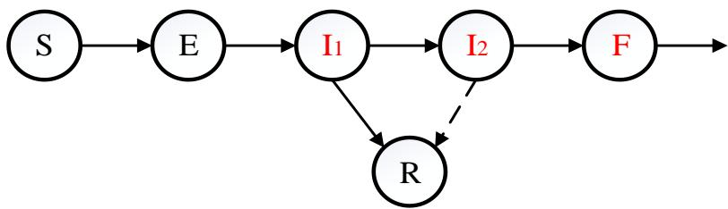
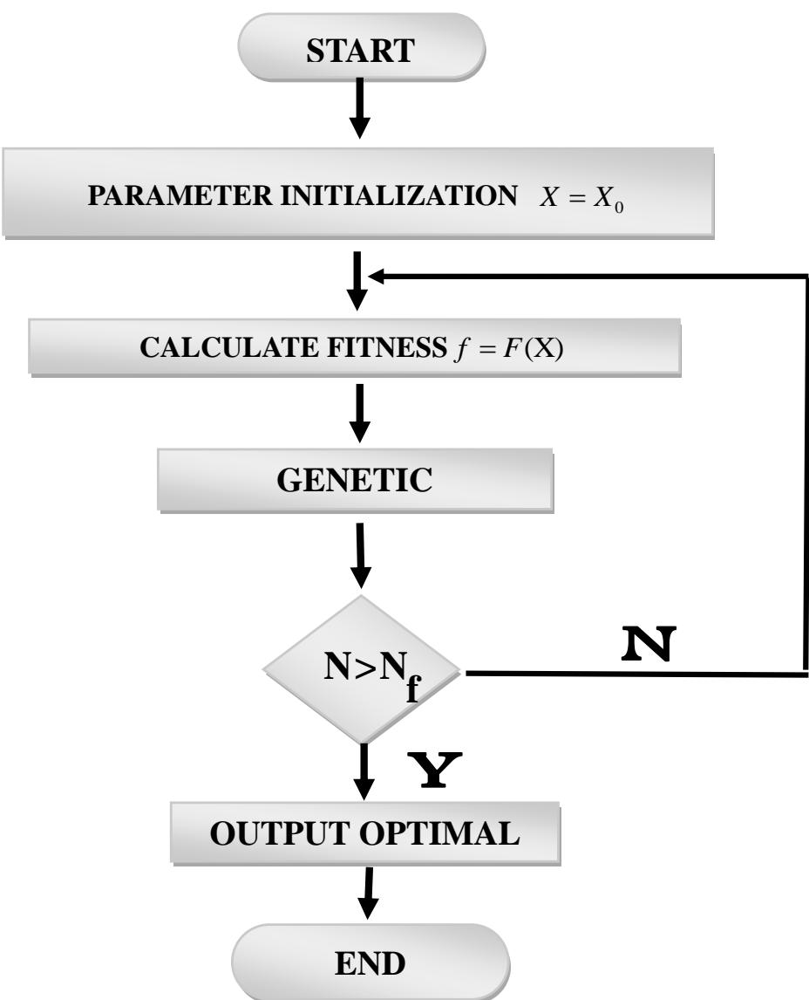
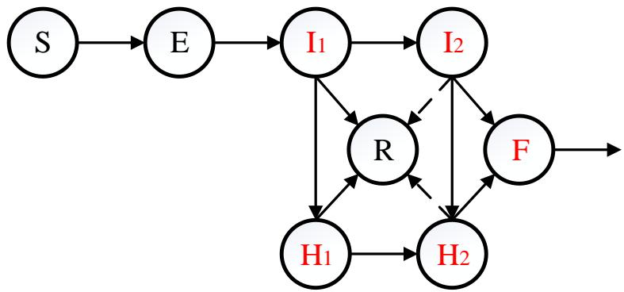
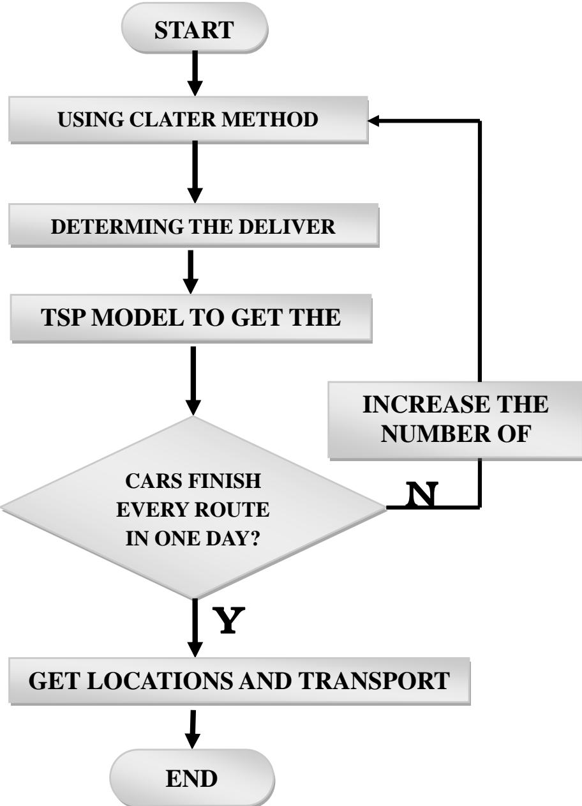
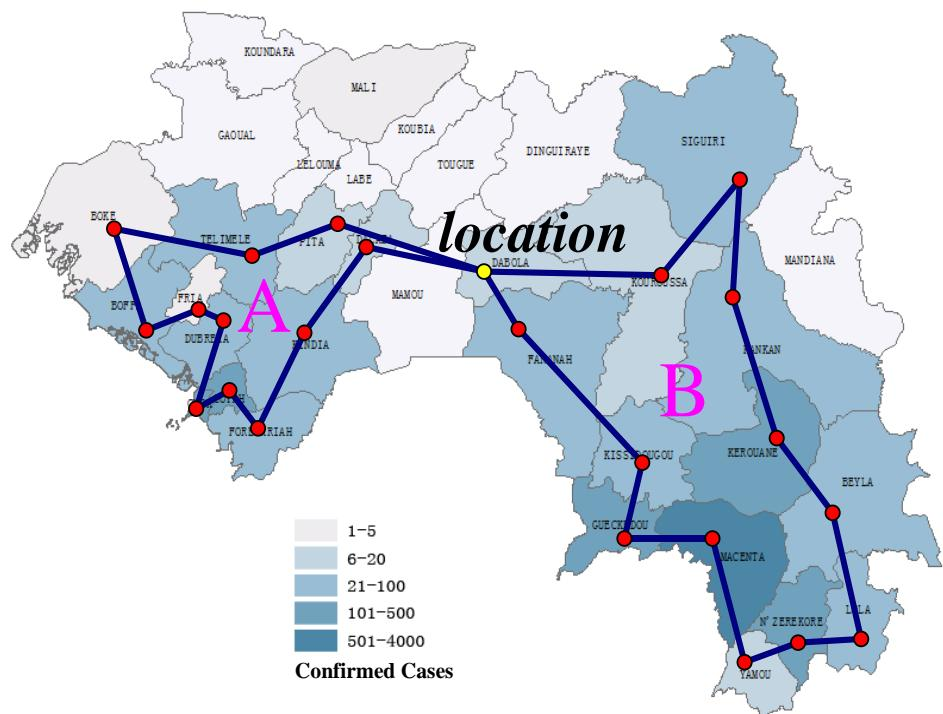
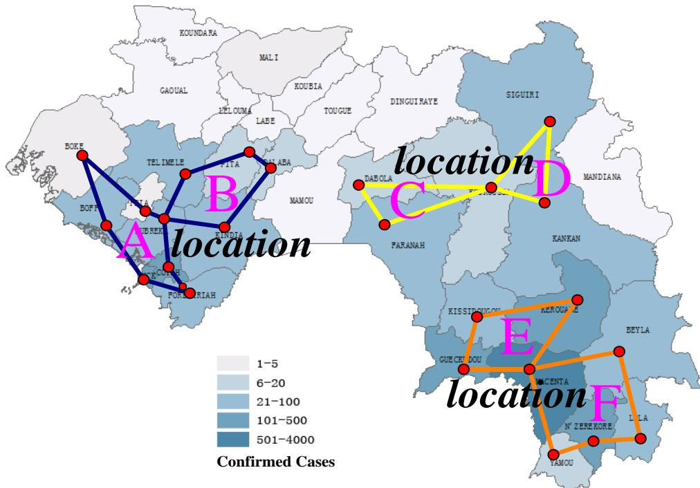
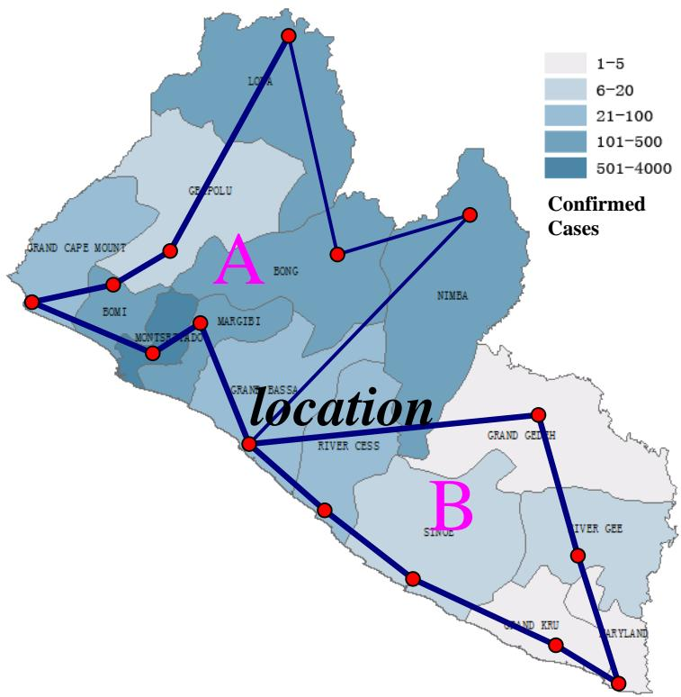
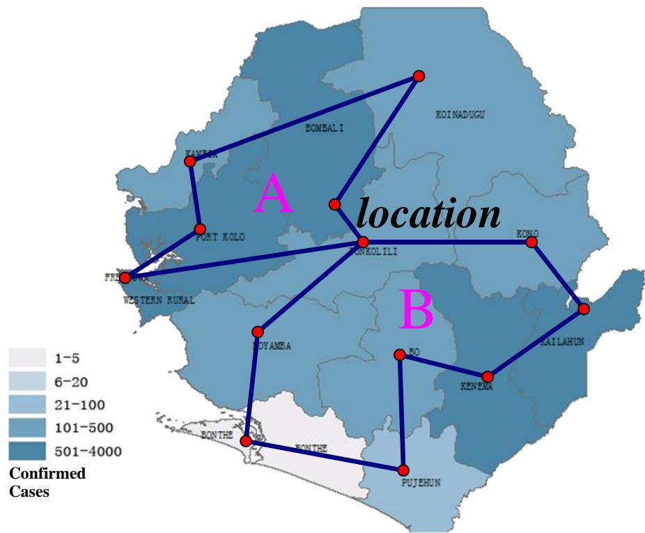

# 2015年美国大学生数学建模竞赛特等奖论文《A Battle Without Gun and Smoke: The Confrontation with Ebola》（Team 34317，A题）

原件经识别和整理；“参考解答”是我们补的。

---
title: 2015年美国大学生数学建模竞赛特等奖论文《A Battle Without Gun and Smoke: The Confrontation with Ebola》（Team 34317，A题）
kind: 课件
course: 数学建模
term: 2015
source: Team 34317, MCM 2015 Problem A
---

# 2015年美国大学生数学建模竞赛特等奖论文《A Battle Without Gun and Smoke: The Confrontation with Ebola》（Team 34317，A题）

本文档整理自 Team 34317 的 2015 年 MCM A 题特等奖论文第 1-3 页内容。

## Summary

“Ebola is a major global crisis that demands a massive and immediate global response. No country or organization can defeat Ebola alone.”

—— H.E. Ban Ki-moon, the UN Secretary-General.

As a number of Global Village, we do our best to help eradicate Ebola.

First, we develop a stage-structured model of Ebola Propagation. In the model, we consider the susceptible, the exposed, the infected whose disease is not advanced, the infected whose disease is serious, the removed and the dead. The model is good at predicting near future cases’ number but fails in predicting far future cases number. Then we take hospital into consideration and add 7 more parameters, then we do simulation once again. Finally, we get a better result that the model well predicts the future cases. For example, the model predicts there are 4000 total cases and 2500 death cases in Guinea, 9509 total cases and 4166 death cases in Liberia, 12556 total cases and 3933 death cases in Sierra Leone up to April, $1^{st}$, 2015.

Second, we determine the locations of delivery. We invoke clustering method to divide the most serious region, namely, West Africa into three parts, Guinea, Liberia and Sierra Leone. According to locations of provincial capital, we use clustering method once again to divide a country into several clusters. Then we adopt P-Center Method to determine a location of delivery in each cluster. We find there are two kinds of ways to choose. One is one-way route and the other is circular route. As for one-way route, we think it is time-consuming and energy-consuming. So we decide to use circular route. The circular route, in some ways, is a little bit similar to TSP problem, we use mix integer programming to find an optimal circular route by Lingo Software and each location of delivery has two optimal circular routes. The result is that there are 3 locations of delivery in Guinea, 1 location of delivery in Liberia and 1 location of delivery in Sierra Leone.

Third, we know from the stage-structured model that Ebola cannot stop spreading by itself. Since we are going to eradicate Ebola, we must use medicine and vaccine to stop Ebola. Medicine mainly influences the number of the susceptible while vaccine mainly influences the number of the infected whose disease is not advanced, in this way, we can eradicate Ebola. As for speed of manufacturing, we consider there is a linear equation between the speed and time because the amount of medicine is too rare to meet the requirement of patients. And this situation continues until the requirement is met. We can calculate the speed by the parameter in the linear equation. And we allocate medicine to different places by ratio of the infected number in that place to the number in three West African countries. Thus, we successfully stop Ebola from spreading.

Keywords: SEIIRF Model TSP Model Clustering Method Ebola Evaluating

## Content

### I Introduction

- 1.1 Aims are Changing now....1
- 1.2 Our Understanding of the Words....1
- 1.3 Decompose the Problem and Our Tasks....2

### II Background – Behavior Change is Key to the Eradication of Ebola

...3

### III Assumptions And Justifications

...4

### IV SEIIRF Model for Ebola propagation

- 4.1 Introduction....4
- 4.2 Symbols and Definitions....5
- 4.3 Construction of the Model....6
- 4.4 Results are Not So Reasonable....8
- 4.5 Refresh the Values of Parameters....8
- 4.6 Advanced Model....10
- 4.7 Results are Reasonable....13
- 4.8 Prediction of the Future....14

### V Model of Locations of Delivery

- 5.1 What is Emergency Supplies....18
- 5.2 Assumptions and Justifications....19
- 5.3 Clustering Method, A Way to Determine Regions for Medicine Delivery...20
- 5.4 Results of Clustering Method....21
- 5.5 Principle of Fairness....22
- 5.6 Principle of Efficiency....22
- 5.7 Determine Delivery Locations in the Three West African Countries......23

### VI Model of Delivery System

- 6.1 Introduction......23
- 6.2 Symbols and Definitions......24
- 6.3 TSP Model – Well-Planned Routes......24
- 6.4 Daily Demand for Medicine......25

### VII Model Implementation of three Countries

- 7.1 General algorithm......26
- 7.2 Application of Algorithm......27
    - 7.2.1 Application in Guinea......27
    - 7.2.2 Application in Liberia......29
    - 7.2.3 Sierra Leone......30

### VIII Model of the Quantity of the Medicine Needed and Manufacturing Speed

- 8.1 Introduction......31
- 8.2 Assumptions and Justifications......32
- 8.3 symbols and definitions......32
- 8.4 How Fast Need We Produce Medicine and Vaccine......32
- 8.5 The Quantity of the Medicine Needed......35

### IX Other Factors We Think Are Important

...35

### X Extension of Models

- 10.1 Optimization of Coverage to Determine Delivery Locations......36
- 10.2 A No-boundary Scheme......37

### XI Sensitivity analysis

- 11.1 Sensitivity Analysis of SEIIRF Model......38
- 11.2 Sensitivity Analysis of Model of the Speed to Produce Medicine......39

### XII Conclusion

- 11.1 Strengths and Weaknesses......40
- 11.2 Overall Results......41

### Ⅰ Introduction

Ebola, a familiar but strange word to us. When the Ebola virus out broke in West Africa and caused plenty of deaths, no one would imagine the disastrous scene without mercy. And, of course, no one believes the word ‘Ebola’ just originated from a peaceful and beautiful river – Ebola River in Congo. Contrary to its attracting meaning, it is true that the Ebola virus do take lots of victims’ lives away. Countries all over the world, thus, have taken strategies, more specifically, distribute health works to disease-torn countries, speed up the development of medicine and establish feasible delivery systems to contain Ebola propagation.

#### 1.1 Aims are changing now

The battle against Ebola will cost us heavily for sure, but human beings are not easily defeated. Although Ebola virus is fatal, we have methods. The WMA (World Medical Association) has announced that they have developed medicine to cure Ebola. At one level, the medicine is a milestone for us human beings in fighting Ebola, but at another it is the result of human nature. We know calling the command center to take away the sick is equally hard. It is our duty, in the interests of our own and the public good, to pick up the phone, but the reality is that, if we do, we may never hug our sister again. We can visit her in the treatment center and talk across two fences. The fortunate will be reunited. For the rest, the future is the body bag.[1] Ebola will not end without the medicine. Thanks to appearance of the medicine, we are gradually going out of confusion and turning to fight back in this smokeless battle. Many previous articles that mainly focus on how Ebola propagation or how difficult to contain Ebola are now may less important than those on how to effectively delivery medicine to most-need regions like West Africa. Accurate location with effective medicine – Ebola’s doomsday and we do our job to make it come true – considering propagation process, medicine needed, delivery systems, locations of delivery and manufacturing speed of vaccine or drug and so on.

#### 1.2 Our understanding of the words

The problem requires us to de several jobs to evaluate Ebola. We think it is necessary for us to come to an understanding of some words in the problem.

**Spread of the Disease:** We consider this sub-problem as a requirement to analyze Ebola propagation process and predict future cases, including total cases and death cases in the three West African countries and what influence that new medicine will bring to us. As for Ebola cases in other countries, such as in the United States or in The United Kingdom, good health condition and developed facilities can contain the cases well, so in this paper, we mainly discuss Ebola cases in West Africa.

**Locations of Delivery:** How to understand the word ‘locations’ is the key to this sub-problem. We also have some criteria to choose ‘locations’ – easy to deliver medicine, cover most people or environment-friendly to build? Here, we regard ‘locations’ as places that have features of easy and time-saving in medicine delivering, being equal to all people in a region.

**Possible Feasible Delivery Systems:** We think this sub-problem needs us to design a route that can not only cover all places which are in need of medicine but also provide vehicles a fastest way to send medicine. Besides, delivery systems can allocate medicine to different places properly.

**The Quantity of the Medicine Needed:** There are several understandings of the word ‘quantity’, like amount of medicine to cure all Ebola patients or amount of medicine needed every day to keep serious patients from dying. Our understanding of this word is the total amount of medicine needed to cure patients whose disease is not advanced until there is no more patients appear. So it is a dynamic and time-varying number until cases stops increasing.

**Speed of manufacturing of the vaccine or medicine:** In our opinion, this sub-problem needs us to decide how fast a factory have to produce medicine when amount of medicine is too rare to cure patients and what changes a factory should obey when there is enough medicine for patients. As for vaccine, we consider it is similar to medicine.

**Other factors:** Something we forget to consider in our model but also important for Ebola evaluating. We will find them during the process of establishing models

#### 1.3 Decompose the Problem and Our Tasks

To totally understand the problem better and know what we should to deal with Ebola, decompose it is needed to us. According to the steps needed in process of achieving our goal that accurate location with effective medicine, we deem the problem ‘Eradicating Ebola’ can be divided into five parts:

1. Propagation mechanism of Ebola virus.
2. Accurate locations for medicine to be delivered like disease-torn countries in West Africa.
3. Effective transportation including amount of medicine needed in a place.
4. Total amount of medicine needed to cure Ebola patients until cases stops increasing.

---
title: 2015年美国大学生数学建模竞赛特等奖论文《A Battle Without Gun and Smoke: The Confrontation with Ebola》（Team 34317，A题）第 3 部分
kind: 课件            # 期末试卷 / 答案 / 复习要点 / 习题 / 课件 / 实验
course: 数学建模      # 学科，即 courses/ 下的文件名
term: 2015            # 有就写
source: 2015 MCM Team 34317 Paper, Part 3 (Pages 6-8)
---

# 2015年美国大学生数学建模竞赛特等奖论文《A Battle Without Gun and Smoke: The Confrontation with Ebola》（Team 34317，A题）第 3 部分

本资料整理自《2015年美国大学生数学建模竞赛特等奖论文》教材第 3 部分（共 13 部分），对应原稿第 6–8 页内容。主要涉及任务分解、行为改变背景、假设以及 SEIIRF 模型的符号定义。

## 一、任务分解与目标明确

### 任务 1

当问题明确时，我们需要澄清需要做什么以及如何做。由于我们将问题分成了几个部分，可以逐个处理。这里的问题要求我们做什么，我们的任务是：

- 建立一个模型来反映我们目前面临的状况，并预测如果药物、医院或其他因素在埃博拉传播过程中起作用，未来的情况会如何。
-  根据我们对“地点”的理解，找到一些最佳的配送地点。
-  设计一个既有利于药品运输又有利于药品分配的配送系统。
-  确定生产药品的速度以及根除埃博拉所需的总数量。
-  考虑其他对优化根除埃博拉至关重要的因素。

## 二、背景——行为改变是根除埃博拉的关键

### 背景 1

随着西非埃博拉病例和死亡人数的增加，许多人仍不了解其致命的后果、病因和治疗选择（或缺乏治疗选择）。让公众了解疾病的危害至关重要，无论是在发展中国家还是在更具体的非洲大陆上。

不幸的是，在这三个非洲国家——几内亚、利比里亚和塞拉利昂的偏远地区，很少有人听说过 Google 或 ABC 新闻或其他电视媒体，更不用说获取最新的埃博拉新闻了。一旦人们看到家庭成员生病并死去，他们倾向于相信这是一个来自地狱的隐形杀手。将关于埃博拉预防和治疗的正确信息传递给整个西非的地方社区必须成为更高的优先事项，我们必须以文化上适宜和创新的方式开始解决这一问题。[2]

此外，尽管在寻找和隔离埃博拉患者方面做出了巨大努力，但人性是导致埃博拉不受阻碍地传播的另一个因素。正如我们在引言中介绍的那样，虽然谈论改变行为很容易，但当我们要思考需要改变的行为类型时，我们意识到这非常困难。我们中有多少人能忍受看着母亲死去而不握住她的手，然后允许她的身体被喷洒氯气，装入双层尸袋从房子里运出，与其他几个人一起装上皮卡车的后部，送往墓地快速埋葬，几乎没有任何祈祷？[1]

**团队 # 34317**
第 3 页，共 44 页

我们必须意识到，改变意识和人性是非常困难的。如果我们想赢得对抗埃博拉的战役，最有效的办法是找到药物。现在是治愈药物的时候了——世界卫生组织（WHO）宣布他们可以做到。

## 三、假设及其合理性说明

### 假设 1

① 忽略由自然出生率和死亡率引起的人口变化。

与埃博拉对人口的影响相比，自然出生率和死亡率的影响很小。此外，在传播期间，人口的总自然增长量并不大。

### 假设 2

② 各地区之间没有人口流动。

自埃博拉爆发以来，不同地区和国家的移民对人口变化的影响可以忽略不计。此外，由于疾病感染，人员流动率可能会降低。

我们将在后续章节中使用这些假设时列出更多详细的假设。

## 四、埃博拉传播的 SEIIRF 模型

### 4.1 简介

持续的埃博拉疫情在规模和复杂性上都让我们感到惊讶。在 2015 年初，许多科学家和其他人，比如我们这样的学生，仍在以不同的方式对抗埃博拉，例如开发药物、推广医疗保健和预测埃博拉的传播。在本节中，我们应用 SEIIRF 模型来评估埃博拉的传播。感谢之前的文章 [5]，我们可以适当地使用这个模型，然而，随着时间的推移，该文章中陈述的参数值可能不再令人信服，因为该文章仅使用 2014 年 10 月至 2014 年 11 月的数据计算参数值，然后用 2014 年 12 月的数据进行测试。如果我们仍然使用该文章中的参数值，我们发现与 2015 年 1 月的数据准确性相差甚远。因此，我们找到了一种方法——遗传算法，通过使用 2014 年 10 月至 2014 年 12 月的数据刷新参数值，并且更新后的 SEIIRF 模型很好地拟合了 2015 年 1 月 $1 ^ { \mathrm { s t } }$ 到 2015 年 2 月 $3 ^ { \mathrm { r d } }$ 的数据。

**团队 # 34317**
第 4 页，共 44 页

### 4.2 符号与定义

模型中出现了一些符号。我们在下面展示它们：

表 4.1：模型中的符号

| SYMBOL | DEFINITION | UNITS |
| :--- | :--- | :--- |
| $\beta_1$ | Transmission Parameter For First Stage Of Illness (Not In Hospital) | $people^{-1} days^{-1}$ |
| $\frac{\beta_2}{\beta_1}$ | Ratio Of Infectiveness In First Vs. Second Of Stage Of Illness (Not In Hospital) | Unitless |
| $\frac{\beta_F}{\beta_1}$ | Ratio Of Infectiveness In First Stage Vs. Funeral Transmission (Not In Hospital) | Unitless |
| $\alpha^{-1}$ | Average Incubation Period | Days |
| $\gamma_1^{-1}$ | Length Of First Stage Of Illness (Not In Hospital) | Days |
| $\gamma_2^{-1}$ | Length Of Second Stage Of Illness (Not In Hospital) | Days |
| $\gamma_F^{-1}$ | Time From Death Until Burial | Days |
| $\delta_1\delta_2$ | Overall Mortality Rate (Fraction) (Not In Hospital) | Unitless |
| $\delta_2$ | Mortality Rate (Fraction) Among Those In Second Stage Of Illness (Not In Hospital) | Unitless |

**团队 # 34317**
第 5 页，共 44 页

## 4.3 Construction of the Model

To adequately reflect the propagation of Ebola and transmission of Ebola, we should take real conditions in life into consideration.

To begin with, we show our model as a form of figure.

We can get information from the figure 4.1. There are six stages in the whole propagation of Ebola. We also call this model as Stage-Structured Model,

- S represents the fraction of the population which is susceptible.
- E represents the fraction of the population which is exposed.
- $I_1$ represents the fraction of the population which is infected and remain in first stage (such as fever, headache, sore throat, muscle aches and other milder symptoms which often progress to diarrhea and vomiting).
- $I_2$ represents the fraction of the population which is infected and deteriorate to second stage (such as hemorrhaging and multi-organ failure).
- R represents the fraction of the population which is recovered. And
- F represents the fraction of the population who have died and are in the process of being buried.

The corresponding equations of Figure 4.1 are

$$
\left\{ \begin{array}{l}
\frac{dS}{dt} = -\left(\beta_I I_1 + \beta_2 I_2 + \beta_F F\right) S \\
\frac{dE}{dt} = \left(\beta_I I_1 + \beta_2 I_2 + \beta_F F\right) S - \alpha E \\
\frac{dI_1}{dt} = \alpha E - \gamma_1 I_1 \\
\frac{dI_2}{dt} = \delta_1 \gamma_1 I_1 - \gamma_2 I_2 \\
\frac{dF}{dt} = \delta_2 \gamma_2 I_2 - \gamma_F F \\
\frac{dR}{dt} = (1 - \delta_1) \gamma_1 I_1 + (1 - \delta_2) \gamma_2 I_2
\end{array} \right.
$$

In the equations we consider the infected ($I_1$ and $I_2$) and the dead ($F$) all have ability to infect the susceptible. In fact, when our relatives get sick, we still contact with them in daily life, and it is not surprise for us to think that human nature play an important role in Ebola propagation – just as we have talked in introduction. How many of us could bear to watch our mother die without holding her hand, and then allow her body to be sprayed with chlorine, removed in a double body bag from the house, be loaded on to the back of a pick-up truck with several others, and taken to the cemetery for rapid interment with little more than a cursory prayer? Moreover, the exposed $E$ are mainly form the susceptible $(\beta_I I_1 + \beta_2 I_2 + \beta_F F)S$ and then have chances to turn to first stage if they show symptoms $(\alpha E)$. And number of people in first stage $I_1$ are mainly from the exposed $(\alpha E)$ and then part of them $(\delta_1 \gamma_1 I_1)$ turn to second stage and the rest of them $(1 - \delta_1)\gamma_1 I_1$ get recovered. Thus number of people in second stage are mainly from first stage $(\delta_1 \gamma_1 I_1)$ and some of them die. So the dead is the result of people $(\delta_2 \gamma_2 I_2)$ in second stage and their bodies $(\gamma_F F)$ exist until being buried.

Then, to measure the total cases and death cases of Ebola, We invoke

$$
y_C = \int_0^t \alpha E(t) dt
$$

$$
y_D = \int_0^t \delta_2 \gamma_2 I_2(t) dt
$$

In these equations, $y_C$ means total cases (or cumulate cases) and $y_D$ means death cases. And $E(t)$ means number of people begin to get sick and have symptoms so $y_C$ is the time integral of $E(t)$. While $\gamma_2 I_2(t)$ is number of people who no longer in second stage anymore, $\delta_2 \gamma_2 I_2(t)$ means number of dead people. So $y_D$ is the time integral of $\delta_2 \gamma_2 I_2(t)$.

## 4.4 Results are Not So Reasonable

The article[5] adopts Least Square Method to figure out values of parameters. Unfortunately, under the values of parameters, although the calculated curve fits quite well to real data in Guinea from October 1st, 2014 to December 31st, 2014, we fail to fit the calculated curve well to real data in Guinea when time reaches on January $1^{\mathrm{st}}$ 2015, namely, the values of parameters in that article may 'outdated'. So we do not show them here because they are not worthy enough.

So, we adopt genetic algorithm combined with least square method to calculate our new values of parameters.

## 4.5 Refresh the Values of Parameters

Genetic algorithm combined with least square method is used by us to find out new parameters values. Here flow diagram of Genetic algorithm is

In the flow diagram, we define $X = [\beta_1, \beta_2 / \beta_1, \beta_F / \beta_1, \alpha, \gamma_1, \gamma_2, \gamma_F, \delta_1, \delta_2]$ and fitness $f = F(\mathbf{X}) = \left| \sum_{t \in t_c} [y_C(t) - C_0(t)] \right| + \left| \sum_{t \in t_c} [y_D(t) - D_0(t)] \right|$. Where $t_c$ is length of time from October $1^{\mathrm{st}}$, 2014 to December $31^{\mathrm{st}}$, 2014. And $C_0(t)$ denotes real total cases in a country updated every day within time length $t_c$ while $D_0(t)$ denotes real death cases in a country updated every day within time length $t_c$.

By now, we have method to find each parameter's value by using data from

## 4.6 Advanced Model

After refreshing the values of parameters, we are still not satisfied with the curve we calculate. Data talks, we should try our best to make our model considerable. To improve the model we discussed in former section, we not only use more data from WHO website to calculate our parameters, but also consider other factors impact on Ebola spreading, like additional parameters and changing of parameters’ values if people receive treatment or get infected in hospital. There is a pie chart showing the proportion of getting infected in different ways (data of Sierra Leone).

There are 17.6% of healthy people in Sierra Leone get Ebola because of hospital. it is a factor important enough for us to take it into consideration when we evaluate Ebola propagation.

First, let us get an accessible way to additional parameters and their meanings in this advanced model.

**Table 4.2: Additional parameters and meanings in this advanced model**

| SYMBOL | DEFINITION | UNITS |
| :--- | :--- | :--- |
| $\beta_1\beta_H$ | Transmission Parameter For First Stage Of Illness (In Hospital) | $people^{-1} days^{-1}$ |
| $\beta_2\beta_H$ | Transmission Parameter For Second Stage Of Illness (In Hospital) | $people^{-1} days^{-1}$ |
| $h_1^{-1}$ | Length Of First Stage Of Illness (From Moment Of Symptoms Appearing To Go To Hospital) | Days |
| $h_2^{-1}$ | Length Of Second Stage Of Illness (From Moment Of Symptoms Appearing To Go To Hospital) | Days |
| $y_3^{-1}$ | Length Of First Stage Of Illness (In Hospital) | Days |
| $y_4^{-1}$ | Length Of Second Stage Of Illness (In Hospital) | Days |
| $\delta_{1H}\delta_{2H}$ | Overall Mortality Rate (Fraction) (In Hospital) | Unitless |
| $\delta_{2H}$ | Mortality Rate (Fraction) Among Those In Second Stage Of Illness (In Hospital) | Unitless |

The reason why we add these parameters is that if hospital plays a role in people’s daily life, people will have another access to cure Ebola. When people feel uncomfortable, they may choose to go to hospital for doctors’ help. Thus, ${ h _ { 1 } } ^ { - 1 } , ~ { h _ { 2 } } ^ { - 1 }$ ${ y _ { 3 } } ^ { - 1 }$ and ${ y _ { 4 } } ^ { - 1 }$ are generated to denote different length of time in or not in hospital. By the way, $\beta _ { 1 } \beta _ { H } , ~ \beta _ { 2 } \beta _ { H } , ~ \delta _ { 1 H } \delta _ { 2 H }$ and $\delta _ { 2 H }$ are introduced to explain the model more considerably.

We show our advanced model as a form of figure

The advanced equations of this model are

$$
\left\{\begin{aligned}
\frac {d S}{d t} &= - \left[ \beta_ {I} \left(I _ {1} + \beta_ {H} H _ {1}\right) + \beta_ {2} \left(I _ {2} + \beta_ {H} H _ {2}\right) + \beta_ {F} F \right] S \\
\frac {d E}{d t} &= \left[ \beta_ {I} \left(I _ {1} + \beta_ {H} H _ {1}\right) + \beta_ {2} \left(I _ {2} + \beta_ {H} H _ {2}\right) + \beta_ {F} F \right] S - \alpha E \\
\frac {d I _ {1}}{d t} &= \alpha E - \gamma_ {1} I _ {1} - h _ {1} I _ {1} \\
\frac {d I _ {2}}{d t} &= \delta_ {1} \gamma_ {1} I _ {1} - \gamma_ {2} I _ {2} - h _ {2} I _ {2} \\
\frac {d H _ {1}}{d t} &= h _ {1} I _ {1} - \gamma_ {3} H _ {1} \\
\frac {d H _ {2}}{d t} &= h _ {2} I _ {2} + \delta_ {1 H} \gamma_ {3} H _ {1} - \gamma_ {4} H _ {2} \\
\frac {d F}{d t} &= \delta_ {2} \gamma_ {2} I _ {2} + \delta_ {2 H} \gamma_ {4} H _ {2} - \gamma_ {F} F \\
\frac {d R}{d t} &= (1 - \delta_ {1}) \gamma_ {1} I _ {1} + (1 - \delta_ {2}) \gamma_ {2} I _ {2} + (1 - \delta_ {1 H}) \gamma_ {3} H _ {1} + (1 - \delta_ {2 H}) \gamma_ {4} H _ {2}
\end{aligned}\right.
$$

Where $H _ { 1 }$ and $H _ { 2 }$ mean number of people in hospital who are in first stage and in second stage, respectively. While $I _ { 1 }$ , $I _ { 2 }$ mean the number of people not in hospital who are in first stage and in second stage, respectively. And S , E , F and R have the same meanings as we talked before.

## 4.6 模型方程补充说明

在这组方程中，易感人群（susceptible）不仅容易受到外部患者（${ } . \beta _ { I } I _ { 1 } S$ 或 $\beta _ { 2 } I _ { 2 } S )$ 的感染，也容易受到住院患者 $( \beta _ { 1 } \beta _ { H } H _ { 1 } S$ 或 $\beta _ { 2 } \beta _ { { \scriptscriptstyle H } } H _ { 2 } S )$ 的感染。与我们在 3.4 节中解释的不同，处于第一阶段的感染者有另一种途径——进入医院 $\left( { { h _ { 1 } } { I _ { 1 } } } \right)$ 。处于第二阶段的感染者也会如此 $( h _ { 2 } I _ { 2 } )$ 。对于住院的感染者，他们可能会死亡或康复。

### 4.7 结果的合理性

首先，我们需要找到额外的参数值。同样地，我们使用上述介绍的遗传算法结合最小二乘法来计算数值。但此刻有一点不同，即 $X = \left[ \beta _ { 1 } , \beta _ { 2 } / \beta _ { 1 } , \beta _ { F } / \beta _ { 1 } , \alpha , \gamma _ { 1 } , \gamma _ { 2 } , \gamma _ { F } , \delta _ { 1 } \delta _ { 2 } , \delta _ { 2 } , \beta _ { H } , h _ { 1 } , h _ { 2 } , \gamma _ { 3 } , \gamma _ { 4 } , \delta _ { 1 H } , \delta _ { 2 H } \right]$

我们计算出几内亚的所有参数如下表所示：

**表 4.3：几内亚的所有参数**

| PARAMETER | VALUE | PARAMETER | VALUE |
| :--- | :--- | :--- | :--- |
| $\beta_1$ | 0.04 | $\gamma_1$ | 0.26 |
| $\beta_2 / \beta_1$ | 2.37 | $\beta_H$ | 0.48 |
| $\beta_F / \beta_1$ | 1.27 | $h_1$ | 0.43 |
| $\alpha$ | 0.42 | $h_2$ | 0.55 |
| $\delta_1\delta_2$ | 0.19 | $\gamma_3$ | 0.20 |
| $\delta_2$ | 0.58 | $\gamma_4$ | 0.11 |
| $\gamma_F$ | 0.46 | $\delta_{1H}$ | 0.49 |
| $\gamma_2$ | 0.70 | $\delta_{2H}$ | 0.81 |

几内亚的曲线如下：

 <!-- 替代文字：图 4.6 几内亚疫情拟合曲线 -->

从图 4.6 可以看出，如果我们考虑医院因素并添加更多参数，我们的曲线比参考文章中的曲线拟合得更好。这些曲线能够很好地拟合 2015 年 1 月 1 日至 2015 年 2 月 3 日几内亚的实际数据，无论是总病例数还是死亡病例数。因此，我们相信这两条曲线。

### 4.8 未来预测

既然我们已经找到了能很好拟合实际数据的曲线，接下来的工作就是利用这些曲线来预测几内亚近期未来的总病例数和死亡病例数。我们基于上面展示的图形绘制了一张新图。我们将时间轴延长以预测直到 2015 年 4 月底的未来病例数。

 <!-- 替代文字：图 4.7 几内亚疫情未来预测曲线 -->

从图 4.7 可以看出，曲线向我们提供了关于几内亚的信息：总病例数和死亡病例数仍在增长，且总病例数的增长速度略快于死亡病例数。180 天后，总病例数将接近 4000，而死亡病例数将达到约 2500。然而，与没有医院和药物的情况相比（见图 4.7），病例数要少得多。毕竟，我们只有药物可以治愈病情尚未恶化的埃博拉患者。对于重症患者，我们能做的唯一努力就是支持性治疗和祈祷。

此外，我们计算了利比里亚和塞拉利昂的参数和曲线，发现曲线也能很好地拟合实际数据。

**利比里亚的参数：**

**表 4.4：利比里亚的参数**

| PARAMETER | VALUE | PARAMETER | VALUE |
| :--- | :--- | :--- | :--- |
| $\beta_1$ | 0.19 | $\gamma_1$ | 0.28 |
| $\beta_2 / \beta_1$ | 2.06 | $\beta_H$ | 0.23 |
| $\beta_F / \beta_1$ | 1.97 | $h_1$ | 0.44 |
| $\alpha$ | 0.45 | $h_2$ | 0.73 |
| $\delta_1\delta_2$ | 0.18 | $\gamma_3$ | 0.12 |
| $\delta_2$ | 0.63 | $\gamma_4$ | 0.84 |
| $\gamma_F$ | 0.46 | $\delta_{1H}$ | 0.31 |
| $\gamma_2$ | 0.92 | $\delta_{2H}$ | 0.79 |

**利比里亚的曲线：**

 <!-- 替代文字：图 4.8 利比里亚疫情拟合曲线 -->

从图 4.8 可以看出，曲线也能很好地拟合利比里亚的实际数据。

**塞拉利昂的参数：**

**表 4.5：塞拉利昂的参数**

| PARAMETER | VALUE | PARAMETER | VALUE |
| :--- | :--- | :--- | :--- |
| $\beta_1$ | 0.29 | $\gamma_1$ | 0.26 |
| $\beta_2 / \beta_1$ | 2.43 | $\beta_H$ | 0.11 |
| $\beta_F / \beta_1$ | 2.25 | $h_1$ | 0.48 |
| $\alpha$ | 0.46 | $h_2$ | 0.79 |
| $\delta_1\delta_2$ | 0.14 | $\gamma_3$ | 0.71 |
| $\delta_2$ | 0.54 | $\gamma_4$ | 0.84 |
| $\gamma_F$ | 0.49 | $\delta_{1H}$ | 0.49 |
| $\gamma_2$ | 0.81 | $\delta_{2H}$ | 0.76 |

**塞拉利昂的曲线：**

 <!-- 替代文字：塞拉利昂疫情拟合曲线 -->

从图中可以看出，曲线也能很好地拟合塞拉利昂的实际数据。由于时间有限，我们无法对利比里亚和塞拉利昂进行预测工作。但我们强烈相信，如果我们有足够的时间，我们可以通过使用这 16 个考虑了医院因素的参数来精确预测未来的数据。在此，我们必须向居住在利比里亚和塞拉利昂的人们表示歉意。

# Ⅴ Model of Locations of Delivery

本节内容整理自《2015年美国大学生数学建模竞赛特等奖论文》第 7 部分（第 21–23 页），主要阐述了基于聚类方法确定埃博拉药物配送地点的模型构建过程，包括紧急物资的定义、假设条件及具体的聚类算法步骤。

## 一、什么是紧急物资

首先，我们需要明确“紧急物资”（如治疗埃博拉的药品）的定义。与普通物资不同，紧急物资用于在突发事件发生时控制局势，或在事件发生后用于疏散、救援和修复；而普通物资仅用于日常生活。两者的区别如下表所示：

<table>
<thead>
<tr><th>ASPECTS</th><th>NORMAL SUPPLIES</th><th>EMERGENCY SUPPLIES</th></tr>
</thead>
<tbody>
<tr><td>Aims</td><td>Maximize Profile And Minimize Cost</td><td>Consider Both Fair And Efficiency</td></tr>
<tr><td>Formation</td><td>Factory, Distribution Center And Customer</td><td>Supplies Collection Point, Delivery Place And Supplies Demand Point</td></tr>
<tr><td>Property</td><td>Permanent</td><td>Temporary</td></tr>
<tr><td>Scheme</td><td>Divide Into Long-Term, Medium-Term And Short-Term</td><td>Urgency, Make Tread-Off Decision At Once</td></tr>
<tr><td>Balance Between Efficiency And Optimization</td><td>Think A Lot Of Optimization</td><td>Think A Lot Of Efficiency</td></tr>
<tr><td>Delivery Mode</td><td>Return And Tour</td><td>Return</td></tr>
</tbody>
</table>

此外，以世界医学协会（WMA）研发的药品为例，紧急物资还具有以下特征：

1. **不确定性 (Uncertainty)**：由于无法预测下一次埃博拉疫情爆发的时间及造成的死亡人数，紧急物资的需求量和投放区域具有不确定性。
2. **不可替代性 (Irreplaceability)**：紧急物资在特殊条件下具有特殊性且不可替代。例如，如果没有治疗埃博拉的特效药，没有任何东西能有效治愈患者。
3. **时效性 (Timeliness)**：紧急物资仅在特定时期发挥作用，若错过关键时刻，其价值将丧失。例如，药品无法使已经死亡的埃博拉患者复活。
4. **滞后性 (Hysteresis)**：紧急物资（或药品）的送达时间总是晚于灾害发生的时间。

因此，我们的目标是从一个国家中筛选出几个最急需的配送地点。具体来说，我们根据聚类原则和方法来筛选配送地点。

## 二、假设与理由

### i. 所有配送地点均位于省/州首府

显而易见，首府更容易接收来自发达国家的药品。也就是说，配送地点应具备快速通往港口或机场的条件。同时，这些地区拥有良好的公共设施状况、道路条件以及通信设施，并且电力、供水、供暖和供气充足。

### ii. 药品需求区域集中在省/州首府

即我们将药品运往首府，而不考虑更低级别的行政区域。从省/州的规模来看，它们并不大，首府向低级行政区域运送药品非常容易。此外，首府是受埃博拉影响地区的代表性地点。由于其发展先进且人口密度高，首府居住着更多的感染者。

### iii. 忽略建设配送地点的成本及药品存储费用

在这些国家爆发埃博拉疫情时，我们应该更加关注人们的健康和生命，并尽快建立配送地点。实际上，药品的生产速度难以满足紧迫的形势，我们需要尽快将药品运送到需要的地方。

## 三、聚类方法：确定药物配送区域的方法

我们已经清楚地理解了为什么配送地点必须设在省会所在的省份。然而，由于非洲国家的基础设施有限，可建立的配送地点仍然太多。因此，为了在考虑资金和其他因素的情况下最大化配送地点的效果，我们必须从不同的配送地点中进行选择，筛选出一些作为“最终赢家”。

如果同一个国家内的两个或多个主要城市距离较近，我们将它们视为一个“城市组”。在每个城市中建立配送地点意义不大，因为我们可以方便地在短时间内将紧急物资传送到各个城市。在一个“城市组”内建立配送地点过于密集。因此，我们采用聚类方法来找出“城市组”，从而将一个国家划分为若干个区域。

根据**网状距离 (reticular distance)**（即沿道路网络使用主干道——一级、二级、三级道路及少量土路/小径的距离），我们将城市分类为不同的组。具体步骤如下：

**第一步**：考虑某个国家的所有城市彼此独立，即没有组包含两个或更多城市。计算每两个城市之间的网状距离，并构建距离矩阵 $\mathbf D _ { ( 0 ) }$。$\mathbf D _ { ( 0 ) }$ 是一个对称矩阵。

**第二步**：在 $\mathbf D _ { ( 0 ) }$ 中找到最小元素，记为 $D _ { \kappa L }$。然后将 $G _ { k }$ 和 $G _ { \scriptscriptstyle L }$ 合并为一个新组 $G _ { u }$，即 $G _ { \scriptscriptstyle M } = \left\{ G _ { \scriptscriptstyle k } , G _ { \scriptscriptstyle L } \right\}$。（注：$D _ { \scriptscriptstyle K L }$ 是 $G _ { k }$ 和 $G _ { \cal L }$ 之间的距离，$G _ { k }$ 和 $G _ { L }$ 是两个组。）

**第三步**：计算第二步生成的新组 $G _ { u }$ 与其他组 $G _ { j }$ 之间的距离。递推公式为：

$$
D _ {M J} = \min _ {x _ {i} \in G _ {M}, x _ {j} \in G _ {J}} d _ {i j} = \min \left\{\min _ {x _ {i} \in G _ {K}, x _ {j} \in G _ {J}} d _ {i j}, \min _ {x _ {i} \in G _ {L}, x _ {j} \in G _ {J}} d _ {i j} \right\} = \min \left\{D _ {K J}, D _ {L J} \right\}
$$

---
title: 2015年美国大学生数学建模竞赛特等奖论文《A Battle Without Gun and Smoke: The Confrontation with Ebola》（Team 34317，A题）第8部分
kind: 课件
course: 数学建模
source: 《2015年美国大学生数学建模竞赛特等奖论文》教材，第 24–26 页
---

# 2015年美国大学生数学建模竞赛特等奖论文《A Battle Without Gun and Smoke: The Confrontation with Ebola》（Team 34317，A题）第8部分

本节内容整理自 Team 34317 的特等奖论文第 8 部分（共 13 部分），主要涉及聚类方法的迭代步骤、结果展示、公平性与效率原则下的配送点选址模型（P-Center 与 P-median 模型）以及配送系统模型的引言。

## 一、聚类方法的迭代与结果

### 章节 1：聚类迭代的最后步骤

当所有步骤完成后，我们将成功找到一个国家中有多少个“城市组”（city groups）。具体操作为：通过收集 $G_k$ 所在的行和 $G_L$ 所在的列到新的行和新列中，更新距离矩阵 $\mathbf{D}_{(0)}$ 得到新的距离矩阵 $\mathbf{D}_{(1)}$。最后，重复第二步直到所有城市被归入一个组。

$$
\mathbf{D}_{(1)} \text{ is obtained by gathering the row where } G_k \text{ lies in and the column where } G_L \text{ lies in into a new row and new column from } \mathbf{D}_{(0)}.
$$

### 章节 2：聚类方法的结果

完成上述所有步骤后，我们得到了几内亚、利比里亚和塞拉利昂三个国家的三种聚类图，并可用它们完成以下任务。此处给出利比里亚的聚类结果图，其他两个国家的分区情况见附录。

一旦找到了“城市组”，我们就需要确定需要多少个“城市组”，以及在一个“城市组”中哪个城市应作为配送地点。我们需要遵循两个原则：一是公平原则（principle of fairness），二是效率原则（principle of efficiency）。

## 二、选址原则与模型

### 章节 1：公平原则

当灾难发生时，不仅会造成巨大的财产损失，还会随着时间推移造成大量人员伤亡。我们认为每一条生命都是平等的。我们不能因为被困者或埃博拉患者人数少或救援成本高而忽视他们。向每一个需要帮助的人伸出援手是尊重生命和人道主义的象征。此外，这还能增强国家的信任感和认同感。

对于这一原则，我们调用 **P-Center 模型** 来说明配送地点的选择。通常城市由许多社区和其他组成部分构成，那里总是有人居住。因此，当我们确定区域内的一个配送点时，生命平等是我们的首要任务。我们使用方程来演示该原则。

$$
\begin{array}{l} 
P = \min \left\{Z \right\} \\ 
Z = \sum_ {i \in I} \sum_ {j \in J} D _ {i j} y _ {i j} 
\end{array}
$$

其中 $i$ 表示药品运输的目的地，$j$ 表示区域内的配送点。$D_{ij}$ 表示目的地 $i$ 与配送点 $j$ 之间的距离。$y_{ij} = 1$ 表示我们需要向目的地 $i$ 发送药品，而 $y_{ij} = 0$ 表示无需这样做。因此，$Z = \sum _ { i \in I } \sum _ { j \in J } D _ {i j} y _ {i j}$ 表示如果有地方需要药品，我们必须覆盖的总距离。如果一个地区有药品需求，配送点通常位于该地区的地理中心。

### 章节 2：效率原则

根据人口、风险以及不同地区的重要性，我们认为这些地区具有不同的“价值”。然后将不同数量的应急物资分配到不同的配送地点。只有这样，我们才能充分利用应急物资，并在发生紧急情况时尽快做出反应。

对于这一类原则，我们调用 **P-median 模型** 来说明配送地点的选择。当我们确定区域内的一个配送点时，配送效率是我们的首要任务。我们使用方程来演示该原则。

$$
\begin{array}{l} 
Q = \min \left\{Y \right\} \\ 
Y = \sum_ {i \in I} \sum_ {j \in J} w _ {i} D _ {i j} y _ {i j} 
\end{array}
$$

其中 $i, j, D_{ij}$ 和 $y_{ij}$ 的含义与公平原则中的相同。$w_i$ 表示某地的埃博拉患者数量，即感染埃博拉的人越多，$w_i$ 越大。因此，$Y = \sum _ { i \in I } \sum _ { j \in J } w _ {i} D _ {i j} y _ {i j}$ 表示如果有地方需要药品，我们必须覆盖的总“加权距离”。我们使用“距离”一词是因为我们考虑了 $w_i$，所以这里的“距离”并不是我们在日常生活中理解的物理距离。通常，配送点会更靠近区域内病情更严重的地方。

### 章节 3：确定西非三国的配送地点

考虑到埃博拉疫情爆发的紧急性，我们根据在特定路线上通过卡车一天内送达药品的标准，在几内亚、利比里亚和塞拉利昂寻找“城市组”（我们将在后面讨论路线问题）。如果送达时间超过一天，我们使用聚类方法寻找其他“城市组”以满足标准。然后，我们将上述原则相加，最终确定几内亚、利比里亚和塞拉利昂的配送地点。在估算过程中，我们对公平原则和效率原则赋予了不同的权重。由于考虑到我们可以一天内送达药品，因此不同地点的时间优势在配送地点选择中可能不起主要作用，所以我们赋予公平原则更多的权重。起初，我们主要考虑公平性。

## 三、配送系统模型

### 章节 1：引言

在配送地点模型中，我们已经确定了国内一些最佳的配送地点，以符合我们提出的所有需求。然而，仅有配送地点远不足以成为一个完美的项目，无法将药品分发给最需要的人，因此需要一个有效且周到的配送策略，或者说需要一个组织良好的配送系统。

我们将配送系统定义为：由精心规划的路线组成，用于分配药品，并科学地确定每天分发到每个所需地点的药品数量。

## 6.2 符号与定义

| 符号 | 定义 |
| --- | --- |
| $c_{ij}$ | 两点之间的距离 |
| $j$ | 终点 |
| $i$ | 起点 |
| $x_{ij}$ | 从配送点到目的地的路线 |
| $H_1$ | 医院中处于第一阶段的患者人数 |

## 6.3 TSP 模型——规划良好的路线

一旦发生一定规模的埃博拉疫情，就必须尽快将药品送往城市或村庄。借助 TSP（旅行商问题）模型，我们为卡车运输药品构建了一条优化路线。

我们引入 0-1 整数变量 $x_{ij}\ (i \neq j)$：$x_{ij}=1$ 表示存在从点 $i$ 到点 $j$ 的路线，$x_{ij}=0$ 表示不存在从点 $i$ 到点 $j$ 的路线。TSP 模型可用一组方程表示。

$$
\begin{array}{c}
\min \sum_{i=1}^{n} \sum_{j=1}^{n} c_{ij} x_{ij} \\
s.t.
\left\{
\begin{array}{ll}
\sum_{j=1}^{n} x_{ij} = 1, & i = 1, 2, \dots, n,\ j \neq i, \\
\sum_{i=1}^{n} x_{ij} = 1, & j = 1, 2, \dots, n,\ i \neq j, \\
x_{ij} = 0, 1, & i, j = 1, 2, \dots, n, \\
\text{no subcycle}
\end{array}
\right.
\end{array}
$$

其中 $\sum_{j=1}^{n} x_{ij}=1$ 表示若要把 $i$ 作为路线中的一点，则必须有一个起点 $i$；而 $\sum_{i=1}^{n} x_{ij}=1$ 表示若要把 $j$ 作为路线中的一点，则必须有一个终点 $j$。“no subcycle”表示必须覆盖某一区域内的所有点，即所有卡车将覆盖一条包含所有处于埃博拉疫情紧急状态城市的路线。此外，为更好地描述“no subcycle”，我们再引入变量 $u_i\ (i=1,2,\cdots,n)$ 及附加约束条件：

$$
u_i - u_j + n x_{ij} \leq n - 1,\quad \text{for } u_i, u_j \geq 0,\ i = 1, 2, \dots, n,\ j = 2, 3, \dots, n,\ i \neq j
$$

至此，我们已建立了一个用于为卡车构建最佳路线的模型。

## 6.4 药品的每日需求

一个好的配送系统需要各地每天所需药品的精确数量。我们应当通过研究不同地点的患者人数，建立一种评估每日所需药品数量的方法。我们引入一个称为紧迫指数 $\operatorname{prob}(i)$ 的评估标准，用以刻画一个地点一天内需要多少药品。$\operatorname{prob}(i)$ 的表达式为

$$
\operatorname{prob}(i) = \frac{H_1 \text{ in a certain place in one day}}{H_1 \text{ in three countries in one day}}
$$

其中 $H_1$ 的含义与我们之前在埃博拉传播模型中讨论的相同，即 $H_1$ 表示医院中处于第一阶段的患者人数（如发热、头痛、咽痛、肌肉酸痛等较轻症状，这些症状常发展为腹泻和呕吐）。我们用 $H_1$ 描述紧迫指数有两个原因：一是 WMA 已宣布其药物可以治愈疾病尚未进展的患者；二是处于第一阶段的患者极有可能病情加重、进入第二阶段（如出血和多器官衰竭），我们需要阻止其恶化。

如果我们有一定数量的药品（所需数量将在后文讨论），就可以向不同地点分配不同数量的药品，以满足患者需求。

## Ⅶ 三国的模型实现

### 7.1 通用算法

在上一部分中，我们讨论了各个模型，事实上我们应当将这些模型结合起来用于具体情况。这里给出确定配送地点和运输路线的通用算法。

### 7.2 算法的应用

通过研究 WHO 网站上不同地点不同埃博拉病例的地图，再采用 TSP 模型，我们找到了一些路线，它们不仅能覆盖我们必须送药的所有地点，还能将埃博拉病例较多的地点视为更危险的地点，并在更短时间内将药品送达这些地点。

#### 7.2.1 在几内亚的应用

由于该地区面积约为 245857 平方千米，我们必须确保 TSP 模型求解出的路线不太长，具体而言，我们考虑一辆车能在一天内走完该距离。

**步骤 1：仅设一个配送地点**

运用确定地点所需的原则，我们计算出配送地点位于 DABOLA。DABOLA 与其他各专区之间的最大距离为 585 km。

然后利用聚类方法的结果，我们将其他专区分为两部分，由 DABOLA 负责向它们配送药品。因此，我们需要求解两个 TSP 问题。

**步骤 2：求解距离路线**

使用 TSP 模型，我们求解出路线，下图展示了结果：

图中 A 和 B 表示两条路线，其距离分别为 1213.8 km 和 1548.2 km。考虑到车辆速度为 80 km/h，走完一条路线将耗时超过 12 小时，这对于疾病救援并不合理。因此，仅设一个配送地点并不合适。

**步骤 3：调整配送地点数量**

根据聚类结果，将各专区分为 3 簇更为合适。然后计算 3 个不同的地点，将每一簇切成 2 个更小的部分并重复步骤 2。我们得到下图：

图中 A、B、C、D、E、F 表示各条路线，其距离如下表所示：

| A | B | C | D | E | F |
| --- | --- | --- | --- | --- | --- |
| 752.2 | 686.6 | 578.0 | 546.5 | 640.4 | 701.2 |

车辆可在一天内走完这些距离。我们得出结论：对几内亚而言 3 簇已经足够。

配送地点为：DUBREKA、KOUROUSSA 和 MACENTA。

# A Battle Without Gun and Smoke: The Confrontation with Ebola (Part 10)

整理自《2015年美国大学生数学建模竞赛特等奖论文》第 10 部分（第 32–36 页），内容涵盖利比里亚与塞拉利昂的路线分析、药物需求量及制造速度模型。

## 七、国家层面的应用分析

### 7.2.2 Application in Liberia

就面积而言，利比里亚小于几内亚，其面积为 111,370 平方公里。按照算法，如同对几内亚的分析步骤一样，我们发现该地区只需一个配送中心即可满足需求。

**表 7.1：六条路线列表**

| 路线 | 路径描述 |
| :--- | :--- |
| **A** | DUBREKA → FRIA → BOKE → BOFFA → CONAKRY → FORECARIAH → COYAH → DUBREKA |
| **B** | DUBREKA → TELIMELE → PITA → DALABA → KINDIA → DUBREKA |
| **C** | KOUROUSSA → FARANAH → DABOLA → KOUROUSSA |
| **D** | KOUROUSSA → SIGUIRI → KANKAN → KOUROUSSA |
| **E** | MACENTA → GUECKEDOU → KISSIDOUGOU → KEROUANE → MACENTA |
| **F** | MACENTA → BEYLA → LOLA → NZEREKORE → YOMOU → MACENTA |

**结果展示：**

在地图中，A 和 B 代表两条路线，它们的距离如下表所示：

### 7.2.3 Sierra Leone

就面积而言，塞拉利昂是这三个国家中最小的，其面积为 71,740 平方公里。

就像我们之前所做的那样，我们应用了该算法。

**结果展示：**

在地图中，A 和 B 代表两条路线，它们的距离如下表所示：

## 八、所需药物数量与制造速度模型

### 8.1 Introduction

在本节中，我们将考虑所需药物的数量和疫苗或药物的制造速度，因为制造速度会影响易感人群、处于第一阶段的患者以及康复者的数量。原因是如果易感人群接种了疫苗，他们几乎不会被埃博拉病毒感染；而一旦感染者接受药物治疗，他们每天都会康复。因此，如果我们把接种过疫苗的人和治愈的人视为康复者，那么康复者的数量会比以前多。

### 8.2 Assumptions and Justifications

*   **假设 1**：当药物或疫苗稀缺时，每天生产的药物和疫苗数量随时间线性增加。
    *   **理由**：由于药物或疫苗是由科学家新研发的，仍处于测试阶段，制造商最初不会大规模生产此类药物或疫苗。因此，我们假设每天生产的药物和疫苗数量随时间线性增加，而不是指数增长。
*   **假设 2**：感染者无法产生耐药性（Allopathic medicines）。
    *   **理由**：埃博拉病毒相对稳定，变异并不常见。因此，我们认为埃博拉病毒不具备产生耐药性的能力。

### 8.3 Symbols and Definitions

| 符号 | 定义 |
| :--- | :--- |
| $V_1$ | 药物生产速度 (Speed Of Producing Medicine) |
| $V_2$ | 疫苗生产速度 (Speed Of Producing Vaccine) |
| $b_1$ | 药物初始库存 (Initial Inventory Of Medicine) |
| $b_2$ | 疫苗初始库存 (Initial Inventory Of Vaccine) |
| $k_1$ | 药物“制造加速度” (Manufacturing Acceleration Of Medicine Per Day) |
| $k_2$ | 疫苗“制造加速度” (Manufacturing Acceleration Of Vaccine Per Day) |
| $\lambda_i$ | 紧急指数 (Urgency Index) |
| $\lambda_h^{-1}$ | 药物治疗疗程 (Course Of Treatment Of The Medicine) |

### 8.4 How Fast Need We Produce Medicine and Vaccine

我们在假设中提到，每天生产的药物和疫苗数量随时间线性增加，因此我们有方程来表达每天的产量：

$$
\begin{array}{l l} \text{Medicine} & V_{1} = k_{1} t + b_{1} \\ \text{Vaccine} & V_{2} = k_{2} t + b_{2} \end{array}
$$

其中 $b_{1}$ 和 $b_{2}$ 分别表示药物和疫苗的初始库存。$k_{1}$ 和 $k_{2}$ 表示药物和疫苗每天的“制造加速度”。

我们从图 8.1 中获得信息：当药物稀缺时，每天生产的药物数量随时间线性增加，直到所有处于第一阶段的病人都能得到药物。这种情况发生在药物向公众使用后的大约 25 天。然后，每天生产的药物数量将随着处于第一阶段的患者数量减少而下降。即，我们需要更具体的方程来解释 $V_{1}$：

$$
medicine\ V_{1} = \left\{ \begin{array}{l l} k_{1} t + b_{1}, & V_{1} < H_{1} \\ H_{1}, & V_{1} > H_{1} \end{array} \right.
$$

当药物和疫苗在公众中使用后，易感人群、处于第一阶段的感染者以及康复者的方程（如高级模型第 IV 节所示）可能会发生变化（标记为红色）：

$$
\left\{ \begin{array}{l} \frac {d S}{d t} = - \left[ \beta_ {I} \left(I _ {1} + \beta_ {H} H _ {1}\right) + \beta_ {2} \left(I _ {2} + \beta_ {H} H _ {2}\right) + \beta_ {F} F \right] S - \lambda_ {i} V _ {2} \\ \frac {d H _ {1}}{d t} = h _ {1} I _ {1} - \gamma_ {3} H _ {1} - \lambda_ {i} V _ {1} \lambda_ {h} \\ \frac {d R}{d t} = (1 - \delta_ {1}) \gamma_ {1} I _ {1} + (1 - \delta_ {2}) \gamma_ {2} I _ {2} + (1 - \delta_ {1 H}) \gamma_ {3} H _ {1} + (1 - \delta_ {2 H}) \gamma_ {4} H _ {2} + \lambda_ {i} V _ {2} \end{array} \right.
$$

---
title: 2015年美国大学生数学建模竞赛特等奖论文《A Battle Without Gun and Smoke: The Confrontation with Ebola》（Team 34317，A题）第11部分
kind: 课件
course: 数学建模
term: 2015
source: 《2015年美国大学生数学建模竞赛特等奖论文》教材第37–40页
---

# 2015年美国大学生数学建模竞赛特等奖论文《A Battle Without Gun and Smoke: The Confrontation with Ebola》（Team 34317，A题）第11部分

本部分为特等奖论文的第11部分（对应教材第37–40页），主要涉及药物用量的积分计算、医院与葬礼传播控制的影响分析，以及未来改进方向，包括配送地点覆盖优化和无边界方案。

## 8.5 所需药物的数量

我们使用积分计算来找出所需的药物总量。因此，总需求量为：

$$
w = \int_ {0} ^ {t} V _ {1} (t) d t
$$

使用上一节中计算出的参数，我们绘制了一张图来展示药物的数量。

因此，我们需要大约 3400 单位的药物来治愈三个西非国家处于第一阶段的病人。

如果我们开发出能治愈第二阶段病人的更好药物，我们相信所需的药物数量将会减少。

在之前的计算过程中，参数设定为 $b _ { 1 } = 5$（生产初期每天生产 5 单位药物）和 $k _ { 1 } = 5$（每天额外生产 5 单位药物）。

关于疫苗，由于其在数量上远少于易感人群，我们在计算过程中忽略了它的作用。

此前，$\lambda _ {i}$ 表示概率 $\operatorname{prob} (\mathrm{i}) = \frac {H _ {1} \text {   in   a   certain   place   in   one   day }}{H _ {1} \text {   in   three   countries   in   one   day }}$。我们按照第6.4节描述的准则分发药物，因此 $\lambda _ { i } V _ { 2 }$ 表示已接种疫苗并产生抗埃博拉抗体、因而很难被感染的易感者数量；$\lambda _ { i } V _ { 1 } \lambda _ { h }$ 表示因药物治疗而从第一阶段恢复的感染者数量，${ \lambda _ { h } } ^ { - 1 }$ 表示药物治疗的疗程。$\lambda _ { i } V _ { 2 }$ 也表示因疫苗而几乎不会被感染的易感者数量。

随后，我们绘制了一幅图，以表达在使用药物条件下，总病例数随时间的变化。

对于疫苗，其主要作用于易感人群。由于易感者人数远远大于疫苗数量，我们忽略了疫苗产生的影响。从图中可以看出，药物在初始时间后90天开始使用，即我们可以推断出药物从2015年2月1日开始使用。在使用药物50天后，总病例数不再增加，这意味着药物对遏制埃博拉产生了积极影响。

## Ⅸ 我们认为重要的其他因素

在我们的第一个模型——SEIIRF模型及其高级模型中，我们没有考虑另外两个我们认为有必要讨论的因素。一个是医院内埃博拉传播的控制，另一个是葬礼上埃博拉传播的控制。

如果我们要控制医院内埃博拉的传播，那么将有更少的健康人被感染。我们将医院视为具有强大感染能力的“巨大”患者。我们必须采取措施降低其感染能力。下图展示了如果我们分别降低50%和90%的感染能力，几内亚的总病例数将呈现何种趋势。

 医院感染控制对几内亚总病例数的影响示意图

接着，如果我们控制葬礼上埃博拉的传播，会发生什么？有一幅图会告诉我们答案。

 葬礼感染控制对疫情影响的示意图

## Ⅹ 未来改进

### 10.1 通过覆盖优化确定配送地点

既然我们已经介绍了一种方法和两个原则用于选择配送地点，现在我们可以很容易地决定在某地区建立配送地点的位置。然而，作为一名设计者，如果有更多时间进行设计，我们必须更加周全。不幸的是，时间有限，这里我们只介绍另一个值得考虑的原则——覆盖优化原则。当灾难发生时，我们通常会尽快将相对较近的应急物资分发到发生灾难的地方。考虑到像埃博拉这样的灾难通常对当地影响巨大且危害严重，我们有时需要向该地区分配和运输更多的应急物资。因此，在选择配送地点时，我们必须考虑配送地点能否同时覆盖尽可能多的需要应急物资的区域。这样，当某个被配送地点覆盖的区域发生紧急情况时，如药物等应急物资可以及时送达。

此处该原则的方程为：

$$
\begin{array}{l} X = \max \left\{A \right\} \\ A = \sum_ {i \in I} \sum_ {j \in J} w _ {i} c _ {i j} y _ {i j} \end{array}
$$

其中 $i$, $j$, $w _ { i }$ 和 $y _ { i j }$ 的含义与公平性原则中的含义相同。

我们将 $c _ { i j }$ 称为覆盖度。

$$
c _ {i j} = \left\{ \begin{array}{l l} 1, & t \geq t _ {m} \\ \frac {t - t _ {1}}{t _ {m} - t _ {1}}, & t _ {1} \leq t \leq t _ {m} \\ 0, & t < t _ {1} \end{array} \right.
$$

其中 $t _ { 1 }$ 是卡车到达目的地所需的最短时间，而 $t _ { m }$ 是卡车到达目的地所需的最长时间。在我们选择配送地点的模型中，$t _ { m }$ 不超过一天。从 $c _ { i j }$ 的表达式中可以看出，覆盖度随着时间的推移而增加，这与现实情况一致。

*[!NOTE] 原文中公式最后一种情况写为 $t \geq t _ {m}$ 且值为0，这显然与第一种情况 $t \geq t _ {m}$ 值为1矛盾。根据上下文逻辑及中间段 $t _ {1} \leq t \leq t _ {m}$，修正为 $t < t _ {1}$ 时值为0，以符合覆盖度随时间增加的定义。*

### 10.2 无边界方案

在本文中，地点模型和旅行商问题（TSP）模型分别在三个国家（塞拉利昂、利比里亚和几内亚）应用。我们认为这些受埃博拉影响的各国之间没有联系，分布在三个国家的配送地点仅向本国发送所需的药物。

然而，面对如此严峻的情况，人类应该团结起来根除埃博拉。因此，我们最好紧密地将这三个国家结合起来，安排配送地点和运输系统，而不考虑边界和政治问题。

因此，可以制定一个无边界方案，以迅速摆脱……

*[!WARNING] 原文在此处截断，后续内容缺失。]*

---
title: 2015年美国大学生数学建模竞赛特等奖论文《A Battle Without Gun and Smoke: The Confrontation with Ebola》（Team 34317，A题）第 12 部分
kind: 课件
course: 数学建模
source: 2015 MCM/ICM Problem A Winner Paper, Team 34317
---

# 2015年美国大学生数学建模竞赛特等奖论文《A Battle Without Gun and Smoke: The Confrontation with Ebola》（Team 34317，A题）第 12 部分

本部分为原论文的第 XI 和 XII 部分，包含敏感性分析、模型优缺点总结、整体结果概述以及给世界医学协会的一封信。内容已整理为课件格式，保留原文核心观点与逻辑结构。

## 第十一章 敏感性分析 (Sensitivity Analysis)

### 11.1 SEIIRF 模型的敏感性分析

我们通过最小二乘法拟合得到了一些参数，用于预测埃博拉的传播情况。为了测试改变参数对模型的影响，我们进行了敏感性分析，以展示模型对这些变化的敏感度是否合理。

在接下来的部分中，我们将根据以下参数分析患者总病例数的敏感性：
- 平均潜伏期 $\alpha^{-1}$
- 第一阶段病程长度（非住院）$\gamma_1^{-1}$
- 第一阶段病程的传播参数（非住院）$\beta_1$

具体而言，我们分别将参数 $(\beta_1, \alpha, \gamma_1)$ 修改了 $\pm 10\%$，并观察总病例数的变化。

从图中可以看出，患者总病例数随 $\beta_1$ 的变化很小。这证明了 $\beta_1$ 的轻微波动可以忽略不计，我们在上述模型中得出的结论是可靠的。

 *图 1：总病例数随 $\beta_1$ 变化的敏感性分析图*

如图所示，在不同 $\gamma_1$ 生成的结果中，总病例数保持相对稳定。因此，我们使用的总病例数是足够精确的。

 *图 2：总病例数随 $\gamma_1$ 变化的敏感性分析图*

### 11.2 药物生产速度模型的敏感性分析

我们改变了药物生产的初始速度 $b_1$，患者总病例数如下所示：

 *图 3：患者总病例数随药物生产初始速度 $b_1$ 变化的曲线*

从上图我们可以发现，如果速度 $b_1$ 相对较小，与较大的 $b_1$ 相比，$b_1$ 的变化影响更大。此外，我们发现随着初始速度的增加，病例数也增加，这一趋势是符合预期的。总之，结果是稳定的。

## 第十二章 结论 (Conclusion)

### 12.1 模型的优缺点

现在我们将分析本文中所用模型的优缺点：

#### SEIIRF 模型

**优点**
1. 模型的结果与现实吻合度较好，例如对患者病例数量的预测。
2. 我们考虑了埃博拉传播的三种方式，这些方式相对全面，且涉及的人群更具代表性。

**缺点**
1. 模型中的参数较多，可能会带来负面影响，降低敏感性分析的稳定性。
2. 由于缺乏数据，我们没有研究埃博拉的空间分布。

#### 配送地点与配送系统模型

**优点**
1. 我们使用了 TSP（旅行商问题）模型，该模型相对简单但能有效解决配送系统问题。
2. 我们开发了一种通用算法来确定运输地点和系统。

**缺点**
1. 由于时间限制，我们没有解决在“未来改进”部分提出的无边界方案。

#### 药物生产速度模型

**优点**
1. 我们对模型进行了定量分析计算。

**缺点**
1. 药物生产速度呈线性增长，这个过程可能过于理想化。

### 12.2 整体结果

到目前为止，我们已经完成了所有任务。以下是我们所有模型的整体结果概述。

首先，我们开发了基础的 SEIIRF 模型，然后改进了该模型以预测埃博拉的传播情况，最后通过收集的数据验证了模型与现实的一致性。接着，我们建立了一种通用算法来解决配送地点问题并设计配送系统。具体而言，我们通过聚类分析和 TSP 模型获得了配送地点和特定的运输路线。此外，所有路线的长度适合药物配送。基于这些路线，我们可以根据与患者比例相关的紧急指数来分配药物。考虑到药物生产的具体速度，我们模拟了这种情况并得出结论：在 50 天内，我们可以根除埃博拉。此后，我们考虑了其他因素，如医院内和葬礼上埃博拉传播的控制，情况可以得到极大缓解。最后，我们测试了模型的敏感性，结果显示其具有稳定性。

## 信件 (Letter)

**收件人：** 世界医学协会的教授们
**发件人：** Team # 34317
**日期：** 2015年2月9日
**主题：** 对抗埃博拉的战斗

埃博拉对我们来说是一个熟悉而又陌生的词汇。没人能想象到“埃博拉”这个名字源自刚果的一条小河——埃博拉河。与其吸引人的字面意思相反，事实是埃博拉病毒确实夺去了许多受害者的生命。对抗埃博拉现在是一场全球性的战斗。我们需要人类团结起来，互相提供帮助。此外，我们非常感激那些在西非日夜奋战对抗埃博拉的无国界医生（MSF）成员。

我们也尽力评估西非埃博拉的传播情况。我们使用模型预测几内亚、利比里亚和塞拉利昂的未来病例。首先，我们使用真实数据计算了一条用于预测的曲线。然后，我们使用世界卫生组织（WHO）网站上的最新数据来测试这条曲线。我们发现这条曲线预测效果良好且值得信赖。接着，我们使用这条曲线预测未来的总病例数和死亡病例数。我们发现如果使用药物，总病例数和死亡病例数将大幅减少。

随后，我们设计了一种方法，在几内亚、利比里亚和塞拉利昂寻找最佳的配送地点，以便快速将药物分配到埃博拉爆发的地区。此外，我们提供了既节省时间又能覆盖大部分地区的车辆运输紧急物资的规划路线。

最后，我们计算出所需药物的数量以及制造药物和疫苗的速率。我们考虑了两种情况。一种是如果药物稀缺，无法帮助大多数人，制药厂应逐渐增加产量；另一种是如果药物足以满足感染者需求，药物量应随时间减少。药物总量为 3400 单位。

此外，我们还做了其他工作来评估埃博拉，详情请参阅我们的论文。

此致，

Team # 34317

## 十三、参考文献

[1] http://www.theguardian.com/commentisfree/2014/dec/29/2015-ebola-eradicated-epidemic-west-africa

[2] http://www.huffingtonpost.com/darius-mans/behavior-change-is-key-to\_b\_5752704.html

[3] Tzeng, G H., Cheng, H. J., and Huang, T. D. Multi-objective optimal planning for designing relief delivery systems. Transportation Research Part E: Logistics and Transportation Review, 2007, 43(6), 673-686.

[4] http://www.diva-gis.org/datadown

[5] Marisa C. Eisenberg, Joseph N.S. Eisenberg, Jeremy P. D'Silva, Eden V. Wells. "Modeling surveillance and interventions in the 2014 Ebola epidemic" The Lancet Infectious Diseases (2015).

[6] Chen zhi-zong, “Major events multi-objective decision model of facility location of emergency rescue”, MANAGEMENT SCIENCES IN CHINA (2006).

[7] PANG Hai-yun, LIU Nan, WU Qiao, “Decision-making model for transportation and distribution of emergency materials and its modified particle swarm optimization algorithm” Control and Decision (2012).

[8] ZHU Jian-ming, HUANG Jun, ” Randomized Algorithm for Vehicle Routing Model for Medical Supplies in Large-Scale Emergencies”, OPERATIONS RESEARCH AND MANAGEMENT SCIENCE (2010).

[9] Liu Fang, “A brief introduction to the U.S. Strategic National Stockpile”, Mil Med Sci. Vol 38, No.11, 2014.

[10] http://maps.who.int/MapJournal/?appid=5b29178821dd4584b78dcb18d280326a

[11] Gu Yong, ”Based on the mechanism of the prevention and control infectious disease emergency supplies demand analysis”, Journal of Wuhan University of Technology, 2010.
