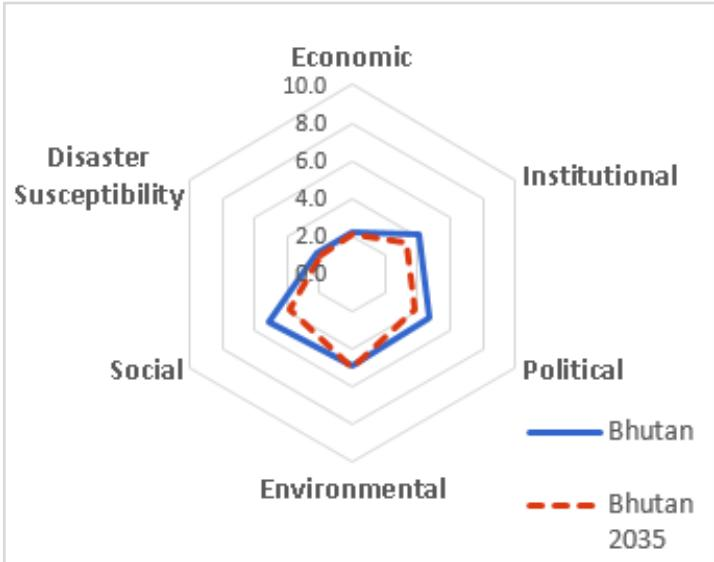
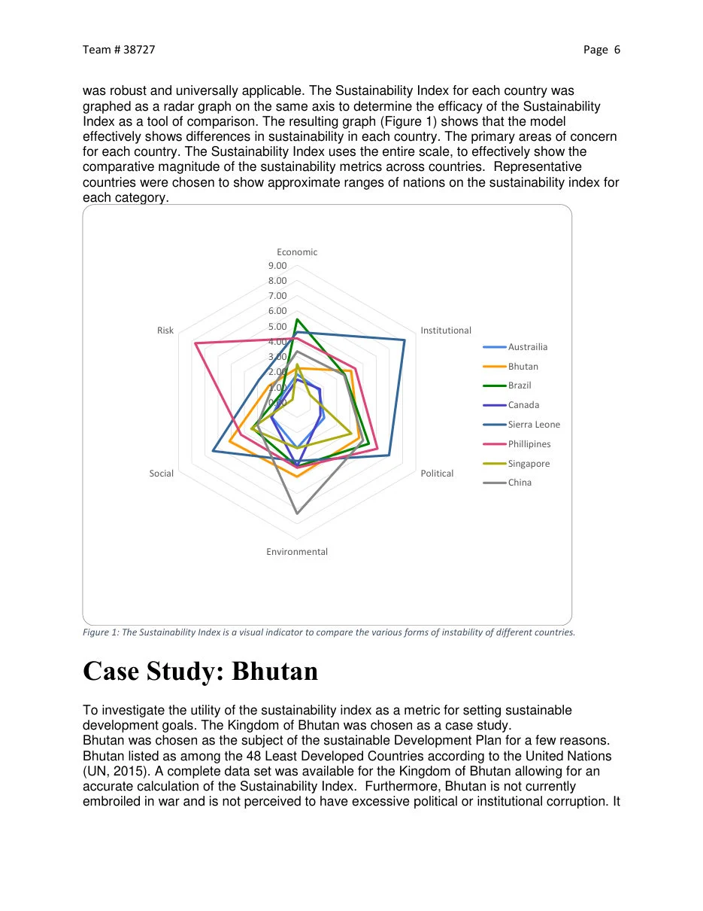
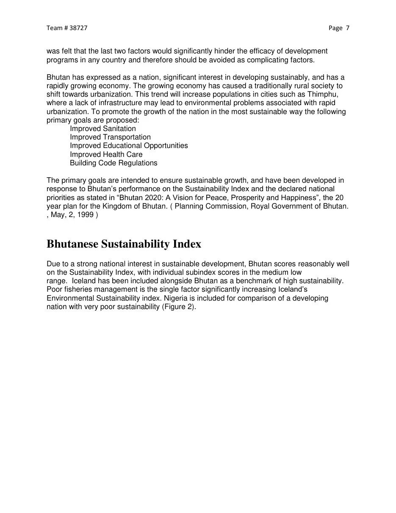

# 2015年美国大学生数学建模竞赛特等奖论文（D题）——可持续性综合指数与国家可持续发展模型

原件为竞赛论文。补充：文中的阅读练习及“参考解答”为整理时增加，原件图文保留出处。

## Abstract

The objective of this model is to establish a comprehensive index that can identify more and less sustainable countries of the world, and to identify target sectors for improvement in sustainability. Identifying the most urgent sustainability issues for a country allows for the formulation of a development plan and can aid in the allocation of resources to reduce instability and increase sustainability. The projected impact of the sustainable development goals are used to forecast the future sustainability of the country.

The model assumes that:
- Subindex parameter properties are uniform across the data set
- Subindices are representative indicators of a network of interconnected factors
- Subindex parameters are accurate and unbiased

Countries are scored across indices of sustainability: Economic, Institutional, Political, Environmental, Social, and Disaster Susceptibility. Within each category, a variety of subindices are used, taking advantage of big data availability to evaluate the stability of each nation with regard to that category. Explicit documentation of the model and parameters used as well as how they were aggregated can be found in the methodology.

The model uses datasets that were chosen because of their completeness making it a robust model for comparing underdeveloped nations. The model is not sensitive to small changes in data values and indicators were chosen to make the model resistant to manipulation. The model penalizes countries for foreign influence on subindices such as air pollution that cannot be contained within the country of origin. There is no alternate subindex evaluation in the rare cases where data is unavailable for a country of interest.

Bhutan was selected for the assistance of the International Conglomeration of Money because of its rapidly growing economy and its high scores across the Sustainability Index relative to other underdeveloped nations. A sustainable development plan was created for Bhutan and model parameters were projected 20 years into the future to determine the effect on Bhutan sustainability. The result was that Bhutan was predicted to maintain or even increase their overall sustainability in the face of rapid development which could let Bhutan serve as the gold standard in sustainably developing the worlds least developed nations.

### Introduction

Sustainable development attempts to balance the material and social needs of present populations with the needs of the planet as a system and the future generations of the population to come. In planning for sustainable development, some prioritization of current needs must be attempted. An analysis of the trajectory of needs and problems must also be performed to try to balance the complicated and uncertain factors for an uncertain future. Resources available for developing nations are limited, so a method of prioritizing the needs and goals for development is needed to aid in the planning process.

### What does sustainability look like?

The essence of sustainability is stability. It is the ability to maintain a process or activity for an extended period of time. On a national scale, it is the ability to indefinitely maintain a country's institutions, ecosystems and communities for future generations. The basis of the sustainability of nations is stability. Without stability, there is uncertainty in a nation’s future ability to meet the needs of its people. Development can bring great prosperity to a nation, but this progress often comes at the expense of sustainability. A balance between these forces should be the goal of sustainable development. The primary requirement for national sustainability is stability in the factors most significantly affecting human welfare:

- Political Stability
- Social Stability
- Economic Stability
- Resilience to risk
- Institutional Stability
- Environmental Stability

### Objective

The objective of this model is to create a comprehensive index to describe the sustainability of a nation in the context of various forms of stability. This index is intended to be used to identify more and less sustainable countries of the world and to identify target sectors for improvement in sustainability, set sustainable development goals, identify the most urgent sustainability issues for a country, and to allocate resources to reduce instability and increase sustainability. The index can also be used to describe the anticipated benefits of various policy changes and sustainability programs. Thus the index is a tool to match up policy measures and unmet needs with their effects on a given sustainability measure.

### 方法论

#### 可持续性指数

可持续性指数由描述一个国家可能经历的、导致其被视为不可持续的各类不稳定性的 6 个因素（子指数）的可视化地图组成。它的设计使得用户可以轻松确定感兴趣国家的哪些部门最需要改进，以提高该国的整体可持续性。它还允许用户确定哪些因素可能是可持续发展的最大障碍。不同国家的可持续性指数可以一起绘制，以并排比较影响每个国家的可持续发展问题的性质和严重程度。可持续性指数还可以用于跟踪一个国家随时间变化的可持续性，并作为评估发展干预措施有效性的工具，通过比较发展举措实施前后的指数来实现。

定义了六个类别的一组六个指数，这些类别被认为对确定一个国家的可持续性最为重要。指数纳入了通常认为会影响或与国家可持续性和稳定性相关因素。

指数的定义如下：

- 它们可以从现成的当前数据集中计算得出。
- 每个指数的刻度为 0 到 10。
- 较高的数字表示更大的不稳定性以及更低的可持续性。
- 数值来自同一数据集（除少数缺失数据的情况外）。
- 输入综合指数的数值来自可用的最新数据。
- 给定指数中包含的所有因素最初权重相等。
- 要被归类为“不可持续”，一个国家需要在任何子指数上获得至少 5.0 的分数。

低于 5.0 的分数并不自动意味着可持续性，而是表明缺乏严重且紧迫的可持续性问题。

#### 子指数

**制度稳定性：**

制度稳定性量化了基础设施系统的完整性以及制度的发展程度。发展的程度和腐败的缺乏标志着一个国家对其未来的投资。

$$
\text { Institutional   Stability   Index } = \frac {\left(\frac {C}{1 0 0} + \frac {S}{1 0 0} + \frac {W}{1 0 0} + \frac {S a}{1 0 0} + I n + E x\right)}{5}
$$

其中：

$$
C = 1 - \text { the Corruption Perceptions Index (Transparency International, 2015) }
$$

$S = 1 - \%$ of the population without access to electricity. (The World Bank, 2014)

$W = \%$ of the population without access to improved water sources (The World Bank, 2015)

$$
\begin{array}{l}S a = \\ \% \text{of the population without access to sanitation infrastructure} \\ (\text{The World Bank, 2015}) \end{array}
$$

$$
I n = \frac {\text { the infant mortality rate } / 1 0 0 0 \text { live births }}{\text { by the maximum infant mortality rate }} (\text { The World Bank,2015 })
$$

$$
E x = 5, i f E x p e c t e d y e a r s o f e d u c a t i o n i s \leq 9. 0 y e a r s
$$

$= 4$, if $9 < \text{Expected years of education} < 11.7$

$$
= 3, i f 1 1. 7 < \text{Expected years of education is} < 1 3. 4
$$

$= 2$, if $13.4 < \text{Expected years of education is} < 16.3$

$$
= 1, i f E x p e c t e d y e a r s o f e d u c a t i o n i s > 1 6. 3
$$

此量表基于世界银行计算的预期受教育年限界限，对应于低、中、高和极高人类发展水平（世界银行，2015）。

**环境稳定性**

环境稳定性衡量的是所讨论国家各个环境领域的退化程度。该类别结合了陆地、水域、大气和环境健康的指标，以评估和描述国家环境系统的可持续性。

$$
E n v i r o n m e t a l I n d e x = \frac {\left(\frac {C l}{1 0 0} + (2 \cdot \frac {P M}{1 0 0}) + \frac {F}{1 0 0} + \frac {\gamma}{1 0 0} + \frac {H a}{1 0 0} + R N\right)}{6}
$$

$Cl =$ the change in the number of climate-related disasters (Yale University, 2014)

$PM =$ Particulate matter in air (Yale University, 2014)

$F =$ the change in forest health (Yale University, 2014)

$\gamma =$ Change in freshwater health (Yale University, 2014)

$Ha =$ the change in human and environmental health (Yale University, 2014)

$RN = \frac{\text{energy consumed per capita} \cdot \% \text{ energy from alternatives (kg oil equivalent)}}{\text{maximum total energy consumption per capita (kWh)}}$ (The World Bank, 2015)

**政治稳定性**

政治稳定性指数以暴力形式量化政治不稳定性，以及政治动荡或失败的可能性。它旨在既表明需要进行政治改革和干预，又识别可持续发展项目的潜在政治障碍。

$$
\text { Political   Instability   Index } = \frac {P I I \cdot C P V I \cdot P Y B I}{3}
$$

其中：

$PII =$ Political Instability Index (The Economist, 2015)

$CPVI =$ Conflict and Political Violence Index (Relifweb, 2015)

$$
P Y B I = 0. 5 \cdot (\left(1 - \frac {M a - 1 5}{3 1}\right) + \left(1 - \frac {E P R - 1 2}{5 3}\right))
$$

其中：

$Ma =$ Median Age of Population (CIA, n.d.)

$EPR =$ Rate of Male unemployment for men ages 15 to 24 (The World Bank, 2015)

**社会稳定性**

社会稳定指数衡量了一些与社会动荡相关的因素。社会不稳定可能表明应与可持续发展结合以实现最大人道主义利益的地区，或具有特殊发展需求的人口。社会稳定指数还可能有助于识别可能导致对可持续发展倡议产生阻力的社会因素。

$$
\mathrm{SocialIndex} = \frac {(V + \frac {R e}{4} + G e + \frac {H}{1 0})}{4}
$$

其中：

$Ge =$ Gender Inequality Index ( U. N. Development Programme)

$H =$ estimate of happiness (Helliwell, Layard, and Sachs, 2013)

$Re =$ estimate of the refugee population by country of origin (Nations, Human Development Reports Data, 2014)

其中：

$$
\begin{array}{r l} & {R e = 5, \text {if} 2 \geq L o g (\mu)} \\ & {\quad = 4, \text {if} 1 \leq L o g (\mu) <   2} \\ & {\quad = 3, \qquad i f 0 \leq L o g (\mu) <   1} \\ & {\quad = 2, \qquad i f - 1 \leq L o g (\mu) <   0} \\ & {\quad = 1, \qquad i f - 2 \leq L o g (\mu) <   - 1} \\ & {\quad = 0, \qquad i f L o g (\mu) <   - 2} \\ & {\qquad \mathrm{Where} \mu = \frac {\frac {\mathrm{refugees}}{\mathrm{population}}}{\mathrm{Maximumvalueof} \frac {\mathrm{refugees}}{\mathrm{population}}} \quad \mathrm{(WorldDatabank)}} \end{array}
$$

# 可持续性综合指数与国家可持续发展模型（第 3 部分）

本部分整理了 2015 年美国大学生数学建模竞赛 D 题特等奖论文中关于经济稳定性、风险稳定性指标定义、计算结果分析以及不丹案例研究的内容。识别过程中已修正公式排版错误、乱码字符及断行问题，将 HTML 表格转换为 Markdown 表格，并规范了 LaTeX 公式格式。

## 一、指标定义与计算方法

### 选择 1：变量 $\vartheta$ 的定义与分段函数

原文定义了变量 $\vartheta$ 及其对应的数值 $V$ 的分段函数关系，用于量化暴力死亡人数等指标。

**变量定义：**
$$ \vartheta = \frac {\text {deaths due to} \frac {\text {violence}}{1 0 0 , 0 0 0 \text {People}} / \text {Population}}{\text {Maximum value of deaths due to violence} / 1 0 0 , 0 0 0 \text {people}} (\text {World Life Expectancy}) $$

**分段函数表达式：**

| 条件 | $V$ 值 |
| :--- | :--- |
| $Log (\vartheta) > 2$ | $5$ |
| $2 \geq Log (\vartheta) > 1$ | $4$ |
| $1 \geq Log (\vartheta) > 0$ | $3$ |
| $0 \geq Log (\vartheta) > - 1$ | $2$ |
| $- 1 \geq Log (\vartheta) > - 2$ | $1$ |
| $Log (\vartheta) < - 2$ | $0$ |

> **说明**：原文中的 `i f` 为识别错误的 `if`，已修正；数字间的空格（如 `1 0 0 , 0 0 0`）已整理为标准千分位格式。

### 选择 2：经济稳定性指数 (Economic Stability Index)

经济稳定性指数反映了贫困程度、经济不平等、经济依赖性和经济参与度的 magnitude（量级）。由于可持续发展的首要目标是消除贫困，该指数对于确定发展项目的紧迫性尤为重要。

**计算公式：**
$$ \mathrm{EconomicIndex} = \frac {(I + \frac {G}{1 0 0} + \frac {P}{1 0 0} + \frac {R}{1 0 0} + \frac {U}{1 0 0})}{5} $$

**参数说明表：**

| 符号 | 含义 | 数据来源 |
| :--- | :--- | :--- |
| $I$ | 联合国开发计划署的人类发展收入指数 (Income index) | The United Nations, 2015 |
| $G$ | 世界银行估算的基尼系数 (GINI coefficient)，衡量收入不平等 | The World Bank, 2014 |
| $P$ | 世界银行估算的每天生活费低于 1.25 美元的人口百分比 | The World Bank, 2015 |
| $R$ | 汇款占该国 GDP 的百分比 (monetary remittances as a % of countries GDP) | The World bank, 2014 |
| $U$ | 正在寻找工作的失业人口百分比 (percentage of unemployed individuals seeking work) | - |

> **订正**：原文中 `$= 1 − the U. N. ...` 处的乱码符号 `` 已根据上下文修正为 $I$；公式中的 `1 0 0` 已修正为 `100`。

### 选择 3：风险稳定性指数 (Risk Stability Index)

风险稳定性指数指示了一个国家在面对灾难、紧急情况、流行病和其他灾害时的脆弱性和应对能力。紧急援助是国际援助中占比最大的部分之一。灾难可能会意外阻碍发展项目，并严重影响一个国家福祉的所有其他部门。因此，一个国家面临的大规模风险是评估发展需求和发展项目失败潜力的重要因素。

**计算公式：**
$$ \text{Risk Index} = \text{WWRA Index} \quad (\text{Development}, 2014) $$

## 二、计算结果与分析

### 选择 4：子指数计算与国家对比

8 个不同国家的子指数是使用上述程序计算的。这些国家是根据其多样的文化、环境问题、政治体系及世界区域选择的。这样做的目的是确保可持续性指数具有稳健性和普遍适用性。每个国家的可持续性指数以雷达图的形式绘制在同一轴上，以确定该指数作为比较工具的有效性。

**结果分析：**
生成的图表（图 1）显示，该模型有效地展示了各国在可持续性方面的差异。图表指出了每个国家的主要关注领域。可持续性指数使用了整个刻度范围，从而有效地展示了各国之间可持续性指标的相对量级。代表性国家的选择是为了展示各类别中国家在可持续性指数上的近似范围。

 *图 1：各国可持续性指数雷达图*

## 三、案例研究：不丹 (Case Study: Bhutan)

为了调查可持续性指数作为设定可持续发展目标度量的效用，选择了不丹王国作为案例研究对象。

**选择不丹的原因：**
1.  **发展中国家地位**：不丹被联合国列为 48 个最不发达国家之一 (UN, 2015)。
2.  **数据完整性**：拥有不丹王国的完整数据集，允许准确计算可持续性指数。
3.  **政治环境**：不丹目前未卷入战争，且未被认为存在过度的政治或制度腐败。最后两个因素被认为会显著阻碍任何国家的发展计划效力，因此应作为干扰因素避免。

**不丹的发展现状与挑战：**
不丹作为一个国家，对可持续发展表现出浓厚兴趣，且经济快速增长。增长的经济促使传统的农村社会向城市化转变。这一趋势将增加像廷布 (Thimphu) 这样城市的 population，其中基础设施的缺乏可能导致与快速城市化相关的环境问题。

**主要发展目标：**
为了以最可持续的方式促进国家增长，提出以下主要目标：
-   改善卫生设施 (Improved Sanitation)
-   改善交通 (Improved Transportation)
-   改善教育机会 (Improved Educational Opportunities)
-   改善医疗保健 (Improved Health Care)
-   建筑法规 (Building Code Regulations)

这些主要目标旨在确保可持续增长，并根据不丹在可持续性指数上的表现以及《不丹 2020：和平、繁荣与幸福愿景》（Bhutan 2020: A Vision for Peace, Prosperity and Happiness）——即不丹王国的 20 年计划中宣布的国家优先事项而制定。(Planning Commission, Royal Government of Bhutan., May, 2, 1999)

### 选择 5：不丹可持续性指数评估

由于对国家发展的强烈兴趣，不丹在可持续性指数上得分尚可，各项子指数分数处于中等偏低范围。冰岛被纳入作为高可持续性的基准。渔业管理不善是导致冰岛环境可持续性指数升高的单一因素。尼日利亚被纳入以进行对比，展示一个可持续性极差的发展中国家的情况（图 2）。

 *图 2：不丹、冰岛与尼日尔的可持续性指数对比*

# 2015年美国大学生数学建模竞赛特等奖论文（D题）——可持续性综合指数与国家可持续发展模型

本资料整理自教材第4部分关于不丹（Bhutan）可持续性指数的分析章节，包含经济、制度、社会、政治、环境及风险等维度的详细论述。

## 一、不丹可持续性指数分析

### 选择 1

**题干：** 根据原文，不丹在经济领域表现较好的主要原因是什么？

- A. 极高的收入水平
- B. 传统农业主导且失业率极低
- C. 严重的贫富差距
- D. 高度依赖进口

答案：B。
参考解答：原文提到 "Bhutan which has traditionally been dominated by subsistence farming... has very low rates of unemployment and scores reasonably well on the index."（不丹传统上以自给自足农业为主……失业率很低，在指数中得分合理。）

### 简答 1

**题干：** 请简述不丹在制度和政治领域的表现及其原因。

正文：
不丹在政治和制度类别中的得分远高于尼日利亚。这主要归因于其长期的和平历史、较少的腐败以及进步的政策，导致民众更幸福，基础设施发展更好。

然而，不规划的城市开发导致了反复出现的公共卫生和环境问题，这些问题与缺乏卫生实践有关（IRC, SNV, 2013）。假设不丹的人口中心继续增长，对于廷布（Thimphu）和普恩乔林（Phuentsholing）等主要城市来说，建立卫生系统是至关重要的。

目前不丹的制度指数为 4.1。这一分数主要由于铺面道路比例低、一定的腐败现象以及预期的教育指标较低而受到惩罚。

### 简答 2

**题干：** 为什么不丹在社会领域的得分较低（5.1）？未来改善的可能性如何？

正文：
不丹在社会领域得分较低（5.1），主要原因是大量难民离境以及中等程度的性别不平等。难民主要由与尼泊尔裔群体（Lhotshampa）的冲突构成。民族紧张局势持续存在，近期与尼泊尔关于难民遣返的谈判恶化（Savada, 2011）。

除非在这些问题上采取行动，否则不丹的社会不稳定指数不太可能得到改善。

### 简答 3

**题干：** 分析不丹政治可持续性指数处于中等水平（4.7）的原因及潜在风险。

正文：
不丹的政治可持续性指数处于中等水平（4.7），原因是与 Lhotshampa 的民族紧张关系。

- **边境问题：** 与印度的多孔边境导致几个印度恐怖组织在不丹南部设立训练营。
- **军事行动后果：** 虽然许多营地被不丹军队强行拆除，但仍有残留，且军事行动可能将恐怖组织的注意力转移到不丹政府身上（Savada, 23 June 2011）。
- **风险评估：** 这提高了政治暴力指标的风险，从而导致政治不稳定指数上升。

### 简答 4

**题干：** 尽管不丹被视为环境方面的模范国家，为何其环境指数得分较差？主要问题出在哪里？

正文：
不丹在许多方面实际上是环境考虑方面的模范国家，因为它坚持发展不会损害环境的长期健康。然而，由于空气质量差，不丹的环境指数得分相当低。

- **主要原因：** 该国与印度和中国接壤，这两个国家重工业发达，空气质量非常差。
- **内部改进空间：** 不丹在以下方面有改进余地：
    1. 室内空气质量（源于传统的烹饪习惯）。
    2. 森林和栖息地保护。

### 简答 5

**题干：** 不丹的风险指数为何很低？但仍存在哪些需要改进的方面？

正文：
不丹是一个内陆国家，因此不像沿海国家那样遭受海平面上升带来的许多风险。

- **低风险因素：**
    - 对森林火灾、飓风、龙卷风、干旱和其他灾害不特别敏感。
    - 位于喜马拉雅山脉东南部，大部分区域高于重大洪水风险区。
    - 因此，不丹具有非常低的“风险指数”。

- **需要改进的方面：**
    1. **地震缓解：** 不丹位于地震活跃区，需通过采用更严格的建筑规范和 retrofitting（加固）要求来提高抗震能力（Geohazards Intl., 2013）。
    2. **交通基础设施：** 良好的交通基础设施缺乏限制了政府应对自然灾害时的疏散措施能力，并可能阻碍紧急援助的有效分发。

## 二、不丹20年可持续发展计划

### 简答 6

**题干：** 为解决可持续性指数中识别出的问题，提出的20年发展计划包含哪些主要内容？

正文：
为解决可持续性指数中识别出的部分问题，提出了一项针对不丹的20年发展计划。该可持续发展计划包括三个主要的“发展倡议”（Development Initiatives），以及用于资助这些倡议的综合长期规划和发展援助。

这些倡议旨在提高不丹的整体发展、可持续性和福祉，并反映《不丹2020：和平、繁荣与幸福的愿景》（Bhutan 2020: A vision for peace Prosperity and happiness）中设定的国家优先事项。

### 简答 7

**题干：** “教育倡议”（Educational Initiative）的具体内容是什么？

正文：
（注：原文在第9页末尾截断，仅列出标题和引导语，未提供具体内容。）

**Educational Initiative**
The Educational Initiative consists of:

Team # 38727

Page 9

## 教育倡议

The construction and endowment of a Private Non-profit Woman's University. The college will consist of four major courses of study to address the major occupational needs of Bhutan. The colleges include:

- College of Nursing and Midwifery
- College of Agricultural Technology
- College of Computer Science and Technology
- College of Education.

The Educational Initiative also includes a system to help Bhutanese women to cover the costs of attendance. This would be done through a policy of free tuition to the College of Midwifery or College of Education to women who agree to work in these fields for a period of at least five years in Bhutan upon graduation. Tuition to the College of Agricultural Technology and College of computer science and technology would be funded through low interest microloans to students.

Additionally the initiative includes a move to make primary and secondary education, which is already free, compulsory.

This Initiative is intended to:

- Improve educational outcomes
- Improve gender equality
- Improve access to healthcare
- Decrease infant mortality rates
- Slow population growth
- Diversify the Bhutanese economy
- Foster economic growth in the tech sector
- Improve nutrition
- Improve agricultural output
- Improve sustainable farming practices

The four majors to be included in the woman's University were chosen to address the need for trained professionals in Bhutan's educational and medical sector, and to encourage growth in the areas of greatest economic potential in Bhutan. The College would be a Private, Non-profit University. This is consistent with the educational objectives set forth in Bhutan's Vision for Peace Prosperity. It is thought that if Bhutan is trying to move towards a private educational system any new institutions should conform to that goal. This condition is intended to prevent "brain drain" of educated individuals from Bhutan, to allow a greater number of Bhutanese woman to have access to higher education, and to create an educated workforce for Bhutan to serve as professional teachers and Healthcare workers to serve in underserved or remote areas of Bhutan in the most need of skilled professionals in these fields.

The Colleges of Agriculture and Technology are intended to ensure women are included in the economic sectors with the greatest potential for economic growth. Agriculture in Bhutan is the largest industry. However most farmers are subsistence farmers. Crop yields in Bhutan are relatively poor and may benefit from modern agricultural techniques.

## 交通倡议

The Transportation Initiative consists of a long term program of improving the transportation infrastructure of Bhutan. The highly mountainous country has one main road, The Lateral Road, traversing the country and connecting the main population centers. The road is currently in very poor condition and only one lane in many locations. It is subject to landslides and winter closure severely restricting the movement of goods and people through Bhutan (J.A., 2013).

The central program of the Transportation Initiative is the repaving and improvement of the Lateral Road. This will include the construction of bypasses of particularly dangerous sections of the road where possible and the improvement of bridges with the worst performance and safety records. The program also includes aid for the purchase and maintenance of multiple snow plows to allow the clearing of the Lateral Road during winter storm events in an effort to maintain mobility of goods and people year round. Additionally a program of funds matching will be instituted to encourage smaller communities to raise money to connect their communities to the Lateral Road.

This Initiative is intended to:

- Improve transportation
- Improve the movement of people and goods
- Improve access to education and health care
- Increase community investment in infrastructure
- Reduce youth unemployment
- Develop the pool of skilled laborers
- Improve crisis response capabilities
- Increase national unity
- Facilitate the growth of industries reliant on transportation

## 基础设施倡议

The infrastructure initiative consists of a set of smaller programs and policies designed to introduce the expectation of modern infrastructure to Bhutanese Society. Because of the relatively small size and populations (all under 100,000) of the urban centers of Bhutan, infrastructure projects enacted in the large population centers can provide benefits to large percentages of the Bhutanese population.

The infrastructure initiative consists of:

- The institution of a national fund to provide loans for cities and towns to build waste water treatment facilities, and modern sewer systems. Priority for loans shall go to towns based on their population density, and level of need.
- A public health education campaign to encourage hand washing and the use of existing latrines, which are currently pervasive, but under used for a variety of reasons (WASH, 2013). This program shall be administered in conjunction with the national education system and community health workers and midwives.

A requirement that new buildings include modern latrines or sewer access, cook stove ventilation and meet basic earthquake safety standards.

The Infrastructure Initiative is intended to: Improve access to sanitation Build modern infrastructure Improve community health Improve water quality Increase employment opportunities Improve earthquake safety

## Economic Development Initiatives

The following list of low cost initiatives have been included as measure to encourage and direct the growth of Bhutan's critical industries towards sustainable growth.

- A pilot program to make the entire city of Thimphu into an internet Hot Spot to encourage growth in the technological sector and the tourism sector
- The development of a long term mining and mineral extraction plan to ensure the sustainability of the extractive industries without threatening Bhutan’s long term environmental health
- The institution of a public agency to encourage organic farming practices, small scale beekeeping and organic certification to increase the sustainability and economic potential of the agricultural sector.

## 20-year changes to sustainability sub-index parameters

The following parameters were updated to reflect the change in the Sustainability Sub-Indices of Bhutan after the sustainable development plan is implemented. All values not mentioned are considered to remain constant over the 20 year period.

### Economic

| Parameter | Current Value | Predicted Value 2035 | Rationale |
| :--- | :--- | :--- | :--- |
| $I$ (Income Index) | 0.363 | 0.243 | Economic growth should improve indicator of general economic health |
| $G$ (Income Inequality) | 38.7 | 45 | Rapid growth and urbanization will likely increase income inequality between the rural subsistence farmers and city dwellers |
| $P$ (% Living in Poverty) | 12 | 8 | As more of the population will be found in cities, their income is likely to be higher and overall % of people living in poverty could drop as much as a third |

### Institutional

| Parameter | Current Value | Predicted Value 2035 | Rationale |
| :--- | :--- | :--- | :--- |
| $S$ (% of Unpaved Roads) | 0.658 | 0.5 | While the percentage of roads paved will increase, improvement is likely to be slow because of the very mountainous terrain |
| $Sa$ (% Without Access to Sanitation) | 0.53 | 0.15 | Increasing proportions of the population living in cities combined with new wastewater treatment plants and building codes will increase access to sanitation |
| $In$ (Infant Mortality) | 0.28 | 0.14 | Improved healthcare and a focused program to increase numbers of rural midwives and improve prenatal care should at least halve the current infant mortality rate |
| $E$ (Expected Years of Schooling Category) | 3 | 2 | Focused education policies should maintain current trends toward increased schooling |

### Political

| Parameter | Current Value | Predicted Value 2035 | Rationale |
| :--- | :--- | :--- | :--- |
| $PYBI$ - (Problematic Youth Bulge Index) | 0.55 | 0.40 | Population projections predict an aging population and lowering unemployment |
| $Pi$ (Political Instability Index) | 5.3 | 4 | Changing demographics, increased prosperity and the easing of ethnic tensions should decrease the level of political instability |

### Environmental

| Parameter | Current Value | Predicted Value 2035 | Rationale |
| :--- | :--- | :--- | :--- |
| $PM$ (Frequency of PM-2.5 Exceedance) | 75.9 | 77.89 | China's current public sentiment and ambitious plan to reduce PM-2.5 emissions counteracted with increased energy needs and population in asian nations will probably result in a slight increase in PM-2.5 overall |

### Social

| Parameter | Current Value | Predicted Value 2035 | Rationale |
| :--- | :--- | :--- | :--- |
| $Re$ (# of refugees originating from Bhutan score) | 4 | 2 | Easing of ethnic tensions and increased education and cultural awareness may significantly decrease refugees leaving Bhutan by 2035 |
| $Ge$ (Gender Equality Index) | 0.495 | 0.395 | Focused women's education programs should help women enter the economy in the healthcare and tech fields |

### Risk

| Parameter | Current Value | Predicted Value 2035 | Rationale |
| :--- | :--- | :--- | :--- |
| Risk Index | 7.8 | 6.8 | Improved building codes, roads and retrofit requirements should reduce Bhutan's susceptibility to seismic events |

## 20-year changes to the Sustainability Index

After updating the parameters of the sustainability measure to account for the effects of the sustainable development plan for Bhutan, the model shows significant improvement to the overall sustainability for Bhutan (Figure 3). The only sector not improved was the environmental sustainability score for Bhutan. The country is likely to suffer from the continued degradation to their air quality resulting from the neighboring countries China and India. On the whole, Bhutan is on track to remain a model nation for sustainable development among the UN’s least developed nations.

## 可持续性指数的优势与不足

可持续性指数模型旨在帮助政策制定者在考虑对发展中国家提供援助时进行决策。指数值的变化为可持续性的优势与不足提供了洞见。该模型对于欠发达国家现有数据有限的一致性具有高度稳健性，而在尝试比较可持续性指数时，数据一致性往往是一大障碍。许多最重要指标的数据集至少缺少若干发展中国家的信息。模型的准确性仅取决于用于计算指数的现有数据的准确性。然而，在假定给定数据集内数值变化一致的前提下，模型对数据值的微小变化并不敏感。

使用少数特定指标并不会使模型容易受到操纵。如果一个国家希望更具可持续性，只需改进模型中所使用的特定指标即可。

此外，某些可持续性问题（如粮食安全或气候难民）具有多重成因，无法仅用一个指数准确描述。归入某一个子指数可能会放大或掩盖某一因素对某种不稳定性的影响。

在所评估的任何国家中，环境指数得分均未低于 3.0。这并不一定反映一国缺乏可持续实践，而是因为环境指数对邻国污染环境、过度捕捞渔业或危害恰好与该国共享栖息地的动物物种等影响十分敏感。环境指数还可通过考虑任一子指数逼近阈值时环境崩溃的风险来加以改进。例如，PM2.5 超标程度高到环境不再适宜人类居住的情形，如北京的情况。（Kaiman, 2015）

环境指数，以及在某些情况下的政治和经济指数，未考虑一国无法控制某些子指数类别的情况。例如，不丹在环境子指数中 PM2.5 排放超标项得分为 75.9（满分 100），在很大程度上是因为该国邻近印度和中国这两个重工业空气污染国。（Pannozzo, "Brown Cloud" penetrates Bhutan, 2011）。因他国影响而导致的可持续性指数/子指数失真，可作为国际环境问题的指标，而这些问题最好通过更具区域性的可持续性方法来加以解决。

模型的持续开发应纳入以下内容：准确估计缺失参数的方法；评估各单项指标在子指数计算中应如何加权以反映其重要性；以及评估各类别的不可持续阈值。

## 参考文献

(n.d.).

Planning Commission, Royal Government of Bhutan. . ( May, 2, 1999 ). "Bhutan 2020:A Vision for Peace, Prosperity and Happiness".

AON. (2015, Feb 5). Political Violence Risk. Retrieved from Interactive Risk Map: http://www.riskmap.aon.co.uk/political\_riskmap.aspx#

Christopher W. Pawlowski, B. D. ( 2005, June). Towards a sustainability index using information theory. Energy. Retrieved from http://dx.doi.org/10.1016/j.energy.2004.02.008.

CIA. (n.d.). World Fact Book. Retrieved from www.cia.gov/library/publications/the-world-factbook/

Development, U. N. (2014). World Risk Report 2014. Alliance Development Works. .

Disaster (Natural & Technological) Profiles by Country. (2015, Feb 5). Retrieved from International Disaster Database: Disaster (Natural & Technological) Profiles by Country

Geohazards International. (2013). Initial Seismoc Vunerability Assesment of Trashigang District Hospital. Trashigang: European Commission for Humanitarian aid and Civil Protection.

(n.d.). In With tthe Bad Transboundary Air Pollution in Bhutan.

IRC, SNV. (2013). How to design a study on 'cost-effectiveness of hygiene promotion' . Progress Report. .

J.A. (2013, Jan 2). Speed is not everything. The Economist.

Kaiman, J. (2015, Jan 28). Bejing smog makes city unlivable, says mayor. TheGuardian.

Moore, K. G. (2003, Aug.). Globilization Urbanization and the inpacts on Human Health.

Nations, U. (2014). Human Development Reports Data. Retrieved from United Nations Development Program: http://hdr.undp.org/en/data

Nations, U. (2014). Human Development Reports Data. Retrieved from United Nations Development Programme: http://hdr.undp.org/en/data

Pannozzo, L. (2011). "Brown Cloud" penetrates Bhutan. Evidence form the Samdrup Jongkhar Initiaive.

Pannozzo, L. (2011). In with the Bad: Ambient Air Quality and Tranboundary Pollution in Bhutan. Journal of Bhutan Studies, 118-126.

Relifweb. (2015, Feb 5). Disasters. Retrieved from Relifweb: reliefweb.int

Savada, A. M. (23 June 2011). "Bhutan: A Country Study".

SciDevNet. (2015, Feb 5). Bhutan faces crop losses from erratic climate . Retrieved from http://www.scidev.net/global/farming/news/bhutan-faces-crop-losses-from-erraticclimate.html

The Economist. (n.d.).

The Economist. (2015, Feb 5). Social Unrest. Retrieved from The Economist Intellegence Unit: http://viewswire.eiu.com/site\_info.asp?info\_name=social\_unrest\_table&page=noads&rf=0

The Economist. (2015, Feb 5). The political Instability Index. Retrieved from The Economist: http://www.economist.com/node/13349331

The United Nations. (2015, Feb 5). Energy use . UNData.

The World bank. (2014). The World Bank. Retrieved from Indicators: http://data.worldbank.org/indicator

The World Bank. (2015, Feb). World Bank . Data.

Transparency International. (2015, Jan 15). Corruption Perceptions Index 2014: Results. Retrieved from Treansparency international: http://www.transparency.org/cpi2014/results

U.S. AGENCY FOR INTERNATIONAL DEVELOPMENT. (1982, March.). Rural roads evaluation summary report. A.I.D. . pp. Program Evaluation Report No, 5.,.

Wikipedia. (2015, Feb 5). Bhutan. Retrieved from Wikipedia: http://en.wikipedia.org/wiki/Bhutan.

World Audit. (2014, Feb 5). Corruption. Retrieved from World Audit: http://www.economist.com/node/13349331

World Life Expectancy. (2015, Feb 5). Rank of Diseases/Epidemics . Retrieved from World Health rankings: http://www.worldlifeexpectancy.com/world-health-rankings

World Life Expectancy. (2015, Feb 5). Violence- Adjusted Age Rate. Retrieved from World Life Expectancy: http://epi.yale.edu/epi

Yale. (2014, 2015 Feb). Environmental Performance Index. Retrieved from http://epi.yale.edu/epi

Zhou, L. e. ( 2012). Sustainability performance evaluation in industry by composite sustainability index. Clean Technologies and Environmental Policy, Page 789.
