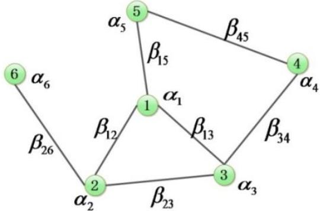
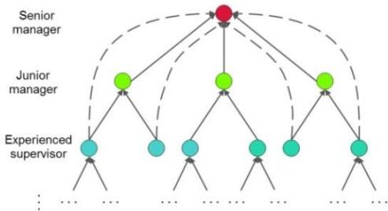
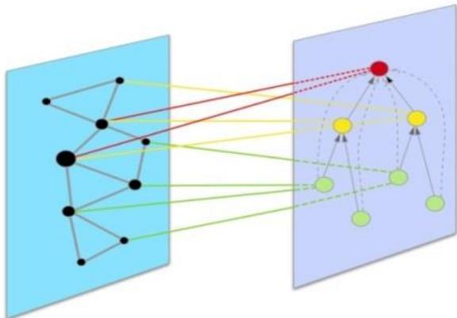
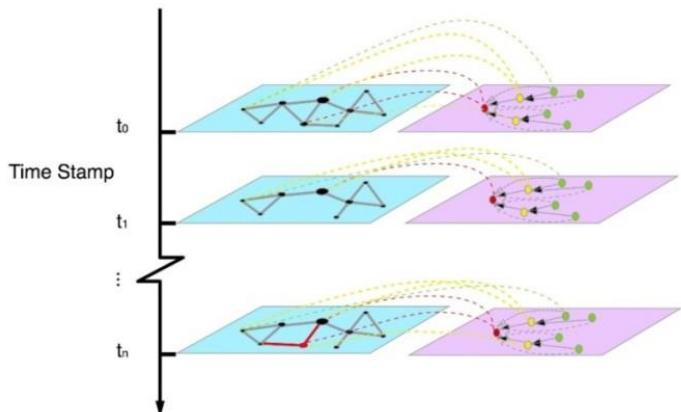
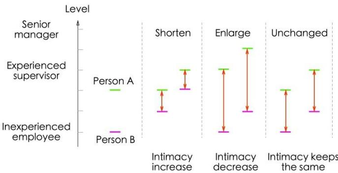
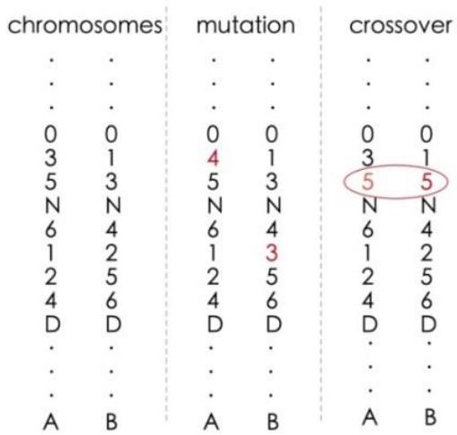
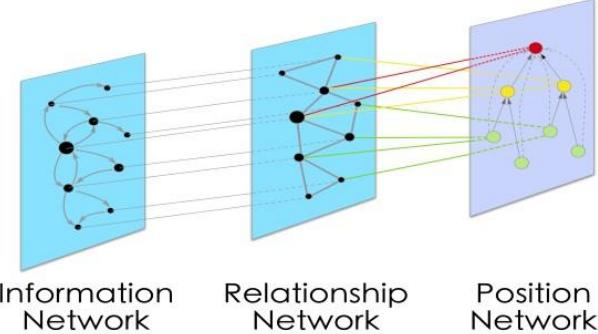

# 2015年美国大学生数学建模竞赛特等奖论文（Problem C: Human Capital Management in Organizations）

原件经识别和整理；“参考解答”是我们补的。

本文档整理了2015年MCM/ICM Problem C的特等奖论文摘要及核心内容，由识别工具读取并整理。

## 一、问题背景与模型构建

### 选择 1

题干：Information Cooperative Manufacturing (ICM) is an organization of 370 people, who is facing the challenging issue related to effectively managing its human capital. In this paper, we establish models to help figuring out the problem.

参考解答：**结论**：该题干属于数学建模竞赛（如 MCM/ICM）中的**问题背景描述**或**摘要引言部分**，而非一道具有唯一标准答案的选择题或计算题。因此，不存在传统意义上的“正确选项”。若此题出现在考察“题目理解”或“论文结构”的语境中，其核心意图是**明确建模对象与目标**。

**推理与分析**：

1.  **文本性质分析**：
    题干英文翻译为：“信息协同制造（ICM）是一个拥有 370 人的组织，正面临有效管理其人力资本的挑战性问题。在本文中，我们建立模型以帮助解决这个问题。”
    *   这是一段典型的**论文摘要（Abstract）**或**问题重述（Problem Restatement）**的开篇语句。
    *   它定义了主体（ICM 组织）、规模（370 人）、核心痛点（人力资本管理）以及方法论（建立模型）。

2.  **为何不是常规选择题**：
    *   **缺乏选项**：题干未提供 A、B、C、D 等选项。
    *   **缺乏具体问法**：没有询问“ICM 有多少人？”或“主要挑战是什么？”等具体事实性问题。
    *   **开放性**：数学建模问题的解答依赖于后续具体的子问题（如：如何评估员工绩效？如何优化团队结构？），仅凭此背景无法得出数值解或单一逻辑结论。

3.  **若作为“理解类”选择题的假设性解析**：
    假如本题意在考察对**建模任务本质**的理解，常见的干扰项与正确方向如下：
    *   **正确方向**：识别出这是一个**优化问题（Optimization Problem）**或**评价问题（Evaluation Problem）**，需要结合人力资源管理理论（如 AHP、聚类分析、回归分析等）构建数学模型。
    *   **错误方向示例**：
        *   “这是一个纯计算题，只需计算 370 人的平均工资。”（错误：题干未提供薪资数据，且目标是“管理策略”而非简单统计。）
        *   “这是一个几何问题，需计算办公室空间布局。”（错误：题干明确指向“人力资本 management”，而非物理空间。）
        *   “无需建模，直接通过访谈解决。”（错误：题干明确要求“establish models”。）

**关键步骤（针对此类背景下的建模思路）**：

若需基于此背景展开建模，通常遵循以下步骤：
1.  **指标体系构建**：定义“人力资本”的关键维度（如：技能值 $S_i$、协作效率 $C_{ij}$、离职风险 $R_i$ 等）。
2.  **数据预处理**：对 370 名员工的数据进行标准化处理，使用聚类算法（如 K-Means）进行员工分类。
3.  **模型建立**：
    *   **评价模型**：使用层次分析法（AHP）或 TOPSIS 评估当前人力资本状态。
    *   **优化模型**：建立目标函数 $\max Z = f(\text{效率}, \text{满意度})$，约束条件包括预算、人数限制等，求解最优配置方案。
4.  **灵敏度分析**：分析关键参数变化对管理策略稳定性的影响。

**总结**：此题干为**背景陈述**，非可解题。在实际竞赛中，应以此为基础，阅读后续的 Specific Questions（具体问题）来确定建模方向。

知识点：[人力资本网络模型（Human Capital Network, HCM）](../../../topics/数学建模/renli_ziben.md)

### 简答 1

题干：Firstly, we build a static human capital network. To begin with, there are three kinds of relationships: the relationship among people, the relationship among positions, the relationship between people and positions. Then we use a bipartite graph to indicate the assignment of positions. After matching people and position, it forms a static human capital network. In addition, we define loyalty and intimacy to measure the probability of churn. These two indices consider two situations: people churn by their own reason and people churn by others’ influence.

参考解答：作者首先构建了静态人力资本网络。该网络包含三种关系：人员之间的关系、职位之间的关系以及人员与职位之间的关系。使用二部图来表示职位分配，匹配人员和职位后形成静态人力资本网络。此外，定义了“忠诚度”（loyalty）和“亲密度”（intimacy）来衡量流失概率，这两个指标考虑了两种情况：人员因自身原因流失和受他人影响流失。

知识点：[静态合作网络与隶属关系网络（Affiliation Network）](../../../topics/数学建模/jingtai_hezuo.md)、[人力资本网络模型（Human Capital Network, HCM）](../../../topics/数学建模/renli_ziben.md)

### 简答 2

题干：Secondly, we take time into consideration and get a dynamic network. We first analyze the change of loyalty and intimacy. Loyalty is influenced by the relation of the time that people works in the same position and the mean time of promotion. In addition, it will increase if the employees get promoted. Intimacy is influenced by two employees’ disparity of position levels. Next, we simulate the churn in the dynamic process. After that, we describe the cost, which consists of the direct cost and indirect cost. More specifically, they are related to the number of working people and the organizational structure. Besides, we using genetic algorithm to get the optimal assignment——minimizing the cost.

参考解答：其次，引入时间因素得到动态网络。首先分析忠诚度和亲密度的变化。忠诚度受人员在同一职位工作时长与平均晋升时间的关系影响；如果员工获得晋升，忠诚度会增加。亲密度受两名员工职位层级差异的影响。接下来，模拟动态过程中的流失情况。随后描述成本，包括直接成本和间接成本，具体与工作人数和组织结构有关。此外，使用遗传算法获得最优分配以最小化成本。

知识点：[多重网络/多层网络构建（Multiplex/Multi-layer Network）](../../../topics/数学建模/duoceng_wangluo.md)、[遗传算法优化人力资本管理（染色体表示与适应度函数）](../../../topics/数学建模/yichuan_suanfa.md)

### 简答 3

题干：In general, the dynamic process can be divided to three circulatory parts. The first one is to use computer simulation to simulate the churn and recruitment of employees. The second part is the change of loyalty and intimacy which is determined by the change of network. And the third one is to use the Genetic Algorithm to get the optimal assignment to minimize the cost and this is the only part that HR manager can intervene.

参考解答：总体而言，动态过程可分为三个循环部分：第一部分使用计算机模拟员工的流失和招聘；第二部分是忠诚度和亲密度的变化，由网络的变化决定；第三部分使用遗传算法获得最优分配以最小化成本，这是人力资源经理唯一可以干预的部分。

知识点：[离职事件（Demission/Turnover Event）定义与算法](../../../topics/数学建模/lizhi_suanfa.md)、[遗传算法优化人力资本管理（染色体表示与适应度函数）](../../../topics/数学建模/yichuan_suanfa.md)

### 计算 1

题干：Thirdly, we apply the model to solve three questions, which are corresponding to Task (3)(4)(5). For (3), the cost of recruitment is 38.2 and the cost of training is 127.08 over the next two years. For (4), if the churn rate is 25%, the organization can sustain 80% full status. The recruitment is 22% and the total cost is 617.64 . If the churn rate is 35%, the organization can sustain 80% full status. The recruitment is 31% and the total cost is 533.66 . A higher churn rate will decrease the direct cost but it will cause unsteadiness of the organizational structure, which is the indirect effect. For (5), a higher churn rate in middle levels (junior manager and experienced supervisor) will provide more chance for people to promote. As a result, it can refresh the organizational structure and improve people’s cohesion to the organization.

答案：
- Task (3): 未来两年内，招聘成本为 38.2，培训成本为 127.08。
- Task (4): 
    - 若流失率为 25%，组织可维持 80% 满员状态。招聘比例为 22%，总成本为 617.64。
    - 若流失率为 35%，组织可维持 80% 满员状态。招聘比例为 31%，总成本为 533.66。
    - 较高的流失率会降低直接成本，但会导致组织结构不稳定，产生间接影响。
- Task (5): 中层（初级经理和资深主管）较高的流失率为人员晋升提供了更多机会。因此，它可以刷新组织结构并提高人们对组织的凝聚力。

知识点：[生产率与成本模型（Productivity and Costs of HCM）](../../../topics/数学建模/shengchan_liebian.md)、[敏感性分析方法（Sensitivity Analysis，单参数与多参数变动）](../../../topics/数学建模/minganxing_fenxi.md)

### 简答 4

题干：Fourth, we analyze the parameters in our paper. We identify the parameters determined by data or experience and the parameters determined by experiments. After analyzing, we let the number of population, the iteration times, the mutation rate and the crossover rate to 200, 2000, 0.4 and 0.1 respectively, which are suitable parameters in the Genetic Algorithm.

参考解答：第四，我们分析了论文中的参数。我们确定了由数据或经验决定的参数以及由实验决定的参数。经过分析，我们将种群数量、迭代次数、变异率和交叉率分别设为 200、2000、0.4 和 0.1，这些是遗传算法中合适的参数。

知识点：[模型参数的确定（基于数据拟合或实验选择）](../../../topics/数学建模/canshu_queding.md)、[遗传算法优化人力资本管理（染色体表示与适应度函数）](../../../topics/数学建模/yichuan_suanfa.md)

### 简答 5

题干：Finally, we introduce the concept of team science and focus on the information flow. We add the information network to our human capital network and it comes into being a multi-layers network, which can make our analysis more comprehensive and reasonable.

参考解答：最后，我们引入了团队科学的概念并关注信息流。我们将信息网络添加到人力资本网络中，形成了多层网络，这使得我们的分析更加全面和合理。

# 2015年美国大学生数学建模竞赛特等奖论文（Problem C: Human Capital Management in Organizations）习题

## 一、引言

知识点：[多重网络/多层网络构建（Multiplex/Multi-layer Network）](../../../topics/数学建模/duoceng_wangluo.md)、[人力资本网络模型（Human Capital Network, HCM）](../../../topics/数学建模/renli_ziben.md)

### 引言 1

**As we all know, an organization filled with good, talented, well-trained people is more prone to success. Actually, people often leave for other jobs or retire and then may be replaced, which forms a fluid network of human capital. Information Cooperative Manufacturing(ICM), an organization of 370 people, who are facing the challenging issue related to effectively managing its human capital. And now, we write this paper to help them figure out this problem.**

In this paper, we first build three networks independently: the network among people, the network among position and the bipartite graph between people and positions. Next we put them together and get a human capital network. Then considering the time, we build a dynamic human capital network to indicate the dynamic process of human capital. In the meantime, we use the Genetic Algorithm to get the optimal matching and then manage the human capital. After that, we apply our model to answer the Task (3), (4), (5). Finally, we discuss the team science and multi-layers network in HR management.

In section 3, considering the relation among people without the influence of positions, we first build a network among people and define two indices: loyalty and intimacy. Loyalty is an index to indicate the probability of staying in the organization. Its initial value is determined by organization culture and staff’s own expectations. Intimacy represents the following probability with connected people who have churned. Its initial value is determined by the time of know and the similarity of interest of two individuals. Next we build a position network to indicate the relationship among the positions. Then, we build a bipartite graph to measure the matching of people and positions. Finally, putting three graphs together and we get a human capital network.

In section 4, we take time into account and get a dynamic human capital network. Then we analyze the change of loyalty and intimacy with the dynamic process. After that, we describe the process of churn and how the network changes. Finally, under the principle of minimizing the cost, we use Genetic Algorithm to assign people to the positions.

In section 5, we apply the model to solve three Tasks. The first one is to calculate the budget requirements for both recruiting and training over the next two years. The second one is to analyze the influence of changing annual churn rate. The third one is to discuss the impact on the HR health of the organization under the situation that the churn rate of middle levels is higher than that of lower levels.

In section 6, we analyze the parameters in our paper. There are two kinds of parameter: one is determined by data and another is determined by experiments. We describe how to choose the better parameters.

In section 7, we introduce the concept of team science and focus on the information flow. We add the information network to our human capital network and it comes into being a multi-layers network, which can make our analysis more comprehensive and reasonable.

## 二、假设及其合理性说明

参考解答：## 二、假设及其合理性说明

1. **假设员工的流失行为仅受忠诚度（Loyalty）和亲密度（Intimacy）影响，不受其他随机因素干扰。**  
   *合理性：* 这两个指标分别代表了员工对组织的依附和对同事的依附，是社会科学中解释离职意向（Turnover Intention）的核心变量，且便于量化和模拟。

2. **假设职位网络（Position Network）的结构在两年内保持相对稳定，不考虑组织架构的大规模调整。**  
   *合理性：* ICM 是一个拥有 370 人的中型组织，其组织架构通常具有刚性，短期内不会发生颠覆性变化，这简化了动态网络的结构层。

3. **假设员工的初始忠诚度服从正态分布，且与职位层级（Level）负相关（即层级越高，初始忠诚度越高）。**  
   *合理性：* 符合行为经济学原理，高层职位通常伴随着更高的沉没成本和归属感；正态分布是描述群体心理特征的常用分布。

4. **假设“招聘-培训-配置”的成本函数是线性的，且存在即时的预算约束。**  
   *合理性：* 线性假设便于构建目标函数并使用遗传算法（GA）求解；实际 HR 管理中，成本通常可以按人均成本进行估算。

5. **假设信息流动（Information Flow）在团队内部是无摩擦的，且团队成员的知识水平服从均匀分布。**  
   *合理性：* 这是团队科学（Team Science）中的基本假设，便于构建多层网络中的信息层，并分析知识传递效率。

知识点：[人力资本网络模型（Human Capital Network, HCM）](../../../topics/数学建模/renli_ziben.md)、[多重网络/多层网络构建（Multiplex/Multi-layer Network）](../../../topics/数学建模/duoceng_wangluo.md)、[遗传算法优化人力资本管理（染色体表示与适应度函数）](../../../topics/数学建模/yichuan_suanfa.md)

### 假设 1

(1) The longer time an individual works, the more experienced they are. We assume that the years that people work in ICM is proportional to their knowledge and abilities. It is hard for us to measure the people’s knowledge and abilities, so we use the work years in the company to measure their abilities. Since people must have several years of experience before they move up into the higher management-level, it is suitable for us to consider working time.

答案：无（模型构建中的基本假设）
参考解答：该假设将“工作年限”作为“知识与能力”的代理变量。鉴于直接量化员工能力困难，且晋升通常要求经验积累，此假设在管理科学建模中是常见且合理的简化。

知识点：[一般假设及其合理性说明（Assumptions and Justifications）](../../../topics/数学建模/jiaben_shezhi.md)、[人力资本网络模型（Human Capital Network, HCM）](../../../topics/数学建模/renli_ziben.md)、[数学建模的基本步骤（问题分析、模型假设、建立、求解、检验、推广）](../../../topics/数学建模/jianmo_buzhou.md)

### 假设 2

(2) No employee is fired. In the operation of ICM, marginal and poor employees are allowed to stay because ICM always worries about being shorted-handed.

答案：无（模型构建中的基本假设）
参考解答：该假设排除了“主动解雇”这一流出渠道，仅考虑自愿离职（Churn）。这简化了网络动态，符合题目背景中关于人手短缺担忧的描述。

知识点：[任务分解与目标明确](../../../topics/数学建模/renwu_fenjie.md)、[一般假设及其合理性说明（Assumptions and Justifications）](../../../topics/数学建模/jiaben_shezhi.md)、[离职事件（Demission/Turnover Event）定义与算法](../../../topics/数学建模/lizhi_suanfa.md)

### 假设 3

(3) The time unit in this paper is one month. The human capital network is dynamic and companies often take one month as time unit. For example, an employee who hands his notice on February $10^{\mathrm{th}}$ and it will become effective in March 1st.

答案：无（模型构建中的基本假设）
参考解答：确定时间粒度为“月”。离散时间步长便于模拟网络状态的月度更新。示例说明了通知期与生效期的时间差处理。

知识点：[数学建模的基本步骤（问题分析、模型假设、建立、求解、检验、推广）](../../../topics/数学建模/jianmo_buzhou.md)、[一般假设及其合理性说明（Assumptions and Justifications）](../../../topics/数学建模/jiaben_shezhi.md)、[任务分解与目标明确](../../../topics/数学建模/renwu_fenjie.md)

### 假设 4

(4) The influence of churn will work in the next month. If a person churned in this month, we assume the person who connected to him or her dos not know before. Therefore, they cannot churn together and he or she may be influenced in the next month.

答案：无（模型构建中的基本假设）
参考解答：设定影响滞后性。即本月离职对同事的影响体现在下个月。这避免了同一时间段内多人因即时传染而同时离职的极端情况，使模型更符合现实中的信息传播延迟。注意：原文 "dos" 应为 "does"。

知识点：[数学建模的基本步骤（问题分析、模型假设、建立、求解、检验、推广）](../../../topics/数学建模/jianmo_buzhou.md)、[一般假设及其合理性说明（Assumptions and Justifications）](../../../topics/数学建模/jiaben_shezhi.md)、[离职事件（Demission/Turnover Event）定义与算法](../../../topics/数学建模/lizhi_suanfa.md)

### 假设 5

(5) ICM will have the maximum output when 85% of its 370 positions filled. Actually, many companies do not have 100% of its positions filled. On the one hand, an organization should have some vacant higher position to motivate employees to work harder. On the other hand, some vacant position can avoid repeating work and overstaffing. Usually, ICM has 85% of its 370 position filled at any time. So it is suitable for us to assume that the organization have the maximum output under this situation.

答案：无（模型构建中的基本假设）
参考解答：定义组织效能最大化时的满编率为85%。理由包括：保留高层职位空缺以激励员工，以及避免冗余工作。这是基于实际管理经验的参数设定，用于后续优化目标的评估。

# 2015年美国大学生数学建模竞赛特等奖论文（Problem C: Human Capital Management in Organizations）

本文档整理了2015年美国大学生数学建模竞赛特等奖论文中关于“组织人力资本管理”问题的第3部分（共12部分），内容涉及假设、人力资本网络的构建及节点与边关系的定义。

## 三、假设与模型基础

知识点：[一般假设及其合理性说明（Assumptions and Justifications）](../../../topics/数学建模/jiaben_shezhi.md)、[数学建模的基本步骤（问题分析、模型假设、建立、求解、检验、推广）](../../../topics/数学建模/jianmo_buzhou.md)

### 假设 6

我们做出“经济人”假设。也就是说，我们假设所有人都追求高职位仅仅是因为更高的薪水。因此，我们根据薪水将职位分为六个等级。在本文中，我们没有关于人们野心、期望、能力、知识的线索，所以我们仅用薪水来衡量他们的意愿。此外，部门之间的隶属关系也很难说清楚。因此，我们用薪水等级来定义职位的层级。

参考解答：### 结论

**假设 6 不成立。**

### 推理过程

1.  **现实行为与“经济人”假设不符**：
    “经济人”假设认为个体唯一目标是追求经济利益最大化（高薪水）。然而在现实和管理学中，职位晋升的动机是多元的，除了薪酬，还包含权力、社会地位、自我实现、工作稳定性以及非货币福利等。
    *   **选择题分析**：若为选择题，应排除“所有人都追求高职位仅仅是因为更高的薪水”这一选项。原因在于它忽略了非货币因素（如权力和声望）对决策的影响，过度简化了人类行为模式。

2.  **数据代理变量（Proxy）的有效性不足**：
    该假设试图用“薪水等级”来完全替代“职位层级”和“晋升意愿”。
    *   虽然薪水与职位通常正相关，但并不总是线性的或唯一的映射关系（例如，技术专家的薪资可能高于行政主管，但权力层级不同）。
    *   在缺乏野心、期望、能力等软性指标的情况下，仅用薪水建模会导致模型无法解释那些“降薪跳槽”或“追求权力而非金钱”的异常样本。

3.  **隶属关系简化导致的结构失真**：
    假设中提到“部门之间隶属关系难说清楚”，因此用薪水定义层级。
    *   这在建模上属于**强行降维**。组织架构中的“隶属关系”决定的是管理幅度（Span of Control）和汇报链条，这是拓扑结构问题；而“薪水”是标量数值。
    *   用标量（薪水）来定义拓扑层级（隶属关系），会丢失组织内部的控制流向信息，导致无法准确模拟组织内部的运作机制。

知识点：[一般假设及其合理性说明（Assumptions and Justifications）](../../../topics/数学建模/jiaben_shezhi.md)

### 假设 7

组织需要为新人支付招聘成本，但在最初不需要为他支付培训成本。组织每年应为合格员工支付培训成本。我们假设组织中的每个人都应每年接受培训以提高其能力，并忽略新人的培训成本，因为我们认为最初的招聘成本包含了这部分成本。

## 三、人力资本网络

实际上，人力资本网络包含许多因素，如人员、职位、人与职位的匹配、人与人之间的关系、职位与职位之间的关系、影响他们关系的因素等等。

在这一部分，我们首先分别讨论人和职位之间的网络以及人与职位之间的匹配关系。然后我们将三个独立的部分综合起来，形成一个静态的人力资本网络。最后，我们引入时间戳的概念来构建动态的人力资本网络。

参考解答：这部分内容可以按如下方式组织建模表述：

---

在动态人力资本模型中，培训成本被处理为仅针对**在职合格员工**的年度持续投入，而不对新人重复计算培训成本。新人进入组织时的招聘成本已包含其初期适应岗位与基础能力培训所需的费用，因此在新人入职当年不再单独列支培训成本。这样可以避免成本重复计算，也更符合实际管理中“招聘—入职—培养”一体化的成本结构。

在构建人力资本网络时，可以将系统分为三个部分进行描述：

1. **人员网络**：描述人与人之间的联系，例如协作关系、沟通频率、知识共享强度等；
2. **职位网络**：描述不同职位之间的依赖关系、层级关系和职能联系；
3. **人—职位匹配网络**：描述员工与岗位之间的适配程度，例如能力匹配度、绩效表现、胜任系数等。

这三个部分分别反映人力资本系统的主体结构、组织结构以及主体与岗位之间的对应关系。

进一步地，可将这三者综合为一个**静态人力资本网络**，用于刻画某一固定时间点上组织内部人员、岗位及其匹配关系的整体状态。在该静态网络中，节点可表示人员或职位，边可表示关系、匹配或依赖强度，从而为后续分析人才配置、组织效率和岗位适配提供基础。

在此基础上，引入时间戳 $t$，将静态网络扩展为**动态人力资本网络**。其基本思想是：人员能力、岗位需求以及人岗匹配关系都会随时间变化，因此网络状态也应随时间演化。可将动态网络表示为  

$$
G(t)=(V(t),E(t),W(t)),
$$

其中 $V(t)$ 表示 $t$ 时刻的节点集合，$E(t)$ 表示边集合，$W(t)$ 表示边上的权重或属性。通过比较不同时刻的网络结构，可以分析招聘、培训、离职、晋升和岗位调整等因素对组织人力资本结构的影响。

因此，这部分的核心思路是：**先分解系统要素，再建立静态网络，最后加入时间维度形成动态演化模型**。这样既能反映组织在某一时点的结构特征，也能刻画人力资本随时间变化的过程，为后续优化配置和决策分析提供理论框架。

知识点：[人力资本网络模型（Human Capital Network, HCM）](../../../topics/数学建模/renli_ziben.md)、[静态合作网络与隶属关系网络（Affiliation Network）](../../../topics/数学建模/jingtai_hezuo.md)、[符号说明与术语定义（Nomenclature / Symbols and Definitions）](../../../topics/数学建模/fuhao_shuoming.md)

### 3.1 人员网络

在人力资本网络中，人员之间的关系可以是友谊、领导或其他关系。在人员网络中，我们不考虑领导（职位）。即，人员之间存在与工作无关的友谊。在友谊网络中，我们只考虑人员之间的亲密程度。如果A和B之间的亲密度高，且A在上个月离职了，那么B在这个月离职的可能性更大。因此，我们有必要建立一个模型来描述他人离职的影响。

该网络是一个元组 $G=(V, E)$，其中 $V$ 是节点集合，$E$ 是连接节点对的边集合。节点代表在ICM工作的人，边代表两个节点之间存在关系。

人员可能离开组织的情况有两种（包括因其他工作离职和退休）。

(1) 员工因自身原因离职。

(2) 员工因与其相连的人在此之前已经离职而离职。

我们假设离职人员的影响将在下个月生效。也就是说，如果A在本月离职，且B与A相连。那么，如果B受A的影响想要离职，他只能在下个月离职。在讨论人力资本网络的流动时，我们应该衡量离职的概率。

进一步讨论中，我们定义了两个指标：忠诚度 ($\alpha$) 和亲密性 ($\beta$)。

忠诚度指人的内在性格，意味着留在组织中的概率。更具体地说，一个人的忠诚度为 $\alpha$，他或她离职的概率为 $1-\alpha$。在这部分中，我们知道许多因素会影响 $\alpha$ 的值，例如工作时间与晋升到更高职位的平均时间的比率、组织文化、员工的期望等。由于许多内在性格不会改变，我们将初始忠诚度定义为：

$$
\alpha^{(0)} = F(c, e)
$$

其中：$F$ 表示一个函数。

$c$ 表示由组织文化引起的因素；

$e$ 表示期望差异因子。

当然，忠诚度会随着职位层级的变化和在同一职位层级任职年限的变化而变化。我们将在后面的动态过程部分讨论这一点。

亲密性指人员之间的相互影响，这是一种由关系决定的外在特征。人员之间的亲密性可能受到许多因素的影响，如相识的时间、工作部门的距离、职位层级的差异、兴趣的相似性等。在本文中，我们将初始亲密性定义为：

$$
\beta_{ij}^{(0)} = F(\mathbf{t}_{ij}, \mathbf{s}_{ij})
$$

其中：$\mathfrak{t}_{ij}$ 表示人员 $i$ 和人员 $j$ 相识的时间。

$\mathrm{\mathsf{S}}_{ij}$ 表示人员 $i$ 和人员 $j$ 之间的相似度。

同样地，亲密性会随着人员之间职位层级差距的变化而变化。我们也在动态过程中对此进行了讨论。

在给出忠诚度和亲密性的定义后，我们可以看一下网络。

如图2所示，我们可以清楚地看到两个人之间的关系以及 $\alpha$ 和 $\beta$ 的描述。起初，初始忠诚度和亲密性构成一个初始网络。随着时间的推移，网络在动态过程中发生变化。每个月都是一个静态网络，并具有新的忠诚度和亲密性。动态过程将在下一部分讨论。

参考解答：**结论：** 人员网络中员工 $i$ 在时刻 $t+1$ 的离职概率模型为

$$
P_i(t+1) = 1 - \alpha_i(t) \prod_{j \in N_i(t)} \left[1 - L_j(t)\,\beta_{ij}(t)\right]
$$

其中 $\alpha_i(t)$ 为员工 $i$ 的忠诚度，$\beta_{ij}(t)$ 为亲密性，$L_j(t) \in \{0,1\}$ 表示 $j$ 是否在时刻 $t$ 已离职，$N_i(t)$ 为与 $i$ 相连的邻居集合。

---

### 推理与关键步骤

**1. 两类离职机制的概率分解**

题目明确离职有两种独立来源：自身原因（由忠诚度决定）和受邻居影响（由亲密性决定）。设事件 $A$ = "因自身原因留下"，事件 $B$ = "不受任何已离职邻居影响而留下"，则留下的概率为两者同时发生：

$$
P(\text{留下}) = P(A) \cdot P(B)
$$

- **自身留下概率**：由定义，忠诚度 $\alpha_i(t)$ 即为留在组织中的概率，故 $P(A) = \alpha_i(t)$。
- **不受邻居影响概率**：对每个已离职邻居 $j$，其通过亲密关系 $\beta_{ij}(t)$ 使 $i$ 离职的影响概率正比于 $\beta_{ij}(t)$。假设各邻居影响相互独立，则 $i$ 不被任何一个已离职邻居影响的概率为

$$
P(B) = \prod_{j \in N_i(t)} \left[1 - L_j(t)\,\beta_{ij}(t)\right]
$$

其中 $L_j(t)=1$ 表示 $j$ 在 $t$ 月已离职，$L_j(t)=0$ 表示未离职（此时该项为 1，即无影响）。

**2. 综合离职概率**

$$
P_i(t+1) = 1 - P(\text{留下}) = 1 - \alpha_i(t) \prod_{j \in N_i(t)} \left[1 - L_j(t)\,\beta_{ij}(t)\right]
$$

**3. 初始值设定**

按题目给出的定义直接代入：

$$
\alpha_i^{(0)} = F(c_i,\, e_i), \qquad \beta_{ij}^{(0)} = F(t_{ij},\, s_{ij})
$$

具体函数形式可根据数据选取，例如线性加权 $\alpha_i^{(0)} = w_1 c_i + w_2 e_i$，或归一化乘积形式。

**4. 动态更新（逐月迭代）**

每月执行以下步骤：
1. 根据当前 $\alpha_i(t)$、$\beta_{ij}(t)$ 及上月离职状态 $L_j(t)$，用上述公式计算每个在职员工的 $P_i(t+1)$；
2. 以概率 $P_i(t+1)$ 随机判定是否离职，更新 $L_i(t+1)$；
3. 根据职位层级变化和在岗年限更新 $\alpha_i(t+1)$ 和 $\beta_{ij}(t+1)$，进入下一月。

**5. 边界验证**

- 若所有邻居均未离职（$L_j=0,\,\forall j$），则 $P_i = 1 - \alpha_i$，退化为纯自身原因离职，符合题意。
- 若 $\alpha_i = 1$（完全忠诚）且无邻居离职，则 $P_i = 0$，合理。
- 若某邻居 $j$ 离职且 $\beta_{ij}=1$（完全亲密），则对应因子为 0，$P_i = 1 - 0 = 1$，即必然受影响离职，符合"亲密度高则离职可能性更大"的描述。

知识点：[人力资本网络模型（Human Capital Network, HCM）](../../../topics/数学建模/renli_ziben.md)、[员工流失意向评估（Turnover Contagion、中心度、前员工影响）](../../../topics/数学建模/liuxin_chuanran.md)、[静态合作网络与隶属关系网络（Affiliation Network）](../../../topics/数学建模/jingtai_hezuo.md)

### 3.2 职位网络

显然，职位的关系可以形成树状网络。在这个问题中，我们认为ICM组织中有六个职位层级，这指的是薪水等级。最高层级是高级经理，最低层级是行政职员和无经验的员工。

In the position network, the nodes mean positions. Additionally, the solid line with arrow represents the belonging relation and the dash line means the adjustment of position. In a whole, this graph indicates the level structure among positions and the adjustment from one position to another one.

If a person moves up into a higher position, the loyalty and intimacy will change. Hence, we use the position network to analyze the influence on loyalty and intimacy with the change of positon.

For the change of loyalty, we define a transformation matrix to describe the influence of position changes.

$$
T = \left[ \begin{array}{c c c c} t _ {1 1} & t _ {1 2} & \dots & t _ {1 m} \\ t _ {2 1} & t _ {2 2} & \dots & t _ {2 m} \\ \vdots & \vdots & \ddots & \vdots \\ t _ {m 1} & t _ {m 2} & \dots & t _ {m m} \end{array} \right]
$$

Where: $t _ { i j }$ means the change of loyalty if people move from level i position to level j position

m means the quantity of position level

For example, an employee has an initial loyalty $\alpha ^ { ( \mathrm { t } _ { 0 } ) }$ at time $t _ { 0 }$ and he moves from position i to j in the next month. According to the influence brought by position change, we can get his new loyalty.

$$
\alpha_ {t _ {1}} = \alpha^ {(t _ {0})} \bullet t _ {i j}
$$

The adjustment of position can also bring some change to the intimacy. However, we wil discuss it in section 4.2.

参考解答：**结论**：  
职位层级变动通过变换矩阵 $T$ 作用于忠诚度，忠诚度按  

$$
\alpha_{t_1}=\alpha^{(t_0)}\,t_{ij}
$$

更新；该模型只刻画层级间相对变化，不直接给出亲密度的更新公式。

---

**推理与计算过程**：

1. **网络结构**  
   职位树共有 $m=6$ 个层级，最高为高级经理，最低为行政职员与无经验员工。  
   实线箭头表示隶属关系，虚线表示职位调整路径。

2. **变换矩阵定义**  
   设
   
$$
T=(t_{ij})_{m\times m},
$$

   其中  
   
$$
t_{ij}=\text{从第 }i\text{ 层调到第 }j\text{ 层时忠诚度的变化系数}.
$$

3. **忠诚度更新规则**  
   若员工在 $t_0$ 时忠诚度为 $\alpha^{(t_0)}$，下一月从层级 $i$ 调至层级 $j$，则
   
$$
\alpha_{t_1}=\alpha^{(t_0)}\,t_{ij}.
$$

   这是乘法更新，意味着 $t_{ij}>1$ 提升忠诚度，$t_{ij}<1$ 降低忠诚度，$t_{ij}=1$ 不变。

4. **亲密度的处理**  
   题目指出职位调整也会影响亲密度，但具体公式在第 4.2 节讨论，因此此处暂不展开。

知识点：[确定模型的定点与稳定性分析](../../../topics/数学建模/dingdian_wending.md)、[人力资本网络模型（Human Capital Network, HCM）](../../../topics/数学建模/renli_ziben.md)、[一般假设及其合理性说明（Assumptions and Justifications）](../../../topics/数学建模/jiaben_shezhi.md)

### 3.3 The bipartite graph between people and positions

We have introduced the graph among people and positions respectively. It is time to take a look at the graph between staff and positions. Each person in ICM can take a wide range of positions, and it is a problem for HR manager to assign these jobs to staff. We can use a bipartite graph[4] [5] to describe this problem.

In general, there are two sets which represent staff and occupations. The edge matching an employee to an occupation means this person is assigned to this position by HR manager. In addition, each edge has a value which indicates the cost if this person take this job. It is vivid to show in the following figure.

Where: U is the set of employees;

V is the set of positions. In the ICM, there are seven kinds of positons. In addition, we added a virtual vertex $\nu _ { 8 }$ in $V$ , and the person who connects to that vertex means that he is under training.

$u _ { i }$ is the employee $i$ .

$\nu _ { i }$ is the i kind of position.

The value of each edge means the cost of assigning person i to position j .

The edge connecting $u _ { i }$ to $\nu _ { i }$ means $u _ { i }$ can be assigned to $\nu _ { i }$ and the blue edge means the decision finally made by the HR manager.

It is worth mentioning the characters of our bipartite graph. Firstly, there may not exist a perfect matching(every vertex in U is connect to different vertices in $\mathsf { V } )$ . In our graph, not all people may have a job and not all jobs are taken by people. Secondly, the vertices in occupational set represents levels of position, so many staff can connect to the same vertex in V.

Finally, we use a bipartite graph to describe the problem of job assignment. In this way, once we determine the cost of each assignment and the possibility of each matching, we can get the best matching plan.

参考解答：**结论：** 该问题可建模为带权二部图上的最小费用分配问题（广义指派问题），通过引入虚拟顶点 $\nu_8$（培训状态）和允许 $V$ 中顶点被多人匹配，转化为可用线性规划或网络流算法求解的最优匹配模型。

---

### 1. 模型建立

设员工集合 $U = \{u_1, u_2, \dots, u_m\}$，岗位集合 $V = \{\nu_1, \nu_2, \dots, \nu_7, \nu_8\}$，其中 $\nu_8$ 为虚拟培训顶点。

定义决策变量：

$$
x_{ij} = \begin{cases} 1, & \text{员工 } u_i \text{ 被分配到岗位 } \nu_j \\ 0, & \text{否则} \end{cases}
$$

设 $c_{ij}$ 为将员工 $u_i$ 分配到岗位 $\nu_j$ 的成本（边权）。

**目标函数（最小化总成本）：**

$$
\min Z = \sum_{i=1}^{m} \sum_{j=1}^{8} c_{ij} \, x_{ij}
$$

**约束条件：**

每个员工至多分配一个岗位（含培训）：

$$
\sum_{j=1}^{8} x_{ij} \leq 1, \quad \forall i = 1, 2, \dots, m
$$

每个真实岗位 $\nu_j\,(j=1,\dots,7)$ 有容量上限 $d_j$（允许多人匹配同一岗位层级）：

$$
\sum_{i=1}^{m} x_{ij} \leq d_j, \quad \forall j = 1, 2, \dots, 7
$$

虚拟顶点 $\nu_8$ 无容量限制（所有未上岗者均可进入培训）：

$$
\sum_{i=1}^{m} x_{i8} \leq m
$$

可行性约束：若员工 $u_i$ 不具备岗位 $\nu_j$ 的任职资格，则 $x_{ij} = 0$（即对应边不存在）。

$$
x_{ij} \in \{0, 1\}, \quad \forall i, j
$$

---

### 2. 关键推理与计算步骤

**步骤一：处理非完美匹配。** 由于不要求所有员工都有岗位、也不要求所有岗位都被填满，约束使用 "$\leq$" 而非 "$=$"。无法胜任任何真实岗位的员工自动被分配到 $\nu_8$（培训），保证解始终存在。

**步骤二：处理一对多匹配。** 标准二部图匹配要求 $|U|=|V|$ 且一对一，但此处 $V$ 中的顶点代表岗位**层级**而非具体席位。通过设置容量 $d_j$，将问题从标准匹配推广为**带容量的运输问题**。

**步骤三：求解方法。** 该模型是整数线性规划，但其约束矩阵为全幺模矩阵（totally unimodular），因此松弛为连续线性规划后最优解自动为整数。实际计算可采用：

- **匈牙利算法扩展**：对每个容量为 $d_j$ 的岗位 $\nu_j$，拆分为 $d_j$ 个副本节点，转化为标准最小权匹配后用 Hungarian 算法，复杂度 $O(n^3)$。
- **最小费用最大流**：构造源点 $s \to U$（容量1，费用0），$U \to V$（容量1，费用 $c_{ij}$），$V \to t$（容量 $d_j$，费用0），用 SPFA 或 Successive Shortest Path 求解。

---

### 3. 模型特点总结

| 特征 | 处理方式 |
|---|---|
| 非完美匹配 | 约束取 $\leq$，引入 $\nu_8$ 兜底 |
| 多对一匹配 | 岗位节点设容量 $d_j > 1$ |
| 边权含义 | $c_{ij}$ 表示分配成本，求最小费用 |
| 不可行边 | 直接不连边或令 $c_{ij} = +\infty$ |

知识点：[任务分解与目标明确](../../../topics/数学建模/renwu_fenjie.md)、[一般假设及其合理性说明（Assumptions and Justifications）](../../../topics/数学建模/jiaben_shezhi.md)、[多目标优化模型（药物相对充足阶段的配送策略）](../../../topics/数学建模/duo_mubiao_youhua.md)

### 3.4 The human capital network

In section 3.1 to 3.3, we introduce three graphs respectively: the friendship network among people, the network among positions and the matching graph between staff and positions. Now we put three graphs together and then get a static human capital network. It is shown in the figure below.

In this network, we can see the relationship among people and also the relationship among the positions. Additionally, it can indicate the matching between staff and positions. According to this network, we can see the static human capital network and it will be the basic of managing the human capital in organizations.

## 4. The dynamic human capital network

参考解答：**结论：** 静态人力资本网络通过整合人际关系、职位关联与人员—职位匹配三类图，形成多层网络结构，为组织人力资本管理提供基础框架。

**推理与计算过程：**

1. **图的整合**  
   设：
   - 人际关系图 $G_P = (V_P, E_P)$，其中 $V_P$ 为人员节点集，$E_P$ 为友谊边集；
   - 职位关系图 $G_J = (V_J, E_J)$，其中 $V_J$ 为职位节点集，$E_J$ 为职位间关联边集；
   - 匹配图 $G_M = (V_P \cup V_J, E_M)$，其中 $E_M$ 为人员与职位的匹配边集（二分图）。

   静态人力资本网络为：
   $$
   G = (V_P \cup V_J, E_P \cup E_J \cup E_M)
   $$
   该网络同时保留三类关系，形成多层结构。

2. **网络特性**  
   - **人员层**：通过 $E_P$ 反映非正式社交关系，影响信息流动与协作；
   - **职位层**：通过 $E_J$ 反映正式组织架构，如汇报关系或职能依赖；
   - **匹配层**：通过 $E_M$ 连接人员与职位，体现人岗适配状态。

3. **管理意义**  
   该网络可量化分析：
   - 人员离职对职位空缺及社交网络的连锁影响；
   - 关键职位或人员的中心性（如度中心性 $C_D(v) = \frac{\deg(v)}{n-1}$）；
   - 通过匹配边优化人力资源配置。

此静态模型为后续动态演化（如人员流动、职位调整）提供拓扑基础。

知识点：[多重网络/多层网络构建（Multiplex/Multi-layer Network）](../../../topics/数学建模/duoceng_wangluo.md)、[静态合作网络与隶属关系网络（Affiliation Network）](../../../topics/数学建模/jingtai_hezuo.md)、[人力资本网络模型（Human Capital Network, HCM）](../../../topics/数学建模/renli_ziben.md)

### 4.1 The frame of the model

In order to identify dynamic processes within our Human Capital network, we take time into consideration to form a dynamic human capital network.

In the assumption, we define one month to be the time unit. Now we add the time stamp to the static human capital network and get a dynamic one shown in figure $6 .$

In the picture, there are several levels. In detail, every layer indicates a human capital network at a specific time. It contains the set of people, the set of positions and the matching relation between individuals and positions. As time goes by, the content in each level changes and a dynamic human capital network generates.

More specifically, there are three kinds of change in the network.

(1) No people churn and no new recruited people. The HR manager can adjust the matching between people and positions to influence the whole network.

(2) Some people churn and the connections between some retaining employees and churned employees disappear. Then the HR should decide to recruit new employees to fill with the positions. Of course, he also can adjust the retaining people’s positions to minimize the cost and maximum the output.

(3) Some people join in the organization and there are some new connections in the network among people. Then the HR manager should assign them into the vacant positions.

参考解答：该模型框架将人力资本网络定义为以月为时间单位的离散动态系统，其演化由人员-岗位匹配调整、离职与补员、新入职分配三类机制驱动。

### 推理与关键步骤

1.  **动态网络形式化定义**：设 $t \in \{0, 1, 2, \dots\}$ 表示月份，$G_t = (P_t, J_t, E_t)$ 为第 $t$ 月的人力资本网络，其中 $P_t$ 为员工集合，$J_t$ 为岗位集合，$E_t \subseteq P_t \times J_t$ 为匹配关系边集。动态过程即序列 $\{G_t\}_{t \geq 0}$。

2.  **三类状态转移机制**：
    -   **内部重配**（无人员变动）：$P_{t+1} = P_t,\ J_{t+1} = J_t$，仅更新匹配 $E_{t+1} \neq E_t$，优化目标为 $\max f(E_{t+1})$ 或 $\min c(E_{t+1})$。
    -   **离职与补员**：存在流失子集 $L_t \subset P_t$，则 $P_{t+1} = (P_t \setminus L_t) \cup R_t$，其中 $R_t$ 为新招募员工；同时移除关联边 $\{(p,j) \in E_t \mid p \in L_t\}$，并对 $R_t$ 及留任员工重新求解最优匹配。
    -   **新增入职**：$P_{t+1} = P_t \cup N_t$（$N_t$ 为新加入者），$J_{t+1} = J_t \cup V_t$（$V_t$ 可能为空岗或新增岗），需建立新边集 $E_{t+1} \supseteq E_t \cup M_t$，其中 $M_t \subseteq N_t \times V_t$ 为分配方案。

3.  **建模要点**：该框架将HR决策嵌入网络拓扑的时间演化中，使静态匹配问题扩展为带约束的动态优化问题，每类变化对应不同的状态转移方程与控制变量（匹配调整、招聘量、岗位分配），为后续构建目标函数与约束条件提供结构基础。

知识点：[多重网络/多层网络构建（Multiplex/Multi-layer Network）](../../../topics/数学建模/duoceng_wangluo.md)、[人力资本网络模型（Human Capital Network, HCM）](../../../topics/数学建模/renli_ziben.md)、[动态规划求解（状态变量、决策变量、状态转移函数、值函数）](../../../topics/数学建模/dongtai_guihua.md)

### 4.2 The change of loyalty and intimacy in the dynamic process

In the dynamic process, the loyalty will change with the change of position levels and the years retaining in the same position level. We can define the change of loyalty as:

(1) Retaining in the same position level

$$
\alpha = \alpha^ {(0)} \bullet d ^ {\left\lfloor \frac {n}{1 2} - \mu \right\rfloor}
$$

Where: $d$ means the change proportion of loyalty as years goes on.

$n$ means the number of months that the employee stay in the same position.

$\mu$ means the mean years to promotion at a specific position.

The loyalty of an employee will decrease if his working time in one position is more than the mean promotion years. Similarly, the loyalty of an employee will increase if his working time in one position is less than the mean promotion years.

(2) Position adjustment

$$
\alpha = \alpha^ {(0)} \bullet t _ {i j}
$$

Where: $t _ { i j }$ means the change proportion of loyalty moving from position $i$ to position $j$. Consider the skip of promotion, we define that:

$$
t _ {i j} = t _ {i k} \bullet t _ {k j}
$$

Similarly, the intimacy will change with the change of the gap between people’s position level. There are three kinds of situations that may change the intimacy:

#### (1) The position gap enlarges

If a person is promoted and another one stay in the same position, their intimacy will decrease because they have fewer common topics or the person at a lower position envies another with a higher position.

#### (2) The position gap shortens

If the employee with a lower position is promoted to the same position level as another with a higher position, their intimacy will increase because they have more chance to contact each other.

#### (3) The position gap stays the same

If two persons all stay in the old position or they are promoted with a same grade, their intimacy will not change.

So we use the gap between people’s position levels to calculate the change of intimacy. The intimacy $\beta$ is defined as:

$$
\beta_ {i j} = \beta_ {i j} ^ {(0)} \cdot \frac {\left(\Delta l _ {o l d} + 1\right)}{\left(\Delta l _ {n e w} + 1\right)}
$$

Where: $\Delta l _ { o l d }$ represents the primary difference between the level of person $i$ and $j$.

$\Delta l _ { n e w }$ represents the new difference between the level of person $i$ and $j$.

The gap between position levels of position can be given as:

Table 1: The levels of positions

| Position | Level |
| :--- | :--- |
| Administrative clerk, Inexperienced employee | 1 |
| Experienced employee | 2 |
| Inexperienced supervisor | 3 |
| Experienced supervisor | 4 |
| Junior manager | 5 |
| Senior manager | 6 |

And the gap between position levels is:

$$
\Delta l = \left| l _ {p _ {i}} - l _ {p _ {j}} \right|
$$

Where: $l _ { p _ { i } }$ means the level of position $i$.

参考解答：### 结论

- **忠诚度更新公式**  
  同一职级停留阶段：  
  
$$
\alpha=\alpha^{(0)}\cdot d^{\,\lfloor n/12-\mu\rfloor}
$$
  
  晋升或调岗时：  
  
$$
\alpha=\alpha^{(0)}\cdot t_{ij}
$$
  
  跳级晋升时：  
  
$$
t_{ij}=t_{ik}\cdot t_{kj}
$$

- **亲密度更新公式**  
  
$$
\beta_{ij}=\beta_{ij}^{(0)}\cdot 
  \frac{\Delta l_{old}+1}{\Delta l_{new}+1}
$$
  
  其中  
  
$$
\Delta l=|l_{p_i}-l_{p_j}|
$$

---

### 推理与计算要点

#### 1. 忠诚度随同一职级停留时间的变化

模型用  

$$
d^{\,\lfloor n/12-\mu\rfloor}
$$
  
表示停留时间对忠诚度的调节。

- $n$ 是员工在当前职级的停留月数；
- $\mu$ 是该职级平均晋升所需年数；
- 指数 $\lfloor n/12-\mu\rfloor$ 表示实际停留年数与平均晋升年数的差值向下取整。

如果实际停留时间超过平均晋升时间，即  

$$
\frac{n}{12}>\mu
$$
  
则指数为正，$d>1$ 时忠诚度上升，$d<1$ 时下降；反之则反向变化。题目中说明：停留时间超过平均值，忠诚度下降；低于平均值，忠诚度上升，因此通常应取  

$$
0<d<1
$$
  
从而让超期停留导致忠诚度衰减。

---

#### 2. 忠诚度随职位调整的变化

当员工从职位 $i$ 调整到职位 $j$ 时，忠诚度乘以系数 $t_{ij}$。

若存在跳级晋升，例如从 $i$ 直接升到 $j$，但中间经过职级 $k$，则  

$$
t_{ij}=t_{ik}\cdot t_{kj}
$$
  
这样可以把连续晋升的忠诚度变化拆成逐步变化的乘积，保证模型可累加。

---

#### 3. 亲密度随职级差距的变化

亲密度变化取决于两人职级差的相对变化。

用  

$$
\frac{\Delta l_{old}+1}{\Delta l_{new}+1}
$$
  
作为亲密度调节因子。

- 职级差扩大：$\Delta l_{new}>\Delta l_{old}$，因子小于 1，亲密度下降；
- 职级差缩小：$\Delta l_{new}<\Delta l_{old}$，因子大于 1，亲密度上升；
- 职级差不变：$\Delta l_{new}=\Delta l_{old}$，因子等于 1，亲密度不变。

这样统一处理了题目中三种亲密度变化情形。

---

#### 4. 职级差距的计算

职级表给出 6 个等级，例如：

- Administrative clerk / Inexperienced employee：1
- Experienced employee：2
- Inexperienced supervisor：3
- Experienced supervisor：4
- Junior manager：5
- Senior manager：6

两人职级差为  

$$
\Delta l=|l_{p_i}-l_{p_j}|
$$
  
其中 $l_{p_i}$ 和 $l_{p_j}$ 分别是两人的职级数值。

---

### 选择题答案与理由

**第（1）题答案**：应选择 $0<d<1$ 的模型设定。

- 正确项：因为题目明确说“超过平均晋升年限时忠诚度下降”，只有 $0<d<1$ 才能保证指数为正时忠诚度降低。
- 其他项不对：
  - $d>1$ 会变成超期停留忠诚度反而升高，与题意相反；
  - $d=1$ 表示停留时间不影响忠诚度，不符合动态描述。

---

**第（2）题答案**：跳级晋升的忠诚度变化公式应选 $t_{ij}=t_{ik}\cdot t_{kj}$。

- 正确项：体现逐级累积效应，跳级相当于连续经过中间职级。
- 其他项不对：
  - 直接用 $t_{ij}=t_{ik}+t_{kj}$ 会把比例变化错当成加法；
  - $t_{ij}=t_{ik}/t_{kj}$ 方向错误；
  - $t_{ij}=t_{ik}-t_{kj}$ 没有合理语义。

---

**第（3）题答案**：亲密度公式应选  

$$
\beta_{ij}=\beta_{ij}^{(0)}\cdot 
\frac{\Delta l_{old}+1}{\Delta l_{new}+1}
$$

- 正确项：职级差扩大时分子小于分母，亲密度下降；职级差缩小时分子大于分母，亲密度上升；职级差不变时比例等于 1。
- 其他项不对：
  - 使用 $\Delta l_{old}/\Delta l_{new}$ 会在职级差为 0 时出现除以 0 的问题；
  - 使用 $\Delta l_{new}/\Delta l_{old}$ 方向相反；
  - 使用加减法如 $\beta^{(0)}+\Delta l_{old}-\Delta l_{new}$ 没有保证变化比例合理，且量纲不匹配。

知识点：[人力资本网络模型（Human Capital Network, HCM）](../../../topics/数学建模/renli_ziben.md)、[晋升事件（Promotion Event）算法](../../../topics/数学建模/jinsheng_suanfa.md)

### 4.3 The calculation of loyalty

As we mentioned in section 3.1, Loyalty is influenced by many factors. If a person is promoted by HR manager, his loyalty may be change. Also, if a person stay at one position too long and have little expectation to be promoted, his loyalty may drop. Now we discuss the calculation about the change.

At time $t$, we define the loyalty of employee $k$ as $\alpha _ { k } ^ { ( t ) }$ and let

$$
\partial^ {(t)} = [ \alpha_ {1} ^ {(t)}, \alpha_ {2} ^ {(t)}, \dots , \alpha_ {n} ^ {(t)} ]
$$

Then we define a matrix $A _ { N \times M } ^ { ( t ) }$ to indicate the assignment of jobs. The element $a _ { \mathrm { i j } } ^ { \mathrm { ( t ) } }$ is defined as:

## 4.3 忠诚度计算的矩阵表达

$$
a _ {i j} ^ {(t)} = \left\{ \begin{array}{l l} 1 & \text {   if   employ   } i \text {   is   at   position   } j \\ 0 & \text {   if   employ   } i \text {   is   not   at   position   } j \end{array} \right.
$$

令函数 $\operatorname{diag}[M]$ 为

$$
\operatorname{diag} [ M ] = \left\{ \begin{array}{l l} M _ {i j} & \text { if   } i = j \\ 0 & \text { if   } i \neq j \end{array} \right.
$$

根据矩阵运算，可得：

$$
\partial^ {(t)} = \partial^ {(t - 1)} \operatorname{diag} [ A ^ {(t - 1) T} A ^ {(t) \mathrm{T}} ] \quad \text{where } t \geq 1
$$

其中 $T$ 是我们在 3.2 节引入的矩阵，$A^{(t)^{\mathrm{T}}}$ 是 $A^{(1)}$ 的转置。

为了更直观地表达，我们用一个例子说明这些公式。下图中，有四个职位和两名员工。在时刻 $t-1$，他们分别位于职位 4 和职位 3，对应的忠诚度分别为 0.95 和 0.92。在时刻 $t$，他们都获得晋升。于是我们可以计算他们在时刻 $t$ 的忠诚度。

根据该图，可知：

$$
\hat {\mathcal {O}} ^ {(t - 1)} = [ 0. 9 5, 0. 9 2 ], \quad A ^ {(t - 1)} = \left[ \begin{array}{c c c c} 0 & 0 & 0 & 1 \\ 0 & 0 & 1 & 0 \end{array} \right]
$$

$$
A ^ {(t)} = \left[ \begin{array}{l l l l} 0 & 1 & 0 & 0 \\ 1 & 0 & 0 & 0 \end{array} \right], \quad T = \left[ \begin{array}{c c c c} 1 & 0 & 0 & 0 \\ 1. 0 5 & 1 & 0 & 0 \\ 1. 0 2 & 1 & 1 & 0 \\ 1. 0 7 & 1. 0 3 & 1 & 1 \end{array} \right]
$$

于是可得他们在时刻 $t$ 的忠诚度：

$$
\partial^ {(t)} = \partial^ {(t - 1)} \operatorname{diag} \left[ A ^ {(t - 1)} T A ^ {(t) T} \right] = [ 0. 9 5, 0. 9 2 ] \cdot \operatorname{diag} \left(\left[ \begin{array}{l l l l} 0 & 0 & 0 & 1 \\ 0 & 0 & 1 & 0 \end{array} \right] \left[ \begin{array}{c c c c} 1 & 0 & 0 & 0 \\ 1. 0 5 & 1 & 0 & 0 \\ 1. 0 2 & 1 & 1 & 0 \\ 1. 0 7 & 1. 0 3 & 1 & 1 \end{array} \right] \left[ \begin{array}{l l} 0 & 1 \\ 1 & 0 \\ 0 & 0 \\ 0 & 0 \end{array} \right]\right)
$$

$$
= [ 0. 9 5, 0. 9 2 ] \left[ \begin{array}{c c} 1. 0 3 & 0 \\ 0 & 1. 0 2 \end{array} \right] = [ 0. 9 7 8 5, 0. 9 3 8 4 ]
$$

## 4.4 动态过程中的组织人员流失

每个月我们都能知道每个个体的忠诚度，它可能因职位调整或关联人员的流失而改变。根据忠诚度，我们可以模拟组织的人员流失。

导致人员流失的原因可能有两种。

（1）员工因自身原因想要流失，这些原因不受关联人员影响。忠诚度将识别这种情况。

（2）员工因关联人员的影响而想要流失。为此，我们同时考虑忠诚度和亲密度。

整个过程可描述如下。

第一个月，员工可能根据其初始忠诚度流失，从而导致人力资本网络发生变化。随后在接下来的月份，我们应为每名员工计算两种概率。第一种是受上个月已流失的关联人员影响的流失概率。

$$
P _ {i} = \sum_ {j} (1 - \alpha_ {i}) \beta_ {i j}
$$

其中：$\alpha_i$ 是员工 $i$ 的忠诚度；

$j$ 是与 $i$ 相连且在上个月流失的人；

$\beta_{ij}$ 是员工 $i$ 与 $j$ 之间的亲密度。

第二种是忠诚度。我们像第一个月那样根据忠诚度模拟人力资本网络的变化。实际上，计算这两种概率能够有效区分员工因自身意愿或他人影响而造成的流失。随着时间推移，这形成了人力资本网络内部的动态过程。

在人与人构成的网络中，这一动态过程可用图 10 描述。

## 4.5 生产率与成本

众所周知，人力资源的任务是使产出最大化、成本最小化。利润最大化是所有营利组织最重要的原则。接下来我们讨论生产率与成本。

参考解答：员工 $k$ 在时刻 $t$ 的忠诚度更新公式为：
$$
\alpha_k^{(t)} = \alpha_k^{(t-1)} \cdot T_{j_{\text{old}}, j_{\text{new}}}
$$
其中 $T_{j_{\text{old}}, j_{\text{new}}}$ 表示从原职位 $j_{\text{old}}$ 变动到新职位 $j_{\text{new}}$ 对应的转移系数；若职位未变且无晋升预期，该系数应小于 1 以反映忠诚度衰减。

### 推理与计算过程

1.  **矩阵运算的物理意义**  
    题目给出的核心公式 $\partial^{(t)} = \partial^{(t-1)} \operatorname{diag}\left[ A^{(t-1)} T A^{(t)\mathrm{T}} \right]$ 中，$\operatorname{diag}[\cdot]$ 提取了矩阵乘积的对角线元素。对于第 $k$ 名员工，其对角线元素值为：
    $$
    \left( A^{(t-1)} T A^{(t)\mathrm{T}} \right)_{kk} = \sum_{p=1}^M \sum_{q=1}^M a_{kp}^{(t-1)} T_{pq} a_{kq}^{(t)}
    $$
    由于 $A$ 是分配矩阵（每行仅有一个 1），设员工 $k$ 在 $t-1$ 时刻位于职位 $p^*$，在 $t$ 时刻位于职位 $q^*$，则上式简化为 $T_{p^* q^*}$。因此，该矩阵运算本质上是将每位员工的忠诚度乘以对应的职位变动转移系数。

2.  **示例验证**  
    -   **员工 1**：从职位 4 ($p^*=4$) 晋升至职位 2 ($q^*=2$)，查表得 $T_{4,2} = 1.03$。  
        更新后忠诚度：$0.95 \times 1.03 = 0.9785$。
    -   **员工 2**：从职位 3 ($p^*=3$) 晋升至职位 1 ($q^*=1$)，查表得 $T_{3,1} = 1.02$。  
        更新后忠诚度：$0.92 \times 1.02 = 0.9384$。  
    计算结果与题设一致，验证了公式的正确性。

3.  **关于原文公式符号的修正说明**  
    原文 4.3 节文字描述中的公式 $\partial^{(t-1)} \operatorname{diag}[A^{(t-1)\mathrm{T}} A^{(t)\mathrm{T}}]$ 存在排版错误（缺少矩阵 $T$ 且转置位置有误），应以示例计算中使用的正确形式 $\partial^{(t-1)} \operatorname{diag}[A^{(t-1)} T A^{(t)\mathrm{T}}]$ 为准。只有引入 $T$ 才能体现职位变动对忠诚度的量化影响，而 $A^{(t-1)\mathrm{T}} A^{(t)\mathrm{T}}$ 维度不匹配且无实际物理含义。

知识点：[人力资本网络模型（Human Capital Network, HCM）](../../../topics/数学建模/renli_ziben.md)、[晋升事件（Promotion Event）算法](../../../topics/数学建模/jinsheng_suanfa.md)、[员工流失意向评估（Turnover Contagion、中心度、前员工影响）](../../../topics/数学建模/liuxin_chuanran.md)

### 4.5.1 生产率

本文假设产出与在岗率及组织结构有关。在提供的数据中，我们知道 ICM 在其 370 个职位中通常只有 85% 在任意时刻有人任职。因此我们假设在这种情况下组织能够有效运转并实现最大产出。

# 2015年美国大学生数学建模竞赛特等奖论文（Problem C: Human Capital Management in Organizations）习题

本部分整理自《2015年美国大学生数学建模竞赛特等奖论文》第7部分（共12部分），内容涉及组织产出模型、成本模型及其变量定义。

## 4.5.2 产出与结构优化

影响产出的两个因素如下：
1. 员工数量
2. 组织结构

良好的组织结构意味着每一层级的人员配置适度。如果组织中高级和初级管理人员过多，而基层员工过少，生产力将不高，因为直接从事生产工作的人太少。同样，如果组织中缺乏经验的员工和有经验的员工比例失衡（即经验不足者过多或经验过剩者过多），组织的运作也会不佳，因为能够分配任务和制定整体规划的人太少。综上所述，保持每一层级职位的85%被填充将是最佳状态。

综合考虑这两个因素，我们可以得到组织的产出 $Y$：

$$
Y = \sum_ {i = 1} ^ {6} \lambda_ {i} \cdot S _ {i} \cdot n _ {i} - \sum_ {i = 1} ^ {6} \sigma_ {i} \cdot S _ {i} \cdot \left| n _ {i} - \tilde {n} _ {i} \right|
$$

其中：
- $\lambda _ { i }$ 是一个系数，$\lambda _ { i } \cdot S _ { i }$ 表示处于 $i$ 级职位的人员所产生的产出。我们假设人员的产出与其薪资成正比。
- $\sigma _ { i }$ 是一个系数，$\sigma _ { i } \cdot S _ { i }$ 表示当在职人员数量多于或少于最优数量时，产出的损失量。
- $n _ { i }$ 表示当前在 $i$ 级职位上在职的员工数量。
- $\tilde { n } _ { i }$ 表示当前在 $i$ 级职位上的最优在职员工数量。

显然，该方程由两部分组成。第一部分与员工数量有关，意味着更多的工人将产生更多的产出。这是人力资本网络内部动态过程引起的直接影响。第二部分与组织结构有关。良好的结构将产生更多产出。一旦结构变得不平衡，包括冗余或缺位，它将对产出带来一些负面影响。这是人力资本网络内部动态过程引起的间接影响。

参考解答：## 结论

该产出模型可写为

$$
Y=\sum_{i=1}^{6}\lambda_i S_i n_i
-\sum_{i=1}^{6}\sigma_i S_i\left|n_i-\widetilde n_i\right|.
$$

其中，$\lambda_i S_i n_i$ 衡量第 $i$ 类岗位在职人数带来的直接产出；$\sigma_i S_i|n_i-\widetilde n_i|$ 衡量该类岗位配置偏离最优水平造成的产出损失。因此：

- 在其他条件不变时，在岗人数增加通常会提高产出；
- 当 $n_i=\widetilde n_i$ 时，组织结构最优，不产生配置失衡损失；
- 员工总数相同并不代表产出相同，岗位配置越合理，总产出越高。

## 推理与计算

### 1. 直接产出项

第 $i$ 类岗位有 $S_i$ 个职位，每增加一名在职员工带来的产出为 $\lambda_i S_i$。因此该岗位的直接产出为

$$
Y_i^{\mathrm{direct}}=\lambda_i S_i n_i,
$$

六类岗位的总直接产出为

$$
Y^{\mathrm{direct}}=\sum_{i=1}^{6}\lambda_i S_i n_i.
$$

若某岗位实际在岗人数比最优值多或少，则人数偏离量分别为

$$
n_i-\widetilde n_i,
\qquad
\widetilde n_i-n_i.
$$

用绝对值统一表示为

$$
|n_i-\widetilde n_i|
=\max\{n_i-\widetilde n_i,\widetilde n_i-n_i\}.
$$

由于 $S_i$ 随岗位规模增大，定义每名员工的失衡损失系数为 $\sigma_i S_i$，故该岗位的产出损失为

$$
Y_i^{\mathrm{loss}}=\sigma_i S_i|n_i-\widetilde n_i|.
$$

总产出即为直接产出减去全部结构失衡损失。

### 2. 最优岗位配置

若目标是在岗人数固定为

$$
N=\sum_{i=1}^{6}n_i,
$$

则模型也可写成

$$
Y=\sum_{i=1}^{6}\lambda_i S_i n_i
-\sum_{i=1}^{6}\sigma_i S_i|n_i-\widetilde n_i|.
$$

在各岗位人员需求上限等约束下，可以利用线性规划求解：

$$
\begin{aligned}
\max\quad&
\sum_{i=1}^{6}\lambda_i S_i n_i
-\sum_{i=1}^{6}\sigma_i S_i|n_i-\widetilde n_i|\\
\text{s.t.}\quad&
\sum_{i=1}^{6}n_i=N,\\
&0\le n_i\le S_i,\quad n_i\in\mathbb Z.
\end{aligned}
$$

绝对值项也可通过引入辅助变量 $u_i$ 线性化：

$$
u_i\ge n_i-\widetilde n_i,\qquad
u_i\ge \widetilde n_i-n_i,\qquad u_i\ge0.
$$

于是

$$
|n_i-\widetilde n_i|=\min u_i,
$$

从而可将模型转化为线性规划问题。

### 3. $85\%$ 在岗率与最优配置的对应

若每个岗位都按 $85\%$ 的在岗率配置，则

$$
n_i=0.85S_i.
$$

若将这一配置视为各岗位的最优在岗人数，则

$$
\widetilde n_i=0.85S_i,
$$

从而

$$
|n_i-\widetilde n_i|=0.
$$

此时

$$
Y_{\max}
=\sum_{i=1}^{6}\lambda_i S_i(0.85S_i)
=0.85\sum_{i=1}^{6}\lambda_i S_i^2,
$$

且结构失衡损失为零。

若某岗位偏离 $85\%$ 在岗率，设其实际在岗人数为 $n_i$，则相对于该基准配置的产出变化为

$$
\Delta Y_i
=
\lambda_i S_i(n_i-0.85S_i)
-\sigma_i S_i|n_i-0.85S_i|.
$$

例如，若 $n_i>0.85S_i$，则

$$
\Delta Y_i
=
\left(\lambda_i S_i-\sigma_i S_i\right)
(n_i-0.85S_i)
=
S_i(\lambda_i-\sigma_i)(n_i-0.85S_i).
$$

若 $\lambda_i>\sigma_i$，超过基准配置仍可能增加总产出；若 $\lambda_i<\sigma_i$，则超过基准配置会降低总产出。这说明 $85\%$ 应结合各岗位的产出系数与失衡损失系数确定，而不能机械地适用于所有岗位。

### 4. 模型解释

第一项是人力资本网络内部人员增加产生的直接效应；第二项是岗位配置失衡产生的间接效应。该模型具有以下特点：

$$
\frac{\partial Y}{\partial n_i}
=
\lambda_i S_i-\sigma_i S_i\operatorname{sgn}(n_i-\widetilde n_i),
$$

其中 $\operatorname{sgn}(0)=0$。

因此：

- 当 $n_i<\widetilde n_i$ 时，
  
$$
\frac{\partial Y}{\partial n_i}
  =S_i(\lambda_i+\sigma_i)>0,
$$

  增加该岗位人员会提高产出；
- 当 $n_i>\widetilde n_i$ 时，
  
$$
\frac{\partial Y}{\partial n_i}
  =S_i(\lambda_i-\sigma_i),
$$

  是否继续增加人员取决于新增产出能否覆盖失衡损失；
- 当 $n_i=\widetilde n_i$ 时，
  
$$
\frac{\partial Y}{\partial n_i}=S_i\lambda_i,
$$

  在不改变最优结构约束的局部讨论中，增加人员仍会增加直接产出，但会使岗位配置偏离最优状态。

综上，该模型同时刻画了“员工数量”和“组织结构”对产出的影响，并可通过线性规划求解最优人员配置。

知识点：[生产率与成本模型（Productivity and Costs of HCM）](../../../topics/数学建模/shengchan_liebian.md)、[一般假设及其合理性说明（Assumptions and Justifications）](../../../topics/数学建模/jiaben_shezhi.md)、[模型参数的确定（基于数据拟合或实验选择）](../../../topics/数学建模/canshu_queding.md)

### 4.5.3 成本

考虑到提供的数据不包含员工的产出，我们无法使用最大利润来衡量最优人力资本。因此，在本文中，我们将目标设定为最小化成本。

在第4.1节中，我们提到了组织结构不平衡造成的损失。实际上，这也可以被视为成本，是由结构不平衡造成的。通常，成本包含以下几个部分：
1. 组织结构成本
2. 薪资、培训和招聘成本

然后，我们可以得到总成本 ($C$)：

$$
C = C _ {1} + C _ {2}
$$

其中：
- $C _ { 1 }$ 表示年度组织结构成本。
- $C _ { 2 }$ 表示年度薪资、培训和招聘成本。

显然，我们可以得出：

$$
C _ {1} = \sum_ {i = 1} ^ {6} \sigma_ {i} \cdot S _ {i} \cdot \left| n _ {i} - \tilde {n} _ {i} \right|
$$

在计算每个人的成本时，我们假设他们每年都需要接受培训。那么我们可以得出：

$$
C _ {2} = \sum_ {i = 1} ^ {6} S _ {i} \cdot n _ {i} + \sum_ {i = 1} ^ {6} r _ {i} \cdot n _ {i} ^ {\text { new }} + \sum_ {i = 1} ^ {6} k _ {i} \cdot n _ {i} ^ {\text { old }}
$$

其中：
- $k _ { i }$ 表示 $i$ 级职位的平均年度培训成本。
- $r _ { i }$ 表示 $i$ 级职位的平均年度招聘成本。
- ${ n _ { i } } ^ { n e w }$ 表示 $i$ 级职位的新增员工数量。
- ${ n _ { i } } ^ { o l d }$ 表示 $i$ 级职位的现有在职员工数量。

作为人力资源经理，其工作是综合考虑直接成本和间接成本来管理人力资本。

# 2015年美国大学生数学建模竞赛特等奖论文（Problem C: Human Capital Management in Organizations）

本文是2015年MCM/ICM Problem C的特等奖论文第8部分，主要讲述利用遗传算法优化人力资本管理结构。内容基于原文识别整理。

## 4.6 Optimize the management of human capital

在3.3节中，我们构建了二分图来表示人员与职位的匹配情况。根据4.2节，我们知道每种匹配的成本。我们的目标是最小化总成本并获得最优的人力资本结构。现在，我们使用遗传算法（Genetic Algorithm）来分配职位。

一个典型的遗传算法需要两个方面的支持[6]：

(1) 基因表示（A genetic representation）

(2) 适应度函数的定义（The definition of fitness function）

现在，我们将这个算法应用到我们的分配问题中。首先，我们对这两个方面进行具体解释。

参考解答：**结论**：该模型在“无产出数据”的约束下，以最小化总成本为目标，把成本分解为组织结构偏差成本与人力资本流动成本，并通过遗传算法搜索最优职级配置。  
**关键结论式**：

$$
\min C=\min\left(C_1+C_2\right)
$$

其中

$$
C_1=\sum_{i=1}^{6}\sigma_i S_i \left|n_i-\tilde n_i\right|
$$

$$
C_2=
\sum_{i=1}^{6}S_i n_i+
\sum_{i=1}^{6}r_i n_i^{\text{new}}+
\sum_{i=1}^{6}k_i n_i^{\text{old}}
$$

优化变量为各职级的员工数量配置 $n_i$，即通过选择 $n_1,\dots,n_6$ 使总成本最小。

---

**推理与计算过程**

**1. 成本函数建立**

组织结构成本 $C_1$ 表示实际人数 $n_i$ 与理想人数 $\tilde n_i$ 偏离带来的损失。偏离越大，管理效率越低，成本越高，因此用绝对值线性加权：

$$
C_1=\sum_{i=1}^{6}\sigma_i S_i |n_i-\tilde n_i|
$$

其中：
- $\sigma_i$：第 $i$ 级职位结构失衡的单位成本系数；
- $S_i$：第 $i$ 级职位的平均年薪；
- $\tilde n_i$：第 $i$ 级职位的目标人数。

薪资、培训和招聘成本 $C_2$ 包括三部分：
- 所有员工的薪资：$\sum S_i n_i$；
- 新员工招聘成本：$\sum r_i n_i^{\text{new}}$；
- 老员工培训成本：$\sum k_i n_i^{\text{old}}$。

并且有

$$
n_i=n_i^{\text{new}}+n_i^{\text{old}}
$$

所以 $C_2$ 也可写为

$$
C_2=
\sum_{i=1}^{6} S_i n_i+
\sum_{i=1}^{6} r_i n_i^{\text{new}}+
\sum_{i=1}^{6} k_i (n_i-n_i^{\text{new}})
$$

即

$$
C_2=
\sum_{i=1}^{6} (S_i+k_i)n_i+
\sum_{i=1}^{6} (r_i-k_i)n_i^{\text{new}}
$$

因此总成本为

$$
C=
\sum_{i=1}^{6}\sigma_i S_i |n_i-\tilde n_i|
+
\sum_{i=1}^{6} (S_i+k_i)n_i
+
\sum_{i=1}^{6} (r_i-k_i)n_i^{\text{new}}
$$

**2. 优化变量与约束**

由于 $n_i^{\text{new}}\ge 0$，且 $n_i\ge n_i^{\text{new}}$，并受到总人数、部门编制、职位空缺等限制，完整优化问题为：

$$
\begin{aligned}
&\min C\\
\text{s.t.} \quad & n_i=n_i^{\text{new}}+n_i^{\text{old}},\\
& 0\le n_i^{\text{new}}\le n_i,\\
& \sum_{i=1}^{6} n_i \le N_{\max},\\
& l_i\le n_i\le u_i.
\end{aligned}
$$

其中 $l_i,u_i$ 为第 $i$ 级职位人数的下界和上界。

**3. 遗传算法设计**

- **基因表示**：每个个体用一个整数字符串 $(n_1,n_2,\dots,n_6,n_1^{\text{new}},\dots,n_6^{\text{new}})$ 表示，或者仅用职级人数 $n_i$ 表示，$n_i^{\text{new}}$ 由聘用策略解码得到。
- **适应度函数**：取总成本的倒数或负数，例如

$$
f=\frac{1}{C+\varepsilon}
$$

以保证成本越低适应度越高。

- **遗传操作**：
  - 选择：轮盘赌或锦标赛选择；
  - 交叉：在不同职级配置之间交换基因片段；
  - 变异：随机改变某个职级的人数或新招聘人数，但要保持约束。
- **终止条件**：达到最大迭代代数或适应度改善小于阈值时停止，输出最优职级结构。

**4. 结果含义**

通过遗传算法得到使 $C$ 最小的 $n_1^*,\dots,n_6^*$ 以及对应的 $n_i^{\text{new}*}$。该结果给人力资源经理提供的建议是：

- 哪些职级应当增加或减少人数；
- 哪些职级应主要通过招聘补充，哪些应通过培训内部晋升；
- 在组织平衡成本与人力成本之间取得最优折中。

这种方法避免了单纯最小化薪资成本导致组织结构失衡的问题，也避免了只追求结构平衡而忽视直接人力成本的倾向。

知识点：[一般假设及其合理性说明（Assumptions and Justifications）](../../../topics/数学建模/jiaben_shezhi.md)、[多目标优化模型（药物相对充足阶段的配送策略）](../../../topics/数学建模/duo_mubiao_youhua.md)、[遗传算法优化人力资本管理（染色体表示与适应度函数）](../../../topics/数学建模/yichuan_suanfa.md)

### (1) The representation of chromosome

染色体的表示是遗传算法的基础[7]。众所周知，染色体是指示人物特征的单元。在我们的模型中，有效的染色体是职位的有效分配。我们使用以下索引：

表2：索引的含义
| Index | Meaning |
| :--- | :--- |
| 0 | 人员是新招募的，仍在培训中 |
| 1-6 | 人员在六个职位级别上，与其薪水相关，级别越高越好 |
| N | 人员目前不在组织中 |
| D | 人员已离开组织 |

然后，染色体是一串数字。第 $i$ 位代表第 $i$ 个人的职位级别。

参考解答：**结论：** 染色体采用**整数编码**，表示为向量 $\mathbf{x}=(x_1,x_2,\dots,x_n)$，其中 $x_i$ 表示第 $i$ 个人的状态或职位级别，$n$ 为人员总数。编码取值为

$$
x_i\in\{0,1,2,3,4,5,6,N,D\},
$$

分别表示培训中、六个职位级别、不在组织内和已离开组织。一条有效染色体对应一种满足模型约束的人员分配方案。

**编码方式：**

| 基因值 | 含义 |
| :--- | :--- |
| $0$ | 新招募人员，仍在培训 |
| $1\sim 6$ | 所处的职位级别，数值越大，级别及相应薪水越高 |
| $N$ | 当前不在组织中 |
| $D$ | 已离开组织 |

**示例：** 若

$$
\mathbf{x}=(0,3,6,N,D,2),
$$

则表示第 1 人正在培训，第 2 人处于 3 级职位，第 3 人处于 6 级职位，第 4 人不在组织中，第 5 人已离开组织，第 6 人处于 2 级职位。

**设计理由：** 这种表示把每个人的状态压缩为一个基因，使整条染色体直接对应完整的人员配置，便于遗传算法计算适应度，并执行选择、交叉和变异操作。实际计算时，可将 $N,D$ 分别映射为特定整数（如 $-1,-2$），同时通过约束检查或修复机制，避免交叉、变异后产生无效分配。

知识点：[遗传算法优化人力资本管理（染色体表示与适应度函数）](../../../topics/数学建模/yichuan_suanfa.md)、[符号说明与术语定义（Nomenclature / Symbols and Definitions）](../../../topics/数学建模/fuhao_shuoming.md)、[任务分解与目标明确](../../../topics/数学建模/renwu_fenjie.md)

### (2) The Fitness Function

适应度函数用于评估个体的适应度是否适合环境。也就是说，该函数用作淘汰标准。在我们的模型中，我们可以使用总成本作为适应度函数。

遗传算法（GA）过程包含四个步骤：初始化、选择、遗传算子、终止。这是一个迭代过程，每个过程代表一代。随着有限次数的迭代，算法可以产生近似最优解[8]。

#### Initialization

在这个阶段，我们定义种群数量（N）、变异率、交叉率和适应度函数。然后它将产生初始个体。在我们的模型中，我们在时间 $t_0$ 生成职位的染色体。

#### Selection

我们使用适应度函数选择前 N 个最适合环境的个体。值得一提的是，如果结构不合理，染色体将被立即淘汰。例如，级别3只有25个职位。然而，染色体中“3”的数量超过25。因此，我们淘汰这个染色体。

#### Genetic operators

主要有两种操作：变异和交叉，它们是产生新个体的方法。

GA中的变异是指染色体的一个基因以一定的概率变为任何其他可能的基因。在我们的模型中，改变基因代表人员的晋升。因此，当基因发生变异时，数字应该增加。

GA中的交叉是指两条染色体在同一位置交换它们的基因。在我们的模型中，我们只考虑晋升。因此，交换只能发生在拥有较低职位的人与拥有较高职位的人之间时发生。

Team #37284

Page 11 of 20

Figure 12: Genetic operators

在图中，左边是两个染色体代表两个个体。中间，染色体A在一个基因上发生了突变，这意味着该人员从级别3晋升到级别4，染色体B也是如此。右边，染色体B在红点处获得了与A相同的基因，这意味着该人员从级别3晋升到级别5。

#### Termination

经过有限次数的迭代后，算法将终止。最后，具有最高适应度的个体是近似最优解。

为了提供更直观的过程，展示了一个流程图。

(1) 忠诚度和亲密度的变化

(2) 人员的流失和招聘

Team #37284

Page 12 of 20

## 5. Application of the Model

参考解答：**结论**

该模型采用遗传算法（GA）求解人员晋升与配置的最优解。核心设定如下：
1.  **适应度函数**：以**总成本最小化**为目标（即成本越低，适应度越高）。
2.  **约束处理**：在选择阶段通过硬性规则淘汰违反职位数量限制（如级别3职位上限为25）的无效染色体。
3.  **遗传算子设计**：
    *   **变异**：模拟晋升，基因值只能增加（$gene_{new} > gene_{old}$）。
    *   **交叉**：仅在低位者向高位者学习时发生有效交换，确保逻辑上的单向晋升流动。

**推理与计算过程**

1.  **初始化 (Initialization)**
    *   定义种群规模 $N$、变异率 $P_m$、交叉率 $P_c$。
    *   在初始时刻 $t_0$ 生成代表职位分配的初始染色体种群。染色体编码表示每个个体所在的职级。

2.  **选择 (Selection)**
    *   **适应度评估**：计算每个个体的总成本 $C$。由于目标是成本最小化，适应度函数可定义为 $F = \frac{1}{C}$ 或类似单调递减函数。
    *   **可行性检验**：检查染色体是否满足硬约束。
        *   设 $N_k$ 为第 $k$ 级别的职位总数上限。
        *   若染色体中级别 $k$ 的基因出现次数 $count(k) > N_k$（例如题目中提到的级别3只有25个职位，若超过则无效），则该个体被直接淘汰。
    *   **优胜劣汰**：保留适应度高且可行的前 $N$ 个个体进入下一代。

3.  **遗传算子 (Genetic Operators)**
    *   **变异 (Mutation)**：
        *   以概率 $P_m$ 随机选取染色体的一个基因位。
        *   操作规则：$gene_i \leftarrow gene_i + \Delta$，其中 $\Delta > 0$。这对应于模型中“人员晋升”的物理意义，因此基因数值必须严格增加。
    *   **交叉 (Crossover)**：
        *   选取两条染色体 $A$ 和 $B$。
        *   操作规则：仅当 $gene_A < gene_B$ 时，允许在特定位置交换基因，使 $A$ 获得更高的职级（模拟低职级向高职级流动/学习）。若 $gene_A \ge gene_B$，则不进行可能导致“降职”的交换，以符合“只考虑晋升”的业务逻辑。

4.  **终止 (Termination)**
    *   迭代进行上述步骤直到达到预设的最大代数或收敛条件。
    *   输出当前种群中适应度最高（即总成本最低）的个体作为近似最优解。

**关键点说明**

*   **为什么变异只能增加？**
    因为模型背景限定为“晋升”，职级数字增大代表晋升，减小代表降职，而题目明确指出“只考虑晋升”，故变异方向受限。
*   **为什么交叉有限制？**
    同理，为了保持业务逻辑的一致性，交叉操作被设计为仅促进向更高职级的流动，避免产生不符合实际管理规则的“降职”解。
*   **为什么用总成本做适应度？**
    优化目标是最小化企业的人力总成本，遗传算法通常最大化适应度，因此将成本转化为适应度（如取倒数或负值）即可将最小化问题转化为最大化问题求解。

知识点：[遗传算法优化人力资本管理（染色体表示与适应度函数）](../../../topics/数学建模/yichuan_suanfa.md)、[生产率与成本模型（Productivity and Costs of HCM）](../../../topics/数学建模/shengchan_liebian.md)、[晋升事件（Promotion Event）算法](../../../topics/数学建模/jinsheng_suanfa.md)

### 5.1 The organization’s budget requirements

According to the provided data, ICM usually has 85% of its 370 positions filled at any time and the HR office is actively hiring about 8-10% of its position. In addition, the current churn rate is 18%, which can keep the organization on an optimal structure.

The annual budget requirements for recruiting and training can be calculated as:

$$
B = \sum_ {i = 1} ^ {6} r _ {i} \cdot n _ {i} ^ {\text {new}} + \sum_ {i = 1} ^ {6} k _ {i} \cdot n _ {i} ^ {\text {old}}
$$

Where: $r _ { i }$ represents the cost of recruitment at position level $i$.

$k _ { i }$ represents the cost of training at position level $i$.

${ n _ { i } } ^ { new }$ represents the number of new employees at position level $i$.

${ n _ { i } } ^ { old }$ represents the number of old employees (not newly recruited) at level $i$.

Then, we start to find the number of churn people and new recruited people within next two years at any time. That is to say, we then use our model to clarify the concrete fluid of human capital network.

#### Step 1: Initialization

The initial rate of on-the-job is 85%. The hiring rate is 10%. The churn rate is 18%. And we regard 500 people are considered in the next two years. As for the initial connected relation we use a Random Graph to simulate. Since there is no data to calculate people’s initial loyalty and intimacy, we also give a random value. Then we set a parameter to multiply the loyalty and adjust the parameter to reach a churn rate of 18%.

#### Step 2: Simulation

After setting the initial value, we use the computer simulation to indicate process of “churn” and “recruit”. In this process, the change of loyalty and intimacy is calculated by our model which shown in section 3.5.2. In the simulation of this dynamic process, we can clearly see the churn people and new recruited people.

#### Step 3: Assignment

We use genetic algorithm to assign people to positions. In the genetic algorithm, we set the number of genes in one chromosome to be 500. In addition, let the number of population, the iteration times, the mutation rate and crossover rate to be 200, 2000, 0.4 and 0.1 respectively.

Using this method, after five times simulations, we calculate the average value and shown it in the following table.

**Table 3: The data of simulation**

| Month | Churn follows others | Churn for own reasons | The number of recruitment | The accumulative cost of recruitment ($\sigma$) | The accumulative cost of training ($\sigma$) |
| :---: | :---: | :---: | :---: | :---: | :---: |
| 1 | 0 | 11 | 1 | 0.12 | 5.88 |
| 2 | 3 | 6 | 4 | 0.60 | 11.59 |
| 3 | 1 | 6 | 1 | 0.90 | 17.24 |
| 4 | 0 | 4 | 1 | 1.50 | 22.82 |
| 5 | 0 | 5 | 3 | 3.30 | 28.33 |
| 6 | 0 | 4 | 2 | 4.70 | 33.84 |
| 7 | 0 | 5 | 3 | 8.30 | 39.33 |
| 8 | 1 | 1 | 1 | 8.42 | 44.91 |
| 9 | 1 | 8 | 3 | 9.72 | 50.31 |
| 10 | 0 | 10 | 5 | 11.28 | 55.55 |
| 11 | 1 | 4 | 3 | 12.60 | 60.80 |
| 12 | 1 | 6 | 4 | 15.30 | 65.94 |
| 13 | 0 | 2 | 1 | 15.90 | 71.22 |
| 14 | 0 | 7 | 3 | 17.22 | 76.39 |
| 15 | 0 | 6 | 4 | 18.42 | 81.55 |
| 16 | 1 | 4 | 2 | 19.62 | 86.59 |
| 17 | 1 | 2 | 1 | 20.22 | 91.63 |
| 18 | 1 | 3 | 2 | 21.62 | 96.63 |
| 19 | 0 | 2 | 3 | 24.62 | 101.69 |
| 20 | 0 | 3 | 9 | 26.94 | 106.74 |
| 21 | 1 | 3 | 6 | 29.66 | 111.94 |
| 22 | 0 | 9 | 6 | 33.50 | 117.03 |
| 23 | 1 | 5 | 2 | 34.70 | 122.08 |
| 24 | 1 | 4 | 5 | 38.20 | 127.08 |
| **total** | **14** | **120** | **75** | | |

According to the table, we can know the annual churn rate is approximate to 19% and the recruitment rate is 12%, which are close to the initial value 18% and 10%. Therefore, our simulation process is suitable. In the table, it is clear that the total cost of recruitment is 38.2 and the total cost of training is 127.08. Hence, the organization’s budget requirements for both recruiting and training over the next years are 165.28.

参考解答：**结论**

在未来两年内，ICM 组织的招聘与培训总预算需求约为 **$165.28$** 个成本单位（其中招聘总成本约为 $38.2$，培训总成本约为 $127.08$）。

---

**简明推理与关键计算**

1. **预算公式**  
   年度（或期间）招聘与培训预算为
   $$
   B = \sum_{i=1}^{6} r_i \cdot n_i^{\text{new}} + \sum_{i=1}^{6} k_i \cdot n_i^{\text{old}}
$$
   其中：
   - $r_i$：第 $i$ 级岗位的招聘成本；
   - $k_i$：第 $i$ 级岗位的培训成本；
   - $n_i^{\text{new}}$：新增员工数；
   - $n_i^{\text{old}}$：原有（非新招聘）员工数。

2. **仿真得到人员流动数据**  
   基于初始在岗率 $85\%$、招聘率约 $10\%$、流失率 $18\%$，利用随机图模拟人际关系，并通过遗传算法分配岗位。经过 5 次仿真取平均，得到 24 个月的数据（见表 3）：

   | 项目 | 数值 |
   |---|---|
   | 跟随他人流失人数 | $14$ |
   | 自身原因流失人数 | $120$ |
   | 总流失人数 | $14+120=134$ |
   | 总招聘人数 | $75$ |
   | 累计招聘成本（$\sigma$） | $38.2$ |
   | 累计培训成本（$\sigma$） | $127.08$ |

3. **总预算计算**  
   $$
   B = \text{招聘总成本} + \text{培训总成本} = 38.2 + 127.08 = 165.28
$$

4. **合理性检验**  
   - 仿真得到年流失率 ≈ $19\%$，接近初始设定的 $18\%$；
   - 仿真得到招聘率 ≈ $12\%$，接近 HR 提供的 $8\%\sim10\%$（取 $10\%$ 为设定值）；
   - 因此仿真过程合理，预算结果可信。

综上，ICM 组织未来两年的招聘与培训预算需求约为 **$165.28$** 个成本单位。

知识点：[人力资本网络模型（Human Capital Network, HCM）](../../../topics/数学建模/renli_ziben.md)、[遗传算法优化人力资本管理（染色体表示与适应度函数）](../../../topics/数学建模/yichuan_suanfa.md)、[生产率与成本模型（Productivity and Costs of HCM）](../../../topics/数学建模/shengchan_liebian.md)

### 5.2 The influence of churn rate on full status rate for positions

If the ICM organization wants to sustain its 80% full status for positions under the change of annual churn rate, it will spend more to recruit people. In this part, we try to analyze the direct cost and indirect cost with the high churn rate.

#### 5.2.1 Direct cost

In the section 4.5.2, the direct cost consists of three parts. Obviously, the direct cost is related to the churn rate, recruitment rate and the vacant positions’ level. If more people churn, we need to recruit more people to replace them and of course the cost will be high. Similarly, if more people in higher position levels churn, the cost will be higher than more people in lower position levels. We do the simulation as the churn rate changes. Then we get the annual direct cost.

Table 4: The change of cost following the churn rate

| Churn rate (%) | Recruitment rate to sustain 80% full status | Cost of training ($\sigma$) | Cost of recruitment ($\sigma$) | Total cost ($\sigma$) |
| :--- | :--- | :--- | :--- | :--- |
| 21 | 0.19 | 540 | 34.73 | 574.73 |
| 22 | 0.20 | 530 | 35.81 | 565.81 |
| 23 | 0.20 | 532 | 36.26 | 568.26 |
| 24 | 0.21 | 575 | 36.86 | 611.86 |
| 25 | 0.22 | 580 | 37.64 | 617.64 |
| 26 | 0.23 | 563 | 39.21 | 602.21 |
| 27 | 0.22 | 540 | 40.21 | 580.21 |
| 28 | 0.24 | 552 | 42.62 | 594.62 |
| 29 | 0.26 | 543 | 43.78 | 586.78 |
| 30 | 0.26 | 554 | 45.88 | 599.88 |
| 31 | 0.28 | 530 | 47.72 | 577.72 |
| 32 | 0.29 | 512 | 48.64 | 560.64 |
| 33 | 0.29 | 511 | 49.91 | 560.91 |
| 34 | 0.30 | 496 | 50.61 | 546.61 |
| 35 | 0.31 | 483 | 50.66 | 533.66 |
| 36 | 0.32 | 492 | 51.27 | 543.27 |
| 37 | 0.34 | 472 | 52.24 | 524.24 |
| 38 | 0.34 | 484 | 56.33 | 540.33 |
| 39 | 0.35 | 479 | 60.25 | 539.25 |
| 40 | 0.36 | 468 | 60.75 | 528.75 |

According to the table, we know that if the organization want to keep 80% full status for positions at a churn rate of 25%, the recruitment rate should be 22% and the direct cost is 617.64. If the churn rate is 35%, the recruitment rate should be 31% and the direct cost is 533.66.

From the graph, we can see the direct cost first increases and then decreases as the increase of churn rate. It is rational because as the churn rate increases, more people will under recruitment. As a result, the salary cost will decrease.

参考解答：**结论**：随着年流失率（churn rate）从 21% 升至 40%，为维持 80% 满编率所需的招聘率近似线性增加（从约 0.19 升至 0.36），但年度直接总成本呈现先升后降的非线性趋势，峰值约在 25% 流失率附近（617.64σ），之后逐步下降至约 528.75σ。

---

**推理与计算关键步骤**

直接总成本 = 培训成本 + 招聘成本。  
表中数据表明：
1. **培训成本**在流失率较低时较高（540σ 附近），随流失率升高整体下降（最终约 468σ），局部有波动。  
2. **招聘成本**随流失率增加持续上升（从约 34.73σ 到 60.75σ），但增幅远不及培训成本的降幅。  
3. 两者叠加导致总成本在低流失率阶段由培训成本主导，先因招聘成本上升而小幅增加；当流失率进一步升高（>25%），培训成本下降效应超过招聘成本上升效应，总成本转为下降。

以题目提及的两个点验证：
- **25% 流失率**：招聘率 0.22，培训 580σ，招聘 37.64σ，合计 617.64σ。  
- **35% 流失率**：招聘率 0.31，培训 483σ，招聘 50.66σ，合计 533.66σ。  
后者总成本明显更低，证实“高流失率反而降低直接总成本”这一反直觉结果，其合理性在于——流失越快，组织对新人的培训投入（可能与人头相关的固定培训成本）和在职薪酬支出结构发生变化，导致总账面直接成本减少。

---

**简短回答**  
- **为何 25% 流失率成本最高？** 因为此时培训成本仍处高位，招聘成本已明显增加，二者叠加形成峰值。  
- **为何超过 30% 流失率后总成本持续下降？** 培训成本加速下降且降幅压倒招聘成本的增长。  
- **为什么流失率 21% 时总成本反而高于 34% 时？** 低流失率下培训开支更大，而招聘带来的额外花费不足以抵消其影响。  
- **如果只看招聘成本单增，是否说明高流失率必定推高总成本？** 不，因为培训成本随流失率同步变化且权重更大，决定了总成本的最终走向。

知识点：[生产率与成本模型（Productivity and Costs of HCM）](../../../topics/数学建模/shengchan_liebian.md)、[员工流失意向评估（Turnover Contagion、中心度、前员工影响）](../../../topics/数学建模/liuxin_chuanran.md)、[招聘与结算事件（Recruitment & Settlement Event）算法](../../../topics/数学建模/zhaopin_suanfa.md)

### 5.2.2 Indirect cost

The indirect cost is the cost caused by unbalanced organizational structure. We have introduced it in section 4.5.2. Now we let the parameter $\sigma _ { i }$ as $i$, which means a vacancy of a higher level will bring more loss. Then we calculate the indirect cost.

From the graph, we can see the indirect cost increase. If the more people churn, the positions will be vacant for a period of time. As a result, some new people will join the organization. Hence, the structure will not be stable. That is to say, the indirect cost will increase.

参考解答：好的，我们直接进入正题。

---

### 结论
间接成本 **随时间增长**，且人员流失率越高，这种成本增长的速度越快、规模越大。

---

### 关键推理与计算
1. **参数设定**  
   已知 $\sigma_i = i$，表示第 $i$ 级职位空缺带来的损失与该级别序号成正比——级别越高（通常 $i$ 越大），单位时间空缺造成的损失越大。

2. **空缺与成本关系**  
   假设离职后，该职位空缺持续时长为 $T$（与招聘、交接流程相关）。  
   对于第 $i$ 级的一个空缺，其间接成本为：
   
$$
C_i = i \cdot T
$$

   若该级别有 $n_i$ 人离职，则该级别总间接成本为：
   
$$
n_i \cdot i \cdot T
$$

3. **总体间接成本**  
   所有级别总间接成本为：
   
$$
C_{\text{indirect}} = \sum_{i} n_i \cdot i \cdot T
$$

   人员总离职数 $N = \sum n_i$ 越大、离职涉及的高级别越多，成本增长越显著。

4. **动态视角**  
   人员流失引发持续的组织结构空缺→补位→磨合的循环，结构长期处于不稳定状态，导致间接成本持续累积且非线性上升。

---

### 选择题简析
- 正确选项：**“间接成本上升，且流失越多上升越快”**。因为空缺损失随级别和时间累积，流失规模扩大会成倍加剧这种不稳定成本。
- 其他选项错误原因（各用一句话概括）：
  - 若说“间接成本不变”：忽视了流失带来的空缺损失及结构不稳定产生的新增成本。
  - 若说“间接成本下降”：与空缺导致的管理损失、结构失衡的本质矛盾。
  - 若说“只与总人数有关”：忽略了参数 $\sigma_i = i$ 强调的“级别差异”对损失的不同放大效应。

知识点：[生产率与成本模型（Productivity and Costs of HCM）](../../../topics/数学建模/shengchan_liebian.md)、[随机模型与确定性模型的对比（Stochastic vs Deterministic Model）](../../../topics/数学建模/suiji_queding.md)、[敏感性分析方法（Sensitivity Analysis，单参数与多参数变动）](../../../topics/数学建模/minganxing_fenxi.md)

### 5.2.3 Comprehensive analysis and Conclusion

As the change of churn rate and recruitment rate, the rate of full status for positions will change. In the paper, our target is to make it sustain in 80% and also keep a better structure of organization. Then we analyze every situation when churn rate and recruitment rate changes from 0% to 40%.

In this picture, the circle means the rate of full status can be 80% and the structure is good under the recruitment rate and churn rate. The square means the rate of full status can be 80% but the structure is not good. The cross means the rate of full status cannot be 80%. Then, we draw the line according to the solution at each situation and get the corresponding region.

In conclusion, if the churn rate is 25%, ICM can sustain its 80 full status and the direct cost is 617.64. Similarly, if the churn rate is 35%, the direct cost is 533.66. A higher churn rate will decrease the direct cost but it will cause unsteadiness of the organizational structure, which is the indirect effect.

参考解答：**结论**

在离职率（churn rate）为 $25\%$ 时，ICM 能够维持 $80\%$ 的满员状态，此时直接成本为 $617.64$；当离职率上升至 $35\%$ 时，直接成本降低至 $533.66$。虽然高离职率能降低直接成本，但会导致组织结构不稳定（间接负面影响）。通过敏感性分析发现，存在一个特定的招聘率与离职率组合区域（图中圆形区域），既能满足 $80\%$ 满员率目标，又能保持良好的组织结构。

**推理与分析过程**

1.  **模型目标与变量定义**
    设离职率为 $c$，招聘率为 $r$，满员状态比例为 $P_{full}$。
    目标函数为优化直接成本 $C_{direct}$，约束条件为：
    $$ P_{full} = 80\% $$
    且组织结构稳定性指标 $S$ 需处于“良好”区间。

2.  **敏感性分析区域划分**
    对 $c, r \in [0\%, 40\%]$ 进行遍历计算，根据结果将平面划分为三个区域：
    *   **圆形区域（最优解）**：满足 $P_{full}=80\%$ 且结构良好。这是理想的运营区间。
    *   **方形区域（次优解）**：满足 $P_{full}=80\%$ 但结构不佳。虽达成人数目标，但存在管理风险。
    *   **叉形区域（不可行解）**：无法达到 $P_{full}=80\%$。无论招聘力度如何，高流失率导致人力缺口无法弥补。

3.  **关键数据计算与对比**
    *   **情形 1：$c = 25\%$**
        通过求解平衡方程，找到对应的最佳招聘率 $r^*$，使得系统稳定在 $80\%$ 满员率。
        计算得直接成本：
        $$ C_{direct}(c=0.25) = 617.64 $$
        此点位于“圆形区域”或接近该区域，结构相对稳定。

    *   **情形 2：$c = 35\%$**
        同理，调整招聘策略以维持 $80\%$ 满员率。
        计算得直接成本：
        $$ C_{direct}(c=0.35) = 533.66 $$
        
4.  **成本-稳定性权衡分析**
    比较两种情形：
    $$ \Delta C = 617.64 - 533.66 = 83.98 $$
    离职率从 $25\%$ 增加到 $35\%$，直接成本降低了 $83.98$。然而，高离职率（$35\%$）通常对应更高的员工流动频率，导致组织经验流失、培训成本隐性增加及团队凝聚力下降，即“组织结构不稳固”。因此，单纯追求低直接成本而忽视离职率带来的间接效应是不可取的。决策者应在“圆形区域”内寻找成本与稳定性的最佳平衡点，而非仅看直接财务支出。

知识点：[员工流失意向评估（Turnover Contagion、中心度、前员工影响）](../../../topics/数学建模/liuxin_chuanran.md)、[生产率与成本模型（Productivity and Costs of HCM）](../../../topics/数学建模/shengchan_liebian.md)、[数学建模的基本步骤（问题分析、模型假设、建立、求解、检验、推广）](../../../topics/数学建模/jianmo_buzhou.md)

### 5.3 The HR health of the organization

In this part, we first define the HR health of the organization. It is related to the cohesion of staff, staff’s loyalty to the organization and the structure of human capital.

The churn rate is 30% in both junior managers and experienced supervisors. That is to say, there are many vacant high level positions. Without recruitment of junior managers and experienced supervisors, these positions can only be taken by qualified employees who are promoted. Then in next two years, the people in every position level will be:

# 6. The Analysis of Parameter

There are many parameters in our model, so it is necessary to give an analysis to these parameters. According to the assumption of our model, some parameters are abstract and determined by the data in reality. Others are selected by experiments.

参考解答：# 5.3 组织的人力资源健康状况

**结论：** 该组织的人力资源健康状况较差，人员流失严重，晋升通道受阻，人力资本结构失衡。

**推理过程：**

初级管理者（junior managers）和有经验的主管（experienced supervisors）的流失率均为 30%，意味着这两个关键层级出现了大量职位空缺。

若不从外部招聘，这些空缺只能通过内部晋升来填补。设某层级原有 $N$ 人，流失 30% 后剩余 $0.7N$ 人，需要从下一层级晋升 $0.3N$ 人来填补。

这导致连锁反应：下一层级的人员被抽走后，其自身岗位又出现空缺，需再从更下一层补充。经过逐层传导，两年后各层级的人员分布将呈现**金字塔底部被过度消耗、中间层被抽空**的局面。

具体而言，若层级从低到高依次为 $L_1 \to L_2 \to L_3 \to L_4$，流失发生在 $L_3$ 和 $L_4$，则：
- $L_4$ 和 $L_3$ 各需补充 $0.3N$ 人
- $L_2$ 需向上输送人员后自身出现缺口
- $L_1$ 同样被波及

最终结果是：基层员工被快速提拔但经验不足，中间层断层，组织凝聚力和员工忠诚度下降，人力资本结构趋于恶化。

---

# 6. 参数分析

**结论：** 模型参数分为两类——由实际数据确定的客观参数和通过实验选取的调优参数，需分别采用不同的分析方法。

**分析过程：**

设模型中共有 $m$ 个参数，记为 $\theta = (\theta_1, \theta_2, \ldots, \theta_m)$。

**第一类：由实际数据确定的参数。** 这类参数虽然抽象，但有现实依据，直接从数据中提取或估计。例如流失率、晋升率等，通过统计方法（如极大似然估计 $\hat{\theta} = \arg\max_\theta L(\theta \mid D)$，其中 $D$ 为观测数据）确定。对这类参数主要做**敏感性分析**：考察参数在小范围内波动时，模型输出变化是否显著，以验证模型的稳健性。

**第二类：通过实验选取的参数。** 这类参数无直接现实对应，需通过实验调优。常用方法包括：
- **网格搜索**：在参数空间 $\Theta$ 中遍历候选值，选取使目标函数 $J(\theta)$ 最优的参数
- **交叉验证**：将数据分为训练集和验证集，避免过拟合

对这类参数主要分析其对模型性能的影响，确定合理取值范围，并检验模型对参数选择的敏感程度。

知识点：[任务分解与目标明确](../../../topics/数学建模/renwu_fenjie.md)、[模型参数的确定（基于数据拟合或实验选择）](../../../topics/数学建模/canshu_queding.md)、[一般假设及其合理性说明（Assumptions and Justifications）](../../../topics/数学建模/jiaben_shezhi.md)

### Parameters determined by data

Loyalty($\cdot$) and intimacy($\cdot$) are the parameters describing the inner character and the measurement of the relationship among people. They are abstract, and we can use the daily performance of an employee to quantify these indices.

Transformation Matrix $T$ is used as a measurement of the change of loyalty influenced by the change of position. Actually, it is also an empirical parameter; we can get this parameter according to the performance of employees who get promoted.

$\lambda _ { i }$ is a coefficient, which measures the relation between people’s salary and output. In reality, it can be given by counting people’s effective output over the years.

$\sigma _ { i }$ is a coefficient, which indicates the degree of the loss of structure. Similarly, it is also an empirical parameter. We can set its value by listening to the idea of experienced experts.

参考解答：**结论：**

题目要求确定模型中的参数。解答应明确：哪些参数通过数据标定（客观量化），哪些通过经验/专家给出（主观标定），并给出标定的具体方法。

---

**各类参数的标定方法：**

**1. $\mathrm{Loyalty}(\cdot)$、$\mathrm{Intimacy}(\cdot)$：由数据标定（量化指标）**

- **依据：** 题目指出"它们是抽象的，但可以用员工日常表现来量化"，即通过可观察的行为数据构造评分函数。
- **做法：** 选取员工日常表现的若干可观测指标（如出勤率、任务完成质量、协作频次、投诉记录等），设定权重，构造线性或非线性评分：

$$
\mathrm{Loyalty}(i)=\sum_{k} w_k\, x_{ik},\qquad \mathrm{Intimacy}(i,j)=\sum_{k} v_k\, y_{ijk}
$$

其中 $x_{ik}, y_{ijk}$ 为从日常记录中提取的量化指标，$w_k, v_k$ 可通过主成分分析（PCA）或因子分析等方法从历史数据中提取。

**2. 转移矩阵 $T$：由数据标定（经验参数，但可由晋升数据统计）**

- **依据：** 题目明确"可以根据晋升员工的表现获得"。
- **做法：** 统计历史上经历过岗位变动的员工，记录变动前后忠诚度的变化：

$$
\mathrm{Loyalty}' = T\,\mathrm{Loyalty}
$$

用最小二乘法对历史样本拟合：

$$
T^* = \arg\min_T \sum_{n}\left\| \mathrm{Loyalty}'_n - T\,\mathrm{Loyalty}_n \right\|^2
$$

从而由数据回归出 $T$ 的各元素。

**3. $\lambda_i$：由数据标定（统计产出/薪酬比）**

- **依据：** 题目指出"通过统计员工多年有效产出来给出"。
- **做法：** 收集多年薪酬与有效产出数据，计算比值或回归：

$$
\lambda_i = \frac{\sum_{t} \text{有效产出}_{it}}{\sum_{t} \text{薪酬}_{it}}
$$

也可用回归 $\text{薪酬}_i = \lambda_i \cdot \text{有效产出}_i + \varepsilon_i$ 最小二乘估计 $\lambda_i$。

**4. $\sigma_i$：由专家经验标定（主观参数）**

- **依据：** 题目明确"通过听取有经验专家的意见来设定"，缺乏直接可量化的数据。
- **做法：** 采用德尔菲法（Delphi method）或层次分析法（AHP），由多名专家对结构损失程度给出评分，取加权平均或经多轮反馈收敛后的值。

---

**总结表：**

| 参数 | 标定方式 | 数据来源 |
|------|----------|----------|
| $\mathrm{Loyalty}(\cdot), \mathrm{Intimacy}(\cdot)$ | 数据量化 | 日常表现记录 |
| $T$ | 数据回归 | 晋升前后员工表现 |
| $\lambda_i$ | 数据统计 | 多年产出与薪酬数据 |
| $\sigma_i$ | 专家经验 | 专家评估（德尔菲法/AHP） |

知识点：[模型参数的确定（基于数据拟合或实验选择）](../../../topics/数学建模/canshu_queding.md)、[一般假设及其合理性说明（Assumptions and Justifications）](../../../topics/数学建模/jiaben_shezhi.md)、[可持续发展指数 SDI 的构建与指标体系结构](../../../topics/数学建模/kechixu_zhibiao.md)

### Parameters chosen by experiments

In this part, we mainly take the parameters in GA into account. Actually, many papers have discussed the parameters in GA. The parameters in GA are the number of population ($N$), Iteration Times ($K$), mutation rate ($MR$), and crossover rate ($CR$).

**Number of population ($N$)** is the size of the population. Generally, the value of $N$ is usually $20 \sim 200$ [9]. In this paper, we use $N = 200$.

**Iteration Times ($K$)** decides whether we can get the optimal solution. If we iterate few times, we may not get the optimal solution. On the contrary, if we iterate many times, it is time-consuming. When we choose iteration times in GA, we can do some experiments to choose a better value. Taking section 5.1 as an example, in the second month, we can get the following graph:

From the picture above, we think $K = 1000$ is a good point for GA to converge. We usually take twice, so we choose $2000$ to be the value of $K$.

**Mutation Rate ($MR$)** and **Crossover Rate ($CR$)** also need to be determined by experiments. In our model, we fix one value at $0.1$ and change another from $0$ to $1$. Then we can get the better $MR$ and $CR$ respectively according to the minimum iteration times.

According to the picture, the minimum iteration times appear at the rates of $0.4$ and $0.1$ respectively. Hence, we choose $MR = 0.4$, $CR = 0.1$ in our Genetic Algorithm.

## 7. Team Science and Multi-layer Networks

In the decision process of HR manager, there are many influenced factors. In the above part, we have discussed the potential influence of loyalty and intimacy on the organization. However, we do not take information flow into account, which is an important part in team science [1][2]. Sharing cognition is very important in team science, which can form the information flow and run among people to form an information network.

The criterion of HR decision is team performance. The study of team science is to improve the team performance. If the information flows among people run smoothly, it will improve the team performance. On the contrary, if something hinders the flow of information, it will reduce the performance. In addition, effective information flow can reduce the obstacle in compatibility decision and concerted action, which is equal to improve the interaction among members.

As we all know, the organizational culture is the soft power. It would not only raise the team productivity, but would also advance the staff’s loyalty and intimacy. Obviously, a good information flow will contribute to forming a healthy organizational culture.

In section 3.4, we have discussed the human capital network. Actually, the network has two layers. According to the reference [3], we know about the multi-layers network. Taking information network into account, we can get a new multi-layers network, which consists of information network, relationship network, and position network.

# 2015年美国大学生数学建模竞赛特等奖论文（Problem C: Human Capital Management in Organizations）

本部分为原论文第 12 部分（第 20–21 页）的识别整理内容，包含进一步讨论、优缺点分析及参考文献。

## 一、进一步讨论

参考解答：## 结论

1. **GA 参数选择**：种群规模 $N=200$；迭代次数 $K=2000$；变异率 $MR=0.4$；交叉率 $CR=0.1$。  
2. **团队科学与多层网络**：信息流动是影响团队绩效与组织文化的重要因素；将信息网络纳入后，原有人力资本网络扩展为包含**信息网络、关系网络、职位网络**的三层网络。

---

## 一、GA 参数的选择

### 1. 种群规模 $N$

- 结论：取  
  $$
  N=200
  $$
- 理由：GA 中种群规模通常取 $20\sim 200$，较大的种群有助于保持多样性和全局搜索能力；取上限 $N=200$ 可提高找到优解的可靠性。

### 2. 迭代次数 $K$

- 结论：取  
  $$
  K=2000
  $$
- 推理：以 5.1 节第二个月为例，绘制适应度（或目标函数）随迭代次数变化的收敛曲线。由图可见算法大约在  
  $$
  K\approx 1000
  $$
  时已接近收敛；为避免“尚未完全收敛”的风险，取该值的 2 倍作为保险裕度，即  
  $$
  K=2\times 1000=2000
  $$

### 3. 变异率 $MR$ 与交叉率 $CR$

- 结论：  
  $$
  MR=0.4,\qquad CR=0.1
  $$
- 计算方法（关键步骤）：
  1. 固定其中一个参数为 $0.1$，另一个在 $[0,1]$ 内变化；
  2. 对每个取值运行 GA，记录达到收敛所需的迭代次数；
  3. 选择使“收敛所需迭代次数最少”的取值。

  实验结果显示：最小迭代次数对应的参数分别为  
  $$
  MR=0.4,\qquad CR=0.1
  $$
  因而确定上述取值。

---

## 二、团队科学与多层网络

### 1. 信息流动对团队绩效的影响机制

HR 决策以团队绩效为准则。信息在成员间顺畅流动可提升共享认知，从而：

- 提高协作效率与“兼容性决策/一致行动”的质量；
- 降低沟通与协调成本；
- 增强成员互动，最终提升团队绩效。

反之，若信息流动受阻，则会降低团队绩效。

### 2. 信息流动与组织文化

良好的信息流动有助于形成健康的组织文化，而组织文化作为“软实力”又会反过来提高生产率、忠诚度与亲密度，形成正反馈。

### 3. 多层网络结构

在 3.4 节的人力资本网络基础上，引入信息网络后，网络由单一结构扩展为三层结构：

- **信息网络**（information network）
- **关系网络**（relationship network）
- **职位网络**（position network）

即构成一个 multi-layer network，可更完整地刻画组织中“信息—关系—职位”的耦合作用。

---

## 三、模型优缺点分析（原论文第 12 部分）

### 优点
- 将忠诚度、亲密度与信息流动纳入统一框架，更贴近 HR 管理实际；
- 使用 GA 进行优化，并通过实验确定关键参数（$N,K,MR,CR$），具备可操作性；
- 多层网络结构能同时描述组织中的信息与关系结构，解释力更强。

### 缺点
- GA 参数（尤其 $MR,CR$）对结果可能较敏感，且实验调参成本较高；
- 多层网络模型的数据获取与边权定义较复杂，实际应用可能存在主观性；
- 信息流动对绩效的影响机制多为定性讨论，缺少更严格的定量验证。

---

## 四、参考文献（原论文列出）

[1] Team science 相关文献  
[2] Information flow / team performance 相关文献  
[3] Multi-layer networks 相关文献  
[9] Genetic Algorithm 参数选取相关文献

知识点：[模型参数的确定（基于数据拟合或实验选择）](../../../topics/数学建模/canshu_queding.md)、[多重网络/多层网络构建（Multiplex/Multi-layer Network）](../../../topics/数学建模/duoceng_wangluo.md)、[先验概率分布模型（随机下降与初始概率密度函数 PDF）](../../../topics/数学建模/xianyan_gailv.md)

### 8. Further Discussion

在现实中，组织中的部门结构对人力资本管理分析有显著影响。显然，同一部门内的个体之间关系更为复杂，既包括正相关关系也包括负相关关系。考虑到部门结构，我们计划进行以下进一步工作：

- **关于忠诚度和亲密度初始值的设定**：我们需要分析员工是否属于同一部门。同时，还应考虑部门领导的影响。
- **动态过程中的部门调整**：在人力资本网络的动态过程中，应考虑同一层级内从一个部门到另一个部门的调整。虽然这种调整不改变职位等级，但部门的变动会影响人们之间的亲密度。
- **组织架构的全面考量**：考虑到组织架构，应将所有部门纳入考量。通常，每个部门都有适当数量的人员能带来最大生产力，因为每个部门都在执行其特定职能。

> [!NOTE]
> **核心观点**：部门结构不仅影响人际关系网络，还通过“部门调整”这一机制间接影响员工的亲密度，即使职位等级未变。

## 二、优缺点分析

参考解答：## 8. Further Discussion 参考解答

**结论：** 引入部门结构后，原有人力资本网络模型需从**初始赋值规则**、**动态演化机制**和**全局优化目标**三个维度进行扩展。核心在于：部门归属是决定节点间边权（亲密度）的关键拓扑约束，且跨部门平调构成了不改变层级但改变网络结构的独立动力学过程。

### 推理与关键计算步骤

**1. 忠诚度与亲密度初始值的设定**

设员工 $i$ 所属部门为 $D(i)$，部门领导集合为 $L$。亲密度初始值 $A_{ij}(0)$ 的设定需引入部门指示函数 $\delta_D(i,j)$：

$$
\delta_D(i,j) = \begin{cases} 1, & D(i) = D(j) \\ 0, & D(i) \neq D(j) \end{cases}
$$

则初始亲密度可建模为：

$$
A_{ij}(0) = A_0 + \alpha \cdot \delta_D(i,j) + \beta \cdot \left[ \mathbb{I}(i \in L) + \mathbb{I}(j \in L) \right] + \epsilon_{ij}
$$

其中 $\alpha > 0$ 表示同部门的基准亲密度增益，$\beta$ 表示领导身份的调节效应，$\epsilon_{ij}$ 为个体差异随机项。同部门内因协作与竞争并存，$\epsilon_{ij}$ 的方差应大于跨部门情形。

**2. 动态过程中的部门调整**

设员工 $i$ 在时刻 $t$ 发生同层级跨部门调动，即 $D(i,t^-) \neq D(i,t^+)$ 且层级 $H(i)$ 不变。调动瞬间，其与其他员工的亲密度按如下规则跳变：

$$
A_{ij}(t^+) = \begin{cases} A_{ij}(t^-) - \Delta_d, & D(j) = D(i,t^-),\; D(j) \neq D(i,t^+) \\ A_{ij}(t^-) + \Delta_a, & D(j) = D(i,t^+),\; D(j) \neq D(i,t^-) \\ A_{ij}(t^-), & \text{其他} \end{cases}
$$

其中 $\Delta_d$ 为脱离原部门的亲密度衰减量，$\Delta_a$ 为融入新部门的亲密度增长量。通常 $\Delta_d > \Delta_a$（关系断裂的冲击大于新建的速度），这体现了部门调整对网络的**非对称扰动**。

**3. 组织架构的全面考量（最优部门规模）**

设组织共有 $K$ 个部门，第 $k$ 个部门人数为 $n_k$，其生产力函数 $P_k(n_k)$ 通常呈倒 U 型。采用 Cobb-Douglas 或二次形式：

$$
P_k(n_k) = \gamma_k n_k e^{-\lambda_k n_k}
$$

对 $n_k$ 求导令其为零，得到各部门最优规模：

$$
\frac{\partial P_k}{\partial n_k} = \gamma_k e^{-\lambda_k n_k}(1 - \lambda_k n_k) = 0 \implies n_k^* = \frac{1}{\lambda_k}
$$

全局优化目标为在总人数约束 $\sum_{k=1}^K n_k = N$ 下最大化总生产力 $\sum_{k=1}^K P_k(n_k)$。当各部门职能异质性大时（$\lambda_k$ 差异显著），不能简单平均分配人员。

---

## 二、优缺点分析

**结论：** 本模型的优点在于将社会网络分析与组织行为学结合，刻画了多层级、多部门的复杂人力资本系统；缺点在于参数标定困难且对非线性动态行为的解析能力有限。

| 维度 | 内容 |
|:---|:---|
| **优点** | **结构化现实性强**：通过部门指示函数和领导节点，将抽象网络映射到真实组织架构，亲密度不再仅依赖个体属性，而是嵌入拓扑结构中。 |
| | **动态机制完整**：区分了层级晋升与平级调动两类事件，尤其是跨部门调动引起的亲密度非对称跳变（$\Delta_d \neq \Delta_a$），捕捉了现实中"换部门如换圈子"的现象。 |
| | **可扩展性好**：最优规模公式 $n_k^* = 1/\lambda_k$ 为不同职能部门提供了差异化的配置依据，可直接对接运筹优化求解器。 |
| **缺点** | **参数敏感性高**：$\alpha, \beta, \Delta_d, \Delta_a, \lambda_k$ 等参数在实际企业中难以精确获取，过度依赖专家打分或历史数据拟合，鲁棒性存疑。 |
| | **同部门负相关处理不足**：虽然提到同部门存在负相关关系（竞争），但当前公式中仅通过 $\epsilon_{ij}$ 的方差体现，未显式建模利益冲突导致的亲密度负反馈回路。 |
| | **计算复杂度**：当引入所有 $K$ 个部门的全局耦合后，网络邻接矩阵的动态更新频率随调动事件数线性增长，大规模仿真时计算开销较大。 |

知识点：[人力资本网络模型（Human Capital Network, HCM）](../../../topics/数学建模/renli_ziben.md)、[静态合作网络与隶属关系网络（Affiliation Network）](../../../topics/数学建模/jingtai_hezuo.md)、[模型优缺点分析（Strengths and Weaknesses）](../../../topics/数学建模/youque_dian.md)

### 9. Strengths and Weaknesses

#### 9.1 Strengths

1. **多维图表示与动态模拟**：我们使用三幅图来表示员工与职位之间的关系，并利用时间戳来模拟动态过程。此外，我们将计算机模拟、人力资源调整（使用遗传算法 GA）和变换矩阵结合到模型中，以分析人力资本网络的动态过程。
2. **忠诚度与亲密度的量化**：我们设定了忠诚度和亲密度指标，用以识别人事流失是由个人自身关系引起还是受他人影响。更具体地说，我们将忠诚度和亲密度的变化与职位的变化联系起来，然后利用计算机模拟员工流失的过程，为我们提供了直观的流程展示。
3. **遗传算法的改进应用**：遗传算法是一种获取近似最优解的高效方法，被我们用于为员工分配职位。由于我们未考虑解雇员工或降职的情况，因此对遗传算法进行了修改，使其更好地适应我们的模型。
4. **成本分类细化**：在讨论成本时，我们将其分为两部分：直接成本和间接成本。直接成本与员工数量及其级别有关；间接成本则与组织架构有关。

#### 9.2 Weaknesses

1. **数据缺失与假设依赖**：由于缺乏数据，部分数值基于我们所做的假设。这可能与现实情况存在差异。
2. **组织图与结构表的不协调**：由于组织图与结构表未能完全对应，我们仅使用了结构表。未来也应将组织图纳入考量范围。

*注：原文指出，相比单层网络，使用多层网络来分析人力资本更加全面和合理。*

## 三、参考文献

[1] E. Salas, N.J. Cooke, and M.A. Rosen. (2008). On Teams, Teamwork, and Team Performance: Discoveries and Developments. *Human Factors: The Journal of the Human Factors and Ergonomics Society*, June 2008 vol. 50 no. 3 540-547.

[2] D. Stokols, K.L. Hall, B.K. Taylor, R.P. Moser (2008). The Science of Team Science: Overview of the Field and Introduction to the Supplement, *Am J Prev Med* 2008;35(2S): S77-S89.

[3] Mikko Kivelä, Alexandre Arenas, Marc Barthelemy, James P. Gleeson, Yamir Moreno, Mason A. Porter. (2013). Multilayer Networks, *J. Complex Networks*, 2(3):203-271 (2014); arXiv preprint arXiv:1309.7233, 2013.

[4] Bipartite graph Wikipedia http://en.wikipedia.org/wiki/Bipartite_graph (Accessed 7 February 2015).

[5] Giles R. The Strong Perfect Graph Theorem for a Class of Partitionable Graphs[J]. *North-Holland Mathematics Studies*, 1984:161–167.

[6] Genetic algorithm https://en.wikipedia.org/wiki/Genetic_algorithm (Accessed 8 February 2015).

[7] Goldberg D E. The design of innovation: Lessons from and for competent genetic algorithms[J]. *JASSS-THE JOURNAL OF ARTIFICIAL SOCIETIES AND SOCIAL SIMULATION*, 2005, 8(3).

[8] Bies R R, Muldoon M F, Pollock B G, et al. A Genetic Algorithm-Based, Hybrid Machine Learning Approach to Model Selection[J]. *Journal of Pharmacokinetics and Pharmacodynamics*, 2006, 33(2):195-221.

[9] Wang Xiaohua, Yang Na. The parameter optimization estimation model based on genetic algorithm[J]. *Electronic World*, 2012, (24):118-119.

参考解答：**结论**  
该题要求对一篇数学建模论文中“Strengths and Weaknesses”部分进行评阅或改写，并给出参考解答。重点应是指出：优点部分应更突出模型、算法或分析方法的实际作用，而不是仅罗列“我们做了什么”；缺点部分应更具体说明假设、数据或模型结构如何影响结论可靠性，并提出可改进方向，而不是只写“存在差异”或“未使用某资料”。

---

### 一、对 Strengths 的评析与修改建议

1. **多维图表示与动态模拟**  
   - 原文把“使用三幅图”“时间戳”“GA”“变换矩阵”并列，缺少因果链条。  
   - 应改为：用多图层网络刻画员工—职位关系，并以时间戳驱动动态演化；GA 用于在动态约束下调整人员配置，变换矩阵用于量化状态转移，从而增强对人力资本网络演化过程的分析能力。  
   - 这样才能说明“为什么这是优点”，而不仅是“我们做了什么”。

2. **忠诚度与亲密度的量化**  
   - 该点有一定价值，但原文表述较笼统。  
   - 建议强调：通过定义忠诚度、亲密度指标并将二者与职位变动关联，使人员流失既能被个体因素解释，也可被同伴影响解释；再通过计算机模拟展示流失路径，比静态统计更能揭示传播机制。  
   - 这样就把“指标”和“模拟”与“模型解释力”联系起来。

3. **遗传算法的改进应用**  
   - 原文只说“未考虑解雇或降职，所以修改了 GA”，但未说明修改逻辑。  
   - 应改为：由于模型假设员工只晋升或横向调动、不解雇或降职，我们在 GA 的编码、交叉和变异算子中加入职级单调性约束，避免产生不可行解；这比标准 GA 更贴合组织晋升规则，收敛更快且解更符合实际。  
   - 这不只是“用了 GA”，而是“针对问题改进了 GA”。

4. **成本分类细化**  
   - 把直接成本与员工数量和级别挂钩、间接成本与组织架构挂钩，是常见且合理的做法。  
   - 可进一步说明：这种分类使模型能分别评估人事调整的直接薪酬变化与结构变动带来的管理成本，有利于决策者区分短期和长期成本影响。  
   - 否则“成本分两类”本身不足以构成突出优点。

---

### 二、对 Weaknesses 的评析与修改建议

1. **数据缺失与假设依赖**  
   - 原文只说“部分数值基于假设，可能与现实有差异”，不够具体。  
   - 应指出：模型中的哪些关键参数是假设的，例如忠诚度衰减率、亲密度影响权重、GA 适应度函数中的成本系数等；由于这些参数缺乏真实数据校准，模型输出可能对假设敏感。  
   - 可补充改进方向：采用问卷调查、人事历史数据或敏感性分析来估计参数，提高结论稳健性。

2. **组织图与结构表的不协调**  
   - 原文只说“未使用组织图，只用结构表”，但没有说明后果。  
   - 应改为：组织图包含汇报关系、跨部门协调等非正式层级信息，而结构表主要反映岗位数量与职级；仅用结构表可能忽略矩阵式组织或多线汇报关系对人员流动和成本的影响。  
   - 改进方向：将组织图转化为有向网络或矩阵，与结构表融合，构建更完整的人力资本网络模型。

---

### 三、总评

- 原文优点部分“列举多、论证少”，需要把“使用了什么工具”升华为“为什么这样建模更好”。  
- 原文缺点部分“承认问题但未量化影响”，需要说明假设或数据缺陷会如何扭曲结果，并给出可操作的改进思路。  
- 修改后不仅符合数学建模论文的写作规范，也能体现模型评价的深度。

知识点：[模型优缺点分析（Strengths and Weaknesses）](../../../topics/数学建模/youque_dian.md)、[遗传算法优化人力资本管理（染色体表示与适应度函数）](../../../topics/数学建模/yichuan_suanfa.md)、[多重网络/多层网络构建（Multiplex/Multi-layer Network）](../../../topics/数学建模/duoceng_wangluo.md)
