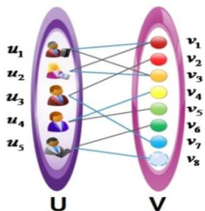
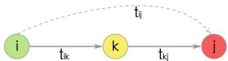
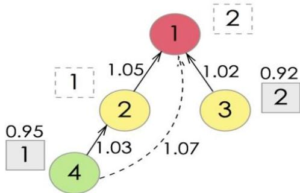
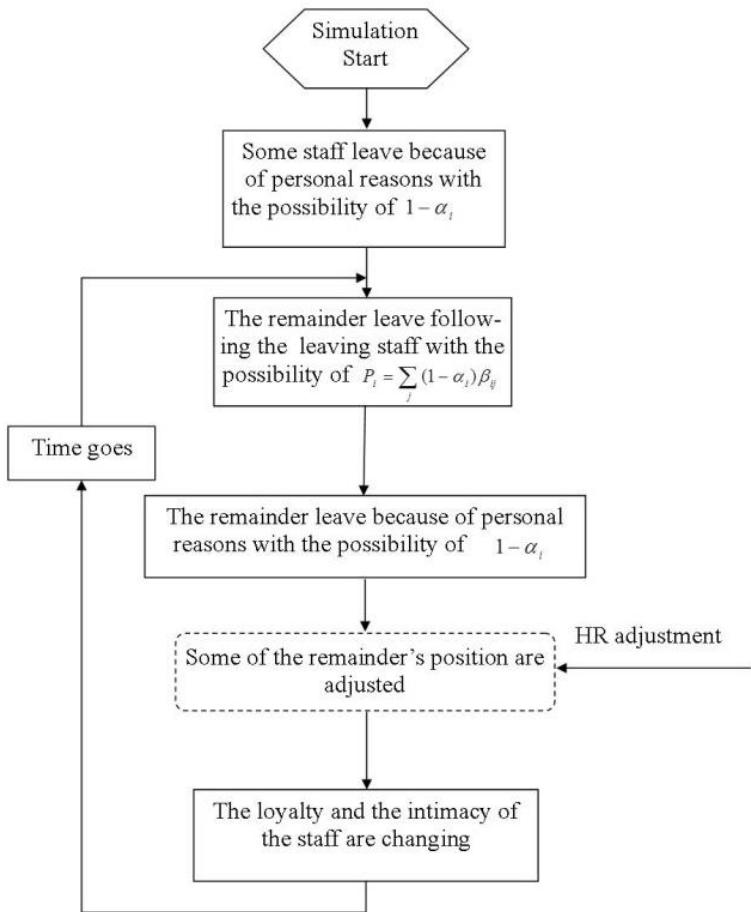
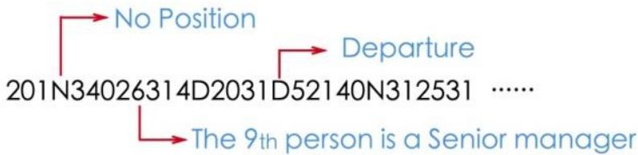
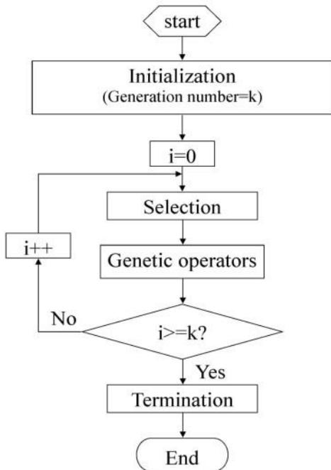

# 2015年美国大学生数学建模竞赛特等奖论文（Problem C: Human Capital Management in Organizations）

原件为竞赛论文。补充：文中的阅读练习及“参考解答”为整理时增加，原件图文保留出处。

本文档整理了2015年MCM/ICM Problem C的特等奖论文摘要及核心内容，由识别工具读取并整理。

## 一、问题背景与模型构建

### 选择 1

题干：Information Cooperative Manufacturing (ICM) is an organization of 370 people, who is facing the challenging issue related to effectively managing its human capital. In this paper, we establish models to help figuring out the problem.

知识点：[人力资本网络模型（Human Capital Network, HCM）](../../../topics/数学建模/renli_ziben.md)

### 简答 1

题干：Firstly, we build a static human capital network. To begin with, there are three kinds of relationships: the relationship among people, the relationship among positions, the relationship between people and positions. Then we use a bipartite graph to indicate the assignment of positions. After matching people and position, it forms a static human capital network. In addition, we define loyalty and intimacy to measure the probability of churn. These two indices consider two situations: people churn by their own reason and people churn by others’ influence.

知识点：[静态合作网络与隶属关系网络（Affiliation Network）](../../../topics/数学建模/jingtai_hezuo.md)、[人力资本网络模型（Human Capital Network, HCM）](../../../topics/数学建模/renli_ziben.md)

### 简答 2

题干：Secondly, we take time into consideration and get a dynamic network. We first analyze the change of loyalty and intimacy. Loyalty is influenced by the relation of the time that people works in the same position and the mean time of promotion. In addition, it will increase if the employees get promoted. Intimacy is influenced by two employees’ disparity of position levels. Next, we simulate the churn in the dynamic process. After that, we describe the cost, which consists of the direct cost and indirect cost. More specifically, they are related to the number of working people and the organizational structure. Besides, we using genetic algorithm to get the optimal assignment——minimizing the cost.

知识点：[多重网络/多层网络构建（Multiplex/Multi-layer Network）](../../../topics/数学建模/duoceng_wangluo.md)、[遗传算法优化人力资本管理（染色体表示与适应度函数）](../../../topics/数学建模/yichuan_suanfa.md)

### 简答 3

题干：In general, the dynamic process can be divided to three circulatory parts. The first one is to use computer simulation to simulate the churn and recruitment of employees. The second part is the change of loyalty and intimacy which is determined by the change of network. And the third one is to use the Genetic Algorithm to get the optimal assignment to minimize the cost and this is the only part that HR manager can intervene.

知识点：[离职事件（Demission/Turnover Event）定义与算法](../../../topics/数学建模/lizhi_suanfa.md)、[遗传算法优化人力资本管理（染色体表示与适应度函数）](../../../topics/数学建模/yichuan_suanfa.md)

### 计算 1

题干：Thirdly, we apply the model to solve three questions, which are corresponding to Task (3)(4)(5). For (3), the cost of recruitment is 38.2 and the cost of training is 127.08 over the next two years. For (4), if the churn rate is 25%, the organization can sustain 80% full status. The recruitment is 22% and the total cost is 617.64 . If the churn rate is 35%, the organization can sustain 80% full status. The recruitment is 31% and the total cost is 533.66 . A higher churn rate will decrease the direct cost but it will cause unsteadiness of the organizational structure, which is the indirect effect. For (5), a higher churn rate in middle levels (junior manager and experienced supervisor) will provide more chance for people to promote. As a result, it can refresh the organizational structure and improve people’s cohesion to the organization.

答案：
- Task (3): 未来两年内，招聘成本为 38.2，培训成本为 127.08。
- Task (4): 
    - 若流失率为 25%，组织可维持 80% 满员状态。招聘比例为 22%，总成本为 617.64。
    - 若流失率为 35%，组织可维持 80% 满员状态。招聘比例为 31%，总成本为 533.66。
    - 较高的流失率会降低直接成本，但会导致组织结构不稳定，产生间接影响。
- Task (5): 中层（初级经理和资深主管）较高的流失率为人员晋升提供了更多机会。因此，它可以刷新组织结构并提高人们对组织的凝聚力。

知识点：[生产率与成本模型（Productivity and Costs of HCM）](../../../topics/数学建模/shengchan_liebian.md)、[敏感性分析方法（Sensitivity Analysis，单参数与多参数变动）](../../../topics/数学建模/minganxing_fenxi.md)

### 简答 4

题干：Fourth, we analyze the parameters in our paper. We identify the parameters determined by data or experience and the parameters determined by experiments. After analyzing, we let the number of population, the iteration times, the mutation rate and the crossover rate to 200, 2000, 0.4 and 0.1 respectively, which are suitable parameters in the Genetic Algorithm.

知识点：[模型参数的确定（基于数据拟合或实验选择）](../../../topics/数学建模/canshu_queding.md)、[遗传算法优化人力资本管理（染色体表示与适应度函数）](../../../topics/数学建模/yichuan_suanfa.md)

### 简答 5

题干：Finally, we introduce the concept of team science and focus on the information flow. We add the information network to our human capital network and it comes into being a multi-layers network, which can make our analysis more comprehensive and reasonable.

知识点：[多重网络/多层网络构建（Multiplex/Multi-layer Network）](../../../topics/数学建模/duoceng_wangluo.md)、[人力资本网络模型（Human Capital Network, HCM）](../../../topics/数学建模/renli_ziben.md)

### 引言 1

**As we all know, an organization filled with good, talented, well-trained people is more prone to success. Actually, people often leave for other jobs or retire and then may be replaced, which forms a fluid network of human capital. Information Cooperative Manufacturing(ICM), an organization of 370 people, who are facing the challenging issue related to effectively managing its human capital. And now, we write this paper to help them figure out this problem.**

In this paper, we first build three networks independently: the network among people, the network among position and the bipartite graph between people and positions. Next we put them together and get a human capital network. Then considering the time, we build a dynamic human capital network to indicate the dynamic process of human capital. In the meantime, we use the Genetic Algorithm to get the optimal matching and then manage the human capital. After that, we apply our model to answer the Task (3), (4), (5). Finally, we discuss the team science and multi-layers network in HR management.

In section 3, considering the relation among people without the influence of positions, we first build a network among people and define two indices: loyalty and intimacy. Loyalty is an index to indicate the probability of staying in the organization. Its initial value is determined by organization culture and staff’s own expectations. Intimacy represents the following probability with connected people who have churned. Its initial value is determined by the time of know and the similarity of interest of two individuals. Next we build a position network to indicate the relationship among the positions. Then, we build a bipartite graph to measure the matching of people and positions. Finally, putting three graphs together and we get a human capital network.

In section 4, we take time into account and get a dynamic human capital network. Then we analyze the change of loyalty and intimacy with the dynamic process. After that, we describe the process of churn and how the network changes. Finally, under the principle of minimizing the cost, we use Genetic Algorithm to assign people to the positions.

In section 5, we apply the model to solve three Tasks. The first one is to calculate the budget requirements for both recruiting and training over the next two years. The second one is to analyze the influence of changing annual churn rate. The third one is to discuss the impact on the HR health of the organization under the situation that the churn rate of middle levels is higher than that of lower levels.

In section 6, we analyze the parameters in our paper. There are two kinds of parameter: one is determined by data and another is determined by experiments. We describe how to choose the better parameters.

In section 7, we introduce the concept of team science and focus on the information flow. We add the information network to our human capital network and it comes into being a multi-layers network, which can make our analysis more comprehensive and reasonable.

## 二、假设及其合理性说明

知识点：[人力资本网络模型（Human Capital Network, HCM）](../../../topics/数学建模/renli_ziben.md)、[多重网络/多层网络构建（Multiplex/Multi-layer Network）](../../../topics/数学建模/duoceng_wangluo.md)、[遗传算法优化人力资本管理（染色体表示与适应度函数）](../../../topics/数学建模/yichuan_suanfa.md)

### 假设 1

(1) The longer time an individual works, the more experienced they are. We assume that the years that people work in ICM is proportional to their knowledge and abilities. It is hard for us to measure the people’s knowledge and abilities, so we use the work years in the company to measure their abilities. Since people must have several years of experience before they move up into the higher management-level, it is suitable for us to consider working time.

答案：无（模型构建中的基本假设）
知识点：[一般假设及其合理性说明（Assumptions and Justifications）](../../../topics/数学建模/jiaben_shezhi.md)、[人力资本网络模型（Human Capital Network, HCM）](../../../topics/数学建模/renli_ziben.md)、[数学建模的基本步骤（问题分析、模型假设、建立、求解、检验、推广）](../../../topics/数学建模/jianmo_buzhou.md)

### 假设 2

(2) No employee is fired. In the operation of ICM, marginal and poor employees are allowed to stay because ICM always worries about being shorted-handed.

答案：无（模型构建中的基本假设）
知识点：[任务分解与目标明确](../../../topics/数学建模/renwu_fenjie.md)、[一般假设及其合理性说明（Assumptions and Justifications）](../../../topics/数学建模/jiaben_shezhi.md)、[离职事件（Demission/Turnover Event）定义与算法](../../../topics/数学建模/lizhi_suanfa.md)

### 假设 3

(3) The time unit in this paper is one month. The human capital network is dynamic and companies often take one month as time unit. For example, an employee who hands his notice on February $10^{\mathrm{th}}$ and it will become effective in March 1st.

答案：无（模型构建中的基本假设）
知识点：[数学建模的基本步骤（问题分析、模型假设、建立、求解、检验、推广）](../../../topics/数学建模/jianmo_buzhou.md)、[一般假设及其合理性说明（Assumptions and Justifications）](../../../topics/数学建模/jiaben_shezhi.md)、[任务分解与目标明确](../../../topics/数学建模/renwu_fenjie.md)

### 假设 4

(4) The influence of churn will work in the next month. If a person churned in this month, we assume the person who connected to him or her dos not know before. Therefore, they cannot churn together and he or she may be influenced in the next month.

答案：无（模型构建中的基本假设）
知识点：[数学建模的基本步骤（问题分析、模型假设、建立、求解、检验、推广）](../../../topics/数学建模/jianmo_buzhou.md)、[一般假设及其合理性说明（Assumptions and Justifications）](../../../topics/数学建模/jiaben_shezhi.md)、[离职事件（Demission/Turnover Event）定义与算法](../../../topics/数学建模/lizhi_suanfa.md)

### 假设 5

(5) ICM will have the maximum output when 85% of its 370 positions filled. Actually, many companies do not have 100% of its positions filled. On the one hand, an organization should have some vacant higher position to motivate employees to work harder. On the other hand, some vacant position can avoid repeating work and overstaffing. Usually, ICM has 85% of its 370 position filled at any time. So it is suitable for us to assume that the organization have the maximum output under this situation.

答案：无（模型构建中的基本假设）
知识点：[一般假设及其合理性说明（Assumptions and Justifications）](../../../topics/数学建模/jiaben_shezhi.md)、[数学建模的基本步骤（问题分析、模型假设、建立、求解、检验、推广）](../../../topics/数学建模/jianmo_buzhou.md)

### 假设 6

我们做出“经济人”假设。也就是说，我们假设所有人都追求高职位仅仅是因为更高的薪水。因此，我们根据薪水将职位分为六个等级。在本文中，我们没有关于人们野心、期望、能力、知识的线索，所以我们仅用薪水来衡量他们的意愿。此外，部门之间的隶属关系也很难说清楚。因此，我们用薪水等级来定义职位的层级。

知识点：[一般假设及其合理性说明（Assumptions and Justifications）](../../../topics/数学建模/jiaben_shezhi.md)

### 假设 7

组织需要为新人支付招聘成本，但在最初不需要为他支付培训成本。组织每年应为合格员工支付培训成本。我们假设组织中的每个人都应每年接受培训以提高其能力，并忽略新人的培训成本，因为我们认为最初的招聘成本包含了这部分成本。

## 三、人力资本网络

实际上，人力资本网络包含许多因素，如人员、职位、人与职位的匹配、人与人之间的关系、职位与职位之间的关系、影响他们关系的因素等等。

在这一部分，我们首先分别讨论人和职位之间的网络以及人与职位之间的匹配关系。然后我们将三个独立的部分综合起来，形成一个静态的人力资本网络。最后，我们引入时间戳的概念来构建动态的人力资本网络。

知识点：[人力资本网络模型（Human Capital Network, HCM）](../../../topics/数学建模/renli_ziben.md)、[静态合作网络与隶属关系网络（Affiliation Network）](../../../topics/数学建模/jingtai_hezuo.md)、[符号说明与术语定义（Nomenclature / Symbols and Definitions）](../../../topics/数学建模/fuhao_shuoming.md)

### 3.1 人员网络

在人力资本网络中，人员之间的关系可以是友谊、领导或其他关系。在人员网络中，我们不考虑领导（职位）。即，人员之间存在与工作无关的友谊。在友谊网络中，我们只考虑人员之间的亲密程度。如果A和B之间的亲密度高，且A在上个月离职了，那么B在这个月离职的可能性更大。因此，我们有必要建立一个模型来描述他人离职的影响。

该网络是一个元组 $G=(V, E)$，其中 $V$ 是节点集合，$E$ 是连接节点对的边集合。节点代表在ICM工作的人，边代表两个节点之间存在关系。

人员可能离开组织的情况有两种（包括因其他工作离职和退休）。

(1) 员工因自身原因离职。

(2) 员工因与其相连的人在此之前已经离职而离职。

我们假设离职人员的影响将在下个月生效。也就是说，如果A在本月离职，且B与A相连。那么，如果B受A的影响想要离职，他只能在下个月离职。在讨论人力资本网络的流动时，我们应该衡量离职的概率。

进一步讨论中，我们定义了两个指标：忠诚度 ($\alpha$) 和亲密性 ($\beta$)。

忠诚度指人的内在性格，意味着留在组织中的概率。更具体地说，一个人的忠诚度为 $\alpha$，他或她离职的概率为 $1-\alpha$。在这部分中，我们知道许多因素会影响 $\alpha$ 的值，例如工作时间与晋升到更高职位的平均时间的比率、组织文化、员工的期望等。由于许多内在性格不会改变，我们将初始忠诚度定义为：

$$
\alpha^{(0)} = F(c, e)
$$

其中：$F$ 表示一个函数。

$c$ 表示由组织文化引起的因素；

$e$ 表示期望差异因子。

当然，忠诚度会随着职位层级的变化和在同一职位层级任职年限的变化而变化。我们将在后面的动态过程部分讨论这一点。

亲密性指人员之间的相互影响，这是一种由关系决定的外在特征。人员之间的亲密性可能受到许多因素的影响，如相识的时间、工作部门的距离、职位层级的差异、兴趣的相似性等。在本文中，我们将初始亲密性定义为：

$$
\beta_{ij}^{(0)} = F(\mathbf{t}_{ij}, \mathbf{s}_{ij})
$$

其中：$\mathfrak{t}_{ij}$ 表示人员 $i$ 和人员 $j$ 相识的时间。

$\mathrm{\mathsf{S}}_{ij}$ 表示人员 $i$ 和人员 $j$ 之间的相似度。

同样地，亲密性会随着人员之间职位层级差距的变化而变化。我们也在动态过程中对此进行了讨论。

在给出忠诚度和亲密性的定义后，我们可以看一下网络。

如图2所示，我们可以清楚地看到两个人之间的关系以及 $\alpha$ 和 $\beta$ 的描述。起初，初始忠诚度和亲密性构成一个初始网络。随着时间的推移，网络在动态过程中发生变化。每个月都是一个静态网络，并具有新的忠诚度和亲密性。动态过程将在下一部分讨论。

知识点：[人力资本网络模型（Human Capital Network, HCM）](../../../topics/数学建模/renli_ziben.md)、[员工流失意向评估（Turnover Contagion、中心度、前员工影响）](../../../topics/数学建模/liuxin_chuanran.md)、[静态合作网络与隶属关系网络（Affiliation Network）](../../../topics/数学建模/jingtai_hezuo.md)

### 3.2 职位网络

显然，职位的关系可以形成树状网络。在这个问题中，我们认为ICM组织中有六个职位层级，这指的是薪水等级。最高层级是高级经理，最低层级是行政职员和无经验的员工。

In the position network, the nodes mean positions. Additionally, the solid line with arrow represents the belonging relation and the dash line means the adjustment of position. In a whole, this graph indicates the level structure among positions and the adjustment from one position to another one.

If a person moves up into a higher position, the loyalty and intimacy will change. Hence, we use the position network to analyze the influence on loyalty and intimacy with the change of positon.

For the change of loyalty, we define a transformation matrix to describe the influence of position changes.

$$
T = \left[ \begin{array}{c c c c} t _ {1 1} & t _ {1 2} & \dots & t _ {1 m} \\ t _ {2 1} & t _ {2 2} & \dots & t _ {2 m} \\ \vdots & \vdots & \ddots & \vdots \\ t _ {m 1} & t _ {m 2} & \dots & t _ {m m} \end{array} \right]
$$

Where: $t _ { i j }$ means the change of loyalty if people move from level i position to level j position

m means the quantity of position level

For example, an employee has an initial loyalty $\alpha ^ { ( \mathrm { t } _ { 0 } ) }$ at time $t _ { 0 }$ and he moves from position i to j in the next month. According to the influence brought by position change, we can get his new loyalty.

$$
\alpha_ {t _ {1}} = \alpha^ {(t _ {0})} \bullet t _ {i j}
$$

The adjustment of position can also bring some change to the intimacy. However, we wil discuss it in section 4.2.

知识点：[确定模型的定点与稳定性分析](../../../topics/数学建模/dingdian_wending.md)、[人力资本网络模型（Human Capital Network, HCM）](../../../topics/数学建模/renli_ziben.md)、[一般假设及其合理性说明（Assumptions and Justifications）](../../../topics/数学建模/jiaben_shezhi.md)

### 3.3 The bipartite graph between people and positions

We have introduced the graph among people and positions respectively. It is time to take a look at the graph between staff and positions. Each person in ICM can take a wide range of positions, and it is a problem for HR manager to assign these jobs to staff. We can use a bipartite graph[4] [5] to describe this problem.

In general, there are two sets which represent staff and occupations. The edge matching an employee to an occupation means this person is assigned to this position by HR manager. In addition, each edge has a value which indicates the cost if this person take this job. It is vivid to show in the following figure.

Where: U is the set of employees;

V is the set of positions. In the ICM, there are seven kinds of positons. In addition, we added a virtual vertex $\nu _ { 8 }$ in $V$ , and the person who connects to that vertex means that he is under training.

$u _ { i }$ is the employee $i$ .

$\nu _ { i }$ is the i kind of position.

The value of each edge means the cost of assigning person i to position j .

The edge connecting $u _ { i }$ to $\nu _ { i }$ means $u _ { i }$ can be assigned to $\nu _ { i }$ and the blue edge means the decision finally made by the HR manager.

It is worth mentioning the characters of our bipartite graph. Firstly, there may not exist a perfect matching(every vertex in U is connect to different vertices in $\mathsf { V } )$ . In our graph, not all people may have a job and not all jobs are taken by people. Secondly, the vertices in occupational set represents levels of position, so many staff can connect to the same vertex in V.

Finally, we use a bipartite graph to describe the problem of job assignment. In this way, once we determine the cost of each assignment and the possibility of each matching, we can get the best matching plan.

知识点：[任务分解与目标明确](../../../topics/数学建模/renwu_fenjie.md)、[一般假设及其合理性说明（Assumptions and Justifications）](../../../topics/数学建模/jiaben_shezhi.md)、[多目标优化模型（药物相对充足阶段的配送策略）](../../../topics/数学建模/duo_mubiao_youhua.md)

### 3.4 The human capital network

In section 3.1 to 3.3, we introduce three graphs respectively: the friendship network among people, the network among positions and the matching graph between staff and positions. Now we put three graphs together and then get a static human capital network. It is shown in the figure below.

In this network, we can see the relationship among people and also the relationship among the positions. Additionally, it can indicate the matching between staff and positions. According to this network, we can see the static human capital network and it will be the basic of managing the human capital in organizations.

## 4. The dynamic human capital network

知识点：[多重网络/多层网络构建（Multiplex/Multi-layer Network）](../../../topics/数学建模/duoceng_wangluo.md)、[静态合作网络与隶属关系网络（Affiliation Network）](../../../topics/数学建模/jingtai_hezuo.md)、[人力资本网络模型（Human Capital Network, HCM）](../../../topics/数学建模/renli_ziben.md)

### 4.1 The frame of the model

In order to identify dynamic processes within our Human Capital network, we take time into consideration to form a dynamic human capital network.

In the assumption, we define one month to be the time unit. Now we add the time stamp to the static human capital network and get a dynamic one shown in figure $6 .$

In the picture, there are several levels. In detail, every layer indicates a human capital network at a specific time. It contains the set of people, the set of positions and the matching relation between individuals and positions. As time goes by, the content in each level changes and a dynamic human capital network generates.

More specifically, there are three kinds of change in the network.

(1) No people churn and no new recruited people. The HR manager can adjust the matching between people and positions to influence the whole network.

(2) Some people churn and the connections between some retaining employees and churned employees disappear. Then the HR should decide to recruit new employees to fill with the positions. Of course, he also can adjust the retaining people’s positions to minimize the cost and maximum the output.

(3) Some people join in the organization and there are some new connections in the network among people. Then the HR manager should assign them into the vacant positions.

知识点：[多重网络/多层网络构建（Multiplex/Multi-layer Network）](../../../topics/数学建模/duoceng_wangluo.md)、[人力资本网络模型（Human Capital Network, HCM）](../../../topics/数学建模/renli_ziben.md)、[动态规划求解（状态变量、决策变量、状态转移函数、值函数）](../../../topics/数学建模/dongtai_guihua.md)

### 4.2 The change of loyalty and intimacy in the dynamic process

In the dynamic process, the loyalty will change with the change of position levels and the years retaining in the same position level. We can define the change of loyalty as:

(1) Retaining in the same position level

$$
\alpha = \alpha^ {(0)} \bullet d ^ {\left\lfloor \frac {n}{1 2} - \mu \right\rfloor}
$$

Where: $d$ means the change proportion of loyalty as years goes on.

$n$ means the number of months that the employee stay in the same position.

$\mu$ means the mean years to promotion at a specific position.

The loyalty of an employee will decrease if his working time in one position is more than the mean promotion years. Similarly, the loyalty of an employee will increase if his working time in one position is less than the mean promotion years.

(2) Position adjustment

$$
\alpha = \alpha^ {(0)} \bullet t _ {i j}
$$

Where: $t _ { i j }$ means the change proportion of loyalty moving from position $i$ to position $j$. Consider the skip of promotion, we define that:

$$
t _ {i j} = t _ {i k} \bullet t _ {k j}
$$

Similarly, the intimacy will change with the change of the gap between people’s position level. There are three kinds of situations that may change the intimacy:

#### (1) The position gap enlarges

If a person is promoted and another one stay in the same position, their intimacy will decrease because they have fewer common topics or the person at a lower position envies another with a higher position.

#### (2) The position gap shortens

If the employee with a lower position is promoted to the same position level as another with a higher position, their intimacy will increase because they have more chance to contact each other.

#### (3) The position gap stays the same

If two persons all stay in the old position or they are promoted with a same grade, their intimacy will not change.

So we use the gap between people’s position levels to calculate the change of intimacy. The intimacy $\beta$ is defined as:

$$
\beta_ {i j} = \beta_ {i j} ^ {(0)} \cdot \frac {\left(\Delta l _ {o l d} + 1\right)}{\left(\Delta l _ {n e w} + 1\right)}
$$

Where: $\Delta l _ { o l d }$ represents the primary difference between the level of person $i$ and $j$.

$\Delta l _ { n e w }$ represents the new difference between the level of person $i$ and $j$.

The gap between position levels of position can be given as:

Table 1: The levels of positions

| Position | Level |
| :--- | :--- |
| Administrative clerk, Inexperienced employee | 1 |
| Experienced employee | 2 |
| Inexperienced supervisor | 3 |
| Experienced supervisor | 4 |
| Junior manager | 5 |
| Senior manager | 6 |

And the gap between position levels is:

$$
\Delta l = \left| l _ {p _ {i}} - l _ {p _ {j}} \right|
$$

Where: $l _ { p _ { i } }$ means the level of position $i$.

知识点：[人力资本网络模型（Human Capital Network, HCM）](../../../topics/数学建模/renli_ziben.md)、[晋升事件（Promotion Event）算法](../../../topics/数学建模/jinsheng_suanfa.md)

### 4.3 The calculation of loyalty

As we mentioned in section 3.1, Loyalty is influenced by many factors. If a person is promoted by HR manager, his loyalty may be change. Also, if a person stay at one position too long and have little expectation to be promoted, his loyalty may drop. Now we discuss the calculation about the change.

At time $t$, we define the loyalty of employee $k$ as $\alpha _ { k } ^ { ( t ) }$ and let

$$
\partial^ {(t)} = [ \alpha_ {1} ^ {(t)}, \alpha_ {2} ^ {(t)}, \dots , \alpha_ {n} ^ {(t)} ]
$$

Then we define a matrix $A _ { N \times M } ^ { ( t ) }$ to indicate the assignment of jobs. The element $a _ { \mathrm { i j } } ^ { \mathrm { ( t ) } }$ is defined as:

## 4.3 忠诚度计算的矩阵表达

$$
a _ {i j} ^ {(t)} = \left\{ \begin{array}{l l} 1 & \text {   if   employ   } i \text {   is   at   position   } j \\ 0 & \text {   if   employ   } i \text {   is   not   at   position   } j \end{array} \right.
$$

令函数 $\operatorname{diag}[M]$ 为

$$
\operatorname{diag} [ M ] = \left\{ \begin{array}{l l} M _ {i j} & \text { if   } i = j \\ 0 & \text { if   } i \neq j \end{array} \right.
$$

根据矩阵运算，可得：

$$
\partial^ {(t)} = \partial^ {(t - 1)} \operatorname{diag} [ A ^ {(t - 1) T} A ^ {(t) \mathrm{T}} ] \quad \text{where } t \geq 1
$$

其中 $T$ 是我们在 3.2 节引入的矩阵，$A^{(t)^{\mathrm{T}}}$ 是 $A^{(1)}$ 的转置。

为了更直观地表达，我们用一个例子说明这些公式。下图中，有四个职位和两名员工。在时刻 $t-1$，他们分别位于职位 4 和职位 3，对应的忠诚度分别为 0.95 和 0.92。在时刻 $t$，他们都获得晋升。于是我们可以计算他们在时刻 $t$ 的忠诚度。

根据该图，可知：

$$
\hat {\mathcal {O}} ^ {(t - 1)} = [ 0. 9 5, 0. 9 2 ], \quad A ^ {(t - 1)} = \left[ \begin{array}{c c c c} 0 & 0 & 0 & 1 \\ 0 & 0 & 1 & 0 \end{array} \right]
$$

$$
A ^ {(t)} = \left[ \begin{array}{l l l l} 0 & 1 & 0 & 0 \\ 1 & 0 & 0 & 0 \end{array} \right], \quad T = \left[ \begin{array}{c c c c} 1 & 0 & 0 & 0 \\ 1. 0 5 & 1 & 0 & 0 \\ 1. 0 2 & 1 & 1 & 0 \\ 1. 0 7 & 1. 0 3 & 1 & 1 \end{array} \right]
$$

于是可得他们在时刻 $t$ 的忠诚度：

$$
\partial^ {(t)} = \partial^ {(t - 1)} \operatorname{diag} \left[ A ^ {(t - 1)} T A ^ {(t) T} \right] = [ 0. 9 5, 0. 9 2 ] \cdot \operatorname{diag} \left(\left[ \begin{array}{l l l l} 0 & 0 & 0 & 1 \\ 0 & 0 & 1 & 0 \end{array} \right] \left[ \begin{array}{c c c c} 1 & 0 & 0 & 0 \\ 1. 0 5 & 1 & 0 & 0 \\ 1. 0 2 & 1 & 1 & 0 \\ 1. 0 7 & 1. 0 3 & 1 & 1 \end{array} \right] \left[ \begin{array}{l l} 0 & 1 \\ 1 & 0 \\ 0 & 0 \\ 0 & 0 \end{array} \right]\right)
$$

$$
= [ 0. 9 5, 0. 9 2 ] \left[ \begin{array}{c c} 1. 0 3 & 0 \\ 0 & 1. 0 2 \end{array} \right] = [ 0. 9 7 8 5, 0. 9 3 8 4 ]
$$

## 4.4 动态过程中的组织人员流失

每个月我们都能知道每个个体的忠诚度，它可能因职位调整或关联人员的流失而改变。根据忠诚度，我们可以模拟组织的人员流失。

导致人员流失的原因可能有两种。

（1）员工因自身原因想要流失，这些原因不受关联人员影响。忠诚度将识别这种情况。

（2）员工因关联人员的影响而想要流失。为此，我们同时考虑忠诚度和亲密度。

整个过程可描述如下。

第一个月，员工可能根据其初始忠诚度流失，从而导致人力资本网络发生变化。随后在接下来的月份，我们应为每名员工计算两种概率。第一种是受上个月已流失的关联人员影响的流失概率。

$$
P _ {i} = \sum_ {j} (1 - \alpha_ {i}) \beta_ {i j}
$$

其中：$\alpha_i$ 是员工 $i$ 的忠诚度；

$j$ 是与 $i$ 相连且在上个月流失的人；

$\beta_{ij}$ 是员工 $i$ 与 $j$ 之间的亲密度。

第二种是忠诚度。我们像第一个月那样根据忠诚度模拟人力资本网络的变化。实际上，计算这两种概率能够有效区分员工因自身意愿或他人影响而造成的流失。随着时间推移，这形成了人力资本网络内部的动态过程。

在人与人构成的网络中，这一动态过程可用图 10 描述。

## 4.5 生产率与成本

众所周知，人力资源的任务是使产出最大化、成本最小化。利润最大化是所有营利组织最重要的原则。接下来我们讨论生产率与成本。

知识点：[人力资本网络模型（Human Capital Network, HCM）](../../../topics/数学建模/renli_ziben.md)、[晋升事件（Promotion Event）算法](../../../topics/数学建模/jinsheng_suanfa.md)、[员工流失意向评估（Turnover Contagion、中心度、前员工影响）](../../../topics/数学建模/liuxin_chuanran.md)

### 4.5.1 生产率

本文假设产出与在岗率及组织结构有关。在提供的数据中，我们知道 ICM 在其 370 个职位中通常只有 85% 在任意时刻有人任职。因此我们假设在这种情况下组织能够有效运转并实现最大产出。

# 2015年美国大学生数学建模竞赛特等奖论文（Problem C: Human Capital Management in Organizations）习题

本部分整理自《2015年美国大学生数学建模竞赛特等奖论文》第7部分（共12部分），内容涉及组织产出模型、成本模型及其变量定义。

## 4.5.2 产出与结构优化

影响产出的两个因素如下：
1. 员工数量
2. 组织结构

良好的组织结构意味着每一层级的人员配置适度。如果组织中高级和初级管理人员过多，而基层员工过少，生产力将不高，因为直接从事生产工作的人太少。同样，如果组织中缺乏经验的员工和有经验的员工比例失衡（即经验不足者过多或经验过剩者过多），组织的运作也会不佳，因为能够分配任务和制定整体规划的人太少。综上所述，保持每一层级职位的85%被填充将是最佳状态。

综合考虑这两个因素，我们可以得到组织的产出 $Y$：

$$
Y = \sum_ {i = 1} ^ {6} \lambda_ {i} \cdot S _ {i} \cdot n _ {i} - \sum_ {i = 1} ^ {6} \sigma_ {i} \cdot S _ {i} \cdot \left| n _ {i} - \tilde {n} _ {i} \right|
$$

其中：
- $\lambda _ { i }$ 是一个系数，$\lambda _ { i } \cdot S _ { i }$ 表示处于 $i$ 级职位的人员所产生的产出。我们假设人员的产出与其薪资成正比。
- $\sigma _ { i }$ 是一个系数，$\sigma _ { i } \cdot S _ { i }$ 表示当在职人员数量多于或少于最优数量时，产出的损失量。
- $n _ { i }$ 表示当前在 $i$ 级职位上在职的员工数量。
- $\tilde { n } _ { i }$ 表示当前在 $i$ 级职位上的最优在职员工数量。

显然，该方程由两部分组成。第一部分与员工数量有关，意味着更多的工人将产生更多的产出。这是人力资本网络内部动态过程引起的直接影响。第二部分与组织结构有关。良好的结构将产生更多产出。一旦结构变得不平衡，包括冗余或缺位，它将对产出带来一些负面影响。这是人力资本网络内部动态过程引起的间接影响。

知识点：[生产率与成本模型（Productivity and Costs of HCM）](../../../topics/数学建模/shengchan_liebian.md)、[一般假设及其合理性说明（Assumptions and Justifications）](../../../topics/数学建模/jiaben_shezhi.md)、[模型参数的确定（基于数据拟合或实验选择）](../../../topics/数学建模/canshu_queding.md)

### 4.5.3 成本

考虑到提供的数据不包含员工的产出，我们无法使用最大利润来衡量最优人力资本。因此，在本文中，我们将目标设定为最小化成本。

在第4.1节中，我们提到了组织结构不平衡造成的损失。实际上，这也可以被视为成本，是由结构不平衡造成的。通常，成本包含以下几个部分：
1. 组织结构成本
2. 薪资、培训和招聘成本

然后，我们可以得到总成本 ($C$)：

$$
C = C _ {1} + C _ {2}
$$

其中：
- $C _ { 1 }$ 表示年度组织结构成本。
- $C _ { 2 }$ 表示年度薪资、培训和招聘成本。

显然，我们可以得出：

$$
C _ {1} = \sum_ {i = 1} ^ {6} \sigma_ {i} \cdot S _ {i} \cdot \left| n _ {i} - \tilde {n} _ {i} \right|
$$

在计算每个人的成本时，我们假设他们每年都需要接受培训。那么我们可以得出：

$$
C _ {2} = \sum_ {i = 1} ^ {6} S _ {i} \cdot n _ {i} + \sum_ {i = 1} ^ {6} r _ {i} \cdot n _ {i} ^ {\text { new }} + \sum_ {i = 1} ^ {6} k _ {i} \cdot n _ {i} ^ {\text { old }}
$$

其中：
- $k _ { i }$ 表示 $i$ 级职位的平均年度培训成本。
- $r _ { i }$ 表示 $i$ 级职位的平均年度招聘成本。
- ${ n _ { i } } ^ { n e w }$ 表示 $i$ 级职位的新增员工数量。
- ${ n _ { i } } ^ { o l d }$ 表示 $i$ 级职位的现有在职员工数量。

作为人力资源经理，其工作是综合考虑直接成本和间接成本来管理人力资本。

# 2015年美国大学生数学建模竞赛特等奖论文（Problem C: Human Capital Management in Organizations）

本文是2015年MCM/ICM Problem C的特等奖论文第8部分，主要讲述利用遗传算法优化人力资本管理结构。内容基于原文识别整理。

## 4.6 Optimize the management of human capital

在3.3节中，我们构建了二分图来表示人员与职位的匹配情况。根据4.2节，我们知道每种匹配的成本。我们的目标是最小化总成本并获得最优的人力资本结构。现在，我们使用遗传算法（Genetic Algorithm）来分配职位。

一个典型的遗传算法需要两个方面的支持[6]：

(1) 基因表示（A genetic representation）

(2) 适应度函数的定义（The definition of fitness function）

现在，我们将这个算法应用到我们的分配问题中。首先，我们对这两个方面进行具体解释。

知识点：[一般假设及其合理性说明（Assumptions and Justifications）](../../../topics/数学建模/jiaben_shezhi.md)、[多目标优化模型（药物相对充足阶段的配送策略）](../../../topics/数学建模/duo_mubiao_youhua.md)、[遗传算法优化人力资本管理（染色体表示与适应度函数）](../../../topics/数学建模/yichuan_suanfa.md)

### (1) The representation of chromosome

染色体的表示是遗传算法的基础[7]。众所周知，染色体是指示人物特征的单元。在我们的模型中，有效的染色体是职位的有效分配。我们使用以下索引：

表2：索引的含义
| Index | Meaning |
| :--- | :--- |
| 0 | 人员是新招募的，仍在培训中 |
| 1-6 | 人员在六个职位级别上，与其薪水相关，级别越高越好 |
| N | 人员目前不在组织中 |
| D | 人员已离开组织 |

然后，染色体是一串数字。第 $i$ 位代表第 $i$ 个人的职位级别。

知识点：[遗传算法优化人力资本管理（染色体表示与适应度函数）](../../../topics/数学建模/yichuan_suanfa.md)、[符号说明与术语定义（Nomenclature / Symbols and Definitions）](../../../topics/数学建模/fuhao_shuoming.md)、[任务分解与目标明确](../../../topics/数学建模/renwu_fenjie.md)

### (2) The Fitness Function

适应度函数用于评估个体的适应度是否适合环境。也就是说，该函数用作淘汰标准。在我们的模型中，我们可以使用总成本作为适应度函数。

遗传算法（GA）过程包含四个步骤：初始化、选择、遗传算子、终止。这是一个迭代过程，每个过程代表一代。随着有限次数的迭代，算法可以产生近似最优解[8]。

#### Initialization

在这个阶段，我们定义种群数量（N）、变异率、交叉率和适应度函数。然后它将产生初始个体。在我们的模型中，我们在时间 $t_0$ 生成职位的染色体。

#### Selection

我们使用适应度函数选择前 N 个最适合环境的个体。值得一提的是，如果结构不合理，染色体将被立即淘汰。例如，级别3只有25个职位。然而，染色体中“3”的数量超过25。因此，我们淘汰这个染色体。

#### Genetic operators

主要有两种操作：变异和交叉，它们是产生新个体的方法。

GA中的变异是指染色体的一个基因以一定的概率变为任何其他可能的基因。在我们的模型中，改变基因代表人员的晋升。因此，当基因发生变异时，数字应该增加。

GA中的交叉是指两条染色体在同一位置交换它们的基因。在我们的模型中，我们只考虑晋升。因此，交换只能发生在拥有较低职位的人与拥有较高职位的人之间时发生。

Team #37284

Page 11 of 20

Figure 12: Genetic operators

在图中，左边是两个染色体代表两个个体。中间，染色体A在一个基因上发生了突变，这意味着该人员从级别3晋升到级别4，染色体B也是如此。右边，染色体B在红点处获得了与A相同的基因，这意味着该人员从级别3晋升到级别5。

#### Termination

经过有限次数的迭代后，算法将终止。最后，具有最高适应度的个体是近似最优解。

为了提供更直观的过程，展示了一个流程图。

(1) 忠诚度和亲密度的变化

(2) 人员的流失和招聘

Team #37284

Page 12 of 20

## 5. Application of the Model

知识点：[遗传算法优化人力资本管理（染色体表示与适应度函数）](../../../topics/数学建模/yichuan_suanfa.md)、[生产率与成本模型（Productivity and Costs of HCM）](../../../topics/数学建模/shengchan_liebian.md)、[晋升事件（Promotion Event）算法](../../../topics/数学建模/jinsheng_suanfa.md)

### 5.1 The organization’s budget requirements

According to the provided data, ICM usually has 85% of its 370 positions filled at any time and the HR office is actively hiring about 8-10% of its position. In addition, the current churn rate is 18%, which can keep the organization on an optimal structure.

The annual budget requirements for recruiting and training can be calculated as:

$$
B = \sum_ {i = 1} ^ {6} r _ {i} \cdot n _ {i} ^ {\text {new}} + \sum_ {i = 1} ^ {6} k _ {i} \cdot n _ {i} ^ {\text {old}}
$$

Where: $r _ { i }$ represents the cost of recruitment at position level $i$.

$k _ { i }$ represents the cost of training at position level $i$.

${ n _ { i } } ^ { new }$ represents the number of new employees at position level $i$.

${ n _ { i } } ^ { old }$ represents the number of old employees (not newly recruited) at level $i$.

Then, we start to find the number of churn people and new recruited people within next two years at any time. That is to say, we then use our model to clarify the concrete fluid of human capital network.

#### Step 1: Initialization

The initial rate of on-the-job is 85%. The hiring rate is 10%. The churn rate is 18%. And we regard 500 people are considered in the next two years. As for the initial connected relation we use a Random Graph to simulate. Since there is no data to calculate people’s initial loyalty and intimacy, we also give a random value. Then we set a parameter to multiply the loyalty and adjust the parameter to reach a churn rate of 18%.

#### Step 2: Simulation

After setting the initial value, we use the computer simulation to indicate process of “churn” and “recruit”. In this process, the change of loyalty and intimacy is calculated by our model which shown in section 3.5.2. In the simulation of this dynamic process, we can clearly see the churn people and new recruited people.

#### Step 3: Assignment

We use genetic algorithm to assign people to positions. In the genetic algorithm, we set the number of genes in one chromosome to be 500. In addition, let the number of population, the iteration times, the mutation rate and crossover rate to be 200, 2000, 0.4 and 0.1 respectively.

Using this method, after five times simulations, we calculate the average value and shown it in the following table.

**Table 3: The data of simulation**

| Month | Churn follows others | Churn for own reasons | The number of recruitment | The accumulative cost of recruitment ($\sigma$) | The accumulative cost of training ($\sigma$) |
| :---: | :---: | :---: | :---: | :---: | :---: |
| 1 | 0 | 11 | 1 | 0.12 | 5.88 |
| 2 | 3 | 6 | 4 | 0.60 | 11.59 |
| 3 | 1 | 6 | 1 | 0.90 | 17.24 |
| 4 | 0 | 4 | 1 | 1.50 | 22.82 |
| 5 | 0 | 5 | 3 | 3.30 | 28.33 |
| 6 | 0 | 4 | 2 | 4.70 | 33.84 |
| 7 | 0 | 5 | 3 | 8.30 | 39.33 |
| 8 | 1 | 1 | 1 | 8.42 | 44.91 |
| 9 | 1 | 8 | 3 | 9.72 | 50.31 |
| 10 | 0 | 10 | 5 | 11.28 | 55.55 |
| 11 | 1 | 4 | 3 | 12.60 | 60.80 |
| 12 | 1 | 6 | 4 | 15.30 | 65.94 |
| 13 | 0 | 2 | 1 | 15.90 | 71.22 |
| 14 | 0 | 7 | 3 | 17.22 | 76.39 |
| 15 | 0 | 6 | 4 | 18.42 | 81.55 |
| 16 | 1 | 4 | 2 | 19.62 | 86.59 |
| 17 | 1 | 2 | 1 | 20.22 | 91.63 |
| 18 | 1 | 3 | 2 | 21.62 | 96.63 |
| 19 | 0 | 2 | 3 | 24.62 | 101.69 |
| 20 | 0 | 3 | 9 | 26.94 | 106.74 |
| 21 | 1 | 3 | 6 | 29.66 | 111.94 |
| 22 | 0 | 9 | 6 | 33.50 | 117.03 |
| 23 | 1 | 5 | 2 | 34.70 | 122.08 |
| 24 | 1 | 4 | 5 | 38.20 | 127.08 |
| **total** | **14** | **120** | **75** | | |

According to the table, we can know the annual churn rate is approximate to 19% and the recruitment rate is 12%, which are close to the initial value 18% and 10%. Therefore, our simulation process is suitable. In the table, it is clear that the total cost of recruitment is 38.2 and the total cost of training is 127.08. Hence, the organization’s budget requirements for both recruiting and training over the next years are 165.28.

知识点：[人力资本网络模型（Human Capital Network, HCM）](../../../topics/数学建模/renli_ziben.md)、[遗传算法优化人力资本管理（染色体表示与适应度函数）](../../../topics/数学建模/yichuan_suanfa.md)、[生产率与成本模型（Productivity and Costs of HCM）](../../../topics/数学建模/shengchan_liebian.md)

### 5.2 The influence of churn rate on full status rate for positions

If the ICM organization wants to sustain its 80% full status for positions under the change of annual churn rate, it will spend more to recruit people. In this part, we try to analyze the direct cost and indirect cost with the high churn rate.

#### 5.2.1 Direct cost

In the section 4.5.2, the direct cost consists of three parts. Obviously, the direct cost is related to the churn rate, recruitment rate and the vacant positions’ level. If more people churn, we need to recruit more people to replace them and of course the cost will be high. Similarly, if more people in higher position levels churn, the cost will be higher than more people in lower position levels. We do the simulation as the churn rate changes. Then we get the annual direct cost.

Table 4: The change of cost following the churn rate

| Churn rate (%) | Recruitment rate to sustain 80% full status | Cost of training ($\sigma$) | Cost of recruitment ($\sigma$) | Total cost ($\sigma$) |
| :--- | :--- | :--- | :--- | :--- |
| 21 | 0.19 | 540 | 34.73 | 574.73 |
| 22 | 0.20 | 530 | 35.81 | 565.81 |
| 23 | 0.20 | 532 | 36.26 | 568.26 |
| 24 | 0.21 | 575 | 36.86 | 611.86 |
| 25 | 0.22 | 580 | 37.64 | 617.64 |
| 26 | 0.23 | 563 | 39.21 | 602.21 |
| 27 | 0.22 | 540 | 40.21 | 580.21 |
| 28 | 0.24 | 552 | 42.62 | 594.62 |
| 29 | 0.26 | 543 | 43.78 | 586.78 |
| 30 | 0.26 | 554 | 45.88 | 599.88 |
| 31 | 0.28 | 530 | 47.72 | 577.72 |
| 32 | 0.29 | 512 | 48.64 | 560.64 |
| 33 | 0.29 | 511 | 49.91 | 560.91 |
| 34 | 0.30 | 496 | 50.61 | 546.61 |
| 35 | 0.31 | 483 | 50.66 | 533.66 |
| 36 | 0.32 | 492 | 51.27 | 543.27 |
| 37 | 0.34 | 472 | 52.24 | 524.24 |
| 38 | 0.34 | 484 | 56.33 | 540.33 |
| 39 | 0.35 | 479 | 60.25 | 539.25 |
| 40 | 0.36 | 468 | 60.75 | 528.75 |

According to the table, we know that if the organization want to keep 80% full status for positions at a churn rate of 25%, the recruitment rate should be 22% and the direct cost is 617.64. If the churn rate is 35%, the recruitment rate should be 31% and the direct cost is 533.66.

From the graph, we can see the direct cost first increases and then decreases as the increase of churn rate. It is rational because as the churn rate increases, more people will under recruitment. As a result, the salary cost will decrease.

知识点：[生产率与成本模型（Productivity and Costs of HCM）](../../../topics/数学建模/shengchan_liebian.md)、[员工流失意向评估（Turnover Contagion、中心度、前员工影响）](../../../topics/数学建模/liuxin_chuanran.md)、[招聘与结算事件（Recruitment & Settlement Event）算法](../../../topics/数学建模/zhaopin_suanfa.md)

### 5.2.2 Indirect cost

The indirect cost is the cost caused by unbalanced organizational structure. We have introduced it in section 4.5.2. Now we let the parameter $\sigma _ { i }$ as $i$, which means a vacancy of a higher level will bring more loss. Then we calculate the indirect cost.

From the graph, we can see the indirect cost increase. If the more people churn, the positions will be vacant for a period of time. As a result, some new people will join the organization. Hence, the structure will not be stable. That is to say, the indirect cost will increase.

知识点：[生产率与成本模型（Productivity and Costs of HCM）](../../../topics/数学建模/shengchan_liebian.md)、[随机模型与确定性模型的对比（Stochastic vs Deterministic Model）](../../../topics/数学建模/suiji_queding.md)、[敏感性分析方法（Sensitivity Analysis，单参数与多参数变动）](../../../topics/数学建模/minganxing_fenxi.md)

### 5.2.3 Comprehensive analysis and Conclusion

As the change of churn rate and recruitment rate, the rate of full status for positions will change. In the paper, our target is to make it sustain in 80% and also keep a better structure of organization. Then we analyze every situation when churn rate and recruitment rate changes from 0% to 40%.

In this picture, the circle means the rate of full status can be 80% and the structure is good under the recruitment rate and churn rate. The square means the rate of full status can be 80% but the structure is not good. The cross means the rate of full status cannot be 80%. Then, we draw the line according to the solution at each situation and get the corresponding region.

In conclusion, if the churn rate is 25%, ICM can sustain its 80 full status and the direct cost is 617.64. Similarly, if the churn rate is 35%, the direct cost is 533.66. A higher churn rate will decrease the direct cost but it will cause unsteadiness of the organizational structure, which is the indirect effect.

知识点：[员工流失意向评估（Turnover Contagion、中心度、前员工影响）](../../../topics/数学建模/liuxin_chuanran.md)、[生产率与成本模型（Productivity and Costs of HCM）](../../../topics/数学建模/shengchan_liebian.md)、[数学建模的基本步骤（问题分析、模型假设、建立、求解、检验、推广）](../../../topics/数学建模/jianmo_buzhou.md)

### 5.3 The HR health of the organization

In this part, we first define the HR health of the organization. It is related to the cohesion of staff, staff’s loyalty to the organization and the structure of human capital.

The churn rate is 30% in both junior managers and experienced supervisors. That is to say, there are many vacant high level positions. Without recruitment of junior managers and experienced supervisors, these positions can only be taken by qualified employees who are promoted. Then in next two years, the people in every position level will be:

# 6. The Analysis of Parameter

There are many parameters in our model, so it is necessary to give an analysis to these parameters. According to the assumption of our model, some parameters are abstract and determined by the data in reality. Others are selected by experiments.

知识点：[任务分解与目标明确](../../../topics/数学建模/renwu_fenjie.md)、[模型参数的确定（基于数据拟合或实验选择）](../../../topics/数学建模/canshu_queding.md)、[一般假设及其合理性说明（Assumptions and Justifications）](../../../topics/数学建模/jiaben_shezhi.md)

### Parameters determined by data

Loyalty($\cdot$) and intimacy($\cdot$) are the parameters describing the inner character and the measurement of the relationship among people. They are abstract, and we can use the daily performance of an employee to quantify these indices.

Transformation Matrix $T$ is used as a measurement of the change of loyalty influenced by the change of position. Actually, it is also an empirical parameter; we can get this parameter according to the performance of employees who get promoted.

$\lambda _ { i }$ is a coefficient, which measures the relation between people’s salary and output. In reality, it can be given by counting people’s effective output over the years.

$\sigma _ { i }$ is a coefficient, which indicates the degree of the loss of structure. Similarly, it is also an empirical parameter. We can set its value by listening to the idea of experienced experts.

知识点：[模型参数的确定（基于数据拟合或实验选择）](../../../topics/数学建模/canshu_queding.md)、[一般假设及其合理性说明（Assumptions and Justifications）](../../../topics/数学建模/jiaben_shezhi.md)、[可持续发展指数 SDI 的构建与指标体系结构](../../../topics/数学建模/kechixu_zhibiao.md)

### Parameters chosen by experiments

In this part, we mainly take the parameters in GA into account. Actually, many papers have discussed the parameters in GA. The parameters in GA are the number of population ($N$), Iteration Times ($K$), mutation rate ($MR$), and crossover rate ($CR$).

**Number of population ($N$)** is the size of the population. Generally, the value of $N$ is usually $20 \sim 200$ [9]. In this paper, we use $N = 200$.

**Iteration Times ($K$)** decides whether we can get the optimal solution. If we iterate few times, we may not get the optimal solution. On the contrary, if we iterate many times, it is time-consuming. When we choose iteration times in GA, we can do some experiments to choose a better value. Taking section 5.1 as an example, in the second month, we can get the following graph:

From the picture above, we think $K = 1000$ is a good point for GA to converge. We usually take twice, so we choose $2000$ to be the value of $K$.

**Mutation Rate ($MR$)** and **Crossover Rate ($CR$)** also need to be determined by experiments. In our model, we fix one value at $0.1$ and change another from $0$ to $1$. Then we can get the better $MR$ and $CR$ respectively according to the minimum iteration times.

According to the picture, the minimum iteration times appear at the rates of $0.4$ and $0.1$ respectively. Hence, we choose $MR = 0.4$, $CR = 0.1$ in our Genetic Algorithm.

## 7. Team Science and Multi-layer Networks

In the decision process of HR manager, there are many influenced factors. In the above part, we have discussed the potential influence of loyalty and intimacy on the organization. However, we do not take information flow into account, which is an important part in team science [1][2]. Sharing cognition is very important in team science, which can form the information flow and run among people to form an information network.

The criterion of HR decision is team performance. The study of team science is to improve the team performance. If the information flows among people run smoothly, it will improve the team performance. On the contrary, if something hinders the flow of information, it will reduce the performance. In addition, effective information flow can reduce the obstacle in compatibility decision and concerted action, which is equal to improve the interaction among members.

As we all know, the organizational culture is the soft power. It would not only raise the team productivity, but would also advance the staff’s loyalty and intimacy. Obviously, a good information flow will contribute to forming a healthy organizational culture.

In section 3.4, we have discussed the human capital network. Actually, the network has two layers. According to the reference [3], we know about the multi-layers network. Taking information network into account, we can get a new multi-layers network, which consists of information network, relationship network, and position network.

# 2015年美国大学生数学建模竞赛特等奖论文（Problem C: Human Capital Management in Organizations）

本部分为原论文第 12 部分（第 20–21 页）的识别整理内容，包含进一步讨论、优缺点分析及参考文献。

## 一、进一步讨论

知识点：[模型参数的确定（基于数据拟合或实验选择）](../../../topics/数学建模/canshu_queding.md)、[多重网络/多层网络构建（Multiplex/Multi-layer Network）](../../../topics/数学建模/duoceng_wangluo.md)、[先验概率分布模型（随机下降与初始概率密度函数 PDF）](../../../topics/数学建模/xianyan_gailv.md)

### 8. Further Discussion

在现实中，组织中的部门结构对人力资本管理分析有显著影响。显然，同一部门内的个体之间关系更为复杂，既包括正相关关系也包括负相关关系。考虑到部门结构，我们计划进行以下进一步工作：

- **关于忠诚度和亲密度初始值的设定**：我们需要分析员工是否属于同一部门。同时，还应考虑部门领导的影响。
- **动态过程中的部门调整**：在人力资本网络的动态过程中，应考虑同一层级内从一个部门到另一个部门的调整。虽然这种调整不改变职位等级，但部门的变动会影响人们之间的亲密度。
- **组织架构的全面考量**：考虑到组织架构，应将所有部门纳入考量。通常，每个部门都有适当数量的人员能带来最大生产力，因为每个部门都在执行其特定职能。

> [!NOTE]
> **核心观点**：部门结构不仅影响人际关系网络，还通过“部门调整”这一机制间接影响员工的亲密度，即使职位等级未变。

## 二、优缺点分析

知识点：[人力资本网络模型（Human Capital Network, HCM）](../../../topics/数学建模/renli_ziben.md)、[静态合作网络与隶属关系网络（Affiliation Network）](../../../topics/数学建模/jingtai_hezuo.md)、[模型优缺点分析（Strengths and Weaknesses）](../../../topics/数学建模/youque_dian.md)

### 9. Strengths and Weaknesses

#### 9.1 Strengths

1. **多维图表示与动态模拟**：我们使用三幅图来表示员工与职位之间的关系，并利用时间戳来模拟动态过程。此外，我们将计算机模拟、人力资源调整（使用遗传算法 GA）和变换矩阵结合到模型中，以分析人力资本网络的动态过程。
2. **忠诚度与亲密度的量化**：我们设定了忠诚度和亲密度指标，用以识别人事流失是由个人自身关系引起还是受他人影响。更具体地说，我们将忠诚度和亲密度的变化与职位的变化联系起来，然后利用计算机模拟员工流失的过程，为我们提供了直观的流程展示。
3. **遗传算法的改进应用**：遗传算法是一种获取近似最优解的高效方法，被我们用于为员工分配职位。由于我们未考虑解雇员工或降职的情况，因此对遗传算法进行了修改，使其更好地适应我们的模型。
4. **成本分类细化**：在讨论成本时，我们将其分为两部分：直接成本和间接成本。直接成本与员工数量及其级别有关；间接成本则与组织架构有关。

#### 9.2 Weaknesses

1. **数据缺失与假设依赖**：由于缺乏数据，部分数值基于我们所做的假设。这可能与现实情况存在差异。
2. **组织图与结构表的不协调**：由于组织图与结构表未能完全对应，我们仅使用了结构表。未来也应将组织图纳入考量范围。

*注：原文指出，相比单层网络，使用多层网络来分析人力资本更加全面和合理。*

## 三、参考文献

[1] E. Salas, N.J. Cooke, and M.A. Rosen. (2008). On Teams, Teamwork, and Team Performance: Discoveries and Developments. *Human Factors: The Journal of the Human Factors and Ergonomics Society*, June 2008 vol. 50 no. 3 540-547.

[2] D. Stokols, K.L. Hall, B.K. Taylor, R.P. Moser (2008). The Science of Team Science: Overview of the Field and Introduction to the Supplement, *Am J Prev Med* 2008;35(2S): S77-S89.

[3] Mikko Kivelä, Alexandre Arenas, Marc Barthelemy, James P. Gleeson, Yamir Moreno, Mason A. Porter. (2013). Multilayer Networks, *J. Complex Networks*, 2(3):203-271 (2014); arXiv preprint arXiv:1309.7233, 2013.

[4] Bipartite graph Wikipedia http://en.wikipedia.org/wiki/Bipartite_graph (Accessed 7 February 2015).

[5] Giles R. The Strong Perfect Graph Theorem for a Class of Partitionable Graphs[J]. *North-Holland Mathematics Studies*, 1984:161–167.

[6] Genetic algorithm https://en.wikipedia.org/wiki/Genetic_algorithm (Accessed 8 February 2015).

[7] Goldberg D E. The design of innovation: Lessons from and for competent genetic algorithms[J]. *JASSS-THE JOURNAL OF ARTIFICIAL SOCIETIES AND SOCIAL SIMULATION*, 2005, 8(3).

[8] Bies R R, Muldoon M F, Pollock B G, et al. A Genetic Algorithm-Based, Hybrid Machine Learning Approach to Model Selection[J]. *Journal of Pharmacokinetics and Pharmacodynamics*, 2006, 33(2):195-221.

[9] Wang Xiaohua, Yang Na. The parameter optimization estimation model based on genetic algorithm[J]. *Electronic World*, 2012, (24):118-119.

知识点：[模型优缺点分析（Strengths and Weaknesses）](../../../topics/数学建模/youque_dian.md)、[遗传算法优化人力资本管理（染色体表示与适应度函数）](../../../topics/数学建模/yichuan_suanfa.md)、[多重网络/多层网络构建（Multiplex/Multi-layer Network）](../../../topics/数学建模/duoceng_wangluo.md)
