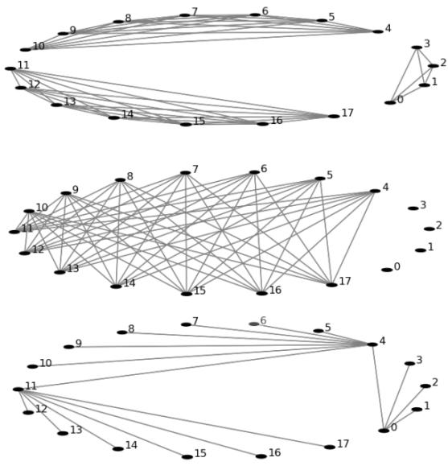
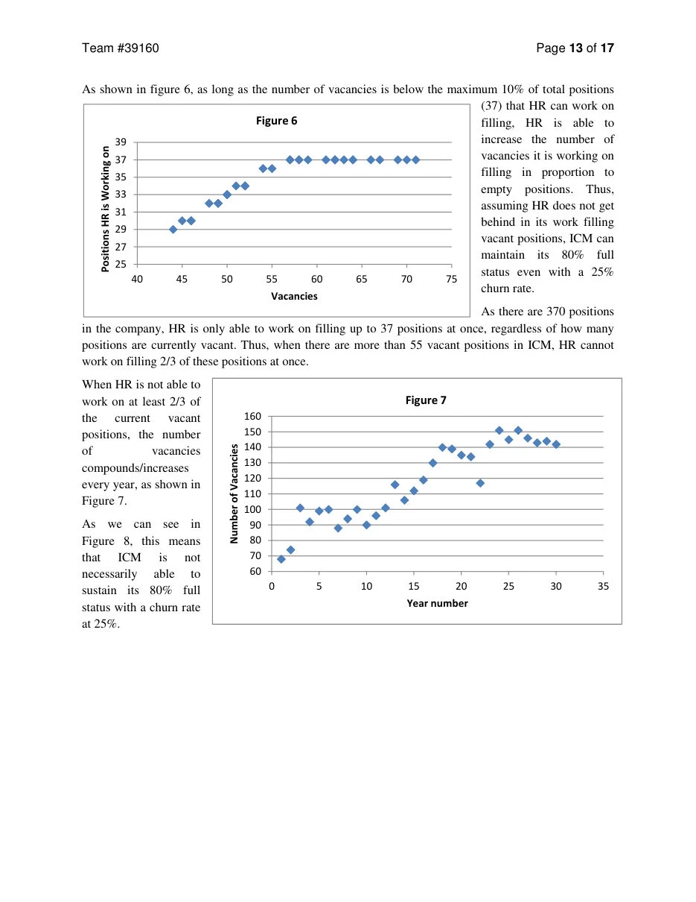
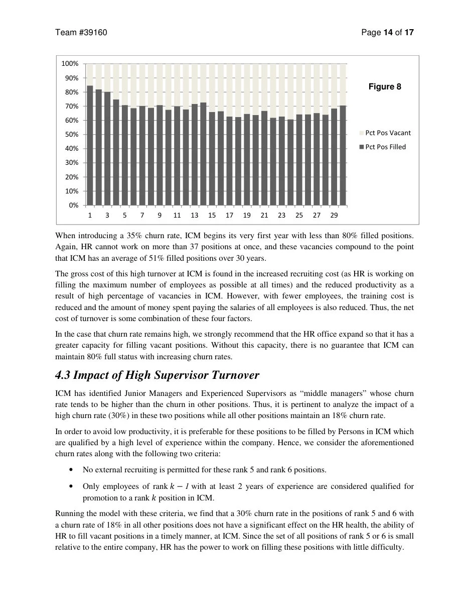

# 2015年美赛C题特等奖论文（39160）：基于多层网络模型的组织人员流失分析

原件为竞赛论文。补充：文中的阅读练习及“参考解答”为整理时增加，原件图文保留出处。

## Summary Sheet

In the modern world, organizations face a number of complex issues related to the recruitment and retention of high-quality personnel with the knowledge, skills, and abilities required for the organization to compete. Network effects of personnel flow into and out of an organization affect day to day operations of that organization. Large organizations, in particular, need to understand these types of flows in order to maximize the potential of their human capital. The professional and personal relationships amongst the members of the organization will have an effect on the turnover, or churn, within that organization.

Tasked with modeling churn within Information Cooperative Manufacturing (ICM), we developed a network model of this rigidly hierarchical company. This model allowed us to answer questions from the Human Resources department regarding dynamic processes within the network, budgetary concerns, labor forecasting, and hiring decision support.

Using the software package called the Multilayer Networks Library, we built a data structure where we treated each layer of a multilayer network as a graph representing a different type of relationship within the company. The computer representation of these networks is comprised of a multidimensional array, or tensor. We took an object oriented approach to simulating interactions between employees, interactions between positions in the hierarchy, and interactions between employees and their positions within the hierarchy.

In the first of three phases, we used a purely stochastic approach to determining the behavior of the various pieces of the simulation. This allowed precise control over the variables in the model, particularly the churn rate, allowing us to hit the target churn rates specified in the problem statement.

In the next phase, we introduced a satisfaction function through which we gave each “employee” of the company the ability to “choose” whether to remain in the company or leave. Using this version of the model, we were able to analyze churn at ICM from the perspective of employee satisfaction.

The third phase of the model included a productivity function, satisfaction function, and smart promotion algorithm, resulting in a realistic simulation of both employee and HR decision making.

Based on analyses of our three phase model, we find that ICM must increase the effectiveness of its HR office so that it can actively hire more than 10% of positions at a time. Otherwise, the churn rates cannot reach 25% if ICM is to maintain an 80% full status. ICM must also find ways to increase employee satisfaction. ICM can avoid the network effect whereby an employee’s satisfaction is reduced by vacancies in his work group or office group by placing new employees in relatively full sections of the company. Furthermore, HR should switch to using employee performance ratings for promotion decisions.

## 1 Introduction

Organizational churn has been frequently studied by sociologists, as evidenced in [1], [2], [3], [4], [5], [6], [7]. While numerous definitions for churn exist in the literature, for this paper we will simply define the employee churn rate, or simply churn, to be the ratio of employees who leave an organization in a year to the total number of positions in that organization. In order to reduce churn within Information Cooperative Manufacturing (ICM), we create a Human Capital network model and use it to analyze both the productivity and churn within the organization.

One common way to represent a network model is through the use of a graph. Such a graph might consist of a node set representing people, organizations, or other structures which are connected to each other by edges. Based upon previous research concerning the “science of team science,” i.e., the study of how teams work together on scientific projects, we find that analyzing the dynamic relationships between people at ICM is a good way to predict churn within the company [1]. Churn in any company is related to multiple factors including hierarchy, friendships, and other types of relationships between employees. Thus, we utilize an object presented by Mikko Kivelä, Alexandre Arenas, Marc Barthelemy, James P. Gleeson, Yamir Moreno, and Mason A. Porter called a multilayer network, which is a way of representing how “sets of entities interact with each other” with respect to considerations like relationships, time, and “other complications” [3].

For the purposes of our paper, we define a multilayer network as a set of layers, where each layer holds a directed or undirected graph. We refer to a multilayer network simply as a network throughout this paper when the meaning is clear from context. Constructing a network with multiple layers allows us to represent different types of connections between nodes on different layers. This means we can assign various types of relationships between positions and employees at ICM to different layers of the network, thereby representing the structure of the organization.

## 2 Computer Representation of ICM

In this section, we outline the representation we use to describe the organizational structure of ICM.

### 2.1 Multilayer Network: Positions Filled with People

When creating this model, we first consider one main question; that is, what do the nodes in the multilayer network represent: people within the company or positions within the company which may or may not be filled with a person? For our model, we use nodes to represent positions within the company hierarchy, rather than people. Thus, instead of adding, moving, and removing nodes, we move objects (people) from one node to another within each increment of time. This approach allows an employee occupying node $v$ to inherit the properties of $v$, such as professional relationships, rank within the hierarchy, and salary. Combining this inheritance property with the perspective of considering each layer in the network to represent a different type of relationship between the nodes allows for the flexibility necessary to represent various factors that affect churn within ICM.

# 2015年美赛C题特等奖论文（39160）：基于多层网络模型的组织人员流失分析

本部分整理自2015年美国大学生数学建模竞赛C题特等奖论文第3-4页，主要涉及多层邻接张量的定义、ICM组织结构的具体构建方法以及“人”对象的类定义。

## 2.1.1 The Multi-dimensional Adjacency Tensor

Spring-boarding off of [3], we define a tensor $\vert V \vert \times \vert V \vert \times \vert R \vert \times \vert T \vert$ in size to represent the multilayer network which in turn represents the structure of ICM. We denote this tensor by $\mathcal { A } _ { \vert V \vert \times \vert V \vert \times \vert R \vert \times \vert T \vert }$, with $V$ being the node set, $R$ the set of types of relationships, and $T$ the set of integers representing time steps.

In our model, $\mathcal { A } _ { \vert V \vert \times \vert V \vert \times \vert R \vert \times \vert T \vert}$ includes the following two-dimensional adjacency sub-tensors, each of which corresponds to a layer in the multilayer network:

*   **The hierarchical structure of the company** (This includes relationships such as “is the boss of” between supervising and the supervised positions). These relationships are immutable. In other words, it does not matter which specific person is placed into a position; the relationship in this layer between a given position and the position one level above or below will not change.
*   **The relationships among positions within the same work group** at the company. These relationships are also immutable.
*   **The relationships among positions within the same office**, but differing work groups. These relationships are also immutable.
*   **Time** (Each two-dimensional sub-tensor representing a relationship type will change with respect to this fourth dimension in the tensor).

Taking the perspective of considering the network to be a multidimensional tensor allows us to conveniently represent such an object in the computer for analysis.

## 2.1.2 Organizing the Structure of ICM

In the problem statement, we are given a tree showing the overall hierarchy of ICM and a table showing seven levels of employees with the specified number of employees at each level. The given tree structure shows five levels of offices and we assign the seven levels of positions to these offices in the following way:

*   Assign to the position levels the ranks 1-7, with 7 being the highest.
*   For each office shown on the given tree, initialize the specified number of positions with appropriate levels, ensuring that every office contains at least one administrative clerk and two positions at the inexperienced supervisor level or higher with one unique highest ranked position in the office.
*   In offices consisting of two seven-position divisions, we assign label $\alpha$ to one division and the label $\beta$ to the other. We then assign the highest level position in the office to $\alpha$ and a second highest level position to $\beta$. Assign the other positions in the office to $\alpha$ and $\beta$ evenly.

Next, we generate the direct command structure at ICM in the following way:

*   For each office at ICM, we assign the title of office manager to the highest ranked position that was assigned to that office.
*   In offices containing two divisions, such as the CIO office, we assign the title division manager to the highest ranked position in division $\beta$.
*   Each office manager within an office of four positions supervises every other position within that office and also supervises the office manager in every directly connected office one level down in the tree structure given in the problem statement.
*   If office $O$ contains two divisions, the office manager of $O$ supervises the six other positions in division $\alpha$ as well as the division manager of division $\beta$ within $O$. The office manager of $O$ also supervises the office manager in every directly connected office one level down from $O$ in the given tree structure.
*   Each division manager of a division $\beta$ supervises the six other positions in $\beta$.

We turn our attention to an example showing this hierarchical structure on a smaller scale. Figure 1 depicts a subset of our multilayer network representing ICM. Specifically, we have depicted the connections between the positions in the research and networks offices given in the problem statement.

*图1：ICM多层网络的一个子集，展示了研究办公室和网络办公室职位之间的连接。*

The bottom layer of the figure shows a tree representing the direct command structure described above. The node labeled 0 represents the office manager of the research office. Since this office manager supervises the other positions in the research office, we draw edges to nodes 1, 2, and 3, which represent those positions. This office manager also supervises the networks office manager, so we draw an edge from node 0 to node 4, where node 4 represents the networks office manager. The networks office manager, in turn, supervises the six positions in division $\alpha$ within the networks office as well as the division manager of division $\beta$. Thus, we draw edges from node 4 to nodes 5-11. Similarly, we draw edges from node 11, which represents the division manager of the networks office, to nodes...

The middle layer represents the “works loosely with” relation. Two nodes in this layer are in an edge if and only if they are in the same office, but not in the same division. Of mild interest is that this is a complete bipartite graph due to the nature of the relation being represented.

The top layer represents the “works closely with” relation. Two nodes in this layer are connected by an edge if and only if they are either in the same four position office or in the same division, so this layer of the network is the disjoint union of cliques. The cliques representing the two divisions of the fourteen position office are the complement of the complete bipartite graph representing that office.

## 2.1.3 Treating Objects Like People

We now define a Person, for the purpose of our models, as an instance of a Python class called “Person.” Each Person has some immutable attributes:

## 3 The Model

知识点：[多重网络/多层网络构建（Multiplex/Multi-layer Network）](../../../topics/数学建模/duoceng_wangluo.md)、[人力资本网络模型（Human Capital Network, HCM）](../../../topics/数学建模/renli_ziben.md)、[离职事件（Demission/Turnover Event）定义与算法](../../../topics/数学建模/lizhi_suanfa.md)

### 3.1 Background

Before modeling the dynamic processes within the network, it is useful to consider the many factors influencing churn rate at any given company. The structure of ICM is full of teams and sub-teams which must coordinate with each other. Some research has been done in the area of the “science of team science,” which is the study of how scientific teams work together under various conditions [1]. In this area, each team may be considered an “information processing unit” which encodes, stores, and retrieves information at both an individual and at a group level [2]. Based upon former work in this area, we identify some factors that influence the effectiveness of team work as it pertains to the ICM company structure. The following are five of these factors:

1. Team training is intended to train teams to coordinate and better understand one another’s roles within a team [2].
2. Shared cognition is, in brief, the sum of knowledge about assigned tasks and collective understanding of a situation, which is increased through interaction between team members [2].
3. Composition of the team includes the “abilities and styles of team leaders” and the extent to which “team members have worked together previously” [1].
4. Communication is the ability of the team to effectively communicate. Factors such as “technological resources” and “conflict-resolution strategies” may affect the quality of communication among team members [1].
5. Collective orientation is the tendency of team members to take care of “task inputs” and the needs of other team members [2].

With the exception of “Composition of the team,” each of the factors listed is increased in a team that works together for a significant amount of time. Thus, we may predict the existence of these factors within offices at ICM by keeping track of variables such as average time people spend in the same office. Under the assumption that these factors increase productivity and reduce churn, we consider change in productivity as a function of average time spent in the same office, average experience of people within the office, and the percent of vacancies in the office, and let churn be related to this change.

知识点：[文献综述与研究背景撰写方法](../../../topics/数学建模/wenxian_zongshu.md)、[人力资本网络模型（Human Capital Network, HCM）](../../../topics/数学建模/renli_ziben.md)、[一般假设及其合理性说明（Assumptions and Justifications）](../../../topics/数学建模/jiaben_shezhi.md)

### 3.2 Definitions

- **Tick**: One repetition of the main loop in our simulation of ICM, representing a time interval of one month.
- **Churn rate**: the number of employees who have left the organization in the previous “year” divided by the number of positions at ICM.
- **Person**: a Python class, representing an employee of ICM. Throughout the paper, when we refer to a Person, we are referring to an instance of this class.
- **Position**: a Python class, representing a position within ICM. We associate each position instance with a node in our network.
- **Satisfaction level**: A value between 0 and 1 assigned to each Person, which changes with time.
- **Office**: A staff office, either containing four positions or containing two divisions of 7 positions.
- **Division**: a set of 7 positions within a staff office.
- **External hire**: when our algorithm initiates a new Person and places it in a vacant node.
- **Internal promotion**: when our algorithm moves a Person from one node to another (of higher rank) in the network.

知识点：[符号说明与术语定义（Nomenclature / Symbols and Definitions）](../../../topics/数学建模/fuhao_shuoming.md)、[静态合作网络与隶属关系网络（Affiliation Network）](../../../topics/数学建模/jingtai_hezuo.md)、[人力资本网络模型（Human Capital Network, HCM）](../../../topics/数学建模/renli_ziben.md)

### 3.3 Initial Phase

In this phase, we create a simple model using the computer representation of ICM described in the previous section as a framework, populate positions with Persons, and randomly mark positions as vacant (because the Person associated with that position was promoted or left) such that the median time to recruit a person to fill each position is correct according to the information given to us. In this initial phase, we utilize purely stochastic processes for hiring and leaving, with the goal of ensuring that our framework correctly associates the nodes of the network with Persons. We also check to make sure that we are able to simulate the correct churn and vacancy rates specified in the problem statement.

知识点：[多重网络/多层网络构建（Multiplex/Multi-layer Network）](../../../topics/数学建模/duoceng_wangluo.md)、[招聘与结算事件（Recruitment & Settlement Event）算法](../../../topics/数学建模/zhaopin_suanfa.md)、[离职事件（Demission/Turnover Event）定义与算法](../../../topics/数学建模/lizhi_suanfa.md)

### 3.3.1 Assumptions

- Assume the hierarchical structure described in the computer representation section.
- The probability of a Person leaving is 0.015 per tick (0.18/year divided by 12 months).

知识点：[一般假设及其合理性说明（Assumptions and Justifications）](../../../topics/数学建模/jiaben_shezhi.md)、[人力资本网络模型（Human Capital Network, HCM）](../../../topics/数学建模/renli_ziben.md)

### 3.3.2 Initializing the Model

We will use a multilayer network represented by a $370 \times 370 \times 3$ adjacency tensor, where 370 is the number of positions in ICM (given in the problem statement), and 3 is the number of types of relationships included. The network is initialized according to the structure of ICM.

We create instances of a Python class called `Person` with the following attributes: rank of position the Person is in, a unique employee ID, time spent at company, and time spent in a work group, which we define as either an office containing 4 positions or a division containing 7 positions. These attributes are tracked in a table. Each Person initially inherits the rank and location in the ICM hierarchy of the position to which it was assigned.

The network is initialized with 85% of the positions randomly filled with non-empty Persons. All of the vacant positions are stored in a queue which we will refer to as the vacancy list. Rather than emptying the node for a position if it is vacant, we create a placeholder Person, flagged as “Vacant,” so that each node is always full. These placeholder Persons also have a negative employee ID number, consecutive to nonvacant Persons. From the vacancy list, 2/3 of the positions are chosen which have been vacant the longest and are placed into a separate queue to be filled by the HR office, which we refer to as the HR attention list.

知识点：[多重网络/多层网络构建（Multiplex/Multi-layer Network）](../../../topics/数学建模/duoceng_wangluo.md)、[招聘与结算事件（Recruitment & Settlement Event）算法](../../../topics/数学建模/zhaopin_suanfa.md)、[离职事件（Demission/Turnover Event）定义与算法](../../../topics/数学建模/lizhi_suanfa.md)

### 3.3.3 Running the Model

Each time the main loop of our program runs, it goes through 12 time ticks, each of which represents one month. In each time tick, the following happens:

*   We update the time with company and time with work group attributes of each Person.
*   We update the HR attention list. The positions in this list will be vacant for the prescribed number of ticks, and then filled by the hiring algorithm described in the next section.
*   We go through each position and if the position is full, determine if the Person filling that instance will leave this tick.
*   If the Person in a position quits, we append this position to the end of the vacancy list and add one for each vacated position to the current churn number for the year.

Throughout a group of 12 ticks, the current time (number of month, beginning with January at 0) is updated along with the current training cost in the year to date, the current recruitment cost in the year to date, and churn counter for the year to date (the number of empty positions). The variables current training cost and current recruitment cost are functions of the rates given in the problem statement and the current number of employees at the company. For time ticks congruent to 1 through 11 mod 12, we keep a running count of the number of employees who have left the organization that “year,” then divide by 370 in order to calculate churn for that year. The variables current training cost, current recruitment cost, and churn counter are reset each year, so that in any given time tick, these three pieces of information can be found in an updated list for the current year.

As each tick is completed, the lists of Persons who have been hired, been promoted, or have left are updated. Thus, at the end of the year, a list is printed with training cost as percentage of median salary, recruitment cost as percentage of median salary, total churn, and current number of vacancies for the entire year.

#### 3.3.3.1 Hiring Algorithm

*   Each position has a corresponding “time to recruit” and “cost of recruitment” that must be applied when hiring for that position.
*   After allowing the appropriate number of ticks to pass, a vacant position of rank $> 2$ is filled either with an external hire (with a 25% chance) or by an internal promotion of a Person in a position of rank $- 1$.
*   If filling a position of rank internally, choose a random, non-vacant position of rank $- 1$ and move the Person in that position to the position being filled.
*   If there is no Person of rank $- 1$ to hire or we previously took the hire externally option, initialize a new Person and place it in that position.

#### 3.3.3.2 Quitting Algorithm

*   Each Person has a 1.5% chance of leaving per tick.

知识点：[离职事件（Demission/Turnover Event）定义与算法](../../../topics/数学建模/lizhi_suanfa.md)、[招聘与结算事件（Recruitment & Settlement Event）算法](../../../topics/数学建模/zhaopin_suanfa.md)、[晋升事件（Promotion Event）算法](../../../topics/数学建模/jinsheng_suanfa.md)

### 3.3.4 Analysis of the Initial Phase

The stochastic, rather than deterministic nature of this phase of our model construction allows us to test the framework upon which subsequent phases will be built, with less complexity than will be introduced in later phases. Furthermore, because the variables controlling churn rate in this phase are random rather than functions of other variables, we were able to more precisely control churn rate, allowing us to answer some of the posed questions in the specified manner.

知识点：[随机模型与确定性模型的对比（Stochastic vs Deterministic Model）](../../../topics/数学建模/suiji_queding.md)、[数学建模的基本步骤（问题分析、模型假设、建立、求解、检验、推广）](../../../topics/数学建模/jianmo_buzhou.md)

### 3.4 Intermediate Phase

With the intermediate phase, we begin to build upon the simple model from phase one. Rather than randomly choosing positions to be vacant, however, we introduce variables which effect the satisfaction of employees and thereby affect the churn in ICM.

#### 3.4.1 Further Assumptions

*   In this phase, we assume the satisfaction level in tick $t + 1$ of Person $i$ is affected by the satisfaction level of $i$ as well as the satisfaction levels of all Persons in positions connected to the position of $i$.

知识点：[人力资本网络模型（Human Capital Network, HCM）](../../../topics/数学建模/renli_ziben.md)、[员工流失意向评估（Turnover Contagion、中心度、前员工影响）](../../../topics/数学建模/liuxin_chuanran.md)

### 3.4.1 Satisfaction Model

- The satisfaction of $a$ is most strongly affected by the previous satisfaction of $a$.
- The satisfaction of $a$ is second most strongly affected by the satisfactions of Persons in the same work group as $a$.
- The satisfaction of the direct supervisor of $a$ and the satisfactions of Persons in the same office as $a$, but not in the same work group, weakly affect the satisfaction of $a$.
- The satisfaction of $a$ is sharply increased each time $a$ receives a promotion to a higher position in the company.

知识点：[多重网络/多层网络构建（Multiplex/Multi-layer Network）](../../../topics/数学建模/duoceng_wangluo.md)、[人力资本网络模型（Human Capital Network, HCM）](../../../topics/数学建模/renli_ziben.md)、[静态合作网络与隶属关系网络（Affiliation Network）](../../../topics/数学建模/jingtai_hezuo.md)

### 3.4.2 Changes in Initializing the Model

The only change from our initial phase initialization is that we now initialize each Person instance with a default starting value of 0.5 for satisfaction, unless that Person is a placeholder representing an empty position, in which case it is assigned a satisfaction level of 0.

知识点：[离职事件（Demission/Turnover Event）定义与算法](../../../topics/数学建模/lizhi_suanfa.md)、[晋升事件（Promotion Event）算法](../../../topics/数学建模/jinsheng_suanfa.md)、[调动事件（Transfer Event）算法](../../../topics/数学建模/diaodong_suanfa.md)

### 3.4.3 Satisfaction Function

With our new concept of satisfaction, we introduce the following variables that affect the satisfaction of a Person $a$ in tick $t + 1$:

- Satisfaction of Person $a$ in time tick $t$, given by the function $s _ { t } ( a )$
- Satisfaction of the direct supervisor of $a$ in tick $t$, given by the function $s _ { t } ( x _ { 1 } )$
- Average satisfaction in tick $t$ of Persons in the same work group as $a$, given by the function $s _ { t } ( x _ { 2 } )$
- Average satisfaction in tick $t$ of Persons in the same office as $a$, given by the function $s _ { t } ( x _ { 3 } )$

From these four variables, we get the function for satisfaction of $a$ in tick $t + 1$; that is, $s _ { t + 1 } ( a ) = c _ { 0 } s _ { t } ( a ) + c _ { 1 } s _ { t } ( x _ { 1 } ) + c _ { 2 } s _ { t } ( x _ { 2 } ) + c _ { 3 } s _ { t } ( x _ { 3 } )$, with constants $c _ { 0 } , c _ { 1 } , c _ { 2 } , c _ { 3 }$ that add up to 1. By choosing constants in this way, we compute a weighted average of the satisfaction level of the various positions directly connected to $a$.

In addition to these basic factors of satisfaction, there are several variables that effect satisfaction in specific cases. These are as follows:

- If Person $a$ is promoted in tick $t + 1$, we calculate the value $\mathsf { c } ( 1 - \mathsf { \sigma } _ { S _ { t } } ( a ) ) + \mathsf { \sigma } _ { S _ { t } } ( a )$. We then set the satisfaction of $a$ to the mean of this value and $s _ { t + 1 } ( a )$ as calculated previously.
- If Person $a$ is in a position of rank 4, 5, or 6, we calculate $s _ { t } ( 1 - c )$. We then set the satisfaction of $a$ to the mean of this value and $s _ { t + 1 } ( a )$ as calculated previously.

知识点：[人力资本网络模型（Human Capital Network, HCM）](../../../topics/数学建模/renli_ziben.md)、[晋升事件（Promotion Event）算法](../../../topics/数学建模/jinsheng_suanfa.md)、[确定模型的定点与稳定性分析](../../../topics/数学建模/dingdian_wending.md)

### 3.4.4 Differences in Running the Model

In the main loop, we add a new step which updates satisfaction according to the equations described in the previous section.

#### 3.4.4.1 Additions to Hiring Algorithm

- Need 2 yrs experience to be promoted

#### 3.4.4.2 A New Quitting Algorithm

- Generate a uniform random variable $r \in ( 0 , 1 )$.
- Define $s _ { t } ( a )$ as in the previous section and define a new quitting constant $q _ { 0 }$.
- If $r > q _ { 0 } s _ { t } ( a )$, then Person $a$ leaves the company.

知识点：[离职事件（Demission/Turnover Event）定义与算法](../../../topics/数学建模/lizhi_suanfa.md)、[晋升事件（Promotion Event）算法](../../../topics/数学建模/jinsheng_suanfa.md)、[招聘与结算事件（Recruitment & Settlement Event）算法](../../../topics/数学建模/zhaopin_suanfa.md)

### 3.4.5 Analysis of the Intermediate Phase

In the problem statement, we are instructed to consider the effects of employee dissatisfaction on churn. The introduction of a satisfaction function in this phase allows us to do so. Further, we introduced tracking managerial satisfaction and churn separately from the rest of the company in this phase, allowing us to see how total churn is affected by churn in this subset of the employees.

知识点：[离职事件（Demission/Turnover Event）定义与算法](../../../topics/数学建模/lizhi_suanfa.md)、[员工流失意向评估（Turnover Contagion、中心度、前员工影响）](../../../topics/数学建模/liuxin_chuanran.md)、[模型优缺点分析（Strengths and Weaknesses）](../../../topics/数学建模/youque_dian.md)

### 3.5 Final Model

知识点：[数学建模的基本步骤（问题分析、模型假设、建立、求解、检验、推广）](../../../topics/数学建模/jianmo_buzhou.md)、[模型优缺点分析（Strengths and Weaknesses）](../../../topics/数学建模/youque_dian.md)

### 3.5.1 Further Assumptions

In this phase, we assume the performance level in tick $t + 1$ of Person $a$ is affected by the competence level of $a$, which was defined when we initialized $a$, as well as the performance levels of all Persons in Positions connected to $a$ in a similar manner to the satisfaction function.

Performance in our model is further affected by performance of the supervisor, under the assumption that a highly effective supervisor will cause a supervisee to perform at a higher level.

We assume that the length of time a Person has been at the company and in its specific work group will cause that Person to perform at a higher level.

知识点：[数学建模的基本步骤（问题分析、模型假设、建立、求解、检验、推广）](../../../topics/数学建模/jianmo_buzhou.md)、[一般假设及其合理性说明（Assumptions and Justifications）](../../../topics/数学建模/jiaben_shezhi.md)

### 3.5.2 Changes in Initializing the Model

Persons are now initialized with both a variable performance attribute and an immutable competence attribute, as defined in Section 2.1.3.

知识点：[人力资本网络模型（Human Capital Network, HCM）](../../../topics/数学建模/renli_ziben.md)、[数学建模的基本步骤（问题分析、模型假设、建立、求解、检验、推广）](../../../topics/数学建模/jianmo_buzhou.md)

### 3.5.3 Performance Function

The following are the variables affecting the performance of a Person $a$ at tick $t + 1$:

- Competence level of $a$, denoted by $C(a)$
- Performance of the direct supervisor of $a$ in tick $t$, given by $p _ { t } ( x _ { 1 } )$
- Average performance in tick $t$ of Persons in the same work group as $a$, given by $p _ { t } ( x _ { 2 } )$
- The time $a$ has been at the company, given by $e _ { I } ( a )$
- The time $a$ has been at the work group, given by $e _ { W } ( a )$
- The satisfaction level of $a$ at tick $t$, which is given by the function $s _ { t } ( a )$ as defined in Section 3.4.3

From these six variables, we get the function for performance of $a$ in tick $t + 1$, that is,

$$
p _ {t + 1} (a) = c _ {0} C (a) + c _ {1} p _ {t} (x _ {1}) + c _ {2} p _ {t} (x _ {2}) + c _ {3} \left(\frac {e _ {I} (a)}{e _ {I} (a) + 1}\right) + c _ {4} \left(\frac {e _ {W} (a)}{e _ {W} (a) + 1}\right) + c _ {5} s _ {t} (a),
$$

with $\sum c _ { i } = 1$. As in the satisfaction function, we chose the constants in this way and the various functions that we multiplied by the constants so that $p _ { t + 1 } ( a )$ remains between 0 and 1 at each tick.

知识点：[人力资本网络模型（Human Capital Network, HCM）](../../../topics/数学建模/renli_ziben.md)、[生产率与成本模型（Productivity and Costs of HCM）](../../../topics/数学建模/shengchan_liebian.md)、[模型参数的确定（基于数据拟合或实验选择）](../../../topics/数学建模/canshu_queding.md)

### 3.5.4 Further Differences in Running the Model

In the main loop, we add a new step which updates the performance function according to the equations described in section 3.5.3.

#### 3.5.4.1 Additions to the Hiring Algorithm

We now require the hire function to evaluate the quality of each employee before choosing. Specifically, the hire function chooses the highest performing Person of rank $n - 1$ when filling a position of rank $n$.

知识点：[人力资本网络模型（Human Capital Network, HCM）](../../../topics/数学建模/renli_ziben.md)、[招聘与结算事件（Recruitment & Settlement Event）算法](../../../topics/数学建模/zhaopin_suanfa.md)、[数学建模的基本步骤（问题分析、模型假设、建立、求解、检验、推广）](../../../topics/数学建模/jianmo_buzhou.md)

### 3.5.5 Analysis of the Final Model

Our main goal in the final model is to set up performance as strongly linearly influenced by employee satisfaction, under the assumption that an employee who is happy with their job will be more productive. Figure 3 shows that we achieve this goal even with the introduction of numerous other variables that we believe affect performance to a lesser extent than satisfaction.

知识点：[任务分解与目标明确](../../../topics/数学建模/renwu_fenjie.md)、[数学建模的基本步骤（问题分析、模型假设、建立、求解、检验、推广）](../../../topics/数学建模/jianmo_buzhou.md)、[模型优缺点分析（Strengths and Weaknesses）](../../../topics/数学建模/youque_dian.md)

### 4 Results

知识点：[参数合理性验证](../../../topics/数学建模/canshu_heli_xing.md)、[模型优缺点分析（Strengths and Weaknesses）](../../../topics/数学建模/youque_dian.md)、[数学建模的基本步骤（问题分析、模型假设、建立、求解、检验、推广）](../../../topics/数学建模/jianmo_buzhou.md)

### 4.1 Budget Requirements for Talent Management

Figure 4 is a pie chart showing the average budget spent on recruiting versus training over a period of thirty years, in terms of $\sigma$ (the median income for ICM).

# 2015年美赛C题特等奖论文（39160）：基于多层网络模型的组织人员流失分析

本节内容整理自2015年美国大学生数学建模竞赛（MCM/ICM）C题特等奖论文第12-14页，主要涉及高流失率下的员工维持能力分析及中层管理人员高流失率的影响。

## 一、高流失率对保持满员状态的影响分析

知识点：[员工流失意向评估（Turnover Contagion、中心度、前员工影响）](../../../topics/数学建模/liuxin_chuanran.md)、[多重网络/多层网络构建（Multiplex/Multi-layer Network）](../../../topics/数学建模/duoceng_wangluo.md)、[人力资本网络模型（Human Capital Network, HCM）](../../../topics/数学建模/renli_ziben.md)

### 情境 1：25% 的流失率

**原文描述：**
图5展示了在30年内培训成本、招聘成本和离职员工数量的变化。如预期所示，由于模型中ICM的空缺职位比例每年基本保持不变，培训成本保持相对稳定。

HR办公室在每个时间步长（tick）中能处理填补的空缺职位数量限制为当前空缺职位的2/3，但不超过公司总职位数的10%。因此，与空缺职位（即离职员工）数量的波动相比，每年的招聘成本波动较小。离职员工趋势与招聘成本的对比表明，HR办公室没有能力跟上需要填补的职位数量。建议HR办公室扩大规模，以便在每个时间步长内招聘和雇佣更大比例的空缺职位。

一个重要的问题是，即使流失率达到25%或35%，ICM是否仍能保持80%的满员状态？首先考虑25%的流失率。

如图6所示，只要空缺职位数量低于HR能处理的最大值（即总职位数的10%，共37个），HR能够按比例增加其正在处理的空缺职位数量。因此，假设HR没有在处理填补空缺职位的工作上落后，ICM即使在25%的流失率下也能保持其80%的满员状态。

ICM共有370个职位。

当HR无法处理至少2/3的当前空缺职位时，空缺职位的数量每年都会累积/增加，如图7所示。

如图8所示，这意味着如果流失率为25%，ICM不一定能维持其80%的满员状态。

*图6：HR处理能力与空缺职位变化的关系示意图*

*图7：HR处理能力不足导致空缺职位累积的情况*

*图8：25%流失率下ICM满员状态的可持续性分析*

知识点：[离职事件（Demission/Turnover Event）定义与算法](../../../topics/数学建模/lizhi_suanfa.md)、[人力资本网络模型（Human Capital Network, HCM）](../../../topics/数学建模/renli_ziben.md)、[招聘与结算事件（Recruitment & Settlement Event）算法](../../../topics/数学建模/zhaopin_suanfa.md)

### 情境 2：35% 的流失率

**原文描述：**
当引入35%的流失率时，ICM在第一年开始时就少于80%的满员状态。同样，HR不能同时处理超过37个职位的空缺，这些空缺累积到极点，使得ICM在30年内的平均满员比例仅为51%。

这种高流动性的总成本体现在增加的招聘成本上（因为HR一直在尽可能多地填补员工空缺）以及因高比例空缺职位导致的生产力下降。然而，由于员工减少，培训成本降低，支付给所有员工的薪水总额也减少了。因此，流动的净成本是这四个因素的组合。

如果流失率持续较高，我们强烈建议HR办公室扩大规模，使其具有更大的能力来填补空缺职位。如果没有这种能力，就不能保证ICM在流失率增加的情况下仍能保持80%的满员状态。

## 二、高层管理人员高流失率的影响

知识点：[生产率与成本模型（Productivity and Costs of HCM）](../../../topics/数学建模/shengchan_liebian.md)、[员工流失意向评估（Turnover Contagion、中心度、前员工影响）](../../../topics/数学建模/liuxin_chuanran.md)、[人力资本网络模型（Human Capital Network, HCM）](../../../topics/数学建模/renli_ziben.md)

### 4.3 高层管理人员高流失率的影响

ICM将初级经理（Junior Managers）和资深主管（Experienced Supervisors）确定为“中层管理者”，其流失率往往高于其他职位。因此，有必要分析这两个职位30%的高流失率对其他职位保持18%流失率时的影响。

为了避免低生产力，这些职位最好由在公司内拥有高水平经验的内部人员担任。因此，我们在上述流失率的基础上，结合以下两个标准进行分析：

- 不允许对外招聘这些第5级（rank 5）和第6级（rank 6）的职位。
- 只有具有至少2年经验的第 $n-1$ 级员工才有资格晋升为ICM中的第 $n$ 级职位。

运行模型并结合这些标准，我们发现，在所有其他职位保持18%流失率的情况下，第5级和第6级职位30%的流失率对HR健康状况、HR及时填补ICM空缺职位的能力没有显著影响。由于第5级或第6级的所有职位集合相对于整个公司来说很小，HR有能力轻松处理填补这些职位的工作。

# 基于多层网络模型的组织人员流失分析（特等奖论文）

## 一、结论与建议

知识点：[多重网络/多层网络构建（Multiplex/Multi-layer Network）](../../../topics/数学建模/duoceng_wangluo.md)、[生产率与成本模型（Productivity and Costs of HCM）](../../../topics/数学建模/shengchan_liebian.md)、[员工流失意向评估（Turnover Contagion、中心度、前员工影响）](../../../topics/数学建模/liuxin_chuanran.md)

### 建议 1：人力资源部门扩张
人力资源部门需要扩大规模，以跟上 ICM 公司预计的空缺水平。

知识点：[任务分解与目标明确](../../../topics/数学建模/renwu_fenjie.md)、[招聘与结算事件（Recruitment & Settlement Event）算法](../../../topics/数学建模/zhaopin_suanfa.md)、[生产率与成本模型（Productivity and Costs of HCM）](../../../topics/数学建模/shengchan_liebian.md)

### 建议 2：提升员工满意度
寻找提高员工满意度的方法。具体来说，将员工分组到公司相对充实的部门中，避免网络效应导致员工因工作小组或办公室内的空缺而降低满意度。

知识点：[多重网络/多层网络构建（Multiplex/Multi-layer Network）](../../../topics/数学建模/duoceng_wangluo.md)、[生产率与成本模型（Productivity and Costs of HCM）](../../../topics/数学建模/shengchan_liebian.md)

### 建议 3：晋升决策依据
人力资源部门应改用员工绩效评级作为晋升决策的依据。

## 二、后续工作展望

我们的模型框架非常灵活。如果有更多时间进行开发，我们可以很容易地考虑更多影响 ICM 流失率和生产率的因素。我们还能通过模型的最终版本观察到一些有趣的动态行为。它提供了对满意度和生产率在影响 ICM 流失率方面作用的合理近似。事实上，在我们的模型中，满意度水平会反馈到生产率水平，反之亦然，这真实地模拟了现实世界中这两个变量之间的反馈机制。

该模型在描述人员在公司内部的互动方式上也相当逼真。例如，如果一个工作小组中的员工个人满意度很高，这将导致整个工作小组的幸福度增加。如果工作小组中的员工满意度很低，这同样会导致反馈循环，导致整个工作小组的满意度下降。工作小组中员工的 productivity 也会以这种方式累积，尽管这个过程比单纯的满意度过程更为复杂。这是因为员工 $i$ 的生产力不仅受同一工作小组内其他员工生产力的影响，还受该工作小组成员经验水平和 ICM 流失波动性的影响。这也符合现实情况：一家拥有高比例新员工的公司，其生产力不如拥有更多经验丰富的员工的公司；即使是一位经验丰富的员工，如果被调任到新职位（由流失引起），其生产力也会下降。

虽然我们的模型在这些方面既逼真又灵活，但我们仍有许多改进之处。首先，目前我们的模型仅包含少数影响离职率的因素。在现实生活中，有无数其他因素可能与公司的最终离职率相关。如果有更多时间，我们希望在我们的模型中添加一层“友谊关系”，以便员工之间的友谊能够跟随员工在公司内部流动，无论这些员工之间是否存在职业关系。这将允许我们模拟将人员调至 ICM 不同岗位时的另一种效应。可能维持跨部门的友谊会提高 ICM 的生产力，即使两个曾经紧密相关的员工被调至 ICM 不同的专业小组，这种效应是我们当前模型无法追踪的。

改进模型的另一个方法是给每个员工添加一个属性来代表其拥有的工作技能和能力，并在层级结构的节点上代表该职位所需的技能集。这些添加将为模型增加另一个维度，更好地实现员工与岗位的匹配，并提供另一个用于模拟员工绩效的指标。

此外，根据我们当前的模型，ICM 可能会发生一些在现实生活中不太可能发生的情况。例如，理论上一个人可以被提升到一个监督一组空职位的主管位置。这在现实生活中的公司中不太可能发生。

## 三、其他方法探讨

知识点：[晋升事件（Promotion Event）算法](../../../topics/数学建模/jinsheng_suanfa.md)、[离职事件（Demission/Turnover Event）定义与算法](../../../topics/数学建模/lizhi_suanfa.md)、[生产率与成本模型（Productivity and Costs of HCM）](../../../topics/数学建模/shengchan_liebian.md)

### 树状结构：职位跟随人员
建立 ICM 公司模型的另一种方法是创建一个树，代表 ICM 内部员工之间的层级关系。在这个初始图中，每个人由一个节点表示，人与人之间的关系由相应节点之间的边表示。为了正确表示 ICM 中的所有关系，我们需要多个图，包括但不限于代表公司层级结构的树和代表部门内员工关系的图。正如我们创建的模型一样，其他关系可以在更多的图中跟踪，例如 ICM 员工之间的友谊。

由于 ICM 中每个人持有的职位必须表示为该人的属性，因此使用这种方法，公司的层级结构是可变的。虽然我们可以创建具有不可变连接的位置的图，但模型必须为员工分配属性，这些属性可能包括在其他方法中需要用单独的图表示的员工之间的关系。

这种方法有可能使人员在公司和职位之间的调动变得相当棘手。然而，这种方法与我们使用的方法并非完全分离。必须实施这两种方法的各个方面，才能创建出关于 ICM 公司的连贯模型。

## 四、参考文献

[1] D. Stokols, K.L. Hall, B.K. Taylor, R.P. Moser. (2008). The Science of Team Science: Overview of the Field and Introduction to the Supplement, Am J Prev Med 2008; 35(2S): S277-S89.

[2] E. Salas, N.J. Cooke, and M.A. Rosen. (2008). On Teams, Teamwork, and Team Performance: Discoveries and Developments. Human Factors: The Journal of the Human Factors and Ergonomics Society June 2008 vol. 50 no. 3 540-547.

[3] Mikko Kivelä, Alexandre Arenas, Marc Barthelemy, James P. Gleeson, Yamir Moreno, Mason A. Porter. (2013). Multilayer Networks, J. Complex Networks, 2(3): 203-271 (2014); arXiv preprint arXiv:1309.7233, 2013.

[4] Kara L. Hall, Annie X. Feng, Richard P. Moser, Daniel Stokols, Brandie K. Taylor, Moving the Science of Team Science Forward: Collaboration and Creativity, American Journal of Preventive Medicine, Volume 35, Issue 2, Supplement, August 2008, Pages S243-S249, ISSN 0749-3797, http://0-dx.doi.org.skyline.ucdenver.edu/10.1016/j.amepre.2008.05.007.

[5] Louise C. Mâsse, Richard P. Moser, Daniel Stokols, Brandie K. Taylor, Stephen E. Marcus, Glen D. Morgan, Kara L. Hall, Robert T. Croyle, William M. Trochim, Measuring Collaboration and Transdisciplinary Integration in Team Science, American Journal of Preventive Medicine, Volume 35, Issue 2, Supplement, August 2008, Pages S151-S160, ISSN 0749-3797, http://0-

# 2015年美赛C题特等奖论文（39160）：基于多层网络模型的组织人员流失分析

## 参考文献

知识点：[多重网络/多层网络构建（Multiplex/Multi-layer Network）](../../../topics/数学建模/duoceng_wangluo.md)、[离职事件（Demission/Turnover Event）定义与算法](../../../topics/数学建模/lizhi_suanfa.md)、[员工流失意向评估（Turnover Contagion、中心度、前员工影响）](../../../topics/数学建模/liuxin_chuanran.md)

### 参考文献 6

Daniel Stokols, Shalini Misra, Richard P. Moser, Kara L. Hall, Brandie K. Taylor, The Ecology of Team Science: Understanding Contextual Influences on Transdisciplinary Collaboration, American Journal of Preventive Medicine, Volume 35, Issue 2, Supplement, August 2008, Pages S96-S115, ISSN 0749-3797, http://0-dx.doi.org.skyline.ucdenver.edu/10.1016/j.amepre.2008.05.003.

知识点：[文献综述与研究背景撰写方法](../../../topics/数学建模/wenxian_zongshu.md)

### 参考文献 7

Kara L. Hall, Daniel Stokols, Richard P. Moser, Brandie K. Taylor, Mark D. Thornquist, Linda C. Nebeling, Carolyn C. Ehret, Matthew J. Barnett, Anne McTiernan, Nathan A. Berger, Michael I. Goran, Robert W. Jeffery, The Collaboration Readiness of Transdisciplinary Research Teams and Centers: Findings from the National Cancer Institute's TREC Year-One Evaluation Study, American Journal of Preventive Medicine, Volume 35, Issue 2, Supplement, August 2008, Pages S161-S172, ISSN 0749-3797, http://0-dx.doi.org.skyline.ucdenver.edu/10.1016/j.amepre.2008.03.035.

知识点：[文献综述与研究背景撰写方法](../../../topics/数学建模/wenxian_zongshu.md)
