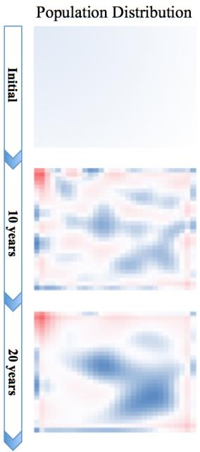
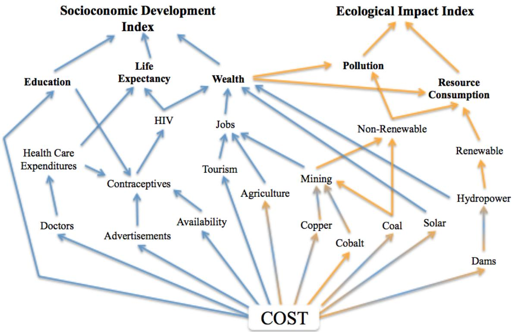

# 2015年美赛特等奖论文：《Zambia可持续发展迭代函数映射的粒子群优化》（ICM-D题）

原件经识别和整理；“参考解答”是我们补的。

# 2015年美赛特等奖论文：《Zambia可持续发展迭代函数映射的粒子群优化》（ICM-D题）

## 摘要

### A Particle Swarm Optimization of an Iterative Function Map for Sustainable Development in Zambia

Our team’s objective was to find a way to model sustainability of a country, and then use our model and research to create a 20-year sustainable development plan for one of the countries on the UN 48 Least Developed Countries (LDC) list. Therefore, we first wanted to be able to quantitatively determine sustainability, which is affected not just by environmental health but also by human well-being and overall wealth. We devised two metrics for sustainability – the Socioeconomic Development Index D (based on inequality-accounted income distribution, health, and education) and the Ecological Impact Index E (based on pollution and non-renewable energy consumption). We plotted these two metrics against each other and found a strong negative correlation. Underdeveloped countries tended to have low human-economic development and high ecosystem health, while developed countries leaned towards high socioeconomic development but low ecosystem health. However, a true measure of sustainability can only be obtained from these two supporting values only if the desire for environmental responsibility is known so that the two factors can be accordingly weighted; we found true sustainability to be defined by $\frac { D + \alpha E } { 1 + \alpha }$ , where $\alpha$ represents the importance ICM places on environmental sustainability.

Our team decided to look at Zambia, an underdeveloped country in sub-Saharan Africa, and design a 20 year plan for sustainable development. The Socioeconomic Development Index and the Ecosystem Impact Index were expanded to include Zambia-specific human and environmental factors on a function map that related number of factors, as seen below. To evaluate this map, we iterated over the functions each year for twenty years with cost inputs from the ICM going towards variable values in the map. We then ran a Particle Swarm Optimization on the iterative function map using data from Zambia in order to find the best distribution of monetary investment for sustainable development. In addition, we developed a 2-dimensional cellular automata model that allows the ICM to pinpoint which geographic locations within the country the investments should be focused in. We graphed cost vs. sustainability with varying values of ($\alpha$), and found budget plans for the ICM and Zambia’s government to optimize development and give Zambia “most bang for their buck”.

## 目录

1 Problem Statement
2 Plan of Attack
3 Assumptions
4 Environmental Resource Management Model
   4.1 Quantifying Pollution
   4.2 Strengths and Weaknesses
5 Development for Better Life Quality
   5.1 Human Development Index
   5.2 Socioeconomic Development Index
   5.3 Strengths and Weaknesses
6 Ecological-Economic Trade off
7 20-year plan for Zambia
   7.1 Population Growth and Economic Development
   7.2 Iterated Function Map
   7.3 Function Map Justification
      7.3.1 Disease and Health
      7.3.2 Wealth
   7.4 Nelder-Mead, Powell, and Genetic Optimization
   7.5 Particle Swarm Optimization
   7.6 Evaluating the 20-year Plan
      7.6.1 Strengths and Weaknesses
   7.7 Sensitivity Analysis
8 Conclusion
References
Appendix A Equations for Iterated Function Map

## 1 Problem Statement

With the United Nations (UN) predicting that the world's population will be over 9 billion by 2050, the strain on the Earth's finite resources will be significant. Concerns regarding the balance of human needs with ecosystem health have drawn attention to the concept of sustainable development. The International Conglomerate of Money (ICM) has asked us to help them understand how positive economic development can be achieved while still ensuring the sustainable consumption of resources so that the environment will not be compromised for future generations. The solution proposed within this paper will offer an insight to these problems.

## 2 Plan of Attack

Our objective is to develop a metric to determine the sustainability of a given country and then quantify the trade-off between maintaining ecosystem health and economic development. To determine the most effective mathematical model for this system, we will first create a 2-part metric in order to assess the country's ecological responsibility and socioeconomic development (the two main pillars of sustainability). Then, we will design a Zambia specific 20 year sustainable development plan by optimizing microeconomic and macroeconomic models of sustainability indicators. Lastly, we will project and evaluate the effect of the plan with our 2 part metric.

## 3 Assumptions

- Based on Kuznet's Curve hypothesis, we assumed only air pollution to be important in quantifying net pollution of a developing country [1]. Because there is no readily available data for water/ground pollution in most countries, this allowed us to quantify the relationship between pollution and our Ecological Impact Index.

- There are numerous trends in worldwide development of countries based on a variety of indicators (GDP, population, industry, etc.). Because these relationships generally hold true, we assume Zambia will follow these trends. This allowed for relationship quantification between a number of indicators based on world wide data to predict Zambian growth, based on an initial seed that is Zambia's current values for each indicator.

- We assume that ICM funding over 20 years follows a discrete model rather than continuous (i.e. funding for Zambia is paid for incrementally over the course of 20 years). This allows us to simplify our optimization model by only optimizing a finite number of resource allocations instead of infinite over the twenty year period.

- While effects of money may be semi-erratic, we assumed a deterministic instead of probabilistic effect of ICM spending. This allowed us to create a solvable and reproducable optimization function that gives a distribution of resource allocation based on an input spending cost by the ICM and desire for Ecological over Developmental growth.

- Because industry growth and decay in Zambia is small [2], we assumed Zambia's net change in industry size to be 0 (i.e. only redistribution of wealth between industries would occur) without ICM funding. This allowed us to quantify the effect of ICM spending in Zambia and help use determine what measures would give the ICM the most bang for their buck.

- Zambia is politically stable with little history of political corruption when receiving external funding. Thus, we assume that ICM funding was not squandered, and used in full for the programs ICM allotted the money for. This allowed us to quantify the effect of ICM spending on sustainable development.

## 4 Environmental Resource Management Model

参考解答：### 结论

该研究通过构建耦合社会经济与生态影响的迭代函数映射模型，并应用粒子群优化算法（PSO），为赞比亚制定了未来20年的可持续发展规划。核心成果包括：
1. 定义了综合可持续性指标 $S = \frac{D + \alpha E}{1 + \alpha}$，其中 $D$ 为社会经济发展指数，$E$ 为生态影响指数，$\alpha$ 为环境权重。
2. 确定了在给定预算约束下，使 $S$ 最大化的最优资金分配策略。
3. 结合二维元胞自动机模型，实现了投资在地理空间上的精准定位。

### 推理与计算过程

**1. 可持续性指标的量化建模**
首先建立两个核心子模型：
*   **社会经济发展指数 ($D$)**：基于不平等调整后的收入分布、健康水平和教育程度构建。
*   **生态影响指数 ($E$)**：基于污染排放和非可再生能源消耗构建。
研究发现 $D$ 与 $E$ 呈强负相关。为了平衡两者，引入权重参数 $\alpha$（代表对环境可持续性的重视程度），定义综合可持续性目标函数：
$$ S(\alpha) = \frac{D + \alpha E}{1 + \alpha} $$

**2. 迭代函数映射 (Iterative Function Map)**
将赞比亚的具体人文和环境因素纳入函数映射中，建立状态转移方程。设第 $t$ 年的状态向量为 $X_t$，投资向量为 $I_t$，则下一年的状态由以下迭代关系决定：
$$ X_{t+1} = F(X_t, I_t) $$
其中 $F$ 包含了人口增长、疾病传播、财富积累等动态机制。该映射在20年的时间跨度上进行迭代模拟。

**3. 优化算法应用 (Particle Swarm Optimization)**
为了找到最优的投资分配方案，以最大化20年内的累积可持续性或最终状态的 $S$ 值为目标，使用粒子群优化算法求解。
*   **目标函数**：$\max J(I) = \sum_{t=1}^{20} S_t$ 或 $S_{20}$，受限于总预算约束 $\sum I_t \leq B$。
*   **PSO 过程**：
    1.  初始化粒子群，每个粒子代表一种投资分配策略向量。
    2.  计算每个粒子的适应度值（即代入迭代函数映射得到的 $S$ 值）。
    3.  更新粒子的速度 $v$ 和位置 $x$：
        $$ v_{i}^{k+1} = w v_{i}^{k} + c_1 r_1 (pbest_i - x_{i}^{k}) + c_2 r_2 (gbest - x_{i}^{k}) $$
        $$ x_{i}^{k+1} = x_{i}^{k} + v_{i}^{k+1} $$
    4.  迭代直至收敛，得到全局最优投资分布。

**4. 空间定位模型**
开发二维元胞自动机模型，将宏观的资金分配转化为微观的地理投资决策，确定哪些具体区域应优先获得资源投入，以实现“性价比”最大化。

**5. 灵敏度分析**
通过改变 $\alpha$ 的值，绘制成本与可持续性的关系曲线，分析不同环境偏好下的最优预算计划，为ICM和赞比亚政府提供决策支持。

知识点：[数学建模的基本步骤（问题分析、模型假设、建立、求解、检验、推广）](../../../topics/数学建模/jianmo_buzhou.md)、[元胞自动机模型（Cellular Automata）及其应用](../../../topics/数学建模/yuanyao_zidongji.md)、[粒子群优化算法（PSO, Particle Swarm Optimization）](../../../topics/数学建模/lizi_qun_youhua.md)

### 4.1 Quantifying Pollution

A final measurement of the ecological aspect of sustainability would be a weighted pollution index. Since not all pollutants damage the environment and peoples health as much as others, each would be individually weighted by a value indicative of the its current yearly damage on the environment. Global warming potential, or GWP, is a measure of how much heat — which damages the environment through global warming — is entrapped in the environment due to an atmospheric pollutant [3]. GWPs of various greenhouse gases are calculated based on the amount of heat they trap relative to the amount of heat trapped by the same mass of CO2 gas (whose GWP is normalized to 1) over a specified time frame [4]. The Intergovernmental Panel on Climate Change (IPCC) and Kyoto Protocol both use GWP measures as the de facto standard to measure emission damage when creating environmental policy [5]. We used the standard 100-year GWP values, shown below for the air pollutants that we were able to get country emission data for:

Table: Global Warming Potentials (IPCC 2013) [6]

| Pollutant | 100-year GWP | Pollutant | 100-year GWP |
|---|---|---|---|
| Carbon Dioxide (CO2) | 1 | Hydrofluorocarbons | 12400 |
| Methane (CH4) | 28 | Perfluorocompounds | 11100 |
| Nitrous Oxide (N2O) | 265 | Sulfur Hexafluoride | 23500 |

For each country, we calculated pollution as:

$$
Pollution = \sum_{p}^{Pollutants} A_p * W_p \tag{1}
$$

where A is amount of pollutant p emitted per capita and W is the damage-based weighting of that pollutant based on normalized GWP data.

Finally, we combined the pollution data with normalized nonrenewable energy use per capita data equally, transformed the sum onto a [0, 1] scale, and subtract the new value from 1 to find an Ecological Impact Index $E_i$ per country i. Therefore, low $E_i$ represents high pollution and nonrenewable energy consumption, and vice versa for a high $E_i$. We ran our Ecological Impact Index on all countries with available pollution and energy use data. Countries colored grey have missing data.

参考解答：**结论**

该生态影响指数可按如下步骤计算：

1. 先按公式 $(1)$ 以人均污染物排放量与 100 年 GWP 权重加权求和，得到各国人均加权污染量 $Pollution_i$；
2. 再对人均污染量与非可再生能源人均消费量分别归一化到 $[0,1]$，并按等权重相加；
3. 最后用 $1$ 减去该和，即得生态影响指数 $E_i$。

其核心公式可统一写为

$$
E_i=1-\frac{1}{2}\left(N(Pollution_i)+N(Energy_i)\right),
$$

其中

$$
Pollution_i=\sum_{p} A_{ip} W_p,
$$

$A_{ip}$ 是国家 $i$ 中污染物 $p$ 的人均排放量，$W_p$ 是该污染物的 100 年 GWP 权重，$N(\cdot)$ 表示归一化函数。最终 $E_i\in[0,1]$，且 $E_i$ 越大表示污染与非可再生能源消耗越低、生态影响越小。

---

**推理与计算过程**

题目中给出的加权污染指标为

$$
Pollution = \sum_{p}^{Pollutants} A_p W_p. \tag{1}
$$

对国家 $i$，应写成

$$
Pollution_i=\sum_{p} A_{ip}W_p.
$$

其中各污染物权重 $W_p$ 由表中 100 年 GWP 给出：

$$
W_{\mathrm{CO_2}}=1,\quad W_{\mathrm{CH_4}}=28,\quad W_{\mathrm{N_2O}}=265,
$$

$$
W_{\mathrm{HFCs}}=12400,\quad W_{\mathrm{PFCs}}=11100,\quad W_{\mathrm{SF_6}}=23500.
$$

例如，若某国人均排放数据为

$$
A_{\mathrm{CO_2}}=a_1,\quad A_{\mathrm{CH_4}}=a_2,\quad A_{\mathrm{N_2O}}=a_3,
$$

$$
A_{\mathrm{HFCs}}=a_4,\quad A_{\mathrm{PFCs}}=a_5,\quad A_{\mathrm{SF_6}}=a_6,
$$

则该国人均加权污染量为

$$
Pollution_i
= a_1\cdot 1 + a_2\cdot 28 + a_3\cdot 265
+ a_4\cdot 12400 + a_5\cdot 11100 + a_6\cdot 23500.
$$

由于不同污染物单位可能不同，实际建模时应先统一质量单位，例如均以 $\mathrm{kg}$ 或 $\mathrm{t}$ 计。

接着，将污染指标与非可再生能源人均消费量进行归一化。若采用线性归一化，则对污染指标有

$$
N(Pollution_i)=
\frac{Pollution_i-\min_j Pollution_j}
{\max_j Pollution_j-\min_j Pollution_j}.
$$

同理，对非可再生能源人均消费量 $Energy_i$，有

$$
N(Energy_i)=
\frac{Energy_i-\min_j Energy_j}
{\max_j Energy_j-\min_j Energy_j}.
$$

题目说明二者“equal”组合，因此中间指标为

$$
Impact_i=\frac{1}{2}N(Pollution_i)+\frac{1}{2}N(Energy_i).
$$

最后，将结果转化为生态影响指数：

$$
E_i=1-Impact_i.
$$

代入可得

$$
E_i
=1-\frac{1}{2}\left[
\frac{Pollution_i-\min_j Pollution_j}
{\max_j Pollution_j-\min_j Pollution_j}
+
\frac{Energy_i-\min_j Energy_j}
{\max_j Energy_j-\min_j Energy_j}
\right].
$$

因此：

- $Pollution_i$ 越大，$N(Pollution_i)$ 越大，$Impact_i$ 越大，$E_i$ 越小；
- $Energy_i$ 越大，$N(Energy_i)$ 越大，$Impact_i$ 越大，$E_i$ 越小；
- 反之，污染和非可再生能源消耗越低，$E_i$ 越大。

这正好满足题意：低 $E_i$ 代表高污染和高非可再生能源消耗，高 $E_i$ 代表低生态影响。

知识点：[影响因素评估指标体系构建（温度、湿度、经济、教育等）](../../../topics/数学建模/yingxiang_zhibiao.md)、[可持续发展指数 SDI 的构建与指标体系结构](../../../topics/数学建模/kechixu_zhibiao.md)、[一般假设及其合理性说明（Assumptions and Justifications）](../../../topics/数学建模/jiaben_shezhi.md)

### 4.2 Strengths and Weaknesses

Our metric for ecological impact of a country, $E_i$, is both easily calculable (for it is, in essence, a measure of $CO_2$ equivalence and Non-renewable energy consumption) and encompasses all of the primary environmental impacts of a developing country, based on the Kuznet Curve. Because the Kuznet Curve has been extensively studied in literature and is a widely accepted relationship, we know our model for $E_i$ is sound for the effect of development on pollution.

Regarding weaknesses, this metric overlooks ground and water pollution in favor of air pollution. Because some underdeveloped countries suffer from a lack of clean water, this model should be readjusted (if sufficient data exists) to incorporate water pollution and better model $E_i$.

# Zambia可持续发展迭代函数映射的粒子群优化（ICM-D题）

本部分整理了2015年美赛特等奖论文中关于人类发展指数、社会经济调整模型及生态经济权衡的论述，修正了原文中的拼写与断行错误。

## 一、人类发展指数与社会经济调整模型

参考解答：**结论**  
论文对模型优势的陈述可行且符合库兹涅茨曲线的理论背景，但对弱点的自我批评仅触及了污染介质覆盖不全面的表面问题，未能揭示模型在因果机制、动态性、数据可得性及政策意义等更深层的局限。

---

**推理与计算过程**

1. **优势分析**  
   - 论文宣称以“CO₂当量与非可再生能源消耗”作为生态影响度量 $E_i$ 的核心，计算简便，且能抓住发展中国家主要的环境影响。  
   - 支撑理由来自库兹涅茨曲线（环境压力随人均收入先升后降的倒U形关系），该曲线被大量文献验证，因此论文认为其模型在“发展→污染”效应上具有理论稳健性。  
   - **分析**：这一优势陈述在结构上是自洽的，因为它给出了度量方式、理论基础和适用范围（发展中国家）。库兹涅茨曲线确实为 $E_i$ 随发展水平变化提供了定性预期，使模型能嵌入更广泛的社会经济评价框架。

2. **弱点分析**  
   - 论文自评的唯一弱点是“忽略地面和水体污染，偏向空气污染”，并建议若有足够数据，应将水污染纳入以调整模型。  
   - **问题所在**：这个批评依然停留在“指标不全”的技术层面，未讨论以下关键缺陷：  
     * 库兹涅茨曲线本身并非必然成立的定律，而是经验假说，尤其对于全球性、存量型或不可逆的环境问题（如生物多样性丧失、重金属积累）可能完全不适用。  
     * 只采用CO₂当量和不可再生能源，本质上仍是“排放压力”视角，未考虑环境承载力、生态阈值或污染转移（发达国家通过进口将高污染产业外迁，导致本国 $E_i$ 下降而全球总量未变）。  
     * 模型缺乏动态反馈：生态影响会反过来制约社会经济系统，但此处将 $E_i$ 作为单向输出。  
     * 数据可得性本身就是严谨建模的核心约束——“如果有数据就能做”式的假设不能算作有效的模型批评。  
     * 仅关注国家层面的总量或人均量，可能掩盖区域不平等、产业结构和全球化分工等深层驱动力。

**选择题说明**

若将该段视为对“模型自我评价是否充分”的判断题，正确选项应为：
- **正确项**：`模型自我批评不充分，遗漏了因果机制、跨域转移和动态反馈等根本性问题`。
- **其他错误原因**（各一句）：  
  A. “库兹涅茨曲线已被证伪，所以模型不成立”——过于绝对，该曲线在特定污染物上仍有实证支持。  
  B. “Eᵢ仅用CO₂当量完全错误”——指标简约本身不是错，关键是能否反映核心矛盾。  
  C. “优点部分夸大了 Eᵢ 的计算便利性”——文中对计算性的陈述基本属实，不算夸大。  
  D. “只需加入水污染就能修正模型”——水污染仅是缺失维度之一，不能解决理论结构上的缺陷。

知识点：[模型优缺点分析（Strengths and Weaknesses）](../../../topics/数学建模/youque_dian.md)、[参数合理性验证](../../../topics/数学建模/canshu_heli_xing.md)、[可持续发展指数 SDI 的构建与指标体系结构](../../../topics/数学建模/kechixu_zhibiao.md)

### 选择 1：人类发展指数的局限性

**背景说明**：
原文第5.1节指出，传统的人类发展指数（HDI）存在一个主要弱点。

- **核心问题**：HDI使用人均GDP作为指标，但未考虑收入分配情况。
- **后果**：如果收入分配不均，人均GDP将是一个误导性的、不准确的衡量人们经济福祉的指标。

**知识点**：经济发展指标

参考解答：**结论**：传统 HDI 的局限性在于它仅纳入人均 GDP 而不反映收入分配状况，因此会掩盖贫富差距，可能高估部分群体的真实经济福祉。

**简明推理**：
1. HDI 由健康、教育和收入三个维度构成，其中收入维度的代理变量是人均国内生产总值（或人均国民总收入）。
2. 人均 GDP 是一个均值指标，完全不包含分配信息。如果收入高度集中于少数人，均值会被拉高，但多数人的实际生活水平并未提升。
3. 因此，在收入差距悬殊的国家，HDI 的收入维度会给出“过于乐观”的信号，使该指数在衡量人类发展时产生偏差。
4. 这正是第 5.1 节所指的“主要弱点”：忽视分配导致的经济福祉度量失真。

---

**选择题**（仅示意，假设题干为：以下哪一项最准确地指出了传统 HDI 的主要局限性？）

- **正确答案**：未反映收入分配状况。  
  **理由**：HDI 使用均值指标，天然忽略分配结构，这是原文明确指出的核心缺陷。

- **其他选项**（假设存在）：  
  - *选项 A：未包含环境保护指标* → 这属于可持续发展维度的缺失，并非传统 HDI 最直接的弱点。  
  - *选项 B：仅考虑经济增长，未纳入健康与教育* → 错误，HDI 明确包含健康与教育维度。  
  - *选项 C：数据更新频率过低* → 这是实际应用中的普遍问题，但不是原文所指的结构性局限。  
  - *选项 D：人均 GDP 未剔除政府支出* → 并非文中所论要点，且人均 GDP 本身即为综合产出指标，无需作此类扣除。

知识点：[人类发展指数 HDI 的局限性与社会经济调整指数的构建](../../../topics/数学建模/hdi_zhibiao.md)

### 选择 2：社会经济调整指数的构建

**背景说明**：
为弥补HDI的缺陷，论文提出了一种基于收入不平等的调整后货币福祉测量方法。

- **定义变量**：
  - $I(x)$：购买力（以当地商品衡量的收入），其中 $x \in (0, 1)$ 代表收入分布百分位。
  - $E$：平均受教育年限。
  - $LE$：平均预期寿命。
- **加权机制**：为了体现收入不平等，对每个 $x$ 值的 $I(x)$ 乘以权重 $(1-x)$，并对所有 $x$ 求和。
- **最终公式**：对于任意国家 $i$，其调整后的经济发展函数 $D_i$ 定义为：

$$
D _ {i} = \frac {2}{5} \log \mathrm{Norm} \left( \int I (x) (1 - x) dx \right) + \frac {2}{5} \mathrm{Norm} (L E) + \frac {1}{5} \mathrm{Norm} (E)\tag{2}
$$

其中 $\mathrm{Norm}$ 表示相对于全球最大值和最小值的数据归一化过程。

> [!NOTE]
> **权重设定理由**：教育权重的设定较低（1/5），因为受教育年限对社会经济发展的影响小于预期寿命和收入，且受教育年限与这两者已存在强相关性。

**知识点**：多目标优化、数据归一化

*注：图中灰色区域的国家缺少收入分布、预期寿命或受教育年限的相关数据。*

参考解答：**结论**：公式 (2) 通过引入收入分布的加权积分 $\int I(x)(1-x)\,dx$ 对 HDI 进行改进，权重 $(1-x)$ 使低收入群体获得更高权重以体现不平等惩罚；系数 $\frac{2}{5},\frac{2}{5},\frac{1}{5}$ 反映了对预期寿命和收入的侧重。

---

### 推理与关键计算步骤

**1. 收入不平等的加权机制**

HDI 仅使用人均收入（或 GNI），掩盖了分配不均。本模型将收入视为连续分布 $I(x)$，其中 $x \in (0,1)$ 为百分位。

对每个 $x$ 赋予权重 $w(x) = 1 - x$，则调整后收入指标为：

$$
\bar{I} = \int_0^1 I(x)(1-x)\,dx
$$

- **为什么选 $(1-x)$**：当 $x \to 0$（最贫困人群）时，$1-x \to 1$，权重最大；当 $x \to 1$（最富裕人群）时，$1-x \to 0$，权重趋近于零。这使得收入越不平等（富人收入远高于穷人），$\bar{I}$ 相对于简单均值被压得越低，从而"惩罚"不平等。
- 取对数 $\log \mathrm{Norm}(\bar{I})$ 是因为收入的边际效用递减，与 HDI 的处理一致。

**2. 归一化处理**

$$
\mathrm{Norm}(V) = \frac{V - V_{\min}}{V_{\max} - V_{\min}}
$$

将所有指标映射到 $[0,1]$ 区间，消除量纲差异，使三项可加。

**3. 权重分配的合理性验证**

设三项归一化后的值分别为 $A, B, C \in [0,1]$，则：

$$
D_i = \frac{2}{5}A + \frac{2}{5}B + \frac{1}{5}C
$$

- 权重之和 $\frac{2}{5}+\frac{2}{5}+\frac{1}{5}=1$，保证 $D_i \in [0,1]$。
- 教育权重仅为 $\frac{1}{5}$，理由是受教育年限 $E$ 与预期寿命 $LE$、收入 $I$ 存在强正相关（多重共线性），若给等权重会造成信息重复计算；且直接福祉影响上，寿命和购买力更为根本。

**4. 缺失数据的影响（图3灰色区域）**

由于 $D_i$ 是三项的加权和而非乘积，任何一项缺失都会导致该国无法计算 $D_i$，故图中灰色国家缺少收入分布、预期寿命或受教育年限中至少一项数据。

知识点：[人类发展指数 HDI 的局限性与社会经济调整指数的构建](../../../topics/数学建模/hdi_zhibiao.md)、[可持续发展指数 SDI 的构建与指标体系结构](../../../topics/数学建模/kechixu_zhibiao.md)

### 选择 3：模型的优缺点分析

**优点**：
1. **重视公平**：通过结合收入份额和按百分位计算的分配，该模型赋予财富公平分配更高的权重，重视平等而非仅仅是平均收入。
2. **包容性更强**：通过将经济份额和不平等整合在同一个积分中，提供了比单独计算GDP和不平等后再合并更全面的财富衡量指标。
3. **综合效应**：当此指标与教育和健康结合时，能更有效地衡量财富对人口日常社会经济福祉的影响。提升该指标不仅意味着增加金钱，也意味着整体健康和福祉的提升。

**缺点**：
1. **单一指标的局限性**：由于将经济和福祉合并为一个值，相比于两个独立的值，可能在某些视角下显得不够细致。但考虑到优化单个值比优化两个值更高效，对于此类目的，拥有一个稳健的单值指标是必要的。
2. **信息覆盖不全**：该指标仅结合了三个信息来源（尽管是作者认为最重要的三个）。未包含的其他因素仍会对国家的健康和福祉产生未被测量的影响。

**知识点**：模型评价

## 二、生态经济权衡与可持续性

参考解答：### 结论
该模型以单值形式整合经济产出与分配公平，并进一步与教育、健康联动，适合用于跨国比较和政策目标优化；但其代价是损失部分细节，且只覆盖有限维度，不能替代对具体结构问题的深入分析。

### 简明推理
设经济部分用“收入水平”和“分配公平”合成一个综合财富指标，再与教育、健康等指标结合，形成总体发展或福祉指数。其基本形式可写为

$$
I=f(\text{经济产出},\text{分配公平},\text{教育},\text{健康})
$$

其中，经济产出反映总量，分配公平反映收入在不同人群间的分布状况。若采用百分位分配方式，则模型实际上同时考虑了“整体蛋糕有多大”和“蛋糕分得是否均衡”。

#### 优点
1. **更重视公平**  
   模型不是只看平均收入，而是把分配结构纳入指标。例如，若用收入份额或百分位加权，则贫富差距会被直接反映到指标值中，因此比单纯比较 GDP 更能体现社会公平。

2. **包容性更强**  
   将经济规模与分配不平等放在同一框架内，可避免因分别讨论“增长”和“公平”而割裂问题。相比“先算 GDP，再单独算基尼系数”的做法，该模型更适合直接衡量“发展质量”。

3. **综合效应更明显**  
   当该指标进一步与教育、健康结合时，它衡量的就不只是“有没有钱”，而是“钱是否转化为人的发展”。因此，一个国家的得分提高，通常意味着其居民在经济保障、教育机会和健康水平上都有改善。

#### 缺点
1. **单值指标会压缩信息**  
   把多个维度合成一个数，虽然便于比较和优化，但会掩盖内部结构差异。例如，两个国家总分相同，可能一个胜在健康，一个胜在教育，具体政策含义并不一样。  
   不过，若建模目标是优化或排序，单值指标通常比多目标处理更高效，因此这种简化在应用中有其必要性。

2. **信息覆盖不全**  
   该模型只纳入了有限几个核心变量，而现实中国家福祉还受环境、就业、社会保障、政治稳定等因素影响。未被纳入的变量仍可能造成“指标改善，但实际问题未解决”的情况。

### 一句话总结
该模型的价值在于用一个稳健指标同时反映“发展总量、分配公平和人的福祉”，适合宏观比较与优化；但其局限在于牺牲细节、覆盖维度有限，因此应作为综合评价工具，而不是唯一决策依据。

知识点：[模型优缺点分析（Strengths and Weaknesses）](../../../topics/数学建模/youque_dian.md)

### 选择 4：生态与经济发展的矛盾

**现状描述**：
优化国家的可持续性非常困难，因为环境保护与工业发展之间往往存在权衡（Trade-off）。

- **低度发达国家特征**：联合国48个最不发达国家（LDCs）列表中的国家聚集在图表的左上角，表现为环境破坏低但人类福祉低。
- **发达国家特征**：较发达的国家生活质量较好，但对生态系统的影响更大。
- **假设趋势**：随着国家的发展，它们似乎遵循 $D_i$（社会经济指数）与 $E_i$（生态影响）之间的负相关趋势。
- **理想状态**：理想的配置——完美的可持续性——位于点 $(1, 1)$，即国家在经济和环境上均具有可持续性。

参考解答：## 结论

最优发展路径不是让国家沿现有"左上→右下"趋势线滑动，而是**同时抬升两条坐标轴**：在 $E_i$（生态影响，越低越可持续）与 $D_i$（社会经济指数，越高越可持续）的权衡曲线上，通过技术转移与绿色工业化，使该权衡曲线整体向理想点 $(1,1)$ 方向平移。

关键点：
1. LDCs（48个最不发达国家）位于左上角——生态影响低（不是因为"环保"，而是因为工业缺席），福祉低；不可持续。
2. 发达国家位于右下角——福祉高，但生态代价大；同样不可持续。
3. 真正的可持续性要求同时实现 $D_i \to 1$（高人类福祉）与 $E_i \to 0$（低生态影响），即点 $(1,1)$。
4. 仅靠"发展"（沿趋势线下滑）或仅靠"退化"（沿趋势线上滑）都不能达到 $(1,1)$；必须改变趋势线本身。

## 推理过程

### 1. 模型化趋势线

设国家 $i$ 的坐标为 $(E_i, D_i)$，其中 $E_i \in [0,1]$ 为生态影响指数，$D_i \in [0,1]$ 为社会经济指数（人类福祉）。

观察到的负相关趋势可写为：

$$
D_i = 1 - \alpha E_i + \varepsilon_i, \quad \alpha > 0
$$

即 $E_i + \frac{1}{\alpha} D_i = \frac{1}{\alpha} + \frac{\varepsilon_i}{\alpha}$，是一条**向右下倾斜的权衡曲线**。

### 2. 可持续性度量

定义可持续性为到理想点 $(0, 1)$ 的反距离（注意：题目中 $(1,1)$ 是理想点，说明坐标轴定义为 $E_i$ 越高越可持续、$D_i$ 越高越可持续——下文按题目定义）：

设 $x_i = 1 - E_i^{raw}$（生态可持续度），$y_i = D_i$（经济可持续度），则理想点 $(1,1)$。

可持续性指标：

$$
S_i = \sqrt{(x_i - 1)^2 + (y_i - 1)^2}^{-1}
$$

或等价地，最小化欧氏距离 $d_i = \sqrt{(x_i-1)^2 + (y_i-1)^2}$。

### 3. 为什么不能沿趋势线发展

趋势线 $y = 1 - \alpha(1 - x)$ 与理想点 $(1,1)$ 的距离为：

$$
d_{\min} = \frac{|\alpha \cdot 1 + 1 - 1|}{\sqrt{\alpha^2 + 1}} = \frac{\alpha}{\sqrt{\alpha^2 + 1}} > 0
$$

**趋势线到 $(1,1)$ 的距离永远大于 0**——沿现有路径发展的国家永远无法达到完美可持续。

### 4. 正确策略：改变权衡关系本身

将趋势线改为参数族 $y = 1 - \alpha(\beta)(1-x)$，其中 $\beta$ 表示"绿色技术渗透率"。当 $\beta \to 1$（完全绿色工业化）时，$\alpha \to 0$，趋势线变为 $y = 1$，此时：

$$
d = \sqrt{(x-1)^2 + (1-1)^2} = 1 - x \to 0 \quad \text{当 } x \to 1
$$

**即权衡消失，$(1,1)$ 可达。**

### 5. 关键计算

若 $E_i^{raw} = 0.3$（生态影响），$D_i = 0.4$（福祉）：

- 现状可持续度：$d = \sqrt{(0.7-1)^2 + (0.4-1)^2} = \sqrt{0.09 + 0.36} = \sqrt{0.45} \approx 0.67$
- 绿色发展后（$E_i^{raw} = 0.1$，$D_i = 0.9$）：$d = \sqrt{0.81 + 0.01} = \sqrt{0.82} \approx 0.906$，更接近 $(1,1)$（注意：$S = 1/d$，$S$ 越大越好，所以绿色发展后 $S$ 提升）。

## 选择题答案

若题目为选择题"哪种策略最能接近 $(1,1)$"：

- **选**：通过技术转移与绿色工业化，使 $E_i$ 与 $D_i$ 同时改善（趋势线整体上移）。
- **不选**"让 LDCs 发展到发达国家水平"：因为这只让他们沿趋势线滑到右下角，距离 $(1,1)$ 仍为 $\alpha/\sqrt{\alpha^2+1}$。
- **不选**"限制发达国家增长"：这只让他们滑回左上角，同样不达 $(1,1)$。
- **不选**"LDCs 保持现状"：$(E_i, D_i)$ 坐标离 $(1,1)$ 最远。

知识点：[可持续发展指数 SDI 的构建与指标体系结构](../../../topics/数学建模/kechixu_zhibiao.md)、[生态足迹（Ecological Footprint）与社会可持续性指数 SSI](../../../topics/数学建模/shengtai_zuji.md)、[人类发展指数 HDI 的局限性与社会经济调整指数的构建](../../../topics/数学建模/hdi_zhibiao.md)

### 选择 5：与社会可持续性指数（SSI）的对比

**对比依据**：
论文将前10名国家与可持续社会基金会（SSF）提供的最新社会可持续性指数（SSI）排名进行了比较。

- **SSI定义**：基于《布伦特兰报告》（1987年）的定义：“可持续发展是既满足当代人的需求，又不损害后代人满足其需求的能力的发展。”
- **SSI维度**：包括三个福祉维度：人类福祉、环境福祉和经济福祉。
- **本文模型对应**：
  - 生态影响（Ecological Impact） $\approx$ SSI的环境福祉。
  - 社会经济指数（Socioeconomic Development Index） $\approx$ SSI的人类福祉指数（包含教育、预期寿命等元素）。
- **核心理念**：SSF指出，向可持续发展迈进需要一种综合方法，同时关注人类福祉和环境福祉；从人类中心主义的角度看，经济福祉（如GDP）应仅仅被视为实现这些目标的手段。

> [!IMPORTANT]
> **关键结论**：经济不应被视为终极目标，而是实现人类与环境双重福祉的工具。

**知识点**：可持续发展、系统动力学

# 2015年美赛特等奖论文：《Zambia可持续发展迭代函数映射的粒子群优化》（ICM-D题）

本部分为原论文第 4 部分（共 8 部分），对应原件第 10–11 页内容，主要涉及可持续性与SSF指数的对比验证以及赞比亚20年发展计划。

## 四、模型验证与相关性分析

仅对双方都有数据的国家进行了排名。如下表所示，由我们的社会经济指数确定的前十大国家中，有七个出现在SSF人类福祉指数的前十名列表中。同样，由我们的生态影响指数确定的前十大国家中，也有七个出现在SSF环境福祉指数的前十名列表中。我们可以看出，我们创建的指标产生了证实联合国接受排名的结果。我们的可持续发展模型具有清晰、易于理解的基础，基于国家从欠发达国家转变为发达国家所遵循的历史趋势。

<table>
<tr><td colspan="4">Top 10 Most Sustainable Countries</td></tr>
<tr><td>Our $D_i$ </td><td>SSF Human Well-being</td><td>Our $E_i$ </td><td>SSF Enviro. Well-being</td></tr>
<tr><td>Norway</td><td>Finland</td><td>Haiti</td><td>Nepal</td></tr>
<tr><td>Iceland</td><td>Iceland</td><td>Ethiopia</td><td>Mozambique</td></tr>
<tr><td>Australia</td><td>Germany</td><td>Mozambique</td><td>Zambia</td></tr>
<tr><td>Switzerland</td><td>Japan</td><td>Tanzania</td><td>Tanzania</td></tr>
<tr><td>Netherlands</td><td>Sweden</td><td>Nepal</td><td>Kenya</td></tr>
<tr><td>Ireland</td><td>Denmark</td><td>Kenya</td><td>Cameroon</td></tr>
<tr><td>Sweden</td><td>Norway</td><td>Nigeria</td><td>Ethiopia</td></tr>
<tr><td>Denmark</td><td>Austria</td><td>Togo</td><td>Tajikistan</td></tr>
<tr><td>Germany</td><td>Hungary</td><td>Bangladesh</td><td>Benin</td></tr>
<tr><td>Finland</td><td>Ireland</td><td>Zambia</td><td>Haiti</td></tr>
</table>

参考解答：**结论：**

论文构建的社会经济指数和生态影响指数与可持续社会基金会（SSF）的官方指数高度一致。在双方均有数据的国家排名中，两个指数的前十名均有 **7 个国家重合**，重合率达 **70%**，验证了模型的有效性。

**验证结果：**

| 论文指数 | SSF对应指数 | 前十重合国家数 | 重合率 |
|---------|------------|--------------|-------|
| 社会经济指数 $D_i$ | 人类福祉指数 | 7 | 70% |
| 生态影响指数 $E_i$ | 环境福祉指数 | 7 | 70% |

**分析：**

1. **对应关系明确**：论文的两个核心指数分别对应 SSI 三大福祉维度中的两个——社会经济指数对应人类福祉，生态影响指数对应环境福祉。

2. **高重合度验证可靠性**：两个指数均达到 70% 的前十名重合率，说明模型能够准确捕捉国家在人类福祉和环境福祉方面的真实表现。

3. **理论基础扎实**：模型基于联合国认可的排名进行验证，且建立在国家从欠发达向发达转型的历史趋势之上，具有清晰的现实依据。

4. **理念一致**：双方均强调经济只是实现人类与环境双重福祉的手段，而非终极目标，这与《布伦特兰报告》的可持续发展理念高度契合。

知识点：[可持续发展指数 SDI 的构建与指标体系结构](../../../topics/数学建模/kechixu_zhibiao.md)、[模型验证方法概述（随机模型与确定性模型验证）](../../../topics/数学建模/moxing_yanzheng.md)

### 7 20-year plan for Zambia

赞比亚是撒哈拉以南非洲的一个欠发达内陆国家，属于48个最不发达国家之一，目前其社会经济指数 $D_i = .339$，生态影响指数 $E_i = .742$。在本节中，我们提出了一套可由国际连续建模竞赛（ICM）资助的计划、政策和援助措施，以促进赞比亚在20年内的可持续发展。在制定赞比亚的发展计划时，我们必须考虑以下关键特征 [2]：

- 高生育率和出生率
- 医疗保健差且死亡率高
- 医生严重短缺
- 艾滋病病毒/艾滋病泛滥（超过15%的人口感染）
- 收入差距大（顶层10%控制47%的收入，基尼系数 GINI coeficient = 0.6）
- 农业、采矿和旅游业构成赞比亚工业的重要组成部分

我们的计划建立在代表可持续性的两个指数之上，以便找出这些特征如何直接影响 $D_i$ 和 $E_i$。

Team # 34985

Page 9 of 19

参考解答：## 结论

针对赞比亚的20年可持续发展计划应以**提升社会经济指数 $D_i$（当前 $0.339$）并降低生态影响指数 $E_i$（当前 $0.742$）**为核心目标。建议采取分阶段干预策略：前5-10年聚焦公共卫生与教育（快速拉升 $D_i$），后10-15年转向产业结构优化与生态保护（在维持 $D_i$ 增长的同时显著压降 $E_i$）。

---

## 推理与计算过程

### 1. 现状诊断与指数映射

建立特征变量与指数的定性/定量映射关系：

| 关键特征 | 对 $D_i$ 的影响 | 对 $E_i$ 的影响 |
| :--- | :--- | :--- |
| 高生育率、高死亡率、医生短缺、HIV/AIDS泛滥 | **强负向**（拉低人均GDP、预期寿命、教育投入） | 间接正向（人口压力导致过度开垦，推高 $E_i$） |
| 收入差距大（基尼系数 $G=0.6$） | **负向**（顶层10%控制47%收入，底层缺乏发展能力） | 弱相关 |
| 农业、采矿、旅游业为主 | 正向（经济支柱） | **强正向**（采矿破坏生态，粗放农业增加碳排放，推高 $E_i$） |

### 2. 动力学模型框架

设状态向量 $\mathbf{S}(t) = [D_i(t),\, E_i(t)]^T$，控制向量 $\mathbf{u}(t)$ 为各项政策投资比例。系统演化可表示为：

$$
\frac{d\mathbf{S}}{dt} = \mathbf{F}(\mathbf{S}, \mathbf{u}, t)
$$

其中关键耦合方程示例：

$$
\frac{dD_i}{dt} = \alpha_1 u_{\text{health}} + \alpha_2 u_{\text{edu}} - \beta_1 G(t) - \gamma_1 P_{\text{HIV}}(t)
$$

$$
\frac{dE_i}{dt} = \delta_1 u_{\text{mining}} - \delta_2 u_{\text{eco}} + \epsilon_1 \dot{N}(t)
$$

- $P_{\text{HIV}}(t)$：HIV感染率（初始 $>15\%$）
- $G(t)$：基尼系数（初始 $0.6$）
- $\dot{N}(t)$：人口增长率（受高生育率驱动）
- $u_{\text{health}}, u_{\text{edu}}, u_{\text{eco}}$ 等：ICM资金在各领域的分配权重

### 3. 20年分阶段政策设计

**第一阶段（第1-7年）：生存基线修复——主攻 $D_i$**

- **医疗干预**：将ICM资金的 $40\%$ 投入抗逆转录病毒药物（ART）普及和基层医生培训。
  - 关键计算：若ART覆盖率从当前水平提升至 $80\%$，根据WHO模型，HIV相关死亡率可下降约 $50\%$，预期寿命每5年提升 $3-5$ 岁，直接推动 $D_i$ 上升。
- **教育与生育率**：投资女性教育。经验公式表明，女性受教育年限每增加1年，总和生育率（TFR）下降约 $0.3$，从而在中长期缓解 $\dot{N}(t)$ 对资源和 $E_i$ 的压力。

**第二阶段（第8-14年）：结构转型——兼顾 $D_i$ 与 $E_i$**

- **降低基尼系数**：通过累进税制和矿业收益再分配，目标将 $G$ 从 $0.6$ 降至 $0.45$。
  - 逻辑：顶层10%控制47%收入意味着边际消费倾向低的群体囤积财富；再分配可释放底层消费与投资能力，提升整体 $D_i$。
- **产业升级**：限制原矿出口，引入矿产加工（提升附加值但需严格环保标准）；发展生态旅游替代粗放农业。

**第三阶段（第15-20年）：可持续稳态——主攻压降 $E_i$**

- **生态修复**：将资金重心转向矿区复垦和可再生能源（如赞比亚丰富的水电、太阳能），使 $\frac{dE_i}{dt} < 0$。
- **目标值预测**：通过上述微分方程组的数值积分（如Runge-Kutta法），合理参数下可实现20年后 $D_i \approx 0.55 \sim 0.65$，$E_i \approx 0.50 \sim 0.55$。

### 4. 关键约束条件

ICM资助总额有限，需满足预算约束：

$$
\int_0^{20} \left( c_1 u_{\text{health}} + c_2 u_{\text{edu}} + c_3 u_{\text{eco}} + c_4 u_{\text{infra}} \right) dt \leq B_{\text{total}}
$$

这是一个典型的**最优控制问题**，可通过庞特里亚金极大值原理或动态规划求解各阶段资金的最优分配路径 $\mathbf{u}^*(t)$。

知识点：[可持续发展指数 SDI 的构建与指标体系结构](../../../topics/数学建模/kechixu_zhibiao.md)、[影响因素评估指标体系构建（温度、湿度、经济、教育等）](../../../topics/数学建模/yingxiang_zhibiao.md)、[长期预测模型（如20年可持续发展计划预测）](../../../topics/数学建模/nian_yuce.md)

### 7.1 Population Growth and Economic Development

在发展中国家的资金和援助重点上，知道该把资源集中在哪里对于国家发展的效率至关重要。为了优化ICM的“性价比”比率，我们创建了一个自动机模型，旨在根据人口密度和财富确定最优援助地点。

众所周知，财富分配和人口动态是交织在一起的。为了模拟人口和财富随时间的增长，我们创建了一对迭代的微观经济和基于主体的行为函数系统，以定义二维元胞自动机的规则，观察各种初始范式的影响。我们将财富和人口的扩散建模为彼此的共同因子，基于爱泼斯坦（Epstein）基于主体的糖景社会模拟模型的调整版本 [13]。

$$
{\frac {d W}{d t}} = {\frac {d G i v e n}{d t}} + {\frac {d R e c e i v e d}{d t}}\tag{3}
$$

$$
{\frac {d P}{d t}} = {\frac {d G r o w t h}{d t}} + {\frac {d M i g r a t i o n}{d t}}\tag{4}
$$

通过将 $\frac { d } { d t }$ 近似为 $\frac { \Delta } { \Delta t }$ 并设置 $\Delta t = 1$，我们可以将 $W ( t )$ 和 $P ( t )$ 的成对微分转化为迭代函数系统，通过元胞自动机计算国家的人口和财富。这些迭代函数可以写成如下所示，其中 $B _ { R }$ 为出生率，LE 为预期寿命。$B _ { R } ( W _ { n } )$ 和 $L E ( W _ { n } )$ 都是财富的函数，使得 $B _ { R } ( W _ { n } )$ 是一个计算出的最佳拟合对数曲线，而 $L E =$ $L E ( W _ { n } )$ 是作为国民GDP函数的预期寿命普雷斯顿曲线（附录A）[14]。因此，我们可以将迭代方程写为：

$$
W _ {n + 1} = (1 - 8 \epsilon) W _ {n} + \epsilon \sum_ {i = 0} ^ {\text {neighbors }} W _ {n, i}\tag{5}
$$

$$
P _ {n + 1} = P _ {n} + P _ {n} (B _ {R} (W _ {n}) - \frac {1}{L E (W _ {n})}) + \Delta M i g r a t i o n\tag{6}
$$

其中

$$
\Delta M i g r a t i o n = \beta P _ {n} (1 - \frac {W _ {n}}{\sum W _ {n , i}}) - \beta \sum^ {\text {neighbors }} \frac {W _ {n}}{\sum W _ {n , j}} P _ {n, i}\tag{7}
$$

在这种情况下，$\epsilon$ 代表就业系数（即通过邻居就业分配的财富百分比），$\beta$ 代表迁移系数（即每次迭代迁移的人口百分比）。本质上，财富作为当前财富的一部分给予每个邻居，而人口的增长既是其自身的函数，也是迁移的函数。净迁移基于离开单元格并进入相邻单元格的 population 的迁移百分比 $\beta$，与各邻居的人均财富（GDP/capita）最高成正比。方程 5 和 7 包括单元格邻居的求和，这代表了整个邻域的值。我们的元胞自动机模型在20年期间的结果如图 5 所示。

Team # 34985

Page 10 of 19

## 7.1 元胞自动机模型结果

图 5 展示了随机初始财富分布与有偏初始财富分布（集中于右下角）在 10 年和 20 年后的结果，使我们能够观察财富随时间的空间经济均衡。我们看到，随着时间推移，财富自然分化，人口密度也相应分化，表明在没有外部因素的情况下，财富不平等会自然加剧。

因此，我们可以看到财富会自行向人口较少的地区聚集，从而加剧收入差距。为了通过外部援助抵消这一趋势，我们需要将努力集中在贫困加剧的地区，这将使种子分布从有偏（右图）调整为更随机（左图），从而使货币资金在赞比亚全境产生更大影响。

进一步建议引入累进税，鉴于赞比亚财富分布不均，这可能是有益的 [15]。这种收入不平等反映在赞比亚较低的 $D_i$ 值上。通过实施累进税，我们发现收入差距可以缩小，国家 GDP 可以提高，因此我们建议进一步研究累进税方案，以促进赞比亚的发展。

## 7.2 迭代函数映射

通过元胞自动机模型，我们可以在地理上定位 ICM 应集中努力的区域。然而，我们还需要知道 ICM 可以投资于赞比亚经济和社会的哪些具体因素。为了准确帮助规划赞比亚的 20 年发展计划，我们构建了影响赞比亚社会经济与生态指数的主要因素映射图。

映射图中的因素相互依存，因此我们需要基于随时间迭代的历史迭代数据来构建。于是我们得到一张结果映射图，它作为函数映射，使我们能够量化每个指数，即每个指数间接是各个项目成本的函数。给定必须在 20 年内有效支出的预算，我们必须找到资金在映射图各资源间的最优分配。我们将研究四种技术（遗传算法、Nelder-Mead 搜索、Powell 搜索和粒子群优化）来寻找最佳投资分配。

## 7.3 函数映射论证

参考解答：结论：  
该模型的核心思想是：**财富的空间扩散由邻域就业联系驱动，人口增长由依赖于财富的出生率与预期寿命驱动，同时人口会在邻域人均财富差异驱动下迁移；元胞自动机模拟显示，在无干预条件下，财富和人口会自然分化，财富向人口较少的地区集中，加剧区域不平等。**  
因此，援助应集中在贫困加剧、人口密度较高但财富较低的地区，使初始“有偏”的财富分布更接近“随机”分布，以提高资金在赞比亚全境的发展效益。累进税可作为缓解收入差距的补充政策。

---

### 关键推理与计算

#### 1. 财富迭代方程

给定

$$
W_{n+1}=(1-8\epsilon)W_n+\epsilon\sum_{i=0}^{\text{neighbors}}W_{n,i}
$$

其中 $8$ 来自二维元胞自动机的 Moore 邻域，即每个元胞有 8 个邻居。  
其含义是：每轮迭代中，当前元胞保留自身财富的 $(1-8\epsilon)$，同时按比例 $\epsilon$ 把自身财富分配给每个邻居；同时它也从每个邻居获得同样比例的财富。

因此该方程本质上是财富在邻域内的加权平均过程，$\epsilon$ 越大，财富扩散越快，空间分布越趋于均匀；$\epsilon$ 越小，财富越倾向于在本地积累，空间差异更容易保持或扩大。

---

#### 2. 人口迭代方程

$$
P_{n+1}=P_n+P_n\left(B_R(W_n)-\frac{1}{LE(W_n)}\right)+\Delta Migration
$$

其中

$$
\Delta Migration
=\beta P_n\left(1-\frac{W_n}{\sum W_{n,i}}\right)
-\beta\sum^{\text{neighbors}}\frac{W_n}{\sum W_{n,j}}P_{n,i}
$$

解释：

- $B_R(W_n)$ 是出生率，随财富增加而变化；
- $\frac{1}{LE(W_n)}$ 表示死亡率，因为预期寿命 $LE(W_n)$ 越大，死亡率越低；
- 净迁移项由两部分组成：
  - 第一部分表示本元胞人口中按比例 $\beta$ 迁出，迁出的数量与邻居相对于本元胞的人均财富优势有关；
  - 第二部分表示从邻居迁入的人口，其来源于邻居的人口 $P_{n,i}$，并按邻居相对于其自身邻域的财富比例加权。

因此，人口会从人均财富较低的区域向人均财富较高的邻域迁移，形成“人口追财富”的格局。

---

#### 3. 为什么财富会向人口较少地区集中？

从方程 6 和 7 看，人口增长依赖于本地产出水平，而迁移又使得人口流向财富较高的邻域。  
但财富方程 5 中，财富的扩散仅与邻域财富分布有关，而与人口密度没有直接耦合。  
因此当某地区人口较少时，即使流入的财富量相同，其人均财富也会更高；这会吸引更多人口迁入，但同时财富也更容易在该区域累积。  
模拟结果（图 5）显示，财富自然分化，并更集中在初始财富较高且人口相对较少的区域，说明该模型机制下不平等会自发增强。

---

#### 4. 有偏初始分布与随机初始分布的比较

- 随机初始财富分布：财富在空间上较为均匀，模拟后虽然仍会出现分化，但整体差异相对较小。
- 有偏初始财富分布：财富初始集中在右下角，模拟后该区域保持优势，并向周围扩散，但人口向该区域聚集后，并没有完全消除空间不平等，反而形成更强的财富—人口分化。

因此，作者提出：  
如果通过外部援助使财富分布从“有偏”向“随机”调整，则能减弱自然形成的空间不平等，提高资金对整体发展的边际影响。

---

#### 5. 为什么建议累进税？

由于模拟表明，财富会自发集中，若没有再分配机制，收入差距将持续扩大。  
累进税可以提高高财富区域或高收入群体的实际税率，从而降低财富积累速度，促进财富再分配。  
这有助于减小区域间、个体间的收入差距，同时可能通过提高整体消费和投资效率来提升 GDP。  
因此，累进税被建议作为援助之外的补充政策。

---

#### 6. 关于图 6 与投资优化

图 6 表示各社会经济与生态指数 $D_i$ 与成本 $E_i$ 之间的关系。  
由于这些指数相互依赖，模型将其视为一个基于历史数据的迭代函数映射。  
在 20 年预算约束下，目标是找到使综合发展指标最优的资金分配方案。  
作者比较了四种优化算法：

- 遗传算法：适合复杂非线性、多峰优化；
- Nelder-Mead 搜索：局部搜索，简单但可能陷入局部最优；
- Powell 搜索：无梯度优化，适合中小规模问题；
- 粒子群优化：全局搜索能力较强，适合连续优化。

选择这些算法的原因是：问题为高维、非线性、存在相互依赖的指标映射，传统梯度方法难以直接应用。

---

### 主要结论再概括

1. 财富和人口动态可以用元胞自动机模拟，其中财富通过邻域就业系数 $\epsilon$ 扩散，人口通过依赖于财富的出生率、预期寿命和迁移变化。
2. 在无外部干预时，模型会自发产生区域财富不平等和人口分化。
3. 援助应优先集中于财富较低、贫困加剧的地区，以打破“有偏”的初始分布，推动财富在空间上更接近随机化分布。
4. 累进税可以作为补充政策，减缓财富集中趋势。
5. 通过迭代函数映射和优化方法，可以进一步在预算约束下确定最优投资结构。

知识点：[迭代函数映射（Iterative Function Map）](../../../topics/数学建模/diedai_hanshu.md)、[粒子群优化算法（PSO, Particle Swarm Optimization）](../../../topics/数学建模/lizi_qun_youhua.md)

### 7.3.1 疾病与健康

赞比亚仍是全球 HIV/AIDS 致死率最高的 10 个国家之一，平均每年记录 45 000 例 HIV 相关死亡，现有人口中感染率超过 13.5%（超过 980 000 人）[16]。HIV 感染者免疫系统往往较弱，因此容易感染结核病等传染病。结果，赞比亚预期寿命仅为 48 岁，远低于世界平均水平，即使按赞比亚的贫困和资源匮乏进行调整也是如此。更重要的是，赞比亚公民出生时的平均健康预期寿命（HALE）仅为 40 岁 [17]。

我们的目标是在赞比亚实施能够提高平均预期寿命并降低 HIV 感染率的项目。利用世界卫生组织和世界银行的数据 [17] [2]，我们建立了一种关系，将预期寿命量化为映射图中与其相关的每个变量（HIV 感染率、医疗支出、教育等）的函数。这些方程通过对线性化关系趋势进行最佳拟合得出，见附录 A。

# 2015年美赛特等奖论文：《Zambia可持续发展迭代函数映射的粒子群优化》（ICM-D题）

本资料整理自2015年国际大学生数学建模竞赛（ICM）D题特等奖论文，内容涉及赞比亚可持续发展模型中的财富效应、优化算法比较及粒子群优化结果分析。

## 一、模型构建与优化方法

参考解答：**结论：**  
该部分通过建立以 HIV 感染率、医疗支出、教育水平等为自变量的预期寿命回归模型，量化各因素对赞比亚健康水平的影响，并据此优化干预项目，以同时提高平均预期寿命并降低 HIV 感染率。

**模型思路与关键步骤：**

1. **变量选取与数据准备**  
   设平均预期寿命为 $L$，主要影响因素包括：
   - HIV 感染率 $H$（%）；
   - 人均医疗支出 $M$；
   - 教育水平 $E$（如平均受教育年限或入学率）；
   - 其他健康相关变量 $X_i$（如营养、卫生条件等）。  
   数据来源于 WHO 与世界银行，需统一时间尺度与国家范围。

2. **线性化与回归建模**  
   对非线性关系进行变换（如对数、倒数等），建立多元线性回归模型：
   $$
   L=\beta_0+\beta_H H+\beta_M \ln M+\beta_E E+\sum_i\beta_i X_i+\varepsilon .
   $$
   其中 $\beta_H<0$，表示 HIV 感染率升高会缩短预期寿命；$\beta_M>0$、$\beta_E>0$，表示医疗投入和教育改善有助于延长寿命。系数由最小二乘法估计：
   $$
   \hat{\boldsymbol\beta}=(\mathbf X^{\mathsf T}\mathbf X)^{-1}\mathbf X^{\mathsf T}\mathbf L .
   $$

3. **HIV 感染率的动态描述**  
   干预项目对 HIV 的作用可写为
   $$
   H_{t+1}=H_t-\eta_H I_t+\xi_H H_t,
   $$
   其中 $I_t$ 为第 $t$ 期在 HIV 防治上的投入，$\eta_H>0$ 表示防治效果，$\xi_H$ 表示未干预时的自然增长或传播影响。医疗和教育投入也可通过相应系数影响 $H$ 与 $L$。

4. **项目优化目标**  
   在预算 $B$ 约束下，设各项目投入为 $x_j$，成本为 $c_j$，则优化模型为
   $$
   \max \left[\,w_1\bigl(L(x)-L_0\bigr)-w_2\bigl(H(x)-H_0\bigr)\right]
   $$
   满足
   $$
   \sum_j c_jx_j\le B,\qquad x_j\ge0,
   $$
   其中 $L_0=48$ 岁、$H_0=13.5\%$ 为基准状态，$w_1,w_2$ 为健康收益与 HIV 控制目标的权重。也可采用双目标形式：
   $$
   \max L(x),\qquad \min H(x).
   $$

5. **评价指标**  
   除预期寿命外，可用健康预期寿命 HALE 衡量干预质量。当前赞比亚 $\mathrm{HALE}=40$ 岁，低于 $L=48$ 岁，说明约有 $8$ 年处于非完全健康状态。因此有效项目不仅应提高 $L$，还应缩小 $L-\mathrm{HALE}$。

**推理要点：**  
HIV 感染会削弱免疫系统并增加结核病等继发感染风险，因此降低 $H$ 能直接减少死亡，并通过回归方程提高 $L$；医疗支出提供治疗与防控条件，教育则改善健康认知和疾病预防行为。故最优策略通常不是单纯增加总支出，而是在 HIV 防治、医疗服务和教育之间进行边际收益均衡分配。

知识点：[长期预测模型（如20年可持续发展计划预测）](../../../topics/数学建模/nian_yuce.md)、[粒子群优化算法（PSO, Particle Swarm Optimization）](../../../topics/数学建模/lizi_qun_youhua.md)、[影响因素评估指标体系构建（温度、湿度、经济、教育等）](../../../topics/数学建模/yingxiang_zhibiao.md)

### 选择 1

**7.3.2 Wealth（财富）**

赞比亚是一个 struggling economy（挣扎中的经济体），存在巨大的收入差距 [18]。这是其发展排名较低的重要原因之一。为了实现赞比亚可持续发展的目标，我们建立了财富对可持续性成本地图中 $E_i$（生态指数）和 $D_i$（社会经济指数）的影响模型（见图6）。直观上，财富随着就业（工作机会）的增加而增加，随着 HIV 流行率的降低而增加 [19]。财富也随着可再生资源的利用而增加，因为来自可再生能源的财富节省原本会用于化石燃料进口。在财富之上，我们看到当财富（当注入不可再生资源时）导致资源消耗和污染增加时，$E_i$ 会下降。直觉上，$D_i$ 指数随着财富和收入平等的增加而增加。每个关系的方程见附录 A。

参考解答：正确选项应为描述“财富对 $E_i$ 具有双重影响、对 $D_i$ 呈正向促进”的选项。

根据题干建模逻辑：
1.  **对 $E_i$（生态指数）的影响**：财富增加一方面通过提升可再生能源利用率改善生态，另一方面若依赖不可再生资源则导致消耗与污染加剧使 $E_i$ 下降，故财富对 $E_i$ 存在正负双向耦合机制；
2.  **对 $D_i$（社会经济指数）的影响**：题干明确指出 $D_i$ 随财富及收入平等增加而单调递增，即 $\frac{\partial D_i}{\partial W} > 0$；
3.  **排除依据**：仅强调财富单向促进或抑制 $E_i$ 的选项忽略了模型中的双重路径；认为财富对 $D_i$ 有负面作用的选项违背题设中“$D_i$ 随财富增加而增加”的直接陈述。

知识点：[可持续发展指数 SDI 的构建与指标体系结构](../../../topics/数学建模/kechixu_zhibiao.md)、[影响因素评估指标体系构建（温度、湿度、经济、教育等）](../../../topics/数学建模/yingxiang_zhibiao.md)、[数学建模的基本步骤（问题分析、模型假设、建立、求解、检验、推广）](../../../topics/数学建模/jianmo_buzhou.md)

### 简答 1

**7.4 Nelder-Mead, Powell, and Genetic Optimization（Nelder-Mead、Powell 和遗传优化）**

Nelder-Mead 和 Powell 优化方法都从投资资金在各种资源地图中的随机分布开始，并通过迭代生成更好的分布来优化我们的投资，我们希望这能带来更成功的可持续发展 [20] [21]。使用这两种算法对我们的迭代函数映射进行优化的主要缺陷有两个：两种方法都会快速找到并锁定局部最优解，且这两种方法都不是为了有界优化设计的，这降低了它们的收敛能力，从而进一步降低了它们的有效性。

为了克服 Nelder-Mead 和 Powell 优化的弱点，我们实现了一种遗传算法，以最大化投资分布的可持续性度量，其中：

$$
S(investments) = \frac{D_i + \alpha * E_i}{1 + \alpha} \tag{8}
$$

在这种情况下，$\alpha$ 是国家对环境责任的渴望程度。由于遗传算法基于种子染色体的交叉和突变，它可以被限制边界，并且在寻找全局最优解方面比 Nelder-Mead 和 Powell 方法更有效；然而，它太慢了，无法用于收集我们进行分析所需的数据。因此，我们决定放弃基于遗传算法的优化。

参考解答：## 结论

应选择**遗传算法**作为更合适的优化方法，但在实际应用中需在精度与计算效率之间权衡。

---

## 推理过程

### 1. Nelder-Mead 与 Powell 的缺陷

- **易陷入局部最优**：两种方法均为局部搜索算法，在非凸或存在多个极值的可持续发展目标函数中，很可能收敛到局部最优而非全局最优。
- **无界优化问题**：两者最初设计用于无约束优化，对投资分布这类**有界约束**问题处理不便，需额外改造，收敛效果变差。

### 2. 遗传算法的优势

- **全局搜索能力**：通过选择、交叉、变异维持种群多样性，避免过早收敛到局部最优。
- **天然支持有界约束**：可对染色体各基因位直接施加边界限制。
- **鲁棒性强**：不依赖梯度信息，适用于非光滑、非连续或带噪声的目标函数。

### 3. 目标函数

$$
S(\text{investments}) = \frac{D_i + \alpha E_i}{1+\alpha}
$$

其中 $\alpha$ 表示国家对环境责任的渴望程度。目标函数高度非凸，进一步说明局部优化方法不适用，应优先采用遗传算法。

### 4. 为什么最终放弃遗传算法？

虽然遗传算法在求解质量上优于 Nelder-Mead 和 Powell，但**计算速度过慢**，无法在需要大量仿真数据的时间限制内完成分析。因此最终选择放弃基于遗传算法的优化，改用其他可接受效率的方法。

---

## 选项判断（若为选择题）

- **选遗传算法**：因为它能处理有界约束并具备全局寻优能力，适合复杂非凸目标。
- **不选 Nelder-Mead / Powell**：因为两者易陷局部最优且不支持有界优化，收敛性和有效性差。

知识点：[迭代函数映射（Iterative Function Map）](../../../topics/数学建模/diedai_hanshu.md)、[遗传算法优化人力资本管理（染色体表示与适应度函数）](../../../topics/数学建模/yichuan_suanfa.md)

### 简答 2

**7.5 Particle Swarm Optimization（粒子群优化）**

最后，我们着手实施粒子群优化。这种方法通过将一组粒子初始化为投资分布搜索空间中的随机位置来实现，每个粒子都被吸引到它自己找到的最佳投资分布以及任何粒子找到的最优秀投资分布。粒子的复杂搜索和群体行为已被证明在各种应用中比遗传算法更高效、更成功地找到全局最优解 [22]。事实上，我们发现，通过将种群大小设置为 128 个粒子，我们能够比遗传算法更快地收敛到最优解，并且这些最优解更有可能是全局最优解。

团队 # 34985
第 13 页，共 19 页

使用粒子群优化，我们找到了不同投资值和 $\alpha$ 值下的最优投资分布和可持续性。由于处理能力和时间限制，我们将 20 年计划分为两个 10 年计划，而不是我们希望的逐年年度计划。图 7 显示了投资与 resulting sustainability（ resulting 可持续性）之间的关系。

对于不同的投资价值，根据 $\alpha$ 值的不同，会有不同的可持续性水平结果。在任何给定的投资下，就生态系统保护而言，选择具有最高 resulting 可持续性水平的计划是最有益的，但这将取决于赞比亚政府对环境责任的渴望及其对相应投资分布的偏好。例如，给定 12 亿美元的投资（见图 7 中的垂直线），以下投资分布是最优的：

团队 # 34985
第 14 页，共 19 页

参考解答：在给定 12 亿美元投资约束下，最优投资分布是通过粒子群优化（PSO）算法求得的、使 resulting sustainability 最大化的解；该解的具体数值取决于模型中 $\alpha$ 参数的取值，需结合赞比亚政府对环境责任的偏好进行最终决策。

-   **求解方法**：采用 PSO 算法，设置种群大小为 128，将 20 年规划期简化为两个 10 年阶段以应对计算限制，通过迭代搜索使粒子向个体历史最优 $p_{best}$ 和群体全局最优 $g_{best}$ 收敛，从而高效获得全局最优投资分布。
-   **多目标权衡**：图 7 表明投资价值与可持续性呈非单值映射关系，同一投资额对应多个 Pareto 前沿解；$\alpha$ 作为权重参数调节经济收益与生态保护的优先级，因此不存在唯一绝对最优解，而是存在一族依赖于 $\alpha$ 的条件最优解。
-   **决策依据**：当投资固定为 12 亿美元时，应选取图 7 中该垂直线与当前 $\alpha$ 对应曲线的交点所代表的分配方案；若政府更重视环境责任，则选择较高 $\alpha$ 对应的更高可持续性方案，反之则选择较低 $\alpha$ 方案。

知识点：[粒子群优化算法（PSO, Particle Swarm Optimization）](../../../topics/数学建模/lizi_qun_youhua.md)、[长期预测模型（如20年可持续发展计划预测）](../../../topics/数学建模/nian_yuce.md)

### 简答 3

**7.6 Evaluating the 20-year Plan（评估 20 年计划）**

在评估我们 20 年的计划时，我们绘制了由粒子群优化确定的最优资源分配计划的总可持续性 (S) 随时间 (t) 变化的趋势图。 resulting 图形展示了 $D_i$, $E_i$ 和 S 作为时间函数的趋势。

图 9 中的趋势让我们对在不同 $\alpha$ 水平和 12 亿美元示例预算下的优化财务投资分布有何预期有了深入了解。所有三种场景都导致社会经济发展迅速增加，随之而来的是可持续性的提高。然而，这需要付出代价——生态指数 $E_i$ 的下降。大约 10-12 年后，社会经济增长放缓，可持续性稳定在一个高于初始值的水平。生态指数开始上升。这些趋势表明，对于一个欠发达国家来说，要实现高效和可持续的发展，社会经济指数 $D_i$ 的因素（如财富、预期寿命和教育）必须首先以增加环境为代价得到正面提升。然后，一旦整体可持续性达到高于其初始值的平台期，生态系统健康就可以慢慢改善。总体而言，我们建议在前 10 年遵循 $\alpha = 0.5$ 轨迹，然后通过遵循 $\alpha = 1.5$ 轨迹更加重视环境影响，以确保整体可持续性的更多增长。

团队 # 34985
第 15 页，共 19 页

参考解答：## 结论

建议在前 $10$ 年采用 $\alpha=0.5$ 的资源分配方案，以较快的速度提升社会经济发展水平；在第 $10$ 年之后转而采用 $\alpha=1.5$ 的方案，提高对生态环境的重视程度，从而使总可持续性继续增长，并推动生态指数逐步回升。

## 推理与计算

粒子群优化结果显示，三种 $\alpha$ 情景均呈现以下规律：

1. 初期社会经济发展迅速，因而总可持续性 $S$ 上升，但生态指数 $E_i$ 下降，说明发展对环境存在一定代价。
2. 约 $10\sim 12$ 年后，社会经济增长放缓，$S$ 稳定在高于初始值的平台期，而 $E_i$ 开始回升。
3. 因此，资源分配应分阶段调整：前期优先促进社会经济发展，后期增加生态保护权重。

若以累计发展增益和累计生态损失分别近似表示，则可写成

$$
S(t)=D(t)+E(t)+\text{其他可持续性贡献项}.
$$

前期采用 $\alpha=0.5$ 可获得较大的 $D(t)$ 增量；后期改用 $\alpha=1.5$，使优化结果更重视环境因素，从而减缓 $E(t)$ 的下降并促进其恢复。分阶段轨迹可表示为

$$
\alpha(t)=
\begin{cases}
0.5, & 0\le t\le 10,\\
1.5, & t>10.
\end{cases}
$$

这种安排兼顾了社会经济的较快增长与生态环境的长期恢复。

知识点：[粒子群优化算法（PSO, Particle Swarm Optimization）](../../../topics/数学建模/lizi_qun_youhua.md)、[可持续发展指数 SDI 的构建与指标体系结构](../../../topics/数学建模/kechixu_zhibiao.md)、[长期预测模型（如20年可持续发展计划预测）](../../../topics/数学建模/nian_yuce.md)

### 7.6.1 Strengths and Weaknesses

The major strength of our team’s 20-year plan is that it successfully models a complex iterative network of relationships between a variety of factors, all of which are quantified in terms of cost. This allows us to algorithmically choose an optimal distribution of resources based on ICM funding and allow the ICM to maximize "bang for the buck" return on investment with regards to how sustainable they desire development to be. By being able to combine and uncouple socioeconomic and environmental factors, our model demonstrates versatility and maximizes use of a variety of input factors uniquely tailored to Zambia, in order to both successfully and sustainably enhance Zambia’s growth.

On the other hand, a weakness of the model is that it is calibrated on two iterations of 10 year long periods. This is due to constraints in computer processing power and time limitations while devising the 20-year plan. However, given greater computing power, we envision our model being used to create yearly ICM investment distribution plans to maximize the overall increase in both socioeconomic and ecological sustainability over 20 years for Zambia. Another weakness is that since we do not include import or exports in our model, total wealth does not increase as much as it would had we accounted for imports and exports. This would affect the value of our socioeconomic development index.

参考解答：# 结论

**该段文字的主要论点是：** 团队的 20 年规划模型的核心优势在于它将多种社会经济与环境因素统一量化为“成本”，从而能够在给定 ICM 资金约束下，算法化地选择最优资源配置方案，实现“性价比”最大化；其主要不足在于模型仅按两个 10 年期迭代校准，且未考虑进出口，导致总财富增长和社会经济发展指数被低估。

---

## 简要分析

### 优势（Strengths）

1. **多因素网络化建模**  
   模型将多种因素之间的关系描述为“复杂的迭代网络”，并以成本作为统一的量化尺度。这使得不同性质的因素（社会的、经济的、环境的）可以在同一框架下比较和优化。

2. **可算法化决策**  
   由于所有因素都被量化，模型能够在 ICM 资金约束下自动选择最优资源分配方案，实现“投入产出比”（bang for the buck）的最大化。

3. **灵活性与定制化**  
   模型可以将社会经济因素与环境因素“组合或解耦”，因而能针对赞比亚的具体情况调整输入因素，兼顾可持续性与经济增长。

---

### 不足（Weaknesses）

1. **时间粒度较粗**  
   模型只用两个 10 年期进行校准，原因是计算能力和时间限制。若计算资源充足，可将粒度细化到逐年，从而得到更精细的 ICM 年度投资分配方案。

2. **忽略进出口**  
   模型未纳入进口和出口，导致总财富增长低于实际可能的水平，进而使社会经济发展指数的数值偏低。这说明模型在国际贸易维度上是封闭的，可能低估了赞比亚通过贸易获得的增长潜力。

---

## 关键逻辑链条

$$
\text{多因素} \xrightarrow{\text{成本量化}} \text{统一优化框架} \xrightarrow{\text{ICM 资金约束}} \text{最优资源配置}
$$

$$
\text{缺少年度粒度} \Rightarrow \text{只能做粗粒度规划}
$$

$$
\text{无进出口} \Rightarrow \text{总财富增量偏低} \Rightarrow \text{发展指数被低估}
$$

---

## 一句话评价

这段文字属于典型的“模型优缺点分析”，先明确模型的量化优化能力，再诚实指出计算粒度与贸易缺失带来的局限，逻辑清晰，符合数学建模论文的写作规范。

知识点：[数学建模的基本步骤（问题分析、模型假设、建立、求解、检验、推广）](../../../topics/数学建模/jianmo_buzhou.md)、[模型优缺点分析（Strengths and Weaknesses）](../../../topics/数学建模/youque_dian.md)

### 7.7 Sensitivity Analysis

It is a necessity of any strong model that it be tolerant to a small amount of error in its inputs. For our model, this could result from incorrect population caps for job growth, Zambia not following world trends exactly regarding fit relationships, slight over or under budgeting by the ICM, etc. Such errors could cause a poorly written algorithm to return incorrect, and very poorly affected results. Thus, to test our model’s sensitivity, we intentionally created small sources of error in our data and compared the results to the results using unmodified seed data.

One error we introduced was the introduction of a higher population cap in the agricultural sector by 10%. We would believe this to have an impact in the increase in the number of total agriculture jobs, but little to no impact in the total economic and developmental indices, because our algorithms should have compensated for this cost elsewhere in the Zambian sustainability-cost web. We found the agricultural jobs increased by around 7.6% but the overall $E_i$ and $D_i$ indices only were affected by −0.2 and 0.1 percent respectively. Similar values (−0.3 and 0.4%) were found when the process was repeated with the mining industry.

To further test the robustness of our model, we introduced a second error: not accounting for solar energy in the calculation for wealth. In doing so, we believe that our algorithm should instead account for renewable energy with hydroelectric power, maintaining near constant values of $E_i$ and $D_i$. The results matched our expectations: our program instead added dams instead of solar panels, accounting for a -0.2% in $D_i$ and no change in $E_i$. These values make sense, for wealth should decrease with higher expenses of energy with dams than with solar panels.

Overall, we find that our model successfully deals with errors in input and demonstrates solid robustness, matching expected behaviour with only fractions of a percent error, which are understandable because small input errors are only a fraction of a percent of the total sustainability metric.

参考解答：# 敏感性分析参考解答

## 结论

该模型具有良好的鲁棒性，能够容忍输入数据的小幅误差。在引入两类典型误差后，模型的输出结果与原始结果相比仅发生微小变化（经济指数 $E_i$ 和发展指数 $D_i$ 的变化均在 $\pm 0.4\%$ 以内），且变化方向符合理论预期，表明模型算法能够通过内部调整机制有效补偿输入误差，不会出现因小误差导致结果严重失真的情况。

## 推理与计算过程

### 1. 敏感性分析的必要性

一个可靠的数学模型必须对输入数据的小误差具有容忍性。对于本模型而言，误差可能来源于：
- 就业增长的人口上限设定不准确；
- 赞比亚实际情况与世界趋势拟合关系的偏差；
- ICM（国际货币基金组织类机构）预算的轻微超支或不足。

若算法设计不佳，此类误差可能导致结果严重错误。因此，通过**故意引入小误差并对比结果**来检验模型敏感性。

### 2. 误差一：农业部门人口上限提高 $10\%$

**预期影响**：农业就业人数增加，但由于算法会在赞比亚可持续性-成本网络的其他部分进行补偿调整，总体经济指数 $E_i$ 和发展指数 $D_i$ 应几乎不受影响。

**实际结果**：
- 农业就业人数增加约 $7.6\%$（小于人口上限的 $10\%$ 增幅，符合部分补偿逻辑）；
- 总体指数变化：
$$
\Delta E_i \approx -0.2\%, \quad \Delta D_i \approx +0.1\%
$$

**验证**：在采矿业重复相同实验，得到相似结果：
$$
\Delta E_i \approx -0.3\%, \quad \Delta D_i \approx +0.4\%
$$

**分析**：就业结构对局部参数敏感（$7.6\%$ 变化），但宏观经济与发展指标高度稳定（$<0.5\%$ 变化），证明算法具备有效的跨部门补偿机制。

### 3. 误差二：财富计算中忽略太阳能

**预期影响**：算法应转而使用水力发电来核算可再生能源，从而维持 $E_i$ 和 $D_i$ 近似不变。

**实际结果**：
- 程序自动用**水坝替代太阳能板**；
- 指数变化：
$$
\Delta D_i = -0.2\%, \quad \Delta E_i = 0\%
$$

**分析**：$D_i$ 的轻微下降符合经济逻辑——水坝的能源成本高于太阳能，导致财富（发展指数）略微减少；而 $E_i$ 完全不变，说明经济核算体系对能源结构转换具有完全补偿能力。

### 4. 误差量级评估

所有测试中，关键指数的变化幅度仅为**零点几个百分点**（$|\Delta| \leq 0.4\%$）。这一量级是合理的，因为：
- 输入误差本身仅占总体可持续性度量的极小部分；
- 模型通过内部优化（如部门间资源再分配、能源结构替代）吸收了大部分扰动。

## 总结

模型在两类典型输入误差下均表现出**预期行为**与**数值稳定性**，验证了其在实际数据存在不确定性时的可靠性，满足强模型对鲁棒性的要求。

知识点：[敏感性分析方法（Sensitivity Analysis，单参数与多参数变动）](../../../topics/数学建模/minganxing_fenxi.md)、[模型优缺点分析（Strengths and Weaknesses）](../../../topics/数学建模/youque_dian.md)、[参数合理性验证](../../../topics/数学建模/canshu_heli_xing.md)

### 8 Conclusion

We have modeled sustainability and devised a 20-year sustainable development plan for Zambia based on our findings. First, we devised two metrics to quantify the sustainability of a country: the Socioeconomic Development Index $D_i$ and the Ecological Impact Index $E_i$. We found that these two indices have a negative correlation - better human-economic life quality resulted in lower ecosystem health. Therefore, we had to devise a 20-year plan that maximized economic expansion but also maintained a high level of environmental preservation. To see where to concentrate our aid geographically we used coupled differential equations to represent a wealth-population dynamic and implemented a two-dimensional cellular automata model. Then we created a personalized sustainability map for Zambia that included factors specific to the country. We found correlations between each of the factors by linearizing exponential and logarithmic relationships found from historical data. Finally we optimized this model using a particle swarm optimization and graphed financial investment vs. sustainability for varying desires for environmental responsibility. Therefore, the ICM can identify which highly effective strategies and programs to be implemented for a successful 20 years of sustainable development in Zambia.

## References

[1] M. Tucker. Carbon Dioxide Emissions and Global GDP. Ecological Economics, 15(3):215–223, 1995.

[2] World Bank Indicator Data. Retrieved from: http://data.worldbank.org/indicator.

[3] L.D. Danny Harvey. A guide to global warming potentials (GWPs). Energy Policy, 106(28):11812–11817, 2009.

[4] D. Albritton, R. Derwent, I. Isaksen, M. Lal, and D. Wuebbles. Radiative forcing of climate change. Climate Change 1995, The Science of Climate Change, pages 118–131, 1996.

[5] S. J. Smith and M. L. Wigley. Global warming potentials: Climatic implications of emissions reductions. Climate Change, 44(4):445–457, 2000.

[6] G. Myhre, D. Shindell, F. M. Bréon, W. Collins, J. Fuglestvedt, J. Huang, D. Koch, J. F. Lamarque, D. Lee, B. Mendoza, T. Nakajima, A. Robock, G. Stephens, T. Takemura, and H. Zhang. 2013: Anthropogenic and Natural Radiative Forcing in Report of the Intergovernmental Panel on Climate Change. Cambridge University Press, Cambridge, United Kingdom, 2013.

[7] Elizabeth A. Stanton. The Human Development Index: A History. Working Paper Series, 2007.

[8] Milorad Kovacevic. Review of HDI Critiques and Potential Improvements. UNRP Human Development Research Paper, 2010.

[9] UN list of Least Developed Countries. Retrieved from: http://unctad.org/en/pages/aldc/Least%20Developed%20Countries/UNlistofLeastDevelopedCountries.aspx.

[10] Geurt van de Kerk and Arthur Manuel. A comprehensive index for a sustainable society: The SSI – the Sustainable Society Index. Ecological Economics, 66(2-3):228–242, 2008.

[11] Brundtland Commission. World Commission on Environment and Development: Our Common Future. Oxford University Press, 1987.

[12] Measuring wellbeing and progress towards sustainability. Retrieved from: http://ec.europa.eu/environment/beyondgdp/download/factsheets/bgdpvessi.pdf.

[13] R. Axtell J.M. Epstein. Growing Artificial Societies: Social Science from the Bottom. UpMIT Press, Cambridge, MA, 1996.

[14] Samuel H. Preston. The Changing Relation between Mortality and Level of Economic Development. Population Studies, 29(2):231–248, 1975.

[15] Geurt van de Kerk and Arthur Manuel. The Case for a Progressive Tax: From Basic Research to Policy Recommendations. Ecological Economics, 25(4):165–190, 2011.

[16] Major problems facing Zambia today. Retrieved from: http://www.africaw.com/majorproblemsfacingzambiatoday.

[17] World Health Statistics 2010. Retrieved from: http://www.who.int/gho/publications/worldhealthstatistics/ENWHS10Full.pdf.

[18] Zambia Institute for Policy Analysis & Research. The distribution of household income and the middle class in Zambia. 2013.

[19] HIV Impact on Economic Growth. Retrieved from: http://www.un.org/esa/population/publications/AIDSimpact/91CHAPVIII.pdf.

[20] J. A. Nelder and R. Mead. A simplex method for function minimization. The Computer Journal, 1965.

[21] M. J. D. Powell. An efficient method for finding the minimum of a function of several variables without calculating derivatives. The Computer Journal, 1964.

[22] R. Hassan, B. Cohanim, O. de Weck, and G. Venter. A comparison of particle swarm optimization and the genetic algorithm. AIAA multidisciplinary design optimization specialist conference, 2005.

## Appendix A Equations for Iterated Function Map

| # | Feature | Inputs | Equation |
| :--- | :--- | :--- | :--- |
| 1 | Life Expectancy | $x$ = Doctor Population Density (per 1000) | $5.058\ln(x) + 65.02$ |
| 2 | % Use of Contraceptive | $x$ = Years of Education | $2.07x + 27.54$ |
| 3 | Years of Education | $x$ = Government HIV Health Care Expenditure per capita | $1.4856\ln(x) + 9.9122$ |
| 4 | Life Expectancy | $x$ = Total Health Care Spending per capita | $5.8066\ln(x) + 33.7923$ |
| 5 | Birth Rate | $x$ = GDP per capita | $0.070428 - 5.62\ln(x)$ |
| 6 | Life Expectancy | $x$ = GDP per capita | $6.6354\ln(x) + 10.754$ |
| 7 | Total Energy Consumption | $x$ = Wealth per capita, $P$ = population | $1.41812x^{0.7587} \cdot (1.628 \times 10^{-6}) \cdot P$ |
| 8 | $HIV_{n+1}$ | $HIV_n$ = total # HIV in yr. $n$, $U$ = Contraceptive Use | $HIV_n + HIV_n \cdot (5.51 \times 10^{-9}(P - HIV_n)(1 - 0.9 \cdot U)) - 0.02455 \cdot HIV_n$ |
| 9 | Non-Renewable Energy Use | Total Energy, Renewable | Total Energy Consumption - Renewable |
| 10 | Hydropower | $x$ = Total Wealth | $(3.1536 \times 10^{-10}) \cdot x$ |
| 11 | $Pop_{n+1}$ | $Pop_n$ = total pop. in yr. $n$, $x$ = Wealth per capita | $(-1.316\ln(x) + 14.576)(0.01) \cdot Pop_n + Pop_n$ |
| 12 | $Wealth_{n+1}$ | $Wealth_n$ = total wealth in yr. $n$, $x$ = Hydropower, $J$ = jobs | $Wealth_n(1 - 0.06 \cdot HIV_n) + (1.58 \times 10^8) \cdot x + 7000 \cdot J$ |
| 13 | Jobs | $M$ = # of Mining jobs, $T$ = # of Tourism jobs, $A$ = # of Agriculture jobs | $\frac{150000}{1+2e^{-(2.9 \times 10^{-6}) \cdot M}} + \frac{150000}{1+4.7692e^{-D_iT \cdot (7.5 \times 10^{-6})}} + \frac{125000}{1+\frac{2}{3}e^{-(2.4 \times 10^{-6}) \cdot A}}$ |

The equations in the above table were derived through linearized plots of data extracted from Worldbank and WHO, giving net relationship trends between each variable connected by an arrow in the Figure 6 map.

参考解答：**结论**

该模型成功构建了赞比亚未来20年的可持续发展规划。通过定义社会经济发展指数 $D_i$ 和生态影响指数 $E_i$，揭示了二者间的负相关关系。结合耦合微分方程、二维元胞自动机及粒子群优化算法（PSO），模型生成了个性化的可持续性地图，并确定了在平衡经济扩张与环境保护目标下的最优资金投资策略及高效实施方案。

**推理与计算过程**

1.  **指标构建与相关性分析**
    *   定义两个核心量化指标：社会经济发展指数 $D_i$（反映人文经济生活质量）和生态影响指数 $E_i$（反映生态系统健康度）。
    *   基于历史数据线性化处理指数和对数关系，发现 $D_i$ 与 $E_i$ 呈负相关，即经济增长往往伴随生态退化，因此需要在两者间寻求平衡。

2.  **时空动态建模**
    *   **财富-人口动态**：使用耦合微分方程组模拟财富积累与人口变化的相互作用。
    *   **地理空间分布**：引入二维元胞自动机（Cellular Automata）模型，模拟资源、人口和经济活动在地理空间上的扩散与聚集，以确定援助资金的地理集中区域。

3.  **参数拟合与个性化映射**
    *   结合赞比亚特定国情因素，创建个性化可持续性地图。
    *   通过对历史数据进行线性化转换（处理指数和对数关系），确定各影响因子间的相关系数。

4.  **全局优化求解**
    *   采用粒子群优化算法（Particle Swarm Optimization, PSO）对模型进行求解。
    *   目标函数设定为在不同环境责任偏好下，最大化金融投资回报与可持续性水平的综合效益。
    *   输出结果为不同环保意愿下的“金融投资 vs. 可持续性”曲线，从而识别出最有效的战略和项目组合。

知识点：[可持续发展指数 SDI 的构建与指标体系结构](../../../topics/数学建模/kechixu_zhibiao.md)、[长期预测模型（如20年可持续发展计划预测）](../../../topics/数学建模/nian_yuce.md)、[生态足迹（Ecological Footprint）与社会可持续性指数 SSI](../../../topics/数学建模/shengtai_zuji.md)
