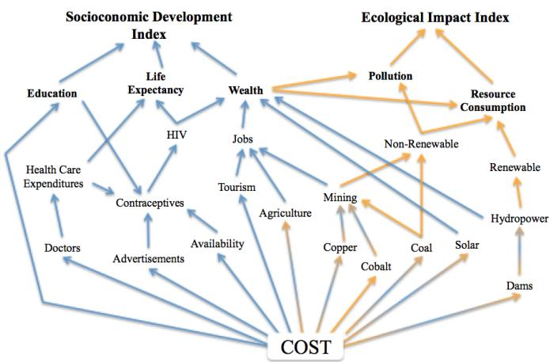
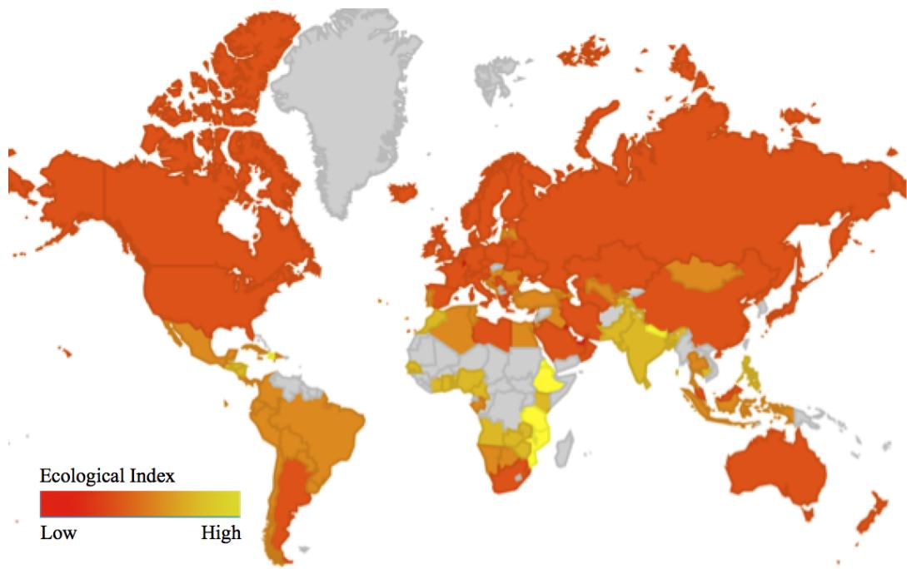
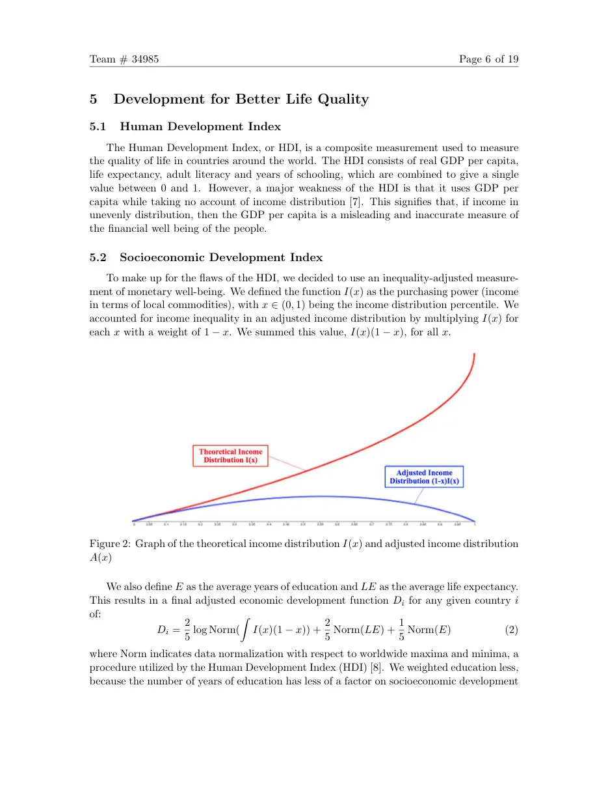

# 2015年美赛特等奖论文：《Zambia可持续发展迭代函数映射的粒子群优化》（ICM-D题）

原件为竞赛论文。补充：文中的阅读练习及“参考解答”为整理时增加，原件图文保留出处。

# 2015年美赛特等奖论文：《Zambia可持续发展迭代函数映射的粒子群优化》（ICM-D题）

## 摘要

### A Particle Swarm Optimization of an Iterative Function Map for Sustainable Development in Zambia

Our team’s objective was to find a way to model sustainability of a country, and then use our model and research to create a 20-year sustainable development plan for one of the countries on the UN 48 Least Developed Countries (LDC) list. Therefore, we first wanted to be able to quantitatively determine sustainability, which is affected not just by environmental health but also by human well-being and overall wealth. We devised two metrics for sustainability – the Socioeconomic Development Index D (based on inequality-accounted income distribution, health, and education) and the Ecological Impact Index E (based on pollution and non-renewable energy consumption). We plotted these two metrics against each other and found a strong negative correlation. Underdeveloped countries tended to have low human-economic development and high ecosystem health, while developed countries leaned towards high socioeconomic development but low ecosystem health. However, a true measure of sustainability can only be obtained from these two supporting values only if the desire for environmental responsibility is known so that the two factors can be accordingly weighted; we found true sustainability to be defined by $\frac { D + \alpha E } { 1 + \alpha }$ , where $\alpha$ represents the importance ICM places on environmental sustainability.

Our team decided to look at Zambia, an underdeveloped country in sub-Saharan Africa, and design a 20 year plan for sustainable development. The Socioeconomic Development Index and the Ecosystem Impact Index were expanded to include Zambia-specific human and environmental factors on a function map that related number of factors, as seen below. To evaluate this map, we iterated over the functions each year for twenty years with cost inputs from the ICM going towards variable values in the map. We then ran a Particle Swarm Optimization on the iterative function map using data from Zambia in order to find the best distribution of monetary investment for sustainable development. In addition, we developed a 2-dimensional cellular automata model that allows the ICM to pinpoint which geographic locations within the country the investments should be focused in. We graphed cost vs. sustainability with varying values of ($\alpha$), and found budget plans for the ICM and Zambia’s government to optimize development and give Zambia “most bang for their buck”.

## 目录

1 Problem Statement
2 Plan of Attack
3 Assumptions
4 Environmental Resource Management Model
   4.1 Quantifying Pollution
   4.2 Strengths and Weaknesses
5 Development for Better Life Quality
   5.1 Human Development Index
   5.2 Socioeconomic Development Index
   5.3 Strengths and Weaknesses
6 Ecological-Economic Trade off
7 20-year plan for Zambia
   7.1 Population Growth and Economic Development
   7.2 Iterated Function Map
   7.3 Function Map Justification
      7.3.1 Disease and Health
      7.3.2 Wealth
   7.4 Nelder-Mead, Powell, and Genetic Optimization
   7.5 Particle Swarm Optimization
   7.6 Evaluating the 20-year Plan
      7.6.1 Strengths and Weaknesses
   7.7 Sensitivity Analysis
8 Conclusion
References
Appendix A Equations for Iterated Function Map

## 1 Problem Statement

With the United Nations (UN) predicting that the world's population will be over 9 billion by 2050, the strain on the Earth's finite resources will be significant. Concerns regarding the balance of human needs with ecosystem health have drawn attention to the concept of sustainable development. The International Conglomerate of Money (ICM) has asked us to help them understand how positive economic development can be achieved while still ensuring the sustainable consumption of resources so that the environment will not be compromised for future generations. The solution proposed within this paper will offer an insight to these problems.

## 2 Plan of Attack

Our objective is to develop a metric to determine the sustainability of a given country and then quantify the trade-off between maintaining ecosystem health and economic development. To determine the most effective mathematical model for this system, we will first create a 2-part metric in order to assess the country's ecological responsibility and socioeconomic development (the two main pillars of sustainability). Then, we will design a Zambia specific 20 year sustainable development plan by optimizing microeconomic and macroeconomic models of sustainability indicators. Lastly, we will project and evaluate the effect of the plan with our 2 part metric.

## 3 Assumptions

- Based on Kuznet's Curve hypothesis, we assumed only air pollution to be important in quantifying net pollution of a developing country [1]. Because there is no readily available data for water/ground pollution in most countries, this allowed us to quantify the relationship between pollution and our Ecological Impact Index.

- There are numerous trends in worldwide development of countries based on a variety of indicators (GDP, population, industry, etc.). Because these relationships generally hold true, we assume Zambia will follow these trends. This allowed for relationship quantification between a number of indicators based on world wide data to predict Zambian growth, based on an initial seed that is Zambia's current values for each indicator.

- We assume that ICM funding over 20 years follows a discrete model rather than continuous (i.e. funding for Zambia is paid for incrementally over the course of 20 years). This allows us to simplify our optimization model by only optimizing a finite number of resource allocations instead of infinite over the twenty year period.

- While effects of money may be semi-erratic, we assumed a deterministic instead of probabilistic effect of ICM spending. This allowed us to create a solvable and reproducable optimization function that gives a distribution of resource allocation based on an input spending cost by the ICM and desire for Ecological over Developmental growth.

- Because industry growth and decay in Zambia is small [2], we assumed Zambia's net change in industry size to be 0 (i.e. only redistribution of wealth between industries would occur) without ICM funding. This allowed us to quantify the effect of ICM spending in Zambia and help use determine what measures would give the ICM the most bang for their buck.

- Zambia is politically stable with little history of political corruption when receiving external funding. Thus, we assume that ICM funding was not squandered, and used in full for the programs ICM allotted the money for. This allowed us to quantify the effect of ICM spending on sustainable development.

## 4 Environmental Resource Management Model

知识点：[数学建模的基本步骤（问题分析、模型假设、建立、求解、检验、推广）](../../../topics/数学建模/jianmo_buzhou.md)、[元胞自动机模型（Cellular Automata）及其应用](../../../topics/数学建模/yuanyao_zidongji.md)、[粒子群优化算法（PSO, Particle Swarm Optimization）](../../../topics/数学建模/lizi_qun_youhua.md)

### 4.1 Quantifying Pollution

A final measurement of the ecological aspect of sustainability would be a weighted pollution index. Since not all pollutants damage the environment and peoples health as much as others, each would be individually weighted by a value indicative of the its current yearly damage on the environment. Global warming potential, or GWP, is a measure of how much heat — which damages the environment through global warming — is entrapped in the environment due to an atmospheric pollutant [3]. GWPs of various greenhouse gases are calculated based on the amount of heat they trap relative to the amount of heat trapped by the same mass of CO2 gas (whose GWP is normalized to 1) over a specified time frame [4]. The Intergovernmental Panel on Climate Change (IPCC) and Kyoto Protocol both use GWP measures as the de facto standard to measure emission damage when creating environmental policy [5]. We used the standard 100-year GWP values, shown below for the air pollutants that we were able to get country emission data for:

Table: Global Warming Potentials (IPCC 2013) [6]

| Pollutant | 100-year GWP | Pollutant | 100-year GWP |
|---|---|---|---|
| Carbon Dioxide (CO2) | 1 | Hydrofluorocarbons | 12400 |
| Methane (CH4) | 28 | Perfluorocompounds | 11100 |
| Nitrous Oxide (N2O) | 265 | Sulfur Hexafluoride | 23500 |

For each country, we calculated pollution as:

$$
Pollution = \sum_{p}^{Pollutants} A_p * W_p \tag{1}
$$

where A is amount of pollutant p emitted per capita and W is the damage-based weighting of that pollutant based on normalized GWP data.

Finally, we combined the pollution data with normalized nonrenewable energy use per capita data equally, transformed the sum onto a [0, 1] scale, and subtract the new value from 1 to find an Ecological Impact Index $E_i$ per country i. Therefore, low $E_i$ represents high pollution and nonrenewable energy consumption, and vice versa for a high $E_i$. We ran our Ecological Impact Index on all countries with available pollution and energy use data. Countries colored grey have missing data.

知识点：[影响因素评估指标体系构建（温度、湿度、经济、教育等）](../../../topics/数学建模/yingxiang_zhibiao.md)、[可持续发展指数 SDI 的构建与指标体系结构](../../../topics/数学建模/kechixu_zhibiao.md)、[一般假设及其合理性说明（Assumptions and Justifications）](../../../topics/数学建模/jiaben_shezhi.md)

### 4.2 Strengths and Weaknesses

Our metric for ecological impact of a country, $E_i$, is both easily calculable (for it is, in essence, a measure of $CO_2$ equivalence and Non-renewable energy consumption) and encompasses all of the primary environmental impacts of a developing country, based on the Kuznet Curve. Because the Kuznet Curve has been extensively studied in literature and is a widely accepted relationship, we know our model for $E_i$ is sound for the effect of development on pollution.

Regarding weaknesses, this metric overlooks ground and water pollution in favor of air pollution. Because some underdeveloped countries suffer from a lack of clean water, this model should be readjusted (if sufficient data exists) to incorporate water pollution and better model $E_i$.

# Zambia可持续发展迭代函数映射的粒子群优化（ICM-D题）

本部分整理了2015年美赛特等奖论文中关于人类发展指数、社会经济调整模型及生态经济权衡的论述，修正了原文中的拼写与断行错误。

## 一、人类发展指数与社会经济调整模型

知识点：[模型优缺点分析（Strengths and Weaknesses）](../../../topics/数学建模/youque_dian.md)、[参数合理性验证](../../../topics/数学建模/canshu_heli_xing.md)、[可持续发展指数 SDI 的构建与指标体系结构](../../../topics/数学建模/kechixu_zhibiao.md)

### 选择 1：人类发展指数的局限性

**背景说明**：
原文第5.1节指出，传统的人类发展指数（HDI）存在一个主要弱点。

- **核心问题**：HDI使用人均GDP作为指标，但未考虑收入分配情况。
- **后果**：如果收入分配不均，人均GDP将是一个误导性的、不准确的衡量人们经济福祉的指标。

**知识点**：经济发展指标

知识点：[人类发展指数 HDI 的局限性与社会经济调整指数的构建](../../../topics/数学建模/hdi_zhibiao.md)

### 选择 2：社会经济调整指数的构建

**背景说明**：
为弥补HDI的缺陷，论文提出了一种基于收入不平等的调整后货币福祉测量方法。

- **定义变量**：
  - $I(x)$：购买力（以当地商品衡量的收入），其中 $x \in (0, 1)$ 代表收入分布百分位。
  - $E$：平均受教育年限。
  - $LE$：平均预期寿命。
- **加权机制**：为了体现收入不平等，对每个 $x$ 值的 $I(x)$ 乘以权重 $(1-x)$，并对所有 $x$ 求和。
- **最终公式**：对于任意国家 $i$，其调整后的经济发展函数 $D_i$ 定义为：

$$
D _ {i} = \frac {2}{5} \log \mathrm{Norm} \left( \int I (x) (1 - x) dx \right) + \frac {2}{5} \mathrm{Norm} (L E) + \frac {1}{5} \mathrm{Norm} (E)\tag{2}
$$

其中 $\mathrm{Norm}$ 表示相对于全球最大值和最小值的数据归一化过程。

> [!NOTE]
> **权重设定理由**：教育权重的设定较低（1/5），因为受教育年限对社会经济发展的影响小于预期寿命和收入，且受教育年限与这两者已存在强相关性。

**知识点**：多目标优化、数据归一化

*注：图中灰色区域的国家缺少收入分布、预期寿命或受教育年限的相关数据。*

知识点：[人类发展指数 HDI 的局限性与社会经济调整指数的构建](../../../topics/数学建模/hdi_zhibiao.md)、[可持续发展指数 SDI 的构建与指标体系结构](../../../topics/数学建模/kechixu_zhibiao.md)

### 选择 3：模型的优缺点分析

**优点**：
1. **重视公平**：通过结合收入份额和按百分位计算的分配，该模型赋予财富公平分配更高的权重，重视平等而非仅仅是平均收入。
2. **包容性更强**：通过将经济份额和不平等整合在同一个积分中，提供了比单独计算GDP和不平等后再合并更全面的财富衡量指标。
3. **综合效应**：当此指标与教育和健康结合时，能更有效地衡量财富对人口日常社会经济福祉的影响。提升该指标不仅意味着增加金钱，也意味着整体健康和福祉的提升。

**缺点**：
1. **单一指标的局限性**：由于将经济和福祉合并为一个值，相比于两个独立的值，可能在某些视角下显得不够细致。但考虑到优化单个值比优化两个值更高效，对于此类目的，拥有一个稳健的单值指标是必要的。
2. **信息覆盖不全**：该指标仅结合了三个信息来源（尽管是作者认为最重要的三个）。未包含的其他因素仍会对国家的健康和福祉产生未被测量的影响。

**知识点**：模型评价

## 二、生态经济权衡与可持续性

知识点：[模型优缺点分析（Strengths and Weaknesses）](../../../topics/数学建模/youque_dian.md)

### 选择 4：生态与经济发展的矛盾

**现状描述**：
优化国家的可持续性非常困难，因为环境保护与工业发展之间往往存在权衡（Trade-off）。

- **低度发达国家特征**：联合国48个最不发达国家（LDCs）列表中的国家聚集在图表的左上角，表现为环境破坏低但人类福祉低。
- **发达国家特征**：较发达的国家生活质量较好，但对生态系统的影响更大。
- **假设趋势**：随着国家的发展，它们似乎遵循 $D_i$（社会经济指数）与 $E_i$（生态影响）之间的负相关趋势。
- **理想状态**：理想的配置——完美的可持续性——位于点 $(1, 1)$，即国家在经济和环境上均具有可持续性。

知识点：[可持续发展指数 SDI 的构建与指标体系结构](../../../topics/数学建模/kechixu_zhibiao.md)、[生态足迹（Ecological Footprint）与社会可持续性指数 SSI](../../../topics/数学建模/shengtai_zuji.md)、[人类发展指数 HDI 的局限性与社会经济调整指数的构建](../../../topics/数学建模/hdi_zhibiao.md)

### 选择 5：与社会可持续性指数（SSI）的对比

**对比依据**：
论文将前10名国家与可持续社会基金会（SSF）提供的最新社会可持续性指数（SSI）排名进行了比较。

- **SSI定义**：基于《布伦特兰报告》（1987年）的定义：“可持续发展是既满足当代人的需求，又不损害后代人满足其需求的能力的发展。”
- **SSI维度**：包括三个福祉维度：人类福祉、环境福祉和经济福祉。
- **本文模型对应**：
  - 生态影响（Ecological Impact） $\approx$ SSI的环境福祉。
  - 社会经济指数（Socioeconomic Development Index） $\approx$ SSI的人类福祉指数（包含教育、预期寿命等元素）。
- **核心理念**：SSF指出，向可持续发展迈进需要一种综合方法，同时关注人类福祉和环境福祉；从人类中心主义的角度看，经济福祉（如GDP）应仅仅被视为实现这些目标的手段。

> [!IMPORTANT]
> **关键结论**：经济不应被视为终极目标，而是实现人类与环境双重福祉的工具。

**知识点**：可持续发展、系统动力学

# 2015年美赛特等奖论文：《Zambia可持续发展迭代函数映射的粒子群优化》（ICM-D题）

本部分为原论文第 4 部分（共 8 部分），对应原件第 10–11 页内容，主要涉及可持续性与SSF指数的对比验证以及赞比亚20年发展计划。

## 四、模型验证与相关性分析

仅对双方都有数据的国家进行了排名。如下表所示，由我们的社会经济指数确定的前十大国家中，有七个出现在SSF人类福祉指数的前十名列表中。同样，由我们的生态影响指数确定的前十大国家中，也有七个出现在SSF环境福祉指数的前十名列表中。我们可以看出，我们创建的指标产生了证实联合国接受排名的结果。我们的可持续发展模型具有清晰、易于理解的基础，基于国家从欠发达国家转变为发达国家所遵循的历史趋势。

<table>
<tr><td colspan="4">Top 10 Most Sustainable Countries</td></tr>
<tr><td>Our $D_i$ </td><td>SSF Human Well-being</td><td>Our $E_i$ </td><td>SSF Enviro. Well-being</td></tr>
<tr><td>Norway</td><td>Finland</td><td>Haiti</td><td>Nepal</td></tr>
<tr><td>Iceland</td><td>Iceland</td><td>Ethiopia</td><td>Mozambique</td></tr>
<tr><td>Australia</td><td>Germany</td><td>Mozambique</td><td>Zambia</td></tr>
<tr><td>Switzerland</td><td>Japan</td><td>Tanzania</td><td>Tanzania</td></tr>
<tr><td>Netherlands</td><td>Sweden</td><td>Nepal</td><td>Kenya</td></tr>
<tr><td>Ireland</td><td>Denmark</td><td>Kenya</td><td>Cameroon</td></tr>
<tr><td>Sweden</td><td>Norway</td><td>Nigeria</td><td>Ethiopia</td></tr>
<tr><td>Denmark</td><td>Austria</td><td>Togo</td><td>Tajikistan</td></tr>
<tr><td>Germany</td><td>Hungary</td><td>Bangladesh</td><td>Benin</td></tr>
<tr><td>Finland</td><td>Ireland</td><td>Zambia</td><td>Haiti</td></tr>
</table>

知识点：[可持续发展指数 SDI 的构建与指标体系结构](../../../topics/数学建模/kechixu_zhibiao.md)、[模型验证方法概述（随机模型与确定性模型验证）](../../../topics/数学建模/moxing_yanzheng.md)

### 7 20-year plan for Zambia

赞比亚是撒哈拉以南非洲的一个欠发达内陆国家，属于48个最不发达国家之一，目前其社会经济指数 $D_i = .339$，生态影响指数 $E_i = .742$。在本节中，我们提出了一套可由国际连续建模竞赛（ICM）资助的计划、政策和援助措施，以促进赞比亚在20年内的可持续发展。在制定赞比亚的发展计划时，我们必须考虑以下关键特征 [2]：

- 高生育率和出生率
- 医疗保健差且死亡率高
- 医生严重短缺
- 艾滋病病毒/艾滋病泛滥（超过15%的人口感染）
- 收入差距大（顶层10%控制47%的收入，基尼系数 GINI coeficient = 0.6）
- 农业、采矿和旅游业构成赞比亚工业的重要组成部分

我们的计划建立在代表可持续性的两个指数之上，以便找出这些特征如何直接影响 $D_i$ 和 $E_i$。

Team # 34985

Page 9 of 19

知识点：[可持续发展指数 SDI 的构建与指标体系结构](../../../topics/数学建模/kechixu_zhibiao.md)、[影响因素评估指标体系构建（温度、湿度、经济、教育等）](../../../topics/数学建模/yingxiang_zhibiao.md)、[长期预测模型（如20年可持续发展计划预测）](../../../topics/数学建模/nian_yuce.md)

### 7.1 Population Growth and Economic Development

在发展中国家的资金和援助重点上，知道该把资源集中在哪里对于国家发展的效率至关重要。为了优化ICM的“性价比”比率，我们创建了一个自动机模型，旨在根据人口密度和财富确定最优援助地点。

众所周知，财富分配和人口动态是交织在一起的。为了模拟人口和财富随时间的增长，我们创建了一对迭代的微观经济和基于主体的行为函数系统，以定义二维元胞自动机的规则，观察各种初始范式的影响。我们将财富和人口的扩散建模为彼此的共同因子，基于爱泼斯坦（Epstein）基于主体的糖景社会模拟模型的调整版本 [13]。

$$
{\frac {d W}{d t}} = {\frac {d G i v e n}{d t}} + {\frac {d R e c e i v e d}{d t}}\tag{3}
$$

$$
{\frac {d P}{d t}} = {\frac {d G r o w t h}{d t}} + {\frac {d M i g r a t i o n}{d t}}\tag{4}
$$

通过将 $\frac { d } { d t }$ 近似为 $\frac { \Delta } { \Delta t }$ 并设置 $\Delta t = 1$，我们可以将 $W ( t )$ 和 $P ( t )$ 的成对微分转化为迭代函数系统，通过元胞自动机计算国家的人口和财富。这些迭代函数可以写成如下所示，其中 $B _ { R }$ 为出生率，LE 为预期寿命。$B _ { R } ( W _ { n } )$ 和 $L E ( W _ { n } )$ 都是财富的函数，使得 $B _ { R } ( W _ { n } )$ 是一个计算出的最佳拟合对数曲线，而 $L E =$ $L E ( W _ { n } )$ 是作为国民GDP函数的预期寿命普雷斯顿曲线（附录A）[14]。因此，我们可以将迭代方程写为：

$$
W _ {n + 1} = (1 - 8 \epsilon) W _ {n} + \epsilon \sum_ {i = 0} ^ {\text {neighbors }} W _ {n, i}\tag{5}
$$

$$
P _ {n + 1} = P _ {n} + P _ {n} (B _ {R} (W _ {n}) - \frac {1}{L E (W _ {n})}) + \Delta M i g r a t i o n\tag{6}
$$

其中

$$
\Delta M i g r a t i o n = \beta P _ {n} (1 - \frac {W _ {n}}{\sum W _ {n , i}}) - \beta \sum^ {\text {neighbors }} \frac {W _ {n}}{\sum W _ {n , j}} P _ {n, i}\tag{7}
$$

在这种情况下，$\epsilon$ 代表就业系数（即通过邻居就业分配的财富百分比），$\beta$ 代表迁移系数（即每次迭代迁移的人口百分比）。本质上，财富作为当前财富的一部分给予每个邻居，而人口的增长既是其自身的函数，也是迁移的函数。净迁移基于离开单元格并进入相邻单元格的 population 的迁移百分比 $\beta$，与各邻居的人均财富（GDP/capita）最高成正比。方程 5 和 7 包括单元格邻居的求和，这代表了整个邻域的值。我们的元胞自动机模型在20年期间的结果如图 5 所示。

Team # 34985

Page 10 of 19

## 7.1 元胞自动机模型结果

图 5 展示了随机初始财富分布与有偏初始财富分布（集中于右下角）在 10 年和 20 年后的结果，使我们能够观察财富随时间的空间经济均衡。我们看到，随着时间推移，财富自然分化，人口密度也相应分化，表明在没有外部因素的情况下，财富不平等会自然加剧。

因此，我们可以看到财富会自行向人口较少的地区聚集，从而加剧收入差距。为了通过外部援助抵消这一趋势，我们需要将努力集中在贫困加剧的地区，这将使种子分布从有偏（右图）调整为更随机（左图），从而使货币资金在赞比亚全境产生更大影响。

进一步建议引入累进税，鉴于赞比亚财富分布不均，这可能是有益的 [15]。这种收入不平等反映在赞比亚较低的 $D_i$ 值上。通过实施累进税，我们发现收入差距可以缩小，国家 GDP 可以提高，因此我们建议进一步研究累进税方案，以促进赞比亚的发展。

## 7.2 迭代函数映射

通过元胞自动机模型，我们可以在地理上定位 ICM 应集中努力的区域。然而，我们还需要知道 ICM 可以投资于赞比亚经济和社会的哪些具体因素。为了准确帮助规划赞比亚的 20 年发展计划，我们构建了影响赞比亚社会经济与生态指数的主要因素映射图。

映射图中的因素相互依存，因此我们需要基于随时间迭代的历史迭代数据来构建。于是我们得到一张结果映射图，它作为函数映射，使我们能够量化每个指数，即每个指数间接是各个项目成本的函数。给定必须在 20 年内有效支出的预算，我们必须找到资金在映射图各资源间的最优分配。我们将研究四种技术（遗传算法、Nelder-Mead 搜索、Powell 搜索和粒子群优化）来寻找最佳投资分配。

## 7.3 函数映射论证

知识点：[迭代函数映射（Iterative Function Map）](../../../topics/数学建模/diedai_hanshu.md)、[粒子群优化算法（PSO, Particle Swarm Optimization）](../../../topics/数学建模/lizi_qun_youhua.md)

### 7.3.1 疾病与健康

赞比亚仍是全球 HIV/AIDS 致死率最高的 10 个国家之一，平均每年记录 45 000 例 HIV 相关死亡，现有人口中感染率超过 13.5%（超过 980 000 人）[16]。HIV 感染者免疫系统往往较弱，因此容易感染结核病等传染病。结果，赞比亚预期寿命仅为 48 岁，远低于世界平均水平，即使按赞比亚的贫困和资源匮乏进行调整也是如此。更重要的是，赞比亚公民出生时的平均健康预期寿命（HALE）仅为 40 岁 [17]。

我们的目标是在赞比亚实施能够提高平均预期寿命并降低 HIV 感染率的项目。利用世界卫生组织和世界银行的数据 [17] [2]，我们建立了一种关系，将预期寿命量化为映射图中与其相关的每个变量（HIV 感染率、医疗支出、教育等）的函数。这些方程通过对线性化关系趋势进行最佳拟合得出，见附录 A。

# 2015年美赛特等奖论文：《Zambia可持续发展迭代函数映射的粒子群优化》（ICM-D题）

本资料整理自2015年国际大学生数学建模竞赛（ICM）D题特等奖论文，内容涉及赞比亚可持续发展模型中的财富效应、优化算法比较及粒子群优化结果分析。

## 一、模型构建与优化方法

知识点：[长期预测模型（如20年可持续发展计划预测）](../../../topics/数学建模/nian_yuce.md)、[粒子群优化算法（PSO, Particle Swarm Optimization）](../../../topics/数学建模/lizi_qun_youhua.md)、[影响因素评估指标体系构建（温度、湿度、经济、教育等）](../../../topics/数学建模/yingxiang_zhibiao.md)

### 选择 1

**7.3.2 Wealth（财富）**

赞比亚是一个 struggling economy（挣扎中的经济体），存在巨大的收入差距 [18]。这是其发展排名较低的重要原因之一。为了实现赞比亚可持续发展的目标，我们建立了财富对可持续性成本地图中 $E_i$（生态指数）和 $D_i$（社会经济指数）的影响模型（见图6）。直观上，财富随着就业（工作机会）的增加而增加，随着 HIV 流行率的降低而增加 [19]。财富也随着可再生资源的利用而增加，因为来自可再生能源的财富节省原本会用于化石燃料进口。在财富之上，我们看到当财富（当注入不可再生资源时）导致资源消耗和污染增加时，$E_i$ 会下降。直觉上，$D_i$ 指数随着财富和收入平等的增加而增加。每个关系的方程见附录 A。

知识点：[可持续发展指数 SDI 的构建与指标体系结构](../../../topics/数学建模/kechixu_zhibiao.md)、[影响因素评估指标体系构建（温度、湿度、经济、教育等）](../../../topics/数学建模/yingxiang_zhibiao.md)、[数学建模的基本步骤（问题分析、模型假设、建立、求解、检验、推广）](../../../topics/数学建模/jianmo_buzhou.md)

### 简答 1

**7.4 Nelder-Mead, Powell, and Genetic Optimization（Nelder-Mead、Powell 和遗传优化）**

Nelder-Mead 和 Powell 优化方法都从投资资金在各种资源地图中的随机分布开始，并通过迭代生成更好的分布来优化我们的投资，我们希望这能带来更成功的可持续发展 [20] [21]。使用这两种算法对我们的迭代函数映射进行优化的主要缺陷有两个：两种方法都会快速找到并锁定局部最优解，且这两种方法都不是为了有界优化设计的，这降低了它们的收敛能力，从而进一步降低了它们的有效性。

为了克服 Nelder-Mead 和 Powell 优化的弱点，我们实现了一种遗传算法，以最大化投资分布的可持续性度量，其中：

$$
S(investments) = \frac{D_i + \alpha * E_i}{1 + \alpha} \tag{8}
$$

在这种情况下，$\alpha$ 是国家对环境责任的渴望程度。由于遗传算法基于种子染色体的交叉和突变，它可以被限制边界，并且在寻找全局最优解方面比 Nelder-Mead 和 Powell 方法更有效；然而，它太慢了，无法用于收集我们进行分析所需的数据。因此，我们决定放弃基于遗传算法的优化。

知识点：[迭代函数映射（Iterative Function Map）](../../../topics/数学建模/diedai_hanshu.md)、[遗传算法优化人力资本管理（染色体表示与适应度函数）](../../../topics/数学建模/yichuan_suanfa.md)

### 简答 2

**7.5 Particle Swarm Optimization（粒子群优化）**

最后，我们着手实施粒子群优化。这种方法通过将一组粒子初始化为投资分布搜索空间中的随机位置来实现，每个粒子都被吸引到它自己找到的最佳投资分布以及任何粒子找到的最优秀投资分布。粒子的复杂搜索和群体行为已被证明在各种应用中比遗传算法更高效、更成功地找到全局最优解 [22]。事实上，我们发现，通过将种群大小设置为 128 个粒子，我们能够比遗传算法更快地收敛到最优解，并且这些最优解更有可能是全局最优解。

团队 # 34985
第 13 页，共 19 页

使用粒子群优化，我们找到了不同投资值和 $\alpha$ 值下的最优投资分布和可持续性。由于处理能力和时间限制，我们将 20 年计划分为两个 10 年计划，而不是我们希望的逐年年度计划。图 7 显示了投资与 resulting sustainability（ resulting 可持续性）之间的关系。

对于不同的投资价值，根据 $\alpha$ 值的不同，会有不同的可持续性水平结果。在任何给定的投资下，就生态系统保护而言，选择具有最高 resulting 可持续性水平的计划是最有益的，但这将取决于赞比亚政府对环境责任的渴望及其对相应投资分布的偏好。例如，给定 12 亿美元的投资（见图 7 中的垂直线），以下投资分布是最优的：

团队 # 34985
第 14 页，共 19 页

知识点：[粒子群优化算法（PSO, Particle Swarm Optimization）](../../../topics/数学建模/lizi_qun_youhua.md)、[长期预测模型（如20年可持续发展计划预测）](../../../topics/数学建模/nian_yuce.md)

### 简答 3

**7.6 Evaluating the 20-year Plan（评估 20 年计划）**

在评估我们 20 年的计划时，我们绘制了由粒子群优化确定的最优资源分配计划的总可持续性 (S) 随时间 (t) 变化的趋势图。 resulting 图形展示了 $D_i$, $E_i$ 和 S 作为时间函数的趋势。

图 9 中的趋势让我们对在不同 $\alpha$ 水平和 12 亿美元示例预算下的优化财务投资分布有何预期有了深入了解。所有三种场景都导致社会经济发展迅速增加，随之而来的是可持续性的提高。然而，这需要付出代价——生态指数 $E_i$ 的下降。大约 10-12 年后，社会经济增长放缓，可持续性稳定在一个高于初始值的水平。生态指数开始上升。这些趋势表明，对于一个欠发达国家来说，要实现高效和可持续的发展，社会经济指数 $D_i$ 的因素（如财富、预期寿命和教育）必须首先以增加环境为代价得到正面提升。然后，一旦整体可持续性达到高于其初始值的平台期，生态系统健康就可以慢慢改善。总体而言，我们建议在前 10 年遵循 $\alpha = 0.5$ 轨迹，然后通过遵循 $\alpha = 1.5$ 轨迹更加重视环境影响，以确保整体可持续性的更多增长。

团队 # 34985
第 15 页，共 19 页

知识点：[粒子群优化算法（PSO, Particle Swarm Optimization）](../../../topics/数学建模/lizi_qun_youhua.md)、[可持续发展指数 SDI 的构建与指标体系结构](../../../topics/数学建模/kechixu_zhibiao.md)、[长期预测模型（如20年可持续发展计划预测）](../../../topics/数学建模/nian_yuce.md)

### 7.6.1 Strengths and Weaknesses

The major strength of our team’s 20-year plan is that it successfully models a complex iterative network of relationships between a variety of factors, all of which are quantified in terms of cost. This allows us to algorithmically choose an optimal distribution of resources based on ICM funding and allow the ICM to maximize "bang for the buck" return on investment with regards to how sustainable they desire development to be. By being able to combine and uncouple socioeconomic and environmental factors, our model demonstrates versatility and maximizes use of a variety of input factors uniquely tailored to Zambia, in order to both successfully and sustainably enhance Zambia’s growth.

On the other hand, a weakness of the model is that it is calibrated on two iterations of 10 year long periods. This is due to constraints in computer processing power and time limitations while devising the 20-year plan. However, given greater computing power, we envision our model being used to create yearly ICM investment distribution plans to maximize the overall increase in both socioeconomic and ecological sustainability over 20 years for Zambia. Another weakness is that since we do not include import or exports in our model, total wealth does not increase as much as it would had we accounted for imports and exports. This would affect the value of our socioeconomic development index.

知识点：[数学建模的基本步骤（问题分析、模型假设、建立、求解、检验、推广）](../../../topics/数学建模/jianmo_buzhou.md)、[模型优缺点分析（Strengths and Weaknesses）](../../../topics/数学建模/youque_dian.md)

### 7.7 Sensitivity Analysis

It is a necessity of any strong model that it be tolerant to a small amount of error in its inputs. For our model, this could result from incorrect population caps for job growth, Zambia not following world trends exactly regarding fit relationships, slight over or under budgeting by the ICM, etc. Such errors could cause a poorly written algorithm to return incorrect, and very poorly affected results. Thus, to test our model’s sensitivity, we intentionally created small sources of error in our data and compared the results to the results using unmodified seed data.

One error we introduced was the introduction of a higher population cap in the agricultural sector by 10%. We would believe this to have an impact in the increase in the number of total agriculture jobs, but little to no impact in the total economic and developmental indices, because our algorithms should have compensated for this cost elsewhere in the Zambian sustainability-cost web. We found the agricultural jobs increased by around 7.6% but the overall $E_i$ and $D_i$ indices only were affected by −0.2 and 0.1 percent respectively. Similar values (−0.3 and 0.4%) were found when the process was repeated with the mining industry.

To further test the robustness of our model, we introduced a second error: not accounting for solar energy in the calculation for wealth. In doing so, we believe that our algorithm should instead account for renewable energy with hydroelectric power, maintaining near constant values of $E_i$ and $D_i$. The results matched our expectations: our program instead added dams instead of solar panels, accounting for a -0.2% in $D_i$ and no change in $E_i$. These values make sense, for wealth should decrease with higher expenses of energy with dams than with solar panels.

Overall, we find that our model successfully deals with errors in input and demonstrates solid robustness, matching expected behaviour with only fractions of a percent error, which are understandable because small input errors are only a fraction of a percent of the total sustainability metric.

知识点：[敏感性分析方法（Sensitivity Analysis，单参数与多参数变动）](../../../topics/数学建模/minganxing_fenxi.md)、[模型优缺点分析（Strengths and Weaknesses）](../../../topics/数学建模/youque_dian.md)、[参数合理性验证](../../../topics/数学建模/canshu_heli_xing.md)

### 8 Conclusion

We have modeled sustainability and devised a 20-year sustainable development plan for Zambia based on our findings. First, we devised two metrics to quantify the sustainability of a country: the Socioeconomic Development Index $D_i$ and the Ecological Impact Index $E_i$. We found that these two indices have a negative correlation - better human-economic life quality resulted in lower ecosystem health. Therefore, we had to devise a 20-year plan that maximized economic expansion but also maintained a high level of environmental preservation. To see where to concentrate our aid geographically we used coupled differential equations to represent a wealth-population dynamic and implemented a two-dimensional cellular automata model. Then we created a personalized sustainability map for Zambia that included factors specific to the country. We found correlations between each of the factors by linearizing exponential and logarithmic relationships found from historical data. Finally we optimized this model using a particle swarm optimization and graphed financial investment vs. sustainability for varying desires for environmental responsibility. Therefore, the ICM can identify which highly effective strategies and programs to be implemented for a successful 20 years of sustainable development in Zambia.

## References

[1] M. Tucker. Carbon Dioxide Emissions and Global GDP. Ecological Economics, 15(3):215–223, 1995.

[2] World Bank Indicator Data. Retrieved from: http://data.worldbank.org/indicator.

[3] L.D. Danny Harvey. A guide to global warming potentials (GWPs). Energy Policy, 106(28):11812–11817, 2009.

[4] D. Albritton, R. Derwent, I. Isaksen, M. Lal, and D. Wuebbles. Radiative forcing of climate change. Climate Change 1995, The Science of Climate Change, pages 118–131, 1996.

[5] S. J. Smith and M. L. Wigley. Global warming potentials: Climatic implications of emissions reductions. Climate Change, 44(4):445–457, 2000.

[6] G. Myhre, D. Shindell, F. M. Bréon, W. Collins, J. Fuglestvedt, J. Huang, D. Koch, J. F. Lamarque, D. Lee, B. Mendoza, T. Nakajima, A. Robock, G. Stephens, T. Takemura, and H. Zhang. 2013: Anthropogenic and Natural Radiative Forcing in Report of the Intergovernmental Panel on Climate Change. Cambridge University Press, Cambridge, United Kingdom, 2013.

[7] Elizabeth A. Stanton. The Human Development Index: A History. Working Paper Series, 2007.

[8] Milorad Kovacevic. Review of HDI Critiques and Potential Improvements. UNRP Human Development Research Paper, 2010.

[9] UN list of Least Developed Countries. Retrieved from: http://unctad.org/en/pages/aldc/Least%20Developed%20Countries/UNlistofLeastDevelopedCountries.aspx.

[10] Geurt van de Kerk and Arthur Manuel. A comprehensive index for a sustainable society: The SSI – the Sustainable Society Index. Ecological Economics, 66(2-3):228–242, 2008.

[11] Brundtland Commission. World Commission on Environment and Development: Our Common Future. Oxford University Press, 1987.

[12] Measuring wellbeing and progress towards sustainability. Retrieved from: http://ec.europa.eu/environment/beyondgdp/download/factsheets/bgdpvessi.pdf.

[13] R. Axtell J.M. Epstein. Growing Artificial Societies: Social Science from the Bottom. UpMIT Press, Cambridge, MA, 1996.

[14] Samuel H. Preston. The Changing Relation between Mortality and Level of Economic Development. Population Studies, 29(2):231–248, 1975.

[15] Geurt van de Kerk and Arthur Manuel. The Case for a Progressive Tax: From Basic Research to Policy Recommendations. Ecological Economics, 25(4):165–190, 2011.

[16] Major problems facing Zambia today. Retrieved from: http://www.africaw.com/majorproblemsfacingzambiatoday.

[17] World Health Statistics 2010. Retrieved from: http://www.who.int/gho/publications/worldhealthstatistics/ENWHS10Full.pdf.

[18] Zambia Institute for Policy Analysis & Research. The distribution of household income and the middle class in Zambia. 2013.

[19] HIV Impact on Economic Growth. Retrieved from: http://www.un.org/esa/population/publications/AIDSimpact/91CHAPVIII.pdf.

[20] J. A. Nelder and R. Mead. A simplex method for function minimization. The Computer Journal, 1965.

[21] M. J. D. Powell. An efficient method for finding the minimum of a function of several variables without calculating derivatives. The Computer Journal, 1964.

[22] R. Hassan, B. Cohanim, O. de Weck, and G. Venter. A comparison of particle swarm optimization and the genetic algorithm. AIAA multidisciplinary design optimization specialist conference, 2005.

## Appendix A Equations for Iterated Function Map

| # | Feature | Inputs | Equation |
| :--- | :--- | :--- | :--- |
| 1 | Life Expectancy | $x$ = Doctor Population Density (per 1000) | $5.058\ln(x) + 65.02$ |
| 2 | % Use of Contraceptive | $x$ = Years of Education | $2.07x + 27.54$ |
| 3 | Years of Education | $x$ = Government HIV Health Care Expenditure per capita | $1.4856\ln(x) + 9.9122$ |
| 4 | Life Expectancy | $x$ = Total Health Care Spending per capita | $5.8066\ln(x) + 33.7923$ |
| 5 | Birth Rate | $x$ = GDP per capita | $0.070428 - 5.62\ln(x)$ |
| 6 | Life Expectancy | $x$ = GDP per capita | $6.6354\ln(x) + 10.754$ |
| 7 | Total Energy Consumption | $x$ = Wealth per capita, $P$ = population | $1.41812x^{0.7587} \cdot (1.628 \times 10^{-6}) \cdot P$ |
| 8 | $HIV_{n+1}$ | $HIV_n$ = total # HIV in yr. $n$, $U$ = Contraceptive Use | $HIV_n + HIV_n \cdot (5.51 \times 10^{-9}(P - HIV_n)(1 - 0.9 \cdot U)) - 0.02455 \cdot HIV_n$ |
| 9 | Non-Renewable Energy Use | Total Energy, Renewable | Total Energy Consumption - Renewable |
| 10 | Hydropower | $x$ = Total Wealth | $(3.1536 \times 10^{-10}) \cdot x$ |
| 11 | $Pop_{n+1}$ | $Pop_n$ = total pop. in yr. $n$, $x$ = Wealth per capita | $(-1.316\ln(x) + 14.576)(0.01) \cdot Pop_n + Pop_n$ |
| 12 | $Wealth_{n+1}$ | $Wealth_n$ = total wealth in yr. $n$, $x$ = Hydropower, $J$ = jobs | $Wealth_n(1 - 0.06 \cdot HIV_n) + (1.58 \times 10^8) \cdot x + 7000 \cdot J$ |
| 13 | Jobs | $M$ = # of Mining jobs, $T$ = # of Tourism jobs, $A$ = # of Agriculture jobs | $\frac{150000}{1+2e^{-(2.9 \times 10^{-6}) \cdot M}} + \frac{150000}{1+4.7692e^{-D_iT \cdot (7.5 \times 10^{-6})}} + \frac{125000}{1+\frac{2}{3}e^{-(2.4 \times 10^{-6}) \cdot A}}$ |

The equations in the above table were derived through linearized plots of data extracted from Worldbank and WHO, giving net relationship trends between each variable connected by an arrow in the Figure 6 map.

知识点：[可持续发展指数 SDI 的构建与指标体系结构](../../../topics/数学建模/kechixu_zhibiao.md)、[长期预测模型（如20年可持续发展计划预测）](../../../topics/数学建模/nian_yuce.md)、[生态足迹（Ecological Footprint）与社会可持续性指数 SSI](../../../topics/数学建模/shengtai_zuji.md)
