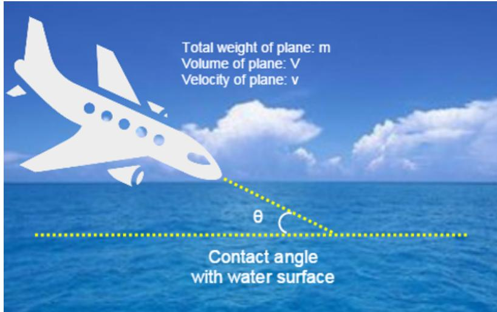
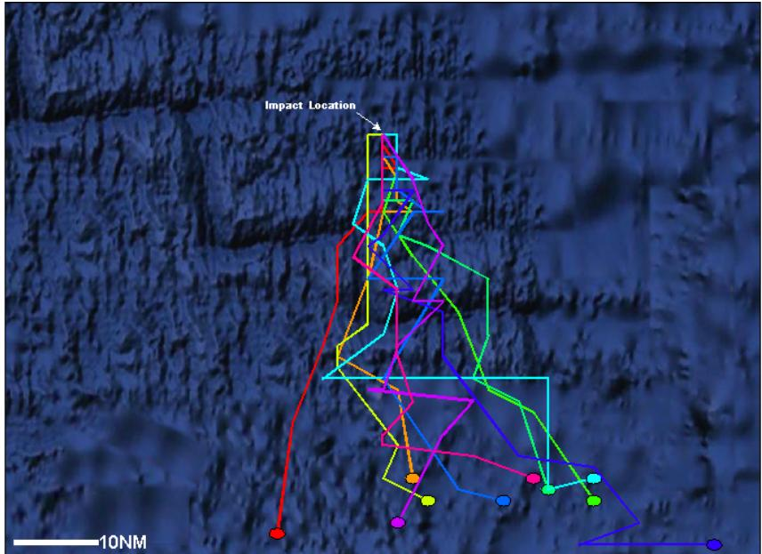
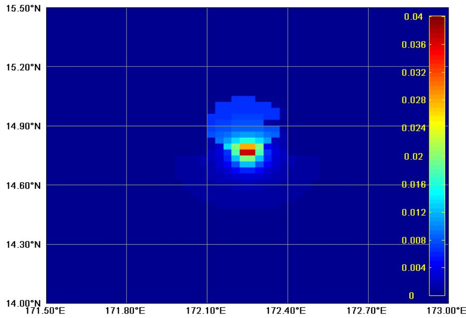
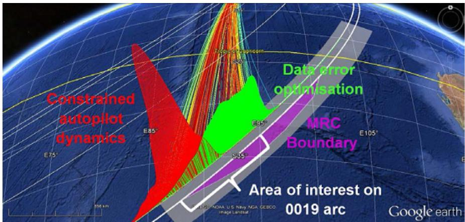
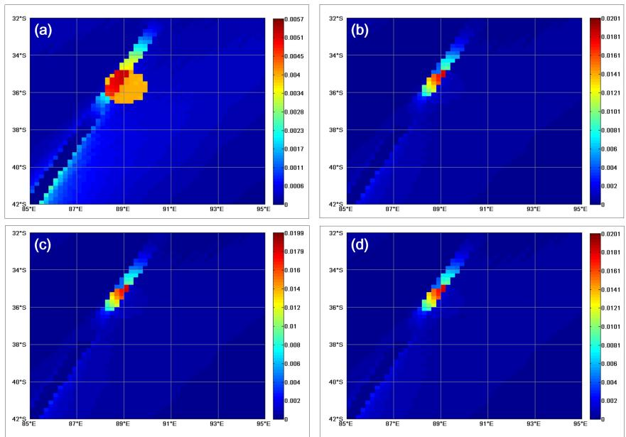

# 2015年美赛特等奖论文：寻找失踪飞机（A题）

原件为竞赛论文。补充：文中的阅读练习及“参考解答”为整理时增加，原件图文保留出处。

## 一、摘要

### 摘要 1

2014 年发生了一系列空难，造成重大人员伤亡，其中包括马来西亚航空公司 370 航班（MH370）在印度洋的神秘失踪。尽管相关国家为寻找飞机这一关键任务付出了巨大努力，但考虑到搜索空间广阔、信息匮乏，飞机仍未找到。在以往的经验中，数学模型在帮助寻找开阔水域失踪飞机方面发挥了主导作用。本文讨论可协助寻找海上失踪飞机的数学模型。

为建立辅助规划开阔水域失事飞机搜索的数学模型，我们首先分析可能的情景并提出假设与假说。然后根据所搜索飞机的类型，建立碰撞模型以预测失事产生的漂浮物数量。主体部分，我们基于贝叶斯定理建立搜索模型，依次考虑失事漂浮物的行为、水面搜索与水下搜索的结果，以指导后续搜索过程。此外，向各搜索飞机分配搜索区域时采用分支定界算法，以优化水面与水下搜索过程可能的结果。我们构建仿真模块，用虚构与真实情景检验模型并进行计算。

随后我们将模型应用于法国航空 447 航班（AF447）与 MH370 的实际案例，采用真实世界数据。我们对 AF447 案例推荐的搜索区域与水下残骸位置相符；对 MH370，我们基于可获取信息预测其可能的残骸位置。

之后对模型进行灵敏度分析，表明模型稳定、稳健且易于适应不同情景。最后，我们讨论模型的优点与不足。

总之，我们的模型在准确性、效率、应用价值与稳健性方面表现突出，尽管在计算复杂度、部分不切实际的假设以及模型某些参数的确定方法上仍有改进空间。

关键词：贝叶斯定理，搜索，失踪飞机，分支定界算法

知识点：[POC（包含概率）更新算法确定搜索模式](../../../topics/数学建模/poc_gengxin.md)、[贝叶斯定理在搜索中的应用（Bayes' Theorem）](../../../topics/数学建模/beiyesi_dingli.md)、[考虑尸体、医院和接触者追踪的原因阐述](../../../topics/数学建模/shi_ti_yiyuan.md)

### 摘要 2

（原件此部分为目录页，已按格式规范省略。）

## 二、引言

知识点：[数学建模的基本步骤（问题分析、模型假设、建立、求解、检验、推广）](../../../topics/数学建模/jianmo_buzhou.md)、[文献综述与研究背景撰写方法](../../../topics/数学建模/wenxian_zongshu.md)、[任务分解与目标明确](../../../topics/数学建模/renwu_fenjie.md)

### 引言 1

值此周年之际，2014 年 3 月 8 日马来西亚航空公司 370 航班（MH370）的失踪已成为航空史上的谜团之一。这一黑暗之谜也让公众想起法国航空 447 航班（AF447）的悲剧：2009 年 6 月 1 日，该航班在执行里约热内卢至巴黎的夜间飞行时在南大西洋上空失踪，近两年后其残骸才在第四阶段海上搜索中被定位。

怀着对遇难者的深切哀悼，当局正在思考如何建立更高效、更准确的海上搜救（SAR）仿真系统。该系统基于飞行动力学计算与预测、海洋模型、大量搜索结果等。目前主要困难在于数据匮乏与对海洋地理了解甚少（例如南印度洋海底大部分未测绘的地形阻碍了 MH370 的搜救 [1]）。

我们的目标是构建一个通用、可靠的数学模型，对应一架据信在从 A 点飞往 B 点途中于开阔水域坠毁的失踪飞机。权衡上述因素，我们提出一套有效的搜索方案以精确定位失踪飞机。具体而言，本文完成以下工作：

- 建立碰撞模型，确定失事产生的漂浮物数量。
- 构建仿真模块，表示漂浮物在水中的真实运动。
- 基于贝叶斯定理提出搜索模型，依次考虑水面搜索与水下搜索，以优化搜索区域。
- 建立分配模型，将搜索飞机与搜索区域匹配。
- 将上述方法用于第四次寻找 AF447 的案例，以验证模型的可信度。
- 利用可获取数据预测 MH370 残骸的可能位置，并为后续搜索工作提供建议。
- 分析模型固有的优点与不足，明确潜在的发展方向。

## 三、基础分析

知识点：[贝叶斯定理在搜索中的应用（Bayes' Theorem）](../../../topics/数学建模/beiyesi_dingli.md)、[海洋搜索理论历史与核心概念](../../../topics/数学建模/sousuo_lilun.md)、[数学建模的基本步骤（问题分析、模型假设、建立、求解、检验、推广）](../../../topics/数学建模/jianmo_buzhou.md)

### 基础分析 1 坠毁飞机类型

（原件第 3 章正文未在给定内容中完整呈现，仅保留标题层级。）

知识点：[数学建模的基本步骤（问题分析、模型假设、建立、求解、检验、推广）](../../../topics/数学建模/jianmo_buzhou.md)、[问题重述与分析（Problem Restatement and Analysis）](../../../topics/数学建模/wenti_chongshu.md)、[任务分解与目标明确](../../../topics/数学建模/renwu_fenjie.md)

### 基础分析 2 搜索飞机类型

（同上。）

## 四、假设与假说

知识点：[海洋搜索理论历史与核心概念](../../../topics/数学建模/sousuo_lilun.md)、[平行搜索与条纹飞行路径（Descending/Spiral Stripe Flight Path）](../../../topics/数学建模/pingxing_sousuo.md)、[螺旋方形搜索模型（Spiral Square Search Model）](../../../topics/数学建模/luoxuan_fangxing.md)

### 假设与假说 1 碰撞模型

（原件第 4 章正文未在给定内容中完整呈现，仅保留标题层级。）

知识点：[一般假设及其合理性说明（Assumptions and Justifications）](../../../topics/数学建模/jiaben_shezhi.md)、[数学建模的基本步骤（问题分析、模型假设、建立、求解、检验、推广）](../../../topics/数学建模/jianmo_buzhou.md)

### 假设与假说 2 仿真模块

（同上。）

知识点：[一般假设及其合理性说明（Assumptions and Justifications）](../../../topics/数学建模/jiaben_shezhi.md)、[随机模型与确定性模型的对比（Stochastic vs Deterministic Model）](../../../topics/数学建模/suiji_queding.md)、[数学建模的基本步骤（问题分析、模型假设、建立、求解、检验、推广）](../../../topics/数学建模/jianmo_buzhou.md)

### 假设与假说 3 水面搜索模型

（同上。）

知识点：[POC（包含概率）更新算法确定搜索模式](../../../topics/数学建模/poc_gengxin.md)、[贝叶斯定理在搜索中的应用（Bayes' Theorem）](../../../topics/数学建模/beiyesi_dingli.md)、[海洋搜索理论历史与核心概念](../../../topics/数学建模/sousuo_lilun.md)

### 假设与假说 4 水下搜索模型

（同上。）

知识点：[坐标变换（经纬度坐标转换与搜索区域离散化网格）](../../../topics/数学建模/zuobiao_bianhuan.md)、[贝叶斯定理在搜索中的应用（Bayes' Theorem）](../../../topics/数学建模/beiyesi_dingli.md)、[POC（包含概率）更新算法确定搜索模式](../../../topics/数学建模/poc_gengxin.md)

### 假设与假说 5 搜索方案

（同上。）

## 五、变量与定义

（原件第 5 章正文未在给定内容中完整呈现，仅保留标题层级。）

## 六、模型的建立与求解

知识点：[数学建模的基本步骤（问题分析、模型假设、建立、求解、检验、推广）](../../../topics/数学建模/jianmo_buzhou.md)、[问题重述与分析（Problem Restatement and Analysis）](../../../topics/数学建模/wenti_chongshu.md)、[一般假设及其合理性说明（Assumptions and Justifications）](../../../topics/数学建模/jiaben_shezhi.md)

### 模型建立 1 碰撞模型

（原件第 6.1 节正文未在给定内容中完整呈现，仅保留标题层级。）

#### 空中解体

（原件第 6.1.1 节正文未在给定内容中完整呈现，仅保留标题层级。）

#### 水中解体

（原件第 6.1.2 节正文未在给定内容中完整呈现，仅保留标题层级。）

知识点：[数学建模的基本步骤（问题分析、模型假设、建立、求解、检验、推广）](../../../topics/数学建模/jianmo_buzhou.md)、[一般假设及其合理性说明（Assumptions and Justifications）](../../../topics/数学建模/jiaben_shezhi.md)、[模型优缺点分析（Strengths and Weaknesses）](../../../topics/数学建模/youque_dian.md)

### 模型建立 2 系统模块

（原件第 6.2 节正文未在给定内容中完整呈现，仅保留标题层级。）

知识点：[数学建模的基本步骤（问题分析、模型假设、建立、求解、检验、推广）](../../../topics/数学建模/jianmo_buzhou.md)、[问题重述与分析（Problem Restatement and Analysis）](../../../topics/数学建模/wenti_chongshu.md)、[任务分解与目标明确](../../../topics/数学建模/renwu_fenjie.md)

### 模型建立 3 搜索模型概述

（原件第 6.3 节正文未在给定内容中完整呈现，仅保留标题层级。）

#### 贝叶斯滤波算法回顾

（原件第 6.3.1 节正文未在给定内容中完整呈现，仅保留标题层级。）

#### 搜索方案步骤

（原件第 6.3.2 节正文未在给定内容中完整呈现，仅保留标题层级。）

知识点：[海洋搜索理论历史与核心概念](../../../topics/数学建模/sousuo_lilun.md)、[贝叶斯定理在搜索中的应用（Bayes' Theorem）](../../../topics/数学建模/beiyesi_dingli.md)、[后验概率更新与搜索路径规划](../../../topics/数学建模/houyan_gailv.md)

### 模型建立 4 水面搜索模型

（原件第 6.4 节正文未在给定内容中完整呈现，仅保留标题层级。）

#### 撞击位置的水面搜索先验概率密度函数

（原件第 6.4.1 节正文未在给定内容中完整呈现，仅保留标题层级。）

#### 撞击位置的水面搜索后验概率密度函数

（原件第 6.4.2 节正文未在给定内容中完整呈现，仅保留标题层级。）

知识点：[先验概率分布模型（随机下降与初始概率密度函数 PDF）](../../../topics/数学建模/xianyan_gailv.md)、[后验概率更新与搜索路径规划](../../../topics/数学建模/houyan_gailv.md)、[海洋搜索理论历史与核心概念](../../../topics/数学建模/sousuo_lilun.md)

### 模型建立 5 水下搜索模型

（原件第 6.5 节正文未在给定内容中完整呈现，仅保留标题层级。）

#### 撞击位置的水下搜索先验概率密度函数

（原件第 6.5.1 节正文未在给定内容中完整呈现，仅保留标题层级。）

#### 第一阶段搜索

（原件第 6.5.2 节正文未在给定内容中完整呈现，仅保留标题层级。）

#### 第一阶段后的水下搜索后验概率密度函数

（原件第 6.5.3 节正文未在给定内容中完整呈现，仅保留标题层级。）

#### 递推

（原件第 6.5.4 节正文未在给定内容中完整呈现，仅保留标题层级。）

## 七、分配模型

知识点：[先验概率分布模型（随机下降与初始概率密度函数 PDF）](../../../topics/数学建模/xianyan_gailv.md)、[贝叶斯定理在搜索中的应用（Bayes' Theorem）](../../../topics/数学建模/beiyesi_dingli.md)、[后验概率更新与搜索路径规划](../../../topics/数学建模/houyan_gailv.md)

### 分配模型 1 算法回顾

（原件第 7.1 节正文未在给定内容中完整呈现，仅保留标题层级。）

知识点：[数学建模的基本步骤（问题分析、模型假设、建立、求解、检验、推广）](../../../topics/数学建模/jianmo_buzhou.md)、[任务分解与目标明确](../../../topics/数学建模/renwu_fenjie.md)、[多目标优化模型（药物相对充足阶段的配送策略）](../../../topics/数学建模/duo_mubiao_youhua.md)

### 分配模型 2 搜索飞机的分配

（原件第 7.2 节正文未在给定内容中完整呈现，仅保留标题层级。）

## 八、模型的应用

知识点：[坐标变换（经纬度坐标转换与搜索区域离散化网格）](../../../topics/数学建模/zuobiao_bianhuan.md)、[贝叶斯定理在搜索中的应用（Bayes' Theorem）](../../../topics/数学建模/beiyesi_dingli.md)、[海洋搜索理论历史与核心概念](../../../topics/数学建模/sousuo_lilun.md)

### 模型应用 1 AF447 案例

（原件第 8.1 节正文未在给定内容中完整呈现，仅保留标题层级。）

#### 可获取信息

（原件第 8.1.1 节正文未在给定内容中完整呈现，仅保留标题层级。）

#### 计算过程

（原件第 8.1.2 节正文未在给定内容中完整呈现，仅保留标题层级。）

#### 计算结果

（原件第 8.1.3 节正文未在给定内容中完整呈现，仅保留标题层级。）

知识点：[数学建模的基本步骤（问题分析、模型假设、建立、求解、检验、推广）](../../../topics/数学建模/jianmo_buzhou.md)、[文献综述与研究背景撰写方法](../../../topics/数学建模/wenxian_zongshu.md)、[问题重述与分析（Problem Restatement and Analysis）](../../../topics/数学建模/wenti_chongshu.md)

### 模型应用 2 MH370 预测

（原件第 8.2 节正文未在给定内容中完整呈现，仅保留标题层级。）

#### 已有模型回顾

（原件第 8.2.1 节正文未在给定内容中完整呈现，仅保留标题层级。）

#### 概率分布

（原件第 8.2.2 节正文未在给定内容中完整呈现，仅保留标题层级。）

#### 计算过程

（原件第 8.2.3 节正文未在给定内容中完整呈现，仅保留标题层级。）

## 九、灵敏度分析

知识点：[POC（包含概率）更新算法确定搜索模式](../../../topics/数学建模/poc_gengxin.md)、[贝叶斯定理在搜索中的应用（Bayes' Theorem）](../../../topics/数学建模/beiyesi_dingli.md)、[敏感性分析方法（Sensitivity Analysis，单参数与多参数变动）](../../../topics/数学建模/minganxing_fenxi.md)

### 灵敏度分析 1 漂浮物数量

（原件第 9.1 节正文未在给定内容中完整呈现，仅保留标题层级。）

知识点：[敏感性分析方法（Sensitivity Analysis，单参数与多参数变动）](../../../topics/数学建模/minganxing_fenxi.md)

### 灵敏度分析 2 搜索飞机数量

（原件第 9.2 节正文未在给定内容中完整呈现，仅保留标题层级。）

知识点：[敏感性分析方法（Sensitivity Analysis，单参数与多参数变动）](../../../topics/数学建模/minganxing_fenxi.md)、[海洋搜索理论历史与核心概念](../../../topics/数学建模/sousuo_lilun.md)、[有效性参数（Effectiveness Parameter）与搜索模式对比](../../../topics/数学建模/youxiaoxing_canshu.md)

### 灵敏度分析 3 搜索飞机类型

（原件第 9.3 节正文未在给定内容中完整呈现，仅保留标题层级。）

知识点：[敏感性分析方法（Sensitivity Analysis，单参数与多参数变动）](../../../topics/数学建模/minganxing_fenxi.md)、[发现不确定性模型（Uncertainty Model）与传感器视野](../../../topics/数学建模/faxian_buqueding.md)、[海洋搜索理论历史与核心概念](../../../topics/数学建模/sousuo_lilun.md)

### 灵敏度分析 4 飞行动力学概率密度函数计算中的权重

（原件第 9.4 节正文未在给定内容中完整呈现，仅保留标题层级。）

知识点：[敏感性分析方法（Sensitivity Analysis，单参数与多参数变动）](../../../topics/数学建模/minganxing_fenxi.md)、[先验概率分布模型（随机下降与初始概率密度函数 PDF）](../../../topics/数学建模/xianyan_gailv.md)

### 灵敏度分析 5 水面搜索先验概率密度函数计算中的权重

（原件第 9.5 节正文未在给定内容中完整呈现，仅保留标题层级。）

知识点：[敏感性分析方法（Sensitivity Analysis，单参数与多参数变动）](../../../topics/数学建模/minganxing_fenxi.md)、[先验概率分布模型（随机下降与初始概率密度函数 PDF）](../../../topics/数学建模/xianyan_gailv.md)、[贝叶斯定理在搜索中的应用（Bayes' Theorem）](../../../topics/数学建模/beiyesi_dingli.md)

### 灵敏度分析 6 水下搜索先验概率密度函数计算中的权重

（原件第 9.6 节正文未在给定内容中完整呈现，仅保留标题层级。）

## 十、优点与不足

知识点：[先验概率分布模型（随机下降与初始概率密度函数 PDF）](../../../topics/数学建模/xianyan_gailv.md)、[敏感性分析方法（Sensitivity Analysis，单参数与多参数变动）](../../../topics/数学建模/minganxing_fenxi.md)、[模型优缺点分析（Strengths and Weaknesses）](../../../topics/数学建模/youque_dian.md)

### 优点与不足 1 优点

（原件第 10.1 节正文未在给定内容中完整呈现，仅保留标题层级。）

知识点：[模型优缺点分析（Strengths and Weaknesses）](../../../topics/数学建模/youque_dian.md)

### 优点与不足 2 不足

（原件第 10.2 节正文未在给定内容中完整呈现，仅保留标题层级。）

## 十一、新闻发布会非技术性文稿

（原件第 11 章正文未在给定内容中完整呈现，仅保留标题层级。）

## 十二、参考文献

（原件参考文献部分未在给定内容中完整呈现，仅保留标题层级。）

# 2015年美赛特等奖论文：寻找失踪飞机（A题）（习题）

本文档整理自《2015年美赛特等奖论文：寻找失踪飞机（A题）》第 2 部分（共 9 部分），对应原件第 7–9 页内容。主要涵盖基础分析、假设与模型构建的基础设定。

## 一、基础分析

知识点：[模型优缺点分析（Strengths and Weaknesses）](../../../topics/数学建模/youque_dian.md)、[非技术性文稿撰写（如致世界医学会的信函、新闻发布会声明）](../../../topics/数学建模/fei_jishu_wengao.md)

### 3 Base Analysis

首先，我们对现实中的搜救和调度问题进行整体观察。注意到可能存在许多不同类型的待搜救飞机，同时也存在许多不同类型的搜救飞机，这些搜救飞机通常配备有多样化的电子设备或传感器，因此区分它们对救援工作的影响具有极大的兴趣和意义。

#### 3.1 Type of Plane Crashed

我们要搜寻的飞机类型决定了坠入海中后产生的漂浮物（drifters）1的数量2。直观上，水面上漂浮的碎片越多，救援就越容易。

- **Size（尺寸）**：符合常识，在相同条件下，大型飞机产生的飞机碎片比小型飞机多。
- **Passenger capacity（乘客容量）**：值得指出的是，回收遗体可能具有更高的价值。当我们计算反向漂移（搜索计划的关键因素之一）时，我们缺乏关于特定类型飞机碎片受风偏影响的模型，而遗体可以利用洋流估计被漂回 [3]。
- **Materials（材料）**：飞机的材料因飞机的不同部位以及不同类型的飞机而异。材料决定了密度和机械行为，如强度、韧性和抗冲击性。

#### 3.2 Type of Search Plane

可用的搜救飞机种类包括直升机（H）和固定翼飞机（F-W）。它们的主要区别在于搜索速度、航程以及搜索电子设备和传感器。每种类型的搜救飞机都有具体实例，其相应的性能 [4] 列于下表 1 中进行比较。

我们从表中得出的启发是，我们应该为不同的搜索区域和目标使用不同的飞机。开发高效模型需要对搜索力量进行最佳控制。此外，我们注意到属于固定翼飞机的特定飞机型号之间仍存在细微差别。然而，为了简化我们的模型，我们保留上述分类。

| Example | Type | Search Speed (km/h) | Voyage (km) | Search Sensors |
| :--- | :--- | :--- | :--- | :--- |
| SH-60B | H | 300 | 800 | Sonar, Radar |
| P-3C | F-W | 600 | 4000 | Sonar, Radar, Magnetic anomaly detection, Photographic equipment |
| C-130H | F-W | 600 | 3800 | Radar |

**表 1：不同类型搜救飞机的比较**

1我们将“drifters”定义为遗体和飞机碎片的统称。飞机碎片按类型识别和分类：客舱、货物、隔间、机翼、腹部整流罩、下层甲板移动机组休息区 (LDMCR) [2]。

2影响漂浮物数量的其他因素包括碰撞原因、飞行速度等，将在 6.1 节中详细讨论。

## 二、假设与模型

知识点：[符号说明与术语定义（Nomenclature / Symbols and Definitions）](../../../topics/数学建模/fuhao_shuoming.md)、[一般假设及其合理性说明（Assumptions and Justifications）](../../../topics/数学建模/jiaben_shezhi.md)、[问题重述与分析（Problem Restatement and Analysis）](../../../topics/数学建模/wenti_chongshu.md)

### 4 Assumption and Hypothesis

为了计算的可行性和模拟，我们做出以下假设：

#### 4.1 Collision Model（碰撞模型）

- 飞机处于满载状态。
- 根据解体情况，事故可分为两种情况：空中解体和水解体。
- 在两种解体情况下，破碎的碎片大小相同。
- 在水解体情况下，我们将其视为理想碰撞过程，并忽略飞机在水平方向上受到的冲量。

#### 4.2 Simulation Module（模拟模块）

- 漂浮物具有相同的初始位置，即撞击点。
- 我们不区分漂浮物。也就是说，因素对遗体和飞机碎片的影响是相等的。
- 在水面上，漂浮运动仅基于洋流数据和计算机施加的随机运动进行模拟。
- 水下部分一旦沉到海底，就被假定为静止不动。

#### 4.3 Water Surface Search Model（水面搜索模型）

- 漂浮物具有相同的初始位置，即撞击点。
- 我们不从运动角度区分漂浮物。
- 我们不从检测概率角度区分漂浮物。
- 假设在搜索阶段漂浮物不移动。

#### 4.4 Underwater Search Model（水下搜索模型）

- 水下部分一旦沉到海底，就被假定为静止不动。
- 其他假设与水面模型相同。

#### 4.5 Search Plan（搜索计划）

- 我们无法从失事飞机收集到任何信号。
- 搜索车辆仅限于飞机。
- 不同搜救飞机的能力差异仅限于搜索区域和检测率。
- 搜索能力在不同天气条件下不变。
- 水下检测能力超过海底深度。
- 假设传感器不会产生虚假目标检测，但当目标存在时可能会未能检测到。
- 我们用搜索区域的限制来替代航程的限制。

# 2015年美赛特等奖论文：寻找失踪飞机（A题）

本文整理了《2015年美赛特等奖论文：寻找失踪飞机（A题）》第3部分（第10–12页）关于变量定义、碰撞模型及系统模块的核心内容，对原文的表格、公式及排版进行了规范化处理。

## 一、变量与定义

知识点：[一般假设及其合理性说明（Assumptions and Justifications）](../../../topics/数学建模/jiaben_shezhi.md)、[符号说明与术语定义（Nomenclature / Symbols and Definitions）](../../../topics/数学建模/fuhao_shuoming.md)、[数学建模的基本步骤（问题分析、模型假设、建立、求解、检验、推广）](../../../topics/数学建模/jianmo_buzhou.md)

### 变量表

**表 1：变量与定义**

| 符号 | 含义 |
| :--- | :--- |
| $N_0$ | 漂流物最大数量 (Maximum amount of drifters) |
| $N$ | 实际漂流物数量 (Actual amount of drifters) |
| $V$ | 飞机体积 (Volume of the plane) |
| $m$ | 飞机总重量 (Total weight of the plane) |
| $\alpha$ | $N_0$ 与 $V$ 的比率 (Ratio of $N_0$ to $V$) |
| $\beta$ | 飞机解体程度 (Degree of disintegration of the plane) |
| $v$ | 碰撞时的飞行速度 (Flight velocity when colliding) |
| $\theta$ | 飞机与水面的接触角 (Contact angle between the plane and water surface) |
| $I$ | 飞机受到的冲量 (Impulse suffered by the plane) |
| $S_{i,j}$ | 水面上的某一点 (Certain point on water surface) |
| $D$ | 从紧急位置到撞击点的距离 (Distance from emergency to impact location) |
| $F(D)$ | 距离的累积分数函数 (Cumulative fraction as a function of distance) |
| $P_C(S_{i,j})$ | $S_{i,j}$ 作为撞击点的概率 (Probability of $S_{i,j}$ as the impact location) |
| $P_D(S_{i,j})$ | $S_{i,j}$ 处存在漂流物的概率 (Probability of drifters at $S_{i,j}$) |
| $P_W(S_{i,j})$ | $S_{i,j}$ 处存在残骸的概率 (Probability of wreckage at $S_{i,j}$) |
| $P_{A_kD}(S_{i,j})$ | 在 $S_{i,j}$ 处探测到漂流物的概率 (Detecting Probability of drifters at $S_{i,j}$) |
| $P_{A_kW}(S_{i,j})$ | 在 $S_{i,j}$ 处探测到残骸的概率 (Detecting Probability of wreckage at $S_{i,j}$) |

## 二、模型的建立与求解

知识点：[符号说明与术语定义（Nomenclature / Symbols and Definitions）](../../../topics/数学建模/fuhao_shuoming.md)、[确定模型的定点与稳定性分析](../../../topics/数学建模/dingdian_wending.md)、[贝叶斯定理在搜索中的应用（Bayes' Theorem）](../../../topics/数学建模/beiyesi_dingli.md)

### 6.1 碰撞模型

我们认识到，坠机产生的漂流物总量对搜索难度有巨大影响。因此，本小节首先处理漂流物的计数问题。

使用 $N_0$ 表示飞机坠毁产生的最大漂流物数量3，这取决于机型、机上乘客数量等因素。为了合理简化，假设飞机处于满载状态。因此，我们假设 $N_0$ 与飞机体积 $V$ 成正比，即：

$$
N _ {0} = \alpha V\tag{1}
$$

其中 $\alpha$ 是 $N_0$ 与 $V$ 的比率。

使用 $N$ 表示飞机坠毁产生的实际漂流物数量，$N$ 与 $N_0$、飞行速度 ($v$)、接触角 ($\theta$)、解体情况等有关。

在我们的论文中，解体情况分为两类：飞机在空中解体，以及飞机作为一个整体与水相撞（意味着直到与水相互作用前飞机未发生解体）。为了方便表达，我们将前者称为“空中解体”(Air Disintegration)，后者称为“水中解体”(Water Disintegration)。随后分别讨论上述情况。

#### 6.1.1 空中解体

假设整个飞机的解体程度4保持不变，且 $N$ 与其成正比，我们有：

$$
N = \beta N _ {0}\tag{2}
$$

其中 $\beta$ 是解体程度。

#### 6.1.2 水中解体

首先注意到，$\beta$ 由飞机撞入水中时受到的冲量决定。

接着，考虑质量为 $m$、飞行速度为 $v$、接触角为 $\theta$ 的飞机撞入水中的情况。该情况的示意图如图 1 所示。

我们在垂直和水平方向的速度表达式如下：

$$
\left\{ \begin{array}{l l} v _ {x} = \cos \theta \\ v _ {y} = \sin \theta \end{array} \right.\tag{3}
$$

在碰撞时刻，垂直速度减小到零所需的时间与水平方向相比非常短。从这个意义上说，飞机在水平方向受到的冲量可以忽略不计。因此，我们有：

$$
I = m v _ {y} = m v \sin \theta\tag{4}
$$

其中 $m$ 是飞机的总重量。

直观地看，$I$ 与 $\beta$ 之间存在正相关关系。我们进一步描述如下：

*   当 $I$ 不足时，$\beta$ 可视为 0。
*   当 $I$ 增加到一定水平时，$I$ 与 $\beta$ 之间存在线性关系。
*   当 $I$ 足够大时，$\beta$ 保持为 1。在这种情况下，$N$ 等于 $N_0$。

形式化地，我们将这种关系表达为：

$$
\beta = \left\{ \begin{array}{l l} 0 & I \leqslant I _ {0} \\ \gamma (I - I _ {0}) & I _ {0} < I < I _ {0} + 1 / \gamma \\ 1 & I \geqslant I _ {0} + 1 / \gamma \end{array} \right.\tag{5}
$$

其中 $\gamma$ 可从实际数据中获得。

因此，水中解体的情况也符合公式 (2)，即：

$$
N = \beta N _ {0}
$$

知识点：[数学建模的基本步骤（问题分析、模型假设、建立、求解、检验、推广）](../../../topics/数学建模/jianmo_buzhou.md)、[一般假设及其合理性说明（Assumptions and Justifications）](../../../topics/数学建模/jiaben_shezhi.md)、[模型参数的确定（基于数据拟合或实验选择）](../../../topics/数学建模/canshu_queding.md)

### 6.2 系统模块

该系统旨在生成坠机飞机的真实场景，包括碎片分布及其随后的运动。它用于测量和修正我们的搜索模型。换句话说，它从动态视角提供了搜索目标位置的“确切答案”。

假设如 4.2 节所述。需要重申的一个关键点是，我们利用计算机给出的随机运动，避免了自洽计算的复杂性。

## 6.3 Overview on Search Model

Our search model optimizes search areas, while the allocation of aircrafts is described in an independent allocation model.

知识点：[数学建模的基本步骤（问题分析、模型假设、建立、求解、检验、推广）](../../../topics/数学建模/jianmo_buzhou.md)、[模型优缺点分析（Strengths and Weaknesses）](../../../topics/数学建模/youque_dian.md)、[模型参数的确定（基于数据拟合或实验选择）](../../../topics/数学建模/canshu_queding.md)

### 6.3.1 Review on Bayesian Filtering Algorithm

The mathematical foundation of our model is rooted in classical Bayesian inference. The Bayesian approach is particularly suitable for combining in a rational manner heterogeneous non-Gaussian sensor observations with other sources of quantitative and qualitative information [6][7].

In Bayesian analysis any quantity that is not known is considered a random variable. The state of knowledge about such a random variable is expressed in the form of a probability density function (PDF). Any new information in the form of a probabilistic observation is combined with the prior PDF using the Bayes’ theorem in order to update the state of knowledge and form a new posterior PDF. That PDF forms the quantitative basis on which all inferences, or control decisions are made. [1]

In a general search problem, the unknown variable is the target location $S_{i,j}$. The analysis starts from determining a prior PDF of $S_{i,j}$, that is, $P_D(S_{i,j})$. The prior PDF incorporates accessible information (e.g. substantial search consequences). Detecting report gives the feedback of 'successful' and 'unsuccessful', characterized by B. Then, the posterior distribution $P_D(S_{i,j}|B)$ can be established recursively based on observations made from detecting tools.

In summary, the recursive estimation is performed with prediction and update in sequence.

知识点：[贝叶斯定理在搜索中的应用（Bayes' Theorem）](../../../topics/数学建模/beiyesi_dingli.md)、[先验概率分布模型（随机下降与初始概率密度函数 PDF）](../../../topics/数学建模/xianyan_gailv.md)、[后验概率更新与搜索路径规划](../../../topics/数学建模/houyan_gailv.md)

### 6.3.2 Steps of Search Plan

Specifically, in this search problem provided by MCM, our computation procedure is summarized in the following flowchart, where 'NM' represents 'nautical mile').

As is illustrated in Figure 2, we can divide the search model into 'water surface search model' and 'underwater search model'.

## 6.4 Water Surface Search Model

知识点：[数学建模的基本步骤（问题分析、模型假设、建立、求解、检验、推广）](../../../topics/数学建模/jianmo_buzhou.md)、[任务分解与目标明确](../../../topics/数学建模/renwu_fenjie.md)

### 6.4.1 Surface Search Prior PDF for Impact Location

In this part, we aim to make out the prior PDF for impact location. The PDF comprises of flight dynamics prior and reverse drift prior.

#### 6.4.1.1 Flight Dynamics Prior PDF

It is as well the combination of two distributions.

The first distribution is inferred from the aircraft’s last known position (LKP). It is based on purely flight dynamics considerations about the maximum distance the aircraft could have feasibly traveled from the time of its last reported position to the time when a scheduled response from the Aircraft Communications Addressing and Reporting System (ACARS) was not received [3]. Then, we get a circular area. Additionally, we suppose each point with the circle has equivalent probability to serve as the impact location.

The foundation of the second distribution is an analysis on the collected data from nine commercial aircraft accidents including loss of control. It is conducted by the Russian Interstate Aviation Group [8]. Using the data, the cumulative distribution of distance traveled from the beginning of emergency to the impact location is plotted in Figure 3. In addition, we fit the function to be

$$
F(D) = 1 - \frac{22}{D^2 + 22}\tag{6}
$$

When constructing the flight dynamic prior, we chose a mixture weighted by 50% for each distribution [3]. The distribution is shown in Figure 4.

#### 6.4.1.2 Reverse Drift Prior PDF

The reverse drift prior is based on data describing marine geography. Surface currents and winds are the primary factors.

We establish our model mainly on the simulation of currents. We utilize data collected from Ocean Surface Current Analyses - Real time (OSCAR) Project Office [9]. Accessible data includes mean currents condition (with a minimum period of 5 days) for each longitude and latitude, dating from 15 October, 1992 to 5 February, 20155.

To compute reverse drift in certain areas for a certain period of time, we use linear interpolation to process the data.

In addition to floating due to surface current, leeway (drift caused by wind) is accounted for. However, faced with scant data on winds, we are deterred to accomplish theoretical calculations (e.g. those presented in the Drift Group Report [10]). Noting that winds spill over their influence on currents, we assume that they affect the drifters’ movements through currents.

The actual speed of the drifters is given as a quarter of the currents speed. The coefficient 0.25 is chosen in consideration of currents, winds, temperature, etc. In following this approach, the positions of the drifters can be drifted back to the initial crashing moment.

Thus, the total reverse probability distribution is the sum of the distributions produced from each position of spotted drifters.

#### 6.4.1.3 Surface Search Prior PDF

To generate a rational surface search prior PDF, it is critical to carefully weigh the priors above. Our model recognize that the complexity of ocean geography and lack of data contribute to a high uncertainty inherent in the estimates of reverse drift prior PDF. We can give a further evidence of the difficulty in predicting the movement with currents, Figure 5 is depicted according to our system simulation. The trajectories of the hypothetical drifters are rather diverging.

In light of this uncertainty, we give a comparatively lower weight to estimates based on reverse drift.

The prior distribution before practical surface search is made to be a mixture of 70% of the flight dynamics prior PDF given in 6.4.1.1 and 30% of the reverse drift prior given in 6.4.1.2 [3]. The result of the calculation is shown in Figure 6.

5We obtained the available currents date on 8 February, 2015.

知识点：[先验概率分布模型（随机下降与初始概率密度函数 PDF）](../../../topics/数学建模/xianyan_gailv.md)、[模型参数的确定（基于数据拟合或实验选择）](../../../topics/数学建模/canshu_queding.md)、[坐标变换（经纬度坐标转换与搜索区域离散化网格）](../../../topics/数学建模/zuobiao_bianhuan.md)

### 6.4.2 Surface Search Posterior PDF for Impact Location

After the release of the prior PDF given in 6.4.1, authorities are scheduled to assign and allocate aircraft to accomplish the first search phase. The substantial efforts provide information of the targets’ location. In this part, we will calculate the posterior PDF in the surface search period through the application of Bayes’ rule.

We have mentioned in 6.1 that the crash generates $N$ drifters. Cells are divided in the search area with equal size.

According to the prior PDF, $P_{D}(S_{i,j})$ gives the probability that certain drifters are located in the search cell $S_{i,j}$. Detecting report gives the feedback of 'successful' and 'unsuccessful', characterized by $B$. Here, we assumed that there are at most one drifter inside a cell. $P_{A_k D}(\tilde{S}_{i,j})$ gives the probability that the object would have be detected by search aircraft $A_k$ if it is located there.

Then, we compute the posterior probability $P_{D}(S_{i,j} | B)$

$$
P_{D}(S_{i,j} | B) = \frac {P (B | S_{i,j}) P_{D}(S_{i,j})}{\sum_ {S_{m,n} \in S} P (B | S_{m,n}) P_{D}(S_{m,n})}\tag{7}
$$

where $S$ is the whole search area in contemporary search phase.

A posterior PDF for the impact point is calculated in this fashion and the result is depicted in Figure 7.

知识点：[贝叶斯定理在搜索中的应用（Bayes' Theorem）](../../../topics/数学建模/beiyesi_dingli.md)、[后验概率更新与搜索路径规划](../../../topics/数学建模/houyan_gailv.md)、[POC（包含概率）更新算法确定搜索模式](../../../topics/数学建模/poc_gengxin.md)

### 6.5 Underwater Search Model

Underwater search acts as the most valuable portion in the whole plan because it directly targets at the aircraft wreckage. Based on Bayes’ theorem, the model turns to be a recursion, ended by the spot of wreckage.

#### 6.5.1 Underwater Search Prior PDF for Impact Location

We form the underwater search prior through a mixture of 30% of the surface search posterior in Figure 7 and 70% of the flight dynamics prior in Figure 3 according to the Final Report. The surface search posterior is allocated a lower weight accounting for the uncertainty of currents. The PDF is plotted in Figure 8.

#### 6.5.2 Phase I Searches

In this phase of search, underwater detections are performed in accordance to the prior PDF in 6.5.1. Moreover, we assume that water surface searches are not conducted any more. It is because the uncertainty caused by ocean geography is rather high and the location estimate will grow even more uncertain as time goes by.

It is expected that the aircraft wreckage can be localized in the first triage of underwater search. However, this strong expectation may not hold in reality. In this sense, we go on to compute posterior after phase I.

#### 6.5.3 Underwater Search Posterior PDF after Phase I

$P_{C}(S_{i,j})$ is the probability $S_{i,j}$ is the impact location. Analogous to surface water search posterior PDF, we just replace $P_{D}(S_{i,j}), P_{A_k D}(S_{i,j})$ with $P_{W}(S_{i,j})$ $P_{A_k W}(S_{i,j})$ in (7).

The posterior PDF is plotted in Figure 9.

#### 6.5.4 Recursion

Then, the PDF in 6.5.3 function as the prior PDF for Phase II searches. If the search ends up unsuccessful, posterior PDF after Phase II is required. The recursion continues until the wreckage is pinpointed or the procedure is suspended intentionally.

知识点：[贝叶斯定理在搜索中的应用（Bayes' Theorem）](../../../topics/数学建模/beiyesi_dingli.md)、[后验概率更新与搜索路径规划](../../../topics/数学建模/houyan_gailv.md)、[POC（包含概率）更新算法确定搜索模式](../../../topics/数学建模/poc_gengxin.md)

### 7 Allocation Model

Taking all data available as well as associated uncertainties into consideration, we have formed an analytic prediction of the debris distribution for next increment of search effort. Then, we are scheduled to deal with the allocation of search forces in this subsection.

On the foundation of Quicksort algorithm and branch-and-bound algorithm, our goal is to develop a method matching search planes with search cells.

#### 7.1 Review on Algorithms

Quicksort is a sorting algorithm with the time complexity of O(n lg n). It is an efficient divide and conquer algorithm, rearranging an array in ascending or descending order by recursive partition.

Branch-and-bound algorithm is a widely used algorithm for solving large scale NP-hard combinatorial optimization problems [14]. For a maximization problem, the key idea of the branch-and-bound algorithm is:

*   The maximum lower bound seen among all candidates examined so far are recorded.
*   If the upper bound for certain set of candidates (A) is smaller than the upper bound for some other set (B), then A may be safely discarded from the search.
*   The recursion stops when the current candidate set S increases to a single element, or when the upper bound for set S matches the lower bound. Either way, any element of S will be a maximum of the function within S. [15]

#### 7.2 Allocation of Search Planes

We implement the task of allocating planes to certain search cells with the following steps:

*   Match planes with search areas. Rank the search areas based on updated PDF applying the Quicksort Algorithm in descending order. Meanwhile, rank the available search aircrafts based on their search capability also in descending order. Thus, search cells with larger PDFs will be allocated to better with a higher priority, which helps us to find a better solution earlier, instead of wasting time on inferior ones.

# 寻找失踪飞机（A题）

本部分为《2015年美赛特等奖论文》第 6 部分（第 22–26 页），主要讲述模型在 AF447 和 MH370 案例中的应用，包括概率分布预测、搜索计划优化及计算过程。

## 一、模型应用概述

知识点：[贝叶斯定理在搜索中的应用（Bayes' Theorem）](../../../topics/数学建模/beiyesi_dingli.md)、[后验概率更新与搜索路径规划](../../../topics/数学建模/houyan_gailv.md)、[迭代函数映射（Iterative Function Map）](../../../topics/数学建模/diedai_hanshu.md)

### 8 模型的应用

前文所述的模型关注于整个失踪飞机的搜寻过程。在本节的前半部分，我们将模型应用于 AF447 案例，评估并分析其性能。随后，基于我们的模型和可获取的数据，提出针对 MH370 进一步探测的可能搜寻计划。

**优化分配计划**：计算累积探测概率（即各点概率之和）作为目标函数。应用分支定界算法（Branch-and-Bound Algorithm）以实现最大化任务。

以水面搜索为例，可用的搜救飞机通常分为探测能力较强和探测能力较弱两类。图 10 展示了分配方案（左上角较大的矩形对应性能较好的飞机）。

*图 10：飞机资源分配方案示意图（左上角大矩形代表性能较好的飞机）*

知识点：[后验概率更新与搜索路径规划](../../../topics/数学建模/houyan_gailv.md)、[海洋搜索理论历史与核心概念](../../../topics/数学建模/sousuo_lilun.md)、[POC（包含概率）更新算法确定搜索模式](../../../topics/数学建模/poc_gengxin.md)

### 8.1 AF447 案例应用

#### 8.1.1 可用信息

救援工作始于 2009 年 6 月 1 日。然而，飞机残骸最终于 2011 年 4 月 2 日被定位。残骸被发现于最后已知位置约 6.5 海里处，深度为 3,900 米，位于预定航路的左侧 [16]。

位置、日期和回收时间数据可参考 BEA 的最终报告 [16]。鉴于海洋地理因素造成的不确定性（如 6.4.1.3 所述），随着时间推移，位置估计的不确定性会进一步增大。因此，我们采用初始搜索阶段收集的数据。

#### 8.1.2 计算过程

该过程符合图 1 中的程序。

飞行动力学先验概率已在 6.4.1.1 中计算得出。从表 3 获得的漂流物分布可假设为水面搜索的后验概率密度函数（PDF）。随后，我们通过混合 70% 的飞行动力学先验概率和 30% 的水面搜索后验概率来构建水下搜索先验概率，这与 6.5.1 中的设定一致。

#### 8.1.3 计算结果

AF447 案例的水下搜索先验概率密度函数如图 11 所示。选择概率最高的点作为“预测”撞击位置。此外，图中用标记点标出了实际撞击位置以供比较。

从图中可以观察到，实际撞击位置位于我们建议的区域内。

*图 11：AF447 案例的水下搜索先验概率分布（黑点为实际撞击位置）*

知识点：[先验概率分布模型（随机下降与初始概率密度函数 PDF）](../../../topics/数学建模/xianyan_gailv.md)、[贝叶斯定理在搜索中的应用（Bayes' Theorem）](../../../topics/数学建模/beiyesi_dingli.md)、[后验概率更新与搜索路径规划](../../../topics/数学建模/houyan_gailv.md)

### 8.2 MH370 案例预测

#### 8.2.1 已建立模型的回顾

MH370 搜寻问题的第一个难点在于无法绝对确定最后已知位置（LKP）。因此，它无法直接进入图 1 的流程。

专家们建立了多种模型来确定 MH370 的飞行路径，但其预测结果差异很大，且鲁棒性较差。

这些模型基于雷达和卫星数据。雷达数据显示 MH370 的飞行路径相当 erratic（不规则）。卫星数据显示了七个关于 MH370 位置的记录。考虑到如何确定飞机与卫星之间距离的原理，测量结果实际上是地球表面的七个圆环。

由于飞行路径的不确定性，搜索区域经历了剧烈变化。此外，每个建议的计划往往覆盖巨大的面积。如图 12 所示 [17]，不同日期提出的不同模型给出了不同的搜索区域，而每个搜索都覆盖了相当大的弧形区域。

*图 12：MH370 的不同搜索区域对比*

一个关键问题被提出：为什么搜索区域在不断变化？我们对这些模型进行了深入分析，推测原因如下：

- 除了 Ping Arc（平流层波束弧）数据外，还必须考虑突发频率偏移（BFO）。
- 数据被过于复杂的方法过度分析。
- 高级模型和算法的应用范围受到限制。

#### 8.2.2 概率分布

在这一部分，我们提出了基于受限自动驾驶仪动力学和数据误差优化的概率分布。表示形式如图 13 所示。

*图 13：概率分布表示图（绿色代表受限数据误差优化，红色代表自动驾驶仪动力学）*

上图关注的是 0011 弧段的受限数据误差优化（绿色）和自动驾驶仪动力学（红色），这两者更有可能发生。0019 弧段上的兴趣区域覆盖了来自两个分析（0011 时刻）和考虑 MRC 近似南部边界的 80% 可能路径 [18]。

该分析表明，总概率区域在 0011 时刻的大致南纬 $35^\circ$ 到 $39^\circ$ 之间重叠。纬度 $32.5^\circ\text{S}$ 到 $38.1^\circ\text{S}$ 之间的第 6 个弧段覆盖了两个分析中最高概率路径的 80%。通过外推路径并以 MRC 与第 7 个弧段的交点限制南部边界，提供了 0019 时刻（第 7 个弧段）大致在南纬 $33.5^\circ$ 到 $38.3^\circ$ 之间的区域 [19]。

#### 8.2.3 计算过程

为了获取图 1 中描述的程序，我们将飞行动力学先验概率密度函数确定为图 13 所示的概率分布。值得注意的是，这两个分布在某种程度上具有共同的基础。

由于实质性搜索数据匮乏，我们假设在水面搜索和水下搜索阶段，搜救飞机均未发现目标。因此，类似于本文前一部分的步骤，我们可以获得水下搜索的先验概率密度函数（PDF）。每次搜索的 PDF 如图 14 所示。

*图 14：MH370 各搜索阶段的概率密度函数分布*

# 寻找失踪飞机（A题）：灵敏度分析

本节整理了2015年美赛特等奖论文《寻找失踪飞机》第7部分（第27-30页）关于模型灵敏度分析的内容，包含漂移物数量、搜索飞机数量与类型、以及各先验概率权重对模型鲁棒性的影响。

## 一、灵敏度分析概述

在本节中，我们对模型进行了灵敏度测试。由于模型主要依赖于我们搜索的飞机和可用的搜索飞机，因此我们分别针对以下四个因素进行了三项测试：
1. 漂流物（Drifters）的数量 ($N$)；
2. 搜索飞机的总数；
3. 搜索飞机的类型；
4. 赋予每个先验分布的权重。

衡量模型鲁棒性的标准是能够定位飞机残骸的概率（累积概率 $\sum P_{A_k W}(S_{i,j})$）。

## 二、漂流物数量的影响

实际使用的漂流物数量 ($N$) 与我们正在搜索的飞机直接相关。我们将 $N$ 默认设为三个不同的数值，并将 $\sum P_{A_k W}(S_{i,j})$ 的值列于下表。

*图 14: MH370的水面搜索与水下搜索的先验及后验概率密度函数 (PDF)*

知识点：[先验概率分布模型（随机下降与初始概率密度函数 PDF）](../../../topics/数学建模/xianyan_gailv.md)、[敏感性分析方法（Sensitivity Analysis，单参数与多参数变动）](../../../topics/数学建模/minganxing_fenxi.md)、[后验概率更新与搜索路径规划](../../../topics/数学建模/houyan_gailv.md)

### 选择 1

**表 3：漂流物数量的灵敏度测试**

| N | $\sum P_{A_{k}W}(S_{i,j})$ |
| :--- | :--- |
| 200 | 0.619 |
| 100 | 0.583 |
| 50 | 0.545 |

## 三、搜索飞机数量的影响

我们假设所有搜索飞机具有相同的搜索能力，并逐步增加搜索飞机的数量。相应的参数设定如下：
- $N := 200$
- 搜索区域限制为 10 个单元格（每个单元格面积等于 $3.244 N M^2$，即 $11.128 \text{km}^2$）
- $P_{A_k D}(S_{i,j}) = 0.8$
- $P_{A_k W}(S_{i,j}) = 0.4$

$\sum P_{A_k W}(S_{i,j})$ 的值列于下表。

知识点：[敏感性分析方法（Sensitivity Analysis，单参数与多参数变动）](../../../topics/数学建模/minganxing_fenxi.md)、[海洋搜索理论历史与核心概念](../../../topics/数学建模/sousuo_lilun.md)、[参数合理性验证](../../../topics/数学建模/canshu_heli_xing.md)

### 选择 2

**表 4：搜索飞机数量的灵敏度测试**

| Number of Search Planes | $\sum P_{A_kW}(S_{i,j})$ |
| :--- | :--- |
| 2 | 0.340 |
| 3 | 0.354 |
| 4 | 0.368 |

## 四、搜索飞机类型的影响

我们为搜索飞机的能力分配了不同的属性。测试了九种不同类型的飞机，详细设置列于表 5。

当我们派遣两架飞机执行一个阶段的搜索任务时，我们给出了不同飞机的组合来测试我们的模型。相应地，$\sum P_{A_k W}(S_{i,j})$ 的值列于表 6。

从表 3、表 4 和表 6 可以观察到，随着漂流物数量的增加和搜索飞机先进程度的提高，坠毁飞机的残骸更容易被精确定位。因此，该实验结果符合我们的直觉。

知识点：[敏感性分析方法（Sensitivity Analysis，单参数与多参数变动）](../../../topics/数学建模/minganxing_fenxi.md)、[发现不确定性模型（Uncertainty Model）与传感器视野](../../../topics/数学建模/faxian_buqueding.md)、[POC（包含概率）更新算法确定搜索模式](../../../topics/数学建模/poc_gengxin.md)

### 选择 3

**表 5：根据搜索能力划分的搜索飞机类型**

| Serial Number | Limit of Search Area in cells | $P_{A_kD}(S_{i,j})$ | $P_{A_kW}(S_{i,j})$ |
| :--- | :--- | :--- | :--- |
| 1 | 4 | 0.9 | 0.8 |
| 2 | 4 | 0.75 | 0.8 |
| 3 | 4 | 0.9 | 0.6 |
| 4 | 8 | 0.7 | 0.5 |
| 5 | 8 | 0.55 | 0.5 |
| 6 | 8 | 0.7 | 0.3 |
| 7 | 8 | 0.9 | 0.8 |
| 8 | 3 | 0.7 | 0.5 |
| 9 | 4 | 0.7 | 0.5 |

知识点：[海洋搜索理论历史与核心概念](../../../topics/数学建模/sousuo_lilun.md)、[POC（包含概率）更新算法确定搜索模式](../../../topics/数学建模/poc_gengxin.md)、[有效性参数（Effectiveness Parameter）与搜索模式对比](../../../topics/数学建模/youxiaoxing_canshu.md)

### 选择 4

**表 6：搜索飞机类型的灵敏度测试**

| The Combinations of Types | | $\sum P_{A_{k}W}(S_{i,j})$ |
| :--- | :--- | :--- |
| 1 | 4 | 0.517 |
| 2 | 4 | 0.501 |
| 3 | 4 | 0.434 |
| 1 | 5 | 0.517 |
| 1 | 6 | 0.442 |
| 7 | 4 | 0.554 |
| 1 | 8 | 0.486 |
| 7 | 9 | 0.531 |
| 7 | 9 | 0.531 |

## 五、计算飞行动力学 PDF 时的权重

在本文的前一部分中，我们在构建飞行动力学先验时，选择了基于 LKP（最后已知位置）的分布和距离累积分布各占 50% 的混合加权。在此，我们对分配给每个分布的权重进行测试。

$\sum P_{A_k W}(S_{i,j})$ 的值列于下表。

知识点：[敏感性分析方法（Sensitivity Analysis，单参数与多参数变动）](../../../topics/数学建模/minganxing_fenxi.md)、[先验概率分布模型（随机下降与初始概率密度函数 PDF）](../../../topics/数学建模/xianyan_gailv.md)

### 选择 5

**表 7：计算飞行动力学 PDF 时权重的灵敏度测试**

| Distribution based on LKP | Cumulative Distribution of Distance | $\sum P_{A_{k}W}(S_{i,j})$ |
| :--- | :--- | :--- |
| 30% | 70% | 0.520 |
| 50% | 50% | 0.516 |
| 70% | 30% | 0.508 |

## 六、计算水面搜索先验 PDF 时的权重

在实际水面搜索之前，先验分布被设定为飞行动力学先验 PDF 的 70% 和 6.4.1 节中逆向漂移先验的 30% 的混合。在此部分，我们改变了分配的权重，并计算了 $\sum P_{A_k W}(S_{i,j})$。

计算结果如表 8 所示。

知识点：[先验概率分布模型（随机下降与初始概率密度函数 PDF）](../../../topics/数学建模/xianyan_gailv.md)、[敏感性分析方法（Sensitivity Analysis，单参数与多参数变动）](../../../topics/数学建模/minganxing_fenxi.md)、[后验概率更新与搜索路径规划](../../../topics/数学建模/houyan_gailv.md)

### 选择 6

**表 8：计算水面搜索先验 PDF 时权重的灵敏度测试**

| Flight Dynamics Prior | Reverse Drift Prior | $\sum P_{A_{k}W}(S_{i,j})$ |
| :--- | :--- | :--- |
| 70% | 30% | 0.518 |
| 50% | 50% | 0.518 |
| 30% | 70% | 0.520 |

## 七、计算水下搜索先验 PDF 时的权重

在 6.5.1 节中，我们通过混合 30% 的水面搜索后验和 70% 的飞行动力学先验形成了水下搜索先验。然后，我们将测试模型对权重分配的敏感性。

结果如表 9 所示。

知识点：[先验概率分布模型（随机下降与初始概率密度函数 PDF）](../../../topics/数学建模/xianyan_gailv.md)、[敏感性分析方法（Sensitivity Analysis，单参数与多参数变动）](../../../topics/数学建模/minganxing_fenxi.md)、[海洋搜索理论历史与核心概念](../../../topics/数学建模/sousuo_lilun.md)

### 选择 7

**表 9：计算水下搜索先验 PDF 时权重的灵敏度测试**

| Surface Search Posterior | Flight Dynamics Prior | $\sum P_{A_{k}W}(S_{i,j})$ |
| :--- | :--- | :--- |
| 30% | 70% | 0.516 |
| 50% | 50% | 0.518 |
| 70% | 30% | 0.519 |

从表 7、8 和 9 中，我们可以得出结论：我们的模型对各先验分配的权重不敏感。这是一个值得欣慰的结论，表明我们的模型具有良好的灵活性和可靠性。

综上所述，实施了一系列实验来验证我们模型的可信度和普适性。

# 2015年美赛特等奖论文：寻找失踪飞机（A题）

## 一、模型的优缺点分析

知识点：[敏感性分析方法（Sensitivity Analysis，单参数与多参数变动）](../../../topics/数学建模/minganxing_fenxi.md)、[模型优缺点分析（Strengths and Weaknesses）](../../../topics/数学建模/youque_dian.md)、[非技术性文稿撰写（如致世界医学会的信函、新闻发布会声明）](../../../topics/数学建模/fei_jishu_wengao.md)

### 10 Strengths and Weaknesses

#### 选择 10.1 Strengths (优点)

• **Accuracy (准确性)**。我们的模型可以在一次水下搜索中精确预测 AF447 的位置。与实际的三阶段搜索相比，我们的模型被证明更加精确。

• **Efficiency (效率)**。除了准确性之外，我们的模型在相对较短的时间内解决了问题。

• **Application Value (应用价值)**。由于模型是为实际救援准备的，我们必须考虑时间和费用。决策时间更短且实质性搜索更少，使得我们的模型具有相当高的实用价值。

• **Robustness (鲁棒性)**。第8节显示，先验设置的权重对模型影响很小。因此，我们无需担心不同参数会导致结果的发散。

#### 选择 10.2 Weaknesses (缺点)

• **Computational complexity (计算复杂度)**。如果我们将较小的区域默认为一个搜索单元或派遣更多的搜索飞机，计算可能会超出我们计算机的能力。

• **Unrealistic assumptions (不切实际的假设)**。我们的一些措施基于不切实际的基础，例如我们没有区分浮标，然而在现实中，身体（遗体）的使用更多是为了辅助搜索。

• **Parameters (参数)**。我们的一些参数难以确定，例如搜索能力。此外，一些参数的默认设置不符合真实情况。例如，我们不会仅用两架飞机来完成搜索。

## 二、非技术性论文（面向新闻发布会）

知识点：[模型优缺点分析（Strengths and Weaknesses）](../../../topics/数学建模/youque_dian.md)、[非技术性文稿撰写（如致世界医学会的信函、新闻发布会声明）](../../../topics/数学建模/fei_jishu_wengao.md)

### 11 Non-technical Paper for Press Conference

2014年3月8日已成为航空史上最黑暗的日子之一，因为马来西亚航空公司MH370航班失踪。随着其周年纪念日的临近，谜团仍在延续，悲痛亦然。想到飞机事故总是令人悲伤。然而，我们应该鼓起勇气面对悲剧，并反思如何避免未来的航空失踪事件。

对于特定的海洋搜索问题，我们从过去的事故中学到了深刻的教训。首先，对海洋地理知识的匮乏常常阻碍搜索工作，特别是在某些水域。以 MH370 为例，南印度洋海底大部分未绘制海图的地形阻碍了救援。因此，主要任务是对目标区域的自然条件进行深入分析。应重点关注洋流和漂移角（leeway）。

目前，已经开发了一些沿海海洋模型，如全球海军沿海海洋模型（G-NCOM）、混合坐标海洋模型（HYCOM）和有限体积沿海海洋模型（FVCOM）。它们在特定情况下证明了其优势。然而，为了获得更通用的模型，我们基于结合各种影响因素的精确洋流数据建立模型。在我们的验证过程中，这被证明是非常精确的。

值得注意的是，随着时间的推移，位置估计的不确定性会增加。这导致我们的决议是应对和调度事故应立即行动。一方面，飞机的实时跟踪功能应良好运行，应急计划应仔细准备。另一方面，搜索计划应尽可能高效。

我们修改后的搜救计划包括两部分：搜索计划和分配计划。前者针对搜索区域的优化，后者展示了搜索飞机的最适当分配。

我们的搜索计划是贝叶斯去中心化数据融合算法的应用，用于处理跟踪问题。其主要阶段进行水面搜索，即检测人体和飞机残骸。搜索区域由最后几分钟的可访问飞行速度信息和根据过去事故做出的预测相结合确定。我们的飞机将迅速飞往目的地。这是一项令人悲伤的任务，但它对整个搜索过程贡献巨大。我们可以从浮标的位置数据中获得可能性分布，这有助于计算出飞机残骸的初始预测位置。

接下来进入水下搜索阶段。我们派遣飞机探测通常位于深海海底的坠毁飞机残骸。

我们梦想残骸能在搜索的第一阶段就被定位。然而，如果不幸的是，这种强烈的期望在现实中无法实现，我们将纠正并更新我们的搜索项目以进行进一步的探测尝试。

我们的分配计划旨在将最先进的搜索飞机匹配到概率最大的区域。我们要感谢其他国家的援助来进行救援。实际上，搜索的难度因我们要搜索的不同类型的飞机而异。然而，由于可访问多种配备各种电子设备和传感器的搜索飞机，我们可以进行更高效和准确的搜索。

尽管在设计计划的过程中采用了一些假设和简化，但我们对自己的计划充满信心。这是因为我们在法国航空447号航班（AF447）的案例中验证了它。公众已知该航班于2009年6月1日从里约热内卢飞往巴黎途中失踪。直到2011年4月2日才最终被定位。在最后成功的定位之前，进行了三个阶段的水下搜索。这对受害者的亲属和当局来说是一段漫长而痛苦的时间。尽管如此，使用我们修改后的计划，我们本可以在仅仅一次搜索中就实现最终目标。从这个意义上说，我们要为我们的计划来得太晚而道歉。

我们致力于尽快完成搜索任务。也许这是拯救幸存者以及向那些悲伤的亲属表达愧疚和慰问的最好方式。无论现实多么令人心碎，我们都有决心战斗到底。只有当残骸被精确定位时，我们才会终止搜索努力。

我们必须对你们过去对我们航空公司的信任表示感谢。我们对这场悲剧的悲伤和愧疚之情难以言表。除了救援计划外，我们将重视并投入资源完善我们的预防措施。我们真诚希望我们的搜救计划永远不会付诸实践，因为不再会有这样的悲剧。

## 三、参考文献

[1] Normile D. Lost at sea[J]. Science, 2014, 344(6187): 963-965.

[2] et d’Analyses B E. Final report on the accident on 1st June 2009 to the Airbus A330-203 registered F-GZCP operated by Air France flight AF 447 Rio de Janeiro-Paris[J]. Ministere de l’Ecologie. du Developpement durable, des Transports et du Logement, Paris, 2012.

[3] Stone L D, Keller C, Kratzke T M, et al. Search analysis for the location of the AF447 underwater wreckage[J]. METRON, report to BEA, 2011.

## 参考文献

[4] http://www.baike.com/wiki/MH370+%E8%88%AA%E7%8F%AD

[5] Bourgault F, Furukawa T, Durrant-Whyte H F. Coordinated decentralized search for a lost target in a Bayesian world[C]//Intelligent Robots and Systems, 2003.(IROS 2003). Proceedings. 2003 IEEE/RSJ International Conference on. IEEE, 2003, 1: 48-53.

[6] Stone L D, Streit R L, Corwin T L, et al. Bayesian multiple target tracking[M]. Artech House, 2013.

[7] Statistical decision theory and Bayesian analysis[M]. Springer Science & Business Media, 1985.

[8] Presentation MAK AF447 Briefing, Russian Interstate Aviation Group, 16 October 2009.

[9] Data Download for Ocean Surface Currents.

[10] Ollitrault M, Blanke B, Chen C, et al. Estimating the wreckage location of the Rio-Paris AF447[J]. 2010.

[11] Quicksort. Wikipedia. http://en.wikipedia.org/wiki/Quicksort 8.

[12] Sedgewick R. Implementing quicksort programs[J]. Communications of the ACM, 1978, 21(10): 847-857.

[13] Skiena S S. The algorithm design manual: Text[M]. Springer Science & Business Media, 1998.

[14] Clausen J. Branch and bound algorithms-principles and examples[J]. Department of Computer Science, University of Copenhagen, 1999: 1-30.

[15] Branch-and-Bounds. Wikipedia. http://en.wikipedia.org/wiki/Branch and bound February 2015.

[16] et d'Analyses B E. Final report on the accident on 1st June 2009 to the Airbus A330-203 registered F-GZCP operated by Air France flight AF 447 Rio de Janeiro-Paris[J]. Ministere de l'Ecologie. du Developpement durable, des Transports et du Logement, Paris, 2012.

[17] Malaysia Airlines Flight 370. http://en.wikipedia.org/wiki/Malaysia Airlines Flight 370.

[18] Google Earth/ Flight path reconstruction group

[19] Australian Transport Safety Bureau. 8 October 2014. Retrieved 15 November 2014.

知识点：[非技术性文稿撰写（如致世界医学会的信函、新闻发布会声明）](../../../topics/数学建模/fei_jishu_wengao.md)、[贝叶斯调整飞行路径方案](../../../topics/数学建模/bayesi_tiaozheng.md)、[海洋搜索理论历史与核心概念](../../../topics/数学建模/sousuo_lilun.md)
