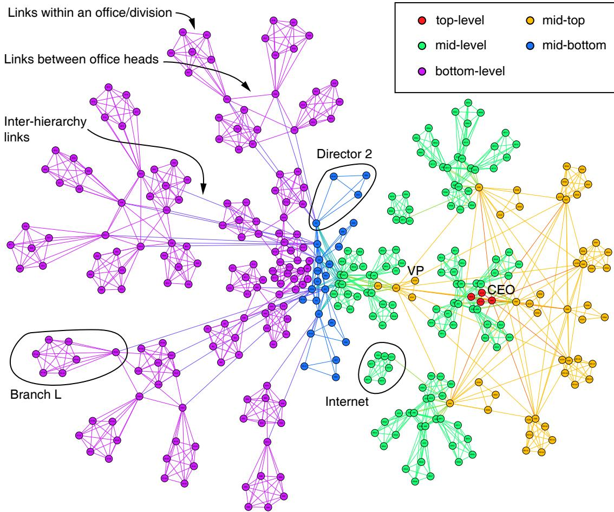
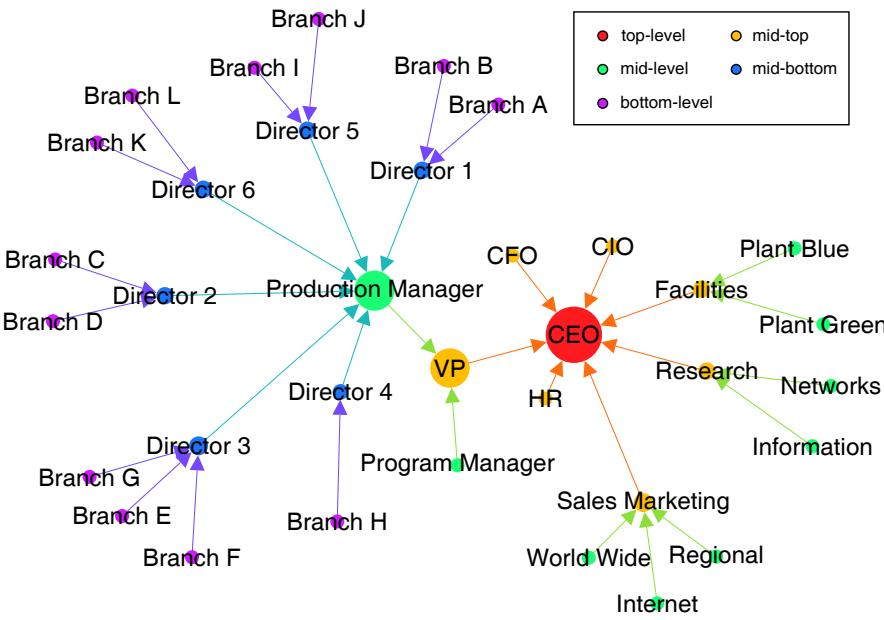
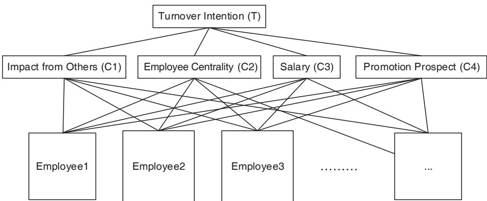
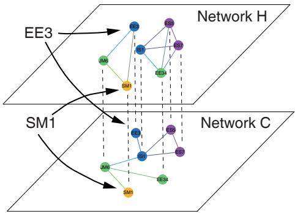

# 2015美赛特等奖论文：利用动态网络分析员工流失（33900.pdf）

原件为竞赛论文。补充：文中的阅读练习及“参考解答”为整理时增加，原件图文保留出处。

本资料为2015年美国大学生数学建模竞赛（MCM）特等奖论文第1部分（共7部分，对应原文第1–3页），由识别工具读取后整理。

## 一、摘要与目录

### 摘要

在本文中，我们构建了一个动态网络模型并进行多种模拟，以研究人力资本网络（HCN）在流失等干扰下的行为。

我们详细说明了HCN因素的结构以及离职的持续影响，并利用给定信息运行模拟以考察离职的传染性并分析HCN的可持续性。我们解释并展示了我们的结果，包括鲁棒性分析以及我们模型的优缺点。

对于任务1，我们构建了两个网络（人际关系网络和组织网络），它们共同构成了我们的人力资本网络。我们从问题材料中提取重要信息，并在必要时做出假设以推导详细结构并为员工分配办公室。我们提出了一个评估函数，并使用遗传算法寻找最优分配。该分配为我们提供了关于员工关系（如同事关系等）的新信息，结合来自监督关系的边，完成了我们网络的构建。

对于任务2，我们首先从因素和影响的角度详细阐述离职，并评估HCN的成本和生产力。然后，我们使用概率方法和离散时间系统模拟深入探讨离职过程、晋升过程和招聘过程的动态变化。结果表明，组织离职对组织的生产力既有直接影响也有间接影响。直接影响是因为它导致员工流失，间接影响是因为它会使其他员工更有可能离职。

对于任务3，我们利用我们的动态网络模型和离散时间模拟系统计算预算。我们的结果显示，未来2年招聘需要 $19.14\sigma$ 的预算，培训需要 $10.87\sigma$ 的预算，总计 $30.01\sigma$。

对于任务4，我们还运行了模拟，结果显示ICM无法维持其80%的满员状态。

对于任务5，我们的结果显示，晋升增加了高层员工的数量并提高了员工的质量，因为只有合格的人才能被晋升。因此，晋升提高了生产力。

我们还对多层网络和人力资源问题进行了进一步讨论，完成了任务6、7以及问题材料提出的其他要求。

### 目录

1. Introduction
   1.1 Problem Statement
   1.2 Related Work
2. Assumptions and Notations
   2.1 Assumptions
   2.2 Notations
3. The Human Capital Network Model
   3.1 Assigning Employees to Offices
      3.1.1 Principles of Employee Assignment
      3.1.2 Evaluation of Employee Assignment
      3.1.3 Optimization Using Genetic Algorithm
   3.2 Building The Human Capital Network
      3.2.1 Building The Network of Personnel Relationship
      3.2.2 Building the Organizational Network
   3.3 Evaluating Turnover Intention of Employee
      3.3.1 Factor of Turnover Contagion
      3.3.2 Factor of Employee Centrality
      3.3.3 Factors of Salary and Promotion Prospect
      3.3.4 Evaluation using AHP
   3.4 Productivity and Costs of HCM
4. Dynamics of Human Capital Network
   4.1 Process of Turnover
   4.2 Process of Promotion
   4.3 Process of Recruitment
5. Simulation Results and Analysis
6. Sensitivity Analysis
7. Improvements using Multi-layered Networks
8. Further Discussions on HR
9. Strengths and Weaknesses
   9.1 Strengths
   9.2 Weaknesses
References

## 二、正文内容

### 1 Introduction

#### 1.1 Problem Statement

在各种影响团队绩效的因素中，团队成员及其之间的化学反应，即团队合作，是一个重要的因素。解决这一问题的方法是保持一支才华横溢且训练有素的团队，并将他们保持在合适的位置上。然而，在现代公司中，员工流失 [5] 经常发生并扰乱环境。本文基于人力资本网络（HCN）提供了一个员工流失及其影响的模型。HCN被提取为作为节点的员工办公室和部门的层级结构，以及作为节点的370名员工列表，然后通过AHP方法分析离职意向，并将其分为薪资、晋升、重要性以及来自他人的影响。节点的的重要性由节点的部门的接近中心性（closeness centrality）和LeaderRank值给出。薪资和晋升是考虑不同级别的影響指标。这种影响通过链接进行，并随时间推移而衰减。晋升过程和招聘过程也通过随机过程方法进行预测，这构成了总动态过程的一部分。

#### 1.2 Related Work

近年来，人们对研究团队科学（Team Science）和发展适当的团队及团队绩效模型产生了巨大兴趣。Salas等人回顾了过去50年中团队绩效领域的关键发现和进展 [2]。他们得出结论：“团队绩效可以被建模”，这也是我们要对生产力进行建模的动力。Stokols等人争论了 [3]，Kivelä等人研究了多层网络（Multilayer Networks），这些都被纳入我们的论文中以改进我们的模型。

许多工作检查了谣言传播等的性质，这与[NOT good...]离职传播类似。然而，他们使用的方法主要是用于同质网络的平均场方程，以及……用于异质网络。网络结构如何影响谣言传播的潜在机制仍然是一个未解之谜。

已有广泛的研究，但在利用数学模型分析离职过程并量化其对整体团队绩效的影响方面，所做的工作有限。我们在本文中关注的是……

### 2 Assumptions and Notations

#### 2.1 Assumptions

为了使问题简化，我们做出以下基本假设。我们的每一个假设都是合理的，并且与 [1] 中给出的信息一致。

- 员工的离职行为具有传染性。因此，与已离职的其他员工相连的工人更有可能离职 [1]。
- 相似的个体更可能相互影响彼此的行为。这是

## 2.2 Notations

We use a list of symbols (cf. Table 1) for simplification of expression.

Table 1. Notations (in the order of model)

| Symbol | Definition | Notes |
| --- | --- | --- |
| **Human Capital Network Model** | | |
| $G$ | graph of Personnel Relationship Network of ICM | cf. Figure 2 |
| $g$ | graph of Organizational Network of ICM | cf. Figure 3 |
| $N$ | number of nodes | |
| $d_{ij}$ | topological distance between node $i$ and $j$ | |
| $R_t$ | employee turnover rate | $R_t=\frac{NELDY^1}{(NEBY^2+NEEY^3)/2}\times100\%$ [5] |
| $T$ | turnover intention | |
| $CC$ | Closeness Centrality | $CC_i=\frac{1}{d_i}=\frac{N}{\sum_{j=1}^{N}d_{ij}}$ |
| $P_i$ | average annual salary (payment) of employee $i$ | represents employee's ability |
| $L_i$ | level of hierarchy of the office of employee $i$ | $L_{CEO}=5$ and $L_{Branch}=1$ |
| **The Second Model** | | |
| Emu | stuffed | |
| C | frozen | |

## 3 The Human Capital Network Model

In this model, the HCN is extracted as a hierarchy structure of staff offices and divisions as nodes and a list of 370 employees as nodes, then the turnover intention is analyzed by the AHP method, and divided as salary, promotion, importance and impacts from others. The importance of the nodes is given by the closeness centrality and the LeaderRank value of nodes in departments.

### 3.1 Assigning Employees to Offices

Due to limited given information on the personnel relationship of ICM in detail, we assume some basic rules of allocating offices to complete our model. We apply these rules and form an AHP-based evaluation model, then we use Genetic Algorithm to find the solution.

#### 3.1.1 Principles of Employee Assignment

Our principles for allocating offices is listed as follows:

- Employees with higher level of position should occupy offices of higher centrality and higher hierarchy in the structure diagram given in [1].
- Supervisors and executives should distribute as broadly as possible to ensure widespread supervisory and to maximally utilize the manager resource.
- Offices of same level should have similar constitute for equality.
- Each executive should be matched with an administrative clerk as his/her secretary.

> 注：原页脚注 1–3 依次为 NELDY: Number of Employees who Left During the Year.；NEBY: Number of Employees at the Beginning of the Year.；NEEY: Number of Employees at the End of the Year.

#### 3.1.2 Evaluation of Employee Assignment

We first quantify these principles as follows:

1. Principle of centrality: $E_1=\sum P_i \cdot CC_i$
2. Principle of hierarchy: $E_2=\sum P_i \cdot L_i$
3. Principle of equality: $E_3=\sum D_j$
4. Principle of uniformity: $E_4=\sum S_j$

$P_i$ is the annual salary of an employee, which is a representative of his ability. $D_j$ is differences between office $j$ and other offices of the same level. $S_j$ is the number of same type of employees in office $j$. We hereby give the evaluation function:

$$
Eval=\alpha_1 E_1+\alpha_2 E_2+\alpha_3 E_3+\alpha_4 E_4 \tag{1}
$$

Because that $E_3$ and $E_4$ are too large, we choose $\alpha_1=0.5$, $\alpha_2=0.5$, $\alpha_3=-0.05$, $\alpha_4=-0.05$ after some experiments with random assignments. We plug these parameters back into Equation 1 to obtain the evaluation function.

#### 3.1.3 Optimization Using Genetic Algorithm

We got an evaluation function in Section 3.1.2. Next we are going to find its optimum, which in correspondence is the best assignment solution. It is easy to show that this problem is a Combinatorial Optimization problem, for which search heuristics such as Genetic Algorithm and Tabu Search are proven to be more efficient. We notice that the assignment itself is naturally a representation of the gene code, so we choose Genetic Algorithm to find the maximum of the evaluation function (cf. Equation 1). Thus the evolution process such as gene crossover can be easily achieved by swap employees in different offices. We implement the algorithm using MATLAB, initialize 500 random solutions and begin iteration. The algorithm produce a satisfactory result (cf. Figure 1).

 算法运行结果图

We can see from Figure 1 that the algorithm not only assigned offices according to staff hierarchy (i.e. superior offices for staff of higher position like senior manager) but also incorporated uniformity and equality.

## 3.2 Building The Human Capital Network

We assigned the staff with proper offices in the above mentioned. Next we are going to build the network using this newly deducted information.

### 3.2.1 Building The Network of Personnel Relationship

Now that there are a grant total of $N ( N \leqslant 3 7 0 )$ employees in ICM, which is corresponding to the N node in graph $G ,$ and we use $v _ { i } ( 1 \leqslant i \leqslant N )$ to denote the ith node in G. In order to simplify the problem,we make a natural assumption that any pair of nodes $v _ { i }$ and in G is connected if and only if the three following conditions are satisfied:

• $v _ { i }$ and $v _ { j }$ are in the same Branch or division;

• $v _ { i }$ and $v _ { j }$ are in the same level;

$v _ { i }$ and $v _ { j }$ are respectively leaders of two ofice whose superior department are the same.

It’s worth noting that the relationship between any two persons in ICM varies, thus G is a weighted graph,the weight of edge $e _ { i j }$ reveals the level of relationship between node $v _ { i }$ and node $v _ { j }$ .Let $N$ dimensional matrix $A = ( w _ { i j } ) _ { N \times N }$ be the adjacency matrix of graph G ,we can conclude from previous discussion that:

$$
w _ {i j} = \left\{ \begin{array}{l l} \sigma & \text { if   } v _ {i} \text {   and   } v _ {j} \text {   satisfy   condition   2 } \\ 1 & \text { if   } v _ {i} \text {   and   } v _ {j} \text {   satisfy   condition   1   or   3 } \end{array} \right.
$$

The graph G is illustrated in Figure 2.

### 3.2.2 Building the Organizational Network

Also we can get the Organizational Network. The procedures of forming g can be implemented as follows:

1. add all staf ofices and divisions to g as nodes.

2. add hierarchy chains as directed edges, from lower hierarchy to higher.

3. for all nodes pairs, if the two nodes have the same hierarchical father, add a bidirected edge between them.

4. add a sink node to graph, then connect all nodes except the sink node to the sink node with a bi-directed edge, which is in convenience for leader rank.

Graph g is a directed graph (cf. Figure 3). The calculated LeaderRank Value is illustrated by the node size. Note that LeaderRank Value is not always consistent with hierarchy.

### 3.3 Evaluating Turnover Intention of Employee

Cotton et al. found that factors such as pay and employment perception are the most highly reliable correlates of turnover [6]. The factors can be divided into External Factors and Internal Factors. We adopt his conclusion and further specify them into three basic elements: salary, level of position, promotion prospect. We also introduce the influence of other people’s turnover behavior, summing up to four elements denoted by $C _ { 1 } ~ , C _ { 2 } ~ , C _ { 3 }$ $C _ { 4 }$ for quantification.

In order to find the employee with the highest turnover probability, we use AHP to evaluate the contribution of each factor to turnover intention.

### 3.3.1 Factor of Turnover Contagion

Hereinbefore we assumed that if one employee left, other employees close to him are influenced and are more likely to ‘churn’ (cf. Section 2.1). We quantify the level of influence by introducing Structural Equivalence [15] as closeness. We assume that the level of influence of one’s turnover to another’s intention is positively correlated with Structural Equivalence (in other words, similarity).

We adopt the RA Index [16] in weighted graph to measure the similarity between nodes. Consider a pair of nodes, x and y which are not directly connected. If node x can send some information to y with their common neighbors playing the role of transmitters, then they would share some similarity. We revise the original RA Index and define the similarity between x and y as the amount of resource y received from x :

$$
s _ {x y} = \sum_ {z \in \Gamma (x) \cap \Gamma (y)} \frac {w _ {x z} + w _ {y z}}{k (z)}
$$

### 3.3.1 Factor of Former Employee Impact

where $\Gamma(i)$ is the set of neighbors of $x$ and $k(i)$ the degree of $x$, and we can develop the expression of $C_{1i}$:

$$
C_{1i} = \sum_{a_j \in S} \frac{e^{-\beta(t - t_j)}}{1 + e^{-\beta(t - t_j)}} s_{ij}
$$

where $S$ denotes the set of former employees who have churned at moment $t_i$. We use Logistic Curve to describe former employee’s impact due to the attenuation effect.

### 3.3.2 Factor of Employee Centrality

Individuals with greater centrality in a communication network are less likely to turnover due to the information and social support benefits provided by peers in the workplace [15].

In our model the overall importance of an employee is determined by his centrality in graph $G$ (cf. Figure 2) and the importance of his department in graph $g$ (cf. Figure 3). Because Closeness Centrality can be regarded as a measure of how long it will take to spread information from certain node to all other nodes and is widely used in Social Network Analysis [17], we choose Closeness Centrality as the measurement. And the importance of his department in graph $g$ is determined by the LeaderRank Value of the office.

For each node in graph $G$, we calculate its Closeness Centrality as follows: For node $i$, calculate mean distance between it and every other node as $d_i$:

$$
d_i = \frac{1}{n} \sum_{j=1}^{N} d_{ij}
$$

where $d_{ij}$ is the topological distance between $i$ and $j$. The reciprocal of $d_i$ is defined as Closeness Centrality:

$$
CC_i = \frac{1}{d_i} = \frac{N}{\sum_{j=1}^{N} d_{ij}}
$$

For each office in directed graph $g$, we calculate the LeaderRank Value $LR$ as follows:

To conclude we give the expression of $C_{2i}$:

$$
C_{2i} = \frac{1}{LR \times CC_i}
$$

### 3.3.3 Factors of Salary and Promotion Prospect

We assume that the salary is the same among same hierarchy, so we quantify the factor of salary as follows:

$$
C_{3i} = \left\{ \begin{array}{ll} \xi_1 & \text{node } i \text{ belongs to top hierarchy} \\ \xi_2 & \text{node } i \text{ belongs to mid hierarchy} \\ \xi_3 & \text{node } i \text{ belongs to bottom hierarchy} \end{array} \right.
$$

Similarly, assuming that the promotion prospect is the same, we give:

$$
C_{4i} = \left\{ \begin{array}{ll} \psi_1 & \text{node } i \text{ belongs to top hierarchy} \\ \psi_2 & \text{node } i \text{ belongs to mid hierarchy} \\ \psi_3 & \text{node } i \text{ belongs to bottom hierarchy} \end{array} \right.
$$

We choose $\xi_1 = 1, \xi_2 = 0, \xi_3 = 0$ on account of the relatively low CEO-to-worker salary ratio. And because that employees in the middle ‘feel stuck in their jobs with little opportunity to advance’ [1], we choose $\psi_1 = 0, \psi_2 = 1, \psi_3 = 0$.

### 3.3.4 Evaluation using AHP

We gave the quantification of factors in the above text. Our AHP hierarchy for this evaluation is illustrated in Figure 4.

Combining those four factors using AHP, we give the following pairwise comparison matrix:

$$
\begin{array}{ccccc} & C_1 & C_2 & C_3 & C_4 \\ C_1 & \left( \begin{array}{cccc} 1 & 2 & 3 & 1/2 \\ 1/3 & 1 & 1 & 1/2 \\ 1/2 & 1 & 1 & 1/3 \\ 3 & 2 & 2 & 1 \end{array} \right) & & & \end{array}
$$

Thus we have the evaluation function expressed as Equation (4), in which the parameters $\alpha_1, \alpha_2, \alpha_3, \alpha_4$ are to be determined.

$$
T = \alpha_1 C_1 + \alpha_2 C_2 + \alpha_3 C_3 + \alpha_4 C_4 \tag{2}
$$

We calculate the parameters using MATLAB, and get $\alpha_1 = 0.3084, \alpha_2 = 0.1482, \alpha_3 = 0.1445, \alpha_4 = 0.3989$. We test the consistency of our AHP in the following two aspects:

1. The Consistency Index $CI = (\lambda_{\max} - n) / (n - 1)$ should be close to zero. With $n = 4$ we get $CI = 0.0045$, which is very close to zero.
2. The Consistency Ratio $CR = CI / RI$ should be less than 0.1. With $n = 4$ we get $RI = 0.9$ and $CR = 0.05 < 0.1$.

The test result displays perfectly acceptable consistency.

### 3.4 Productivity and Costs of HCM

The contribution of employee to the company is intuitively relevant to the following three factors:

1. The ability of the employee, represented by his wage.
2. The efficiency of the employee (denoted by $e_i$). It is trivial to see that efficiency is inversely proportional to turnover intention.
3. The importance of the office in which the employee works. This factor is introduced by modifying coefficient $\lambda_i$ and is equal to LeaderRank Value of graph $g$.

Thus we have productivity expression as follows:

$$
Productivity = \sum_{i} \lambda_i \times P_i \times e_i \tag{3}
$$

The overall recruiting costs of ICM is given by the summation of new workers’ median recruit costs:

$$
RC_{all} = \sum_{j} \sum_{N_j \in NW} MR_j
$$

where $RC_{all}$ is for overall recruiting costs, $N_j$ represents a node of level $j$, $NW$ indicates the new worker set, and $MR_j$ is the median recruiting costs of level $j$. The training costs is related to the current number of workers in different levels, which are given by:

$$
TC_{all} = \sum_{j} \sum_{N_j \in Nodes} MT_j
$$

where $TC_{all}$ is for overall training costs, $N_j$ represents a node of level $j$, $Nodes$ indicates the set of all nodes, and $MT_j$ is the median training costs of level $j$.

## 4 Dynamics of Human Capital Network

We further analyze the dynamic characteristics of HCN. The dynamic process includes churns, promotions and recruits. The churn exhibits impacts on linked nodes as parts of the turnover intention. With stochastic process the recruits and promotions can be regarded as random variables following to specific distributions. Using the model

# 2015美赛特等奖论文：利用动态网络分析员工流失（33900.pdf）

## 一、模型构建过程

### 4.1 Process of Turnover

The process of turnover is based on the turnover intention analysis in Section 3. The nodes to churn is chosen randomly with their turnover intention as weight. By approximating the poisson distribution can best describe churns distribution as follows:

$$
P (n _ {c h} = k) = \frac {e ^ {- \lambda} \lambda^ {k}}{k !}\tag{4}
$$

where $n_{ch}$ represents the number of churns. If the time unit is month, we have $\lambda = \text{churn rate}$. Eventually, A churned worker loses his links and is deleted from the G graph.

### 4.2 Process of Promotion

We aim to distinguish qualified workers in the company, hence we choose the service time and the work experience as two disciplines in promoting. The service time of a worker is the duration he stays in this company. The service time requirements with respect to levels of positions are shown as Table 2.

Table 2. Service Time Requirements for different Level of Positions.

| Level of Position | SM | JM | ES | IS | EE | IE |
| :--- | :--- | :--- | :--- | :--- | :--- | :--- |
| Service Time Requirements | 8 | 5 | 3 | 2 | 1 | 0 |

Note that the promotion of Administrative Clerk is ignored in the promotion process because of the differences in jobs especially in a production-oriented company. We assume that worker with service-time beyond comparison in Table 2 be cropped to the maximum requirements initially. Therefore, we choose a truncated gaussian distribution with a mean value of $\mu _ { j }$ and a variance of $\sigma _ { j }$ to describe the distribution of service time of workers in level $j$ as the approximation of initial distribution:

$$
G (x | \mu_ {j}, \sigma_ {j}) = \frac {1}{\sqrt {2 \pi} \sigma_ {j}} e ^ {- \frac {(x - \mu_ {j}) ^ {2}}{2 \sigma_ {j} {} ^ {2}}}
$$

where $G ( x | \mu _ { j } , \sigma _ { j } )$ represents the gaussian distribution function, and $\mu _ { j }$ is the minimum service time requirement in level $j$, $\sigma _ { j }$ is chosen as twice of the length of intervals. The truncate range is the ranges in Table 2. Because that Senior Manager has no where to promote, we don’t care about his promotion.

The work experience can be determined by the similarity of the nodes and the vacancy, where we create a virtual node as well as several virtual edges to connect real nodes. By replacing the vacancy with the virtual node, the similarity between the vacancy and other nodes is calculated. Similarity is a proper indicator of the related work experience for there are strong edges inside the staff office and hierarchy. A worker is promoted to a higher level means he should get used to new circumstances, loses old links and forms new links.

### 4.3 Process of Recruitment

Since the median time to recruit $( M T _ { j }$ with respect to level $j$ in months) is a constant value, the number of workers ICM recruit during a unit time interval can be formulated as Poisson Random Distribution. The probability is given by Equation 4. where $n _ { j }$ represents the recruit number of level $j.$ When the time unit is month, we have $\lambda = \frac {1}{M T _ {j}}$. A new worker forms the links deleted when he is recruited.

## 二、仿真结果与分析

### 5 Simulation Results and Analysis

For Task 2(1), our simulation result indicate that a churn in network induces impacts according to the similarity of nodes (cf. Figure 5, 6). Nodes having strong connection with the churn node gain large external factors in their turnover intentions while the others suffer less impact, thus those heavily affected nodes are more likely to turnover. As the impact declines with time, the turnover intention of nodes reduce to the unaffected level. The impacts spread further when the affected nodes turnover, and stops at a non-churn node.

For Task 2(2), our simulation shows that churn will both directly and indirectly affect the productivity. As is shown in Equation 4, when an organizational churn takes place, a direct effect is decreases in the number of workers. In the simulation of two years, the number of workers keeps reducing due to the high turn over rate and limited recruiting rate. The average turn over intention of different levels of positions are shown in Figure 7, which is a main factor of productivity. The turn over intention of middle managers is relatively higher than the other levels, and the rises shown in these curves represent the continuous impacts of churns. The productivity mainly fluctuate with the number of workers, but with the average productivity shown with the right y-axis, we can see a reduction of 9.8% at the end of simulation. Churns impacts conducts to linked employee and have a negative effects on their productivity. Considering the declining rate, it is easy to know that the continuous churns will keeps a steady impacts on the productivity, thus causes the decreases in the average productivity comparing to the start point.

For Task 3, Our model yields a budget requirement of 19.14$\sigma$ for recruiting and 10.87$\sigma$ for training in the next 2 years, adding up to 30.01$\sigma$. The recruiting costs of ICM in terms of $\sigma$ shown in Figure 8 varies randomly, which is caused by the poisson distribution of recruit numbers. The training costs is a function of the number of workers and their levels resulting in the smooth decrease of the curve.

For Task 4, our result shows that ICM can’t sustain a 80% full status for positions when the annual churn rate is 25% or 35%. In the recruiting model the coming number in an average time distribution is set to follows poisson distribution, thus a higher churn rate makes a faster loss in worker number. As a consequence of high churn rate, the productivity of the company decreases a lot; the workers suffer from the impacts of churns and their turn over intentions are higher. The total number of workers are shown in Figure 9 and the numbers at 18% churn rate is also shown for comparison.

For Task 5, our results show that promotion increases the number of high-level employee and improve the quality of staff because only those qualified can be promoted. Thus promotion increases the productivity.

The promotion is implemented by choosing a qualified node and replace a vacancy in a higher levels. As an assumption, we spare no effects on promoting qualified employees, which means that all qualified nodes will be promoted at once. Figure 10 shows the overall productivity of different levels of positions. The promotion method keeps the productivity of higher levels and middle levels while introduces a shortage in low levels employees.

# 2015美赛特等奖论文：利用动态网络分析员工流失（33900.pdf）

本资料整理自《2015美赛特等奖论文：利用动态网络分析员工流失（33900.pdf）》第 6–7 部分，由识别工具读出后按规范整理。

## 一、敏感性分析

### 小节 6 Sensitivity Analysis

初始的服务时间分布是一个具有选定均值和方差的特定高斯分布。由于服务时间是判断合格员工的重要因素，该分布可能会影响合格员工的数量。改变分布系数，结果可能会发生很大变化。

我们选择 $\sigma$ 作为要检查的变量。$\sigma$ 最初设置为等于等级区间长度（对于等级 $j$ 为 $\Delta l_j$）的两倍。因此，新的 $\sigma$ 值分别设定为等于等级区间长度和等级区间长度的三倍。我们在任务 5 中运行了模拟，结果如下所示：

**表 3. $\sigma$ 的敏感性分析**

| $\sigma$ | 1 | 2l | 3l |
| :--- | :--- | :--- | :--- |
| average promoted number(month) | 2.314 | 2.083 | 2.250 |
| average productivity | 0.378 | 0.353 | 0.374 |
| average Senior Manager productivity | 3.378 | 3.372 | 3.741 |
| middle manager number | 35.16 | 38.33 | 37.00 |

这四个指标与高层和中层的人数或生产力相关，它们可能显示出相同的变化。虽然我们无法完全消除由于随机性引起的波动，但这表明 $\sigma$ 的值不会导致我们的结果发生巨大变化。

接着，我们选择均值 $\mu$ 作为要检查的变量。$\mu$ 最初设置为等级区间的下边界。因此，新的 $\mu$ 值分别设定为等级区间的中位值和上边界。我们在任务 5 中运行了模拟，结果如下所示：

**表 4. $\mu$ 的敏感性分析**

| $\mu$ | 1 | 2l | 3l |
| :--- | :--- | :--- | :--- |
| average promoted number(month) | 2.314 | 2.083 | 2.250 |
| average productivity | 0.378 | 0.353 | 0.374 |
| average Senior Manager productivity | 3.378 | 3.372 | 3.741 |
| middle manager number | 35.16 | 38.33 | 37.00 |

### 小节 7 Improvements using Multi-layered Networks

在本节中，我们概述多层网络的潜在用途。

目前的模型仅考虑了 ICM 内部的关系和链接。事实上，ICM 的员工在人力资本网络中通过广泛的个人和公共关系相互连接。这些关系纽带在性质上高度多样化，可以代表例如一个人对另一个人的影响力或信任度。每种类型的关系都跨越其自身的社交网络。因此，人力资本网络与其他组织网络模型之间的关系特征是其网络的叠加，所有网络都定义在同一组节点上。这种叠加被称为多重网络（Multiplex network）。

我们考虑网络 H 和网络 C（见图 11），它们分别代表人力资本网络的一部分和另一个将具有相同家乡的人联系起来的网络。比较网络 C 和网络 H，我们可以看到两者包含对方所没有的信息，例如 SM1 和 EE3 在网络 C 中相连，但在网络 H 中不相连。

我们可以从多重网络的潜在使用中获益良多 [4]。使用多重网络，我们可以预测并更好地理解个人的行为。在前面的例子中，如果 SM1 和 EE3 都离开 ICM 去其他工作，这与我们的预期是一致的，因为他们在网络 C 中是相邻的。

多重网络也可用于群体层面的动态分析。我们可以基于 Jaccard 系数来衡量相似性，该系数通过测量两个网络中同时存在链接的趋势来量化两个网络之间的相互作用。$J_{\alpha \beta}$ 是两个元素集之间的相似度得分，定义为两个集合交集的大小除以它们并集的大小：

$$ J _ { \alpha \beta } = \frac { | \alpha \cap \beta | } { | \alpha \cup \beta | } $$

## 8 关于人力资源的进一步讨论

我们进一步研究题目材料中指出的人力资源问题。

首先，我们将年度评估与现有人力资源管理结合起来。我们用一个 $n$ 维向量 $\vec{e} = (e_1, e_2, e_3, \ldots, e_n)$ 表示主管评判的年度评估，其中 $e_i \in [0,1]$ 表示评估的第 $i$ 个分量。假设该员工有 $m$ 个可选岗位，我们的目标是为其找到最合适的岗位。第 $k$ 个岗位的要求可以用另一个类似向量 $\vec{\Phi}_k = (\Phi_{k1}, \Phi_{k2}, \Phi_{k3}, \ldots, \Phi_{kn})$ 表示。因此，我们用 $D_k = \|\vec{\Phi}_k - \vec{e}\|$ 表示该员工到岗位 $k$ 的欧几里得距离，距离越大表明岗位 $k$ 适合该员工的可能性越低。于是，最适合该员工的岗位编号为：

$$
k = \arg\left\{\min_{j} D_j\right\}
$$

然后，我们利用人力资本网络的性质分析 ICM 的人力资源要素。注意，网络平均聚类系数可用于分析人力资本网络的人力资源功能，因为单个节点的聚类系数能反映以该节点为中心的簇的紧密程度。因此，平均聚类系数通过考虑所有节点，反映了 ICM 的团结程度。

## 9 优势与不足

### 9.1 优势

#### 全面性

我们仔细考虑了与流失意向相关的各种因素。

我们的模型能够模拟现实生活中的情形，结果也与常识和生活经验相符。

我们的模型与网络科学密切相关，而网络科学在建模方面的优势在于能够容纳现实世界的复杂性。

我们建立并分析了流失影响的扩散过程，其中涉及动态过程，这是我们模型的一个亮点。

#### 稳健性

基于敏感性分析，我们的模型对参数变化相当稳健。这意味着参数的微小变化不会导致结果的显著变化。

#### 合理性

我们的模型结果与经验高度一致，这证明了模型的合理性与正确性。

### 9.2 不足

- 我们并未全面了解中层管理者或基层员工的构成，我们在处理时将他们视为不同群体，但在分析结果时又将他们视为一个整体。
- 部分参数因数据匮乏而基于常识设定。不过，根据我们的敏感性分析，即使稍作改变也不会造成很大差异。

## 参考文献

[1] COMAP. (2015). ICM Problem C. http://www.comap.com/undergraduate/contests/mcm/contests/2015/problems/2015_ICM_Problem_C.pdf.

[2] Salas, E., Cooke, N. J., & Rosen, M. A. (2008). On teams, teamwork, and team performance: Discoveries and developments. Human Factors: The Journal of the Human Factors and Ergonomics Society, 50(3), 540-547.

[3] Stokols, D., Hall, K. L., Taylor, B. K., & Moser, R. P. (2008). The science of team science: overview of the field and introduction to the supplement. American journal of preventive medicine, 35(2), S77-S89.

[4] Kivelä, M., Arenas, A., Barthelemy, M., Gleeson, J. P., Moreno, Y., & Porter, M. A. (2014). Multilayer networks. Journal of Complex Networks, 2(3), 203-271.

[5] Wikipedia (2015). Turnover (employment). http://en.wikipedia.org/wiki/Turnover_(employment).

[6] Cotton, J. L., & Tuttle, J. M. (1986). Employee turnover: A meta-analysis and review with implications for research. Academy of Management Review, 11(1), 55-70.

[7] LinkedIn Inc. (2014). LinkedIn Big Data: The First Report on Promotion to HOD. http://www.gs.xinhuanet.com/news/2015-01/30/c_1114195205.htm

[8] Zhao, X., Liu, L., & Zhang, C. (2003). A Multi-variable Analysis on Factors Influencing Employee's Turnover Intention. China Soft Science, (3), 71-74.

[9] Felps, W., Mitchell, T. R., Hekman, D. R., Lee, T. W., Holtom, B. C., & Harman, W. S. (2009). Turnover contagion: How coworkers' job embeddedness and job search behaviors influence quitting. Academy of Management Journal, 52(3), 545-561.

[10] Bartunek, J. M., Huang, Z., & Walsh, I. J. (2008). The development of a process model of collective turnover. Human Relations, 61(1), 5-38.

[11] Whitmore, G. A. (1979). An inverse Gaussian model for labour turnover. Journal of the Royal Statistical Society. Series A (General), 468-478.

[12] Jovanovic, B. (1979). Job matching and the theory of turnover. The Journal of Political Economy, 972-990.

[13] Tett, R. P., & Meyer, J. P. (1993). Job satisfaction, organizational commitment, turnover intention, and turnover: path analyses based on meta-analytic findings. Personnel Psychology, 46(2), 259-293.

[14] Mobley, W. H., Griffeth, R. W., Hand, H. H., & Meglino, B. M. (1979). Review and conceptual analysis of the employee turnover process. Psychological Bulletin, 86(3), 493.

[15] Feeley, T. H., Moon, S. I., Kozey, R. S., & Slowe, A. S. (2010). An erosion model of employee turnover based on network centrality. Journal of Applied Communication Research, 38(2), 167-188.

[16] Zhou, T., Lü, L., & Zhang, Y. C. (2009). Predicting missing links via local information. The European Physical Journal B-Condensed Matter and Complex Systems, 71(4), 623-630.

[17] Okamoto, K., Chen, W., & Li, X. Y. (2008). Ranking of closeness centrality for large-scale social networks. In Frontiers in Algorithmics (pp. 186-195). Springer Berlin Heidelberg.
