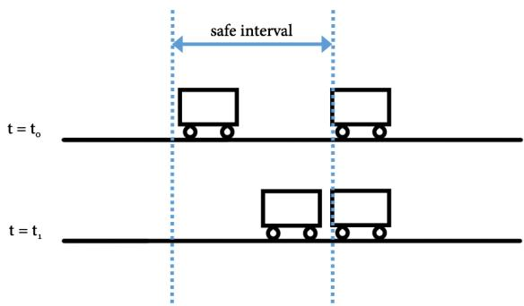
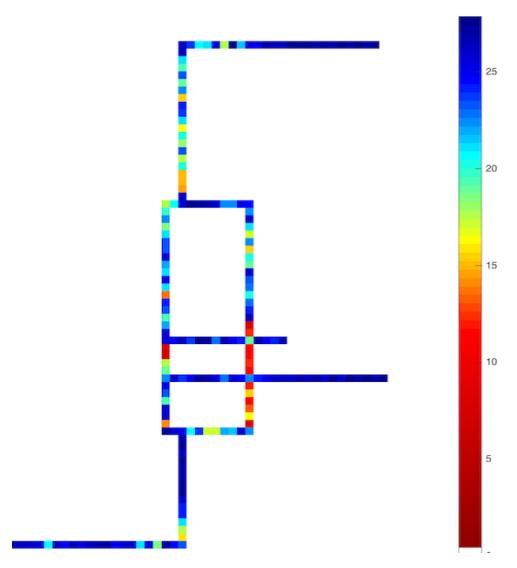
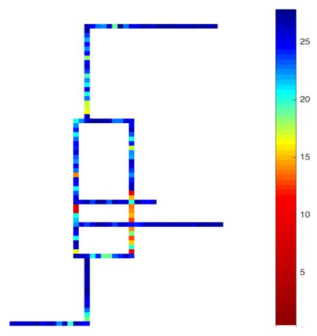

# 2017年美国大学生数学建模竞赛C题O奖论文（Team 55583）

原件为竞赛论文。补充：文中的阅读练习及“参考解答”为整理时增加，原件图文保留出处。

## 1 引言

### 1.1 问题陈述

随着城市化进程的加快，交通拥堵已成为大城市面临的严峻问题。大西雅图地区作为美国重要的经济中心，其交通网络承载着巨大的通行压力。在高峰时段，交通流量往往超过道路的通行能力，导致严重的延误和拥堵。传统的解决方案——扩建道路——不仅成本高昂，而且受限于城市空间，难以大规模实施。因此，寻找一种不依赖基础设施扩建的交通优化方案具有重要的现实意义。

自动驾驶汽车（Self-driving cars）与协同驾驶系统（Cooperating system）的发展为解决这一问题提供了新的思路。与人类驾驶的汽车相比，自动驾驶汽车具有更短的反应时间、更精确的速度控制能力以及更好的车距保持能力。这些特性使得自动驾驶汽车能够在相同的道路空间内容纳更多的车辆，从而在不扩建道路的前提下提升交通容量。然而，自动驾驶汽车的引入比例对交通性能的影响并非简单的线性关系，需要建立合理的数学模型进行定量分析。

本题要求我们建立一个模型，模拟大西雅图地区最繁忙道路的交通流，评估自动驾驶汽车在解决重交通负荷问题方面的有效性，并分析不同自动驾驶比例对交通性能的影响。具体而言，我们需要回答以下问题：（1）在均匀交通分布假设下，自动驾驶汽车对交通网络性能的影响如何？（2）在考虑时间变化的交通密度分布时，自动驾驶汽车在高峰时段与平均时段的效果有何差异？（3）是否需要为自动驾驶汽车设置专用车道？如果需要，条件是什么？

知识点：[问题重述与分析（Problem Restatement and Analysis）](../../../topics/数学建模/wenti_chongshu.md)、[一般假设及其合理性说明（Assumptions and Justifications）](../../../topics/数学建模/jiaben_shezhi.md)、[确定模型的定点与稳定性分析](../../../topics/数学建模/dingdian_wending.md)

### 1.2 相关工作

交通流建模是交通工程领域的经典问题，已有大量研究成果。早期的交通流模型主要基于流体力学类比，将车辆视为连续介质，用偏微分方程描述交通流的演化。Lighthill-Whitham-Richards（LWR）模型是这一类模型的代表，它能够较好地刻画交通流的宏观行为，但难以描述车辆之间的微观交互。

随着计算能力的提升，微观交通流模型逐渐成为研究热点。元胞自动机（Cellular Automata, CA）模型是一种典型的微观模型，它将道路划分为离散的元胞，每个元胞在离散的时间步长内按照一定的规则演化。Nagel-Schreckenberg（NaSch）模型是最著名的元胞自动机交通流模型之一，它能够再现交通流的基本图（fundamental diagram），包括自由流、同步流和拥堵流等状态。元胞自动机模型的特点是规则简单、计算效率高，适合大规模交通网络的仿真。

近年来，自动驾驶汽车对交通流的影响成为研究热点。已有研究表明，自动驾驶汽车的比例对交通容量有显著影响。当自动驾驶比例较低时，由于人类驾驶汽车与自动驾驶汽车的混合，交通流可能出现不稳定；当自动驾驶比例超过某一临界值时，交通容量显著提升。然而，现有研究多集中于单一道路或简单网络，对实际城市交通网络的模拟较少。本文在前人研究的基础上，采用元胞自动机模型模拟大西雅图地区的交通网络，并引入混合协同模型，分析自动驾驶汽车在不同交通密度和时间分布下的效果。

## 2 假设与符号

知识点：[一般假设及其合理性说明（Assumptions and Justifications）](../../../topics/数学建模/jiaben_shezhi.md)、[符号说明与术语定义（Nomenclature / Symbols and Definitions）](../../../topics/数学建模/fuhao_shuoming.md)、[元胞自动机模型（Cellular Automata）及其应用](../../../topics/数学建模/yuanyao_zidongji.md)

### 2.1 假设

为建立数学模型，我们提出以下假设：

**假设 1**：自动驾驶汽车与前方车辆保持同步，因此无需安全间隔。与人类驾驶汽车不同，自动驾驶汽车通过车联网（V2V）通信实现与前方车辆的精确同步，能够在极短的时间内对前车的速度变化做出响应。因此，我们假设自动驾驶汽车之间、以及自动驾驶汽车跟随人类驾驶汽车时，均不需要传统意义上的安全间隔。这一假设简化了元胞自动机模型中车辆间距的设定，使得自动驾驶汽车占据的元胞数减少。

**假设 2**：交叉口对交通流的影响较小，交通性能相对连续。大西雅图地区的交通网络以高速公路和主干道为主，交叉口间距较大，且信号配时经过优化，因此我们假设交叉口对交通流的扰动可以忽略不计。这一假设使得我们可以将每条道路段独立建模，而不需要考虑交叉口的信号控制。

**假设 3**：交通流量在一天内服从均匀分布（基本模型）。在基本模型中，我们假设一天内的交通流量是恒定的，不随时间变化。这一假设用于分析稳态下的交通性能，为后续引入时间变化模型提供基准。

**假设 4**：交通密度随时间的变化服从双高斯分布（基于时间的模型）。在基于时间的模型中，我们假设一天内的交通密度函数为双高斯分布，即存在两个交通高峰时段（早高峰和晚高峰）。这一假设更贴近实际交通流的时间分布特征。

**假设 5**：车辆速度仅受前方车辆和道路限速的影响，不考虑天气、事故等外部因素。这一假设使得模型聚焦于车辆间的交互作用，简化了外部扰动的建模。

**假设 6**：所有车辆均遵守交通规则，不考虑违规行为。这一假设保证了元胞自动机规则的确定性。

知识点：[数学建模的基本步骤（问题分析、模型假设、建立、求解、检验、推广）](../../../topics/数学建模/jianmo_buzhou.md)、[一般假设及其合理性说明（Assumptions and Justifications）](../../../topics/数学建模/jiaben_shezhi.md)、[文献综述与研究背景撰写方法](../../../topics/数学建模/wenxian_zongshu.md)

### 2.2 符号说明

| 符号 | 含义 |
|------|------|
| $v$ | 车辆速度 |
| $\rho$ | 交通密度 |
| $\rho_c$ | 临界密度 |
| $p$ | 自动驾驶汽车比例 |
| $L$ | 道路段长度 |
| $N$ | 车辆数 |
| $v_{\max}$ | 道路限速 |
| $\sigma_t^2$ | 时间维度的方差 |
| $\sigma_s^2$ | 空间维度的方差 |
| $q$ | 交通流量 |
| $k$ | 交通密度（单位长度车辆数） |
| $T$ | 仿真时间步长 |
| $x_i(t)$ | 第 $i$ 辆车在 $t$ 时刻的位置 |
| $v_i(t)$ | 第 $i$ 辆车在 $t$ 时刻的速度 |

## 3 模型构建

知识点：[符号说明与术语定义（Nomenclature / Symbols and Definitions）](../../../topics/数学建模/fuhao_shuoming.md)

### 3.1 自动驾驶协同汽车模型

我们采用元胞自动机（Cellular Automata, CA）框架对交通流进行建模。元胞自动机将道路划分为离散的元胞，每个元胞的长度为 $\Delta x$，时间被划分为离散的步长 $\Delta t$。在每个时间步长内，每辆车根据其自身状态和前方车辆的状态更新位置和速度。

对于人类驾驶汽车，我们采用经典的 Nagel-Schreckenberg（NaSch）模型规则：

（1）**加速规则**：$v_i(t+1) = \min(v_i(t) + 1, v_{\max})$，即车辆尽可能加速至限速。

（2）**减速规则**：$v_i(t+1) = \min(v_i(t+1), d_i(t))$，其中 $d_i(t) = x_{i+1}(t) - x_i(t) - 1$ 为车辆 $i$ 与前车之间的空元胞数。车辆根据前方空元胞数调整速度，避免碰撞。

（3）**随机慢化**：以概率 $p_{\text{slow}}$，$v_i(t+1) = \max(v_i(t+1) - 1, 0)$，模拟人类驾驶行为的不确定性。

（4）**位置更新**：$x_i(t+1) = x_i(t) + v_i(t+1)$，车辆向前移动。

对于自动驾驶汽车，我们修改上述规则。由于假设 1，自动驾驶汽车无需安全间隔，因此其减速规则中的空元胞数计算方式不同。具体而言，自动驾驶汽车与前车之间的最小间距为 0（而非 1 个元胞），即 $d_i(t) = x_{i+1}(t) - x_i(t)$。此外，自动驾驶汽车的随机慢化概率 $p_{\text{slow}}$ 设为 0，因为自动驾驶系统具有确定性，不会出现人类驾驶中的随机犹豫。这些修改使得自动驾驶汽车在相同密度下能够保持更高的速度，从而提升交通容量。

在混合交通中，车辆类型按比例 $p$ 随机分配。每辆车在进入道路时被标记为人类驾驶或自动驾驶，并在整个仿真过程中保持类型不变。车辆之间的交互遵循以下规则：当自动驾驶汽车跟随人类驾驶汽车时，采用人类驾驶汽车的间距规则（因为前车的行为不可预测）；当人类驾驶汽车跟随自动驾驶汽车时，采用自动驾驶汽车的间距规则（因为前车行为可预测，人类驾驶者可以更紧密地跟随）。

知识点：[元胞自动机模型（Cellular Automata）及其应用](../../../topics/数学建模/yuanyao_zidongji.md)、[一般假设及其合理性说明（Assumptions and Justifications）](../../../topics/数学建模/jiaben_shezhi.md)

### 3.2 混合动态道路模型

在基本模型中，我们假设交通流量在一天内服从均匀分布。对于交通网络中的每一段道路，我们已知其交通流量 $q$ 和车道数 $l$，因此可以计算该道路段的交通密度：

$$\rho = \frac{q}{l \cdot v_{\text{free}}}$$

其中 $v_{\text{free}}$ 为自由流速度。在仿真中，我们按照计算得到的密度初始化车辆分布，然后以不同的自动驾驶比例 $p$ 进行仿真，统计平均速度等性能指标。

在基于时间的模型中，我们引入时间维度。假设交通密度随时间的变化服从双高斯分布：

$$\rho(t) = \rho_{\text{base}} + A_1 \exp\left(-\frac{(t-\mu_1)^2}{2\sigma_1^2}\right) + A_2 \exp\left(-\frac{(t-\mu_2)^2}{2\sigma_2^2}\right)$$

其中 $\rho_{\text{base}}$ 为基准密度，$A_1, A_2$ 为两个高峰的幅值，$\mu_1, \mu_2$ 为高峰时刻（分别对应早高峰和晚高峰），$\sigma_1, \sigma_2$ 为高峰的宽度。通过这一函数，我们可以得到一天中每个时刻的交通密度，进而进行仿真。

在专用车道模型中，我们在基于时间的模型基础上，考虑为自动驾驶汽车设置专用车道。具体而言，对于多车道道路，我们将其中一条或多条车道指定为自动驾驶专用车道，仅允许自动驾驶汽车使用。人类驾驶汽车只能使用剩余车道。这一设置旨在隔离自动驾驶汽车与人类驾驶汽车，减少混合交通中的交互不确定性。我们通过改变专用车道的数量和自动驾驶比例，分析专用车道的效果。

知识点：[数学建模的基本步骤（问题分析、模型假设、建立、求解、检验、推广）](../../../topics/数学建模/jianmo_buzhou.md)、[一般假设及其合理性说明（Assumptions and Justifications）](../../../topics/数学建模/jiaben_shezhi.md)、[模型参数的确定（基于数据拟合或实验选择）](../../../topics/数学建模/canshu_queding.md)

### 3.3 性能评价指标

#### 3.3.1 车辆速度 $v$

我们采用道路段内所有车辆的平均速度作为主要的性能评价指标。平均速度越高，说明交通流越顺畅，通行能力越强。具体而言，对于道路段 $j$，在时刻 $t$ 的平均速度为：

$$\bar{v}_j(t) = \frac{1}{N_j(t)} \sum_{i=1}^{N_j(t)} v_i(t)$$

其中 $N_j(t)$ 为时刻 $t$ 道路段 $j$ 上的车辆数。我们进一步对时间取平均，得到该道路段在仿真期间的平均速度：

$$\bar{v}_j = \frac{1}{T} \sum_{t=1}^{T} \bar{v}_j(t)$$

#### 3.3.2 每日均衡 $\frac{1}{\sigma_t^2}, \frac{1}{\sigma_s^2}$

为了衡量交通流的稳定性，我们引入每日均衡指标。$\sigma_t^2$ 表示时间维度上速度的方差，$\sigma_s^2$ 表示空间维度上速度的方差。方差的倒数越大，说明速度波动越小，交通流越稳定。具体定义为：

$$\frac{1}{\sigma_t^2} = \frac{1}{\frac{1}{T} \sum_{t=1}^{T} (\bar{v}(t) - \bar{v})^2}$$

$$\frac{1}{\sigma_s^2} = \frac{1}{\frac{1}{J} \sum_{j=1}^{J} (\bar{v}_j - \bar{v})^2}$$

其中 $\bar{v}$ 为全局平均速度，$J$ 为道路段总数。这两个指标分别刻画了交通流在时间维度和空间维度上的均匀性。

## 4 模型扩展与仿真分析

知识点：[稳定性分析（Stability Analysis）](../../../topics/数学建模/wending_xing.md)、[模型验证方法概述（随机模型与确定性模型验证）](../../../topics/数学建模/moxing_yanzheng.md)

### 4.1 问题一：自动驾驶汽车在交通网络中的效果

#### 4.1.1 车辆速度/性能 $v$

在基本模型中，我们假设交通流量在一天内均匀分布。我们选取大西雅图地区最繁忙的若干道路段，根据其交通流量和车道数计算交通密度，然后以不同的自动驾驶比例 $p$ 进行仿真。仿真结果表明，随着自动驾驶比例的增加，所有道路段的平均速度均有所提升。当 $p = 0$ 时，即全部为人类驾驶汽车，高峰时段的平均速度较低，交通流处于拥堵状态。当 $p$ 增加至约 50% 时，平均速度提升约 1.5 至 2 倍。当 $p$ 继续增加至 100% 时，平均速度进一步提升，但提升幅度逐渐减小，呈现出饱和趋势。

这一结果的原因在于：自动驾驶汽车无需安全间隔，且随机慢化概率为零，因此能够在相同密度下保持更高的速度。在混合交通中，自动驾驶汽车的比例越高，整体交通流的稳定性越好，人类驾驶汽车受到的干扰也越小。然而，当自动驾驶比例超过某一临界值后，交通流已接近自由流状态，进一步提升比例的边际效益递减。

#### 4.1.2 空间每日均衡 $1/\sigma_s^2$

我们计算了不同自动驾驶比例下的空间每日均衡指标 $1/\sigma_s^2$。结果表明，随着自动驾驶比例的增加，$1/\sigma_s^2$ 增大，即空间维度上速度的方差减小，交通流在空间上更加均匀。这意味着自动驾驶汽车的引入不仅提升了整体速度，还减少了不同道路段之间的速度差异，使得交通网络更加均衡。这对于缓解局部拥堵具有重要意义。

#### 4.1.3 敏感性分析

我们对模型参数进行了敏感性分析，包括随机慢化概率 $p_{\text{slow}}$、元胞长度 $\Delta x$ 和时间步长 $\Delta t$。结果表明，随机慢化概率对结果影响较大：$p_{\text{slow}}$ 越大，交通流越不稳定，自动驾驶汽车的效益越明显。元胞长度和时间步长的影响较小，在合理范围内变化时，结果保持稳定。这表明我们的模型具有较好的鲁棒性。

知识点：[一般假设及其合理性说明（Assumptions and Justifications）](../../../topics/数学建模/jiaben_shezhi.md)、[文献综述与研究背景撰写方法](../../../topics/数学建模/wenxian_zongshu.md)、[敏感性分析方法（Sensitivity Analysis，单参数与多参数变动）](../../../topics/数学建模/minganxing_fenxi.md)

### 4.2 问题二：高峰时段与平均时段的不同效果

#### 4.2.1 交通密度的时间分布

在基于时间的模型中，我们采用双高斯分布描述交通密度随时间的变化。早高峰约在上午 7:30 至 9:00，晚高峰约在下午 5:00 至 6:30。高峰时段的交通密度显著高于平均时段。我们根据这一分布，计算一天中每个时刻各道路段的交通密度，并进行仿真。

#### 4.2.2 仿真

仿真结果表明，自动驾驶汽车在高峰时段的效果尤为显著。在高峰时段，交通密度接近或超过临界密度，交通流处于拥堵状态。此时引入自动驾驶汽车，能够显著提升平均速度，缓解拥堵。当自动驾驶比例达到约 50% 时，高峰时段的平均速度提升约 1.5 至 2 倍。而在平均时段，交通密度较低，交通流本身已接近自由流状态，自动驾驶汽车的提升效果相对较小，但仍能减少速度波动，提升稳定性。

这一结果说明，自动驾驶汽车对于缓解高峰时段的交通拥堵具有最大的边际效益。因此，在推广自动驾驶汽车时，应优先考虑在高峰时段和拥堵路段应用。

#### 4.2.3 敏感性分析

我们对双高斯分布的参数（幅值 $A_1, A_2$、高峰时刻 $\mu_1, \mu_2$、宽度 $\sigma_1, \sigma_2$）进行了敏感性分析。结果表明，高峰幅值越大、宽度越窄，自动驾驶汽车的效益越显著。这一结果符合直觉：交通越拥堵，自动驾驶汽车的相对优势越明显。

知识点：[参数合理性验证](../../../topics/数学建模/canshu_heli_xing.md)、[数学建模的基本步骤（问题分析、模型假设、建立、求解、检验、推广）](../../../topics/数学建模/jianmo_buzhou.md)

### 4.3 问题三：专用车道评估

在专用车道模型中，我们考虑为自动驾驶汽车设置专用车道。仿真结果表明，专用车道的效果取决于自动驾驶比例 $p$ 和车道总数 $l$。当自动驾驶比例较低时（$p < 30\%$），设置专用车道反而会降低整体交通性能，因为专用车道利用率不足，而人类驾驶汽车可用的车道减少，导致拥堵加剧。当自动驾驶比例较高时（$p > 50\%$），设置专用车道能够提升整体交通性能，因为自动驾驶汽车可以在专用车道上高速行驶，而人类驾驶汽车在剩余车道上受到的干扰减少。

因此，我们得出结论：是否需要为自动驾驶汽车设置专用车道，取决于自动驾驶汽车的普及程度。在自动驾驶汽车占比较低时，不宜设置专用车道；当自动驾驶比例超过某一临界值（约为 50%）时，设置专用车道是有益的。

#### 4.3.1 敏感性分析

我们对专用车道的数量进行了敏感性分析。结果表明，当自动驾驶比例较高时，设置一条专用车道即可显著提升性能；设置过多专用车道反而会降低人类驾驶汽车可用的车道数，导致整体性能下降。因此，专用车道的数量应与自动驾驶比例相匹配。

## 5 优缺点

知识点：[文献综述与研究背景撰写方法](../../../topics/数学建模/wenxian_zongshu.md)、[模型优缺点分析（Strengths and Weaknesses）](../../../topics/数学建模/youque_dian.md)、[数学建模的基本步骤（问题分析、模型假设、建立、求解、检验、推广）](../../../topics/数学建模/jianmo_buzhou.md)

### 5.1 优点

（1）**模型简洁高效**：元胞自动机模型规则简单，计算效率高，适合大规模交通网络的仿真。我们能够在大西雅图地区的多个道路段上同时进行仿真，获得全面的性能评估。

（2）**混合协同机制合理**：我们区分了人类驾驶汽车与自动驾驶汽车的行为规则，并考虑了混合交通中的交互作用，使得模型能够反映不同自动驾驶比例下的交通流特征。

（3）**时间维度建模**：通过引入双高斯分布描述交通密度的时间变化，我们的模型能够刻画高峰时段与平均时段的差异，分析自动驾驶汽车在不同交通负荷下的效果。

（4）**专用车道分析**：我们进一步构建了专用车道模型，分析了专用车道的设置条件，为政策制定提供了定量依据。

（5）**多指标评价**：我们采用平均速度和每日均衡指标从多个维度评价交通性能，既考虑了通行效率，也考虑了稳定性。

知识点：[模型优缺点分析（Strengths and Weaknesses）](../../../topics/数学建模/youque_dian.md)、[元胞自动机模型（Cellular Automata）及其应用](../../../topics/数学建模/yuanyao_zidongji.md)、[一般假设及其合理性说明（Assumptions and Justifications）](../../../topics/数学建模/jiaben_shezhi.md)

### 5.2 缺点

（1）**交叉口简化**：我们假设交叉口对交通流的影响较小，忽略了信号控制和转向行为。在实际城市交通中，交叉口往往是瓶颈，这一简化可能低估了拥堵程度。

（2）**均匀分布假设**：基本模型假设交通流量在一天内均匀分布，这与实际不符。虽然基于时间的模型对此进行了改进，但双高斯分布仍是对实际交通分布的近似。

（3）**车辆类型固定**：我们假设每辆车的类型在仿真过程中不变，且自动驾驶比例固定。在实际中，自动驾驶汽车的普及是一个渐进过程，比例可能随时间变化。

（4）**未考虑事故和天气**：模型未考虑交通事故、恶劣天气等外部扰动，这些因素在实际交通中对性能有显著影响。

（5）**参数标定**：模型中的部分参数（如随机慢化概率）缺乏实际数据标定，可能影响结果的准确性。

知识点：[模型优缺点分析（Strengths and Weaknesses）](../../../topics/数学建模/youque_dian.md)

### 5.3 未来工作

（1）**引入交叉口模型**：在元胞自动机框架中加入交叉口的信号控制和转向行为，提高模型对城市交通网络的刻画能力。

（2）**动态自动驾驶比例**：考虑自动驾驶比例随时间的变化，模拟自动驾驶汽车普及过程中的交通演化。

（3）**多模式交通**：将公共交通、非机动车和行人纳入模型，构建多模式交通网络，更全面地评估自动驾驶汽车的影响。

（4）**实际数据标定**：利用大西雅图地区的实际交通数据对模型参数进行标定，提高模型的预测精度。

（5）**政策分析**：基于模型结果，进一步分析推广自动驾驶汽车的政策措施，如补贴、专用车道建设等。

## 6 结论

本文针对大西雅图地区的交通拥堵问题，建立了基于元胞自动机的混合协同模型，模拟了自动驾驶汽车对交通网络性能的影响。我们首先构建了基本模型，假设交通流量均匀分布，分析了不同自动驾驶比例下的平均速度和空间均衡指标。结果表明，自动驾驶汽车能够显著提升交通容量，当比例达到约 50% 时，平均速度提升 1.5 至 2 倍。随后，我们引入时间维度，采用双高斯分布描述交通密度的时间变化，发现自动驾驶汽车在高峰时段的效果尤为显著。最后，我们构建了专用车道模型，分析了专用车道的设置条件，结论是当自动驾驶比例超过约 50% 时，设置专用车道是有益的。

我们的模型具有简洁高效、混合协同机制合理、多指标评价等优点，但也存在交叉口简化、均匀分布假设等局限性。未来工作将引入交叉口模型、动态自动驾驶比例和多模式交通，以提高模型的刻画能力和预测精度。我们的研究为自动驾驶汽车在城市交通中的应用提供了定量依据，可为政策制定者提供参考。

## 附录

知识点：[元胞自动机模型（Cellular Automata）及其应用](../../../topics/数学建模/yuanyao_zidongji.md)、[模型参数的确定（基于数据拟合或实验选择）](../../../topics/数学建模/canshu_queding.md)、[模型优缺点分析（Strengths and Weaknesses）](../../../topics/数学建模/youque_dian.md)

### 附录 A 元胞自动机程序：移动行为

```python
# Cellular automata program: Moving behavior
# Team 55583

import numpy as np

def update_velocity(vehicles, v_max, p_slow, is_autonomous):
    """
    Update velocity of each vehicle according to NaSch rules.
    vehicles: list of dict with keys 'pos', 'vel'
    """
    n = len(vehicles)
    for i in range(n):
        # Acceleration
        vehicles[i]['vel'] = min(vehicles[i]['vel'] + 1, v_max)
        # Deceleration based on gap
        if i < n - 1:
            gap = vehicles[i+1]['pos'] - vehicles[i]['pos'] - 1
        else:
            gap = v_max  # free road ahead
        if is_autonomous[i]:
            gap = gap + 1  # no safety interval
        vehicles[i]['vel'] = min(vehicles[i]['vel'], gap)
        # Random slowdown (only for human-driven)
        if not is_autonomous[i]:
            if np.random.rand() < p_slow:
                vehicles[i]['vel'] = max(vehicles[i]['vel'] - 1, 0)
    return vehicles

def update_position(vehicles, road_length):
    """Update position of each vehicle."""
    for v in vehicles:
        v['pos'] = (v['pos'] + v['vel']) % road_length
    return vehicles
```

知识点：[元胞自动机模型（Cellular Automata）及其应用](../../../topics/数学建模/yuanyao_zidongji.md)

### 附录 B 元胞自动机程序：创建新车辆

```python
# Cellular automata program: Create new vehicles
# Team 55583

import numpy as np

def create_vehicles(road_length, density, p_autonomous, v_max):
    """
    Create vehicles on a road with given density and autonomous ratio.
    """
    n_vehicles = int(road_length * density)
    positions = np.sort(np.random.choice(road_length, n_vehicles, replace=False))
    vehicles = []
    is_autonomous = []
    for pos in positions:
        vehicles.append({'pos': pos, 'vel': np.random.randint(0, v_max+1)})
        is_autonomous.append(np.random.rand() < p_autonomous)
    return vehicles, is_autonomous
```

知识点：[元胞自动机模型（Cellular Automata）及其应用](../../../topics/数学建模/yuanyao_zidongji.md)、[迭代函数映射（Iterative Function Map）](../../../topics/数学建模/diedai_hanshu.md)

### 附录 C 元胞自动机程序：考虑专用车道的新车辆创建

```python
# Cellular automata program: Create new vehicles considering dedicated lanes
# Team 55583

import numpy as np

def create_vehicles_dedicated(road_length, density, p_autonomous,
                              n_lanes, n_dedicated, v_max):
    """
    Create vehicles with dedicated lanes for autonomous vehicles.
    """
    n_vehicles = int(road_length * density)
    positions = np.sort(np.random.choice(road_length, n_vehicles, replace=False))
    vehicles = []
    is_autonomous = []
    lane_assignment = []
    for pos in positions:
        aut = np.random.rand() < p_autonomous
        is_autonomous.append(aut)
        vehicles.append({'pos': pos, 'vel': np.random.randint(0, v_max+1)})
        if aut and n_dedicated > 0:
            lane = np.random.randint(0, n_dedicated)
        else:
            lane = np.random.randint(n_dedicated, n_lanes)
        lane_assignment.append(lane)
    return vehicles, is_autonomous, lane_assignment

## 1 Introduction

知识点：[TSP 模型（旅行商问题）规划配送路线](../../../topics/数学建模/tsp_moxing.md)、[模型优缺点分析（Strengths and Weaknesses）](../../../topics/数学建模/youque_dian.md)

### 1.1 Problem Statement

Traffic capacity is limited in many regions of the United States due to the number of lanes of roads. For example, in the Greater Seattle area drivers experience long delays during peak traffic hours because the volume of traffic exceeds the designed capacity of the road networks. This is particularly pronounced on Interstates 5, 90, and 405, as well as State Route 520, the roads of particular interest for this problem. Self-driving, cooperating cars have been proposed as a solution to increase capacity of highways without increasing number of lanes or roads. The behavior of these cars interacting with the existing traffic flow and each other is not well understood at this point. Based on the road listed above in Thurston, Pierce, King, and Snohomish counties, we considered how the effects would change as the percentage of self-driving cars increases from 10% to 50% to 90%, and the equilibria as well as the tipping point where performance changes markedly. Also we simulated that under what conditions, if any, should lanes be dedicated to these cars. Based on our model, we listed several practical suggestions to the local government.

知识点：[确定模型的定点与稳定性分析](../../../topics/数学建模/dingdian_wending.md)、[模型优缺点分析（Strengths and Weaknesses）](../../../topics/数学建模/youque_dian.md)、[数学建模的基本步骤（问题分析、模型假设、建立、求解、检验、推广）](../../../topics/数学建模/jianmo_buzhou.md)

### 1.2 Related Work

Traffic flow has been researched for a long time by many people. We can get some basic models about relationship among traffic density, speed and throughput [5]. When traffic density is medium, there is a linear relationship:

$$
Speed = Maximum Speed * (1 - \frac{traffic density}{Maximum density})\tag{1}
$$

When traffic density is nearly full, there is a logarithmic relationship:

$$
Speed = Maximum Speed * \ln (\frac{Maximum density}{traffic density})\tag{2}
$$

When traffic density is very low, there is an exponential relationship:

$$
Speed = Maximum Speed * (1 - \exp (\frac{Maximum density}{traffic density}))\tag{3}
$$

Self-driving has entered our vision and may be popular in the future. The accuracy and safety have been improved a lot thanks to the development of artificial intelligence. One of the most important points is the sensors on the vehicle [1], which can detect the motion state of the surrounding vehicles, including velocity, distance and acceleration. So, in our models, we assume that self-driving vehicles can keep the same motion state with the former one, without safe interval.

## 2 Assumptions and Notations

知识点：[文献综述与研究背景撰写方法](../../../topics/数学建模/wenxian_zongshu.md)、[一般假设及其合理性说明（Assumptions and Justifications）](../../../topics/数学建模/jiaben_shezhi.md)、[符号说明与术语定义（Nomenclature / Symbols and Definitions）](../../../topics/数学建模/fuhao_shuoming.md)

### 2.1 Assumptions

We make the following basic assumptions in order to simplify the problem. Each of our assumptions is justified and is consistent with the basic fact.

- Time consumed on the crossroads and toll on the roads is not in consideration. We suppose that the cars are in the same speed and ignored the wasted time due to the road conditions.
- The traffic counts on the specific roads will not change after adjustment. We presume that at certain day or certain hours the car that need to use certain road will not change because of our adjustment.
- No lane changing situation is considered. This assumption will be explained in 3.1 when we illustrate the self-driving, cooperating car model.
- The capacities and sizes of different kinds of cars will not be differentiated. To simplify our model, we assume that all the car in our model share the same regular length 4m and regular width for one car a lane.

知识点：[一般假设及其合理性说明（Assumptions and Justifications）](../../../topics/数学建模/jiaben_shezhi.md)

### 2.2 Notations

The notation table contains all the notations we use in this paper.

| Symbol | Definition | Notes |
| :--- | :--- | :--- |
| $v_{ins}$ | instantaneous speed of a car | |
| $t_{response}$ | the response time of a human driver | equals 1s |
| $l_u$ | unit length of a block in Cellular Automaton model | equals 4m |
| $n_l$ | lane counts of a certain road section | |
| d | the distance between two adjacent cars | |
| $L_R$ | the whole length of a certain road section | |
| $V_{max}$ | the maximum speed that a car can reach | equals 7 units/s |
| TC | traffic count during a certain time slot | TC during a day $TC_{24}$ is a constant |
| v | car velocity | |
| $t_{avg}$ | the average car passing time | |
| $\sigma_t^2$ | car velocity variance during different period in a day | |
| $\sigma_s^2$ | car velocity variance among different road sections | |
| $P_{self}$ | the possibility of a self-driving car to show up | |
| $P_{Nself}$ | the possibility of a non-self-driving car to show up | |

Table 1: Notations.

## 3 Model Construction

知识点：[符号说明与术语定义（Nomenclature / Symbols and Definitions）](../../../topics/数学建模/fuhao_shuoming.md)

### 3.1 The self-driving, cooperating car model

From article [1] and [2], we can know that the self-driving, cooperating cars have four potential benefits:

- Fewer accidents. Driverless car can dramatically reduce the accident toll due to drivers’ error.
- More productive commutes. Driverless cars would enable the unproductive hours and minutes to be converted into productive work and/or leisure time. In other word, self-driving car can help reduce the useless waste on time.
- Environmental friendliness. Autonomous cars and trucks can tune their acceleration and deceleration profiles to reduce wasted fuel.
- Fewer traffic jams. Driverless cars would be better adapted to higher volumes of traffic, as they would be able to travel at higher speeds while keeping shorter distances between vehicles.

In our model, we paid special attention to the forth benefit and considered a lot about the self-driving cars’ effects on traffic jams.

A self-driving, cooperating car is guided by internal computers and external sensors, and it can communicate and exchange datas with other self-driving, cooperating cars as it decides what to do. In our model, we think self-driving, cooperating cars can better deal with emergent situation and almost don’t need the reaction time that human take in face of emergencies.

From article [3] we can see on the one hand, when cars pull over or overtake, they may have trouble recognizing lane markers especially in low light, bad weather, on curves, and at forks and merging lanes. On the other hand, lane change prediction of self-driving cars may not be accurate enough, and the time it will take for a complete turnover of all cars to self-driving cars makes planning for it more than a little premature. So we reasonably assume that in our model, no lane changing situation is considered.

Here is the structural difference between self-driving, cooperating cars and non-self-driving cars.

# 2017年美国大学生数学建模竞赛C题O奖论文（Team 55583）

本节内容整理自《2017年美国大学生数学建模竞赛C题O奖论文》第3部分，主要涉及自动驾驶与混合交通流的模型构建及评价指标定义。

## 一、自动驾驶安全间隔与混合道路模型

知识点：[一般假设及其合理性说明（Assumptions and Justifications）](../../../topics/数学建模/jiaben_shezhi.md)、[问题重述与分析（Problem Restatement and Analysis）](../../../topics/数学建模/wenti_chongshu.md)、[数学建模的基本步骤（问题分析、模型假设、建立、求解、检验、推广）](../../../topics/数学建模/jianmo_buzhou.md)

### 选择 1：自动驾驶与非自动驾驶的安全差异

**题干**：自动驾驶汽车与非自动驾驶汽车在紧急情况下对安全间隔的处理方式有何不同？

- **非自动驾驶汽车**：需要保持“安全间隔”（Safe interval），即考虑当前速度和驾驶员反应时间的最短距离。
- **自动驾驶协同汽车**：由人工智能系统控制，能即时响应前车速度变化，无需保持传统安全间隔，可紧跟前车行驶。

**原文说明**：
当两车间距小于安全间隔时，人类驾驶员会减速并保持车距（如图1(a)所示）。而对于自动驾驶协同汽车，由于系统控制且反应及时，它们不需要保持安全间隔，可以以最佳状态紧跟前车（如图1(b)所示）。



**定义 1. 安全间隔 (Safe interval)**：
考虑到当前速度和人类驾驶员的反应时间，从前车到后车保证安全的最短距离。计算公式如下：

$$
\text{safe interval} = v_{ins} \times t_{response} \tag{4}
$$

知识点：[任务分解与目标明确](../../../topics/数学建模/renwu_fenjie.md)、[问题重述与分析（Problem Restatement and Analysis）](../../../topics/数学建模/wenti_chongshu.md)、[一般假设及其合理性说明（Assumptions and Justifications）](../../../topics/数学建模/jiaben_shezhi.md)

### 选择 2：基于元胞自动机的混合动态道路模型

为了更好地复现动态道路交通流模型，本文选用元胞自动机（Cellular Automaton, CA）来模拟每个路段的实时交通。

**模型描述**：
- 模型数据每秒更新一次。
- CA中的每一行代表道路的一条车道。
- 每个体积块（volume block）代表一个单位长度，用于表示车辆长度及相邻车辆间的距离。
- **黄色块**代表自动驾驶汽车，**蓝色块**代表非自动驾驶汽车。


**CA模型参数与程序列表**：

- **单位长度 $l_u$**：
  为方便计算，设定单位长度 $l_u = 4m$，等于一辆普通汽车的长度。

- **车道数 $n_l$**：
  由于每条道路两个方向的交通流无明显差异且互不干扰，模型中将两者视为同一方向处理。车道总数为两个方向车道数之和：
  $$
  n_l = n_{left} + n_{right} \tag{5}
  $$

- **相邻车辆间距 $d$**：
  定义两车之间的单位长度数量，即第一辆车尾部到下一辆车头部的距离：
  $$
  d = pos_{former} - pos_{latter} - 1 \tag{6}
  $$

- **路段长度 $L_R$**：
  对于每一个路段，其长度为单位长度的数量：
  $$
  L_R = \frac{L_{real}}{l_u} \tag{7}
  $$

- **最大速度 $V_{max}$**：
  定义速度为每秒行驶的单位长度数。限速为 60 mile/h（约 27 m/s），即每秒 7 个单位长度。
  $$
  V_{max} = 7 \text{ units/s}
  $$

- **人类反应时间 $t_{response}$**：
  定义为人发现紧急情况到开始刹车所需的时间。通常为 0.3 秒至 1.5 秒。此处设定：
  $$
  t_{response} = 1 \text{ s}
  $$

- **车辆瞬时速度 $v_{ins}$**：
  车辆的瞬时速度决定了该车在下一秒向前移动的块数。单位为“块/秒”。

- **交通流量计数 TC (Traffic Counts)**：
  在一段时间内，到达路段终点的车辆数量即为该路段在此时间段内的 TC。

## 二、性能评估标准

知识点：[数学建模的基本步骤（问题分析、模型假设、建立、求解、检验、推广）](../../../topics/数学建模/jianmo_buzhou.md)、[符号说明与术语定义（Nomenclature / Symbols and Definitions）](../../../topics/数学建模/fuhao_shuoming.md)、[一般假设及其合理性说明（Assumptions and Justifications）](../../../topics/数学建模/jiaben_shezhi.md)

### 选择 3：车辆平均速度 $v$

从上述模型中获取瞬时速度较为容易，但用于评估路况的车辆速度是指特定时间段内通过该路段的车辆平均速度。平均车速能很好地反映不同条件下的道路性能：速度越大，道路越不拥挤，通行能力越好。

**计算方法**：
1. 统计每秒道路上所有车辆的数量并求和：
   $$
   N_{sum} = \Sigma_t n_{(per second)} \tag{8}
   $$
2. 计算平均通过时间：
   $$
   t_{avg} = \frac{N_{sum}}{TC} \tag{9}
   $$
3. 计算平均车速：
   $$
   v = \frac{L_{real}}{t_{avg}} \tag{10}
   $$

知识点：[模型参数的确定（基于数据拟合或实验选择）](../../../topics/数学建模/canshu_queding.md)、[问题重述与分析（Problem Restatement and Analysis）](../../../topics/数学建模/wenti_chongshu.md)、[数学建模的基本步骤（问题分析、模型假设、建立、求解、检验、推广）](../../../topics/数学建模/jianmo_buzhou.md)

### 选择 4：日平衡性指标（时间维度与空间维度）

从时间和空间两个维度评估交通网络的平衡性。

**定义 2. 时间日平衡性 (Time daily equilibria)**：
对于某一路段，在一天内（包含高峰时段和平峰时段），如果车速保持稳定且波动较小，则时间日平衡性较好。
定义为 $\frac{1}{\sigma_t^2}$，其中 $\sigma_t^2$ 是某一路段在不同时段的车辆速度方差：
$$
\sigma_t^2 = \frac{1}{m} \Sigma_m (v_{t_i} - \bar{v})^2 \tag{11}
$$

**定义 3. 空间日平衡性 (Space daily equilibria)**：
在特定时间段，如果不同路段的车速差异不大或基本相同，则空间日平衡性较好。
定义为 $\frac{1}{\sigma_s^2}$，其中 $\sigma_s^2$ 是同一时刻不同路段的车辆速度方差。本题中关注的四条路段共计 224 个路段：
$$
\sigma_s^2 = \frac{1}{224} \Sigma (v_{l_i} - \bar{v})^2 \tag{12}
$$

# 2017年美国大学生数学建模竞赛C题O奖论文（Team 55583）

## 习题

知识点：[符号说明与术语定义（Nomenclature / Symbols and Definitions）](../../../topics/数学建模/fuhao_shuoming.md)、[文献综述与研究背景撰写方法](../../../topics/数学建模/wenxian_zongshu.md)

### 4 Model Extension and Simulation Analysis

We decomposed our simulation into three steps and corresponded them to three problems. First of all, we ignored peak hours in a day and no dedicated lanes. Secondly, we proposed the traffic counts distribution during a day considering the peak hours and average hours, and applied our model into this situation. Lastly, we considered dedicated lanes’ effect and answered the question "Under what condition, if any, should lanes be dedicated to these cars".

知识点：[任务分解与目标明确](../../../topics/数学建模/renwu_fenjie.md)、[数学建模的基本步骤（问题分析、模型假设、建立、求解、检验、推广）](../../../topics/数学建模/jianmo_buzhou.md)

### 4.1 Problem1: The effects of auto-driving cars in traffic network

When peak hours are not taken into consideration, we assume that the cars come randomly at any second during a day with evenly possibilities. So if the proportion of the self-driving car is $p$, the possibility of a self-driving car come at the start point of a road section on each lane $P_{self}$ is:

$$
P_{self} = TC_{24h} / 24 / 3600 \times p / lanes\tag{13}
$$

and for the non-self-driving car, $P_{non-self}$ is:

$$
P_{Nself} = TC_{24h} / 24 / 3600 \times (1 - p) / lanes\tag{14}
$$

The initial velocity of each car is randomly assigned among 0 to 60 mile/h, that is, the maximum speed of a car is 7 units/s. Then we use the procedure showed in Figure 3 to decide how the velocity and position will change in the next second.

First, we check if there is conflict between adjacent cars, if there is conflict, the drivers or the artificial intelligence system will brake until the velocity is the same as the car in front, so in this situation, the new velocity is the same as the car in front, and the position will be closely following the former one. Meanwhile, if there is no conflict, check if the distance is shorter than safe interval, if not, the car controller will accelerate until the car velocity reached the maximum velocity. If the distance is within the safe interval, for non-self-driving car, the driver will decelerate considering safety, but self-driving car will still accelerating because it has the ability to adjust the speed of itself quickly according to the speed of the former car and need no response time. In other words, self-driving cars can be perfectly synchronized with the former car automatically, and need no safety interval.

Then, we simulated the whole 224 road sections for one hour long time, and repeated every simulation for 100 times to eliminate accidental error.


#### 4.1.1 Car Velocity/Performance v

We simulates the traffic performance when the percentage of self-driving, cooperating cars change every 5%, and the 10%, 50%, 90% is emphasized in the Figure 4.

From the result, we can safely come to the conclusion that the car velocity steadily increase as the self-driving car percentage raises.

#### 4.1.2 Space Daily Equilibria $1/\sigma_s^2$

The traffic counts distribution of time is considered, so $\sigma_t^s$ is not compared here. Figure 5 below shows the simulation results.

Also, Figure 5 shows the car velocity variance decreases steadily, which means the space daily equilibria increase as the self-driving, cooperating cars percentage raises.

Both this two results can prove that the self-driving, cooperating car can do release the traffic pressure, and help to improve the road capacity.

#### 4.1.3 Sensitivity Analysis

*   **Sensitivity of performance to self-driving ratio.** With further observation of Figure 4, we can know that the change of performance is little and the difference between maximum and minimum is about 1 m/s, which is just 4% of the performance. So, performance is not sensitive to the self-driving ratio.
*   **Sensitivity of variance to self-driving ratio.** With further observation of Figure 5, we can get that the change of variance is relatively big and the difference between maximum and minimum is about $4 m^2/s^{-2}$, which is about 66% of the maximum, so the variance is relatively sensitive to the self-driving ratio.

知识点：[数学建模的基本步骤（问题分析、模型假设、建立、求解、检验、推广）](../../../topics/数学建模/jianmo_buzhou.md)、[模型参数的确定（基于数据拟合或实验选择）](../../../topics/数学建模/canshu_queding.md)、[随机模型与确定性模型的对比（Stochastic vs Deterministic Model）](../../../topics/数学建模/suiji_queding.md)

### 4.2 Problem2: The different effects on peak/average hours

#### 4.2.1 Traffic Density Distribution of Time

Based on the article[4], we re-defined traffic density here to help us figure out and make the good use of the rules of traffic count distribution of time.

**Definition 4.** Traffic Density is the ratio of the number of vehicles arriving per hour to the daily traffic count.

There are two peaks every day, so we choose dual-Gaussian distribution to approximate the traffic density function. Our test and verification show that this function can well reflect the truly traffic density function versus time.

$$
\left\{ \begin{array}{r l} f(x) = & \frac{\lambda}{2\sigma\sqrt{2\pi}} (e^{-\frac{(x-t_1)^2}{2\sigma^2}} + e^{-\frac{(x-t_2)^2}{2\sigma^2}}) \\ \int_0^{24} f(x) dx = & 1 \end{array} \right.\tag{15}
$$

After calculation and comparasion, we got the parameters $\lambda, \sigma, t_1$ and $t_2$ in the function, and the function graph is shown in Figure6.

#### 4.2.2 Simulation

Considering peak hours’ heavy traffic loads, we adjust our model’s traffic count parameter according to the density function given above every hour. We simulated 24 hours a day for the whole 224 road sections, and repeated for 20 times to eliminate accidental error. Different from the barely three criteria, we adjust our data visualization strategies to stress the changing point.

## 4.2.3 Sensitivity Analysis

The real-time car velocity of 224 road sections at peak time 17:00, during our density model, the heaviest density come at 17:00, so we chose this time point to compare different traffic performance when the self-driving ratio is 0%, 10%, 50% and 90%.

We abstract the four particularly pronounced roads from the map, and corresponding every road section to a block in the graph. The road direction as well as the road length is adapted based on the fact data on the map.

In Figure 7, we use different colors to reflect the real-time car velocity. The lower the car velocity is, the more crowded the road is and the worse the traffic performance is, meanwhile, the color is more close to "red".

As we can see from the graphs in Figure 7, self-driving, cooperating cars can distinctively reduce the traffic pressure at peak hours and get a better equilibrium of space because the color becomes more unified. When the percentage of the self-driving cars reaches 50%, the traffic flow can proceed almost without hindrance.






**Figure 7:** The difference between self-driving and non-self-driving cars when in face of emergency situations

• **Tipping Point Observation:** In our basic model in Prob.1, the ignorance of peak time will result in the car sparse, so the changing tendency is not so representative. In this part, we compared car velocity in variable density background versus self-driving ratio. Specifically speaking, we choose the presentative busy hour 17:00, the average of the road conditions during peak hours and daily average car velocity regardless of peak hours, and show its corresponding car velocity changing tendency versus self-driving ratio.

From Figure 8, especially the curve trends of the two lines of the busy roads, we can see the change is the most obvious when the self-driving car percentage is around 45%. Therefore, only the tipping point of busy road sections at peak time can be observed, and is about 45%.

• In this part, we also compare Time daily equilibria and Space daily equilibria to illustrate what effect the self-driving, cooperating car will take to the road equilibria.

For time daily equilibria, we displayed its changing tendency with the increase of the self-driving car percentage. The corresponding curve is shown in Figure 9.

For space daily equilibria, we displayed its changing tendency versus time during a day when the self-driving car percentage is 10%, 50% and 90%. The 0% line works as a reference here. The corresponding curve is shown in Figure 10.

From Figure 9, we can clearly observe that the $\sigma _ { t } ^ { 2 }$ decreases as the percentage increases, especially when the traffic density is heavy, that is, especially in peak hours. Also, the biggest drop come up around the tipping point 45%. From Figure 10, the $\sigma _ { s } ^ { 2 }$ decreases as the percentage increases too. When the percentage of self-driving cars reaches 50%, the peak hours effect become less significant.

From the results of this part, the self-driving car applied can dramatically improve the traffic capacity and performance during peak hours, and for the busy roads, the tipping point come up around 45%, the percentage of the self-driving cooperating cars. Spatially, road performance is more sensitive to self-driving ratio during peak hours. Chronologically, road performance is more sensitive to self-driving ratio at busy road sections, like Interstate 5, milepost 163.36.

知识点：[模型参数的确定（基于数据拟合或实验选择）](../../../topics/数学建模/canshu_queding.md)、[敏感性分析方法（Sensitivity Analysis，单参数与多参数变动）](../../../topics/数学建模/minganxing_fenxi.md)、[模型验证方法概述（随机模型与确定性模型验证）](../../../topics/数学建模/moxing_yanzheng.md)

### 4.3 Problem 3: Dedicated lane assessment

To assess the performance of dedicated lane, we added a dedicated lane to both directions of each road section. In our model, if there is a dedicated lane for self-driving, cooperating cars, these cars cannot drive on other lanes and the dedicated lane is not open for non-self-driving cars.

We simulate the performance of the road sections when two lanes are dedicated to self-driving cars, and compare it with the performance without dedicated lanes.

The average car velocity performance is shown in Figure 11.

Also, the space daily equilibria performance is shown in Figure 12. To better represent the effects of self-driving cars, we chose the busy road to simulate instead of average road condition.

From the two figures, we can see, when the self-driving cooperating cars percentage is less than 68%, the roads without dedicated lines have relatively better capacity and performance. However, when the percentage reaches 68%, the roads with two dedicated liens have relatively better capacity and performance.

Also, we can find that when the percentage reaches 95% or more, the performance of roads with dedicated lanes declined at the same time. We think, it is because we limited the self-driving car on the dedicated lanes, and it may result in the over-crowded dedicated lanes for self-driving cars. In this situation, add more lanes dedicated to self-driving, cooperating cars may get performance improve. But we did not simulate it, because of the simulation time cost.

#### 4.3.1 Sensitivity analysis

For dedicated lanes, here we only allocate one on each road section in each direction. But we find something within our expectation. The performance is sensitive to dedicated lane number when self-driving ratio is lower than 68% because, the dedicated lanes have robbed the capacity of other lanes to serve self-driving cars, so the common lanes become more busy. Although the performance is improved by allocating a dedicated lane to each road section in each direction when self-driving ratio is higher than 68%, the performance changes little. The reason is that we only allocate one dedicated lane for self-driving vehicles and the dedicated lane becomes busy when self-driving ratio is high.

知识点：[数学建模的基本步骤（问题分析、模型假设、建立、求解、检验、推广）](../../../topics/数学建模/jianmo_buzhou.md)、[敏感性分析方法（Sensitivity Analysis，单参数与多参数变动）](../../../topics/数学建模/minganxing_fenxi.md)、[模型优缺点分析（Strengths and Weaknesses）](../../../topics/数学建模/youque_dian.md)

### 5 Strengths and Weaknesses

#### 5.1 Strengths

Our model takes time, space, self-driving ratio, traffic density and dedicated lanes into consideration. Based on the analysis above, we list strengths of our model as follows:

*   **Extensibility.** Our models deal with each road section independently, so we can extend them easily. For instance, given the traffic density function of time over the whole year, we can get the effect of self-driving-ratio on the traffic during a whole year. Furthermore, we can modify the moving behavior in 4.1 to construct a more complicated but more practical model. Such as adding lane changing situation into consideration as the technology improved.
*   **Exactness.** Our models deal with time using second as a unit, so, in fact, we monitor how vehicles move in a second, which improves the accuracy a lot. In addition, in our time-based model, the traffic density function of time during a day has a second-level accuracy better than minute-level or hour-level.
*   **Stability.** Our models have some undetermined factors, like the initial speed of a vehicle. But we have verified that the results of many tests under the same conditions have little fluctuation, which means a great stability.

#### 5.2 Weaknesses

*   **Junctions are ignored.** Actually, what happens in the junction between two road sections is very complex. We have observed that the two adjacent road sections have different traffic counts, which means loss or gain of traffic counts. If we could consider the initial condition and final condition based on the junction parts, we are likely to get a more accurate model of the whole traffic network.
*   **Switching lanes is ignored.** Actually, for non-self-driving vehicles, switching lanes is possible. If we try considering switching lanes, we also need to distinguish the left lanes and right lanes and vehicles can not cross the line between this two kinds of lanes.

#### 5.3 Future work

First, take junctions into consideration for higher exactness of the whole traffic network. In our model, we can extend it by recording the final condition of current road section and using it as the initial condition of the adjacent road section.

Second, take switching lanes into consideration. In our model, we can modify the moving behavior of non-self-driving and self-driving vehicles, and add switching behavior into it.

Finally, in fact, how to determine a path over the whole road network is also different for non-self-driving and self-driving. Self-driving vehicles probably know the performance of each road section, and could select a path which costs least, while non-self-driving vehicles probably choose a path which is shortest physically but may cost more. If we add the way of searching a path into our models, they could be more practical and strong.

Since the time is limited, we are sorry that we implement little of the future work. But the future work is really worth considering. We suppose that the model can become more practical after the future work has been done.

知识点：[模型优缺点分析（Strengths and Weaknesses）](../../../topics/数学建模/youque_dian.md)、[数学建模的基本步骤（问题分析、模型假设、建立、求解、检验、推广）](../../../topics/数学建模/jianmo_buzhou.md)、[文献综述与研究背景撰写方法](../../../topics/数学建模/wenxian_zongshu.md)

### 6 Conclusion

From the simulation analysis of the model we proposed, self-driving, cooperating cars can do be regarded as a solution to increase capacity of highways without increasing number of lanes or roads. In particular, when the percentage of self-driving cars increases, the performance of the road capacity and performance increase as well. Especially for peak hours and busy road sections. From our simulation, we find, for busy road or on peak hours, the capacity of the roads improve dramatically when the percentage of the self-driving, cooperating car is around $45\%$. And, we find, when the self-driving-car ratio reached $68\%$ or more, dedicating two lanes to self-driving cars can help to further improve the road capacity. But when the ratio reaches $95\%$ or more, two dedicated lanes is not enough, the crowded car on the dedicated lanes will lower the performance.

知识点：[数学建模的基本步骤（问题分析、模型假设、建立、求解、检验、推广）](../../../topics/数学建模/jianmo_buzhou.md)、[模型优缺点分析（Strengths and Weaknesses）](../../../topics/数学建模/youque_dian.md)、[文献综述与研究背景撰写方法](../../../topics/数学建模/wenxian_zongshu.md)

### References

[1] Araujo, Luis, Katy Mason, and Martin Spring. "Self-driving cars." A case study in making new markets, London, UK: Big Innovation Centre 9 (2012).

[2] Urmson, Chris. "Self-driving cars and the urban challenge." IEEE Intelligent Systems 23.2 (2008).

[3] Foley, Emily. "Self-Driving Cars."

[4] Muñoz, Laura, et al. "Traffic density estimation with the cell transmission model." American Control Conference, 2003. Proceedings of the 2003. Vol. 5. IEEE, 2003.

[5] Serge Hoogendoorn, Victor Knoop. "The transport system and transport policy." Chapter 7 "Traffic flow theory and modelling."

知识点：[文献综述与研究背景撰写方法](../../../topics/数学建模/wenxian_zongshu.md)

### Appendices

#### Appendix A Cellular automata program: Moving behavior

Here is part of MATLAB simulation programs we used in our model.

#### Appendix B Cellular automata program: Create new vehicles

Here is part of our simulation programs we used in our model.

#### Appendix C Cellular automata program: Create new vehicles considering dedicated lanes

Here is part of our simulation programs we used in our model.

Generate new vehicles

知识点：[元胞自动机模型（Cellular Automata）及其应用](../../../topics/数学建模/yuanyao_zidongji.md)
