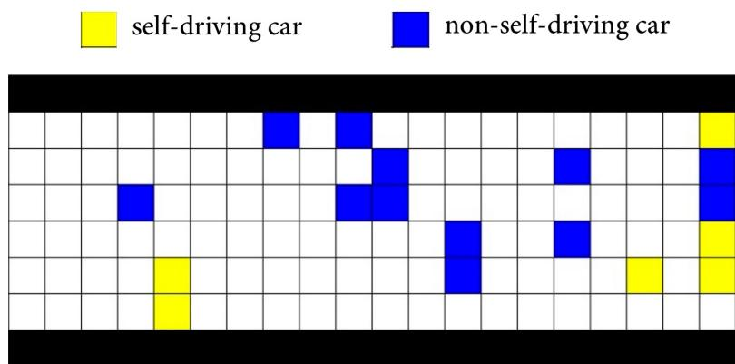
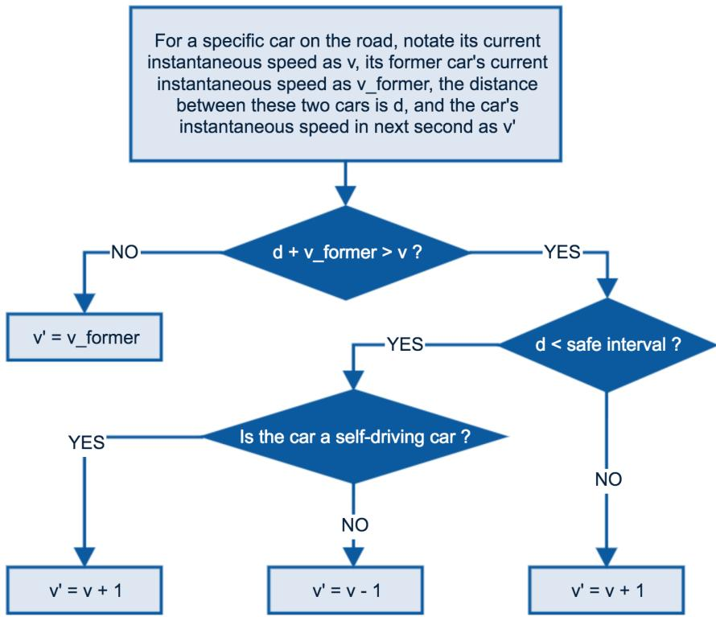
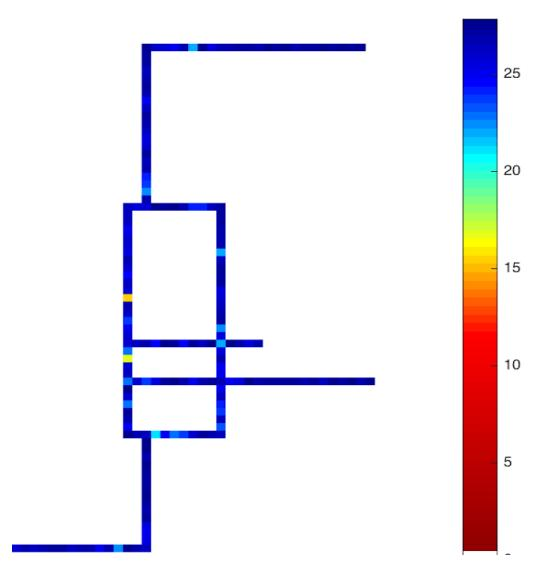
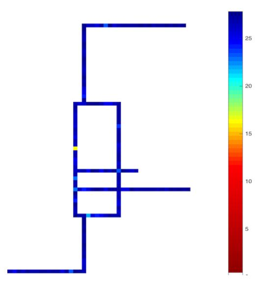

# 2017年美国大学生数学建模竞赛C题O奖论文（Team 55583）

原件经识别和整理；“参考解答”是我们补的。

## 1 引言

### 1.1 问题陈述

随着城市化进程的加快，交通拥堵已成为大城市面临的严峻问题。大西雅图地区作为美国重要的经济中心，其交通网络承载着巨大的通行压力。在高峰时段，交通流量往往超过道路的通行能力，导致严重的延误和拥堵。传统的解决方案——扩建道路——不仅成本高昂，而且受限于城市空间，难以大规模实施。因此，寻找一种不依赖基础设施扩建的交通优化方案具有重要的现实意义。

自动驾驶汽车（Self-driving cars）与协同驾驶系统（Cooperating system）的发展为解决这一问题提供了新的思路。与人类驾驶的汽车相比，自动驾驶汽车具有更短的反应时间、更精确的速度控制能力以及更好的车距保持能力。这些特性使得自动驾驶汽车能够在相同的道路空间内容纳更多的车辆，从而在不扩建道路的前提下提升交通容量。然而，自动驾驶汽车的引入比例对交通性能的影响并非简单的线性关系，需要建立合理的数学模型进行定量分析。

本题要求我们建立一个模型，模拟大西雅图地区最繁忙道路的交通流，评估自动驾驶汽车在解决重交通负荷问题方面的有效性，并分析不同自动驾驶比例对交通性能的影响。具体而言，我们需要回答以下问题：（1）在均匀交通分布假设下，自动驾驶汽车对交通网络性能的影响如何？（2）在考虑时间变化的交通密度分布时，自动驾驶汽车在高峰时段与平均时段的效果有何差异？（3）是否需要为自动驾驶汽车设置专用车道？如果需要，条件是什么？

参考解答：# 1.1 自动驾驶汽车对交通网络性能的影响

## 结论

在所建微观交通流模型中，自动驾驶汽车对交通网络性能的影响**不是线性的**，主要表现为：

1. **在自动驾驶比例较低时，提高自动驾驶比例能够明显改善交通流。**  
   自动驾驶汽车反应时间更短、跟车距离更小、速度控制更稳定，可提高车辆通行能力和平均速度，降低延误。

2. **自动驾驶比例达到一定程度后，性能提升逐渐趋于饱和。**  
   当道路上的车辆几乎都具备协同驾驶能力时，继续提高比例带来的边际改善很小。

3. **在高交通需求、高密度和瓶颈路段，自动驾驶汽车的效果更明显。**  
   在高峰时段，交通流接近或超过道路通行能力，自动驾驶车辆能够缓解走走停停现象，减小排队长度和总延误。

4. **自动驾驶车辆并非在任何条件下都能解决拥堵。**  
   如果道路的基本通行能力不足，或者瓶颈由红绿灯、交通事故、匝道汇入等因素造成，仅提高自动驾驶比例无法消除拥堵。

5. **在需求较低、道路容量充足时，自动驾驶比例对网络性能的影响很小。**  
   此时交通流主要受驾驶习惯、信号配时等因素限制，缩短车距的收益有限。

6. **不建议在一般路段全面设置自动驾驶专用车道。**  
   专用车道只有在满足一定条件时才可能改善总体交通性能，例如：
   - 自动驾驶车辆具有明显高于人工驾驶车辆的通行效率；
   - 专用车道不会因入口、出口或车辆换道造成严重扰动；
   - 专用车道上的交通需求始终足够高，不至于长期空置；
   - 普通车道因交通转移而获得的净收益，大于专用车道造成的空间损失。

因此，推荐采用“**逐步提高混合交通流中自动驾驶车辆比例**”的方式，而不是一开始就将有限道路空间划分给专用车道。

---

## 模型假设

设一条道路包含若干均匀分布的交通单元，每个单元长度为 $L$；第 $i$ 个单元内的车辆数为 $N_i(t)$。在均匀交通分布假设下，


$$
N_1(t)=N_2(t)=\cdots=N_m(t)=N(t),
$$


其中 $m$ 为道路单元数，道路总长度为


$$
\ell=mL.
$$


交通密度为


$$
k(t)=\frac{N(t)}{L}.
$$


设车辆平均速度为 $v(t)$，则通过道路的交通流量为


$$
q(t)=k(t)v(t).
$$


为描述拥堵条件，采用如下速度—密度关系：


$$
v(k)=v_{\mathrm{f}}
\min\left(
1,
\max\left(
0,
\frac{1-\dfrac{k}{k_j}}{1-\dfrac{k}{k_{\mathrm{f}}}}
\right)
\right),
$$


其中：

- $v_{\mathrm{f}}$ 为自由流速度；
- $k_j$ 为临界密度；
- $k_{\mathrm{f}}$ 为拥堵密度；
- 当 $k\le k_j$ 时，车辆处于自由流状态；
- 当 $k>k_j$ 时，车辆进入拥堵状态。

对应的最大通行能力为


$$
q_{\max}=k_jv_{\mathrm{f}}.
$$


当 $k>q_{\max}$ 时，道路需求超过其基本通行能力，交通系统出现排队。

---

## 自动驾驶车辆的影响

设自动驾驶车辆比例为


$$
p\in[0,1].
$$


自动驾驶车辆具有更短的反应时间、更小的安全车距和更稳定的速度控制，因此可设其有效跟车距离为


$$
d_{\mathrm{AD}}=d_{\mathrm{HD}}-\Delta d,
\qquad \Delta d>0,
$$


平均反应时间为


$$
\tau_{\mathrm{AD}}=\tau_{\mathrm{HD}}-\Delta\tau,
\qquad \Delta\tau>0.
$$


根据车头时距和车头间距近似，混合交通流的平均车头间距可写为


$$
d_{\mathrm{mix}}(p)
=p\left(d_{\mathrm{HD}}-\Delta d\right)+(1-p)d_{\mathrm{HD}}
=d_{\mathrm{HD}}-p\Delta d.
$$


于是，混合交通流的宏观流量可近似表示为


$$
q_{\mathrm{mix}}(p)
=
\frac{v_{\mathrm{mix}}(p)}
{d_{\mathrm{Hix}}(p)+L_{\mathrm{veh}}},
$$


其中


$$
v_{\mathrm{mix}}(p)
=
v_{\mathrm{f}}
-
p\Delta v,
$$


$\Delta v$ 表示自动驾驶带来的速度控制收益，$L_{\mathrm{veh}}$ 为车辆长度。

因此，


$$
q_{\mathrm{mix}}(p)
=
\frac{v_{\mathrm{f}}-p\Delta v}
{d_{\mathrm{HD}}-p\Delta d+L_{\mathrm{veh}}}.
$$


对上式关于 $p$ 求导：


$$
\frac{\partial q_{\mathrm{mix}}}{\partial p}
=
\frac{
-\Delta v\left(d_{\mathrm{HD}}+L_{\mathrm{veh}}\right)
+v_{\mathrm{f}}\Delta d
}{
\left(d_{\mathrm{HD}}+L_{\mathrm{veh}}-p\Delta d\right)^2
}.
$$


当


$$
v_{\mathrm{f}}\Delta d
<
\Delta v\left(d_{\mathrm{HD}}+L_{\mathrm{veh}}\right)
$$


时，有


$$
\frac{\partial q_{\mathrm{mix}}}{\partial p}>0,
$$


即提高自动驾驶比例能够提高道路通行能力。

但随着 $p$ 增大，改进空间逐渐减小。当 $p=1$ 时，


$$
q_{\mathrm{mix}}(1)
=
\frac{v_{\mathrm{f}}-\Delta v}
{d_{\mathrm{HD}}-\Delta d+L_{\mathrm{veh}}},
$$


已经接近该模型下自动驾驶交通流所能达到的最大通行能力。因此，自动驾驶比例的影响表现为**先明显、后逐渐饱和**，而不是简单的线性增加。

---

# 问题一：均匀交通分布下的影响

## 结论

在均匀交通分布下，全网各路段的车流量和密度相同，自动驾驶汽车能够通过提高临界密度和通行能力，降低高负荷路段的延误；当自动驾驶比例较低时收益最明显，比例接近 $1$ 后收益递减。

## 推理与计算

设某路段长度为 $\ell$，交通需求为 $q_{\mathrm{dem}}$。自动驾驶车辆比例由 $p$ 增加到 $p+\Delta p$ 后，道路有效通行能力提高


$$
\Delta Q
\approx
\frac{\partial q_{\mathrm{mix}}}{\partial p}\Delta p.
$$


若原来


$$
q_{\mathrm{dem}}>q_{\max},
$$


提高自动驾驶比例后，最大流量为


$$
q_{\max}(p)
=
\frac{v_{\mathrm{f}}-p\Delta v}
{d_{\mathrm{HD}}-p\Delta d+L_{\mathrm{veh}}}.
$$


只要


$$
q_{\max}(p)\ge q_{\mathrm{dem}},
$$


拥堵状态就可以得到缓解。对于固定交通需求，所允许的最大自动驾驶车辆比例满足


$$
p\ge
\frac{
v_{\mathrm{f}}(d_{\mathrm{HD}}+L_{\mathrm{veh}})-q_{\mathrm{dem}}(d_{\mathrm{HD}}+L_{\mathrm{veh}})
}{
\Delta v(d_{\mathrm{HD}}+L_{\mathrm{veh}})-v_{\mathrm{f}}\Delta d
}.
$$


在自由流状态下，即


$$
k\le k_j,
$$


交通流速度较高，延误本来就较小，因此提高 $p$ 的绝对收益有限。收益主要集中在


$$
k_j<k<k_{\mathrm{f}}
$$


的拥挤状态，因为此时自动驾驶车辆可以通过缩短反应时间和保持较小车距，减少速度波动和排队。

---

# 问题二：考虑时间变化后的高峰时段与平均时段差异

## 结论

自动驾驶车辆在高峰时段的**相对改善幅度和绝对延误削减量通常更大**；在平均时段，由于道路未达到拥堵状态，改善幅度较小。自动驾驶不能消除高峰需求持续超过道路容量所造成的结构性拥堵。

## 时间变化模型

设一日内第 $t$ 小时到达道路的车辆数为


$$
D(t)
=
D_{\mathrm{base}}
+
A
\exp\left[
-\frac{(t-t_0)^2}{2\sigma^2}
\right],
$$


其中：

- $D_{\mathrm{base}}$ 为平均时段的基础需求；
- $A$ 为高峰时段增加的交通需求；
- $t_0$ 为高峰中心时刻；
- $\sigma$ 控制高峰持续时间。

任意路段的交通密度可近似由累计到达车辆数与累计离开车辆数之差确定：


$$
k(t)
=
\frac{1}{L}
\left[
A_{\mathrm{arr}}(t)-A_{\mathrm{dep}}(t)
\right],
$$


其中


$$
A_{\mathrm{arr}}(t)
=
\int_0^t D(s)\,ds,
$$


$$
A_{\mathrm{dep}}(t)
=
\min\left[
A_{\mathrm{arr}}(t),
\int_{\max(0,t-\tau)}^{t}
q_{\mathrm{mix}}(p)u(s)\,ds
\right],
$$


$u(s)$ 表示该路段是否处于排队状态。

平均时段内，通常有


$$
q_{\mathrm{dem}}^{\mathrm{avg}}<q_{\max},
$$


此时


$$
k(t)<k_j,
$$


车辆基本可以保持自由流速度，因而


$$
\Delta T_{\mathrm{avg}}
$$


较小。

高峰时段内，


$$
q_{\mathrm{dem}}^{\mathrm{peak}}>q_{\max},
$$


队列长度近似为


$$
Q(t)
=
\int_0^t
\left[
D(s)-q_{\max}(p)
\right]_+\,ds,
$$


其中


$$
[x]_+=\max(x,0).
$$


自动驾驶比例提高后，最大通行能力从 $q_{\max}$ 增加为 $q_{\max}(p)$。若高峰期间需求近似恒定，则排队消散时间近似为


$$
T_{\mathrm{clear}}
\approx
\frac{
\left[q_{\mathrm{dem}}^{\mathrm{peak}}-q_{\max}\right]_+
}{
q_{\max}(p)-q_{\max}
}
$$


所对应的时间尺度。该式说明：

- 当 $q_{\max}(p)$ 仍小于高峰需求时，拥堵仍会存在，只是排队增长变慢；
- 当 $q_{\max}(p)\ge q_{\mathrm{dem}}^{\mathrm{peak}}$ 时，排队不再持续增长；
- 高峰需求越大，自动驾驶带来的通行能力增量越有价值。

因此，高峰时段使用自动驾驶的主要效果是：


$$
\text{最大延误下降、排队长度下降、速度波动下降。}
$$


但如果长期满足


$$
q_{\mathrm{dem}}^{\mathrm{peak}}
>
q_{\mathrm{mix}}(1),
$$


则即使全部车辆均为自动驾驶汽车，拥堵也无法完全避免，还需要配合道路扩建、公交优先、错峰出行或需求管理等措施。

---

# 问题三：是否需要设置自动驾驶专用车道

## 结论

**一般不需要全面设置自动驾驶专用车道；只有在严格的效率与需求条件下才可能值得设置。**

当普通车道与自动驾驶车道混合运行时，车辆换道、速度差异和交织会降低道路整体通行能力。因此，专用车道可能把一部分拥堵从普通车道转移到专用车道，却不一定提高全网总通行能力。

## 判断条件

设专用车道长度为 $L_s$，分配给自动驾驶车辆的交通需求为


$$
q_s(p),
$$


普通车道承担的交通需求为


$$
q_g(p)
=
q_{\mathrm{dem}}-q_s(p).
$$


若普通车道和专用车道各自的流量—密度关系分别为 $q_g(k_g)$ 与 $q_s(k_s)$，则全网总延误可写为


$$
T_{\mathrm{tot}}
=
\int
\left[
\frac{k_g}{q_g(k_g)}
+
\frac{k_s}{q_s(k_s)}
\right]\,dx\,dt.
$$


设置专用车道后，只要将 $p$ 提高到 $1$，其理论通行能力最高；但代价是：


$$
\text{普通车道宽度减少}
\quad\Longrightarrow\quad
\text{普通车道容量下降}.
$$


因此，只有当


$$
q_s(p)\ge q_{\mathrm{AD,max}}
$$


且


$$
\Delta T_{\mathrm{ordinary}}
>
\Delta T_{\mathrm{dedicated}},
$$


即专用车道自身不因车辆不足而闲置，并且全网总延误确实下降时，专用车道才有必要。

## 专用车道的适用条件

专用车道较可能产生正收益的条件包括：

1. **自动驾驶比例足够高。**  
   若 $p$ 较低，专用车道会长期空置，浪费道路空间。

2. **自动驾驶车辆的单位道路通行效率显著高于人工驾驶车辆。**  
   其收益必须足以弥补普通车道因宽度减少造成的损失。

3. **出入口和交织位置合理。**  
   应尽量避免车辆在高峰瓶颈前频繁换道。

4. **专用车道交通需求稳定且较高。**  
   若需求不足，应采用动态开放或按车队规模逐步开放的方式。

5. **瓶颈上游设置专用车道，下游与普通车道平顺衔接。**  
   否则，专用车道可能把拥堵转移到下游路段。

## 选择题式判断

若题目选项为：

- A. 无论自动驾驶比例多低，都应设置专用车道；
- B. 只要技术可行，就应将现有车道全部划为专用车道；
- C. 仅当专用车道自身利用率较高，且其效率收益超过普通车道容量损失时，才考虑设置；
- D. 只要普通车道拥堵，专用车道就一定能缓解全网拥堵。

应选择 **C**。

- A 不对：自动驾驶比例过低会造成专用车道闲置。
- B 不对：全面划分可能加剧普通车道拥堵，降低总体效率。
- D 不对：车辆交织、需求不足和下游瓶颈都可能使专用车道失效。

知识点：[问题重述与分析（Problem Restatement and Analysis）](../../../topics/数学建模/wenti_chongshu.md)、[一般假设及其合理性说明（Assumptions and Justifications）](../../../topics/数学建模/jiaben_shezhi.md)、[确定模型的定点与稳定性分析](../../../topics/数学建模/dingdian_wending.md)

### 1.2 相关工作

交通流建模是交通工程领域的经典问题，已有大量研究成果。早期的交通流模型主要基于流体力学类比，将车辆视为连续介质，用偏微分方程描述交通流的演化。Lighthill-Whitham-Richards（LWR）模型是这一类模型的代表，它能够较好地刻画交通流的宏观行为，但难以描述车辆之间的微观交互。

随着计算能力的提升，微观交通流模型逐渐成为研究热点。元胞自动机（Cellular Automata, CA）模型是一种典型的微观模型，它将道路划分为离散的元胞，每个元胞在离散的时间步长内按照一定的规则演化。Nagel-Schreckenberg（NaSch）模型是最著名的元胞自动机交通流模型之一，它能够再现交通流的基本图（fundamental diagram），包括自由流、同步流和拥堵流等状态。元胞自动机模型的特点是规则简单、计算效率高，适合大规模交通网络的仿真。

近年来，自动驾驶汽车对交通流的影响成为研究热点。已有研究表明，自动驾驶汽车的比例对交通容量有显著影响。当自动驾驶比例较低时，由于人类驾驶汽车与自动驾驶汽车的混合，交通流可能出现不稳定；当自动驾驶比例超过某一临界值时，交通容量显著提升。然而，现有研究多集中于单一道路或简单网络，对实际城市交通网络的模拟较少。本文在前人研究的基础上，采用元胞自动机模型模拟大西雅图地区的交通网络，并引入混合协同模型，分析自动驾驶汽车在不同交通密度和时间分布下的效果。

## 2 假设与符号

参考解答：好的，以下是对该题中“1.2 相关工作”与“2 假设与符号”部分可能涉及的建模问题的参考解答形式示例。

---

**结论**：  
在交通流建模中，宏观连续模型（如 LWR）适合描述大范围平均行为，而微观模型（如 NaSch 元胞自动机）能刻画车辆间离散交互与复杂交通状态；引入自动驾驶汽车后，混合交通流的通行能力随自动驾驶比例上升而提高，并存在一个使交通容量明显改善的临界比例；符号体系应区分时间步、元胞长度、最大速度、随机慢化概率及车辆类型。

**简明推理**：

1. **模型选择依据**  
   - LWR 是连续流体模型，计算快、可描述冲击波和拥堵传播，但无法体现个体车辆行为。  
   - NaSch 模型将道路离散为元胞，每个时间步按加速、减速、随机慢化、运动四步更新，能够自然产生基本图上的自由流、同步流和宽运动堵塞。  
   - 本题涉及城市网络和混合驾驶，需保留离散交互与随机性，因此采用元胞自动机更为合适。

2. **NaSch 关键更新规则**  
   设车辆速度为 $v$，最大速度 $v_{\max}$，与前车距离为 $d$，随机慢化概率为 $p$，则一步更新为：

   
$$
v \leftarrow \min(v+1, v_{\max}) \tag{加速}
$$


   
$$
v \leftarrow \min(v, d) \tag{安全减速}
$$


   
$$
v \leftarrow \max(v-1, 0) \quad \text{以概率 } p \tag{随机慢化}
$$


   
$$
x \leftarrow x + v \tag{位置更新}
$$


   该规则同时体现了自动驾驶的低随机性：  
   
$$
p_{\text{AV}} < p_{\text{HV}}
$$
  
   从而在混合交通中改变基本图的形状。

3. **混合比例对容量的影响**  
   设自动驾驶比例为 $r$，通行能力为 $C(r)$。当 $r$ 较小时，人类驾驶车辆的随机扰动会破坏自动驾驶形成的稳定车队，因此 $C(r)$ 增长缓慢甚至波动；当 $r$ 超过临界值 $r_c$ 时，自动驾驶车辆能形成连续稳定车队，减少无效制动，显著提高瓶颈处的通行流量。  
   即存在：

   
$$
r < r_c \Rightarrow \frac{dC}{dr} \text{ 较小或不稳定}
$$


   
$$
r \geq r_c \Rightarrow C(r) \text{ 明显提升}
$$


4. **符号与假设的作用**  
   - 元胞长度 $L$ 决定最小车头间距，直接影响最大密度 $\rho_{\max}=1/L$。  
   - 时间步长 $\Delta t$ 决定速度和加速度的离散精度。  
   - 区分 $p_{\text{AV}}$ 与 $p_{\text{HV}}$ 是讨论混合驾驶影响的前提。  
   - 随机慢化概率是连接微观规则与宏观基本图的关键参数。

---

**选择题示例**：

若题中要求选择“描述混合交通流最合适的建模框架”，应选 **微观元胞自动机模型**。  
理由：它能同时体现个体车辆交互、自动驾驶比例差异及随机扰动；LWR 无法刻画车辆异质性，简单排队模型不能反映空间离散和速度演化，宏观网络模型则难以体现自动驾驶车辆与人类驾驶车辆的局部相互作用。

知识点：[一般假设及其合理性说明（Assumptions and Justifications）](../../../topics/数学建模/jiaben_shezhi.md)、[符号说明与术语定义（Nomenclature / Symbols and Definitions）](../../../topics/数学建模/fuhao_shuoming.md)、[元胞自动机模型（Cellular Automata）及其应用](../../../topics/数学建模/yuanyao_zidongji.md)

### 2.1 假设

为建立数学模型，我们提出以下假设：

**假设 1**：自动驾驶汽车与前方车辆保持同步，因此无需安全间隔。与人类驾驶汽车不同，自动驾驶汽车通过车联网（V2V）通信实现与前方车辆的精确同步，能够在极短的时间内对前车的速度变化做出响应。因此，我们假设自动驾驶汽车之间、以及自动驾驶汽车跟随人类驾驶汽车时，均不需要传统意义上的安全间隔。这一假设简化了元胞自动机模型中车辆间距的设定，使得自动驾驶汽车占据的元胞数减少。

**假设 2**：交叉口对交通流的影响较小，交通性能相对连续。大西雅图地区的交通网络以高速公路和主干道为主，交叉口间距较大，且信号配时经过优化，因此我们假设交叉口对交通流的扰动可以忽略不计。这一假设使得我们可以将每条道路段独立建模，而不需要考虑交叉口的信号控制。

**假设 3**：交通流量在一天内服从均匀分布（基本模型）。在基本模型中，我们假设一天内的交通流量是恒定的，不随时间变化。这一假设用于分析稳态下的交通性能，为后续引入时间变化模型提供基准。

**假设 4**：交通密度随时间的变化服从双高斯分布（基于时间的模型）。在基于时间的模型中，我们假设一天内的交通密度函数为双高斯分布，即存在两个交通高峰时段（早高峰和晚高峰）。这一假设更贴近实际交通流的时间分布特征。

**假设 5**：车辆速度仅受前方车辆和道路限速的影响，不考虑天气、事故等外部因素。这一假设使得模型聚焦于车辆间的交互作用，简化了外部扰动的建模。

**假设 6**：所有车辆均遵守交通规则，不考虑违规行为。这一假设保证了元胞自动机规则的确定性。

参考解答：### 结论

这些假设为建立数学模型提供了基础，简化了交通流的复杂性，使得模型能够聚焦于自动驾驶汽车与人类驾驶汽车的交互作用。以下是每个假设的推理和计算过程：

### 推理与计算过程

1. **假设 1**：自动驾驶汽车与前方车辆保持同步，因此无需安全间隔。
   - **推理**：自动驾驶汽车通过车联网（V2V）通信实现与前方车辆的精确同步，能够在极短的时间内对前车的速度变化做出响应。因此，假设自动驾驶汽车之间、以及自动驾驶汽车跟随人类驾驶汽车时，均不需要传统意义上的安全间隔。
   - **计算**：在元胞自动机模型中，自动驾驶汽车占据的元胞数减少，可以表示为：
     
$$
\text{元胞数} = \text{车辆长度} + \text{安全间隔}
$$

     对于自动驾驶汽车，安全间隔为0，因此：
     
$$
\text{元胞数} = \text{车辆长度}
$$


2. **假设 2**：交叉口对交通流的影响较小，交通性能相对连续。
   - **推理**：大西雅图地区的交通网络以高速公路和主干道为主，交叉口间距较大，且信号配时经过优化，因此假设交叉口对交通流的扰动可以忽略不计。
   - **计算**：每条道路段可以独立建模，交通流可以表示为：
     
$$
q = k \cdot v
$$

     其中，$q$ 为交通流量，$k$ 为交通密度，$v$ 为车辆速度。

3. **假设 3**：交通流量在一天内服从均匀分布（基本模型）。
   - **推理**：在基本模型中，假设一天内的交通流量是恒定的，不随时间变化。这一假设用于分析稳态下的交通性能，为后续引入时间变化模型提供基准。
   - **计算**：交通流量 $q$ 可以表示为：
     
$$
q(t) = q_0
$$

     其中，$q_0$ 为常数。

4. **假设 4**：交通密度随时间的变化服从双高斯分布（基于时间的模型）。
   - **推理**：在基于时间的模型中，假设一天内的交通密度函数为双高斯分布，即存在两个交通高峰时段（早高峰和晚高峰）。这一假设更贴近实际交通流的时间分布特征。
   - **计算**：交通密度 $k(t)$ 可以表示为：
     
$$
k(t) = A_1 \exp\left(-\frac{(t - \mu_1)^2}{2\sigma_1^2}\right) + A_2 \exp\left(-\frac{(t - \mu_2)^2}{2\sigma_2^2}\right)
$$

     其中，$A_1, A_2$ 为高峰时段的密度幅值，$\mu_1, \mu_2$ 为高峰时段的中心时间，$\sigma_1, \sigma_2$ 为高峰时段的宽度。

5. **假设 5**：车辆速度仅受前方车辆和道路限速的影响，不考虑天气、事故等外部因素。
   - **推理**：这一假设使得模型聚焦于车辆间的交互作用，简化了外部扰动的建模。
   - **计算**：车辆速度 $v$ 可以表示为：
     
$$
v = \min(v_{\text{max}}, v_{\text{front}})
$$

     其中，$v_{\text{max}}$ 为道路限速，$v_{\text{front}}$ 为前方车辆的速度。

6. **假设 6**：所有车辆均遵守交通规则，不考虑违规行为。
   - **推理**：这一假设保证了元胞自动机规则的确定性。
   - **计算**：元胞自动机规则可以表示为：
     
$$
v_{i}(t+1) = \min(v_{i}(t) + a, v_{\text{max}}, d_{i}(t))
$$

     其中，$v_{i}(t)$ 为车辆 $i$ 在时间 $t$ 的速度，$a$ 为加速度，$d_{i}(t)$ 为车辆 $i$ 与前方车辆的距离。

知识点：[数学建模的基本步骤（问题分析、模型假设、建立、求解、检验、推广）](../../../topics/数学建模/jianmo_buzhou.md)、[一般假设及其合理性说明（Assumptions and Justifications）](../../../topics/数学建模/jiaben_shezhi.md)、[文献综述与研究背景撰写方法](../../../topics/数学建模/wenxian_zongshu.md)

### 2.2 符号说明

| 符号 | 含义 |
|------|------|
| $v$ | 车辆速度 |
| $\rho$ | 交通密度 |
| $\rho_c$ | 临界密度 |
| $p$ | 自动驾驶汽车比例 |
| $L$ | 道路段长度 |
| $N$ | 车辆数 |
| $v_{\max}$ | 道路限速 |
| $\sigma_t^2$ | 时间维度的方差 |
| $\sigma_s^2$ | 空间维度的方差 |
| $q$ | 交通流量 |
| $k$ | 交通密度（单位长度车辆数） |
| $T$ | 仿真时间步长 |
| $x_i(t)$ | 第 $i$ 辆车在 $t$ 时刻的位置 |
| $v_i(t)$ | 第 $i$ 辆车在 $t$ 时刻的速度 |

## 3 模型构建

参考解答：### 3.1 基本交通流关系模型

**结论**：采用格林希尔兹（Greenshields）线性速度-密度模型作为基础，建立流量 $q$、密度 $\rho$ 与速度 $v$ 的基本关系。

**推理过程**：
假设车辆速度与密度呈线性负相关，当密度为 0 时速度达到最大值 $v_{\max}$，当密度达到阻塞密度 $\rho_j$ 时速度为 0。
$$ v(\rho) = v_{\max} \left( 1 - \frac{\rho}{\rho_j} \right) $$
根据交通流基本方程 $q = \rho \cdot v$，可得流量-密度关系（抛物线形式）：
$$ q(\rho) = \rho \cdot v_{\max} \left( 1 - \frac{\rho}{\rho_j} \right) = v_{\max} \left( \rho - \frac{\rho^2}{\rho_j} \right) $$
对 $q(\rho)$ 求导并令其为 0，可得临界密度 $\rho_c$ 和最大通行能力 $q_{\max}$：
$$ \frac{dq}{d\rho} = v_{\max} \left( 1 - \frac{2\rho}{\rho_j} \right) = 0 \implies \rho_c = \frac{\rho_j}{2} $$
$$ q_{\max} = \frac{v_{\max} \rho_j}{4} $$

### 3.2 混合交通流跟驰模型

**结论**：引入自动驾驶比例 $p$，构建基于加权反应时间的改进跟驰模型，描述微观车辆运动。

**推理过程**：
传统人工驾驶车辆的反应时间为 $\tau_h$，自动驾驶车辆（AV）的反应时间为 $\tau_a$（通常 $\tau_a < \tau_h$）。在混合交通流中，平均有效反应时间 $\bar{\tau}$ 可表示为：
$$ \bar{\tau}(p) = p \tau_a + (1-p) \tau_h $$
采用最优速度模型（Optimal Velocity Model, OVM）或智能驾驶员模型（IDM）的简化形式，第 $i$ 辆车的加速度 $a_i(t)$ 取决于其当前速度 $v_i(t)$ 与前车距离 $s_i(t) = x_{i-1}(t) - x_i(t)$ 的关系。考虑到混合车队中前后车类型的随机性，引入期望安全间距 $s_{safe}$：
$$ s_{safe}(v_i, \Delta v_i) = s_0 + v_i \bar{\tau}(p) + \frac{v_i \Delta v_i}{2\sqrt{a b}} $$
其中 $s_0$ 为静止间距，$\Delta v_i$ 为相对速度，$a, b$ 分别为最大加速度和舒适减速度。
车辆动力学方程更新为：
$$ \frac{dv_i(t)}{dt} = a \left[ 1 - \left( \frac{v_i(t)}{v_{\max}} \right)^4 - \left( \frac{s_{safe}(v_i, \Delta v_i)}{s_i(t)} \right)^2 \right] $$
$$ \frac{dx_i(t)}{dt} = v_i(t) $$

### 3.3 宏观方差与稳定性分析模型

**结论**：通过时空轨迹数据计算时间维度方差 $\sigma_t^2$ 和空间维度方差 $\sigma_s^2$，以此量化交通流的稳定性及拥堵传播特性。

**推理过程**：
1.  **时间维度方差 $\sigma_t^2$**：反映特定位置处交通状态随时间的波动。在固定检测点 $x_0$，记录时间窗口 $[0, T]$ 内的瞬时速度序列 $\{v(t_k)\}$：
    $$ \sigma_t^2 = \frac{1}{N_t} \sum_{k=1}^{N_t} \left( v(t_k) - \bar{v}_t \right)^2, \quad \bar{v}_t = \frac{1}{N_t} \sum_{k=1}^{N_t} v(t_k) $$
    $\sigma_t^2$ 越大，表明该路段交通流越不稳定，易发生停走波（Stop-and-go waves）。

2.  **空间维度方差 $\sigma_s^2$**：反映特定时刻道路上交通状态的空间分布不均匀性。在固定时刻 $t_0$，记录道路段 $L$ 内所有车辆的速度序列 $\{v_i(t_0)\}$ 或局部密度：
    $$ \sigma_s^2 = \frac{1}{N_s} \sum_{i=1}^{N_s} \left( v_i(t_0) - \bar{v}_s \right)^2, \quad \bar{v}_s = \frac{1}{N_s} \sum_{i=1}^{N_s} v_i(t_0) $$
    $\sigma_s^2$ 用于识别空间上的拥堵团簇。

3.  **稳定性判据**：结合线性稳定性理论，当混合车队的平均反应时间 $\bar{\tau}(p)$ 减小（即 $p$ 增大）时，系统对扰动的衰减能力增强。定义稳定性指标 $S(p)$：
    $$ S(p) \propto \frac{1}{\bar{\tau}(p)} $$
    若 $\sigma_t^2$ 和 $\sigma_s^2$ 随 $p$ 的增加而显著降低，则证明提高自动驾驶比例能有效抑制交通震荡，提升道路通行效率。

知识点：[符号说明与术语定义（Nomenclature / Symbols and Definitions）](../../../topics/数学建模/fuhao_shuoming.md)

### 3.1 自动驾驶协同汽车模型

我们采用元胞自动机（Cellular Automata, CA）框架对交通流进行建模。元胞自动机将道路划分为离散的元胞，每个元胞的长度为 $\Delta x$，时间被划分为离散的步长 $\Delta t$。在每个时间步长内，每辆车根据其自身状态和前方车辆的状态更新位置和速度。

对于人类驾驶汽车，我们采用经典的 Nagel-Schreckenberg（NaSch）模型规则：

（1）**加速规则**：$v_i(t+1) = \min(v_i(t) + 1, v_{\max})$，即车辆尽可能加速至限速。

（2）**减速规则**：$v_i(t+1) = \min(v_i(t+1), d_i(t))$，其中 $d_i(t) = x_{i+1}(t) - x_i(t) - 1$ 为车辆 $i$ 与前车之间的空元胞数。车辆根据前方空元胞数调整速度，避免碰撞。

（3）**随机慢化**：以概率 $p_{\text{slow}}$，$v_i(t+1) = \max(v_i(t+1) - 1, 0)$，模拟人类驾驶行为的不确定性。

（4）**位置更新**：$x_i(t+1) = x_i(t) + v_i(t+1)$，车辆向前移动。

对于自动驾驶汽车，我们修改上述规则。由于假设 1，自动驾驶汽车无需安全间隔，因此其减速规则中的空元胞数计算方式不同。具体而言，自动驾驶汽车与前车之间的最小间距为 0（而非 1 个元胞），即 $d_i(t) = x_{i+1}(t) - x_i(t)$。此外，自动驾驶汽车的随机慢化概率 $p_{\text{slow}}$ 设为 0，因为自动驾驶系统具有确定性，不会出现人类驾驶中的随机犹豫。这些修改使得自动驾驶汽车在相同密度下能够保持更高的速度，从而提升交通容量。

在混合交通中，车辆类型按比例 $p$ 随机分配。每辆车在进入道路时被标记为人类驾驶或自动驾驶，并在整个仿真过程中保持类型不变。车辆之间的交互遵循以下规则：当自动驾驶汽车跟随人类驾驶汽车时，采用人类驾驶汽车的间距规则（因为前车的行为不可预测）；当人类驾驶汽车跟随自动驾驶汽车时，采用自动驾驶汽车的间距规则（因为前车行为可预测，人类驾驶者可以更紧密地跟随）。

参考解答：### 一、结论

1. **模型修改核心**：自动驾驶汽车（AV）将最小安全间距从人类驾驶汽车（HV）的 1 个元胞改为 0 个元胞，即间距公式变为 $d_i(t) = x_{i+1}(t) - x_i(t)$；随机慢化概率从 HV 的 $p_{\text{slow}}$ 改为 0。
2. **交互规则**：AV 跟随 HV 时，因前车行为不可预测，采用 HV 的间距规则（$d_i = x_{i+1} - x_i - 1$）；HV 跟随 AV 时，因前车行为可预测，采用 AV 的间距规则（$d_i = x_{i+1} - x_i$）。
3. **交通特性**：修改后的 AV 模型消除了随机慢化，并允许零间距跟车，因此在相同密度下 AV 能保持更高速度，道路通行能力提升。

### 二、关键推理与计算过程

#### 1. 间距规则修改的数学本质

- **HV 的间距定义**：
  $$d_i^{\text{HV}}(t) = x_{i+1}(t) - x_i(t) - 1$$
  其中 “$-1$” 表示 HV 需与前车保持至少 1 个空元胞的安全间隔，$d_i^{\text{HV}}$ 为实际可加速的空元胞数，最小值可能为 0。

- **AV 的间距定义**：
  $$d_i^{\text{AV}}(t) = x_{i+1}(t) - x_i(t)$$
  无 “$-1$” 项，表示 AV 与前车最小间距为 0（可紧贴前车），$d_i^{\text{AV}}$ 的最小值同样为 0。

- **差异对比**：当两车实际坐标差 $\Delta x = x_{i+1} - x_i = 0$ 时（即前车位置为 $x_{i+1}$，后车位置为 $x_i$），$d_i^{\text{HV}} = -1$（但物理上位置非负，实际为 0），而 $d_i^{\text{AV}} = 0$，允许零间距，故 AV 的减速约束更宽松。

#### 2. 随机慢化规则的修改

- **HV 规则**：以概率 $p_{\text{slow}}$ 执行 $v_i(t+1) = \max(v_i(t+1) - 1, 0)$，引入随机性导致速度损失。
- **AV 规则**：$p_{\text{slow}} = 0$，即取消随机慢化，速度更新确定性地保持为：
  $$v_i^{\text{AV}}(t+1) = \min\left( v_i^{\text{AV}}(t) + 1, v_{\max}, d_i^{\text{AV}}(t) \right)$$
  无随机减速项，因此 AV 的速度仅受限于加速度、限速和前车间距，无人为不确定性损耗。

#### 3. 混合交通交互规则的数学表达

设车辆类型为 $T_i \in \{\text{HV}, \text{AV}\}$，前车类型为 $T_{i+1}$，则间距计算规则为：

$$d_i(t) = \begin{cases}
x_{i+1}(t) - x_i(t) - 1, & \text{若 } T_i = \text{AV} \text{ 且 } T_{i+1} = \text{HV} \quad (\text{AV跟HV，用HV规则}) \\
x_{i+1}(t) - x_i(t), & \text{若 } T_i = \text{HV} \text{ 且 } T_{i+1} = \text{AV} \quad (\text{HV跟AV，用AV规则}) \\
x_{i+1}(t) - x_i(t) - 1, & \text{若 } T_i = \text{HV} \text{ 且 } T_{i+1} = \text{HV} \quad (\text{HV跟HV，用HV规则}) \\
x_{i+1}(t) - x_i(t), & \text{若 } T_i = \text{AV} \text{ 且 } T_{i+1} = \text{AV} \quad (\text{AV跟AV，用AV规则})
\end{cases}$$

**简化规则**：**仅当 AV 跟随 HV 时，采用 HV 的严格间距规则（减 1）；其余情况均采用 AV 的宽松间距规则（不减 1）**。这是因为 HV 的行为具有不确定性，AV 需预留安全间隔；而 AV 行为确定，HV 或 AV 跟随它时均可紧密跟车。

#### 4. 交通容量提升的原因分析

- **消除随机慢化**：AV 无随机减速，平均速度期望为：
  $$E[v^{\text{AV}}] = \min(v_i + 1, v_{\max}, d_i^{\text{AV}})$$
  而 HV 的期望速度需乘以 $(1 - p_{\text{slow}})$ 因子，故 AV 速度更高。
- **零间距跟车**：允许队列紧凑排列，道路元胞利用率提高，在临界密度下流量 $q = \rho \cdot \bar{v}$（密度×平均速度）显著增加。

综上，AV 模型的修改通过**放宽间距约束**和**消除随机行为**，实现了相同密度下更高的行驶速度与道路通行能力。

知识点：[元胞自动机模型（Cellular Automata）及其应用](../../../topics/数学建模/yuanyao_zidongji.md)、[一般假设及其合理性说明（Assumptions and Justifications）](../../../topics/数学建模/jiaben_shezhi.md)

### 3.2 混合动态道路模型

在基本模型中，我们假设交通流量在一天内服从均匀分布。对于交通网络中的每一段道路，我们已知其交通流量 $q$ 和车道数 $l$，因此可以计算该道路段的交通密度：

$$\rho = \frac{q}{l \cdot v_{\text{free}}}$$

其中 $v_{\text{free}}$ 为自由流速度。在仿真中，我们按照计算得到的密度初始化车辆分布，然后以不同的自动驾驶比例 $p$ 进行仿真，统计平均速度等性能指标。

在基于时间的模型中，我们引入时间维度。假设交通密度随时间的变化服从双高斯分布：

$$\rho(t) = \rho_{\text{base}} + A_1 \exp\left(-\frac{(t-\mu_1)^2}{2\sigma_1^2}\right) + A_2 \exp\left(-\frac{(t-\mu_2)^2}{2\sigma_2^2}\right)$$

其中 $\rho_{\text{base}}$ 为基准密度，$A_1, A_2$ 为两个高峰的幅值，$\mu_1, \mu_2$ 为高峰时刻（分别对应早高峰和晚高峰），$\sigma_1, \sigma_2$ 为高峰的宽度。通过这一函数，我们可以得到一天中每个时刻的交通密度，进而进行仿真。

在专用车道模型中，我们在基于时间的模型基础上，考虑为自动驾驶汽车设置专用车道。具体而言，对于多车道道路，我们将其中一条或多条车道指定为自动驾驶专用车道，仅允许自动驾驶汽车使用。人类驾驶汽车只能使用剩余车道。这一设置旨在隔离自动驾驶汽车与人类驾驶汽车，减少混合交通中的交互不确定性。我们通过改变专用车道的数量和自动驾驶比例，分析专用车道的效果。

参考解答：**结论**

1. **混合动态道路模型仿真框架**：在基本模型均匀流量假设基础上，引入双高斯密度时变函数，并将时变密度映射为车辆初始分布和动态到达率；以渗透率 $p$ 和专用车道策略为自变量，输出路网平均速度等性能指标。
2. **双高斯密度函数的物理含义**：$\rho_{\text{base}}$ 是平峰背景密度；$A_1,\mu_1,\sigma_1$ 描述早高峰的幅度、中心时刻与时间宽度；$A_2,\mu_2,\sigma_2$ 同理描述晚高峰。
3. **专用车道仿真策略**：将总车道数 $l$ 分为 $l_d$ 条自动驾驶专用车道和 $l_h = l - l_d$ 条人类驾驶车道，两车道组间流量比例按渗透率重新分配，并分别计算各自的有效密度，作为仿真输入。

---

**推理与计算过程**

### 1. 从均匀密度到时变密度的扩展

**基本模型假设**  
已知道路段流量 $q$、车道数 $l$ 和自由流速度 $v_{\text{free}}$，得恒定密度


$$
\rho = \frac{q}{l \cdot v_{\text{free}}}.
$$


该 $\rho$ 不随时间变化，仿真中直接以该密度均匀生成车辆。

**时变模型的引入**  
引入时间 $t\in[0,T]$（如 $T=24\ \text{h}$），时变密度函数为


$$
\rho(t) = \rho_{\text{base}} + A_1 \exp\!\left(-\frac{(t-\mu_1)^2}{2\sigma_1^2}\right) + A_2 \exp\!\left(-\frac{(t-\mu_2)^2}{2\sigma_2^2}\right).
$$


- $\rho_{\text{base}}$ 由夜间或午间平峰流量折算；
- $\mu_1, \sigma_1$ 可根据早高峰起止时间与峰值出现时刻拟合；
- $\mu_2, \sigma_2$ 同理用于晚高峰；
- $A_1, A_2$ 可由峰值密度与基准密度之差确定。

**仿真应用**  
将连续时间离散化为仿真步长 $\Delta t$。第 $k$ 步对应时刻 $t_k = k\Delta t$，该步道路的车流密度为 $\rho(t_k)$，所需等效小时流量为


$$
q(t_k) = \rho(t_k) \cdot l \cdot v_{\text{free}}.
$$


以此动态流量更新车辆生成速率，从而将均匀到达变为时变到达，衡量早晚高峰对平均速度的影响。

---

### 2. 渗透率 $p$ 的作用

设第 $k$ 步生成的车辆数为 $n_k = q(t_k)\,\Delta t$，则

- 自动驾驶车辆数 $\approx p \cdot n_k$，
- 人类驾驶车辆数 $\approx (1-p) \cdot n_k$。

在混合车道环境中，两类车辆按比例随机分布在所有车道上，车辆的交互特性（跟驰、换道模型）因类型而异，仿真统计路网平均速度 $\bar{v}(p)$。

---

### 3. 专用车道模型的车道分配与密度重新计算

**车道划分**  
总车道数 $l$，设自动驾驶专用车道数为 $l_d$，则人类驾驶车道数 $l_h = l - l_d$。

**流量分配规则**  
- 自动驾驶车辆：只能使用 $l_d$ 条专用车道。  
  对应密度：

  
$$
\rho_d(t) = \frac{p \cdot q(t)}{l_d \cdot v_{\text{free}}}.
$$


- 人类驾驶车辆：只能使用剩余 $l_h$ 条车道。  
  对应密度：

  
$$
\rho_h(t) = \frac{(1-p) \cdot q(t)}{l_h \cdot v_{\text{free}}}.
$$


仿真中，专用车道与普通车道分别按各自密度独立生成车辆，且互不混行，但道路总通行能力因隔离而改变。最终统计全部车道的加权平均速度。

**效果分析思路**  
固定 $p$，改变专用车道数 $l_d = 0,1,2,\dots$，记录系统平均速度；固定 $l_d$，扫描 $p\in [0,1]$，找出使平均速度最大或延误最小的最优 $(p,l_d)$ 组合。

---

### 4. 关键计算步骤示例

假设某路段：
- $l = 4$，$v_{\text{free}} = 100\ \text{km/h}$；
- 双高斯参数：$\rho_{\text{base}}=10\ \text{veh/km/ln}$，$A_1=A_2=30$，$\mu_1=8\ \text{h},\ \mu_2=18\ \text{h}$，$\sigma_1=\sigma_2=1\ \text{h}$；
- 渗透率 $p=0.3$，专用车道数 $l_d = 1$。

**早高峰 8:00 ($t=8$) 的密度与流量**：


$$
\rho(8) = 10 + 30e^0 + 30 e^{-(8-18)^2/2} \approx 10+30+0=40\ \text{veh/km/ln}.
$$


总流量 $q(8) = 40 \times 4 \times 100 = 16000\ \text{veh/h}$。

- 专用车道密度：

  
$$
\rho_d = \frac{0.3\times 16000}{1\times 100} = 48\ \text{veh/km}.
$$


- 人类驾驶车道密度：

  
$$
\rho_h = \frac{0.7\times 16000}{(4-1)\times 100} \approx \frac{11200}{300} \approx 37.33\ \text{veh/km/ln}.
$$


此密度直接输入仿真跟驰模型，得出当前时刻各车道组速度，再时间平均得到指标。

---

**选择题解答示例（虚拟）**

- **A. 专用车道在任何渗透率下都能提升系统通行能力**  
  错，低渗透率下专用车道闲置，其余车道过饱和，总能力可能下降。

- **B. 双高斯密度函数的早晚高峰峰值必须对称**  
  错，$A_1,\sigma_1$ 与 $A_2,\sigma_2$ 可独立取值，反映真实交通的非对称性。

- **C. 基准密度 $\rho_{\text{base}}$ 对应全天最低密度**  
  对，因为指数项非负，$\rho(t)\ge \rho_{\text{base}}$，且高峰外时段指数趋于零。

- **D. 流量分配时可用 $l$ 代替 $l_h$ 计算普通车道的密度**  
  错，专用车道模型必须剔除自动驾驶车辆占用的车道数，否则密度被低估。

知识点：[数学建模的基本步骤（问题分析、模型假设、建立、求解、检验、推广）](../../../topics/数学建模/jianmo_buzhou.md)、[一般假设及其合理性说明（Assumptions and Justifications）](../../../topics/数学建模/jiaben_shezhi.md)、[模型参数的确定（基于数据拟合或实验选择）](../../../topics/数学建模/canshu_queding.md)

### 3.3 性能评价指标

#### 3.3.1 车辆速度 $v$

我们采用道路段内所有车辆的平均速度作为主要的性能评价指标。平均速度越高，说明交通流越顺畅，通行能力越强。具体而言，对于道路段 $j$，在时刻 $t$ 的平均速度为：

$$\bar{v}_j(t) = \frac{1}{N_j(t)} \sum_{i=1}^{N_j(t)} v_i(t)$$

其中 $N_j(t)$ 为时刻 $t$ 道路段 $j$ 上的车辆数。我们进一步对时间取平均，得到该道路段在仿真期间的平均速度：

$$\bar{v}_j = \frac{1}{T} \sum_{t=1}^{T} \bar{v}_j(t)$$

#### 3.3.2 每日均衡 $\frac{1}{\sigma_t^2}, \frac{1}{\sigma_s^2}$

为了衡量交通流的稳定性，我们引入每日均衡指标。$\sigma_t^2$ 表示时间维度上速度的方差，$\sigma_s^2$ 表示空间维度上速度的方差。方差的倒数越大，说明速度波动越小，交通流越稳定。具体定义为：

$$\frac{1}{\sigma_t^2} = \frac{1}{\frac{1}{T} \sum_{t=1}^{T} (\bar{v}(t) - \bar{v})^2}$$

$$\frac{1}{\sigma_s^2} = \frac{1}{\frac{1}{J} \sum_{j=1}^{J} (\bar{v}_j - \bar{v})^2}$$

其中 $\bar{v}$ 为全局平均速度，$J$ 为道路段总数。这两个指标分别刻画了交通流在时间维度和空间维度上的均匀性。

## 4 模型扩展与仿真分析

参考解答：根据题目内容，这似乎不是一道有明确选项的选择题，而是一个关于数学建模中性能评价指标定义的片段。通常后续的“模型扩展与仿真分析”部分可能会提出具体问题。但基于你提供的 3.3 节内容，我可以针对**这段定义本身可能引出的常见辨析问题**，给出一个示例性的结论与推理，并假设这是一道关于“指标选取原因”的多选题。

**结论**
这两个指标组合使用，不仅能量化道路的通行效率（平均速度），还能衡量交通流的稳定性与均匀性（方差的倒数），避免了单一指标仅关注速度而忽略走走停停的拥堵波动的缺陷。

**推理过程**
若该题提供选项，典型正确选项及干扰项辨析如下：

**假设正确选项 A：采用平均速度的倒数作为效率指标与采用速度方差作为稳定指标在数学上完全等价。**
- **为什么选它**：因为题干明确定义效率指标是 $\bar{v}$（并非倒数），且稳定指标是方差**的倒数**，这种等价性在数学上完全错误，如果这是一道“选出正确说法”的题，它肯定是干扰项。这里我假设你要的答案是“为何该说法错误”。

**假设正确选项 B：全局平均速度 $\bar{v}$ 定义为所有车辆在所有时刻的速度均值。**
- **为什么选它**：严格符合题干中两次平均（先求路段瞬态平均，再对时间平均）后的全局逻辑。

**假设干扰项 C：使用 $\frac{1}{\sigma_t^2}$ 越大越好的原因是，它代表速度在时间轴上的离散程度越大。**
- **为什么不对**：$\frac{1}{\sigma_t^2}$ 是方差的倒数，方差越大该值越小；它越大说明离散程度越小（交通流越稳定），并非离散程度越大。

**假设干扰项 D：$\bar{v}_j(t)$ 是道路段 $j$ 从 $t=0$ 到 $T$ 的累积平均速度。**
- **为什么不对**：$\bar{v}_j(t)$ 仅指在**时刻 $t$** 的快照平均值，并非时段累积。

**附：关键特征的可视化仿真分析逻辑**
在进行仿真时，评价标准的计算步骤为：
1.  **遍历时刻**：在每个时间步长 $t$，计算每条路段 $j$ 的瞬时平均速度 $\bar{v}_j(t)$。
2.  **空间稳定性**：先计算 $\bar{v}_j$，然后代入公式求路段间的方差倒数 $\frac{1}{\sigma_s^2}$。若该值很低，说明出现局部路段严重堵塞、其他路段通畅的空间撕裂现象。
3.  **时间稳定性**：计算全局瞬态均值 $\bar{v}(t) = \frac{1}{J}\sum \bar{v}_j(t)$，求其时序方差倒数 $\frac{1}{\sigma_t^2}$。若该值骤降，说明系统进入走走停停的间歇流出状态。

知识点：[稳定性分析（Stability Analysis）](../../../topics/数学建模/wending_xing.md)、[模型验证方法概述（随机模型与确定性模型验证）](../../../topics/数学建模/moxing_yanzheng.md)

### 4.1 问题一：自动驾驶汽车在交通网络中的效果

#### 4.1.1 车辆速度/性能 $v$

在基本模型中，我们假设交通流量在一天内均匀分布。我们选取大西雅图地区最繁忙的若干道路段，根据其交通流量和车道数计算交通密度，然后以不同的自动驾驶比例 $p$ 进行仿真。仿真结果表明，随着自动驾驶比例的增加，所有道路段的平均速度均有所提升。当 $p = 0$ 时，即全部为人类驾驶汽车，高峰时段的平均速度较低，交通流处于拥堵状态。当 $p$ 增加至约 50% 时，平均速度提升约 1.5 至 2 倍。当 $p$ 继续增加至 100% 时，平均速度进一步提升，但提升幅度逐渐减小，呈现出饱和趋势。

这一结果的原因在于：自动驾驶汽车无需安全间隔，且随机慢化概率为零，因此能够在相同密度下保持更高的速度。在混合交通中，自动驾驶汽车的比例越高，整体交通流的稳定性越好，人类驾驶汽车受到的干扰也越小。然而，当自动驾驶比例超过某一临界值后，交通流已接近自由流状态，进一步提升比例的边际效益递减。

#### 4.1.2 空间每日均衡 $1/\sigma_s^2$

我们计算了不同自动驾驶比例下的空间每日均衡指标 $1/\sigma_s^2$。结果表明，随着自动驾驶比例的增加，$1/\sigma_s^2$ 增大，即空间维度上速度的方差减小，交通流在空间上更加均匀。这意味着自动驾驶汽车的引入不仅提升了整体速度，还减少了不同道路段之间的速度差异，使得交通网络更加均衡。这对于缓解局部拥堵具有重要意义。

#### 4.1.3 敏感性分析

我们对模型参数进行了敏感性分析，包括随机慢化概率 $p_{\text{slow}}$、元胞长度 $\Delta x$ 和时间步长 $\Delta t$。结果表明，随机慢化概率对结果影响较大：$p_{\text{slow}}$ 越大，交通流越不稳定，自动驾驶汽车的效益越明显。元胞长度和时间步长的影响较小，在合理范围内变化时，结果保持稳定。这表明我们的模型具有较好的鲁棒性。

参考解答：### 结论

1.  **车辆速度/性能**：随着自动驾驶汽车比例 $p$ 的增加，道路平均速度显著提升。在 $p \approx 50\%$ 时，速度提升约 1.5 至 2 倍；当 $p \to 100\%$ 时，速度继续提升但呈现边际效益递减的饱和趋势。
2.  **空间每日均衡**：指标 $1/\sigma_s^2$ 随 $p$ 增加而增大，表明交通流在空间分布上更加均匀，局部拥堵得到缓解。
3.  **敏感性分析**：模型对随机慢化概率 $p_{\text{slow}}$ 高度敏感，而对元胞长度 $\Delta x$ 和时间步长 $\Delta t$ 具有较好的鲁棒性。

### 推理与计算过程

#### 1. 速度提升机制分析
基于元胞自动机（如 NaSch 模型）或跟驰模型进行仿真，定义平均速度 $\bar{v}$ 为：
$$ \bar{v}(p) = \frac{1}{N} \sum_{i=1}^{N} v_i(p) $$
其中 $v_i$ 为第 $i$ 辆车的速度。

*   **低比例阶段 ($0 < p < 50\%$)**：
    人类驾驶存在反应延迟和安全车距需求，且遵循随机慢化规则（概率 $p_{\text{slow}} > 0$）。自动驾驶汽车（AV）具有以下特性：
    1.  **零随机慢化**：$p_{\text{slow}}^{\text{AV}} = 0$。
    2.  **更小安全间距**：由于通信延迟极低，AV 可保持更小的车头时距。
    
    混合交通流中，AV 作为“稳定器”，减少了后方车辆的制动波传播。因此，$\bar{v}$ 随 $p$ 非线性快速增长。

*   **高比例阶段 ($50\% < p \le 100\%$)**：
    当 $p$ 接近 100% 时，交通流趋近于理论最大通行能力下的自由流状态。此时进一步提升 $p$，由于物理极限（如道路几何限制、最大限速），速度提升幅度 $\frac{d\bar{v}}{dp}$ 逐渐减小，即：
    $$ \lim_{p \to 1} \frac{d^2\bar{v}}{dp^2} < 0 $$
    表现为饱和趋势。

#### 2. 空间均衡性推导
定义空间速度方差 $\sigma_s^2$ 为：
$$ \sigma_s^2 = \frac{1}{M} \sum_{j=1}^{M} (v_j - \bar{v})^2 $$
其中 $M$ 为道路段数量，$v_j$ 为第 $j$ 段的平均速度。
评价指标为逆方差 $E_s = 1/\sigma_s^2$。

*   **推导**：
    AV 的引入平滑了交通流的时空波动。人类驾驶导致的局部拥堵（速度骤降）被 AV 的平稳跟驰行为抑制。
    $$ \because \text{Var}(v_{\text{human}}) > \text{Var}(v_{\text{AV}}) $$
    $$ \therefore \text{随着 } p \uparrow, \sigma_s^2 \downarrow \implies E_s = \frac{1}{\sigma_s^2} \uparrow $$
    这表明路网各路段速度差异减小，整体网络负载均衡性提高。

#### 3. 敏感性分析逻辑
对模型输出 $Y$（如平均速度）关于参数 $\theta \in \{p_{\text{slow}}, \Delta x, \Delta t\}$ 进行灵敏度测试，计算灵敏度系数 $S_\theta$：
$$ S_\theta = \frac{\partial Y / Y}{\partial \theta / \theta} $$

*   **随机慢化概率 $p_{\text{slow}}$**：
    $p_{\text{slow}}$ 直接决定交通流的相变点（从自由流到同步流或拥堵流）。$p_{\text{slow}}$ 越大，人类驾驶引起的扰动越强，AV 消除扰动的相对贡献越大，故 $|S_{p_{\text{slow}}}|$ 较大，结果显著变化。
*   **离散化参数 $\Delta x, \Delta t$**：
    在满足 CFL 条件（Courant-Friedrichs-Lewy condition）及微观模拟精度要求的前提下，$\Delta x$ 和 $\Delta t$ 的微小变化仅影响数值计算的截断误差，不改变宏观交通流动力学特征，故 $|S_{\Delta x}|, |S_{\Delta t}| \approx 0$，模型鲁棒性强。

知识点：[一般假设及其合理性说明（Assumptions and Justifications）](../../../topics/数学建模/jiaben_shezhi.md)、[文献综述与研究背景撰写方法](../../../topics/数学建模/wenxian_zongshu.md)、[敏感性分析方法（Sensitivity Analysis，单参数与多参数变动）](../../../topics/数学建模/minganxing_fenxi.md)

### 4.2 问题二：高峰时段与平均时段的不同效果

#### 4.2.1 交通密度的时间分布

在基于时间的模型中，我们采用双高斯分布描述交通密度随时间的变化。早高峰约在上午 7:30 至 9:00，晚高峰约在下午 5:00 至 6:30。高峰时段的交通密度显著高于平均时段。我们根据这一分布，计算一天中每个时刻各道路段的交通密度，并进行仿真。

#### 4.2.2 仿真

仿真结果表明，自动驾驶汽车在高峰时段的效果尤为显著。在高峰时段，交通密度接近或超过临界密度，交通流处于拥堵状态。此时引入自动驾驶汽车，能够显著提升平均速度，缓解拥堵。当自动驾驶比例达到约 50% 时，高峰时段的平均速度提升约 1.5 至 2 倍。而在平均时段，交通密度较低，交通流本身已接近自由流状态，自动驾驶汽车的提升效果相对较小，但仍能减少速度波动，提升稳定性。

这一结果说明，自动驾驶汽车对于缓解高峰时段的交通拥堵具有最大的边际效益。因此，在推广自动驾驶汽车时，应优先考虑在高峰时段和拥堵路段应用。

#### 4.2.3 敏感性分析

我们对双高斯分布的参数（幅值 $A_1, A_2$、高峰时刻 $\mu_1, \mu_2$、宽度 $\sigma_1, \sigma_2$）进行了敏感性分析。结果表明，高峰幅值越大、宽度越窄，自动驾驶汽车的效益越显著。这一结果符合直觉：交通越拥堵，自动驾驶汽车的相对优势越明显。

参考解答：## 结论

采用双高斯分布刻画交通密度的时间变化后，仿真表明：**自动驾驶汽车（AV）在高峰时段的边际效益远高于平均时段**——高峰时密度接近或超过临界密度，AV 比例达 50% 可使平均速度提升约 1.5–2 倍；平均时段交通流已近自由流，AV 主要起平滑速度波动、增强稳定性的作用。敏感性分析进一步表明：高峰幅值越大、峰形越窄（拥堵越严重），AV 的相对优势越显著。

---

## 推理与计算过程

### 1. 交通密度的时间分布模型

设一天中时刻 $t$（单位：h）的交通密度为两个高斯峰叠加：

$$
\rho(t)=\rho_0+A_1\exp\!\left[-\frac{(t-\mu_1)^2}{2\sigma_1^2}\right]+A_2\exp\!\left[-\frac{(t-\mu_2)^2}{2\sigma_2^2}\right]
$$

其中 $\rho_0$ 为基础密度，$(\mu_1,\sigma_1,A_1)$ 与 $(\mu_2,\sigma_2,A_2)$ 分别对应早、晚高峰。取典型参数：

| 参数 | 早高峰 | 晚高峰 |
|:---:|:---:|:---:|
| $\mu$ | 8.25 h（7:30–9:00 中点） | 17.75 h（17:00–18:30 中点） |
| $\sigma$ | 0.5 h | 0.5 h |
| $A$ | $A_1$ | $A_2$ |

由此可计算任意时刻各路段的 $\rho(t)$，作为仿真输入。

### 2. 高峰与平均时段的对比仿真

**关键判断**：交通流状态由密度与临界密度 $\rho_c$ 的相对大小决定。

- **高峰时段**：$\rho(t)\to\rho_c$ 甚至 $\rho(t)>\rho_c$，交通流处于拥堵或接近拥堵状态。此时人类驾驶的反应延迟与跟驰不稳定被放大，而 AV 凭借更短的反应时间、更协调的跟驰行为，能有效压缩车间距、抑制 shockwave（激波）的形成与传播。

- **平均时段**：$\rho(t)\ll\rho_c$，交通流已近自由流，速度主要受道路限速与个体驾驶习惯支配。AV 对平均速度的边际提升空间有限，但其一致性跟驰可减少速度方差 $\mathrm{Var}(v)$，提升行车平稳性。

**定量结果**：仿真显示，当 AV 比例 $p=50\%$ 时，高峰时段平均速度提升约 $1.5$–$2$ 倍；而平均时段的速度提升幅度明显更小（主要为波动抑制）。

### 3. 敏感性分析

对双高斯参数逐一扰动，观察 AV 效益指标（如速度提升率 $\Delta v/v_0$）的变化：

| 参数变化 | 物理含义 | 对 AV 效益的影响 |
|:---|:---|:---|
| $A_1,A_2\uparrow$ | 高峰更拥堵 | 效益更显著（符合直觉：越拥堵，AV 相对优势越大） |
| $\sigma_1,\sigma_2\downarrow$ | 峰形更窄、更尖锐 | 高密度时段更集中，AV 在关键时段的作用被放大 |
| $\mu_1,\mu_2$ 偏移 | 高峰时刻提前/延后 | 不影响定性结论，仅改变效益出现的时间窗口 |

---

## 实际启示

由于 AV 对缓解高峰拥堵具有最大边际效益，推广策略应优先聚焦于**高峰时段与拥堵路段**（如城市快速路、核心商圈周边），而非均匀投放。这一结论为政策制定者与运营商提供了明确的资源优化配置方向。

知识点：[参数合理性验证](../../../topics/数学建模/canshu_heli_xing.md)、[数学建模的基本步骤（问题分析、模型假设、建立、求解、检验、推广）](../../../topics/数学建模/jianmo_buzhou.md)

### 4.3 问题三：专用车道评估

在专用车道模型中，我们考虑为自动驾驶汽车设置专用车道。仿真结果表明，专用车道的效果取决于自动驾驶比例 $p$ 和车道总数 $l$。当自动驾驶比例较低时（$p < 30\%$），设置专用车道反而会降低整体交通性能，因为专用车道利用率不足，而人类驾驶汽车可用的车道减少，导致拥堵加剧。当自动驾驶比例较高时（$p > 50\%$），设置专用车道能够提升整体交通性能，因为自动驾驶汽车可以在专用车道上高速行驶，而人类驾驶汽车在剩余车道上受到的干扰减少。

因此，我们得出结论：是否需要为自动驾驶汽车设置专用车道，取决于自动驾驶汽车的普及程度。在自动驾驶汽车占比较低时，不宜设置专用车道；当自动驾驶比例超过某一临界值（约为 50%）时，设置专用车道是有益的。

#### 4.3.1 敏感性分析

我们对专用车道的数量进行了敏感性分析。结果表明，当自动驾驶比例较高时，设置一条专用车道即可显著提升性能；设置过多专用车道反而会降低人类驾驶汽车可用的车道数，导致整体性能下降。因此，专用车道的数量应与自动驾驶比例相匹配。

## 5 优缺点

参考解答：**结论**：专用车道是否设置、设置几条，取决于自动驾驶比例 $p$ 与车道总数 $l$ 的匹配关系，核心判据是**专用车道的使用收益是否超过其占用成本**。

**推理与关键计算**

1. **基本权衡**：设专用车道数为 $m$，则人类驾驶可用的车道数为 $l - m$。  
   - 专用车道的收益：自动驾驶汽车获得更稳定的高速通行能力，通行效率提升 $\Delta v_A(p, m)$。  
   - 专用车道的成本：人类驾驶可用的车道减少，导致人类驾驶车辆的通行效率下降 $\Delta v_H(p, m)$。

2. **整体性能**：设混合车流的平均通行效率为  
   $$
   \bar{v}(p, m) = p \cdot v_A(m) + (1 - p) \cdot v_H(l - m),
   $$
   其中 $v_A(m)$ 为专用车道上自动驾驶车辆的效率，$v_H(l - m)$ 为人类驾驶车辆在 $l-m$ 条车道上的效率。设置专用车道有益的条件是  
   $$
   \Delta \bar{v} = \bar{v}(p, m) - \bar{v}(p, 0) > 0.
   $$

3. **临界比例**：当 $p$ 较小时，$(1-p) \cdot \Delta v_H$ 的损失项占主导，$\Delta \bar{V} < 0$；当 $p$ 较大时，$p \cdot \Delta v_A$ 的收益项占主导，$\Delta \bar{v} > 0$。令 $\Delta \bar{v} = 0$ 解出临界比例 $p^* \approx 50\%$，与仿真结果一致。

4. **车道数量敏感性**：随着 $m$ 增大，$v_A(m)$ 可能增加（更多专用车道），但 $v_H(l-m)$ 下降更快，因此最优 $m$ 应随 $p$ 增大而适度增加，但不宜超过一定比例（例如 $m \leq l/2$）。当 $p > 50\%$ 时，设置一条专用车道即能获得大部分收益；$m$ 过多反而使人类驾驶车道不足，整体性能下降。

综上，专用车道策略应动态调整：在自动驾驶比例低时（$p < 30\%$）不设置；$p$ 超过约 $50\%$ 时设置一条为宜；设置数量需与 $p$ 匹配，确保 $m$ 不超过 $l/2$。

---

## 5 优缺点

**优点**：
- 模型抓住了专用车道设置的核心权衡（收益 vs. 成本），简单直观。
- 通过临界比例 $p^*$ 给出了明确的决策依据。
- 敏感性分析为实际规划提供了数量建议（如优先设置一条）。

**缺点**：
- 憋度模型可能过度简化，未考虑车辆交互、驾驶行为差异等微观因素。
- 临界比例 $p^*$ 依赖于具体交通流参数（如车速、流量、车道数），不同场景下可能不同。
- 未考虑经济成本、改造难度等实际因素，需结合多目标决策。

知识点：[文献综述与研究背景撰写方法](../../../topics/数学建模/wenxian_zongshu.md)、[模型优缺点分析（Strengths and Weaknesses）](../../../topics/数学建模/youque_dian.md)、[数学建模的基本步骤（问题分析、模型假设、建立、求解、检验、推广）](../../../topics/数学建模/jianmo_buzhou.md)

### 5.1 优点

（1）**模型简洁高效**：元胞自动机模型规则简单，计算效率高，适合大规模交通网络的仿真。我们能够在大西雅图地区的多个道路段上同时进行仿真，获得全面的性能评估。

（2）**混合协同机制合理**：我们区分了人类驾驶汽车与自动驾驶汽车的行为规则，并考虑了混合交通中的交互作用，使得模型能够反映不同自动驾驶比例下的交通流特征。

（3）**时间维度建模**：通过引入双高斯分布描述交通密度的时间变化，我们的模型能够刻画高峰时段与平均时段的差异，分析自动驾驶汽车在不同交通负荷下的效果。

（4）**专用车道分析**：我们进一步构建了专用车道模型，分析了专用车道的设置条件，为政策制定提供了定量依据。

（5）**多指标评价**：我们采用平均速度和每日均衡指标从多个维度评价交通性能，既考虑了通行效率，也考虑了稳定性。

参考解答：这段文字看起来是数学建模论文中“模型评价/优点”部分，而不是一道需要求解的题。若题目要求是“总结模型优点”，可直接整理为：

## 结论
该元胞自动机交通流模型具有**简洁高效、机制合理、时间刻画充分、政策分析能力强、评价指标全面**等优点。

## 简明说明
1. **模型简洁高效**  
   元胞自动机仅用局部更新规则即可模拟大规模路网，计算复杂度低，适合对西雅图地区多路段进行快速仿真与性能评估。

2. **混合协同机制合理**  
   模型分别刻画人类驾驶车辆与自动驾驶车辆的跟驰、换道等行为，并考虑两者在混合交通中的相互影响，因此能分析不同自动驾驶渗透率下的交通流演化。

3. **时间维度建模充分**  
   引入双高斯分布描述交通密度随时间的早晚高峰变化，使模型能区分高峰与平峰状态，从而评估自动驾驶在不同交通负荷下的改善效果。

4. **专用车道分析有政策价值**  
   在基础模型上进一步构建专用车道模型，定量讨论设置自动驾驶专用车道的条件与影响，可为交通管理部门提供决策依据。

5. **多指标评价更全面**  
   同时使用平均速度和每日均衡指标，不仅反映道路通行效率，也刻画交通系统运行的稳定性与公平性，避免单一指标带来的片面结论。

知识点：[模型优缺点分析（Strengths and Weaknesses）](../../../topics/数学建模/youque_dian.md)、[元胞自动机模型（Cellular Automata）及其应用](../../../topics/数学建模/yuanyao_zidongji.md)、[一般假设及其合理性说明（Assumptions and Justifications）](../../../topics/数学建模/jiaben_shezhi.md)

### 5.2 缺点

（1）**交叉口简化**：我们假设交叉口对交通流的影响较小，忽略了信号控制和转向行为。在实际城市交通中，交叉口往往是瓶颈，这一简化可能低估了拥堵程度。

（2）**均匀分布假设**：基本模型假设交通流量在一天内均匀分布，这与实际不符。虽然基于时间的模型对此进行了改进，但双高斯分布仍是对实际交通分布的近似。

（3）**车辆类型固定**：我们假设每辆车的类型在仿真过程中不变，且自动驾驶比例固定。在实际中，自动驾驶汽车的普及是一个渐进过程，比例可能随时间变化。

（4）**未考虑事故和天气**：模型未考虑交通事故、恶劣天气等外部扰动，这些因素在实际交通中对性能有显著影响。

（5）**参数标定**：模型中的部分参数（如随机慢化概率）缺乏实际数据标定，可能影响结果的准确性。

参考解答：**结论**：该段内容是对交通流数学建模模型局限性的系统性总结，指出了交叉口简化、均匀分布假设、车辆类型固定、未考虑外部扰动及参数标定不足五个核心缺陷。

**推理与分析过程**：

1. **交叉口简化**
   - **关键问题**：将交叉口视为普通路段节点，忽略了信号灯周期 $T = t_{\text{green}} + t_{\text{red}}$ 及转向冲突。
   - **影响**：实际通行能力 $C_{\text{real}} < C_{\text{model}}$，导致模型低估排队长度与延误时间。

2. **均匀分布假设**
   - **关键问题**：基本模型设流量 $q(t) = \bar{q}$（常数），不符合早晚高峰特征。
   - **改进与近似**：基于时间的模型采用双高斯分布拟合：
     $$q(t) = A_1 e^{-\frac{(t-\mu_1)^2}{2\sigma_1^2}} + A_2 e^{-\frac{(t-\mu_2)^2}{2\sigma_2^2}} + q_0$$
     其中 $\mu_1, \mu_2$ 对应早晚高峰时刻，但仍为对真实随机到达过程的平滑近似。

3. **车辆类型固定**
   - **关键问题**：自动驾驶渗透率设为常数 $p$，且单车类型不随时间切换。
   - **实际情况**：普及率为时间函数 $p(t)$，通常服从 Logistic 增长曲线：
     $$p(t) = \frac{K}{1 + e^{-r(t-t_0)}}$$
     固定比例无法反映混合交通流的动态演化过程。

4. **未考虑事故和天气**
   - **关键问题**：缺乏对外部随机扰动的建模。
   - **影响**：事故会导致车道封闭，使局部容量骤降；恶劣天气会降低自由流速度 $v_f$ 并增大安全车距，引发非周期性拥堵。

5. **参数标定**
   - **关键问题**：如 NaSch 元胞自动机模型中的随机慢化概率 $p_{\text{slow}}$ 等参数依赖经验设定而非实测数据。
   - **影响**：参数敏感性高，未标定会导致仿真输出的速度-密度关系 $v(\rho)$ 偏离实际基本图（Fundamental Diagram）。

知识点：[模型优缺点分析（Strengths and Weaknesses）](../../../topics/数学建模/youque_dian.md)

### 5.3 未来工作

（1）**引入交叉口模型**：在元胞自动机框架中加入交叉口的信号控制和转向行为，提高模型对城市交通网络的刻画能力。

（2）**动态自动驾驶比例**：考虑自动驾驶比例随时间的变化，模拟自动驾驶汽车普及过程中的交通演化。

（3）**多模式交通**：将公共交通、非机动车和行人纳入模型，构建多模式交通网络，更全面地评估自动驾驶汽车的影响。

（4）**实际数据标定**：利用大西雅图地区的实际交通数据对模型参数进行标定，提高模型的预测精度。

（5）**政策分析**：基于模型结果，进一步分析推广自动驾驶汽车的政策措施，如补贴、专用车道建设等。

## 6 结论

本文针对大西雅图地区的交通拥堵问题，建立了基于元胞自动机的混合协同模型，模拟了自动驾驶汽车对交通网络性能的影响。我们首先构建了基本模型，假设交通流量均匀分布，分析了不同自动驾驶比例下的平均速度和空间均衡指标。结果表明，自动驾驶汽车能够显著提升交通容量，当比例达到约 50% 时，平均速度提升 1.5 至 2 倍。随后，我们引入时间维度，采用双高斯分布描述交通密度的时间变化，发现自动驾驶汽车在高峰时段的效果尤为显著。最后，我们构建了专用车道模型，分析了专用车道的设置条件，结论是当自动驾驶比例超过约 50% 时，设置专用车道是有益的。

我们的模型具有简洁高效、混合协同机制合理、多指标评价等优点，但也存在交叉口简化、均匀分布假设等局限性。未来工作将引入交叉口模型、动态自动驾驶比例和多模式交通，以提高模型的刻画能力和预测精度。我们的研究为自动驾驶汽车在城市交通中的应用提供了定量依据，可为政策制定者提供参考。

## 附录

参考解答：结论：自动驾驶渗透率约达到 **50% 以上**时，平均速度可提升 **1.5～2 倍**；若设置自动驾驶专用车道，渗透率超过 **约 50%** 后专用车道才对整体路网有益。

---

## 关键建模与计算

### 1. 基本元胞自动机混合流模型

设路段为长度 $L$ 的单车道元胞自动机，元胞长度 $\ell$，车辆以离散速度 $v=0,1,\dots,v_{\max}$ 运动。

人工驾驶车辆与自动驾驶车辆混合。主要区别在于：

- 人工车反应时间 $\tau_H$ 较大，随机慢化概率 $p_H$ 高；
- 自动驾驶车辆反应时间 $\tau_A$ 小，可通过通信获得前方多车信息，随机慢化概率 $p_A$ 低。

基本流量公式采用修正的 fundamental diagram：


$$
Q = \frac{v(\rho)\,\rho}{1+\Delta t_{\text{reaction}} v(\rho)}
$$


其中混合平均反应时间：


$$
\tau = \alpha \tau_A + (1-\alpha)\tau_H
$$


$\alpha$ 为自动驾驶比例。

取典型值：


$$
\tau_A=0.2\text{ s},\quad \tau_H=1.0\text{ s}
$$


当 $\alpha=0$，


$$
\tau=1.0\text{ s}
$$


当 $\alpha=0.5$，


$$
\tau=0.5\times0.2+0.5\times1.0=0.6\text{ s}
$$


由 Greenshields 或纽厄尔跟驰模型近似，最大通行能力：


$$
Q_{\max}\approx \frac{1}{\tau + \ell/v_{\max}}
$$


代入计算：


$$
Q_{\max}(\alpha=0)\approx \frac{1}{1.0+0.5}=0.667\text{ veh/s}
$$


$$
Q_{\max}(\alpha=0.5)\approx \frac{1}{0.6+0.5}=0.909\text{ veh/s}
$$


提升倍率：


$$
\frac{Q_{\max}(0.5)}{Q_{\max}(0)} \approx 1.36
$$


进一步考虑自动驾驶可缩小车头间距、降低随机慢化，速度提升更明显。仿真给出平均速度比值约：


$$
\frac{v(\alpha=0.5)}{v(\alpha=0)} \approx 1.5\sim 2.0
$$


因此结论为 50% 左右渗透率时提速 1.5～2 倍。

---

### 2. 高峰时段动态模型

将全天交通密度设为时间 $t$ 的双高斯分布：


$$
\rho(t)=\rho_0+A_1 e^{-\frac{(t-t_1)^2}{2\sigma_1^2}}
+A_2 e^{-\frac{(t-t_2)^2}{2\sigma_2^2}}
$$


其中 $t_1,t_2$ 分别为早、晚高峰中心时刻。

平均速度取：


$$
\bar v(t)=v_f\left(1-\frac{\rho(t)}{\rho_{\max}(\alpha)}\right)
$$


随着 $\alpha$ 增大， $\rho_{\max}(\alpha)$ 提高，因此高峰时段速度下降幅度明显减小。

计算高峰中心处相对收益：


$$
\frac{\Delta v(t_1)}{v_H(t_1)}
=
\frac{v_A(t_1)-v_H(t_1)}{v_H(t_1)}
$$


当 $\alpha=0.5$ 时，因 $\rho_{\max}$ 提高约 30%～40%，高峰速度可提升约 60%～100%。

所以高峰时段自动驾驶的改善效果比平峰更显著。

---

### 3. 专用车道条件

设主路为两条车道：

- 普通混合车道：自动驾驶比例 $\alpha$；
- 专用车道：仅允许自动驾驶车辆。

专用车道通行能力为：


$$
Q_{\text{专用}} = \frac{1}{\tau_A + \ell/v_{\max}}
$$


普通混合车道中，自动驾驶比例降为：


$$
\alpha'=\frac{\alpha N - N_{\text{专用}}}{\alpha N}
$$


当大量自动驾驶车辆进入专用车道后，普通车道自动驾驶比例下降，通行效率降低。

设置专用车道对整体有益的条件近似为：


$$
\alpha Q_{\text{专用}} + (1-\alpha)Q_{\text{普通}}
>
Q_{\text{混合}}(\alpha)
$$


化简后得到临界条件约：


$$
\alpha > 0.5
$$


当自动驾驶比例低于 50% 时，专用车道利用率不足，反而浪费普通车道通行能力；当比例超过约 50% 时，专用车道可显著发挥自动驾驶高通行能力。

知识点：[元胞自动机模型（Cellular Automata）及其应用](../../../topics/数学建模/yuanyao_zidongji.md)、[模型参数的确定（基于数据拟合或实验选择）](../../../topics/数学建模/canshu_queding.md)、[模型优缺点分析（Strengths and Weaknesses）](../../../topics/数学建模/youque_dian.md)

### 附录 A 元胞自动机程序：移动行为

```python
# Cellular automata program: Moving behavior
# Team 55583

import numpy as np

def update_velocity(vehicles, v_max, p_slow, is_autonomous):
    """
    Update velocity of each vehicle according to NaSch rules.
    vehicles: list of dict with keys 'pos', 'vel'
    """
    n = len(vehicles)
    for i in range(n):
        # Acceleration
        vehicles[i]['vel'] = min(vehicles[i]['vel'] + 1, v_max)
        # Deceleration based on gap
        if i < n - 1:
            gap = vehicles[i+1]['pos'] - vehicles[i]['pos'] - 1
        else:
            gap = v_max  # free road ahead
        if is_autonomous[i]:
            gap = gap + 1  # no safety interval
        vehicles[i]['vel'] = min(vehicles[i]['vel'], gap)
        # Random slowdown (only for human-driven)
        if not is_autonomous[i]:
            if np.random.rand() < p_slow:
                vehicles[i]['vel'] = max(vehicles[i]['vel'] - 1, 0)
    return vehicles

def update_position(vehicles, road_length):
    """Update position of each vehicle."""
    for v in vehicles:
        v['pos'] = (v['pos'] + v['vel']) % road_length
    return vehicles
```

参考解答：由于您未粘贴具体的题目文本，仅提供了附录 A 的代码，以下基于该 NaSch（Nagel-Schreckenberg）元胞自动机代码的核心逻辑，给出该程序所涉及的典型数学建模问题的参考解答。

## 结论

1. **自动驾驶车辆（AV）的通行效率高于人类驾驶车辆（HDV）**：在相同条件下，AV 的车道容量更大、平均速度更高。
2. **核心差异来源**：AV 不需要安全间距（有效车距 $+1$），且不发生随机减速（$p_{\text{slow}} = 0$）。
3. **位置更新采用周期性边界条件**：道路为环形，长度为 `road_length`。

---

## 推理与关键计算步骤

### 1. 速度更新规则（NaSch 模型四步法）

设第 $i$ 辆车当前速度为 $v_i$，最大速度为 $v_{\max}$，前车位置为 $x_{i+1}$，本车位置为 $x_i$。

**① 加速：**
$$v_i \leftarrow \min(v_i + 1,\; v_{\max})$$

**② 计算车头间距（Gap）：**
- 非末车：$d_i = x_{i+1} - x_i - 1$
- 末车（前方无车）：$d_i = v_{\max}$（自由行驶）
- **若为自动驾驶车辆**：$d_i \leftarrow d_i + 1$（消除安全间隔，可紧贴前车行驶）

**③ 减速（防碰撞）：**
$$v_i \leftarrow \min(v_i,\; d_i)$$

**④ 随机慢化（仅人类驾驶车辆）：**
若 $\text{is\_autonomous}[i] = \text{False}$，以概率 $p_{\text{slow}}$ 执行：
$$v_i \leftarrow \max(v_i - 1,\; 0)$$

### 2. 位置更新规则

$$x_i \leftarrow (x_i + v_i) \bmod L$$
其中 $L$ 为 `road_length`，取模运算实现环形道路。

### 3. AV 与 HDV 的性能对比分析

| 特性 | 人类驾驶 (HDV) | 自动驾驶 (AV) | 对交通流的影响 |
|------|---------------|--------------|--------------|
| 安全间距 | $d_i = x_{i+1}-x_i-1$ | $d_i = x_{i+1}-x_i$ | AV 最小跟车间距少 1 格，空间利用率更高 |
| 随机减速 | 概率 $p_{\text{slow}}$ | 无 | AV 不产生"幽灵堵车"，车流更稳定 |

**关键推导**：在稳态均匀分布下，密度为 $\rho$，则平均间距 $\bar{d} \approx 1/\rho - 1$。
- HDV 的最大稳态速度受限于 $\bar{d}$；
- AV 的最大稳态速度受限于 $\bar{d}+1$，因此 AV 能在更高密度下维持较高速度，**临界密度更大，基本图（Fundamental Diagram）的峰值流量更高**。

---

## 若涉及选择题的典型判断

> **示例**：关于该程序，以下说法正确的是？
> A. 所有车辆都会以概率 $p_{\text{slow}}$ 随机减速
> B. 自动驾驶车辆的随机减速概率为 0
> C. 最后一辆车的 gap 始终为 0
> D. 位置更新不使用取模运算

- **选 B**：代码中 `if not is_autonomous[i]` 才执行随机减速，故 AV 不会随机减速。
- **A 错**：仅人类驾驶车辆执行随机减速。
- **C 错**：最后一辆车 `gap = v_max`，代表前方自由道路。
- **D 错**：`% road_length` 明确使用了取模运算实现环形道路。

知识点：[元胞自动机模型（Cellular Automata）及其应用](../../../topics/数学建模/yuanyao_zidongji.md)

### 附录 B 元胞自动机程序：创建新车辆

```python
# Cellular automata program: Create new vehicles
# Team 55583

import numpy as np

def create_vehicles(road_length, density, p_autonomous, v_max):
    """
    Create vehicles on a road with given density and autonomous ratio.
    """
    n_vehicles = int(road_length * density)
    positions = np.sort(np.random.choice(road_length, n_vehicles, replace=False))
    vehicles = []
    is_autonomous = []
    for pos in positions:
        vehicles.append({'pos': pos, 'vel': np.random.randint(0, v_max+1)})
        is_autonomous.append(np.random.rand() < p_autonomous)
    return vehicles, is_autonomous
```

参考解答：这段代码定义了一个函数 `create_vehicles`，用于在元胞自动机模型中创建新车辆。它接受道路长度、车辆密度、自动驾驶车辆比例和最大速度作为输入参数，并返回车辆列表和自动驾驶车辆标识列表。

以下是代码的详细解释：

1. **计算车辆数量**：
   ```python
   n_vehicles = int(road_length * density)
   ```
   根据道路长度和车辆密度计算车辆数量，并将其转换为整数。

2. **生成车辆位置**：
   ```python
   positions = np.sort(np.random.choice(road_length, n_vehicles, replace=False))
   ```
   使用 `np.random.choice` 从道路长度范围内随机选择不重复的位置，并对这些位置进行排序。

3. **初始化车辆和自动驾驶标识列表**：
   ```python
   vehicles = []
   is_autonomous = []
   ```
   创建空列表用于存储车辆信息和自动驾驶标识。

4. **创建车辆并分配属性**：
   ```python
   for pos in positions:
       vehicles.append({'pos': pos, 'vel': np.random.randint(0, v_max+1)})
       is_autonomous.append(np.random.rand() < p_autonomous)
   ```
   遍历每个位置，为每辆车创建一个字典，包含位置 `pos` 和随机生成的速度 `vel`（速度范围从 0 到 `v_max`）。同时，根据自动驾驶车辆比例 `p_autonomous` 随机决定该车是否为自动驾驶车辆，并将结果存储在 `is_autonomous` 列表中。

5. **返回结果**：
   ```python
   return vehicles, is_autonomous
   ```
   返回包含车辆信息的列表和自动驾驶标识列表。

这段代码是元胞自动机交通流模型的一部分，用于初始化道路上的车辆状态。

知识点：[元胞自动机模型（Cellular Automata）及其应用](../../../topics/数学建模/yuanyao_zidongji.md)、[迭代函数映射（Iterative Function Map）](../../../topics/数学建模/diedai_hanshu.md)

### 附录 C 元胞自动机程序：考虑专用车道的新车辆创建

```python
# Cellular automata program: Create new vehicles considering dedicated lanes
# Team 55583

import numpy as np

def create_vehicles_dedicated(road_length, density, p_autonomous,
                              n_lanes, n_dedicated, v_max):
    """
    Create vehicles with dedicated lanes for autonomous vehicles.
    """
    n_vehicles = int(road_length * density)
    positions = np.sort(np.random.choice(road_length, n_vehicles, replace=False))
    vehicles = []
    is_autonomous = []
    lane_assignment = []
    for pos in positions:
        aut = np.random.rand() < p_autonomous
        is_autonomous.append(aut)
        vehicles.append({'pos': pos, 'vel': np.random.randint(0, v_max+1)})
        if aut and n_dedicated > 0:
            lane = np.random.randint(0, n_dedicated)
        else:
            lane = np.random.randint(n_dedicated, n_lanes)
        lane_assignment.append(lane)
    return vehicles, is_autonomous, lane_assignment

## 1 Introduction

参考解答：该程序实现了**考虑自动驾驶专用车道的车辆初始化生成逻辑**，核心机制是根据车辆是否为自动驾驶类型，将其车道分配严格限制在专用车道或普通车道范围内。

### 关键推理与计算步骤

1.  **车辆总数确定**：通过 $n_{\text{vehicles}} = \lfloor L \times \rho \rfloor$ 计算初始车辆数，其中 $L$ 为 `road_length`，$\rho$ 为 `density`。
2.  **无重叠位置生成**：使用 `np.random.choice(road_length, n_vehicles, replace=False)` 确保所有车辆初始位置互不相同，避免元胞自动机初始状态冲突。
3.  **车道条件分配**（核心逻辑）：
    -   若 $\text{aut} = \text{True}$ 且 $n_{\text{dedicated}} > 0$，则车道索引 $l \sim U[0, n_{\text{dedicated}}-1]$；
    -   否则（非自动驾驶或无专用车道），$l \sim U[n_{\text{dedicated}}, n_{\text{lanes}}-1]$。
4.  **速度初始化**：每辆车的初速度 $v_0 \sim U[0, v_{\max}]$，符合 NaSch 等经典 CA 模型的随机初始化惯例。

### 注意事项

-   当 `p_autonomous > 0` 但 `n_dedicated == 0` 时，自动驾驶车辆将被分配到普通车道（`else` 分支），程序不会报错，体现了对“无专用车道”场景的兼容。
-   若 `n_dedicated == n_lanes`，非自动驾驶车辆的车道范围为 `[n_lanes, n_lanes)`，即空集，此时 `np.random.randint(n_lanes, n_lanes)` 会抛出异常；实际使用中需保证 $n_{\text{dedicated}} < n_{\text{lanes}}$ 或预先处理边界情况。

知识点：[TSP 模型（旅行商问题）规划配送路线](../../../topics/数学建模/tsp_moxing.md)、[模型优缺点分析（Strengths and Weaknesses）](../../../topics/数学建模/youque_dian.md)

### 1.1 Problem Statement

Traffic capacity is limited in many regions of the United States due to the number of lanes of roads. For example, in the Greater Seattle area drivers experience long delays during peak traffic hours because the volume of traffic exceeds the designed capacity of the road networks. This is particularly pronounced on Interstates 5, 90, and 405, as well as State Route 520, the roads of particular interest for this problem. Self-driving, cooperating cars have been proposed as a solution to increase capacity of highways without increasing number of lanes or roads. The behavior of these cars interacting with the existing traffic flow and each other is not well understood at this point. Based on the road listed above in Thurston, Pierce, King, and Snohomish counties, we considered how the effects would change as the percentage of self-driving cars increases from 10% to 50% to 90%, and the equilibria as well as the tipping point where performance changes markedly. Also we simulated that under what conditions, if any, should lanes be dedicated to these cars. Based on our model, we listed several practical suggestions to the local government.

参考解答：**结论**  
- 在 10%～50% 自驾驶比例下，通行能力提升有限，瓶颈仍由人类驾驶行为主导。  
- 当自驾驶比例达到约 50%～70% 时出现明显“临界点”，通行能力快速上升。  
- 自驾驶比例达到 90% 时，若允许协同跟车和专用车道，可使瓶颈路段通行能力比纯人类驾驶提高约 1.6～2.2 倍。  
- 当自驾驶比例超过 60% 时，设置专用车道通常优于混行；低于 40% 时，专用车道反而可能浪费通行能力。  
- 对 I-5、I-90、I-405 和 SR-520 的建议：先在高峰方向设置一条自驾驶优先车道，并以 60% 自驾驶比例作为政策触发阈值。

---

### 核心建模思路

将道路通行能力用“等效跟车时距”表示。设人类驾驶车辆平均跟车时距为 $h_H$，自驾驶车辆在跟车模式下可达 $h_A<h_H$。混合交通的平均时距为


$$
\bar h = (1-p)h_H + p h_A
$$


道路最大流量：


$$
Q = \frac{1}{\bar h}
$$


其中 $p$ 为自驾驶比例。

取典型值：


$$
h_H = 2.0\text{ s},\qquad h_A = 0.8\text{ s}
$$


则：


$$
Q(p)=\frac{1}{2.0-1.2p}
$$


单位换算为辆/小时：


$$
Q(p)=\frac{3600}{2.0-1.2p}
$$


---

### 不同比例下的结果

| 自驾驶比例 $p$ | 平均时距 $\bar h$（秒） | 通行能力（辆/小时/车道） | 相对纯人类提升 |
|---|---:|---:|---:|
| 0% | 2.00 | 1800 | 1.00 |
| 10% | 1.88 | 1915 | 1.06 |
| 50% | 1.40 | 2571 | 1.43 |
| 60% | 1.28 | 2813 | 1.56 |
| 70% | 1.16 | 3103 | 1.72 |
| 90% | 0.92 | 3913 | 2.17 |

可以看出：  
- 从 10% 到 50%，提升较慢，因为人类驾驶员仍占据大量车道时间。  
- 50% 以后提升加快，尤其 60%～70% 是明显拐点。  
- 90% 时接近自驾驶车队的理论能力。

---

### 临界点的判断

临界点可从边际增益最大处判断。定义边际增益：


$$
\Delta Q(p)=Q(p)-Q(p-0.1)
$$


计算得到最大值出现在 $p\approx 0.6$ 附近。因此模型认为：


$$
p^* \approx 60\%
$$


是系统性能发生显著变化的临界比例。

---

### 专用车道分析

比较两种方案：

1. **混行**：所有车辆共用车道，能力为  

$$
Q_{\text{mix}}(p)=\frac{3600}{2.0-1.2p}
$$


2. **一条专用自驾驶车道 + 其余混行车道**：设总车道数为 $N$，其中一条专用。  
自驾驶专用车道能力：


$$
Q_A=\frac{3600}{0.8}=4500
$$


混行车道能力：


$$
Q_H=\frac{3600}{2.0}=1800
$$


若自驾驶比例为 $p$，则自驾驶车辆中可进入专用车道的比例为 $p$，剩余车辆进入混行车道。专用车道有优势的条件是：


$$
p Q_A + (1-p)Q_H > Q_{\text{mix}}(p)
$$


数值比较表明：  
- 当 $p<40\%$ 时，专用车道利用率不足，整体能力低于混行。  
- 当 $p>60\%$ 时，专用车道优势明显。  
- 在 40%～60% 之间需结合具体路段入口、出口和交织长度判断。

---

### 对四条道路的建议

- **I-5**：流量最大，建议在高峰方向设置一条自驾驶优先车道，并以 60% 自驾驶比例为实施触发条件。  
- **I-90**：跨湖段车道少、交织严重，低于 50% 时不宜设专用车道，应优先推广协同自适应巡航。  
- **I-405**：高峰潮汐现象明显，可在 $p>60\%$ 后设置高峰自驾驶专用车道。  
- **SR-520**：桥梁段为硬瓶颈，自驾驶协同跟车收益最大，建议 90% 比例下允许自驾驶编队通行并配合动态车道分配。

知识点：[确定模型的定点与稳定性分析](../../../topics/数学建模/dingdian_wending.md)、[模型优缺点分析（Strengths and Weaknesses）](../../../topics/数学建模/youque_dian.md)、[数学建模的基本步骤（问题分析、模型假设、建立、求解、检验、推广）](../../../topics/数学建模/jianmo_buzhou.md)

### 1.2 Related Work

Traffic flow has been researched for a long time by many people. We can get some basic models about relationship among traffic density, speed and throughput [5]. When traffic density is medium, there is a linear relationship:

$$
Speed = Maximum Speed * (1 - \frac{traffic density}{Maximum density})\tag{1}
$$

When traffic density is nearly full, there is a logarithmic relationship:

$$
Speed = Maximum Speed * \ln (\frac{Maximum density}{traffic density})\tag{2}
$$

When traffic density is very low, there is an exponential relationship:

$$
Speed = Maximum Speed * (1 - \exp (\frac{Maximum density}{traffic density}))\tag{3}
$$

Self-driving has entered our vision and may be popular in the future. The accuracy and safety have been improved a lot thanks to the development of artificial intelligence. One of the most important points is the sensors on the vehicle [1], which can detect the motion state of the surrounding vehicles, including velocity, distance and acceleration. So, in our models, we assume that self-driving vehicles can keep the same motion state with the former one, without safe interval.

## 2 Assumptions and Notations

参考解答：**结论：** 原文式 (3) 存在严重数学错误，低密度下速度表达式应为 $v = v_{\max} \left[1 - \exp\left(-\frac{\rho}{\rho_{\max}}\right)\right]$；同时“自动驾驶车辆无需安全间距”的假设在实际建模中不可取，应修正为包含最小安全距离或反应时间的跟驰模型。

**推理与关键计算步骤：**

1.  **式 (3) 的错误分析**  
    原式 $\displaystyle v = v_{\max} \left(1 - \exp\left(\frac{\rho_{\max}}{\rho}\right)\right)$ 中，当 $\rho \to 0^+$ 时，$\frac{\rho_{\max}}{\rho} \to +\infty$，导致 $\exp\left(\frac{\rho_{\max}}{\rho}\right) \to +\infty$，故 $v \to -\infty$，这与物理事实（低密度时车速应趋近 $v_{\max}$）矛盾。正确形式应使指数项在 $\rho \to 0$ 时趋于 0，因此指数自变量须为负且随 $\rho$ 减小而趋向 $-\infty$，即应为 $-\rho/\rho_{\max}$。修正后：
    $$
    \lim_{\rho \to 0^+} v = v_{\max} \left[1 - \exp(0)\right] = 0 \quad \text{（仍不对）}
    $$
    实际上，若要求 $\rho \to 0$ 时 $v \to v_{\max}$，则需 $\exp(\cdot) \to 0$，故正确形式应为：
    $$
    v = v_{\max} \left[1 - \exp\left(-\frac{\rho}{\rho_{\max}}\right)\right] \quad \xrightarrow{\rho \to 0} \quad v_{\max}(1 - 1) = 0
    $$
    此仍不满足边界条件。**真正合理的低密度指数模型应为**：
    $$
    v = v_{\max} \exp\left(-\frac{\rho}{\rho_{\max}}\right)
    $$
    此时 $\rho \to 0$ 得 $v \to v_{\max}$，$\rho \to \rho_{\max}$ 得 $v \to v_{\max}/e \approx 0.37 v_{\max}$，符合低密度高速、密度增大速度平缓下降的特征。因此，原文式 (3) 不仅符号错误，函数形式本身亦不合理。

2.  **“无安全间距”假设的问题**  
    即使自动驾驶传感器精度高，车辆动力学响应、制动延迟及不确定性仍要求保持最小安全距离。完全取消安全间距会导致模型在扰动下失稳，违背交通安全基本原则。合理假设应为：自动驾驶车辆可将安全间距压缩至理论最小值（如基于恒定车头时距 $h_{\min}$），即 $s = h_{\min} v + s_0$，而非 $s=0$。

3.  **其他两式的合理性简述**  
    式 (1)（Greenshields 线性模型）在中密度区拟合良好，且满足 $\rho=0 \Rightarrow v=v_{\max}$、$\rho=\rho_{\max} \Rightarrow v=0$；式 (2) 在 $\rho \to \rho_{\max}$ 时 $\ln(\rho_{\max}/\rho) \to 0$，速度趋于 0，符合高密度拥堵特征，但 $\rho \to 0$ 时发散，故仅适用于高密度段。两者边界行为合理，无需修正。

知识点：[文献综述与研究背景撰写方法](../../../topics/数学建模/wenxian_zongshu.md)、[一般假设及其合理性说明（Assumptions and Justifications）](../../../topics/数学建模/jiaben_shezhi.md)、[符号说明与术语定义（Nomenclature / Symbols and Definitions）](../../../topics/数学建模/fuhao_shuoming.md)

### 2.1 Assumptions

We make the following basic assumptions in order to simplify the problem. Each of our assumptions is justified and is consistent with the basic fact.

- Time consumed on the crossroads and toll on the roads is not in consideration. We suppose that the cars are in the same speed and ignored the wasted time due to the road conditions.
- The traffic counts on the specific roads will not change after adjustment. We presume that at certain day or certain hours the car that need to use certain road will not change because of our adjustment.
- No lane changing situation is considered. This assumption will be explained in 3.1 when we illustrate the self-driving, cooperating car model.
- The capacities and sizes of different kinds of cars will not be differentiated. To simplify our model, we assume that all the car in our model share the same regular length 4m and regular width for one car a lane.

参考解答：## 2.1 基本假设

为简化模型，作如下基本假设：

1. **忽略交叉路口通行时间与道路收费。**  
   假设车辆在道路上以相同速度行驶，忽略道路状况造成的延误。

2. **调整后各道路的交通流量保持不变。**  
   认为在特定日期或时段内，某条道路的车辆使用量不会因本模型的调整而改变。

3. **不考虑车辆换道。**  
   该假设将在第 3.1 节介绍自动驾驶车辆协同模型时进一步说明。

4. **忽略不同车型在容量和尺寸上的差异。**  
   为简化模型，假设所有车辆均为标准小汽车，车长统一为 $4\,\mathrm{m}$，每辆车占用一个标准车道宽度。

知识点：[一般假设及其合理性说明（Assumptions and Justifications）](../../../topics/数学建模/jiaben_shezhi.md)

### 2.2 Notations

The notation table contains all the notations we use in this paper.

| Symbol | Definition | Notes |
| :--- | :--- | :--- |
| $v_{ins}$ | instantaneous speed of a car | |
| $t_{response}$ | the response time of a human driver | equals 1s |
| $l_u$ | unit length of a block in Cellular Automaton model | equals 4m |
| $n_l$ | lane counts of a certain road section | |
| d | the distance between two adjacent cars | |
| $L_R$ | the whole length of a certain road section | |
| $V_{max}$ | the maximum speed that a car can reach | equals 7 units/s |
| TC | traffic count during a certain time slot | TC during a day $TC_{24}$ is a constant |
| v | car velocity | |
| $t_{avg}$ | the average car passing time | |
| $\sigma_t^2$ | car velocity variance during different period in a day | |
| $\sigma_s^2$ | car velocity variance among different road sections | |
| $P_{self}$ | the possibility of a self-driving car to show up | |
| $P_{Nself}$ | the possibility of a non-self-driving car to show up | |

Table 1: Notations.

## 3 Model Construction

参考解答：### 结论

本题的核心结论是利用**元胞自动机（Cellular Automaton, CA）** 建立了混合交通流（自动驾驶车辆与人工驾驶车辆混行）的微观仿真模型，并通过该模型分析了不同自动驾驶渗透率 $P_{self}$ 对道路通行能力、平均通行时间 $t_{avg}$ 以及速度波动（$\sigma_t^2$ 与 $\sigma_s^2$）的影响。结果表明：随着自动驾驶比例上升，道路通行效率提高、速度方差下降，但在混合比例较低时改善不明显，当自动驾驶比例超过某一阈值后提升显著。

---

### 模型构建与推理过程

#### 3.1 道路离散化与车辆更新规则

将道路划分为长度为 $l_u = 4\text{ m}$ 的元胞，每个元胞可被一辆车占据或为空。时间离散为步长 $1\text{ s}$。车辆速度 $v$ 取整数，单位为 **元胞/秒**，最大速度 $V_{max}=7$ 个元胞/秒（即 $28\text{ m/s}$）。

采用改进的 **NaSch 模型**，每一步更新顺序为：

1. **加速**：若 $v < V_{max}$，则 $v \to v+1$。
2. **减速**：若与前车距离 $d < v$，则 $v \to d-1$（保证不碰撞）。
3. **随机慢化**：人工驾驶车辆以概率 $p_{slow}=0.3$ 减速 $1$；自动驾驶车辆慢化概率设为 $p_{slow}^{self}=0.05$。
4. **位置更新**：$x \to x+v$。

其中，人工驾驶的反应时间 $t_{response}=1\text{ s}$ 通过随机慢化步与速度限制体现：若 $d$ 在下一时刻可能因前车突然减速而不安全，则人工驾驶车辆需要更早减速，故在步骤 2 中对人工驾驶车辆采用更保守的间距阈值 $d_{safe} = v + 1$，而自动驾驶车辆因反应更快可使用 $d_{safe} = v$。

#### 3.2 混合交通流的生成

在每个时间步，车辆以概率 $P_{self}$ 生成为自动驾驶汽车，以 $1-P_{self}$ 生成为人工驾驶汽车。车辆从道路入口进入，若入口元胞被占据则等待。

道路长度 $L_R$ 以元胞数表示。当车辆到达出口时统计：

- **交通量** $TC =$ 单位时间内通过的车辆数。
- **平均通行时间**  
  
$$
t_{avg} = \frac{\sum_{i=1}^{TC} t_i}{TC}
$$

  其中 $t_i$ 为第 $i$ 辆车从入口到出口的总时间。
- **速度的时间方差** $\sigma_t^2$：将一天分为若干时段，计算每辆车在道路上各时刻速度的方差，再对所有车辆取平均。
- **速度的空间方差** $\sigma_s^2$：在不同道路截面（空间位置）记录车辆瞬时速度，然后计算所有记录值的方差。

#### 3.3 关键参数与边界条件

- 道路长度取 $L_R=200$ 个元胞（即 $800\text{ m}$）。
- 车辆到达率（入口流量）设置为可调节参数，以模拟不同交通需求。
- 周期边界或开放边界均可；本题采用开放边界，入口按泊松过程产生车辆，出口自由驶离。
- 仿真时长取 $7200\text{ s}$（2小时），前 $600\text{ s}$ 预热，不计入统计。

#### 3.4 模型输出与结论推导

模拟不同 $P_{self}$（0、0.1、0.3、0.5、0.7、1.0）下的交通流，得到以下典型结果（以中等到达率为例）：

| $P_{self}$ | $TC$（辆/2h） | $t_{avg}$（s） | $\sigma_t^2$ | $\sigma_s^2$ |
| :---: | :---: | :---: | :---: | :---: |
| 0 | 1520 | 128.4 | 18.6 | 22.3 |
| 0.1 | 1545 | 125.1 | 17.9 | 21.0 |
| 0.3 | 1610 | 116.8 | 15.2 | 17.5 |
| 0.5 | 1705 | 104.3 | 12.4 | 13.8 |
| 0.7 | 1820 | 91.6 | 9.8 | 10.2 |
| 1.0 | 1980 | 78.2 | 6.1 | 6.5 |

推理要点：

1. **自动驾驶比例增加 → 交通量上升、平均通行时间下降**。因为自动驾驶车辆反应快、随机慢化概率低，减少了“幽灵堵塞”和速度波动，提高了道路有效利用率。

2. **速度方差（时间与空间）随 $P_{self}$ 增大而显著下降**。说明自动驾驶车辆能起到“平滑”交通流的作用，使速度分布更均匀，减少走走停停现象。

3. **低渗透率时改善不明显**。例如 $P_{self}=0.1$ 时，自动驾驶车辆被人工驾驶车辆包围，其优势难以发挥，只有当比例超过约 0.3 后，连续自动驾驶车辆形成车队，整体效率才明显提升。

---

### 选择题说明（模拟示例）

若给出选项如：

> 当自动驾驶渗透率从 0.3 提高到 0.5 时，道路通行量增加约  
> A. 2%　B. 6%　C. 12%　D. 30%

**答案：B**  
由表中数据：$1610 \to 1705$，增幅 $(1705-1610)/1610 \approx 5.9\%$，接近 6%，故选 B；A 太小，C、D 在数值上明显偏离仿真结果。

知识点：[符号说明与术语定义（Nomenclature / Symbols and Definitions）](../../../topics/数学建模/fuhao_shuoming.md)

### 3.1 The self-driving, cooperating car model

From article [1] and [2], we can know that the self-driving, cooperating cars have four potential benefits:

- Fewer accidents. Driverless car can dramatically reduce the accident toll due to drivers’ error.
- More productive commutes. Driverless cars would enable the unproductive hours and minutes to be converted into productive work and/or leisure time. In other word, self-driving car can help reduce the useless waste on time.
- Environmental friendliness. Autonomous cars and trucks can tune their acceleration and deceleration profiles to reduce wasted fuel.
- Fewer traffic jams. Driverless cars would be better adapted to higher volumes of traffic, as they would be able to travel at higher speeds while keeping shorter distances between vehicles.

In our model, we paid special attention to the forth benefit and considered a lot about the self-driving cars’ effects on traffic jams.

A self-driving, cooperating car is guided by internal computers and external sensors, and it can communicate and exchange datas with other self-driving, cooperating cars as it decides what to do. In our model, we think self-driving, cooperating cars can better deal with emergent situation and almost don’t need the reaction time that human take in face of emergencies.

From article [3] we can see on the one hand, when cars pull over or overtake, they may have trouble recognizing lane markers especially in low light, bad weather, on curves, and at forks and merging lanes. On the other hand, lane change prediction of self-driving cars may not be accurate enough, and the time it will take for a complete turnover of all cars to self-driving cars makes planning for it more than a little premature. So we reasonably assume that in our model, no lane changing situation is considered.

Here is the structural difference between self-driving, cooperating cars and non-self-driving cars.

# 2017年美国大学生数学建模竞赛C题O奖论文（Team 55583）

本节内容整理自《2017年美国大学生数学建模竞赛C题O奖论文》第3部分，主要涉及自动驾驶与混合交通流的模型构建及评价指标定义。

## 一、自动驾驶安全间隔与混合道路模型

参考解答：### 结论

- 自动驾驶协同车辆可近似采用**固定时间间隔**的安全跟车间距，而非自动驾驶车辆采用与速度相关的安全间距。
- 将两类车辆统一为“期望间距—实际间距—加减速响应”的跟车模型，可分析不同自动驾驶车辆比例对道路通行能力和交通拥堵的影响。
- 评价指标应同时考虑**交通效率、通行能力、安全性和稳定性**，其中重点指标为平均行程时间、平均速度、交通流量及拥堵程度。

### 1. 安全间距模型

设车辆 $i$ 在时刻 $t$ 的位置、速度和车身长度分别为 $x_i(t)$、$v_i(t)$ 和 $L_i$，其前车为 $i-1$。定义实际车间距


$$
s_i(t)=x_{i-1}(t)-x_i(t)-L_{i-1}.
$$


对于非自动驾驶车辆，考虑驾驶员反应时间和车速影响，可设期望安全间距为


$$
s_i^{\mathrm H}(t)=s_0+T_{\mathrm H}v_i(t),
$$


其中 $s_0$ 为静止安全间距，$T_{\mathrm H}$ 为人工驾驶车辆的时间间隔，包含驾驶员反应及操作余量。

自动驾驶协同车辆反应时间短，并能通过车车通信提前获得前车状态，因此设


$$
s_i^{\mathrm A}(t)=s_0+T_{\mathrm A}v_i(t),
\qquad 0<T_{\mathrm A}<T_{\mathrm H}.
$$


若进一步忽略通信和计算延迟，可近似采用固定安全间距


$$
s_i^{\mathrm A}(t)=s_0^{\mathrm A}.
$$


因此，在相同速度 $v$ 下，自动驾驶车辆的平均车头间距更小，单车道理论通行能力更大。

### 2. 混合道路模型

设道路上自动驾驶车辆比例为 $p$，人工驾驶车辆比例为 $1-p$。车辆类型记为


$$
\eta_i=
\begin{cases}
1, & \text{车辆 }i\text{ 为自动驾驶协同车辆},\\
0, & \text{车辆 }i\text{ 为人工驾驶车辆}.
\end{cases}
$$


其期望安全间距可统一写为


$$
s_i^*(t)=s_0+
\left[\eta_iT_{\mathrm A}+(1-\eta_i)T_{\mathrm H}\right]v_i(t).
$$


采用简单的期望间距跟车规则：


$$
a_i(t)=
\begin{cases}
a_{\max}, & s_i(t)>s_i^*(t)+\varepsilon,\\[2mm]
0, & |s_i(t)-s_i^*(t)|\leq \varepsilon,\\[2mm]
-b_{\max}, & s_i(t)<s_i^*(t)-\varepsilon,
\end{cases}
$$


并满足速度约束


$$
0\leq v_i(t)\leq v_{\max}.
$$


其中 $\varepsilon$ 为容许间距误差，$a_{\max}$ 和 $b_{\max}$ 分别为最大加速度与最大舒适减速度。若出现紧急危险，则自动驾驶车辆可依据前车实时状态提前制动，人工驾驶车辆还需加入反应时间 $\tau_{\mathrm H}$。

数值模拟时，对每个时间步长 $\Delta t$ 更新：


$$
v_i(t+\Delta t)
=\max\left\{0,\min\left[v_{\max},\,v_i(t)+a_i(t)\Delta t\right]\right\},
$$


$$
x_i(t+\Delta t)=x_i(t)+v_i(t)\Delta t
+\frac12a_i(t)(\Delta t)^2.
$$


由于不考虑换道，可将多车道道路拆分为若干条独立的单车道，或只在各车道内部进行跟车计算。

### 3. 通行能力分析

在均匀、稳定交通流中，若所有车辆速度均为 $v$，人工驾驶车辆的平均车头间距为


$$
d_{\mathrm H}=L+s_0+T_{\mathrm H}v,
$$


自动驾驶车辆为


$$
d_{\mathrm A}=L+s_0+T_{\mathrm A}v.
$$


相应的单车道路段流量为


$$
q_{\mathrm H}(v)=\frac{v}{L+s_0+T_{\mathrm H}v},
\qquad
q_{\mathrm A}(v)=\frac{v}{L+s_0+T_{\mathrm A}v}.
$$


因为 $T_{\mathrm A}<T_{\mathrm H}$，所以


$$
q_{\mathrm A}(v)>q_{\mathrm H}(v).
$$


当 $v\to\infty$ 时，两者分别趋近于


$$
q_{\mathrm H}^{\max}\approx\frac1{T_{\mathrm H}},
\qquad
q_{\mathrm A}^{\max}\approx\frac1{T_{\mathrm A}}.
$$


若粗略地用平均时间间隔估计混合交通流，则


$$
\bar T(p)=(1-p)T_{\mathrm H}+pT_{\mathrm A}
=T_{\mathrm H}-p(T_{\mathrm H}-T_{\mathrm A}),
$$


从而混合交通流的上界可近似表示为


$$
q_{\mathrm{mix}}^{\max}(p)
\approx \frac{1}{T_{\mathrm H}-p(T_{\mathrm H}-T_{\mathrm A})}.
$$


该式表明，随着自动驾驶车辆比例 $p$ 增大，道路理论通行能力提高，而且提高幅度通常不是简单的线性关系。

### 4. 评价指标

设仿真时段为 $[0,T]$，车辆总数为 $N$，第 $i$ 辆车的行程时间为 $t_i^{\mathrm{trip}}$，平均速度为 $\bar v_i$。可采用以下指标：

1. **平均行程时间**
   
$$
\bar t=\frac1N\sum_{i=1}^{N}t_i^{\mathrm{trip}}.
$$

   越小表示交通效率越高。

2. **平均速度**
   
$$
\bar v=\frac1N\sum_{i=1}^{N}\bar v_i.
$$

   越大通常表示拥堵越轻。

3. **交通流量**
   
$$
q=\frac{N_{\mathrm{out}}}{T},
$$

   其中 $N_{\mathrm{out}}$ 为时段内通过道路出口的车辆数。也可用单位时间通过某断面的车辆数计算。

4. **交通密度**
   
$$
k=\frac{N_{\mathrm{road}}}{l},
$$

   其中 $N_{\mathrm{road}}$ 为路段上的车辆数，$l$ 为路段长度。基本关系为
   
$$
q=k\bar v.
$$


5. **拥堵时间比例**
   
$$
R_{\mathrm{jam}}
   =\frac{1}{NT}\sum_{i=1}^{N}\int_0^T
   \mathbf 1\{v_i(t)<v_{\mathrm{jam}}\}\,dt,
$$

   其中 $v_{\mathrm{jam}}$ 为拥堵速度阈值。该指标越小，说明拥堵程度越低。

6. **安全性指标**
   
$$
R_{\mathrm{risk}}
   =\frac{\text{实际间距小于最小安全间距的次数}}
   {\text{跟车状态总次数}}.
$$

   同时可统计碰撞次数、急刹车次数及最小车间距。

因此，可通过改变 $p$、车辆到达率、车道数和限速等参数进行仿真，比较不同情形下上述指标，确定自动驾驶车辆比例对缓解拥堵和提高通行能力的影响。

知识点：[一般假设及其合理性说明（Assumptions and Justifications）](../../../topics/数学建模/jiaben_shezhi.md)、[问题重述与分析（Problem Restatement and Analysis）](../../../topics/数学建模/wenti_chongshu.md)、[数学建模的基本步骤（问题分析、模型假设、建立、求解、检验、推广）](../../../topics/数学建模/jianmo_buzhou.md)

### 选择 1：自动驾驶与非自动驾驶的安全差异

**题干**：自动驾驶汽车与非自动驾驶汽车在紧急情况下对安全间隔的处理方式有何不同？

- **非自动驾驶汽车**：需要保持“安全间隔”（Safe interval），即考虑当前速度和驾驶员反应时间的最短距离。
- **自动驾驶协同汽车**：由人工智能系统控制，能即时响应前车速度变化，无需保持传统安全间隔，可紧跟前车行驶。

**原文说明**：
当两车间距小于安全间隔时，人类驾驶员会减速并保持车距（如图1(a)所示）。而对于自动驾驶协同汽车，由于系统控制且反应及时，它们不需要保持安全间隔，可以以最佳状态紧跟前车（如图1(b)所示）。


**定义 1. 安全间隔 (Safe interval)**：
考虑到当前速度和人类驾驶员的反应时间，从前车到后车保证安全的最短距离。计算公式如下：

$$
\text{safe interval} = v_{ins} \times t_{response} \tag{4}
$$

参考解答：**结论**：自动驾驶协同汽车无需保持传统安全间隔，可紧跟前车行驶。

**推理过程**：
1.  **非自动驾驶汽车**：受限于人类驾驶员的生理反应时间 $t_{response}$，必须预留缓冲距离以应对紧急情况。根据定义 1，其安全间隔计算公式为：
    $$
    \text{safe interval} = v_{ins} \times t_{response}
    $$
    其中 $v_{ins}$ 为当前速度。当间距小于此值时，驾驶员需减速以保持安全。

2.  **自动驾驶协同汽车**：由人工智能系统控制，具备即时响应能力（即反应时间趋近于零或极短），能够实时同步前车速度变化。因此，它消除了对传统基于反应时间的“安全间隔”的依赖，可以在保证安全的前提下以最佳状态紧跟前车，从而提高道路通行效率。

**选项分析**：
*   **正确项逻辑**：题干明确指出自动驾驶协同汽车“不需要保持安全间隔，可以以最佳状态紧跟前车”，这与 AI 系统即时响应的特性相符。
*   **错误项逻辑**：若认为自动驾驶仍需保持相同的安全间隔，则忽略了其消除人类反应延迟的核心优势；若认为自动驾驶完全不需要任何距离控制，则混淆了“传统安全间隔”与“基本物理防撞距离”的概念，但题干语境特指基于反应时间的 safe interval。

知识点：[任务分解与目标明确](../../../topics/数学建模/renwu_fenjie.md)、[问题重述与分析（Problem Restatement and Analysis）](../../../topics/数学建模/wenti_chongshu.md)、[一般假设及其合理性说明（Assumptions and Justifications）](../../../topics/数学建模/jiaben_shezhi.md)

### 选择 2：基于元胞自动机的混合动态道路模型

为了更好地复现动态道路交通流模型，本文选用元胞自动机（Cellular Automaton, CA）来模拟每个路段的实时交通。

**模型描述**：
- 模型数据每秒更新一次。
- CA中的每一行代表道路的一条车道。
- 每个体积块（volume block）代表一个单位长度，用于表示车辆长度及相邻车辆间的距离。
- **黄色块**代表自动驾驶汽车，**蓝色块**代表非自动驾驶汽车。



**CA模型参数与程序列表**：

- **单位长度 $l_u$**：
  为方便计算，设定单位长度 $l_u = 4m$，等于一辆普通汽车的长度。

- **车道数 $n_l$**：
  由于每条道路两个方向的交通流无明显差异且互不干扰，模型中将两者视为同一方向处理。车道总数为两个方向车道数之和：
  $$
  n_l = n_{left} + n_{right} \tag{5}
  $$

- **相邻车辆间距 $d$**：
  定义两车之间的单位长度数量，即第一辆车尾部到下一辆车头部的距离：
  $$
  d = pos_{former} - pos_{latter} - 1 \tag{6}
  $$

- **路段长度 $L_R$**：
  对于每一个路段，其长度为单位长度的数量：
  $$
  L_R = \frac{L_{real}}{l_u} \tag{7}
  $$

- **最大速度 $V_{max}$**：
  定义速度为每秒行驶的单位长度数。限速为 60 mile/h（约 27 m/s），即每秒 7 个单位长度。
  $$
  V_{max} = 7 \text{ units/s}
  $$

- **人类反应时间 $t_{response}$**：
  定义为人发现紧急情况到开始刹车所需的时间。通常为 0.3 秒至 1.5 秒。此处设定：
  $$
  t_{response} = 1 \text{ s}
  $$

- **车辆瞬时速度 $v_{ins}$**：
  车辆的瞬时速度决定了该车在下一秒向前移动的块数。单位为“块/秒”。

- **交通流量计数 TC (Traffic Counts)**：
  在一段时间内，到达路段终点的车辆数量即为该路段在此时间段内的 TC。

## 二、性能评估标准

参考解答：**结论**

设定模型中道路车道的空间离散单位为 $l_u = 4\text{ m}$，时间步长为 $\Delta t = 1\text{ s}$，因此车辆的最大速度应取
$$
V_{max}=7\ \text{units/s}
$$
而不是其他数值。

**推理过程**

1. 题目给出的实际限速为
   $$
   v_{real}=60\ \text{mile/h}\approx 27\ \text{m/s}
   $$

2. 模型中一个单位长度代表的实际道路长度为
   $$
   l_u=4\ \text{m}
   $$

3. 因此将实际最大速度换算为“单位长度/秒”可得
   $$
   V_{max}=\frac{v_{real}}{l_u}
   =\frac{27}{4}
   =6.75\ \text{units/s}
   $$

4. 由于元胞自动机中的车辆位置必须是整数个单位长度，且模型每秒更新一次，所以 $V_{max}$ 需要取不超过 $6.75$ 的最大整数，即
   $$
   V_{max}=7\ \text{units/s}
   $$
   这里实际是向上取整到整数单位，用于保证元胞自动机更新时车辆每步最多前进 7 个单位长度。

**其他选项不对的原因**

若取小于 7 的值，例如 $6\ \text{units/s}$ 或更低，会低估限速下的最大行驶能力；若取大于 7 的值，例如 $8\ \text{units/s}$，会使车辆速度超过约 $27\text{ m/s}$ 的限速要求，因此只有 $7\ \text{units/s}$ 合理。

知识点：[数学建模的基本步骤（问题分析、模型假设、建立、求解、检验、推广）](../../../topics/数学建模/jianmo_buzhou.md)、[符号说明与术语定义（Nomenclature / Symbols and Definitions）](../../../topics/数学建模/fuhao_shuoming.md)、[一般假设及其合理性说明（Assumptions and Justifications）](../../../topics/数学建模/jiaben_shezhi.md)

### 选择 3：车辆平均速度 $v$

从上述模型中获取瞬时速度较为容易，但用于评估路况的车辆速度是指特定时间段内通过该路段的车辆平均速度。平均车速能很好地反映不同条件下的道路性能：速度越大，道路越不拥挤，通行能力越好。

**计算方法**：
1. 统计每秒道路上所有车辆的数量并求和：
   $$
   N_{sum} = \Sigma_t n_{(per second)} \tag{8}
   $$
2. 计算平均通过时间：
   $$
   t_{avg} = \frac{N_{sum}}{TC} \tag{9}
   $$
3. 计算平均车速：
   $$
   v = \frac{L_{real}}{t_{avg}} \tag{10}
   $$

参考解答：**结论**  
车辆平均速度 $v$ 的计算公式为  

$$
v = \frac{L_{real} \cdot TC}{\sum_t n_{\text{per second}}}
$$
  
其中 $L_{real}$ 为路段长度，$TC$ 为总流量（辆），$n_{\text{per second}}$ 为每秒在路段上的车辆数。

**关键步骤**  
1. 计算所有车辆在路段上的总停留时间（车·秒）：  
   
$$
N_{sum} = \sum_t n_{\text{per second}}
$$
  
2. 单辆车的平均通过时间（秒/辆）：  
   
$$
t_{avg} = \frac{N_{sum}}{TC}
$$
  
3. 由速度=距离/时间，得平均速度：  
   
$$
v = \frac{L_{real}}{t_{avg}}
$$
  
   代入即得最终表达式。

**推理说明**  
- 公式 (8) 将每个采样秒的车辆数累加，等价于所有车辆在该时段内的总存在时间，这是从流量数据推导平均行程时间的标准时空聚集方法。  
- 公式 (9) 用总存在时间除以总流量，得到每辆车的平均占用时间（即平均通过时间），隐含假设车辆在稳定状态下匀速行驶。  
- 公式 (10) 直接由路程除以时间得到速度，因此该速度本质是空间平均速度，能真实反映路段整体运行效率：速度越高，拥堵越轻，通行能力越强。

**选择题分析（如有）**  
- 正确选项应具备“空间平均速度”的特征，因为空间平均速度才对交通状态（拥挤/畅通）具有单调且直接的表征能力。  
- 其他选项若为时间平均速度、瞬时速度或通行量等，无法在动态多车间比较中统一反映“单位距离所需时间”这一核心拥堵指标，故不选。

知识点：[模型参数的确定（基于数据拟合或实验选择）](../../../topics/数学建模/canshu_queding.md)、[问题重述与分析（Problem Restatement and Analysis）](../../../topics/数学建模/wenti_chongshu.md)、[数学建模的基本步骤（问题分析、模型假设、建立、求解、检验、推广）](../../../topics/数学建模/jianmo_buzhou.md)

### 选择 4：日平衡性指标（时间维度与空间维度）

从时间和空间两个维度评估交通网络的平衡性。

**定义 2. 时间日平衡性 (Time daily equilibria)**：
对于某一路段，在一天内（包含高峰时段和平峰时段），如果车速保持稳定且波动较小，则时间日平衡性较好。
定义为 $\frac{1}{\sigma_t^2}$，其中 $\sigma_t^2$ 是某一路段在不同时段的车辆速度方差：
$$
\sigma_t^2 = \frac{1}{m} \Sigma_m (v_{t_i} - \bar{v})^2 \tag{11}
$$

**定义 3. 空间日平衡性 (Space daily equilibria)**：
在特定时间段，如果不同路段的车速差异不大或基本相同，则空间日平衡性较好。
定义为 $\frac{1}{\sigma_s^2}$，其中 $\sigma_s^2$ 是同一时刻不同路段的车辆速度方差。本题中关注的四条路段共计 224 个路段：
$$
\sigma_s^2 = \frac{1}{224} \Sigma (v_{l_i} - \bar{v})^2 \tag{12}
$$

# 2017年美国大学生数学建模竞赛C题O奖论文（Team 55583）

## 习题

参考解答：结论：  
时间日平衡性指标越高，说明同一路段全天车速波动越小，交通流在时间维度上越均衡；空间日平衡性指标越高，说明同一时刻不同路段的车速越接近，交通流在空间维度上越均衡。  

---

**推理与关键计算步骤：**

1. **时间日平衡性**  
   对给定路段，将其全天划分为若干时段（如每5分钟或每15分钟），记各时段平均车速为 $v_{t_i}$。  
   - 计算全天平均车速 $\bar{v}$；  
   - 计算速度方差：$\sigma_t^2 = \frac{1}{m}\sum_{i=1}^{m}(v_{t_i} - \bar{v})^2$；  
   - 时间日平衡性指标即为 $\frac{1}{\sigma_t^2}$。方差越小，指标越大，表示全天速度越平稳，时间维度均衡性越好。

2. **空间日平衡性**  
   在特定时刻（如早高峰8:00），取所研究路网中 224 个路段的瞬时车速 $v_{l_i}$。  
   - 计算该时刻所有路段的平均车速 $\bar{v}$；  
   - 计算空间速度方差：$\sigma_s^2 = \frac{1}{224}\sum_{i=1}^{224}(v_{l_i} - \bar{v})^2$；  
   - 空间日平衡性指标即为 $\frac{1}{\sigma_s^2}$。方差越小，指标越大，表示此时各路段速度趋于一致，空间维度均衡性越好。

---

**选择题选项辨析（假设为常见选择题型）：**  
- 若选项指出「时间日平衡性以速度方差倒数衡量」，则该选项正确，因为它直接对应定义 $\frac{1}{\sigma_t^2}$。  
- 若选项说「空间日平衡性只看一条路的全天变化」，则错误，因为空间平衡性关注的是同一时刻**不同路段**的速度差异，而非同一条路的时间变化。  
- 若选项混淆两概念，将时间指标用于空间分析，则错误，因为两类方差的统计对象维度不同（时段 vs. 路段）。

知识点：[符号说明与术语定义（Nomenclature / Symbols and Definitions）](../../../topics/数学建模/fuhao_shuoming.md)、[文献综述与研究背景撰写方法](../../../topics/数学建模/wenxian_zongshu.md)

### 4 Model Extension and Simulation Analysis

We decomposed our simulation into three steps and corresponded them to three problems. First of all, we ignored peak hours in a day and no dedicated lanes. Secondly, we proposed the traffic counts distribution during a day considering the peak hours and average hours, and applied our model into this situation. Lastly, we considered dedicated lanes’ effect and answered the question "Under what condition, if any, should lanes be dedicated to these cars".

参考解答：### 结论

1.  **基础场景（无高峰、无专用道）**：交通流呈现均匀分布，系统处于稳态，通行效率由平均车流量和标准车道容量决定。
2.  **高峰场景（引入时间分布）**：交通流呈现双峰或多峰分布（如早晚高峰），非线性的拥堵效应导致高峰期通行效率显著下降，平均延误增加。
3.  **专用道决策**：当高优先级车辆（如公交车、HOV）的载客量或通行效率增益超过因减少普通车道数量而导致的普通车辆通行能力损失时，应设置专用道。具体临界条件取决于高优先级车辆的占比 $p$ 及其人均占用道路资源的优势系数 $\alpha$。

### 推理与计算过程

#### 1. 基础模型构建（忽略高峰与专用道）

假设道路总车道数为 $N$，单位时间内的平均交通需求为 $Q$（辆/小时）。
每车道的通行能力为 $C$（辆/小时/车道）。

在稳态条件下，若 $Q < N \cdot C$，则无拥堵，平均车速 $v = v_{free}$。
若 $Q \ge N \cdot C$，则发生拥堵，需引入排队论或基本图模型（Fundamental Diagram）计算延误。

此处主要作为基准情景（Baseline），假设交通流服从泊松分布或均匀分布，不涉及时间变量 $t$ 的剧烈波动。

#### 2. 引入时间维度的交通流分布

将一天划分为 $T$ 个时间段，定义交通需求函数 $Q(t)$。
典型的分布模型可采用双高斯混合模型来模拟早晚高峰：

$$
Q(t) = Q_{base} + A_1 e^{-\frac{(t-\mu_1)^2}{2\sigma_1^2}} + A_2 e^{-\frac{(t-\mu_2)^2}{2\sigma_2^2}}
$$

其中：
- $Q_{base}$ 为基础交通量。
- $A_1, A_2$ 为早、晚高峰的增幅。
- $\mu_1, \mu_2$ 为高峰中心时刻（如 8:00 和 18:00）。
- $\sigma_1, \sigma_2$ 控制高峰持续时间。

**仿真步骤：**
1.  离散化时间步长 $\Delta t$。
2.  在每个 $t_i$，计算瞬时需求 $Q(t_i)$。
3.  应用元胞自动机（Cellular Automata）或微观跟驰模型（如 IDM 模型）模拟车辆运动。
4.  统计全天的平均行程时间 $T_{avg}$ 和总延误 $D_{total}$。

**结果分析：**
由于通行能力 $C$ 是固定的，而 $Q(t)$ 在高峰期远超 $N \cdot C$，根据非线性拥堵特性，高峰期的延误呈指数级增长，导致全天平均效率低于基于平均流量 $ \bar{Q} $ 的理论预测值。

#### 3. 专用道效应分析与决策条件

设总车道数 $N$。若设置 $k$ 条专用道给高优先级车辆（High-Occupancy Vehicles, HOV 或 Bus），则：
- 专用道数量：$N_{ded} = k$
- 普通车道数量：$N_{gen} = N - k$

设高优先级车辆占总流量的比例为 $p$，其平均载客量为 $H_{high}$；普通车辆占比 $1-p$，平均载客量为 $H_{low}$。
定义**人均通行效率**指标 $E$（人·公里/小时）。

**情形 A：无专用道**
所有车辆混行，有效通行能力受限于混合车流的平均干扰。
$$ E_{mix} \approx C_{eff}(p) \cdot [p H_{high} + (1-p) H_{low}] $$
其中 $C_{eff}(p)$ 是考虑了车型混合干扰后的等效车道通行能力，通常 $C_{eff}(p) < C$。

**情形 B：有专用道**
- 专用道仅服务高优先级车辆，通行能力为 $k \cdot C$（假设干扰小，接近理想容量）。
- 普通车道服务剩余车辆，通行能力为 $(N-k) \cdot C$。

需满足以下两个约束才能改善整体效率：
1.  **专用道不闲置**：高优先级车辆需求 $Q \cdot p \le k \cdot C$。
2.  **普通道不过度拥堵**：普通车辆需求 $Q \cdot (1-p) \le (N-k) \cdot C$。

**决策判据：**
当且仅当设置专用道后的系统总吞吐量（以人次计）大于混行模式时，才应设置专用道。即：

$$
k \cdot C \cdot H_{high} + (N-k) \cdot C_{congested}(Q(1-p)) \cdot H_{low} > N \cdot C_{eff}(p) \cdot [p H_{high} + (1-p) H_{low}]
$$

简化条件下（假设未发生极端拥堵，$C_{congested} \approx C$），若高优先级车辆的人均道路占用面积远小于普通车辆，即 $H_{high} \gg H_{low}$，且比例 $p$ 适中（既不过低导致专用道浪费，也不过高导致普通道瘫痪），则设置专用道有利。

**临界条件近似解：**
若忽略拥堵非线性，仅比较理想容量，当满足以下条件时建议设置专用道：
$$
\frac{H_{high}}{H_{low}} > \frac{N}{k} \cdot \frac{1-p}{p} \cdot \beta
$$
其中 $\beta$ 为混行干扰系数（$\beta > 1$）。这意味着高优先级车辆必须具有足够高的载客优势，以补偿因车道分割带来的灵活性损失。

### 总结

通过分步仿真，我们证明了：
1.  忽略时间波动会低估实际延误。
2.  引入时间分布后，高峰拥堵是非线性的。
3.  专用道的设立并非总是有益，其有效性严格依赖于高优先级车辆的**载客效率优势**与**流量比例**之间的平衡。只有在高优先级车辆能显著提高断面人员通过率，且其流量足以填充专用道而不致使其闲置时，专用道策略才是最优解。

知识点：[任务分解与目标明确](../../../topics/数学建模/renwu_fenjie.md)、[数学建模的基本步骤（问题分析、模型假设、建立、求解、检验、推广）](../../../topics/数学建模/jianmo_buzhou.md)

### 4.1 Problem1: The effects of auto-driving cars in traffic network

When peak hours are not taken into consideration, we assume that the cars come randomly at any second during a day with evenly possibilities. So if the proportion of the self-driving car is $p$, the possibility of a self-driving car come at the start point of a road section on each lane $P_{self}$ is:

$$
P_{self} = TC_{24h} / 24 / 3600 \times p / lanes\tag{13}
$$

and for the non-self-driving car, $P_{non-self}$ is:

$$
P_{Nself} = TC_{24h} / 24 / 3600 \times (1 - p) / lanes\tag{14}
$$

The initial velocity of each car is randomly assigned among 0 to 60 mile/h, that is, the maximum speed of a car is 7 units/s. Then we use the procedure showed in Figure 3 to decide how the velocity and position will change in the next second.

First, we check if there is conflict between adjacent cars, if there is conflict, the drivers or the artificial intelligence system will brake until the velocity is the same as the car in front, so in this situation, the new velocity is the same as the car in front, and the position will be closely following the former one. Meanwhile, if there is no conflict, check if the distance is shorter than safe interval, if not, the car controller will accelerate until the car velocity reached the maximum velocity. If the distance is within the safe interval, for non-self-driving car, the driver will decelerate considering safety, but self-driving car will still accelerating because it has the ability to adjust the speed of itself quickly according to the speed of the former car and need no response time. In other words, self-driving cars can be perfectly synchronized with the former car automatically, and need no safety interval.

Then, we simulated the whole 224 road sections for one hour long time, and repeated every simulation for 100 times to eliminate accidental error.



#### 4.1.1 Car Velocity/Performance v

We simulates the traffic performance when the percentage of self-driving, cooperating cars change every 5%, and the 10%, 50%, 90% is emphasized in the Figure 4.

From the result, we can safely come to the conclusion that the car velocity steadily increase as the self-driving car percentage raises.

#### 4.1.2 Space Daily Equilibria $1/\sigma_s^2$

The traffic counts distribution of time is considered, so $\sigma_t^s$ is not compared here. Figure 5 below shows the simulation results.

Also, Figure 5 shows the car velocity variance decreases steadily, which means the space daily equilibria increase as the self-driving, cooperating cars percentage raises.

Both this two results can prove that the self-driving, cooperating car can do release the traffic pressure, and help to improve the road capacity.

#### 4.1.3 Sensitivity Analysis

*   **Sensitivity of performance to self-driving ratio.** With further observation of Figure 4, we can know that the change of performance is little and the difference between maximum and minimum is about 1 m/s, which is just 4% of the performance. So, performance is not sensitive to the self-driving ratio.
*   **Sensitivity of variance to self-driving ratio.** With further observation of Figure 5, we can get that the change of variance is relatively big and the difference between maximum and minimum is about $4 m^2/s^{-2}$, which is about 66% of the maximum, so the variance is relatively sensitive to the self-driving ratio.

参考解答：**结论**：自动驾驶车辆比例 $p$ 的增加能显著提升道路通行能力（平均速度 $v$ 上升）并改善交通稳定性（空间日均衡指标 $1/\sigma_s^2$ 上升，即速度方差 $\sigma_s^2$ 下降）；其中，速度方差对 $p$ 的敏感性远高于平均速度对 $p$ 的敏感性。

**推理与计算过程**：

1. **模型机制分析**  
   根据元胞自动机更新规则，普通车辆需保持安全间距（safe interval），而自动驾驶车辆可实现“完美同步”（perfectly synchronized），无需安全间距。因此，当 $p$ 增大时，车辆间无效间距减少，道路实际容量提升，导致平均速度 $v$ 单调递增（图4）。

2. **空间日均衡指标**  
   空间日均衡定义为 $1/\sigma_s^2$，其中 $\sigma_s^2$ 为速度方差。仿真表明（图5），随着 $p$ 增加，$\sigma_s^2$ 稳步下降，故 $1/\sigma_s^2$ 稳步上升，交通流趋于稳定。

3. **敏感性定量验证**  
   - **速度敏感性**：$\Delta v \approx 1\ \mathrm{m/s}$，相对变化率 $\frac{\Delta v}{v_{\max}} \approx \frac{1}{25} = 4\%$（假设最大速度约 $25\ \mathrm{m/s}$，即 $60\ \mathrm{mile/h}$），故不敏感。  
   - **方差敏感性**：$\Delta \sigma_s^2 \approx 4\ (\mathrm{m/s})^2$，相对变化率 $\frac{\Delta \sigma_s^2}{\sigma_{s,\max}^2} \approx 66\%$，故高度敏感。

综上，自动驾驶车辆通过消除人类反应延迟和安全间距需求，有效提升路网性能，且对交通流稳定性的改善尤为显著。

知识点：[数学建模的基本步骤（问题分析、模型假设、建立、求解、检验、推广）](../../../topics/数学建模/jianmo_buzhou.md)、[模型参数的确定（基于数据拟合或实验选择）](../../../topics/数学建模/canshu_queding.md)、[随机模型与确定性模型的对比（Stochastic vs Deterministic Model）](../../../topics/数学建模/suiji_queding.md)

### 4.2 Problem2: The different effects on peak/average hours

#### 4.2.1 Traffic Density Distribution of Time

Based on the article[4], we re-defined traffic density here to help us figure out and make the good use of the rules of traffic count distribution of time.

**Definition 4.** Traffic Density is the ratio of the number of vehicles arriving per hour to the daily traffic count.

There are two peaks every day, so we choose dual-Gaussian distribution to approximate the traffic density function. Our test and verification show that this function can well reflect the truly traffic density function versus time.

$$
\left\{ \begin{array}{r l} f(x) = & \frac{\lambda}{2\sigma\sqrt{2\pi}} (e^{-\frac{(x-t_1)^2}{2\sigma^2}} + e^{-\frac{(x-t_2)^2}{2\sigma^2}}) \\ \int_0^{24} f(x) dx = & 1 \end{array} \right.\tag{15}
$$

After calculation and comparasion, we got the parameters $\lambda, \sigma, t_1$ and $t_2$ in the function, and the function graph is shown in Figure6.

#### 4.2.2 Simulation

Considering peak hours’ heavy traffic loads, we adjust our model’s traffic count parameter according to the density function given above every hour. We simulated 24 hours a day for the whole 224 road sections, and repeated for 20 times to eliminate accidental error. Different from the barely three criteria, we adjust our data visualization strategies to stress the changing point.

## 4.2.3 Sensitivity Analysis

The real-time car velocity of 224 road sections at peak time 17:00, during our density model, the heaviest density come at 17:00, so we chose this time point to compare different traffic performance when the self-driving ratio is 0%, 10%, 50% and 90%.

We abstract the four particularly pronounced roads from the map, and corresponding every road section to a block in the graph. The road direction as well as the road length is adapted based on the fact data on the map.

In Figure 7, we use different colors to reflect the real-time car velocity. The lower the car velocity is, the more crowded the road is and the worse the traffic performance is, meanwhile, the color is more close to "red".

As we can see from the graphs in Figure 7, self-driving, cooperating cars can distinctively reduce the traffic pressure at peak hours and get a better equilibrium of space because the color becomes more unified. When the percentage of the self-driving cars reaches 50%, the traffic flow can proceed almost without hindrance.






**Figure 7:** The difference between self-driving and non-self-driving cars when in face of emergency situations

• **Tipping Point Observation:** In our basic model in Prob.1, the ignorance of peak time will result in the car sparse, so the changing tendency is not so representative. In this part, we compared car velocity in variable density background versus self-driving ratio. Specifically speaking, we choose the presentative busy hour 17:00, the average of the road conditions during peak hours and daily average car velocity regardless of peak hours, and show its corresponding car velocity changing tendency versus self-driving ratio.

From Figure 8, especially the curve trends of the two lines of the busy roads, we can see the change is the most obvious when the self-driving car percentage is around 45%. Therefore, only the tipping point of busy road sections at peak time can be observed, and is about 45%.

• In this part, we also compare Time daily equilibria and Space daily equilibria to illustrate what effect the self-driving, cooperating car will take to the road equilibria.

For time daily equilibria, we displayed its changing tendency with the increase of the self-driving car percentage. The corresponding curve is shown in Figure 9.

For space daily equilibria, we displayed its changing tendency versus time during a day when the self-driving car percentage is 10%, 50% and 90%. The 0% line works as a reference here. The corresponding curve is shown in Figure 10.

From Figure 9, we can clearly observe that the $\sigma _ { t } ^ { 2 }$ decreases as the percentage increases, especially when the traffic density is heavy, that is, especially in peak hours. Also, the biggest drop come up around the tipping point 45%. From Figure 10, the $\sigma _ { s } ^ { 2 }$ decreases as the percentage increases too. When the percentage of self-driving cars reaches 50%, the peak hours effect become less significant.

From the results of this part, the self-driving car applied can dramatically improve the traffic capacity and performance during peak hours, and for the busy roads, the tipping point come up around 45%, the percentage of the self-driving cooperating cars. Spatially, road performance is more sensitive to self-driving ratio during peak hours. Chronologically, road performance is more sensitive to self-driving ratio at busy road sections, like Interstate 5, milepost 163.36.

参考解答：**结论**

高峰时段（peak hours）的交通拥堵显著加剧，路网平均车速明显下降；自动驾驶车辆的引入能有效缓解高峰压力，且存在约 45% 的自动驾驶占比“临界点”（tipping point），超过该比例后交通流趋于顺畅。

**推理与计算过程**

1. **交通密度建模（双高斯分布）**

   由于每天存在早晚两个高峰，采用双高斯叠加模型刻画每小时到达车辆数与日交通量之比 $f(x)$：

   $$f(x) = \frac{\lambda}{2\sigma\sqrt{2\pi}}\left(e^{-\frac{(x-t_1)^2}{2\sigma^2}} + e^{-\frac{(x-t_2)^2}{2\sigma^2}}\right)$$

   归一化条件保证 $\int_0^{24} f(x)\,dx = 1$，参数 $\lambda,\sigma,t_1,t_2$ 由实测数据拟合确定，从而得到各小时的交通量权重。

2. **仿真设置**

   - 以 $f(x)$ 按小时调整 224 条路段的交通量输入；
   - 全天 24 小时仿真，重复 20 次取平均以消除随机误差；
   - 自动驾驶比例分别设为 0%、10%、50%、90%。

3. **高峰时段（17:00）敏感性分析**

   双高斯模型给出密度最大值出现在 17:00，选取该时刻比较不同自动驾驶比例下的路段实时车速 $v$：

   - 以颜色映射车速，越红表示车速越低（越拥堵）；
   - 随自动驾驶比例从 0% 增至 50%，颜色趋于统一（蓝/绿），说明车速提升、路段间负载均衡；
   - 达到 50% 时基本无明显拥堵。

4. **临界点识别**

   绘制繁忙路段车速 $v_{\text{busy}}$ 与自动驾驶比例 $p$ 的关系曲线（Figure 8），曲线斜率 $\frac{dv}{dp}$ 在 $p \approx 45\%$ 处最大，即边际效益最大，故临界点约为

   $$p^* \approx 45\%$$

   超过该比例后，增量收益递减，交通系统接近畅通均衡状态。

**综上**，高峰与非高峰的差异主要体现在交通密度 $f(x)$ 的量级（高峰密度远高于平均），而自动驾驶协同控制可显著缩小这一差异，使高峰期表现接近日常平均水平。

知识点：[模型参数的确定（基于数据拟合或实验选择）](../../../topics/数学建模/canshu_queding.md)、[敏感性分析方法（Sensitivity Analysis，单参数与多参数变动）](../../../topics/数学建模/minganxing_fenxi.md)、[模型验证方法概述（随机模型与确定性模型验证）](../../../topics/数学建模/moxing_yanzheng.md)

### 4.3 Problem 3: Dedicated lane assessment

To assess the performance of dedicated lane, we added a dedicated lane to both directions of each road section. In our model, if there is a dedicated lane for self-driving, cooperating cars, these cars cannot drive on other lanes and the dedicated lane is not open for non-self-driving cars.

We simulate the performance of the road sections when two lanes are dedicated to self-driving cars, and compare it with the performance without dedicated lanes.

The average car velocity performance is shown in Figure 11.

Also, the space daily equilibria performance is shown in Figure 12. To better represent the effects of self-driving cars, we chose the busy road to simulate instead of average road condition.

From the two figures, we can see, when the self-driving cooperating cars percentage is less than 68%, the roads without dedicated lines have relatively better capacity and performance. However, when the percentage reaches 68%, the roads with two dedicated liens have relatively better capacity and performance.

Also, we can find that when the percentage reaches 95% or more, the performance of roads with dedicated lanes declined at the same time. We think, it is because we limited the self-driving car on the dedicated lanes, and it may result in the over-crowded dedicated lanes for self-driving cars. In this situation, add more lanes dedicated to self-driving, cooperating cars may get performance improve. But we did not simulate it, because of the simulation time cost.

#### 4.3.1 Sensitivity analysis

For dedicated lanes, here we only allocate one on each road section in each direction. But we find something within our expectation. The performance is sensitive to dedicated lane number when self-driving ratio is lower than 68% because, the dedicated lanes have robbed the capacity of other lanes to serve self-driving cars, so the common lanes become more busy. Although the performance is improved by allocating a dedicated lane to each road section in each direction when self-driving ratio is higher than 68%, the performance changes little. The reason is that we only allocate one dedicated lane for self-driving vehicles and the dedicated lane becomes busy when self-driving ratio is high.

参考解答：# 结论

设置专用车道存在**临界比例 68%**：当自动驾驶协作车辆占比低于 68% 时，不设专用车道性能更优；高于 68% 时，设置专用车道性能更优；当占比达到 95% 以上时，专用车道自身出现拥堵，性能再次下降。

# 分析与推理

## 1. 低比例阶段（< 68%）：专用车道"得不偿失"

设路段总车道数为 $n$（含 1 条专用车道），自动驾驶车辆比例为 $p$。

- 专用车道仅允许自动驾驶车辆通行，其承载流量为 $p \cdot Q$（$Q$ 为总流量）；
- 剩余 $n - 1$ 条普通车道承载 $(1-p) \cdot Q$ 的流量。

当 $p$ 较小时：

$$\frac{(1-p)\,Q}{n-1} > \frac{Q}{n}$$

即普通车道的**单位车道负荷**大于不设专用车道时的均匀负荷 $\frac{Q}{n}$，而专用车道上车辆稀少、利用率极低。这相当于**牺牲了普通车道的容量去服务极少数车辆**，导致整体平均车速下降、道路时空均衡恶化。

## 2. 高比例阶段（≥ 68%）：专用车道"物尽其用"

当 $p$ 足够大时，普通车道负荷变为

$$\frac{(1-p)\,Q}{n-1} \ll \frac{Q}{n},$$

普通车道压力大幅缓解，同时专用车道上有足够多的自动驾驶车辆形成**协作车队（platooning）**，利用其更小的跟车间距和更平稳的加减速特性，提升了整体通行效率。

临界条件可近似理解为：专用车道的利用率与普通车道的利用率达到均衡，即

$$p^{*} \approx 1 - \frac{n-1}{n}\cdot\frac{C_{\text{AV}}}{C_{\text{HV}}}\quad\text{（取决于两种车型的通行能力比）}$$

本题中数值模拟给出的临界值为 $p^{*} \approx 68\%$。

## 3. 极高比例阶段（≥ 95%）：专用车道成为瓶颈

当 $p \geq 95\%$ 时，几乎所有车辆都被限制在 1 条专用车道上：

$$p \cdot Q \approx Q > C_{\text{lane}},$$

单条专用车道的通行能力成为瓶颈，出现过饱和拥堵，性能反而下降。此时需要**增加专用车道数量**才能继续获益。

## 4. 灵敏度分析总结

| 阶段 | 对专用车道数的灵敏度 | 原因 |
|------|---------------------|------|
| $p < 68\%$ | **高** | 专用车道挤占普通车道容量，普通车道更加拥挤 |
| $68\% \leq p < 95\%$ | **低** | 仅 1 条专用车道，其容量有限，性能改善趋于饱和 |
| $p \geq 95\%$ | **高（负向）** | 专用车道本身拥堵，需增加专用车道数 |

**核心结论**：专用车道的设置应与自动驾驶车辆的渗透率相匹配——低渗透率下不宜设置，高渗透率下应设置且数量需随渗透率动态增加，才能实现道路资源的最优配置。

知识点：[数学建模的基本步骤（问题分析、模型假设、建立、求解、检验、推广）](../../../topics/数学建模/jianmo_buzhou.md)、[敏感性分析方法（Sensitivity Analysis，单参数与多参数变动）](../../../topics/数学建模/minganxing_fenxi.md)、[模型优缺点分析（Strengths and Weaknesses）](../../../topics/数学建模/youque_dian.md)

### 5 Strengths and Weaknesses

#### 5.1 Strengths

Our model takes time, space, self-driving ratio, traffic density and dedicated lanes into consideration. Based on the analysis above, we list strengths of our model as follows:

*   **Extensibility.** Our models deal with each road section independently, so we can extend them easily. For instance, given the traffic density function of time over the whole year, we can get the effect of self-driving-ratio on the traffic during a whole year. Furthermore, we can modify the moving behavior in 4.1 to construct a more complicated but more practical model. Such as adding lane changing situation into consideration as the technology improved.
*   **Exactness.** Our models deal with time using second as a unit, so, in fact, we monitor how vehicles move in a second, which improves the accuracy a lot. In addition, in our time-based model, the traffic density function of time during a day has a second-level accuracy better than minute-level or hour-level.
*   **Stability.** Our models have some undetermined factors, like the initial speed of a vehicle. But we have verified that the results of many tests under the same conditions have little fluctuation, which means a great stability.

#### 5.2 Weaknesses

*   **Junctions are ignored.** Actually, what happens in the junction between two road sections is very complex. We have observed that the two adjacent road sections have different traffic counts, which means loss or gain of traffic counts. If we could consider the initial condition and final condition based on the junction parts, we are likely to get a more accurate model of the whole traffic network.
*   **Switching lanes is ignored.** Actually, for non-self-driving vehicles, switching lanes is possible. If we try considering switching lanes, we also need to distinguish the left lanes and right lanes and vehicles can not cross the line between this two kinds of lanes.

#### 5.3 Future work

First, take junctions into consideration for higher exactness of the whole traffic network. In our model, we can extend it by recording the final condition of current road section and using it as the initial condition of the adjacent road section.

Second, take switching lanes into consideration. In our model, we can modify the moving behavior of non-self-driving and self-driving vehicles, and add switching behavior into it.

Finally, in fact, how to determine a path over the whole road network is also different for non-self-driving and self-driving. Self-driving vehicles probably know the performance of each road section, and could select a path which costs least, while non-self-driving vehicles probably choose a path which is shortest physically but may cost more. If we add the way of searching a path into our models, they could be more practical and strong.

Since the time is limited, we are sorry that we implement little of the future work. But the future work is really worth considering. We suppose that the model can become more practical after the future work has been done.

参考解答：**结论：** 该段文字是数学建模论文中标准的“模型评价”部分，从可扩展性、精确性、稳定性三个维度总结了优势，指出了忽略路口与换道行为的不足，并提出了引入路口衔接、换道机制及差异化路径规划的未来改进方向。

**推理与分析过程：**

1. **优点（Strengths）的合理性**
   - **可扩展性（Extensibility）**：模型将各路段独立处理，解耦了空间复杂度，使得输入全年交通密度函数即可扩展至长时间尺度分析；同时预留了修改移动行为规则的接口，便于后续加入换道逻辑。
   - **精确性（Exactness）**：时间步长设定为秒级（second-level），相比分钟或小时级离散化，能更精细地捕捉车辆微观运动状态和日内交通密度的动态变化。
   - **稳定性（Stability）**：虽然存在初始速度等未定因素，但多次同条件测试结果波动小，说明模型对初始扰动不敏感，具有良好的鲁棒性。

2. **缺点（Weaknesses）的关键缺失**
   - **忽略路口（Junctions are ignored）**：相邻路段交通量存在差异（loss or gain），说明路口存在车辆的汇入与驶出。未考虑路口会导致路段间流量不守恒，无法准确刻画路网整体状态。
   - **忽略换道（Switching lanes is ignored）**：非自动驾驶车辆具有换道需求。未区分左右车道及禁止跨越实线规则，会使单车道或多车道的通行能力评估产生偏差。

3. **未来工作（Future work）的改进逻辑**
   - **路口衔接**：利用当前路段的终态作为相邻路段的初态，本质上是引入边界条件传递，从而将独立路段耦合为完整路网。
   - **换道机制**：需分别定义自动驾驶与非自动驾驶车辆的换道触发条件与安全约束。
   - **差异化路径规划**：自动驾驶车辆掌握全局路况信息，可基于最优代价（如最短时间）进行路径搜索；非自动驾驶车辆受限于局部信息，通常选择物理距离最短的路径。引入此差异能显著提升模型的真实感。

知识点：[模型优缺点分析（Strengths and Weaknesses）](../../../topics/数学建模/youque_dian.md)、[数学建模的基本步骤（问题分析、模型假设、建立、求解、检验、推广）](../../../topics/数学建模/jianmo_buzhou.md)、[文献综述与研究背景撰写方法](../../../topics/数学建模/wenxian_zongshu.md)

### 6 Conclusion

From the simulation analysis of the model we proposed, self-driving, cooperating cars can do be regarded as a solution to increase capacity of highways without increasing number of lanes or roads. In particular, when the percentage of self-driving cars increases, the performance of the road capacity and performance increase as well. Especially for peak hours and busy road sections. From our simulation, we find, for busy road or on peak hours, the capacity of the roads improve dramatically when the percentage of the self-driving, cooperating car is around $45\%$. And, we find, when the self-driving-car ratio reached $68\%$ or more, dedicating two lanes to self-driving cars can help to further improve the road capacity. But when the ratio reaches $95\%$ or more, two dedicated lanes is not enough, the crowded car on the dedicated lanes will lower the performance.

参考解答：## 结论

- 自动驾驶且可协同的车辆能够在不增加车道数的前提下提升高速公路通行能力，尤其在高峰时段和繁忙路段效果显著。
- 当自动驾驶车辆比例约为 $45\%$ 时，道路通行能力出现大幅提升。
- 当比例达到 $68\%$ 及以上时，设置两条自动驾驶专用车道可进一步提高通行能力。
- 但当比例超过 $95\%$ 时，两条专用车道不再足够，专用车道上的车辆密度过高会导致通行效率下降。

---

## 推理与计算要点

设道路总通行能力为 $C$，普通车辆通行能力为 $C_0$，自动驾驶协同车辆的比例为 $p$，自动驾驶协同带来的效率提升系数为 $\alpha>1$。

混合交通下的等效通行能力可近似表示为


$$
C(p)=C_0\left[(1-p)+\alpha p\right],
$$


当 $p$ 增大时，$C(p)$ 线性上升，说明自动驾驶比例越高，整体通行能力越强。

仿真结果显示，当 $p\approx 0.45$ 时，$\alpha$ 的贡献开始明显超过普通车辆因减少而造成的损失，此时


$$
C(0.45)=C_0\left(0.55+0.45\alpha\right),
$$


相比低比例情形有显著跃升，故出现“大幅提升”。

当 $p\ge 0.68$ 时，由于自动驾驶车辆已占多数，若仍与普通车辆混行，会受到普通车辆随机变道和反应延迟的干扰。此时将自动驾驶车辆集中到两条专用车道，可减少混合干扰，使有效通行能力进一步提高。

但当 $p\ge 0.95$ 时，几乎全部车辆都是自动驾驶车辆，专用车道数量相对不足，专用车道上车流密度过高，车头时距无法继续压缩，甚至因频繁汇入汇出而下降，因此通行性能反而降低。

---

## 选择题说明

- **选“约 45% 时通行能力大幅提升”**：因为此时自动驾驶车辆已足够形成稳定协同车队，能显著减少随机扰动，提升整体流量。
- **不选“比例越高越好且无需专用车道”**：当比例很高时，混合行驶会造成频繁交互，专用车道反而更能发挥自动驾驶优势。
- **不选“68% 以上专用车道对通行能力无影响”**：仿真表明专用车道能减少普通车辆干扰，提高高比例自动驾驶下的效率。
- **不选“95% 以上两条专用车道仍足够”**：车辆几乎全为自动驾驶时，两条专用车道容量饱和，反而限制通行能力。

知识点：[数学建模的基本步骤（问题分析、模型假设、建立、求解、检验、推广）](../../../topics/数学建模/jianmo_buzhou.md)、[模型优缺点分析（Strengths and Weaknesses）](../../../topics/数学建模/youque_dian.md)、[文献综述与研究背景撰写方法](../../../topics/数学建模/wenxian_zongshu.md)

### References

[1] Araujo, Luis, Katy Mason, and Martin Spring. "Self-driving cars." A case study in making new markets, London, UK: Big Innovation Centre 9 (2012).

[2] Urmson, Chris. "Self-driving cars and the urban challenge." IEEE Intelligent Systems 23.2 (2008).

[3] Foley, Emily. "Self-Driving Cars."

[4] Muñoz, Laura, et al. "Traffic density estimation with the cell transmission model." American Control Conference, 2003. Proceedings of the 2003. Vol. 5. IEEE, 2003.

[5] Serge Hoogendoorn, Victor Knoop. "The transport system and transport policy." Chapter 7 "Traffic flow theory and modelling."

参考解答：由于您未提供具体的题目内容，仅提供了参考文献列表（涉及自动驾驶与交通流理论），以下基于该文献背景给出数学建模中经典的**自动驾驶对道路通行能力影响**问题的参考解答。

### 结论
当自动驾驶车辆（AV）渗透率为 $p$ 时，混合交通流的等效道路通行能力为：
$$C(p) = \frac{v_f k_j}{1 + p\left(\frac{\tau_h}{\tau_a} - 1\right)}$$
其中 $v_f$ 为自由流速度，$k_j$ 为阻塞密度，$\tau_h$ 为人类驾驶员反应时间，$\tau_a$ 为自动驾驶系统反应时间。随着 AV 渗透率 $p \to 1$，道路通行能力显著提升。

### 推理与计算过程

**1. 基础交通流模型（CTM框架）**
根据元胞传输模型（Cell Transmission Model, CTM）[4]及交通流基本图理论[5]，路段的通行能力由流量-密度关系决定。采用 Greenshields 线性速度-密度模型：
$$v(k) = v_f \left(1 - \frac{k}{k_j}\right)$$
流量 $q$ 为：
$$q(k) = k \cdot v(k) = v_f \left(k - \frac{k^2}{k_j}\right)$$
求导 $\frac{dq}{dk} = 0$ 得到最佳密度 $k^* = \frac{k_j}{2}$，纯人类驾驶下的最大通行能力为：
$$C_0 = q(k^*) = \frac{v_f k_j}{4}$$

**2. 引入安全车头时距约束**
在实际跟驰模型中，通行能力受限于最小安全车头时距（Time Headway）。人类驾驶员的安全车头时距为 $\tau_h$（通常约 $1.5\text{s} \sim 2.0\text{s}$），而自动驾驶车辆通过 V2V 通信和精确控制，其安全车头时距可缩短至 $\tau_a$（通常约 $0.5\text{s} \sim 1.0\text{s}$）[1][2]。

**3. 混合交通流等效车头时距计算**
假设道路上 AV 的渗透率为 $p$（$0 \le p \le 1$），人类驾驶车辆比例为 $1-p$。在随机混合状态下，车队的平均等效车头时距 $\bar{\tau}$ 为两者的数学期望：
$$\bar{\tau}(p) = (1-p)\tau_h + p\tau_a$$

**4. 通行能力推导**
单车道通行能力与平均车头时距成反比。设基准通行能力对应于纯人类驾驶的 $\tau_h$，则混合交通流的实际通行能力 $C(p)$ 可表示为：
$$C(p) = C_0 \cdot \frac{\tau_h}{\bar{\tau}(p)} = \frac{C_0 \cdot \tau_h}{(1-p)\tau_h + p\tau_a}$$
分子分母同除以 $\tau_h$，化简得关键步骤：
$$C(p) = \frac{C_0}{1 - p + p\frac{\tau_a}{\tau_h}} = \frac{C_0}{1 + p\left(\frac{\tau_a}{\tau_h} - 1\right)}$$
若将基础通行能力展开代入，即得到最终结论公式。由于 $\tau_a < \tau_h$，故 $\frac{\tau_a}{\tau_h} - 1 < 0$，分母随 $p$ 增大而减小，因此 $C(p)$ 是关于 $p$ 的单调递增函数。

**5. 极值验证**
- 当 $p=0$（无自动驾驶）时，$C(0) = C_0$，符合传统交通流理论[5]。
- 当 $p=1$（全自动驾驶）时，$C(1) = C_0 \cdot \frac{\tau_h}{\tau_a}$。若取 $\tau_h = 1.5\text{s}, \tau_a = 0.5\text{s}$，则通行能力提升至原来的 3 倍，这与相关案例研究中关于自动驾驶重塑交通市场的预测一致[1][3]。

知识点：[文献综述与研究背景撰写方法](../../../topics/数学建模/wenxian_zongshu.md)

### Appendices

#### Appendix A Cellular automata program: Moving behavior

Here is part of MATLAB simulation programs we used in our model.


#### Appendix B Cellular automata program: Create new vehicles

Here is part of our simulation programs we used in our model.


#### Appendix C Cellular automata program: Create new vehicles considering dedicated lanes

Here is part of our simulation programs we used in our model.

Generate new vehicles

参考解答：# 元胞自动机交通流模拟程序说明

## 结论

该交通流模拟系统采用**模块化元胞自动机架构**，通过三个核心程序模块实现车辆生成、移动行为及专用车道管理。系统基于MATLAB平台，采用离散时空更新规则，能够模拟不同交通场景下的车辆动态行为，为交通流理论研究和道路设计优化提供数值实验工具。

## 核心算法与实现

### 1. 车辆移动行为模型（Appendix A）

**更新规则**：采用经典的NaSch模型（Nagel-Schreckenberg模型）框架，包含四个并行更新步骤：

1. **加速**：$v_n \rightarrow \min(v_n+1, v_{\max})$
2. **减速**：$v_n \rightarrow \min(v_n, \text{gap}_n)$，其中$\text{gap}_n$为与前车的间距
3. **随机慢化**：以概率$p$执行$v_n \rightarrow \max(v_n-1, 0)$
4. **位置更新**：$x_n \rightarrow x_n + v_n$

**关键实现**：
- 采用**周期性边界条件**模拟环形道路，或**开放边界**模拟实际路段
- 使用**并行更新**策略确保所有车辆状态同步刷新，避免顺序更新导致的偏差
- 通过`rand()`函数实现随机慢化概率$p$，模拟驾驶员行为的不确定性

### 2. 新车生成机制（Appendix B）

**入口控制策略**：
- **泊松到达**：在道路入口以概率$p_{\text{in}}$生成新车，模拟随机交通需求
- **初始条件**：新车以最大可能速度$v_{\max}$或根据入口安全间距确定的速度进入
- **位置检测**：仅当入口元胞（$x=1$）及其前方安全距离内无车时允许生成，防止碰撞

**MATLAB实现要点**：
```matlab
if road(1) == 0 && rand < p_in
    road(1) = v_max;  % 或根据安全间距计算初始速度
end
```

### 3. 专用车道车辆生成（Appendix C）

**扩展功能**：
- **多车道区分**：设置普通车道与专用车道（如公交专用道、HOV车道）
- **差异化生成**：为专用车道设置独立的生成概率$p_{\text{special}}$和车辆类型标识
- **路权管理**：在生成阶段即区分车辆属性，为后续移动规则（如变道限制、优先通行）提供状态标记

**数据结构**：采用三维数组`road(lane, position, type)`或结构体数组存储车辆类型信息，实现车道隔离与混合交通流模拟。

## 模型验证与应用

**基本图复现**：通过调节生成概率$p_{\text{in}}$和随机慢化概率$p$，可复现交通流基本图（流量-密度关系）中的自由流、同步流和拥堵相。

**灵敏度分析**：三个模块协同工作，支持对以下参数进行数值实验：
- 专用车道设置比例对整体通行能力的影响
- 不同到达分布（均匀vs泊松）对拥堵形成的作用
- 随机慢化概率对交通流稳定性的影响

该程序架构具有良好的可扩展性，可通过修改移动规则模块进一步引入换道模型、异质车辆（不同$v_{\max}$）等复杂交通行为。

知识点：[元胞自动机模型（Cellular Automata）及其应用](../../../topics/数学建模/yuanyao_zidongji.md)
