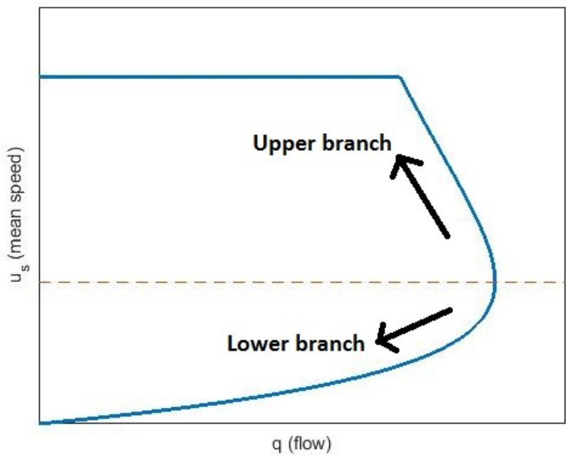

# 2017年美国大学生数学建模竞赛C题O奖论文（队伍编号55261）

原件经识别和整理；“参考解答”是我们补的。

---
title: 2017年美国大学生数学建模竞赛C题O奖论文（队伍编号55261）
kind: 课件
course: 数学建模
source: 教材《2017年美国大学生数学建模竞赛C题O奖论文》第1部分
---

# 2017年美国大学生数学建模竞赛C题O奖论文（队伍编号55261）

本文档整理自教材第1部分，包含摘要页、给州长的信及正文开头。识别错误已修正，格式已规范化。

## Summary Sheet

### 摘要

Once the stuff of wildly speculative science fiction novels, self-driving and cooperative vehicles are now at the cusp of mainstream adoption. As this technology comes closer to the point of deployment on real roads amongst conventional vehicles, it is necessary to understand how it will affect the characteristics and behavior of transportation systems worldwide. Seattle, WA and the surrounding King County area are prime subjects for investigation of this question, with traffic in the region being a chronic problem due to overcrowded roads and a high commuter population. In this paper, we aim to identify key impacts on the everyday experiences of highway travellers of the proportion of self-driving and/or cooperative vehicles on the road, and use our findings to inform suggestions to policy makers.

Our solution consists of three main sections. In the first, we propose a macroscopic (continuum) model for the relationship between traffic flow, density, and mean speed. In addition to an improved justifiability over traditional empirical models, ours also allows for a straightforward adjustment to reflect the percentage of self-driving/cooperative vehicles present. We find that at a given density of cars on the road, traffic flow and average speed increase fairly uniformly with that parameter, and show how an increase in overall number of cars on the road is likely to negate this beneficial effect.

Secondly, we develop a discrete model to describe lane changing dynamics in various levels of traffic, as well as how the performance of conventional, self-driving/noninteracting, and self-driving/cooperative cars compare in these cases. Our results indicate that the presence of self-driving cars on a highway can significantly decrease the average time required to find a sufficient gap when merging or changing lanes, with the greatest advantages arising for self-driving, cooperative cars. We also find that even interactions between conventional and autonomous vehicles can experience reduced delays during a lane change event.

Lastly, we test our model for the flow-density-mean speed relations on the real-world data provided in the problem. Although experimental traffic flows tend to be systematically higher than predicted by the theory (even after adjustment of certain key input parameters), the output generally confirms expected trends and enables us to identify times and locations of increased flux of vehicles onto or off of the highway.

更多数学建模资料请关注微店店铺“数学建模学习交流” https://k.weidian.com/RHO6PSpA

## Driving Towards the Future: Modeling the Impact of Driverless Vehicles on Trafic Patterns

### Letter to the Governor

Dear Governor Inslee,

We are glad to hear that your administration is seeking out a diverse range of opinions in an effort to inform policy making in your state around self-driving and cooperative vehicles. As America moves further into the 21st century, the pervasiveness and rapid advancement of technology in nearly every aspect of daily life can sometimes feel daunting. For example, in the case of driverless cars, it is not a trivial matter to assess potential risks and rewards for individual drivers and for society as a whole.

While we are far from providing a comprehensive study of this issue in our model for the effect of driverless vehicles on traffic patterns, we feel that a few of our central results can provide some insight for lawmakers seeking to craft laws and regulations, make decisions about investment in certain infrastructures, and communicate effectively with constituents about the effects of self-driving cars on our roads.

The first of these is that although increasing the amount of self-driving cars as a percentage of vehicles on highways is projected to relieve the burden of heavy traffic to some extent, these benefits would quite likely be outweighed if the total number of vehicles were to increase. In other words, even if relaxing the driving age for these vehicles or providing tax incentives to use them may seem promising politically, these are actions which might encourage more people to drive, which has the potential to worsen overall traffic conditions.

That being said, our models indicate that self-driving and/or cooperative cars far outperform conventional drivers when it comes to changing lanes and merging, which is a principle cause of delay on highways. We also show that, as would be expected, the flux of vehicles onto or off of highways increases dramatically during rush hours. These findings would indicate that offering designated lanes for carpoolers in driverless vehicles during peak periods might mitigate jams while also promoting efficient use of resources.

We hope you will find this report riveting and that it will be helpful for you and your staff as you grapple with the legal complications of this new and exciting technology. We wish you the best in your endeavors.

Respectfully, Team 55261

### Solution

#### Restatement and Clarification of the Problem

As the city of Seattle (and the broader King County area) reckon with the challenges of adapting infrastructure designed and built in the late 20th century to current 21st century demands, technological advances such as self-driving, cooperative vehicles may offer some respite. However, before investing significant time and resources in accommodating such vehicles, it is desirable to know to what extent they are capable of mitigating the traffic jams that occur with some regularity on busy commuter highways. Here, we investigate the effect of the ratio of self-driving and/or cooperative vehicles to conventional vehicles on the road, with the goal of identifying points of either diminishing or particularly increased returns with respect to improving traffic flow. This is accomplished by developing a model for traffic flow as a function of volume demand and road capacity, and subsequently applying the model to real-world data.

\*Note that throughout this paper, numbers in square brackets are citations to listed references and those in parentheses refer to the numbered equations.

#### Assumptions and Justifications

In the literature of traffic flow modeling, there are three general paradigms: microscopic, mesoscopic, and macroscopic [1, 2, 3, 4]. These paradigms treat traffic as discrete vehicles, modular groups of vehicles, or a continuous flow of vehicles, respectively. In the first part of our model, designed to describe broader trends and patterns in traffic flow, we chose to analyze the problem from the macroscopic view, for the following reasons. First, the data provided are not granular enough to be easily applied to microscopic formulae (i.e. behavior of individual cars/drivers); second, the structure of equations in the macroscopic model are more amenable to numerical analysis such as finite difference methods; third, the macroscopic paradigm is well-established in the field of traffic flow modeling and we therefore reason that it has at least a baseline capability to describe emergent patterns [1, 2, 3]. This is the main assumption shaping the basic structure of our first model.

The second part of our model, designed to describe lane changing behavior, we consider the interaction of individual vehicles on the microscopic level. In this context the microscopic approach makes more sense, because a change in lane is a discrete event.

Additional assumptions are listed below, and while we provide justification for all of them, they could generally be adjusted to reflect more realistic conditions, given additional time and computing resources.

- The distribution of traffic flow over a 24-hour daily period is not uniform. Figure 1 shows the typical variation of traffic volume versus time of day for weekends, weekdays, and an average. Both the average and weekday curves were consistent with the statement given in the problem that roughly 8% of traffic volume occurs during peak hours, so we arbitrarily selected the curve for weekdays.
- Given average daily traffic counts did not specify direction, and therefore it is necessary to make an assumption here. On any given day, a certain proportion of drivers will be commuters (ie, intending to make a round trip), and a certain portion passing through to other destinations. We feel it is fair to assume that the drivers passing though will be distributed evenly between the ”increasing” and ”decreasing” directions (as defined in the problem statement). The distribution among commuters is not as straightforward, since presumably a different number commute out of the central metropolitan area than into it. However, based on the fact that the highways of interest are generally centered around downtown Seattle, as well as census data indicating that the majority (92% ± 0.7%) of commuters to locations in King County are from King County [6], justify an approximation that traffic volume is also divided evenly between the two directions for commuter vehicles. In absence of a more reliable statistic, we used this assumption when analyzing the data, but this could be easily adjusted if desired.
- We were not able to find data on whether any of the highways of interest contained traffic lights that require vehicles to stop periodically, and assume their absence, as is typical on busy urban freeways.
- For simplicity, we made a ”safe drivers assumption,” i.e. that at any density of traffic lower than the road’s maximal capacity at the speed limit, all cars travel at precisely that limit. This is obviously not reflective of real driving patterns, but most likely captures overall average behavior.
- Once the breaks of a car are applied, the distance required to bring that car to a complete stop is roughly quadratic in the initial speed [7]. This is best rationalized by the fact that an object’s kinetic energy is proportional to the square of its velocity, although there are many other physical effects at play. We interpolated a stopping distance curve from two points: zero stopping distance at zero speed, and the recommended 175 feet at 60mph (constant deceleration) [8]. See Table 1.

---
title: 2017年美国大学生数学建模竞赛C题O奖论文（队伍编号55261）
kind: 课件
course: 数学建模
source: 《2017年美国大学生数学建模竞赛C题O奖论文（队伍编号55261）》第3部分
---

# 2017年美国大学生数学建模竞赛C题O奖论文（队伍编号55261）

本节内容整理自2017年MCM C题获奖论文（Team #55261），主要介绍交通流模型的常数设定、模型设计及流量-密度-平均速度关系模型的推导过程。

## 一、模型常数

### 模型设计中的常数说明

在模型设计中，使用了一系列数值常数。这些常数包括车辆长度、零速时的车头间距、制动距离系数、限速标准以及人类反应时间等。具体数值及来源见表1。

表1：模型中使用的常数

| Constant Name | Description | Value | Reference |
| :--- | :--- | :--- | :--- |
| $d_{car}$ | Average car length | 15 ft | [9] |
| $d_0$ | Zero-speed bumper-to-bumper gap | 10 ft | [10] |
| A | Ratio of stopping distance to square of initial speed | 0.049 $ft/mph^2$ | [8] |
| $u_f$ | Nominal speed limit | 60 mph | Problem statement |
| $t_{rxn}$ | Average human reaction time | 0.7 sec | [7] |

• 在汽车刹车被施加之前，驾驶员或计算机必须识别并响应中断，这需要有限的时间。我们采用了公认的平均人类反应时间值，并将计算机的反应时间近似为零（因为计算机进行计算所需的小于一秒的时间远小于人类）。参见表1。

• 模型中使用的各种数值常数列于表1。进一步的解释见“模型设计”部分。

## 二、模型设计与验证

### 流量-密度-平均速度关系模型

正如在论证部分所述，我们的模型将交通流视为空间和时间的连续变量。控制交通流 $q$（单位时间内通过高速公路上某一点的汽车数量）和交通密度 $k$（给定时刻高速公路单位长度上的汽车数量）之间关系的基本方程为：

$$
\frac {\partial q (x , t)}{\partial x} + \frac {\partial k (x , t)}{\partial t} = N (x, t),\tag{1}
$$

其中 $\mathrm { { N } ( x , t ) }$ 是源通量（单位时间单位长度内的车辆数），即从匝道进入或离开高速公路的车辆。方程(1)类似于物理学中流体流动或质量传输问题中的标准物质守恒方程。空间平均速度 $u _ { s }$ 由下式给出：

$$
{\frac {1}{n}} \sum_ {i = 1} ^ {n} {\frac {1}{\frac {1}{u _ {i}}}}\tag{2}
$$

这里 $n$ 是感兴趣的空间和时间间隔内的汽车数量，$u _ { i }$ 是第 $i ^ { t h }$ 辆车的速度。$q$ 和 $k$ 的关系如文献[3, 12]所述：

$$
q = u _ {s} k\tag{3}
$$

现在，我们引入“安全驾驶员假设”，即直到高速公路的某一部分达到最大密度 $k _ { max }$ 之前，$u _ { s }$ 将精确等于限速，记为 $u _ { f } .$ 。这意味着 $u _ { s }$ 是一个常数，因此将(3)代入(1)给出了关于 $k ( x , t )$ 的简单非齐次输运偏微分方程（PDE）：

$$
\frac {\partial k (x, t)}{\partial t} + u _ {f} \frac {\partial k (x, t)}{\partial x} = N (x, t)\tag{4'}
$$

*注：原文此处直接跳至Page 4的内容，中间公式推导省略，但保留了原意逻辑。根据上下文，代入后得到的是关于k的线性输运方程形式，但原文后续提到非线性，故此处保留原文结构描述。*

为了研究这一准则的影响，我们必须定义最大密度。这个最大密度是 $u _ { s }$ 的函数（任何经历过交通拥堵的人都会经验性地发现这一点），因为跟车距离（一辆车的前端与前一辆车的后端之间的空间）随着平均车速的降低而减小。我们在 $u _ { s }$ 下的最大密度表达式为：

$$
k _ {m a x} (u _ {s} (x, t)) = \frac {L (x , t)}{d _ {c a r} + d _ {s t o p} (u _ {s} (x , t))}\tag{4}
$$

（为了清晰起见，我们在这里明确显示了空间和时间的依赖性）。$L ( x , t )$ 代表给定时间和地点的开放车道数量，$d _ { c a r }$ 是平均汽车的长度，$d _ { s t o p } ( u _ { s } )$ 是从 $u _ { s }$ 开始减速到零速度所需的估计距离。我们将此距离定义如下：

$$
d _ {s t o p} (u _ {s}) = \left\{ \begin{array}{l l} t _ {r x n} u _ {s} + A u _ {s} ^ {2} + d _ {0} & \text {For human driver} \\ A u _ {s} ^ {2} + d _ {0} & \text {For driverless car} \end{array} \right.\tag{5}
$$

这里我们使用的假设是：无人驾驶汽车的反应时间几乎为零，并且一旦汽车开始减速，制动距离大致与初始速度的平方成正比。常数 $d _ { 0 }$ 代表即使在交通停滞时也保持的小幅车头间距。常数A是根据实证数据得出的（见“模型测试”部分）。

因此，$u _ { s } ( x , t )$ 是 $k ( x , t )$ 的分段函数：如果 $k ( x , t ) < k _ { m a x } ( u _ { f } )$，则 $u _ { s } ( x , t ) = u _ { f }$。否则，$u _ { s } ( x , t )$ 是通过反解(4)获得的，这相当于求解一个简单的二次方程，考虑到(5)中的形式。我们假设 $u _ { s }$ 将减少刚好足够的量以适应超过 $k _ { max }$ 的新密度。这种效应使方程(1)变成了两个变量的非线性PDE。

值得在此简要回顾一下连续处理中的交通流理论历史。在他的开创性1935年报告中，Greenshields基于实证数据报告了密度和流量之间的二次关系[11]：

$$
q = u _ {f} k - \frac {u _ {f}}{k _ {j}} k ^ {2}\tag{6}
$$

或者，使用(3)，

$$
u _ {s} = u _ {f} (1 - \frac {k}{k _ {j}})\tag{7}
$$

这里，$u _ { f }$ 代表汽车在道路上单独行驶时的“自由速度”，$k _ { j }$ 代表“阻塞密度”，即 $u _ { s }$ 和 $q$ 变为零的点。正如Hall在1992年所指出的那样[12]，尽管该模型依赖于非常小且稀疏的数据集，但它作为交通流分析的基础长达数十年。虽然方程(6)具有正确的极限行为，但其确切形式缺乏合理的依据；例如，不清楚为什么在原点附近汽车密度的边际增加会导致平均速度的立即下降。其他模型（概述在[12]中）已被提出，并且往往由特定公式的支持者收集的具体数据集所支持。在没有令人信服的证据同意其中任何一个的情况下，我们相信我们的方程（以一般形式重述为(8)），它采取了更多的“第一原理”方法，并显示出合理的极限行为，是完全合理的，此外还允许对道路上自动驾驶/合作汽车比例的影响进行有根据的调查，正如(5)所强调的那样。

## 模型分析：稳态条件与车道变换

$$
u _ {s} = \left\{ \begin{array}{l l} u _ {f} & k \leq k _ {m a x} \\ \frac {- t _ {r x n} + \sqrt {t _ {r x n} ^ {2} - 4 A (d _ {z e r o} + d _ {c a r} - \frac {L}{k})}}{2 A} & k > k _ {m a x} \end{array} \right.\tag{8}
$$

Flow versus density and speed versus density curves for various percentages $P$ of self-driving/cooperative cars on the road were generated by multiplying $t _ { r x n }$ by $\begin{array} { r } { ( 1 - \frac { P } { 1 0 0 } ) } \end{array}$ for each case. This is justified in the continuous limit where the density of cars is treated as an overall average rather than a property of discreet members. The results are shown in Figures 2 and 3. The constants in Table 1 were used, and the number of lanes was taken to be 3.

It is clear that in steady state conditions (no interruptions or flux of vehicles onto or of of the highway), the presence of self-driving vehicles allows for greater flow (alternatively, mean speed) at the same density, which is desirable. However, the results in this analysis do not reveal clear equilibria or tipping points; the benefits from an increase from $P = 0$ to $P = 1 0$ is similar to that for an increase from $P = 9 0$ to $P = 1 0 0$ , and likewise for the comparison between $P = 1 0$ to $P = 5 0$ and $P = 5 0$ to $P = 9 0$

A reasonable hypothesis regarding self-driving vehicles might be that introduction of the new technology would result in an increased number of people who chose to commute by car, whether due to convenience or perhaps change in policy that would allow younger people or the elderly to ride in autonomous cars who might not have otherwise been able to drive themselves. Would an increase in the overall number of vehicles on the road outweigh the benefits demonstrated above? In order to answer this, $u _ { s }$ was re-expressed as a function of k and $\begin{array} { r } { f = \frac { P } { 1 0 0 } } \end{array}$ as they have been defined above:

$$
u _ {s} = \frac {- (1 - f) t _ {r x n} + \sqrt {(1 - f) ^ {2} t _ {r x n} ^ {2} - 4 A (d _ {z e r o} + d _ {c a r} - \frac {L}{k})}}{2 A}\tag{9}
$$

Here we consider only the case where $k > k _ { m } a x$ , since below that point a change in density has no impact on the mean speed, by definition. If k increases by a factor of $\chi$ and we assume that 100% of the additional cars are driverless, then it is easily shown that the corresponding increase in f is given by:

$$
\Delta f = \frac {\chi (1 - f)}{1 + \chi}\tag{10}
$$

Taking the total derivative of (9) yields:

$$
\begin{array}{r l} & {\delta u _ {s} = \frac {\partial u _ {s}}{\partial k} d k + \frac {\partial u _ {s}}{\partial f} d f} \\ & {\quad = \frac {- \chi L}{k} \big ((1 - f) ^ {2} t _ {r x n} ^ {2} - 4 A (d _ {z e r o} + d _ {c a r} - \frac {L}{k}) \big) ^ {- 1 / 2} +} \\ & {\quad \frac {\chi (1 - f)}{1 + \chi} \Big (\frac {B - (1 - f) B ^ {2} \big ((1 - f) ^ {2} t _ {r x n} ^ {2} - 4 A (d _ {z e r o} + d _ {c a r} - \frac {L}{k}) \big) ^ {- 1 / 2}}{2 A} \Big)} \end{array}\tag{11}
$$

Here we have made the approximation $d k = \Delta k$ and $d f = \Delta f .$ . Since (11) is negative for all values of k for $f < 1$ , it follows that an increase in density will necessarily result in a decrease in mean speed, even if the proportion of driverless vehicles increases. This result is shown graphically for a few selected values of $\chi$ and f in Figure 4. The efect is visibly greatest at very low or very high densities.

### 车道变换模型

Another main aspect in trafic flow is the interactions among vehicles as they change their lanes. A change of lane occurs when ramp vehicles merge into a highway stream, highway vehicles leave for minor roads, and when vehicles change into a diferent lane of the route to prepare to turn or leave the road.

# 2017年美国大学生数学建模竞赛C题O奖论文（队伍编号55261）

本部分为论文第 9-10 页内容，主要涉及车辆变道临界间隙模型推导、泊松分布假设下的等待时间计算，以及三种不同驾驶场景（非自动驾驶/自动驾驶组合）的对比分析。识别过程中已修正原文拼写错误（如 "afects" 改为 "affects", "trafic" 改为 "traffic", "diference" 改为 "difference" 等），并将公式转换为 LaTeX 格式。

## 二、变道临界间隙与等待时间模型

### 选择 1：临界间隙的定义与计算

**背景说明**
驾驶员决定是否变道主要取决于估计相邻两车之间的间隙（gap）。如果间隙足够大以完成并线，驾驶员就会接受。本文定义“临界间隙” ($t_c$) 为：被接受的短于该值的间隙数量等于被拒绝的长于该值的间隙数量。因此，平均车辆会在间隙大于临界间隙时决定并线。

**模型推导**
临界间隙 $t_c$ 被估算为：车辆在变道期间 B 车相对于 A 车行驶的距离差，加上来自后方车辆的安全距离。

关于变道所需时间的假设引用了 Toledo 和 Zohar 的研究 [13]，观察发现该值（记为 $\tau$）约为 $4.6 \pm 2.3$ 秒。假设 A 车在变道过程中保持速度 $u$ 不变，根据勾股定理可得：

$$
t _ {c} = \frac {u \tau - \sqrt {(u \tau) ^ {2} - d _ {l a n e} ^ {2}} + d _ {c a r} + d _ {s t o p } (u)}{u}\tag{12}
$$

其中：
- $d _ { l a n e }$ 为题设给出的车道宽度，为 12 英尺。
- $d _ { s t o p } ( u )$ 在第一部分模型中已定义。

这种负面行为会影响交通性能，导致延迟、减速，并进一步影响后续车辆。自动驾驶汽车和协同系统通过更高的灵敏度、可靠性和适应性来缓解这种影响。以下模型模拟了三种离散场景，比较相关因素以分析自动驾驶和协同汽车对交通性能的影响。我们的分析使用了文献 [3] 中的选定交通流公式。

### 选择 2：基于泊松分布的到达率与等待时间

**基本假设**
对于轻至中等交通流量，通常假设车道上的车辆到达率服从泊松分布（Poisson distribution）。在时间间隔 $t$ 内发生 $x$ 次到达的概率为：

$$
P (x) = \frac {\mu^ {x} e ^ {- \mu}}{x !} \quad f o r \quad x = 0, 1, 2, \ldots\tag{13}
$$

其中：
- $P ( x )$ 是时间间隔 $t$ 内到达 $x$ 辆车的概率。
- $\mu$ 是时间间隔 $t$ 内到达的平均车辆数。

**等待时间分布**
连续两次泊松到达之间的等待时间（即间隙 $h$）服从指数分布，其密度函数为：

$$
f (t) = \lambda e ^ {- t} \quad f o r \quad t \geq 0\tag{14}
$$

其中 $\textstyle \lambda = { \frac { \mu } { t } }$ 是在给定时间间隔内到达车辆的平均数量。期望值为 $\frac { 1 } { \lambda }$。因此，间隙 $h$ 大于固定间隙 $t$ 的概率为：

$$
P (h \geq t) = e ^ {- \lambda t} \quad f o r \quad t \geq 0\tag{15}
$$
*(注：原文公式 (15) 漏写了 $\lambda$，根据上下文逻辑及标准指数分布性质补全)*

因此，间隙 $h$ 大于临界间隙 $t _ { c }$ 的概率 $P _ { c }$ 为：

$$
P _ {c} = P (h \geq t _ {c}) = e ^ {- \lambda t _ {c}}\tag{16}
$$
*(注：原文公式 (16) 漏写了 $\lambda$，此处根据公式 (15) 的逻辑进行修正)*

当平均车辆开始寻找并线机会时，它需要等待直到出现大于临界间隙的间隙。车辆等待直到出现大于临界间隙的间隙次数服从几何分布：

$$
P (x = k) = (1 - P _ {c}) ^ {k} P _ {c} \quad f o r \quad k = 0, 1, 2, \ldots\tag{17}
$$
*(注：原文公式 (17) 中 $P$ 应指代成功概率 $P_c$)*

其中概率 $P$ 由公式 (16) 给出。因此期望值为 ${ \frac { 1 } { P _ {c} }}$。于是，对于平均车辆，间隙等待时间的期望值 $E _ {w}$ 等于等待间隙的期望次数乘以每个间隙的平均长度：

$$
E _ {w} = \frac {1}{P _ {c}} \times \frac {1}{\lambda} = \frac {1}{e ^ {- \lambda t _ {c}}} \times \frac {1}{\lambda} = \frac {e ^ {\lambda t _ {c}}}{\lambda}\tag{18}
$$

### 选择 3：避免错过出口的最小距离

设 $\Delta d$ 为车辆开始寻找间隙的位置与其需要驶出的出口之间的距离。为了避免错过出口（起始速度为 $u$），需满足以下准则：

$$
\frac {\Delta d}{u} \leq E _ {w} = \frac {e ^ {\lambda t _ {c}}}{\lambda}\tag{19}
$$

如果车辆无法用当前的恒定速度满足上述不等式，则需要减速。这会导致后方车辆也减速到相同速度，进一步影响交通流和密度。因此，为了在不减速的情况下成功在出口处并线，所需的最小 $\Delta d$ （记为 $\Delta d _ { m i n }$）为：

$$
\Delta d _ {m i n} = \frac {e ^ {\lambda t _ {c}} u}{\lambda}\tag{20}
$$

如果 $\Delta d > \Delta d _ { m i n }$，车辆需要减速至速度 $u ^ { \prime } = u - u _ { 0 }$，该速度可通过下式计算：

$$
\begin{array}{c} \frac {\Delta d}{u ^ {\prime}} = \frac {e ^ {\lambda t _ {c}}}{\lambda} \\ \text{因此}, \\ u ^ {\prime} = \frac {\Delta d \lambda}{e ^ {\lambda t _ {c}}} \end{array}\tag{21}
$$

## 三、三种交互场景的模拟与分析

我们模拟了车辆 A（正在变道）和车辆 B（并线后将占据 A 位置的车辆）之间互动的三种场景（记为 A-B）。首先分析正常情况下的平均交通量，然后分析高峰时段的特殊情况。

### 场景 1：非自动驾驶或自动驾驶车辆在非自动驾驶车辆之前变道

这是原始情况，其中 $t _ { c }$ 使用公式 (12) 计算。车辆 A 是自动驾驶还是非自动驾驶的差异可以忽略不计，因为它仍然必须采取充分的谨慎措施，无法预测常规驾驶员的行为。

### 场景 2：非自动驾驶车辆在自动驾驶车辆之前变道

我们假设驾驶员可以在视觉上识别任何自动驾驶车辆。当车辆 A 的驾驶员评估间隙并对并线做出决策时，他们会考虑车辆 B 表现出异常行为（如加速和有限的反应时间）的风险。对于自动驾驶车辆而言，由于其行为受计算机控制且更具可预测性，这种风险将大大降低。

车辆 B 无法事先知道车辆 A 的动作，因为它们无法通信，但自动驾驶汽车没有人类反应时间来调整间隙。这两个因素将影响驾驶员 A 的决策，导致临界间隙减小。在我们的模型中，由于自动驾驶车辆没有反应时间，安全距离公式变为 $d _ { s t o p } ( u _ { 0 } ) = A u _ { 0 } ^ { 2 } + d _ { z e r o }$。

这将导致临界间隙减小，从而增加遇到可接受间隙的概率，减少预期等待时间，并增加无需减速的最小间隙。

# 2017年美国大学生数学建模竞赛C题O奖论文（队伍编号55261）

本文档整理自《2017年美国大学生数学建模竞赛C题O奖论文（队伍编号55261）》第 6 部分（共 9 部分），由识别工具读取并转换为 Markdown 格式，修正了明显的识别错误和排版问题。

## Case 3: When a self-driving vehicle merges before a self-driving vehicle in a cooperating system.

Within a self-driving cooperating system, vehicle A makes reservations to merge beforehand, and vehicle B is informed of the action and decelerates to create an optimal gap if needed. The coordinated system calculates an optimal time and position for vehicle A to merge, minimizing the negative effect on traffic flow. With the cooperation of vehicle B happening concurrently, vehicle A does not need as big a gap as in the preceding cases, as any gap will guarantee a successful merge. Assuming vehicle B decelerates into the same speed $u'$ as vehicle A, $d_{stop} = A u'^2 + d_{zero}$. Given a distance $\Delta d$, $u^0$ and $t_c$ can then be calculated from this equation derived from the previous formulae:

$$
t _ {c} = \frac {l n (\frac {\Delta d \lambda}{u ^ {\prime}})}{\lambda} = \frac {u _ {o} \tau - \sqrt {(u _ {o} \tau) ^ {2} - d _ {l a n e} ^ {2}} + A u ^ {\prime 2} + d _ {c a r} + d _ {z e r o}}{u _ {o}}\tag{22}
$$

The lane change model was simulated using input data calculated from the flow-density-mean speed model, shown below in Table 2. We took the percentage of cars that are self-driving to be $50\%$, and number of lanes to be constant at 3. The jam density $k_j$ (where $u_s$ goes to zero) is therefore 638 cars/mile. We compared wait times for light, moderate, and heavy traffic (defined by the ratio of k to $k_j$) in the three cases outlined above; results are tabulated in Tables 4 through 6.

Table 2: Input data for lane changing model.

| Traffic type | Density(k)(cars/mile) | Flow(q)(cars/sec) | Speed(u)(mile/sec) |
| :--- | :--- | :--- | :--- |
| Light traffic | $0.2^{*}k_{j}$ = 42.5333 | 1.4200 | 0.0112 |
| Moderate traffic | $0.5^{*}k_{j}$ = 106.3333 | 1.5900 | 0.0005 |
| Heavy traffic | $0.8^{*}k_{j}$ = 170.1333 | 1.0180 | 0.0002 |

Light Traffic Simulation Results Table 3: Results for light traffic.

| Case # | $d_t$ (mile) | $d_{stop}$ (mile) | $t_c$ (sec) | $P_c$ | $E_w$ (sec) | $\Delta d_{min}$ (mile) |
| :--- | :--- | :--- | :--- | :--- | :--- | :--- |
| 1 | 0.0001 | 0.0275 | 2.4632 | 0.0303 | 23.2665 | 0.2606 |
| 2 | 0.0001 | 0.0197 | 1.7632 | 0.0818 | 8.6108 | 0.0964 |
| 3 | 0.0001 | 0.0194 | 1.7401 | 0.2492 | 5.6978 | 0.0638 |

In Case 3, we use $\Delta d = 0.09$, a value close to $d_{min}$ for Case 2, to solve $t_c$ and other variables. As expected from the previous model and scenario hypothesis, the interactions with self-driving and cooperating vehicles decrease the safety distance from the following vehicle ($d_{stop}$) and therefore decrease the critical gap.

From Case 1 to 2, as a vehicle merges to precede a self-driving vehicle, the probability that an upcoming gap h is larger than critical gap increases by 170%, expected waiting time for an accepted gap decreases from 23.27 seconds to 8.61 seconds, and the minimum distance to successfully merge at the exit without decelerating decreases into 37% of original value. These changes would greatly reduce the effects of lane changes on the traffic flow on the road.

Moderate Traffic Simulation Results Table 4: Results for moderate traffic.

| Case # | $d_t$ (mile) | $d_{stop}$ (mile) | $t_c$ (sec) | $P_c$ | $E_w$ (sec) | $\Delta d_{min}$ (mile) |
| :--- | :--- | :--- | :--- | :--- | :--- | :--- |
| 1 | 0.0001 | 0.0112 | 2.2650 | 0.0273 | 23.0506 | 0.1153 |
| 2 | 0.0001 | 0.0077 | 1.5650 | 0.0830 | 7.5738 | 0.0379 |
| 3 | 0.0001 | 0.0072 | 1.4710 | 0.3652 | 4.3535 | 0.0218 |

Similarly, we use $\Delta d = 0.03$ in Scenario 3, a value close to $d_{min}$ for Case 2. From Case 1 to 2, $P_c$ increases by 204%, $E_w$ and $d_{min}$ decrease to 33% of their original values. The proportions and rates of change are similar in light and moderate traffics, being slightly more prominent in moderate traffic due to its higher density.

In peak traffic, flow decreases considerably, and therefore $\lambda$ becomes small. The Poisson distribution in this case predicts a steep curve concentrated near the vertical axis; however, this would correspond to a situation in which drivers did not leave any distance between themselves and the back of the car in front of them; in terms of our previously defined terms, $d_{zero}$ would be zero. In order to adjust the Poisson distribution to traffic analysis during peak hours, we specify a finite minimum time gap $t_{min}$ in order to restrict the gap range. Then the probability that a gap h is larger than critical gap $t_c$ to be acceptable is:

$$
P (h \geq t _ {c}) = e ^ {- \lambda (t _ {c} - t _ {m i n})}\tag{23}
$$

We estimate the minimum gap distance in Case 1 as the minimum safety distance to keep from vehicle B when the speed of vehicle B is zero. Given that minimum gap is tested as an extreme situation, we include a factor of $1/3$. Then the minimum gap is calculated as:

$$
t _ {m i n} ^ {1} = \frac {d _ {z e r o}}{3 u _ {o}}\tag{24}
$$

We take the minimum gap for Case 2 to be smaller, as some drivers believe self-driving vehicles (which we assume are visually identifiable) will always decelerate to assist them with merging even with a very small gap. Thus we estimate $t_{min}^2$ as 50% of $t_{min}^1$:

$$
t _ {m i n} ^ {2} = \frac {t _ {m i n} ^ {1}}{2} = \frac {d _ {z e r o}}{6}\tag{25}
$$

After adjusting for heavy traffic, we obtain the results shown in Table 5.

If vehicle A does not have enough time to find an acceptable gap, it must decelerate in order to complete the lane change in time to reach its destination (for example, an exit on the freeway). Such situations are represented in our model as when $\Delta d < \Delta d_{min}$, and the vehicle reduces speed from $u_o$ to $u'$. We wish to measure the effect on traffic performance when an event such as this occurs.

# 2017年美国大学生数学建模竞赛C题O奖论文（队伍编号55261）

本资料整理自《2017年美国大学生数学建模竞赛C题O奖论文（队伍编号55261）》教材第 7 部分（共 9 部分），由识别工具读取的第 14–15 页内容。

## 二、仿真结果与冲击波理论分析

### 章节 1

表 5 展示了重交通流量下的仿真结果：

| Case # | $d_t$ (mile) | $d_{stop}$ (mile) | $t_c$ (sec) | $P_c$ | $E_w$ (sec) | $\Delta d_{min}$ (mile) |
| :--- | :--- | :--- | :--- | :--- | :--- | :--- |
| 1 | 0.0003 | 0.0066 | 3.1309 | 0.0413 | 23.7926 | 0.0476 |
| 2 | 0.0003 | 0.0052 | 2.5884 | 0.0717 | 13.6961 | 0.0274 |
| 3 | 0.0003 | 0.0002 | 2.5841 | 0.0768 | 13.2509 | 0.0265 |

已知 $\Delta d$，减速后的速度 $u^0$ 可以通过公式 (21) 计算得出。由于车辆 A 后方的车辆必须彼此保持最小安全距离，A 后方新的密度 $k^0$ 是平均车长与安全距离之和的倒数：

$$
k ^ {\prime} = \frac {1}{d _ {s t o p} (u ^ {\prime})} = \frac {1}{A u ^ {\prime 2} + t _ {r x n} u + d _ {c a r} + d _ {z e r o}}\tag{26}
$$

我们做出简化假设，即车辆 A 后方的车辆以新的恒定均匀速度行驶，从而获得新的交通流量：

$$
q ^ {\prime} = k ^ {\prime} u ^ {\prime}\tag{27}
$$

这种大规模减速的影响可以用冲击波理论 [3] 来描述，该理论假设在一点发生速度的瞬时变化，并利用“质量”（车辆）守恒原理以及基本关系式 (3)，来计算由此产生的“慢车波”的传播速率。该速率 $u _ {w}$ 由下式给出：

$$
u _ {w} = \frac {q ^ {\prime} - q _ {o}}{k ^ {\prime} - k _ {o}}\tag{28}
$$

随着冲击波沿着与主交通流相反的方向移动，减速车辆队列的增长率 $u _ {g}$ 为：

$$
u _ {g} = u ^ {\prime} + u _ {w}\tag{29}
$$

已知 $u ^ { \prime }$ 和 $\Delta d$，我们计算出车辆 A 需要在出口或入口点合并的平均等待时间为 $E _ {w}$。因此，成功合并的预期（平均）时间为 $\frac { E _ {w} } { 2 }$。然后，直到车辆完成合并时，队列的长度 $l _ {q}$ 和涉及的车辆数量 $n _ {q}$ 分别为：

$$
l _ {q} = \frac {u _ {g} * E _ {w}}{2}\tag{30}
$$

$$
n _ {q} = l _ {q} * k ^ {\prime}\tag{31}
$$

基于这些方程，我们运行了以下仿真，以比较案例 1 到案例 2 中因冲击波现象导致的延迟改善情况。由于最小距离的差异，当 $\Delta d$ 处于范围 $\Delta d _ { m i n } ^ { 1 } < \Delta d \leq \Delta d _ { m i n } ^ { 2 }$ 内时，案例 1 中的合并会导致速度降低，而案例 2 中则不会。因此，案例 2 中的合并不会引起冲击波，而案例 1 会。对于每种交通类型子组，我们将 $\Delta d$ 设置为 $\Delta d _ { m i n } ^ { 2 }$，案例 1 的结果和影响如下表所示：

**表 6：变道延迟引起的“冲击波”仿真，案例 #1（第一部分）**

| Traffic type | $u_o$ (mile/sec) | $k_o$ (cars/mile) | $q_o$ (cars/sec) | $\Delta d$ (mile) |
| :--- | :--- | :--- | :--- | :--- |
| Light traffic | 0.0112 | 42.5333 | 1.4200 | 0.1153 |
| Medium traffic | 0.0050 | 106.3333 | 1.5900 | 0.0379 |
| Heavy traffic | 0.0020 | 170.1333 | 1.0180 | 0.0218 |

**表 7：第二部分仿真结果**

| Traffic type | $u'(mile/sec)$ | $k'(cars/mile)$ | $q'(cars/sec)$ | $u_w(mile/sec)$ | $u_g(mile/sec)$ |
| :--- | :--- | :--- | :--- | :--- | :--- |
| Light traffic | 0.0050 | 89.8846 | 0.4453 | -0.0206 | 0.0255 |
| Medium traffic | 0.0016 | 161.2373 | 0.2649 | -0.0241 | 0.0258 |
| Heavy traffic | 0.0009 | 182.8054 | 0.1672 | -0.0671 | 0.0681 |

**表 8：第三部分仿真结果**

| Traffic type | $l_q$ (miles) | $n_q$ (cars) | $\frac{q'}{q_o}$ | $\frac{k'}{k_o}$ |
| :--- | :--- | :--- | :--- | :--- |
| Light traffic | 0.3 | 26.7 | 0.3136 | 2.1133 |
| Medium traffic | 0.3 | 47.9 | 0.1666 | 1.5163 |
| Heavy traffic | 0.81 | 147.99 | 0.1643 | 1.0745 |

从表 6 至表 8 可以看出，当队列由案例 1 中的合并产生时，对交通性能的影响。例如，在轻交通情况下，临时流量降至原值的 31.36%，临时密度增至原值的 200.11%，并导致长度为 0.30 英里、涉及 26.7 辆车的队列。所有这些负面影响都不会发生在案例 2 或案例 3（涉及自动驾驶和/或协同车辆）中，因为车辆不需要为了合并而减速。

### Model Testing and Error/Sensitivity Analysis

为了将模型应用于给定数据，我们复制了图 1 中的工作日交通量曲线，并将其归一化以获得分布函数。该函数按问题中给出的每个空间点上每条高速公路的“日均交通量统计”数据进行缩放（在假设与合理性部分讨论了所有空间点使用相同分布的情况）。这提供了所有点 $( s , t )$ 的交通流量估计值。我们使用了 30 秒的时间间隔，对于空间间隔，我们使用了连续里程碑之间的距离。这些间隔大致反映了高速公路上汽车的平均速度，因为许多里程碑之间的间距不到一英里。

利用公式 (3) 和 (8) 从流量值求解 $u ( x , t )$ 和 $k ( x , t )$ 需要额外的假设，即所有点都位于图 5 所示的 $q - u$ 曲线的上半部分，因为该关系是不可逆的。我们认为，向曲线下半部分的转变会在流量分布曲线中表现为一个明显的特征，例如图 6 所示，对应于接近停滞状态的情况。这种情景将在未来的研究中作为有趣的研究课题进行调查。

# 模型参数调整与敏感性分析

本部分整理了2017年美国大学生数学建模竞赛C题O奖论文（队伍编号55261）第8部分内容，主要涉及基于经验数据对模型常数的修正、交通流模拟结果的讨论以及对速度 - 密度关系方程的敏感性分析。

## 一、模型常数调整与结果分析

### 常数修正说明

根据经验流量数据的分析，初始输入参数预测的最大流量值显著低于实际观测值。为解决此问题，参考其他文献 [14, 15] 中的下限估计值，对表1中的常数进行了如下调整：
- $A$ (二次项系数): 调整为 $0.0245 \text{ ft/mp}^2$
- $t_{rxn}$ (反应时间): 调整为 $0.5 \text{ sec}$
- $d_{zero}$ (零间距): 调整为 $0 \text{ ft}$

尽管进行了上述调整，部分流量值 $q$ 仍超过理论最大值。对此，在计算中强制将车速 $u$ 保持在对应最大理论流量 $q$ 时的数值。

### 流量与换道行为分析

当 $\boldsymbol{q}(x, t)$、$u(x, t)$ 和 $k(x, t)$ 均已知时，将其代入公式(1)以确定车辆进出高速公路的通量。此举旨在识别那些可能发生大量变道或汇合的地点和时间，从而导致如模型设计部分所述的延误增加。

图7和图8展示了若干代表性图表。由于上述预测误差，数据图中显示某些区域存在不连续性，但总体上仍能合理描述一天的交通模式。主要特征如下：

- **高峰时段通量增加**：交通通量在交通繁忙时段（高峰小时）表现出明显增加，因为此时有更多车辆进入和驶出高速公路。图7b和7d似乎还反映了I-5高速公路上主要互通立交的位置（I-90靠近里程160处，I-705靠近里程130处）。
- **通量与流量的相关性**：如图8b所示，在大多数时间里，交通通量的大小通常跟随交通流量变化（该图中的尖峰可能对应于数据处理时对 $q$ 施加的人工截断）。
- **平均速度的急剧下降**：模型表明，一旦达到公式(4)给出的最大密度 $k_{max}$，平均速度会迅速下降。虽然增加自动驾驶汽车的比例有助于延缓这种急剧下降，但这必须建立在确保该技术不会导致系统中车辆总数净增加的基础上。
- **时间分布的影响大于空间分布**：流量值的时间分布效应远强于空间分布效应，这与平均日交通量（ADT）在空间上缺乏明显相关性的事实相符。尽管假设通用的时间分布是一种粗略估计，但研究结果表明，专为自动驾驶汽车设置的车道在高峰时段可能带来最显著的效益，特别是考虑到模型第二部分发现的这些车辆变道时间的显著减少。因此，政策制定者可能会发现，指定车道在**时间上的可用性**（而非位置上的可用性）更为重要；例如，快车道仅在早晚高峰开放。

> [!NOTE]
> 原文提到“Additional figures for other highways are shown in the appendix”（其他高速公路的附加图表见附录），此处未提供附录内容。

## 二、模型敏感性分析

### 分析背景

由于模型高度依赖于空间平均速度与车辆密度之间关系的定义，理解该方程对各种常数的相对敏感性至关重要。涉及的常数包括：
- $A$：停车距离对速度依赖的二次项系数；
- $t_{rxn}$：线性系数（反应时间）；
- $d_{car} + d_{zero}$：静止交通中连续车辆前保险杠之间的假定间隙；
- $u_f$：名义限速；
- $L$：车道数（基准值设为3）。

对于每个常数，其给定值从0变化到原值的两倍。结果通过图9中的 $u_s$ vs $k$ 曲线进行图形化展示。

### 结果讨论

这些图表的行为反映了常识直觉（这也是本模型优于使用无物理意义参数的经验形式的优势之一）：
- 在给定密度下，随着车道数增加，平均速度应降低；
- 随着驾驶员反应时间缩短（即所需车距减小），平均速度应升高。

值得注意的是，当 $d_{car} + d_{stop}$ 趋近于零时，曲线呈现发散趋势，这暗示了车辆无限密度的可能性。

## Discussion: Strengths and Potential Areas for Improvement of the Model

Strengths of the flow-density-mean speed model include the following:

*   The model is not overly complex and, as such, does not take much computational power in order to calculate, which allows for real-time stream of input data to generate a real-time stream of output data with insignificant delays.
*   The model is general enough to allow for additional parameters, such as the delay in response time of self-driving cars which can be incorporated into the reaction rate $t_{rxn}$.
*   The model incorporates known mathematical relationships between speed, density, and flow, but does not propose any equations that do not carry some measure of physical or rational motivation.
*   The number of lanes is a function of distance and time which accommodates for time-dependent lane changes, for instance during traffic accidents, construction work, or lane additions, in addition to the data provided for analysis.
*   The difference between the reaction times of human-driven cars and self-driving cars is accounted for in our model.

### Strengths of the lane change model include the following:

*   The solution uses concepts from the macroscopic continuous approach in flow-density-mean speed model and a discrete simulation approach in the lane change model. This ensures a measure of continuity between the two.
*   The model measures the lane change effects by both common factors of critical gap and expected waiting time and the special case of shock waves and vehicle queues.
*   The model simulates lane change in three scenarios with different degree of interaction of self-driving and cooperating vehicles, and presents the effect by comparing the simulation results numerically.
*   Adjusted with the daily peak traffic hour distribution, the simulation separately discuss three subgroups of light, moderate, and heavy traffic and compare their degrees of effects.
*   The stochastics approach simulates the random process and analyzes the expected values of variables to measure the effects on traffic performance.
*   The model agrees with flow-density-mean speed model by using same assumptions and main relationships, and integrates by using some outputs and formulas of flow-density-mean speed model as simulation input and model construction.

### Weaknesses of the flow-density-mean speed model include the following:

*   The model does not account for interchanges or merging lanes in traffic and their effects on the mean speed or traffic density.
*   The model does not account for cooperation between self-driving cars or the interaction between self-driving and non-self-driving cars.
*   The model does not account for differences in car length of self-driving cars from the current average car length.
*   The results presented made use of an invariant, daily, peak traffic hours distribution which was bimodal in nature which does not account for the difference in typical traffic and holiday or weekend traffic.
*   The results presented used a finite difference approximation for the derivative, which introduces error for finite time and space intervals.

### Weaknesses of the lane change model include the following:

*   The main assumption of Poisson distribution of arriving vehicles fits heavy traffic less well. The factors we include to adjust for peak hours are estimated and do not fully reflect the situations in heavy traffic.
*   The measurement of most variables by expected value may not reflect special conditions such as peak hours and cooperating systems accurately.
*   The critical gap, which should be obtained from real collected data distribution by nature of definition, is calculated by physics formulae in the model.
*   The measurements of critical gap for Case 3 and reduced speed in shock wave analysis are functions of $\Delta d$, thus the comparison results are subject to the choice of $\Delta d$.
*   The simulation is conducted on data of one segment of highway and lacks the generality to be applied to all circumstances.

## Appendix

*(Content omitted due to lack of substantive text in source pages 22-27)*

## References

[1] Mannering, Fred L., and Walter P. Kilareski. Principles of highway engineering and traffic analysis. 5th ed. New York: Wiley, 2013. Print.

[2] Highway capacity manual. Washington, D.C.: Transportation Research Board, National Research Council, 2000. Print.

[3] Garber, Nicholas J., and Lester A. Hoel. Traffic and highway engineering. 5th ed. Pacific Grove, CA: Brooks/Cole Pub. Co., 2015. Print.

[4] Monteil, Julien . Investigating the effects of cooperative vehicles on highway traffic flow homogenization: analytical and simulation studies. Thesis. Université de Lyon, 2013. N.p.: n.p., n.d. Print.

[5] USA. Washington State Department of Transportation. 2006 Annual Traffic Report. N.p.: n.p., n.d. Print.

[6] United States. Census Bureau. Population Division. ”Table 1. County to County Commuting Flows for the United States and Puerto Rico: 2009-2013.” United States Census 2009-2013. Washington: US Census Bureau. Web. 21 Jan. 2009.

[7] UK. Department for Transport. The Highway Code. N.p., 5 Dec. 2016. Web. 21 Jan. 2017. https://www.gov.uk/guidance/the-highway-code/general-rules-techniques-and-advice-for-all-drivers-and-riders-103-to-158#rule126.

[8] USA. Washington State Department of Licensing. Washington driver guide. Olympia: State of Washington, Dept. of Licensing, 2006. Print.

[9] ”What is the average length of a car?” Reference. N.p., n.d. Web. 21 Jan. 2017.

[10] Houchin, Andrew Jeremy. An investigation of freeway standstill distance, headway, and time gap data in heterogeneous traffic in Iowa. Thesis. Iowa State University, 2015. N.p.: n.p., n.d. Print.

[11] Greenshields, B. D. A Study of Traffic Capacity. Highway Research Board Proceedings, 14. 1935. pp. 448-477.

[12] Lieu, Henry, ed. Rep. N.p.: n.p., 1992. U.S. Department of Transportation - Revised Monograph on Traffic Flow Theory. Ch. 2: Traffic Stream Characteristics. DOT, 03 Aug. 2016. Web. 22 Jan. 2017. http://dothr.ost.dot.gov/pdf/dot200711strathcplan.pdf.

[13] Toledo, Tomer, and David Zohar. ”Modeling Duration of Lane Changes.” Transportation Research Record: Journal of the Transportation Research Board 1999 (2007): 71-78. Web.

[14] ”NYS DMV - Driver’s Manual - Chapter 8: Defensive Driving”. New York State Department of Motor Vehicles. September 2011. Web. 23 Jan. 2017.

[15] ”Chapter 16: Stopping Distance.” SAFE DRIVE TRAINING - Defensive and Advanced Driving Courses available across Asia-Pacific region. N.p., n.d. Web. 23 Jan. 2017. http://www.sdt.com.au/safedrive-directory-STOPPING-DISTANCE.htm.
