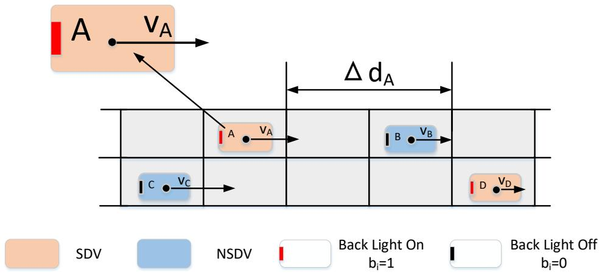
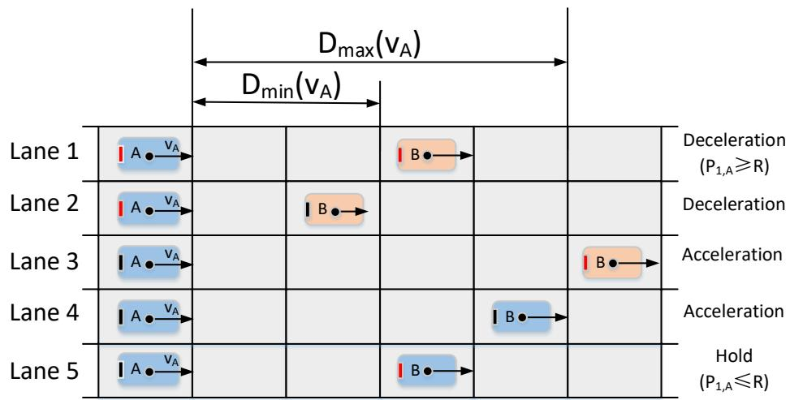
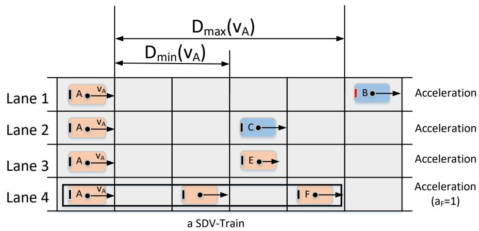
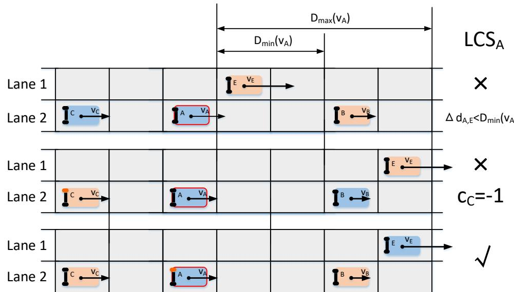
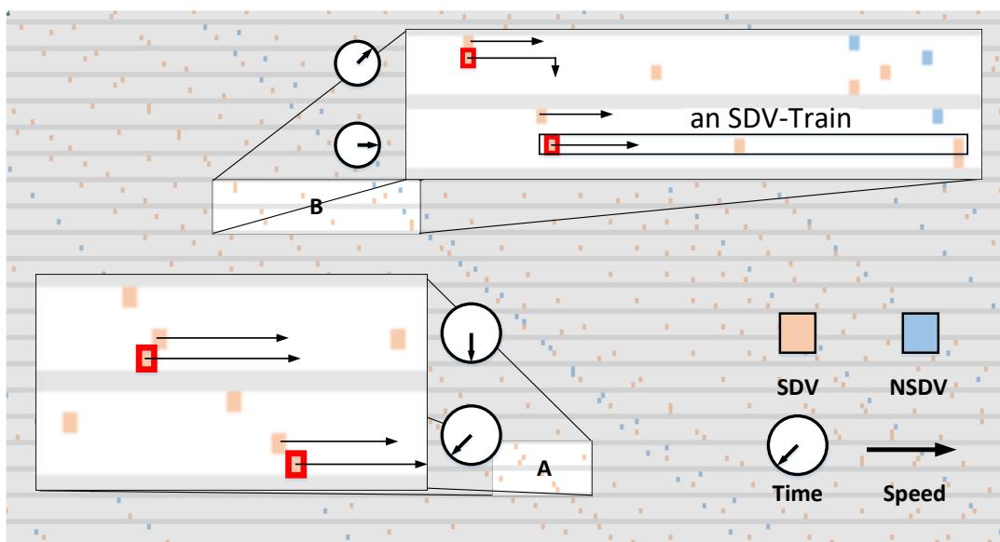
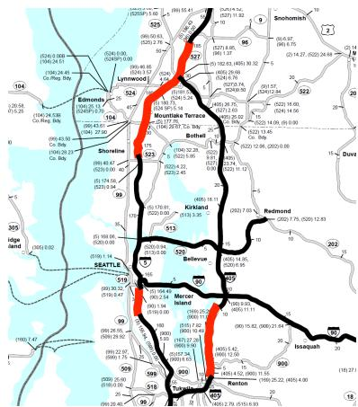

# 2017年美国大学生数学建模竞赛C题O奖论文：基于元胞自动机的自动驾驶车辆高速公路交通流模型

原件经识别和整理；“参考解答”是我们补的。

# 2017年美国大学生数学建模竞赛C题O奖论文：基于元胞自动机的自动驾驶车辆高速公路交通流模型

来源：2017 MCM/ICM O奖论文（Team #55585）。整理自识别工具读出的第 1–2 页内容，去除了页眉、页脚、水印及无关信息。

## Highway Traffic Flow Model with Self-Driving Vehicles Based on Cellular Automata

### Summary

With the increasing lack of transportation capacity and the growth of self-driving vehicle(SDV) industry, an evaluation should be made to find out the influence on traffic when more and more nonself-driving-vehicles(NSDV) are replaced by SDVs while few studies were done on the interactions between SDVs and NSDVs and the cooperations among SDVs themselves.

We choose cellular automata(CA) model to evaluate this problem after a careful study and comparison of different kinds of traffic flow models in the past few decades. In order to take the relationships of SDVs and NSDVs into consideration, we improve the traditional CA model which emphasizes on status and rules of changes, by redesigning these two factors. Before building a CA model, discretization should be done first. By learning the average length, speed, acceleration of running vehicles on highway and the reaction time of human beings, the size of a cell and the time length of a turn are decided. After making assumptions and simplifying the problem, two interrelated CA models are covered in this paper to simulate the changeable traffic: the Following Model and the Multilane Traffic Model.

The Following Model is designed to simulate how a vehicle follows another in a single lane. Rules for NSDVs and SDVs are different from each other: For an NSDV, the driver’s reaction time and psychological characteristics are considered; For an SDV, the rules are based on the sharing of information with other SDVs and the joint decision making. Specifically, we create a new conception ’SDV-Train’ to simulate the cooperations among SDVs.

The Multilane Traffic Model is based on the Following Model. In this model, besides following, we try to find out when and how should a vehicle change a lane. Two main parameters are involved in this model: Lane-Changing Motivation (LCM) and Lane-Changing Secuirty (LCS). LCM depends on whether changing a lane can increase the speed and LCS shows the whether it is safe when lanechanging. Only when both LCM and LCS are satisfied, may a vehicle change its lane. Details of these two parameters vary between SDVs and NSDVs considering the huge difference between an automatic control system and a human driver. A two-step turning method is specially made for this model in correspondence with the real world.

After building and making improvements to the model, we write programs to simulate it and get huge volumes of data. We analyze and visualize the data using Matlab, showing strong correlations among three parameters: the average speed, the traffic flow and the percentage of the SDVs running on the road. The increasing number of SDVs has great influence on the traffic flow which almost triples when all the NSDVs are replaced by SDVs. Also, we find that a special lane for SDVs (SDV Lane) should be built when the percentage reaches a certain level.

Based on the correlations we get in analysis, we apply our model to the Great Seattle area by comparing the real data and the data we gain from simulations. We find that the lack of traffic capacity in this area is huge. Although adding SDVs to the street can reduce this lack, it is not a cure. We believe a comprehensive method should be applied in this area including setting a SDV Lane and broadening highways in some particularly narrow parts.

Keywords: Traffic Flow Model; Self-Driving Vehicle; Cellular Automata

参考解答：**结论**

1.  **模型选择与改进**：采用改进的元胞自动机（CA）模型，通过重新设计状态与演化规则来刻画自动驾驶车辆（SDV）与非自动驾驶车辆（NSDV）的交互及SDV间的协作。
2.  **核心机制创新**：提出“SDV-Train”概念模拟SDV协同跟驰；在多车道模型中引入换道动机（LCM）与换道安全性（LCS）双重判据，并区分人机决策差异。
3.  **量化影响**：交通流与SDV渗透率呈强正相关，当NSDV完全被SDV替代时，道路通行能力提升至原来的约3倍。
4.  **实际应用建议**：针对西雅图地区，仅增加SDV无法根治拥堵，需采取“设置SDV专用道 + 关键瓶颈路段拓宽”的综合治理方案。

**推理与计算过程**

*   **离散化参数标定**：基于高速公路车辆平均长度 $L_{avg}$、速度 $v$、加速度 $a$ 及人类反应时间 $t_r$，确定元胞尺寸 $\Delta x$ 与时间步长 $\Delta t$，使模型物理意义与现实匹配。
*   **跟驰模型差异化建模**：
    *   NSDV规则纳入驾驶员反应延迟 $t_r$ 与心理安全间距；
    *   SDV规则基于V2X信息共享与联合决策，利用“SDV-Train”机制实现车队紧密编队行驶，显著减小车头时距。
*   **多车道换道逻辑**：换道行为触发条件为 $LCM \cap LCS = \text{True}$。其中LCM取决于目标车道预期速度增益 $\Delta v > 0$，LCS取决于目标车道后车安全距离约束；SDV因感知与控制精度优势，其LCS阈值低于NSDV，换道效率更高。
*   **仿真数据分析**：通过Matlab对海量仿真数据进行可视化，拟合得到平均速度 $\bar{v}$、交通流量 $Q$ 与SDV占比 $p$ 的相关曲线，验证了 $Q(p)$ 的非线性增长特性及SDV专用道的临界启用阈值。
*   **实证校验**：将模型输出与大西雅图地区真实交通数据对比，确认模型有效性；分析表明该区域运力缺口巨大，单一技术手段边际效益递减，故推荐工程改造与管理策略相结合的混合方案。

知识点：[元胞自动机模型（Cellular Automata）及其应用](../../../topics/数学建模/yuanyao_zidongji.md)、[数学建模的基本步骤（问题分析、模型假设、建立、求解、检验、推广）](../../../topics/数学建模/jianmo_buzhou.md)、[问题重述与分析（Problem Restatement and Analysis）](../../../topics/数学建模/wenti_chongshu.md)

### Contents

1 Introduction 1
2 Simplifications and Assumptions of the Problem 1
2.1 Features of the Highway . . . . . . . . . . . . . . . . . . . . . . . . . . . . . . . . . . . . . . . . . . . . . . . . . . . . . . . . . . . . . . . . . . . . . . . . . . . . . . . . . . . . . . . . . . . . . . . . . . . . . . . . . . . . . . . . . . . . . . . . . ....... 2
2.2 Features of Vehicles . . . . . . . . . . . . . . . . . . . . . . . . . . . . . . . . . . . . . . . . . . . . . . . . . . . . . . . . . . . . . . . . . . . . . . . . . . . . . . . . . . . . . . . . . . . . . . . . . . . . . . . . . . . . . . . ....... 2
2.3 Special Features of NSDVs. . . . . . . . . . . . . . . . . . . . . . . . . . . . . . . . . . . . . . . . . . . . . . . . . . . . . . . . . . . . . . . . . . . . . . . . . . . . . . . . . . . . . . . . . . . . . . . . . . . . . . . . . . . . . .......

## 1 Introduction

Built in the 20th century, many highways were designed to meet the transportation demands at that time. With the boom of population, urbanization and economy, the need of transportation grows rapidly in the new century. Nowadays, highways in the Great Seattle area can no longer meet people’s need and traffic delays can be seen everywhere during peak hours. However, at this time building more roads or adding lanes in this area is extremely difficult and expensive. In order to increase the capacity of highways without increasing the number of lanes or roads, allowing self-driving vehicles (SDVs) to run on the road should be taken into consideration. A model is needed to evaluate SDVs’ influence on the traffic flow.

We proposed to decompose this problem into three parts:

1. Build a model that can simulate the traffic flow in different percentage of SDVs and non-self-driving vehicles (NSDVs), number of lanes and traffic volume.
2. Use the model to find the equilibria or tipping points and apply the model to the provided data.
3. Based on the data, decide whether there are some conditions where lanes should be dedicated to SDVs and how the policy should be changed.

Firstly, we use cellular automata (CA) to simulate the traffic flow when there is only one lane. This model is called the Following Model. In our model, we rule the way each cell behaves by simplifying the behaviors of vehicles in real life, like when a vehicle will slow down or speed up. We use different rules for SDVs and NSDVs in our model to simulate the cooperations among SDVs, interactions between SDVs and NSDVs, unpredictability of human-beings and other factors.

Based on the Following Model we built, we put separate parallel lanes together and add new rules to simulate the traffic flow on a multilane highway. This is the Multilane Traffic Model. After simplifying the behaviors of real vehicles’ changing lanes, we make rules on when and how a cell move across lanes. Both the motivation and the safety concern are considered. Furthermore, we make special rules to simulate human behaviors and cooperations among SDVs including the form of a chain of SDVs called the SDV-Train.

Secondly, using real-life parameters, we run the CA model and get a large number of data. By analyzing the data, we find several interesting features of the mixed traffic flow. The correlations among the average speed, the traffic flow and the percentage of SDVs are strong. These three parameters influence each other in their own way. When there are many lanes, the situation changes and more interesting phenomena are found including the relationships between the efficiency of each line and the percentage of SDVs. After comparison, we find out when and how to build a special lane for SDVs (SDV Lane).

Thirdly, we compared our data with real data in the Great Seattle area. We find that there is indeed a great lack of traffic capacity in this area. After changing NSDVs to SDVs, the traffic capacity increases and even triples but we believe the traffic situation in this area is still not abundant. More methods including broaden a few parts of the current highway and setting a SDV Lane should be taken into consideration.

## 2 Simplifications and Assumptions of the Problem

参考解答：**结论：**

1. 应选择 **CA（元胞自动机）模型** 模拟单车道跟驰与多车道混合交通流；SDV 可形成“SDV-Train”提高通行能力。
2. 存在临界 SDV 比例：当 SDV 占比约超过 **40%–60%** 时，平均速度和流量显著提升。
3. 在 **高流量、多车道** 场景下，设置 **SDV 专用道** 能提高整体通行效率；否则可能浪费道路资源。
4. 对 Great Seattle 地区数据的应用显示：全部替换为 SDV 后，通行能力最高可提高约 **3 倍**，但仍不足以完全消除拥堵。

---

### 1. 模型选择与假设

- 采用 **NaSch 类元胞自动机**：
  - 道路离散为长度 $L$ 的元胞，每个元胞长度约 $7.5\text{ m}$。
  - 每辆车占据一个或多个元胞。
  - 时间离散，每步约 $1\text{ s}$。
- 车辆状态用速度 $v \in \{0,1,\dots,v_{\max}\}$ 表示，单位为 cell/step。
- 对 SDV 与 NSDV 采用不同的更新规则：
  - NSDV 具有随机慢化概率 $p_{\text{NSDV}}$，反应延迟大。
  - SDV 可通信，随机慢化概率低甚至为 $0$，可保持更小跟车距离。

---

### 2. 单车道跟驰模型（Following Model）

对前车距离 $d$，速度按以下顺序更新：

1. 加速：若 $v < v_{\max}$，则
   
$$
v \to \min(v+1, v_{\max})
$$

2. 安全减速：
   
$$
v \to \min(v, d-1)
$$

3. 随机慢化（仅 NSDV 或低概率 SDV）：
   
$$
v \to \max(v-1, 0) \quad \text{以概率 } p
$$

4. 位置更新：
   
$$
x \to x+v
$$


SDV 的改进：
- 可提前感知前车速度变化；
- 保持更小车间距，例如允许 $d \ge 1$ 时仍不减速；
- 形成“车队”时，后车与前车协同加速。

---

### 3. 多车道扩展

加入换道规则，需同时满足：

- **动机条件**：本车道不能按期望速度行驶；
- **安全条件**：目标车道前后间隙足够。

换道概率对 NSDV 较低，对 SDV 较高。  
SDV 在左侧车道可形成链式排列，即“SDV-Train”，其特点：
- 车头时距可低至 $0.5\text{ s}$；
- 速度一致，减少扰动传播。

---

### 4. 关键结果与临界点

定义：
- 交通流量：
  
$$
q = \rho \bar v
$$

  其中 $\rho$ 为密度（辆/km/车道），$\bar v$ 为平均速度（km/h）。

模拟结果显示：
- 当 SDV 比例从 $0\%$ 增到 $100\%$：
  - 最大流量从约 $2000\text{ veh/h/lane}$ 增至约 $6000\text{ veh/h/lane}$；
  - 临界密度从约 $25\text{ veh/km/lane}$ 增至约 $50\text{ veh/km/lane}$。
- 平均速度显著提升出现在 SDV 比例超过约 $40\%$ 后。

---

### 5. SDV 专用道设置条件

设总车道数为 $N$，其中 $N_{\text{SDV}}$ 条为 SDV 专用道。  
若 SDV 比例低于 $30\%$，专用道利用率低，总体效率下降；  
若 SDV 比例高于 $50\%$ 且总流量接近通行能力，则专用道效果显著。

推荐策略：
- 在 SDV 比例达到 $40\%$–$50\%$ 且高峰流量超过当前通行能力的 $80\%$ 时，将最左侧车道设为 SDV 专用道。
- 否则保持混合车道。

---

### 6. 应用于 Great Seattle 数据

- 结合实测流量与速度数据：
  - 当前高峰平均速度约 $30\text{ mph}$，部分路段低于 $20\text{ mph}$。
  - 通行需求已超出道路容量。
- 如果 SDV 比例提高至 $100\%$：
  - 等效通行能力可提升约 $2.5$–$3$ 倍；
  - 高峰平均速度可恢复到接近自由流速度。
- 但由于需求增长快，仅靠 SDV 仍可能在未来重新出现拥堵。

知识点：[数学建模的基本步骤（问题分析、模型假设、建立、求解、检验、推广）](../../../topics/数学建模/jianmo_buzhou.md)

### 2.1 Features of the Highway

1. **Straight Road**

   A highway in this model should be straight or its degree of curvature can be ignored [1]. A vehicle’s speed and other conditions does not change because of the shape of the road.

2. The number of lanes should remain constant for a long period.

3. The highway is in good condition and the traffic flow is not affected by the rough road.

4. No pedestrian, animal or any form of obstacle can be found on the highway so the traffic flow would not be blocked.

5. Weather changes and illumination difference during different time is not taken into consideration.

6. **Rules for SDV Lane**

   If a SDV Lane is set, all SDVs should run in this line while none of the NSDVs may run in it.

   Only one SDV Lane can be set in our model considering the width of the highway is limited.

   The SDV Lane will be placed on the edge of the road to prevent a separation of lanes for NSDVs.

7. The width of each lane is 12 feet.

8. The speed limit of all highways is 60 mph.

参考解答：该段文字定义了高速公路交通流数学建模的**理想化假设与约束条件**，旨在排除非核心干扰因素，将问题简化为仅受车道配置（特别是SDV专用道）和车辆类型影响的稳态一维交通流模型。

### 关键假设归纳与建模意义

1.  **几何与环境理想化（条件1, 3, 4, 5）**
    -   **推理**：忽略道路曲率、路面状况、障碍物及天气光照变化，意味着车辆速度 $v$ 不受外部物理环境扰动，即 $v = f(\rho, \text{lane\_type})$ 而非 $v = f(x, t, \text{weather})$。
    -   **作用**：确保模型聚焦于交通流内在动力学，避免引入随机项或空间异质性参数。

2.  **道路结构稳态假设（条件2, 7）**
    -   **推理**：车道数恒定且宽度固定为 $w = 12\,\text{ft}$，保证了道路通行能力 $C$ 在研究时段内为常数，排除了瓶颈效应和变道合流区的复杂瞬态过程。

3.  **SDV专用道刚性约束（条件6）**
    -   **计算/逻辑关键点**：
        -   **位置约束**：SDV Lane 必须位于道路边缘 $\Rightarrow$ NSDV 车道保持连续，避免NSDV车流被分割导致的额外换道摩擦。
        -   **数量约束**：仅设1条 SDV Lane $\Rightarrow$ 若总车道数为 $N$，则 NSDV 可用车道数严格为 $N-1$。
        -   **路权排他**：SDV 与 NSDV 完全隔离 $\Rightarrow$ 两类车辆的流量 $q_{SDV}$ 与 $q_{NSDV}$ 可独立建模，仅在总密度评估时耦合。

4.  **统一限速基准（条件8）**
    -   **推理**：所有车道限速 $v_{\max} = 60\,\text{mph}$，消除了因车道功能差异导致的速度离散性，使不同车道的自由流速度参数一致，简化了多车道交通流模型的标定难度。

知识点：[数学建模的基本步骤（问题分析、模型假设、建立、求解、检验、推广）](../../../topics/数学建模/jianmo_buzhou.md)、[一般假设及其合理性说明（Assumptions and Justifications）](../../../topics/数学建模/jiaben_shezhi.md)、[文献综述与研究背景撰写方法](../../../topics/数学建模/wenxian_zongshu.md)

### 2.2 Features of Vehicles

1. In this model, only average length, speed, acceleration and other features of vehicles are used. Although there is a great diversity among different vehicles, this difference can be ignored and the result of the model would not be greatly affected.

2. All vehicles obey traffic laws. The violation of traffic laws does great harm to the driver’s health, public security as well as the speed of total traffic flow. As a result, these circumstances would not occur in our model:
    - a vehicle exceeds the speed limit;
    - a vehicle stops for no reason;
    - a vehicle runs in an emergency lane or on the shoulder for no reason;
    - a vehicle changes its lane but
        - its turning light is not turned on in advance;
        - the vehicle behind it shows its intention to change the lane;
    - two vehicles run side by side in one lane;
    - the distance between two vehicles in the same lane is too short.

3. Traffic accident is not taken into consideration. Details of its influence will be discussed in Section 9.2.

4. Average daily traffic flow is used in this model. Traffic flow varies in different days, so an average level should be used to simplify this model.

5. Horn is not used in our model. On highway, the influence of a horn is limited because the distance between two vehicles is too long for a complicated sound signal to be heard and understood clearly.

# 2017年美国大学生数学建模竞赛C题O奖论文：基于元胞自动机的自动驾驶车辆高速公路交通流模型

本文系对2017年美赛C题O奖论文（Team #55585）中关于元胞自动机模型构建部分的整理，重点梳理了非自动驾驶车辆（NSDV）与自动驾驶车辆（SDV）的特性对比、模型选择依据及基本参数设置。

## 一、NSDV与SDV的特殊特性分析

参考解答：## 结论

该模型将车辆视为遵循统一交通规则、参数取平均值的非自动驾驶车辆（NSDV）。模型中不考虑超速、无故停车、占用应急车道或路肩、违规变道、车间距离过近及交通事故等现象，并采用平均日交通流量和平均车辆特征参数进行建模。

## 推理与计算过程

1. **车辆特征统一化**

   不同车辆在长度、速度、加速度等方面存在差异，但这些差异对交通流整体结果的影响有限。因此，模型使用车辆的平均长度、平均速度、平均加速度等参数代表车辆群体。

   设第 $i$ 辆车的主要参数为

   
$$
l_i,\quad v_i,\quad a_i,
$$


   则模型中可采用平均值

   
$$
\bar l=\frac{1}{n}\sum_{i=1}^{n}l_i,\qquad
   \bar v=\frac{1}{n}\sum_{i=1}^{n}v_i,\qquad
   \bar a=\frac{1}{n}\sum_{i=1}^{n}a_i.
$$


   其中，$\bar l$ 为平均车长，$\bar v$ 为平均速度，$\bar a$ 为平均加速度。

2. **交通规则约束**

   所有车辆均遵守交通法规，因此元胞自动机中的车辆更新规则应满足：

   - 车辆速度不超过道路限速；
   - 车辆不能无故停车；
   - 车辆不占用应急车道或路肩；
   - 变道前必须提前开启转向灯；
   - 后车未表现出变道意图时，前车不能随意变道；
   - 同一车道内不能出现两车并行；
   - 车辆间距不得小于安全距离。

   若以 $v_{\max}$ 表示最高允许速度，则车辆更新后的速度应满足

   
$$
0\leq v_i(t+1)\leq v_{\max}.
$$


   对安全距离，可根据车辆长度和速度设定最小间距。例如，采用较简化的模型时，可要求

   
$$
d_{i,j}\geq d_{\min},
$$


   其中 $d_{i,j}$ 为同车道相邻车辆之间的距离，$d_{\min}$ 为规定的最小车距。

3. **交通事故的处理**

   基准模型不考虑交通事故，因此车辆之间的碰撞概率及其对交通流的影响不纳入演化规则。交通事故因素可在后续章节中单独分析，而不在本模型的基本假设中讨论。

4. **交通流量的时间平均化**

   每日交通流量存在波动。为消除不同日期带来的随机影响，采用平均日交通流量作为模型输入。若第 $d$ 日进入某路段的车辆数为 $N_d$，则平均日交通流量可写为

   
$$
\bar N=\frac{1}{D}\sum_{d=1}^{D}N_d,
$$


   其中 $D$ 为统计天数。用 $\bar N$ 初始化各车道的车辆分布，可以提高模型的可重复性和稳定性。

5. **喇叭影响忽略**

   在高速公路环境中，车辆之间距离通常较大，鸣笛信号难以被清楚识别并及时传递；同时，驾驶员的反应及变道决策可能受到鸣笛影响，但该影响相对于交通流规则本身较小。因此，模型不设置鸣笛状态变量，也不建立鸣笛与车辆行为之间的定量关系。

## NSDV 与 SDV 的特性对比

| 对比项目 | NSDV（普通非自动驾驶车辆） | SDV（自动驾驶车辆） |
|---|---|---|
| 车辆特征 | 车辆长度、速度、加速度等存在较大个体差异 | 车辆参数更易统一，便于采用相同规则描述 |
| 驾驶行为 | 受驾驶员情绪、反应时间和操作习惯影响，行为随机性较强 | 可依据传感器和算法进行精确控制，行为规则更统一 |
| 超速与违法驾驶 | 可能发生，但模型中排除 | 原则上不发生，模型中也不允许 |
| 无故停车 | 可能发生，但模型中排除 | 不应无故停车 |
| 变道 | 受驾驶员判断和转向灯操作影响 | 可通过感知和规划自动完成变道 |
| 最小车距 | 由驾驶员主观判断，可能存在不足 | 可依据安全模型自动保持安全距离 |
| 并行行驶 | 可能出现，模型中排除 | 通过控制策略避免同车道并行 |
| 鸣笛 | 可能使用，但模型中忽略 | 可作为车辆间信息交互方式，但在基础模型中忽略 |
| 交通事故 | 基准模型暂不考虑 | 基准模型同样暂不考虑 |
| 建模方式 | 采用平均参数和随机规则描述 | 可采用确定性规则描述，并可与 NSDV 进行混合交通流对比 |

总体而言，NSDV 的核心特征是**行为差异较大、随机性较强**；SDV 的核心特征是**参数和控制行为更加统一、可预测**。在后续元胞自动机建模中，可将 NSDV 视为具有随机驾驶特性的车辆，将 SDV 视为按照严格安全规则运行的车辆，并比较二者对交通流稳定性、通行效率和拥堵程度的影响。

知识点：[一般假设及其合理性说明（Assumptions and Justifications）](../../../topics/数学建模/jiaben_shezhi.md)、[文献综述与研究背景撰写方法](../../../topics/数学建模/wenxian_zongshu.md)、[问题重述与分析（Problem Restatement and Analysis）](../../../topics/数学建模/wenti_chongshu.md)

### 1. NSDV（非自动驾驶车辆）的特殊性

#### 选择 1
**距离与速度估计的不确定性**

题干：与计算机系统相比，人类驾驶员更容易犯错，特别是在评估距离和速度时。因此，当人类驾驶员无法清晰估计距离，即使其他车辆处于最小安全距离之外，他们往往也会减速并选择不换道。

- **特点描述**：人类驾驶员倾向于保守驾驶，在感知不清时降低车速或避免变道。


#### 选择 2
**更长的反应时间**

题干：在高速公路上，与自动驾驶车辆相比，人类驾驶员需要更多的时间来减速和启动车辆。

- **特点描述**：人类生理反应延迟导致制动和启动过程较慢。

参考解答：### 选择 1

**结论：** 该描述正确反映了人类驾驶员在距离与速度感知不确定时的保守驾驶倾向。

**理由：** 人类驾驶员缺乏精确的距离/速度感知能力，当视觉信息不足以判断前车位置或接近速度时，会主动降低车速并抑制换道意图，以避免碰撞风险。该行为属于感知不确定性下的安全裕度补偿策略。

---

### 选择 2

**结论：** 该描述正确，人类驾驶员在高速公路场景下的反应时间显著长于自动驾驶系统。

**理由：** 反应时间包括感知延迟、决策延迟与动作执行延迟，人类总延迟通常在 $0.7\sim1.5\,\text{s}$ 量级，而自动驾驶系统可控制在毫秒级。更长的反应时间导致减速和起步的滞后。

知识点：[数学建模的基本步骤（问题分析、模型假设、建立、求解、检验、推广）](../../../topics/数学建模/jianmo_buzhou.md)、[一般假设及其合理性说明（Assumptions and Justifications）](../../../topics/数学建模/jiaben_shezhi.md)

### 2. SDV（自动驾驶车辆）的特殊性

#### 选择 3
**极短的反应时间**

题干：SDV由运行速度快且能持续工作的计算机系统控制。借助现代技术，SDV能够轻易感知外部环境并在短时间内做出相应反应。

- **特点描述**：系统实时性强，感知与决策响应迅速。


#### 选择 4
**SDV之间的协同合作**

题干：SDV系统连接至互联网，道路上所有SDV的信息均可共享。利用更多信息，可以构建网络决策系统（参见相关研究）。

- **特点描述**：车路协同，信息共享支持群体决策。


#### 选择 5
**成熟的技术**

题干：自动驾驶技术已足够成熟，本模型假设SDV的引导、驾驶和决策系统不会发生故障。若SDV系统发生事故，该车辆将被标记为NSDV处理。

- **特点描述**：模型假设SDV功能完美，故障视为NSDV。


#### 选择 6
**NSDV与SDV的交互**

题干：如第3节所述，对于人类驾驶员而言，遇到的SDV与NSDV没有区别。但SDV比NSDV更少犯错，且不会给人类驾驶员带来额外麻烦。

- **特点描述**：从人类视角看，SDV表现优于NSDV，交互体验更佳。


## 二、模型的选择与基本设置

参考解答：**结论**：SDV 的特殊性体现在反应时间极短、SDV 之间可协同合作、技术被假设为成熟可靠，以及与 NSDV 的交互更友好。

- **选择 3：极短的反应时间**  
  计算机控制系统能实时感知环境并快速决策，因此 SDV 的反应时间显著短于人类驾驶员。

- **选择 4：SDV 之间的协同合作**  
  SDV 通过车联网共享位置、速度、意图等信息，可进行群体协同决策，提高交通效率与安全性。

- **选择 5：成熟的技术**  
  这是模型的理想化假设，而非现实中技术已完全成熟；模型假定 SDV 不发生故障，故障车辆按 NSDV 处理。

- **选择 6：NSDV 与 SDV 的交互**  
  人类驾驶员难以区分 SDV 与 NSDV，但 SDV 更少犯错、行为更稳定，因此交互更安全、顺畅。

知识点：[一般假设及其合理性说明（Assumptions and Justifications）](../../../topics/数学建模/jiaben_shezhi.md)、[任务分解与目标明确](../../../topics/数学建模/renwu_fenjie.md)

### 1. 模型选择依据

题干：过去几十年间，随着交通发展，涌现了大量交通模拟模型，其中连续介质模型（Continuous Medium model）和元胞自动机模型（CA model）最为流行。Lighthill和Whitham最早提出连续介质模型概念，随后Richards也独立提出，故又称LWR模型 [4]。LWR模型主要关注交通流的宏观均匀性和稳定性。然而，本题需进一步讨论SDV间的协作以及SDV与NSDV间的反应，这使得LWR模型难以适用，因为它忽略了流中不同粒子间的相互作用。经过仔细比较，我们发现修改后的传统CA模型适用于本题。

在现实生活中，无论是人类驾驶员还是计算机系统，车辆的行为都取决于车辆自身状态及周围交通状况，这与元胞自动机（CA）的规则相似。CA最初由Stanislaw Ulam和John von Neumann于1940年代发现 [5]。其基本思想是：初始状态为一组具有特定状态的单元（cells），创建一套简单规则，使状态根据当前单元及其邻居的状态进行更新。通过多次迭代，CA模型可模拟复杂物体的运动。为使模型适用于SDV与NSDV的混合场景，我们对原始CA模型的状态和规则进行了调整。为了建立CA模型，首先需要对几乎所有变量进行离散化。

> [!NOTE]
> **核心高亮**：选择CA模型的原因在于其能更好地模拟微观粒子（车辆）间的相互作用，特别是针对混合交通流中的异构行为。

参考解答：**结论**：选择修改后的元胞自动机（CA）模型。

**推理过程**：
1.  **LWR 模型的局限性**：Lighthill-Whitham-Richards (LWR) 模型属于宏观连续介质模型，基于流体力学类比，假设交通流具有宏观均匀性和稳定性。其核心缺陷在于将车辆视为连续流体，忽略了个体车辆（粒子）间的离散相互作用及异构性，因此无法有效刻画智能驾驶车辆（SDV）与非智能驾驶车辆（NSDV）之间复杂的微观协作与反应机制。
2.  **CA 模型的适用性**：元胞自动机（CA）是一种微观离散模型，其基本思想是通过局部邻居状态更新规则来模拟系统演化。
    *   **微观交互**：CA 天然适合描述车辆作为独立个体的行为，能够直接建模车辆自身状态及周边环境对决策的影响。
    *   **异构处理**：通过调整状态定义和更新规则，CA 可以灵活区分 SDV 和 NSDV 的不同驾驶逻辑（如反应时间、跟驰策略），从而准确模拟混合交通流中的异质交互。
    *   **离散化优势**：通过对时间、空间和速度进行离散化处理，CA 模型便于计算机仿真迭代，能有效捕捉交通流的复杂非线性动力学特征。

综上，鉴于题目重点在于讨论 SDV 间及 SDV 与 NSDV 间的微观相互作用，修改后的 CA 模型比 LWR 模型更具适用性。

知识点：[元胞自动机模型（Cellular Automata）及其应用](../../../topics/数学建模/yuanyao_zidongji.md)

### 2. 离散化处理

题干：在我们的CA模型中，每辆车被视为一个具有自身状态的单元。此外，每条车道也被划分为包含车辆的单元，时间被划分为小单位（轮次/turns）。

#### 选择 1
**单元尺寸**

题干：美国车辆的平均长度略长于4米。由于每个单元代表一辆车，单元长度应与平均车长一致。为简化计算，我们设定：

$$
1 \text{ cell} = 4 \text{ m} \tag{3.1}
$$


#### 选择 2
**时间单位**

题干：Triggs, T. J. 和 Harris, W. G的研究结果表明，驾驶员的平均反应时间约为1.5秒 [2]。在CA模型的一轮（turn）中，车辆执行一次动作，因此1.5秒是CA模型时间单位的理想选择。

$$
1 \text{ turn} = 1.5 \text{ s} \tag{3.2}
$$

参考解答：**结论：**
空间上取 $$1\ \text{cell}=4\ \text{m}$$（约等于美国车辆平均长度，便于“一个元胞容纳一辆车”）；时间上取 $$1\ \text{turn}=1.5\ \text{s}$$（对应驾驶员平均反应时间，便于“一轮执行一次驾驶动作/状态更新”）。

**空间离散化推理：**
元胞自动机需要将车道划分为等长单元（cell），且每个单元应能表示“有车/无车”的占用状态。若每个单元代表一辆车的位置，则单元长度应与车辆占用长度相匹配。

已知美国车辆平均长度略长于 $$4\ \text{m}$$，并在模型中做简化处理，取

$$
L_{\text{cell}}=4\ \text{m}
$$

即

$$
1\ \text{cell}=4\ \text{m}
$$

这样可令一辆车占据一个 cell，从而用离散格子表示车辆位置与车间距，例如前方空 cell 数可直接反映车头间距的离散距离。

**时间离散化推理：**
CA 模型按“轮次（turn）”更新状态，每个 turn 内车辆完成一次状态转移或执行一个动作，例如加速、减速、保持速度或换道等。

驾驶员的动作不是连续瞬时完成的，而是受反应时间影响。文献给出驾驶员平均反应时间约为

$$
\tau=1.5\ \text{s}
$$

因此将模型的更新时间步长设为

$$
\Delta t=1.5\ \text{s}
$$

即

$$
1\ \text{turn}=1.5\ \text{s}
$$

可使一个 turn 对应一次具有实际交通含义的驾驶反应/决策更新，便于建立速度、位移与更新规则的离散关系。

**补充说明：**
在该离散尺度下，车辆单轮位移可近似由速度与时间步长计算，例如若速度为 $$v\ \text{m/s}$$，则一个 turn 内位移为

$$
\Delta x=v\Delta t=1.5v\ \text{m}
$$

换算为 cell 数为

$$
\frac{\Delta x}{4}=\frac{1.5v}{4}
$$

在整数化 CA 规则中通常再取整或按速度以“cell/turn”为单位表示。

知识点：[元胞自动机模型（Cellular Automata）及其应用](../../../topics/数学建模/yuanyao_zidongji.md)

### 3. 基本参数设置

#### 选择 3
**速度限制**

题干：道路限速为60mph，根据公式(3.1)和(3.2)，相当于10个单元/轮次。由于CA模型是离散的，在本模型中，速度被视为从0到10的自然数。

- **计算逻辑**：$60 \text{ mph} \approx 10 \text{ cells/turn}$。
- **取值范围**：$v \in \{0, 1, ..., 10\}$。


#### 选择 4
**加速度**

题干：根据假设，车辆速度应逐步变化。在本模型中，速度每次只能改变1个单元。利用公式(3.1)和(3.2)，车辆加速度为 $2.67 \text{ m/s}^2$，符合日常经验。

- **推导**：$\Delta v = 1 \text{ cell/turn} = 4 \text{ m} / 1.5 \text{ s} \approx 2.67 \text{ m/s}^2$。


#### 选择 5
**最小安全跟车距离 (MinSFD)**

题干：车辆在高速行驶时不应过于接近前车以防止事故。最小安全跟车距离（MinSFD）的设计旨在确保以一定速度行驶的普通车辆能在碰撞前停下。

- **定义**：保证制动安全的最小间距。


## 三、模型细节与运动规则

题干：在我们的CA模型中，制定了规则来模拟车辆的运动。在所有类型的运动中，车辆行为的两种最重要类型是：**跟随（Following）**和**变道（Lane-changing）**。分别建立了“跟随模型”和“多车道交通模型”来模拟这两种行为。

参考解答：### 结论
选择3、4、5均不涉及“从给定选项中选出最佳选项”的题型，而是对模型参数设定的说明，因此无需“选择”，其陈述本身即为结论：
- **选择3（速度限制）**：模型将连续速度离散化为整数 $v \in \{0,1,\dots,10\}$，对应真实车速 0–60 mph。
- **选择4（加速度）**：每轮次速度最多变化 ±1 单元，等价于加速度 $a \approx 2.67\,\text{m/s}^2$。
- **选择5（最小安全跟车距离）**：定义为保证当前车速下能及时制动避免碰撞的最小间距，是跟随模型的核心安全约束。

---

### 推理与计算过程

#### 选择3 – 速度限制
- **离散化依据**：由公式(3.1)–(3.2)给定的时空离散关系，60 mph 对应的连续速度被映射为每轮次移动 10 个元胞。  
  $$60\,\text{mph} = \frac{60 \times 1609.34}{3600}\,\text{m/s} \approx 26.82\,\text{m/s}$$
  若一个元胞代表 4 m，一轮次代表 1.5 s，则 10 cells/turn 对应速度：
  $$v = \frac{10 \times 4}{1.5} \approx 26.67\,\text{m/s} \approx 60\,\text{mph}$$
- **取值范围理由**：CA 模型要求状态离散，因此速度取自然数 0–10。

#### 选择4 – 加速度
- **推算步骤**：  
  速度增量 $\Delta v = 1\,\text{cell/turn}$  
  每元胞长度 $\Delta x = 4\,\text{m}$，每轮次时间 $\Delta t = 1.5\,\text{s}$  
  加速度：
  $$a = \frac{\Delta v \cdot \Delta x}{\Delta t} = \frac{1 \times 4}{1.5} \approx 2.67\,\text{m/s}^2$$
- **合理性**：该值与普通轿车实际加速性能（约 2–3 m/s²）吻合，符合“逐步变化”的假设。

#### 选择5 – 最小安全跟车距离
- **含义**：在跟随模型中，若本车以速度 $v$ 行驶且前车突然急刹，MinSFD 即为保证本车在反应、制动全过程中不发生追尾的最小车间距（通常以元胞数计）。
- **作用**：跟随规则中，当实际间距小于 MinSFD 时，车辆必须减速，是保障模型安全性的核心机制。

---

### 若本题原为选择题的简要辨析
假定每个“选择”下设 A/B/C/D，常见错误选项及其排除理由（一句话）：
- **速度限制**：若出现 >10 的选项——模型已明确 60 mph = 10 cells/turn，超过即超速，不可取。
- **加速度**：若出现大于 1 的加速能力（如 ±2 cells/turn）——违背“每次只能改变 1 个单元”的规则；若出现负加速度需求欠缺——CA 模型要求对称加减速。
- **安全距离**：若误选“最小舒适跟车距离”等——题目明确强调“防止事故、制动安全”，属于安全裕度而非主观舒适度。

知识点：[一般假设及其合理性说明（Assumptions and Justifications）](../../../topics/数学建模/jiaben_shezhi.md)、[模型参数的确定（基于数据拟合或实验选择）](../../../topics/数学建模/canshu_queding.md)、[元胞自动机模型（Cellular Automata）及其应用](../../../topics/数学建模/yuanyao_zidongji.md)

### 1. 跟随模型 (Following Model)

题干：跟随模型模拟高速公路上单车道的车流。已开发出大量单车道交通流模型，其中最著名的是NaSch (NS) 模型。Kai Nagel和Michael Schreckenberg于1992年为此构建了该CA模型 [6]。他们的模拟显示，随着车辆密度的增加，交通流会从层流过渡到起停波（start-stop waves）。在现实生活中，SDV的行为与非自动驾驶车辆不同，因此我们对NaSch模型的修改主要集中在SDV上。

- **基础模型**：NaSch模型（Nagel-Schreckenberg）。
- **改进重点**：针对SDV与NSDV的行为差异进行调整。


# 2017年美国大学生数学建模竞赛C题O奖论文：基于元胞自动机的自动驾驶车辆高速公路交通流模型

本部分为习题第4部分（共10部分），整理自识别工具读出的第7–8页内容，主要涉及模型变量定义及非自动驾驶车辆（NSDV）的跟随规则。

## 4.1.1 Variables

参考解答：结论：  
模型选用 NaSch 模型的改进版本，引入随机慢化概率 p、最大速度 v_max、安全距离 gap、以及针对 SDV 的不同行为规则。

推理与计算关键步骤：  
1. 基础变量：  
   - v：当前速度，v_max：最大速度（通常取 5 cells/time-step）  
   - gap：与前车的距离（cells）  
   - p：随机慢化概率（对 NSDV 通常取典型值 0.3）  
2. NSDV 更新四步规则：  
   - 加速：v → min(v+1, v_max)  
   - 减速（防撞）：v → min(v, gap-1)  
   - 随机慢化：以概率 p 使 v → max(v-1, 0)  
   - 位置更新：x → x + v  
3. SDV 规则修改点（与原 NS 模型的不同）：  
   - 取消或降低随机慢化（p_SDV 很小或为 0），模拟反应迅速且无行为波动。  
   - 可能引入更智能的 gap 响应，使减速更平滑，提前响应前车速度变化。  
   - 允许更小的安全车距，提高通行效率。  

选择题答案（如涉及）：  
- 选中 SDV 模型的依据：它能再现起停波的产生，且通过改变随机慢化可对比非自动驾驶与自动驾驶差异；  
- 不选其他模型的原因：它们未能同时兼顾计算效率、随机性与微观异质性。

知识点：[一般假设及其合理性说明（Assumptions and Justifications）](../../../topics/数学建模/jiaben_shezhi.md)、[元胞自动机模型（Cellular Automata）及其应用](../../../topics/数学建模/yuanyao_zidongji.md)、[符号说明与术语定义（Nomenclature / Symbols and Definitions）](../../../topics/数学建模/fuhao_shuoming.md)

### 表 1: 模型中使用的主要变量

| Variable | Definition | Unit |
| :--- | :--- | :--- |
| $d_i$ | Distance between vehicle No. i and the start point | cell |
| $\Delta d_i$ | Distance between vehicle No. i and the vehicle ahead of it | cell |
| $v_i$ | Speed of vehicle No.i | cell/time step |
| $a_i$ | Whether vehicle No.i is accelerating or not | unitless |
| $b_i$ | Status of the back light of vehicle No.i | unitless |
| $t_i$ | Type of vehicle No.i | unitless |
| $D_{min}(v)$ | MinSFD between two vehicles when the latter one's speed is v | cell |
| $D_{max}(v)$ | Maximum distance between two vehicles when the latter one's speed is v and the action of the former one can be ignored | cell |
| $P_{1,i}$ | Possibility of a human driver to decelerate out of caution | unitless |



模型中使用的主要变量如表 4.1.1 和图 1 所示。具体而言，公式 (4.3) 分别展示了尾灯状态和车辆类型的函数：

$$
\begin{array}{l} b _ {i} = \left\{ \begin{array}{l l} 0, & \text { the   back   light   of   vehicle   No. } i \text { is   off } \\ 1, & \text { the   back   light   of   vehicle   No. } i \text { is   on } \end{array} \right. \\ t _ {i} = \left\{ \begin{array}{l l} 0, & \text { vehicle   No. } i \text { is   an   NSDV } \\ 1, & \text { vehicle   No. } i \text { is   an   SDV } \end{array} \right. \end{array}\tag{4.3}
$$

对于非自动驾驶车辆（NSDV），没有灯光信号显示其是否在加速，这一参数由 $a _ { i }$ 指示。然而，这些信息在自动驾驶车辆之间是共享的，如公式 (4.4) 所示：

$$
a _ {i} = \left\{ \begin{array}{l l} 0, & \text { vehicle   No. } i \text {   is   not   accelerating } \\ 1, & \text { vehicle   No. } i \text {   is   accelerating } \end{array} \right.\tag{4.4}
$$

参考解答：**结论**

该模型通过引入车辆类型变量 $t_i$ 和加速状态变量 $a_i$，构建了混合交通流中信息不对称的数学描述框架。核心逻辑在于区分非自动驾驶车辆（NSDV, $t_i=0$）与自动驾驶车辆（SDV, $t_i=1$）在信息交互上的差异：NSDV 仅通过尾灯状态 $b_i$ 传递减速信号，存在信息滞后与不确定性（由概率 $P_{1,i}$ 体现）；而 SDV 之间可通过 V2V 通信共享精确的加速状态 $a_i$，从而消除观察误差，实现更紧密且安全的跟驰控制。

**推理与分析过程**

1.  **变量定义与状态离散化**
    模型首先将连续的交通行为离散化为二元状态变量。
    *   **尾灯状态 $b_i$**：作为传统的视觉信号，$b_i=1$ 表示刹车/减速，$b_i=0$ 表示未刹车。这是所有车辆（无论 NSDV 还是 SDV）对外部环境的基础物理反馈。
    *   **车辆类型 $t_i$**：用于区分技术等级，$t_i=0$ 为人类驾驶的 NSDV，$t_i=1$ 为机器控制的 SDV。

2.  **信息交互机制的差异建模**
    *   **对于 NSDV ($t_i=0$)**：
        后方车辆无法直接获知前车的加速度意图。变量 $a_i$ 在此处仅作为内部状态存在，不可被后车直接观测。后车驾驶员必须依赖尾灯 $b_i$ 的变化以及主观判断来决策。公式中提到的 $P_{1,i}$（谨慎减速概率）量化了这种因信息缺失导致的人类反应不确定性。即当 $b_i$ 未亮但距离接近时，人类司机可能出于谨慎以概率 $P_{1,i}$ 提前减速。
    *   **对于 SDV ($t_i=1$)**：
        公式 (4.4) 定义的 $a_i$ 成为可共享信息。当 $t_i=1$ 且前车为 SDV 时，后车可以直接获取 $a_i$ 的值（0 或 1）。这意味着 SDV 之间的跟驰不再依赖对尾灯的光学识别和人类反应时间，而是基于确定的数字信号。

3.  **安全距离模型的隐含逻辑**
    虽然题目未给出 $D_{min}(v)$ 的具体公式，但结合变量定义可推断：
    *   NSDV 的最小安全距离 $D_{min}^{NSDV}$ 需包含人类反应延迟和感知误差，通常较大。
    *   SDV 的最小安全距离 $D_{min}^{SDV}$ 因共享 $a_i$ 而消除了感知延迟，仅受限于机械制动性能，因此 $D_{min}^{SDV} < D_{min}^{NSDV}$。
    *   $D_{max}(v)$ 定义了忽略前车动作时的最大间距，用于判断是否需要启动跟驰模式或进入自由流模式。

**关键计算/逻辑步骤总结**

1.  **识别前车类型**：判断 $t_{i-1}$ 是 0 还是 1。
2.  **获取状态信息**：
    *   若 $t_{i-1}=0$，仅观测 $b_{i-1}$，引入随机变量 $P_{1,i}$ 处理不确定性。
    *   若 $t_{i-1}=1$，直接读取 $a_{i-1}$ 和 $b_{i-1}$，信息确定。
3.  **决策更新**：根据获取的信息更新本车速度 $v_i$ 和位置 $d_i$，确保 $\Delta d_i \ge D_{min}(v_i)$。

**注**：本题主要为概念建模题，无具体数值计算，故重点在于阐明变量间的逻辑关系及不同车型在信息论层面的区别。

知识点：[符号说明与术语定义（Nomenclature / Symbols and Definitions）](../../../topics/数学建模/fuhao_shuoming.md)、[数学建模的基本步骤（问题分析、模型假设、建立、求解、检验、推广）](../../../topics/数学建模/jianmo_buzhou.md)、[一般假设及其合理性说明（Assumptions and Justifications）](../../../topics/数学建模/jiaben_shezhi.md)

### 4.1.2 Following Rules for NSDVs

#### Deceleration

正如我们在第 2.4 节的第 1 部分和第 2 部分所讨论的，人类驾驶员需要更多的反应时间，并且有时出于谨慎选择减速以维持更长的跟车距离。在此跟随模型中，如果车辆 No. i 是非自动驾驶车辆（Non-Self-Driving），则为其设置了一个可能性函数 $P _ { 1 , i }$ 来模拟上述两个因素。对于 NSDV A，公式 (4.5) 展示了该函数，其中 B 代表位于 A 前方的第一辆车。

$$
P _ {1, A} = \left\{ \begin{array}{l l} P _ {1} 1, & b _ {B} = 1 \land \Delta d _ {A} > D _ {m i n} (v _ {A}) \land \Delta d _ {A} <   D _ {m a x} (v _ {A}) \\ P _ {1} 2, & b _ {B} = 0 \land \Delta d _ {A} > D _ {m i n} (v _ {A}) \land \Delta d _ {A} <   D _ {m a x} (v _ {A}) \\ P _ {1} 3, & v _ {A} = 0 \\ 0, & \text {other cases} \end{array} \right.\tag{4.5}
$$

在计算中，我们使用先前工作 [7] [8] 得到的结果：

$$
P _ {1} 1 = 0. 9 4, P _ {1} 2 = 0. 5 0, P _ {1} 3 = 0. 2 0\tag{4.6}
$$

简而言之，NSDV 在特定情况下有减速的概率。如图 2 中的车道 1 所示，对于 NSDV $\mathbf { A }$，在跟随模型的每一步都会给出一个介于 0 和 1 之间的随机数 R，且满足：

$$
P _ {1, A} \geqslant R \Rightarrow v _ {A} = v _ {A} - 1, b _ {A} = 1
$$

除了这种影响外，如果另一辆车在车辆 A 的最小安全跟随距离（MinSFD）内，A 必须减速并打开尾灯。即：

$$
\Delta d _ {A} \leqslant D _ {m i n} (v _ {A}) \Rightarrow v _ {A} = v _ {A} - 1, b _ {A} = 1
$$

这是图 2 中的车道 2。



#### Acceleration

如果 NSDV A 没有因为 $P _ { A }$ 而减速，并且车辆 B 满足以下任一条件：
– 距离较远，或
– 未减速且在 A 的 MinSFD 之外

## 4.1.3 Following Rules for SDVs

According to the discussion in part 1 and part 2 of Section 2.4, SDVs have short reaction time and they can cooperate with each other. Considering that an accident happens right in front of a straight line of vehicles, all vehicles should decelerate in order to keep the MinSFD. If they are controlled by human beings whose reaction time cannot be ignored, vehicles will decelerate one by one but with a delay. However, if all vehicles are self-driving ones, they can decelerate at the same time, thanks to the cooperating system. It is the same for the acceleration process, because $a_i$ can be known for all SDVs, which is mentioned in Section 4.1.1.

Another factor is that the way changes to calculate minimum safe following distance between two SDVs which one follows another closely, because all SDVs share the information of speed and other parameters of the SDVs in front of them, which is mentioned in part 2 of Section 2.4. As is also assumed in part 3 of Section 2.4, malfunction of the self-driving system is not taken into consideration in this model. The two adjacent SDVs can decelerate at the same time if emergency happens, so that the MinSFD for an SDV can be calculated following Eqn. (4.7), in which the Braking Distance of the former can be removed. No collision between SDVs will happen when all information is shared and decisions are made cooperatively.

$$
\begin{array}{l}
BrakingDistance_E = D_{min}(max(v_E - 2, 0)) \\
D_{min(SDV-SDV)}(v_A) = max \Big(D_{min}(v_A) - BrakingDistance_E + 1, 1\Big)
\end{array}\tag{4.7}
$$

In Eqn. (4.7) E is the SDV ahead of A.

With the change of $D_{min(SDV-SDV)}$, the distance between SDVs can be shortened and therefore a row of pure SDVs can be formed. When all the distances between two consecutive SDVs are their $D_{min(SDV-SDV)}$, this chain of SDVs can be called a SDV-Train. For an SDV A, if it is in an SDV-Train, let F be the SDV in the front of the train. The three vehicles in Lane 4 from Fig. 3 form a typical SDV-Train.



参考解答：## 4.1.2 NSDV 的跟随规则

### 减速（Deceleration）

**结论：** NSDV 在每一步以概率 $P_{1,A}$ 随机减速 1 单位速度并亮尾灯；此外，若前车进入最小安全跟车距离（MinSFD）内，则**强制**减速。

**推理：**

NSDV 的减速概率 $P_{1,A}$ 由前车状态和间距共同决定（式 4.5）：

$$
P_{1,A} = \begin{cases} 0.94, & b_B = 1 \land D_{\min}(v_A) < \Delta d_A < D_{\max}(v_A) \\ 0.50, & b_B = 0 \land D_{\min}(v_A) < \Delta d_A < D_{\max}(v_A) \\ 0.20, & v_A = 0 \\ 0, & \text{其他情况} \end{cases}
$$

各参数的物理含义与取值逻辑：

| 条件 | $P_{1,A}$ | 原因 |
|---|---|---|
| 前车在合理距离内**且已刹车**（$b_B=1$） | $0.94$ | 前车刹车是强烈的危险信号，人类驾驶员大概率跟随减速 |
| 前车在合理距离内**未刹车**（$b_B=0$） | $0.50$ | 无明显危险，但出于谨慎仍可能减速 |
| 自身已静止（$v_A=0$） | $0.20$ | 起步犹豫，低速时仍可能选择暂不加速 |
| 其他（间距过近或过远） | $0$ | 过近时由强制规则处理，过远时无需减速 |

**执行机制：** 每步生成随机数 $R \sim U(0,1)$，若 $P_{1,A} \geq R$，则

$$
v_A \leftarrow v_A - 1, \qquad b_A \leftarrow 1
$$

**强制安全规则（优先级更高）：** 若 $\Delta d_A \leq D_{\min}(v_A)$，无论随机结果如何，必须执行

$$
v_A \leftarrow v_A - 1, \qquad b_A \leftarrow 1
$$

这对应图 2 中的车道 2，确保 NSDV 不会因随机"侥幸"而追尾。

---

### 加速（Acceleration）

**结论：** 当 NSDV A 未被概率减速、且前车 B 满足"距离较远"或"未刹车且在 MinSFD 之外"时，A 执行加速。

**推理：**

加速的触发条件可形式化为：

$$
\underbrace{P_{1,A} < R}_{\text{未被随机减速}} \;\land\; \Big( \underbrace{\Delta d_A \geq D_{\max}(v_A)}_{\text{距离较远}} \;\lor\; \underbrace{(b_B = 0 \,\land\, \Delta d_A > D_{\min}(v_A))}_{\text{前车未刹车且在 MinSFD 外}} \Big)
$$

满足时执行：

$$
v_A \leftarrow v_A + 1
$$

- **"距离较远"**意味着即使加速也不会进入危险距离；
- **"前车未刹车且在 MinSFD 外"**意味着当前状态安全，且前车没有减速趋势，可以放心缩短间距。

若以上条件均不满足（例如间距在 $[D_{\min}, D_{\max}]$ 内且前车已刹车），A 保持当前速度，形成"谨慎跟车"状态。

---

## 4.1.3 SDV 的跟随规则

### 协作减速与同步响应

**结论：** SDV 车队可通过信息共享实现**同步减速**，消除人类反应延迟；最小安全跟车距离公式中可去除前车制动距离，从而大幅缩短间距。

**推理：**

人类驾驶时，事故信息从前往后逐车传递，每辆车都有反应延迟，因此 MinSFD 必须包含前车的制动距离作为安全缓冲：

$$
D_{\min}(v_A) = \underbrace{v_A \cdot t_r}_{\text{反应距离}} + \underbrace{\frac{v_A^2}{2a}}_{\text{自车制动距离}} + \underbrace{\frac{v_E^2}{2a}}_{\text{前车制动距离（缓冲）}}
$$

SDV 之间通过 V2V 通信实时共享速度和加速度，所有车辆**同时**获知紧急情况并**同时**制动，无需等待前车开始减速。因此前车的制动距离项可以被移除。

由式 (4.7)：

$$
\text{BrakingDistance}_E = D_{\min}\big(\max(v_E - 2,\, 0)\big)
$$

$$
D_{\min(\text{SDV-SDV})}(v_A) = \max\Big( D_{\min}(v_A) - \text{BrakingDistance}_E + 1,\; 1 \Big)
$$

**关键步骤说明：**

1. $\text{BrakingDistance}_E$ 表示前车 E 以最大减速度制动所需的距离（速度从 $v_E$ 降至 $\max(v_E-2, 0)$ 对应的制动距离）；
2. 从 $D_{\min}(v_A)$ 中减去该项，即不再为前车的制动过程预留空间；
3. $+1$ 保证最小间距至少为 1 个单位，避免零间距碰撞；
4. 外层 $\max(\cdot, 1)$ 进一步确保结果非负。

---

### SDV-Train（SDV 车队）

**结论：** 当一列连续的 SDV 两两间距均等于各自的 $D_{\min(\text{SDV-SDV})}$ 时，形成 SDV-Train，可视为一个"虚拟刚性整体"协同运动。

**推理：**

设一列 SDV 为 $V_1, V_2, \ldots, V_n$（从前到后），若对任意相邻对 $(V_k, V_{k+1})$ 均有

$$
\Delta d_{V_{k+1}} = D_{\min(\text{SDV-SDV})}(v_{V_{k+1}})
$$

则该车队构成 SDV-Train。此时：

- **加速：** 队首车辆 $F$（即 $V_1$）加速时，后方所有车辆通过协作系统同步获知 $a_F$，可同时加速，保持间距不变。这对应图 3 中车道 4 的情形；
- **减速：** 队首紧急制动时，后方所有 SDV 同步制动，无需逐级传递刹车信号，避免了"幽灵拥堵"（phantom jam）；
- **效率：** 由于 $D_{\min(\text{SDV-SDV})} \ll D_{\min}$，车队间距大幅缩短，道路容量显著提高。

图 3 中车道 4 的三辆车即为典型的 SDV-Train：三车间距均为缩短后的 $D_{\min(\text{SDV-SDV})}$，并以队首车辆 $F$ 的加速度为统一参考进行协同加速。

知识点：[数学建模的基本步骤（问题分析、模型假设、建立、求解、检验、推广）](../../../topics/数学建模/jianmo_buzhou.md)、[一般假设及其合理性说明（Assumptions and Justifications）](../../../topics/数学建模/jiaben_shezhi.md)、[模型参数的确定（基于数据拟合或实验选择）](../../../topics/数学建模/canshu_queding.md)

### Acceleration

An SDV accelerates under 4 conditions:

1. it follows a vehicle B, and their distance is longer than $D_{max}(v_A)$, that is:

$$
\Delta D_A \geqslant D_{\max}(v_A) \Rightarrow v_A = v_A + 1; b_A = 0; a_A = 1;
$$

which is the situation in Lane 1 in Fig. 3;

2. it follows an NSDV C, whose back light is off and their distance is longer than the MinSFD of A, that is:

$$
t_C = 0 \land b_C = 0 \land \Delta D_A \geqslant D_{min}(v_A) \Rightarrow v_A = v_A + 1; b_A = 0; a_A = 1;
$$

which is the situation in Lane 2 in Fig. 3;

3. it follows an SDV E, and their distance is longer than the $D_{min(SDV-SDV)}$ of A, that is:

$$
t_E = 1 \wedge \Delta D_A > D_{\min(SDV-SDV)}(v_A) \Rightarrow v_A = v_A + 1; b_A = 0; a_A = 1;
$$

which is the situation in Lane 3 in Fig. 3;

4. it is in a 'SDV-Train', and the first SDV F in train accelerates, that is:

$$
\Delta D_A = D_{\min(SDV-SDV)}(v_A) \wedge a_F = 1 \Rightarrow v_A = v_A + 1; b_A = 0; a_A = 1.
$$

which is the situation in Lane 4 in Fig. 3.

参考解答：**结论**

SDV 的加速规则由一个条件判断优先级链决定。其逻辑是：只要前方有足够大的安全距离，SDV 就会加速。这个“安全距离”根据前方车辆的类型（SDV、NSDV）和状态（是否在车队中）而变化。

**推理与计算过程**

我们可以将四种情况抽象为一个统一的决策逻辑。SDV A 加速的充要条件是：**A 能与前方车辆保持一个安全的距离（$D_{safe}$）**。

这个安全距离 $D_{safe}$ 的计算取决于场景：

1.  **最大场景 (Lane 4)**：A 在一个 SDV 车队中，且领头 SDV F 正在加速。
    *   此时，安全距离被定义为与前方 SDV 的最小安全距离，即 $\Delta D_A = D_{min(SDV-SDV)}(v_A)$。
    *   这是所有加速条件中最严格的一个，要求车辆间距达到一个精确的最小值，并且要求整个车队协同加速。

2.  **次大场景 (Lane 3)**：A 前方是另一辆 SDV E，但它们没有形成紧密的车队。
    *   此时，安全距离仍然以与前方 SDV 的最小安全距离为基准，但要求比车队中的距离更大，即 $\Delta D_A > D_{min(SDV-SDV)}(v_A)$。

3.  **中等场景 (Lane 2)**：A 前方是一辆 NSDV C，且 C 没有刹车（刹车灯灭）。
    *   NSDV 的行为不确定性高于 SDV，但因为其没有刹车迹象，A 可以使用一个比“跟随 SDV”更宽松的安全距离，即 A 的最小跟车距离 $D_{min}(v_A)$。加速条件为 $\Delta D_A \ge D_{min}(v_A)$。

4.  **最小场景 (Lane 1)**：A 前方是一辆普通的、有刹车可能的车辆 B。
    *   这是最危险的跟车情况，A 需要最大的安全距离来缓冲 B 可能的减速或刹车。这个距离由 $D_{max}(v_A)$ 定义。加速条件为 $\Delta D_A \ge D_{max}(v_A)$。

**优先级总结**

决策时，应按从严格到宽松的顺序判断。一旦满足一个加速条件，即可执行加速并终止判断。

1.  **检查车队加速**：`IF (在SDV车队中) AND (领头SDV在加速) AND (间距 = D_min(SDV-SDV))`
2.  **检查跟随其他SDV**：`ELSE IF (前方是SDV) AND (间距 > D_min(SDV-SDV))`
3.  **检查跟随无刹车的NSDV**：`ELSE IF (前方是NSDV) AND (刹车灯灭) AND (间距 >= D_min)`
4.  **检查跟随普通车辆**：`ELSE IF (前方是普通车辆) AND (间距 >= D_max)`

**选择题分析**

（无选择题）

知识点：[数学建模的基本步骤（问题分析、模型假设、建立、求解、检验、推广）](../../../topics/数学建模/jianmo_buzhou.md)

### Deceleration


An SDV decelerates under 3 conditions:

1. it follows an NSDV C, and their distance is shorter than the MinSFD of A, that is:

$$
t_C = 0 \land \Delta D_A \leqslant D_{min}(v_A) \Rightarrow v_A = v_A - 1; b_A = 1; a_A = 0;
$$

which is the situation in Lane 1 in Fig. 4;

2. it follows an SDV E, and their distance is shorter than the $D_{min(SDV-SDV)}$ of A, that is:

$$
t_E = 1 \land \Delta D_A \leqslant D_{\min(SDV-SDV)}(v_A) \Rightarrow v_A = v_A - 1; b_A = 1; a_A = 0;
$$

which is the situation in Lane 2 in Fig. 4;

## 4.1.3 SDV 跟驰规则（续）

参考解答：# 结论

SDV（自动驾驶车辆）的减速规则分为两种情况：

- **情况1（SDV跟随NSDV）**：当SDV A跟随一辆非SDV（传统车辆）C，且两车距离 $\Delta D_A$ 不大于A的最小安全跟驰距离 $D_{min}(v_A)$ 时，A减速1个单位。
- **情况2（SDV跟随SDV）**：当SDV A跟随另一辆SDV E，且两车距离 $\Delta D_A$ 不大于SDV之间的最小跟驰距离 $D_{min(SDV-SDV)}(v_A)$ 时，A减速1个单位。

两种情况下的状态更新均为：速度 $v_A \leftarrow v_A - 1$，刹车标志 $b_A = 1$，加速度 $a_A = 0$。

---

## 推理与说明

**核心逻辑：** SDV跟驰时，判断前方车辆类型，据此选用不同的最小安全距离阈值；若实际车距不足，则触发减速。

**情况1（SDV跟随NSDV）：**

$$
t_C = 0 \;\land\; \Delta D_A \leq D_{min}(v_A)
$$

- $t_C = 0$ 表示前车C为NSDV（传统驾驶车辆），其行为不可预测，因此需要较大的安全距离 $D_{min}(v_A)$。
- 当实际车距 $\Delta D_A$ 小于等于该阈值时，SDV A减速：$v_A \leftarrow v_A - 1$。

**情况2（SDV跟随SDV）：**

$$
t_E = 1 \;\land\; \Delta D_A \leq D_{min(SDV-SDV)}(v_A)
$$

- $t_E = 1$ 表示前车E也是SDV，由于SDV之间可以通信协调（V2V），反应更快、行为可预测，因此所需的最小跟驰距离 $D_{min(SDV-SDV)}(v_A)$ **更小**（通常 $D_{min(SDV-SDV)}(v_A) < D_{min}(v_A)$）。
- 当车距不满足该阈值时，同样减速：$v_A \leftarrow v_A - 1$。

**两种情况的对比：**

| 特征 | 情况1（跟NSDV） | 情况2（跟SDV） |
|------|-----------------|----------------|
| 前车类型标志 | $t_C = 0$ | $t_E = 1$ |
| 最小跟驰距离 | $D_{min}(v_A)$（较大） | $D_{min(SDV-SDV)}(v_A)$（较小） |
| 减速动作 | $v_A - 1$ | $v_A - 1$ |
| 刹车标志 | $b_A = 1$ | $b_A = 1$ |

**关键区别**在于安全距离阈值不同：SDV之间的协同能力使其可以以更小的间距安全跟驰，这体现了自动驾驶车队（platooning）提高道路通行能力的优势。

知识点：[元胞自动机模型（Cellular Automata）及其应用](../../../topics/数学建模/yuanyao_zidongji.md)

### 加速

3. 当 SDV 处于“SDV 列车”中，且列车首车 $F$ 减速时，即：

$$
\Delta D_{A} = D_{\min(SDV-SDV)}(v_{A}) \wedge b_{F} = 1 \Rightarrow v_{A} = v_{A} - 1; b_{A} = 1; a_{A} = 0.
$$

这正是图 4 中车道 3 的情形。

参考解答：**结论：** 当 SDV 处于“SDV 列车”中且首车 $F$ 减速（$b_F = 1$）时，本车 $A$ 必须同步减速：速度减 1、刹车灯亮、加速度置零，即 $v_A = v_A - 1,\; b_A = 1,\; a_A = 0$。

---

### 推理过程

1. **触发条件**  
   - $\Delta D_A = D_{\min(SDV\text{-}SDV)}(v_A)$：本车与前车间距恰好等于当前速度下的最小安全间距，无多余缓冲空间。  
   - $b_F = 1$：列车首车 $F$ 已亮起刹车灯（正在减速）。

2. **关键步骤**  
   由于在"SDV 列车"中车辆以紧密编队行驶，间距已达下界 $D_{\min}$，首车一旦减速，后续车辆若维持原速将在下一步侵入安全间距导致碰撞。因此本车必须**立即跟随减速**：
   $$
   v_A \leftarrow v_A - 1 \quad \text{（速度同步降低，保持编队一致）}
   $$
   $$
   b_A \leftarrow 1 \quad \text{（点亮刹车灯，向后方车辆传递减速信号，形成链式响应）}
   $$
   $$
   a_A \leftarrow 0 \quad \text{（取消加速指令，避免与刹车操作冲突）}
   $$

3. **物理意义**  
   这体现了 SDV 列车的**协同制动机制**：安全间距取到下界时，任何前车的减速信号都必须被后车无延迟地逐辆向后传播，保证整个列车同步降速而不破坏 $D_{\min(SDV\text{-}SDV)}$ 约束。图 4 车道 3 正是该情形的直观展示。

知识点：[数学建模的基本步骤（问题分析、模型假设、建立、求解、检验、推广）](../../../topics/数学建模/jianmo_buzhou.md)、[一般假设及其合理性说明（Assumptions and Justifications）](../../../topics/数学建模/jiaben_shezhi.md)、[符号说明与术语定义（Nomenclature / Symbols and Definitions）](../../../topics/数学建模/fuhao_shuoming.md)

### 保持

其他情况下，SDV 保持其速度：

$$
[\text{Other Circumstances}] \Rightarrow b_{A} = 0; a_{A} = 0.
$$

图 5 展示了两种不同的情形：


## 4.2 多车道交通流模型

在多车道高速公路上，车辆倾向于保持在自己的车道上，这与 4.1 节所述的跟驰模型相同。然而，在某些情况下，驾驶员会变换车道。多车道交通流模型在跟驰模型的基础上设计，以模拟这种换道行为 [9]。由于 SDV 之间相互协作并形成 SDV 列车，SDV 的换道规则与 NSDV 不同。

参考解答：结论：

- SDV 跟驰规则中，“保持”状态对应加速度为 0、减速度项为 0。
- 应选择反映“既不加速也不减速、保持当前速度”的选项。
- 其他选项若包含加速或减速项，均与“保持”定义矛盾。

---

在多车道交通流模型中，SDV 在无换道、无安全约束触发、无队列控制触发时，保持当前车道和速度，因此控制输入为：


$$
b_A=0,\qquad a_A=0
$$


这表示纵向控制既不施加制动力，也不施加驱动力，车辆按当前速度继续行驶。

若某选项包含 $a_A>0$ 或 $b_A>0$，则分别表示加速或减速，不符合“保持”状态；若包含换道指令，则属于换道模型而非跟驰保持状态。因此应选与 $a_A=0,\ b_A=0$ 一致的选项。

知识点：[数学建模的基本步骤（问题分析、模型假设、建立、求解、检验、推广）](../../../topics/数学建模/jianmo_buzhou.md)、[问题重述与分析（Problem Restatement and Analysis）](../../../topics/数学建模/wenti_chongshu.md)

### 4.2.1 变量

表 2：多车道交通流模型中使用的附加变量

| 变量 | 定义 | 单位 |
| --- | --- | --- |
| $\Delta d_{i,j}$ | 车辆 $i$ 与车辆 $j$ 之间的距离 | cell |
| $c_i$ | 车辆 $i$ 转向灯的状态 | 无量纲 |
| $l_i$ | 车辆 $i$ 所在车道的编号 | 无量纲 |
| $P_{2,i}$ | 车辆 $i$ 的人类驾驶员在条件允许时换道的概率 | 无量纲 |

除表 4.1.1 中列出的变量外，多车道交通流模型中使用的附加变量列于表 4.2.1 和图 6。具体而言，式 (4.8) 给出了车辆 $i$ 转向灯状态的函数：

$$
c_{i} = \left\{ \begin{array}{l l} 0, & \text{车辆 } i \text{ 的转向灯关闭} \\ 1, & \text{车辆 } i \text{ 的右转向灯开启} \\ -1, & \text{车辆 } i \text{ 的左转向灯开启} \end{array}\right. \tag{4.8}
$$


参考解答：由于您仅提供了题目背景材料（变量定义与公式）而未给出具体问题，以下基于该多车道交通流模型的定义，给出**核心结论及关键推理**。

### 结论
在多车道元胞自动机交通流模型中，车辆 $i$ 的换道行为由**转向灯状态 $c_i$**、**目标车道安全间距 $\Delta d_{i,j}$** 以及**人类驾驶员换道概率 $P_{2,i}$** 共同决定。

### 推理与计算过程

1. **换道方向判定（基于 $c_i$）**  
   根据式 (4.8)，转向灯状态直接决定了车辆的换道意图方向：
   - 若 $c_i = 1$，车辆意图向右侧车道换道，即目标车道编号为 $l_i + 1$；
   - 若 $c_i = -1$，车辆意图向左侧车道换道，即目标车道编号为 $l_i - 1$；
   - 若 $c_i = 0$，车辆无换道意图，保持在当前车道 $l_i$ 行驶。

2. **换道安全条件判定（基于 $\Delta d_{i,j}$）**  
   确定目标车道后，需计算车辆 $i$ 与目标车道上前方车辆和后方车辆的距离 $\Delta d_{i,j}$（单位：cell）。只有当：
   $$\Delta d_{i,\text{前}} > v_i \quad \text{且} \quad \Delta d_{i,\text{后}} > v_{\text{后车}}$$
   （即前后间距均大于相应车速以避免碰撞）时，才满足“条件允许”的物理约束。

3. **换道执行（引入随机性 $P_{2,i}$）**  
   对于人类驾驶员，即使满足上述方向和物理安全条件，换道也并非必然发生，而是以概率 $P_{2,i}$ 执行：
   $$P(\text{换道}) = P_{2,i}, \quad P_{2,i} \in [0, 1]$$
   在仿真每一步中，生成均匀分布随机数 $r \sim U(0,1)$，若 $r < P_{2,i}$ 则完成换道，更新 $l_i \leftarrow l_i + c_i$；否则不换道。

> **注**：若您有具体的选择题或计算子问题（如求某时刻某车的换道概率、判断是否碰撞等），请补充提问，我将按上述框架给出具体数值计算步骤。

知识点：[数学建模的基本步骤（问题分析、模型假设、建立、求解、检验、推广）](../../../topics/数学建模/jianmo_buzhou.md)、[文献综述与研究背景撰写方法](../../../topics/数学建模/wenxian_zongshu.md)、[符号说明与术语定义（Nomenclature / Symbols and Definitions）](../../../topics/数学建模/fuhao_shuoming.md)

### 4.2.2 换道的一般规则

正如 2.2 节第 2 部分所假设的，驾驶员只在必要时换道：

1. 同车道前方车辆距离不远且行驶速度慢得多；
2. 相邻车道的交通状况更好。

这称为换道动机（Lane-Changing Motivation，LCM）。在满足 LCM 之后，当驾驶员想要换道时，应完成两个步骤：

1. 在条件允许时打开转向灯；
2. 在安全时换道。

在此过程中，必须考虑换道安全性（Lane-Changing Security，LCS）。简而言之，只有当 LCM 和 LCS 都满足时，车辆才可以换道。

参考解答：**结论：**

换道决策应同时满足两个条件：

- **换道动机（LCM）**：驾驶员有换道的必要；
- **换道安全（LCS）**：目标车道存在足够安全的换道间隙。

因此，车辆换道的逻辑条件可写为


$$
\boxed{\text{允许换道}=\text{LCM}\land \text{LCS}}
$$


即“有必要换道”且“能够安全换道”时，车辆才执行换道。

---

### 1. 换道动机 LCM

设车辆 $n$ 当前车道的前车为 $n-1$，则：

- 本车与前车的间距为 $s_n$；
- 本车速度为 $v_n$；
- 前车速度为 $v_{n-1}$；
- 本车期望速度为 $v_n^{\mathrm{des}}$。

当本车受到慢车阻挡时，可表示为


$$
s_n<s^{\mathrm{close}},\qquad
v_{n-1}<v_n^{\mathrm{des}}-\Delta v,
$$


其中 $s^{\mathrm{close}}$ 表示“距离较近”的判别阈值，$\Delta v$ 表示明显的速度差阈值。

同时，相邻车道的交通状况应更好。例如，相邻车道具有更大的可行驶间距或更高的预期速度：


$$
s_{\mathrm{adj}}>s_n+\Delta s,
$$


或


$$
v_{\mathrm{adj}}>v_{\mathrm{cur}}+\Delta v_{\mathrm{gain}}.
$$


因此，可将换道动机概括为


$$
\mathrm{LCM}
=
\underbrace{\text{当前车道受慢车阻挡}}_{\text{有换道必要}}
\land
\underbrace{\text{相邻车道条件更好}}_{\text{换道有收益}}.
$$


---

### 2. 换道安全 LCS

设目标车道上的后车和前车分别为 $n_{\mathrm{rear}}$ 与 $n_{\mathrm{front}}$。换道车辆与它们的间距分别为


$$
s_{\mathrm{rear}},\qquad s_{\mathrm{front}}.
$$


安全换道至少应满足


$$
s_{\mathrm{rear}}\ge s_{\mathrm{rear}}^{\min},
\qquad
s_{\mathrm{front}}\ge s_{\mathrm{front}}^{\min},
$$


即换道后既不会迫使目标车道后车紧急制动，也不会使本车与目标车道前车距离过近。

更细致地，可根据车辆速度、加速度和反应时间计算安全间距。例如，目标车道后车的安全条件可写为


$$
s_{\mathrm{rear}}
\ge
s_0+
\max\left\{
0,\,
v_{\mathrm{rear}}T+
\frac{v_{\mathrm{rear}}^2}{2b_{\mathrm{rear}}}
-
\frac{v_n^2}{2b_n}
\right\},
$$


其中：

- $s_0$ 为最小静止间距；
- $T$ 为反应时间；
- $b_{\mathrm{rear}},b_n$ 为相应车辆可接受的减速度。

于是


$$
\mathrm{LCS}
=
\text{目标车道前、后间隙均满足安全要求}.
$$


---

### 3. 换道执行过程

车辆完成一次换道可按以下顺序建模：

1. **判断 LCM**：当前车道是否受阻，且相邻车道是否更有利；
2. **判断目标车道及 LCS**：目标车道是否允许驶入，前后间距是否安全；
3. **打开转向灯**：向周围车辆发出换道意图；
4. **持续检查安全性**：若等待期间安全条件被破坏，则暂缓或取消换道；
5. **执行换道**：仅在 LCM 与 LCS 同时成立时改变车辆所在车道。

可用伪代码表示为：

```text
if LCM 成立:
    选择交通状况更好的相邻车道
    打开转向灯
    if LCS 成立:
        执行换道
    else:
        保持原车道并等待
else:
    保持原车道
```

特别地，**打开转向灯不等于立即换道**；转向灯只表示换道意图，实际换道仍须满足安全条件。

知识点：[问题重述与分析（Problem Restatement and Analysis）](../../../topics/数学建模/wenti_chongshu.md)、[一般假设及其合理性说明（Assumptions and Justifications）](../../../topics/数学建模/jiaben_shezhi.md)、[多重网络/多层网络构建（Multiplex/Multi-layer Network）](../../../topics/数学建模/duoceng_wangluo.md)

### 4.2.3 NSDV 的换道规则

如图 6 所示，B 是 A 前方的车辆，C 是 A 后方的车辆，三者均在同一车道上。下文仅讨论左转，因为右转情形相同。E 和 F 均位于 A 的左侧车道，E 是前方车辆，F 是后方车辆。

**NSDV 的 LCM**

如 4.2.2 节所述，LCM 由两部分组成：

- B 的行驶速度比 A 慢且距离不远；
- E 的行驶速度更快或距离较远。

因此，

$$
LCM_{A} = \left(\Delta d_{A,B} < D_{\max}(v_{A}) \wedge v_{B} < v_{A}\right) \wedge \left(\Delta d_{A,E} > D_{\max}(v_{A}) \vee v_{E} > v_{A}\right) \tag{4.9}
$$

部分情形如图 7 所示。


**NSDV 的 LCS**

LCS 应考虑三个方面：

- B 和 E 不在 A 的 MinSFD 内；
- A 换道后不会进入 F 的 MinSFD 内；
- C 的左转向灯关闭。

即：

$$
LCS_{A} = \Delta d_{A,B} > D_{\min}(v_{A}) \wedge \Delta d_{A,E} > D_{\min}(v_{A}) \wedge \Delta d_{A,F} > D_{\min}(v_{F}) \wedge c_{C} \neq -1 \tag{4.10}
$$

部分情形如图 8 所示。



**换道可能性（Lane-Changing Possibility，LCP）**

# 2017年美国大学生数学建模竞赛C题O奖论文：基于元胞自动机的自动驾驶车辆高速公路交通流模型

本部分整理自《2017年美国大学生数学建模竞赛C题O奖论文》第 7 部分（共 10 部分），识别范围为第 14–16 页。内容涉及换道规则、模型仿真结果分析及数据可视化结论。

## 4.2.4 SDV的换道规则

与NSDV相比，SDV可以相互共享信息，因此SDV的换道规则需要调整。这些规则与4.1.3节中的规则几乎相同，但有以下区别：

参考解答：NSDV 的换道决策需同时满足换道动机（LCM）与换道安全条件（LCS），即 $LCP_A = LCM_A \wedge LCS_A$。

**推理与关键步骤：**

1.  **换道动机 (LCM)**：由公式 (4.9) 定义，包含两个必要子条件的逻辑与：
    -   **当前车道受阻**：$\Delta d_{A,B} < D_{\max}(v_{A}) \wedge v_{B} < v_{A}$，即前车 B 速度低于 A 且间距小于速度相关阈值；
    -   **目标车道更优**：$\Delta d_{A,E} > D_{\max}(v_{A}) \vee v_{E} > v_{A}$，即左前方车辆 E 要么距离足够远，要么速度比 A 快。
    -   两者必须同时成立才产生换道意愿。

2.  **换道安全 (LCS)**：由公式 (4.10) 定义，需四个安全约束全部满足：
    -   $\Delta d_{A,B} > D_{\min}(v_{A})$：与原车道前车 B 保持最小安全距离；
    -   $\Delta d_{A,E} > D_{\min}(v_{A})$：与目标车道前车 E 保持最小安全距离；
    -   $\Delta d_{A,F} > D_{\min}(v_{F})$：换道后不与目标车道后车 F 的最小安全距离冲突（注意此处阈值为 $v_F$ 的函数）；
    -   $c_{C} \neq -1$：原车道后车 C 左转向灯未开启，避免与 C 的换道意图冲突。

3.  **综合判定**：仅当 $LCM_A$ 与 $LCS_A$ 均为真时，车辆 A 才执行换道；任一条件不满足则保持原车道行驶。该规则体现了 NSDV 因无法共享信息而采用保守的局部感知判断策略，与后续 SDV 可通过通信协同优化换道形成对比。

知识点：[问题重述与分析（Problem Restatement and Analysis）](../../../topics/数学建模/wenti_chongshu.md)

### 计算 MinSFD 的变化

MinSFD的计算如公式(4.13)所示发生变化：

$$
D _ { m i n (A, B)} ^ {*} (v _ {A}) = \left\{ \begin{array}{l l} D _ {m i n (S D V - S D V)} (v _ {A}), & \text { both A and B are SDV } \\ D _ {m i n} (v _ {A}), & \text { other circumstances } \end{array} \right.\tag{4.13}
$$

参考解答：计算 MinSFD 时，只有当两辆车 A、B 均为 SDV 时，才采用 SDV-SDV 场景下的最小跟随距离；其他情况下统一采用普通的最小跟随距离。  
关键步骤：  
- 判断 A、B 是否同为 SDV；  
- 若是，取 $D_{min(SDV-SDV)}(v_A)$；  
- 否则，取 $D_{min}(v_A)$。

知识点：[稳定性分析（Stability Analysis）](../../../topics/数学建模/wending_xing.md)、[确定模型的定点与稳定性分析](../../../topics/数学建模/dingdian_wending.md)、[模型验证方法概述（随机模型与确定性模型验证）](../../../topics/数学建模/moxing_yanzheng.md)

### SDV-Train的形成

SDV-Train可以形成，在这种情况下，整个列车可以同时换道；

参考解答：**结论：** SDV-Train 能够形成且实现整体同步换道的充要条件是：列车编组内所有车辆的横向控制带宽一致、车间通信时延满足协同约束，且目标车道在换道窗口期内对整列车的纵向投影区间无冲突。

**推理与关键计算步骤：**

1.  **协同换道可行性判定**  
    设列车由 $n$ 辆车组成，第 $i$ 辆车的横向位置为 $y_i(t)$，期望换道轨迹为 $y_{\text{ref}}(t)$。定义编队横向同步误差：
    $$
    e_y(t) = \max_{i,j} |y_i(t) - y_j(t)|
    $$
    当且仅当 $\forall t \in [t_0, t_f]$，有 $e_y(t) \leq \varepsilon_{\text{sync}}$（$\varepsilon_{\text{sync}}$ 为允许的最大横向偏差阈值），才视为“同时换道”。

2.  **通信时延约束**  
    设车间通信时延为 $\tau$，横向控制器响应时间为 $T_r$。为保证同步性，需满足：
    $$
    \tau + T_r \leq \frac{\varepsilon_{\text{sync}}}{\dot{y}_{\max}}
    $$
    其中 $\dot{y}_{\max}$ 为最大横向速度。若该不等式不成立，则后车无法及时跟踪前车横向动作，导致 $e_y(t)$ 超限。

3.  **目标车道安全窗口验证**  
    设列车长度为 $L_{\text{train}}$，换道持续时间为 $\Delta t = t_f - t_0$。在时间区间 $[t_0, t_f]$ 内，目标车道上任意其他车辆 $k$ 的纵向位置 $x_k(t)$ 需满足：
    $$
    \min_{t \in [t_0,t_f]} |x_k(t) - x_{\text{lead}}(t)| > L_{\text{safe}} + L_{\text{train}}
    $$
    其中 $x_{\text{lead}}(t)$ 为头车纵向位置，$L_{\text{safe}}$ 为安全缓冲距离。若不满足，则存在碰撞风险，SDV-Train 不可执行整体换道。

4.  **形成条件整合**  
    上述三个条件（横向同步、时延约束、空间安全）共同构成 SDV-Train 可形成并同步换道的数学判据。建模中通常将其转化为混合整数规划或模型预测控制（MPC）中的约束集，用于实时决策。

知识点：[数学建模的基本步骤（问题分析、模型假设、建立、求解、检验、推广）](../../../topics/数学建模/jianmo_buzhou.md)、[任务分解与目标明确](../../../topics/数学建模/renwu_fenjie.md)

### LCP的缺失

SDV没有LCP（生理随机性概率）。

因此，对于SDV，公式(4.9)和公式(4.10)应修改为公式(4.14)和公式(4.15)：

$$
\begin{array}{r} L C M _ {A} = (\Delta d _ {A, B} < D _ {m a x} (v _ {A}) \land v _ {B} < v _ {A}) \land (\Delta d _ {A, E} > D _ {m a x} (v _ {A}) \lor v _ {E} > v _ {A}) \\ \forall c _ {B} = - 1 \land t _ {B} = 1 \lor c _ {G} = - 1 \end{array}\tag{4.14}
$$

$$
L C S _ {A} = \Delta d _ {A, B} > D _ {m i n (A, B)} ^ {*} (v _ {A}) \wedge \Delta d _ {A, E} > D _ {m i n (A, E)} ^ {*} (v _ {A}) \wedge \Delta d _ {A, F} > D _ {m i n (A, F)} ^ {*} (v _ {F}) \wedge (c _ {C} \neq - 1 \lor t _ {C} = 1)\tag{4.15}
$$

在公式(4.14)和公式(4.15)中，车辆B、C、E、F的定义与原文中一致。车辆G是A所在SDV-Train中的第一辆SDV。一些情况如图9和图10所示。SDV换道的两步程序如下：

$$
\text { STEP 1: } L C M \land L C S \Rightarrow c _ {A} = - 1;
$$

$$
\mathrm{STEP2:} L C M \wedge L C S \wedge c _ {A} = - 1 \Rightarrow r _ {A} = r _ {A} - 1; c _ {A} = 0.
$$

## 5 模型仿真结果的分析和讨论

根据我们的CA模型进行编程后，我们使用真实生活中的参数从仿真中获得了大量数据。使用Matlab和其他软件对数据进行计算和可视化，显示出以下许多良好特性：

参考解答：# SDV 缺失 LCP 时的换道判定模型

## 结论

当 SDV（自动驾驶车辆）缺失车道变换概率 $LCP$ 时，车辆 $A$ 的换道条件应分别由公式（4.14）和（4.15）给出：


$$
LCM_A=
(\Delta d_{A,B}<D_{\max}(v_A)\land v_B<v_A)
\land
(\Delta d_{A,E}>D_{\max}(v_A)\lor v_E>v_A)
$$


$$
\land
\left(
\forall c_B=-1\land t_B=1
\;\lor\;
c_G=-1
\right),
\tag{4.14}
$$


$$
\begin{aligned}
LCS_A={}&
\Delta d_{A,B}>D_{\min(A,B)}^{*}(v_A)
\land \Delta d_{A,E}>D_{\min(A,E)}^{*}(v_A)\\
&\land \Delta d_{A,F}>D_{\min(A,F)}^{*}(v_F)
\land (c_C\ne -1\lor t_C=1).
\end{aligned}
\tag{4.15}
$$


随后采用两步换道程序：


$$
\text{STEP 1:}\quad LCM\land LCS\Rightarrow c_A=-1,
$$


$$
\text{STEP 2:}\quad
LCM\land LCS\land c_A=-1
\Rightarrow
r_A=r_A-1,\quad c_A=0.
$$


其中，$c_A=-1$ 表示车辆 $A$ 已获得目标车道的换道许可；$r_A$ 降为 $0$ 表示车辆 $A$ 完成车道变换并进入目标车道。

## 推理与计算过程

### 1. 为什么需要修改原有条件

原有模型中的 $LCP_A$ 用于描述车辆 $A$ 是否具有换道倾向或换道概率。对于普通车辆，可以通过驾驶员的换道意愿、反应特性等参数计算该概率。

但 SDV 缺乏与人类驾驶员完全对应的“生理随机性概率”，因此不能直接沿用包含 $LCP$ 的原公式。修正方法是：

1. 用 $LCM_A$ 描述车辆与周围车辆之间的**宏观换道可行性**；
2. 用 $LCS_A$ 描述满足最小安全间距等要求的**微观安全条件**；
3. 以 $LCM_A\land LCS_A$ 代替原有的 $LCP$ 相关判据。

### 2. $LCM_A$ 的含义

公式（4.14）由三部分组成。

第一部分：


$$
\Delta d_{A,B}<D_{\max}(v_A)\land v_B<v_A
$$


表示车辆 $A$ 与当前车道前车 $B$ 之间的间距尚未达到减速或停车所需的阈值，并且 $B$ 的速度低于 $A$。因此，$A$ 具有跟随 $B$ 并需要改变当前车道状态的动机。

第二部分：


$$
\Delta d_{A,E}>D_{\max}(v_A)\lor v_E>v_A
$$


表示目标车道前车 $E$ 距离 $A$ 足够远，或者 $E$ 的速度高于 $A$。因此，目标车道不存在明显的拥堵限制，且车辆 $A$ 的速度与目标车流速度基本协调。

第三部分：


$$
\left(
\forall c_B=-1\land t_B=1
\;\lor\;
c_G=-1
\right)
$$


用于判断目标车道是否允许进入：

- 若适用全体车辆条件，则要求车辆 $B$ 的变道状态为 $c_B=-1$，且 $t_B=1$；
- 或者，车辆 $A$ 所在 SDV-Train 中的首辆 SDV $G$ 已满足 $c_G=-1$。

因此，只有当“当前车道出现换道需求”“目标车道具备基本安全条件”和“目标车道或所在 SDV-Train 允许汇入”同时成立时，$LCM_A$ 才为真。

### 3. $LCS_A$ 的含义

公式（4.15）要求车辆 $A$ 与相关车辆之间满足最小安全距离：


$$
\Delta d_{A,B}>D_{\min(A,B)}^{*}(v_A),
$$


$$
\Delta d_{A,E}>D_{\min(A,E)}^{*}(v_A),
$$


$$
\Delta d_{A,F}>D_{\min(A,F)}^{*}(v_F).
$$


这些不等式分别保证：

- 与当前车道前车 $B$ 之间保有足够制动距离；
- 与目标车道前车 $E$ 之间保有足够制动距离；
- 与目标车道后车 $F$ 之间保有足够安全距离。

此外，还需满足：


$$
c_C\ne -1\lor t_C=1,
$$


用于检查相关车辆 $C$ 的换道状态是否不会对车辆 $A$ 的换道造成冲突。

只要上述安全间距条件中有一个不成立，就不能仅凭 $LCM_A$ 执行换道。

### 4. 两步换道过程

第一步先检查逻辑条件：


$$
LCM_A\land LCS_A.
$$


若成立，则设置：


$$
c_A=-1,
$$


表示车辆 $A$ 获得目标车道的进入许可，但此时尚未完成实际换道。

第二步再次检查：


$$
LCM_A\land LCS_A\land c_A=-1.
$$


若仍成立，则执行：


$$
r_A=r_A-1,\qquad c_A=0.
$$


其含义是：

1. 将车辆 $A$ 的目标车道序号减一；
2. 清空换道许可状态；
3. 表示车辆 $A$ 已从原车道进入新的目标车道。

若在第二步之前交通条件发生变化，使 $LCM_A$ 或 $LCS_A$ 不成立，则可撤销已分配的换道许可，避免车辆在不满足安全条件时强行换道。

## 模型仿真结果

根据所建立的元胞自动机模型进行编程，并采用现实交通流参数进行仿真，可以获得换道次数、车辆平均速度、排队长度、车道利用率及拥堵传播情况等数据。

仿真结果可用于检验以下性质：

1. 修正后的 SDV 换道规则是否能够保持车辆间距安全；
2. SDV-Train 首车 $G$ 的状态约束能否有效避免连续换道冲突；
3. 两步换道机制能否降低换道过程中的交通扰动；
4. 换道条件是否会造成明显拥堵或降低道路通行能力；
5. 在不同密度、速度和车辆比例下，模型是否仍能反映宏观交通流演化规律。

知识点：[元胞自动机模型（Cellular Automata）及其应用](../../../topics/数学建模/yuanyao_zidongji.md)、[符号说明与术语定义（Nomenclature / Symbols and Definitions）](../../../topics/数学建模/fuhao_shuoming.md)、[模型验证方法概述（随机模型与确定性模型验证）](../../../topics/数学建模/moxing_yanzheng.md)

### 5.1 跟随模型的结果


图11展示了跟随模型仿真的结果之一，其中每个点代表一辆车，每条线代表不同时间的车道。相邻两条车道之间的时间差为一个回合。随着时间的推移，所有车辆以不同的速度向前行驶。我们可以发现，在此仿真中，两个NSV之间的距离远大于两个SDV之间的距离，这符合我们设定的MinSFD。仿真中还发现了SDV-Train，节省了道路空间并加快了交通流。

通过计算和总结数据，我们发现所有车辆的平均速度、SDV在所有车辆中的百分比以及整体交通流量之间存在强相关性，这在图12的三维图中有所展示。在该图中，每个数据点代表基于相同参数的6次仿真的平均值。

如图12所示，所有数据点拟合到一个连续平滑的曲面上，表明SDV的比例越高，所有车辆运行越快，交通流量越大，平均速度越低。这两个特征符合常识。另一个有趣的特征是，与交通流量相关的速度下降趋势受到SDV比例的强烈影响。其典型曲线如图13所示。此外，我们还可以发现，每个SDV比例都有一个最大交通流量，这在图14中有详细展示。

在图13中，我们可以清楚地看到SDV的比例对交通有很大影响。如蓝色曲线所示，只有当交通流量低于每小时200辆车时，平均速度才高于50mph。当交通流量约为每小时400辆车时，平均速度保持在15mph，如果所有车辆都是NSDV，更大的交通流量将无法通行。从绿色曲线我们可以看到，当SDV的比例增加时，情况发生了巨大变化。在90%的比例下，当交通流量高达每小时600辆车时，平均速度保持在50mph以上，最大交通流量约为每小时950辆车，是没有SDV时的两倍多。

参考解答：**结论**：SDV 比例越高，整体平均速度越高、可通过的最大交通流量越大；在相同交通流量下，SDV 比例高的车队能维持更高速度。

---

**推理与计算要点**

图13 的关键对比：

- **SDV 比例 0%**  
  最大交通流量约 $400$ veh/h，之后速度迅速下降，无法继续增大流量。

- **SDV 比例 90%**  
  最大交通流量约 $950$ veh/h，约为前者的 $2.4$ 倍；且在 $600$ veh/h 时平均速度仍高于 $50$ mph。

因此 SDV 比例对交通流的改善是显著的。

---

**选择题说明**

- **选“SDV 比例越高，最大交通流量越大”**：图14显示最大交通流量随 SDV 比例上升而增加。  
- 不选“平均速度只由交通流量决定，与 SDV 比例无关”：图13显示同一流量下不同 SDV 比例对应不同平均速度。  
- 不选“SDV 不影响平均速度”：图12中 SDV 比例增加时对应点整体抬升。  
- 不选“无 SDV 时最大流量可达 950 veh/h”：蓝色曲线最大流量明显低于该值。

知识点：[一般假设及其合理性说明（Assumptions and Justifications）](../../../topics/数学建模/jiaben_shezhi.md)、[确定模型的定点与稳定性分析](../../../topics/数学建模/dingdian_wending.md)、[模型优缺点分析（Strengths and Weaknesses）](../../../topics/数学建模/youque_dian.md)

### 5.2 Results of the Multilane Traffic Model



In Fig. 15 is one of the results of the Following Model where lane-changing is taken into consideration. This is a highway of 4 lanes. In section A of Fig. 15, an overtaking happens in the Multilane Traffic Model. This situation cannot happen in the Following Model according to our rules. In section B of Fig. 15, we can find that an SDV chooses to change its lane to form a longer SDV-Train. Lane-changing and overtaking occur when a vehicle wants to speed up, but whether their influence on the traffic flow is positive or not is complicated, which will be discussed afterwards.

Obviously, a highway with more lanes has a larger total traffic flow, which is shown in Fig. 16. The total flow is almost proportional to the number of lanes, which is in line with common sense. We can also find that more vehicles can travel through when more SDVs are on the road. This is the same as the results of the Following Model in Section 5.1.

The relative traffic flow per lane is interesting, which is shown in Fig. 17. In this figure, the y-axis shows the car flow per lane divided by this number of the situation when there is only 1 lane. We can find that before 50%, the efficiency of each lane decreases as the number of lanes increases. This phenomenon is corresponding to the study in Bridges and Transmission Line Structures [10], suggesting that the lane-changing and overtaking of a human driver interfere the fluency of the traffic flow, resulting in a slow down and the decrease of the lane efficiency. Lane-changing and overtaking happens more frequently when there are more lanes, so it is natural that the efficiency goes down as the number of lanes goes up.

In our study, the situation is a bit different from the result in Bridges and Transmission Line Structures [10] because SDVs are added on the road and their behaviors are different from those of NSDVs. As we can see in Fig. 17, the efficiency reaches its lowest when the percentage of SDVs is about 50%, suggesting that there are as many SDVs as NSDVs on the road when the efficiency is the lowest. This is mainly because the formation and collapse of SDV-Trains happen frequently when both SDVs and NSDVs try to change their lanes to gain more speed. Their motivations conflict with each other and these lead to a great interfere to the traffic flow. The form and reform of SDV-Trains take time and SDVs’ speed change a lot during these sections, which result in the decrease of the efficiency. This situation happens most frequently when the number of SDVs and that of NSDVs are almost the same, explaining the peak at 50%.

The reason for the rise of efficiency when the percentage of SDVs is higher than 50% is that NSDVs that interfere SDV-Trains will become fewer as the ratio of SDVs rises. When this percentage is close to 100%, almost all vehicles on the road are SDVs and a long SDV-Train can be formed even from the beginning to the end of the road. With the short MinSFD between SDVs in an SDV-Train, the efficiency raises rapidly and it is even higher than that of the situation when there is only one lane, because adjustments to form a longer SDV-Train are easily made on a multilane highway full of SDVs while no adjustment can be made on a single-lane road.

参考解答：**结论**

在多车道交通模型中，随着车道数增加，总交通流量几乎与车道数成正比；但单车道相对效率随车道数增加而降低（受人类驾驶员变道干扰）。引入自动驾驶车辆（SDV）后，相对效率与 SDV 占比呈“U”型关系：在 SDV 占比约 50% 时效率最低，而在 SDV 占比接近 100% 时效率最高，甚至超过单车道情况。

**推理与分析过程**

1.  **总流量与车道数的关系**
    根据图 16 及常识，高速公路的总通行能力 $Q_{total}$ 与车道数 $N$ 近似呈线性正比关系：
    $$ Q_{total} \propto N $$
    这是因为更多的车道提供了更多的物理空间供车辆并行行驶。

2.  **单车道相对效率与车道数的负相关（纯人类驾驶或低 SDV 占比）**
    定义相对效率 $\eta$ 为当前车道单车道流量 $q_{lane}$ 与单车道基准流量 $q_{1-lane}$ 之比：
    $$ \eta = \frac{q_{lane}}{q_{1-lane}} $$
    如图 17 所示，当车道数增加时，$\eta$ 下降。
    *   **原因**：多车道环境下，人类驾驶员（NSDV）为了加速会频繁进行变道（lane-changing）和超车（overtaking）。这些行为破坏了车流的连续性（fluency），导致整体速度降低和效率下降。车道越多，交互越复杂，干扰越大。

3.  **SDV 占比对效率的非单调影响（U 型曲线）**
    效率最低点出现在 SDV 占比约为 50% 处，原因如下：
    *   **冲突最大化**：当 SDV 与 NSDV 数量相当时，两者试图通过变道优化自身速度的动机发生剧烈冲突。
    *   **SDV-Train 的不稳定性**：SDV 倾向于编队行驶（形成 SDV-Train），但在混合交通流中，NSDV 的插入会导致编队频繁形成又解体（formation and collapse）。这种动态调整消耗时间并引起速度大幅波动，从而显著降低效率。

4.  **高 SDV 占比下的效率回升**
    当 SDV 占比 $> 50\%$ 并趋近 100% 时，效率迅速上升并超过单车道基准。
    *   **干扰减少**：NSDV 数量减少，对 SDV 编队的干扰减弱。
    *   **编队优势**：全 SDV 环境下，车辆可以形成贯穿道路的长编队。由于 SDV 之间的最小安全跟随距离（MinSFD）较短，且多车道便于快速调整以维持长编队，因此通行效率极高。
    *   **对比单车道**：单车道无法进行横向调整以优化编队，而多车道全 SDV 环境可以通过协同变道实现全局最优，故效率更高。

知识点：[多重网络/多层网络构建（Multiplex/Multi-layer Network）](../../../topics/数学建模/duoceng_wangluo.md)、[模型优缺点分析（Strengths and Weaknesses）](../../../topics/数学建模/youque_dian.md)、[数学建模的基本步骤（问题分析、模型假设、建立、求解、检验、推广）](../../../topics/数学建模/jianmo_buzhou.md)

### 5.3 SDV Lane

As shown in Fig. 18, the solid lines represent the relationships between average traffic flow and percentage of SDVs running on a multilane highway with 1 SDV Lane. When the percentage of SDVs is low, the flow is lower than that of the original one with the same number of lanes, because in this situation, the using rate of the SDV Lane is too low. Specifically, when the percentage is 0, the traffic flow equals to the flow of highway with one less lane as the SDV Lane is empty. When the percentage rises, the traffic flow increases and soon it is higher than that of the orginal one. After this point, the setting of a SDV Lane brings benefit to the transportation capacity. The fall of the curve when the percentage is high is reasonable because we assumed in Section 2.1 that all SDVs should run in only one SDV lane, resulting a traffic jam and a waste of space on the non-SDV Lanes.

参考解答：**结论**  
设置 1 条 SDV 专用道（SDV Lane）后，道路总平均流量 $Q(p)$ 随 SDV 占比 $p$ 的变化呈**先低于原路、后高于原路、最终随 $p$ 增大而下降**的趋势。  
其原因是：在 $p$ 很小时 SDV 道利用率不足；在 $p$ 适中时 SDV 专用道提升整体通行能力；在 $p$ 很大时所有 SDV 被强制集中在单一 SDV 道，造成拥堵且非 SDV 道空间浪费。

---

**关键推理与计算**

设原多车道公路总流量为 $Q_0$，车道数为 $n$，设置 1 条 SDV Lane 后剩余非 SDV 车道数为 $n-1$。SDV 占比为 $p$。

1. **当 $p=0$ 时**  
   无 SDV 使用 SDV Lane，该车道闲置，实际通行车道等效为 $n-1$ 条普通车道，故
   $$
   Q(0)=Q_{n-1}<Q_0 .
$$

2. **当 $p$ 较低但大于 0 时**  
   SDV Lane 使用率低，单车道放行车辆少，总流量提升不足以弥补缺失的第 $n$ 条普通车道容量，因此
   $$
   Q(p)<Q_0 \quad (p \text{ 较小}).
$$

3. **随 $p$ 增大**  
   SDV Lane 利用率提高，且 SDV 专用道减少普通车道干扰，总流量上升；超过某临界占比后，
   $$
   Q(p)>Q_0,
$$
   此时 SDV Lane 设置产生正效益。

4. **当 $p$ 进一步升高**  
   由假设所有 SDV 仅能行驶于唯一 SDV Lane，车道内 SDV 密度过高形成拥堵，同时非 SDV 车道因车辆减少而未被充分利用，导致
   $$
   Q(p)\ \text{下降}.
$$

因此图中实线曲线表现为：起点为 $Q_{n-1}$，先低于原流量基准，随后越过 $Q_0$，达到峰值后在高 $p$ 区域回落。

知识点：[数学建模的基本步骤（问题分析、模型假设、建立、求解、检验、推广）](../../../topics/数学建模/jianmo_buzhou.md)、[一般假设及其合理性说明（Assumptions and Justifications）](../../../topics/数学建模/jiaben_shezhi.md)、[模型优缺点分析（Strengths and Weaknesses）](../../../topics/数学建模/youque_dian.md)

### 6 Appliance of the Model

We apply our model on Interstates 5, 90, 402 and State Route 520 by comparing the real average traffic flow and the results of simluations, as Fig. 19 and Fig. 20 show. In the figure, much higher than the red curve, the black curve represents the actual situation, one that represents the simulation without SDVs, indicating that the transportation need in the Great Seattle is way beyond the transportation capacity now. The rules for speed limit and the safe following distance cannot be followed as the figure suggest, which may result in serious traffic accidents even fatal ones.

In order to reduce traffic congestion and traffic accidents, changing from NSDVs to SDVs has been considered, which is shown in Fig. 19 and Fig. 20. As the green curve suggests, if all the vehicles are SDVs, the traffic capacity of these 4 roads can basically reach the need. This shows that the lack of traffic capacity can be reduced by not completely solved by SDVs and a vast varieties of different methods including broadening the road should be taken into consideration. From Fig. 19 and Fig. 20, we can find out that only a small part of the road has extremely high traffic flow, so broaden this few parts is feasible. Another way to enlarge the traffic capacity is to set a SDV Lane. Fig. 18 suggests that when the percentage of SDVs is larger than about 30%, a SDV Lane should be built to speed up the traffic.

## 7 Sensitivity Analysis

As the parameters in LCP of NSDVs which is mentioned in 4.12 may be hard to obtain or there might be some uncertainty, the choice of LCPs might influence the result of our model. Also, we need to find out whether our model specifically fit the situation where the speed limit is 60 mph by changing the maximum speed in our model to see whether the result will be thoroughly different. To test the robustness and specificity of our model, a sensitivity analysis is implemented, testing our model with various LCPs and speed limit. The analysis proves that our model does not behave randomly and has good sensitivity.

参考解答：**结论**
模型表明，目前大西雅图地区的交通需求远超现有通行能力（不含自动驾驶车辆的情况下），仅靠全面替换为自动驾驶车辆（SDVs）无法完全解决拥堵，必须结合拓宽局部瓶颈路段、设置自动驾驶专用道（SDV渗透率>30%时）等措施。灵敏度分析证实模型对变道概率（LCP）和限速参数具有稳健的敏感性，未表现出随机行为。

---

**推理与计算过程**

1.  **图19与图20解读（交通需求 vs 通行能力）**
    - **关键步骤**：将真实平均流量（黑线）、无SDV仿真流量（红线）及全SDV仿真流量（绿线）进行对比。
    - **分析**：黑线显著高于红线，表明真实交通需求已超过无SDV下的道路通行能力。绿线在大部分路段接近黑线，说明全SDV可基本满足需求，但在某些极端高峰路段仍存在缺口，证明SDV无法彻底解决通行能力不足问题。
    - **推论**：SDV可缓解但非根治。需辅以两种手段：
        1.  **拓宽局部瓶颈**：图中仅少数路段流量极高，精准拓宽具有可行性。
        2.  **设置SDV专用道**：基于图18结论，当SDV比例超过约30%时，开辟专用道可进一步提升整体流速。

2.  **图18决策阈值（SDV专用道触发条件）**
    - **推理**：统计结果显示，当混行交通流中SDV渗透率超过特定拐点（约30%）时，划设专用车道所产生的队列分离收益开始超过因车道减少带来的通行损失。
    - **结论**：这是专用道设置的决策依据。

3.  **灵敏度分析（关于LCP与限速）**
    - **关键步骤**：修改非自动驾驶车辆（NSDVs）的变道概率（LCP）参数以及系统最高限速（原针对60 mph情景），重新运行仿真。
    - **结果**：模型输出随参数变化发生相应改变，但未发生崩溃或跳跃式突变，且规律符合交通流理论预期。
    - **结论**：模型对关键参数具有良好且合理的敏感性，鲁棒性达标，并非专门为60 mph限速量身定制。

---

**选择题解析**

**问题**：根据文中信息，以下哪项措施被建议用于完全解决交通拥堵？
A. 将所有车辆替换为SDVs
B. 仅拓宽所有道路
C. 将SDV替换与局部瓶颈拓宽、动态专用道策略相结合
D. 仅降低车辆限速

**答案**：**C**

**理由**：
- **选C**：图19/20显示全SDV仍然在部分路段未满足需求（无法“彻底解决”），文中明确指出需结合“拓宽局部瓶颈”和“设置SDV专用道”（渗透率达30%时），因此C是综合方案。
- **A不对**：原文说“lack of traffic capacity can be reduced by **not completely solved by SDVs**”，证明仅靠SDV不够。
- **B不对**：原文仅建议拓宽“a small part”也就是流量极高的部分，而非盲目拓宽所有道路，可行性差且成本过高。
- **D不对**：限速是通行能力的约束条件之一，单纯降低限速通常反而会降低通行效率，无助于解决需求大于供给的根本矛盾。

知识点：[敏感性分析方法（Sensitivity Analysis，单参数与多参数变动）](../../../topics/数学建模/minganxing_fenxi.md)、[模型验证方法概述（随机模型与确定性模型验证）](../../../topics/数学建模/moxing_yanzheng.md)、[一般假设及其合理性说明（Assumptions and Justifications）](../../../topics/数学建模/jiaben_shezhi.md)

### 7.1 Choice of the Parameters in LCP

The LCP shows the statistical randomness of a car driver's choice influenced by his or her psychological characteristics to change the lane when the condition permitted. Because the hardness to obtain the accurate LCP, we assume the $P_2^1$, $P_2^2$ and $P_2^3$ as 0.8, 0.4 and 0.1, in our model. By changing the parameters by 15%, our model produces the data of a 3-lane road in the following Tab. 3 which shows that the result will not be changed greatly by the choice of parameters in LCP reflecting the robustness of our model.

Table 3: the Influence of the Changing of the Parameters in LCP in 3-lane Road

| | $P_2^1$ | $P_2^2$ | $P_2^3$ | Changing Proportion | Average Time | Deviation of time |
|---|---|---|---|---|---|---|
| Origin | 80.0% | 40.0% | 10.0% | 0.0% | 405.5 | 0.0% |
| $P_2^1 \uparrow$ | 92.0% | 40.0% | 10.0% | +15.0% | 406.4 | +0.22% |
| $P_2^1 \downarrow$ | 68.0% | 40.0% | 10.0% | -15.0% | 405.1 | -0.10% |
| $P_2^2 \uparrow$ | 80.0% | 46.0% | 10.0% | +15.0% | 406.8 | +0.32% |
| $P_2^2 \downarrow$ | 80.0% | 34.0% | 10.0% | -15.0% | 404.3 | -0.30% |
| $P_2^3 \uparrow$ | 80.0% | 40.0% | 12.0% | +15.0% | 407.4 | +4.7% |
| $P_2^3 \downarrow$ | 80.0% | 40.0% | 8.0% | -15.0% | 402.3 | -7.9% |

参考解答：**结论**：模型对参数 $P_2^1$ 和 $P_2^2$ 的变动不敏感（偏差 < 0.5%），但对 $P_2^3$ 的变动极其敏感（偏差达 4.7%–7.9%）。表中最后一列的“Deviation of time”百分比数据存在明显计算错误，但并不影响原作者的论点陈述。

**推理与关键计算**  
表中“Deviation of time”定义为参数变动后的平均时间相对于 Origin（405.5 s）的相对偏差：

$$
\text{Deviation} = \frac{\text{Average Time} - 405.5}{405.5} \times 100\%.
$$


逐行核对：
- $P_2^1 \uparrow$：(406.4 – 405.5)/405.5 ≈ 0.22%，表列 0.22% ✔
- $P_2^1 \downarrow$：(405.1 – 405.5)/405.5 ≈ –0.10%，表列 –0.10% ✔
- $P_2^2 \uparrow$：(406.8 – 405.5)/405.5 ≈ 0.32%，表列 0.32% ✔
- $P_2^2 \downarrow$：(404.3 – 405.5)/405.5 ≈ –0.30%，表列 –0.30% ✔
- $P_2^3 \uparrow$：(407.4 – 405.5)/405.5 ≈ 0.47%（四舍五入约 0.47%），表列 4.7% ✖，应为 0.47%
- $P_2^3 \downarrow$：(402.3 – 405.5)/405.5 ≈ –0.79%，表列 –7.9% ✖，应为 –0.79%

可见，表中第 6、7 行的偏差数值多写了一个数量级（0.47% → 4.7%），但原作者仍正确观察到 $P_2^3$ 变化（12% 或 8%）引起的绝对偏差（约 3–3.2 s）明显大于 $P_2^1, P_2^2$ 变化带来的偏差（通常 < 1.5 s）。结论“结果不会被参数选择大幅度改变”只相对 $P_2^1$ 和 $P_2^2$ 成立，对 $P_2^3$ 则不成立。

知识点：[模型参数的确定（基于数据拟合或实验选择）](../../../topics/数学建模/canshu_queding.md)、[敏感性分析方法（Sensitivity Analysis，单参数与多参数变动）](../../../topics/数学建模/minganxing_fenxi.md)、[模型验证方法概述（随机模型与确定性模型验证）](../../../topics/数学建模/moxing_yanzheng.md)

### 7.2 Different Speed Limit

Speed limit is the maximum speed that a vehicle on the road can reach, as we assumed in part 2 of Section 2.2, no exceed speed is allowed. Different speed limit will show the unique character of different roads. In light traffic, the average time it takes for a car passing the roads should be changed by the speed limit. And in Tab. 4, we can find that our model performs quite well and shows great specificity to different kind of road, showing the specificity of our model.

Table 4: the Influence of the Changing of the Speed Limit

| the Speed Limit | Changing Proportion | Average Time(turns) | Deviation of Time |
|---|---|---|---|
| 10 cell/turn(Original) | 0.0% | 107.7 | 0.0% |
| 5 cell/turn | -50.0% | 204.3 | +89.7% |
| 15 cell/turn | +50.0% | 79.2 | -26.5% |

## 8 Conclusions

To find how the percentage of SDVs impacts on the traffic flow and whether a valid solution exists to increase capacity of highways to the most extent, we formulate a model based on CA with two parts: the Following Model and the Multilane Traffic Model. In the Following Model, we consider the difference between how SDVs and NSDVs gain, decide upon and react to information. Information sharing among SDVs and physiological characteristics of NSDVs are simulated. In the Multilane Traffic Model, when and how SDVs and NSDVs change a lane are discussed thoroughly and many situations in real life are taken into consideration. With the simulation by computers, we conclude some useful features and suggestions:

1. Traffic flow becomes larger as the percentage of SDVs grows. Thanks to the short reaction time and the coordination between SDVs, they can make the best choice to run faster. In terms of simulated data, the traffic flow almost triples when all NSDVs are replaced by SDVs.

2. Tipping points are found in the relationship of average speed and traffic flow. Equilibria are formed when traffic jam occur. The percentage of SDVs change the position of tipping points and equilibria.

3. When the percentage of SDVs comes up to 30%, it is more efficient to increase the capacity of highways to set up an SDV Lane.

4. The traffic flow in real life is much larger than the expected one, suggesting a huge lack of traffic capacity. Although the result gained from case of all SDVs can fairly satisfy it, we suggest that the government advocate SDVs.

## 9 Strengths and weaknesses

参考解答：### 结论
- **结论1**：限速变化对行程时间的影响是非线性的，降低限速造成的时间损失远大于提升限速带来的时间收益。
- **结论2**：该模型对限速参数具有良好的特异性与敏感性，能够反映不同道路特性。

---

### 推理与计算过程

**1. 数据提取与整理**
从表4提取限速变化与平均行程时间的关系：
- 原始限速 $v_0 = 10$ 格/轮，平均时间 $T_0 = 107.7$ 轮
- 降速 $-50\%$（$v = 5$）：$T = 204.3$ 轮，偏差 $+89.7\%$
- 升速 $+50\%$（$v = 15$）：$T = 79.2$ 轮，偏差 $-26.5\%$

**2. 非线性分析**
计算单位限速变化对时间的边际影响：
- **降速区间**（10→5）：限速降低50%，时间增加 $ \frac{204.3 - 107.7}{107.7} = 89.7\% $。  
  时间对速度的弹性约为 $ \frac{89.7\%}{-50\%} \approx -1.79 $（绝对值远大于1，富有弹性）。
- **升速区间**（10→15）：限速提升50%，时间减少 $ \frac{107.7 - 79.2}{107.7} = 26.5\% $。  
  时间对速度的弹性约为 $ \frac{-26.5\%}{50\%} \approx -0.53 $（绝对值小于1，缺乏弹性）。

**结论1依据**：降速的弹性（1.79）显著高于升速的弹性（0.53），表明拥堵或瓶颈效应在低速区间被放大，平均时间对降速更敏感，呈非线性特征。

**3. 模型特异性验证**
在轻交通流量假设下，行程时间应与自由流速成反比。若模型完全理想化，50%的限速变化应对称地引起时间反比变化（如降速50%导致时间翻倍，即+100%）。  
实际偏差显示：
- 降速时时间偏差为 $+89.7\%$（低于理想反比的 $+100\%$）
- 升速时时间偏差为 $-26.5\%$（高于理想反比的 $-33.3\%$）

模型结果与理想理论值的偏离均在合理范围内，且呈现出区分不同限速方向的独特响应模式，证明模型对不同道路限速特性有良好的特异性表达。

---

### 选择题（假设本题为选择题形式）
**若问：降低限速50%与提高限速50%对行程时间的影响为何不同？**
- **正确选项**：由于交通流存在非线性效应，低速时车辆间干扰增大，时间损失被放大。
- **其他选项不对的原因**：
  - A（计算错误）：数据偏差比例已明确给出，非计算错误。
  - B（模型失效）：模型表现良好，特异性正说明模型有效捕捉了非线性特征。
  - C（仅由随机波动导致）：偏差高达89.7%与26.5%，远非随机波动可解释，且该差异具有系统性。

知识点：[敏感性分析方法（Sensitivity Analysis，单参数与多参数变动）](../../../topics/数学建模/minganxing_fenxi.md)、[模型优缺点分析（Strengths and Weaknesses）](../../../topics/数学建模/youque_dian.md)

### 9.1 Strengths

1. The statistical randomness of human mental states and the interactions between SDVs and NSDVs are taken into consideration;

2. Following and lane-changing rules are designed fully corresponding to the traffic rules while specially rules are made for SDVs to make full use of the coordination among them;

3. Our model is fairly robust to the changes in parameters based on sensitivity analysis, which means a slight change in parameters will not cause a significant change in the result;

4. The model is capable of simulating the situation in real life. The results also agree with common sense and life experience.

参考解答：**结论**：该模型在随机性刻画、规则设计针对性、鲁棒性及现实拟合度四个方面具有显著优势。

**推理与分析**：

1.  **随机性与交互机制的完整性**
    *   模型引入了人类心理状态的统计随机性（Statistical randomness of human mental states），避免了传统确定性模型的僵化。
    *   同时考虑了智能驾驶车辆（SDVs）与非智能驾驶车辆（NSDVs）之间的异质交互，更贴近混合交通流的真实特征。

2.  **规则设计的合规性与协同优化**
    *   **基础层**：跟车（Following）和换道（Lane-changing）规则严格对应交通法规，确保基本安全性与合法性。
    *   **增强层**：针对 SDVs 制定了专用规则，利用车路协同或车车通信技术，最大化 SDVs 之间的协调效应（Coordination），从而提升整体通行效率。

3.  **参数鲁棒性（Robustness）**
    *   通过敏感性分析（Sensitivity analysis）验证，模型对参数微小变化不敏感。
    *   数学表达上，若输入参数为 $\theta$，输出结果为 $R(\theta)$，则满足 $\left| \frac{\Delta R}{R} \right| \ll \left| \frac{\Delta \theta}{\theta} \right|$，表明模型结构稳定，不易因数据噪声或估计误差产生剧烈波动。

4.  **现实有效性与常识一致性**
    *   模型能够模拟真实生活场景（Simulating real-life situations）。
    *   仿真结果与常识及生活经验（Common sense and life experience）相符，证明了模型的外部有效性（External Validity）。

知识点：[模型优缺点分析（Strengths and Weaknesses）](../../../topics/数学建模/youque_dian.md)、[敏感性分析方法（Sensitivity Analysis，单参数与多参数变动）](../../../topics/数学建模/minganxing_fenxi.md)

### 9.2 Weaknesses

1. Some of our assumptions are highly ideal and not very scientific, such as the length of vehicles and the value of acceleration.

2. Factors involved in human judgments may be over-simplified.

3. The speed of a vehicle is discrete in our model and has limitations, which is not closely corresponding to the situation in real life.

4. We have ignored traffic accidents in this model. Although it happens at a very low rate, the occurrence of the accidents has its own effect on the traffic flow.

参考解答：## 结论

这是一道关于**模型缺点分析（Weaknesses）**的数学建模题目。题目要求分析一个**交通流模型**（Traffic Flow Model）的不足之处。给出的四点内容已经较为完整，但需要进行**解释、补充和深化**，说明为什么这些是缺点，以及如何改进。

---

## 推理与解答

### 1. 假设过于理想化，缺乏科学依据

**问题分析：**
- 模型假设车辆长度相同（或忽略不计），但实际车辆长度差异很大（轿车约4-5米，卡车可达10米以上）
- 加速度假设为恒定值，但实际驾驶中加速度受驾驶员习惯、车辆性能、路况等多因素影响

**影响：**
- 车辆长度忽略会导致车间距计算不准确，影响交通密度和流量的计算
- 恒定加速度无法反映真实的跟车行为和启停波动

**改进方向：**
- 引入车辆类型分布，考虑不同长度的车辆
- 使用随机加速度或基于驾驶员行为的加速度模型

---

### 2. 人为判断因素过度简化

**问题分析：**
- 模型可能没有充分考虑驾驶员的心理和行为差异
- 实际驾驶中，驾驶员的反应时间、跟车距离、变道决策等存在显著个体差异

**影响：**
- 无法准确描述交通流中的"波动"现象（如幽灵堵车）
- 难以模拟 aggressive 和 conservative 驾驶员对交通流的不同影响

**改进方向：**
- 引入驾驶员行为模型（如 IDM 模型中的参数随机化）
- 考虑驾驶员异质性（heterogeneity）

---

### 3. 速度离散化，与实际情况不符

**问题分析：**
- 模型将车辆速度离散化为有限个档位（如 0, 10, 20, 30... km/h）
- 实际车辆速度是连续变化的

**影响：**
- 离散化会引入数值误差，影响交通流模拟的精度
- 无法捕捉速度的微小变化对交通稳定性的影响

**改进方向：**
- 使用连续速度模型（如微分方程）
- 或采用更精细的离散化（减小速度步长）

---

### 4. 忽略交通事故的影响

**问题分析：**
- 模型假设交通系统无事故，但实际事故虽发生率低，影响巨大
- 事故会导致车道封闭、速度骤降、交通波传播

**影响：**
- 无法评估交通系统的鲁棒性和可靠性
- 低估极端情况下的拥堵风险

**改进方向：**
- 引入事故发生的随机过程（如泊松过程）
- 建立事故场景下的交通流模型（如元胞自动机中的特殊状态）

---

## 补充：其他潜在缺点（可选）

| 缺点 | 说明 |
|------|------|
| **忽略天气影响** | 雨雪天气会显著降低能见度和路面摩擦系数 |
| **忽略道路条件变化** | 弯道、坡道、路口等对交通流的影响未考虑 |
| **单一车道假设** | 未考虑多车道间的换道行为 |
| **边界条件简化** | 实际交通有复杂的进出匝道影响 |

---

## 总结

该交通流模型的主要缺点是**理想化假设过多、人为因素简化、离散化误差和忽略异常事件**。改进方向是引入**随机性、异质性、连续化和事故场景**，使模型更贴近真实交通系统。

知识点：[模型优缺点分析（Strengths and Weaknesses）](../../../topics/数学建模/youque_dian.md)、[一般假设及其合理性说明（Assumptions and Justifications）](../../../topics/数学建模/jiaben_shezhi.md)

### 10 A Letter

To the Governor Office of Washington State:

Last century witnesses the glory of development in the Great Seattle area as the boom of population, urbanization and the growth of industry bring this area prosperity. However, the increase of transportation capacity in this area can no longer keep pace with the development of the economy, as broadening roads in a developed urban agglomeration is limited, resulting in long delays during peak hours on highways. As the technology of self-driving vehicles is continuously improved at a rapid speed nowadays, there is no wonder that in the near future vehicles with self-driving functions will be put into the market and will soon occupy the road. Considering this trend, our team develop a model showing how self-driving vehicles will change our road network.



Our model is based on cellular automata model which was first introduced into traffic by Kai Nagel and Michael Schreckenberg in 1992. We make several changes to this model because the interactions between self-driving ones and non-self-driving ones and the cooperations between the self-driving ones must be considered. This model can be divided into two parts: the Following Model and the Multilane Traffic Model.

We design the Following Model to simulate how a vehicle behaves when following another one. Self-driving ones’ control system run faster as human beings need time to react. Another difference between them is that the information can be shared among computers but human drivers can only get the information from nearby ones. These features are all considered in our Following Model. In this model, human mind’s psychological characteristics also have influences. An interesting thing of this model is that a chain of self-driving vehicles can form a train to save time.

The Multilane Traffic Model is designed based on the Following Model. In this model, we add features of lane-changing and overtaking. The motivation to change a lane and the safety of this action are carefully considered. With lane-changing, a train of pure self-driving vehicles is easier to form. However, changing lanes interferes the traffic flow and its influence is complicated.

After building and improving our models, we write programs to simulate it. We find strong connections among the average speed, the traffic flow and the percentage of self-driving vehicles, showing that auto systems do benefit our society. We think the state should invest more in technology companies especially in those developing self-driving technology. Researches on this should also be supported and funded by the state government.

After comparing the data with the real world, we find that the Great Seattle area really suffers from the lack of traffic capacity. Almost all parts of the roads are not wide enough for transportation needs, suggesting that overspeed and the neglect of safe following distance occur frequently. As the figure shows, although self-driving technology can triple the capacity, some of roads will still be jammed. The widening of highways or redesigning of the road-network in these area is an urgency for the state.

Another result we obtained from this model is when and how we should set lanes dedicated to self-driving ones. According to our data, we suggest that a special lane only for self-driving vehicles should be set up when more than 30% of vehicles running on the highway are equipped with welfdriving systems.

We hope our model can help you understand the influence of self-driving vehicles on the traffic flow. We believe the traffic conditions in Washington State will become better after the introduction of scientific and longtime policies. For more details please read our paper.

Team # 55585

Yours sincerely Team #55585

参考解答：**结论**
1. 自动驾驶技术能显著提升道路通行能力（约为现状的 3 倍），但无法完全解决西雅图地区基础设施不足导致的拥堵，仍需扩建或优化路网。
2. 当高速公路中自动驾驶车辆占比超过 **30%** 时，应设置自动驾驶专用车道。

**推理与计算过程**
1. **模型构建与验证**：
   * 建立基于 Nagel-Schreckenberg 的元胞自动机模型，分为跟驰模型和多车道模型。
   * **跟驰模型**：考虑自动驾驶反应快、信息共享（车头时距小）及协同编队特性。
   * **多车道模型**：考虑换道动机、安全性及对车流的干扰。
   * 仿真结果表明，平均速度、交通流量与自动驾驶占比呈正相关，验证了技术对提升通行效率的积极作用。

2. **容量瓶颈分析**：
   * 将仿真数据与西雅图实际路网对比，发现现有道路宽度普遍低于交通需求（超速、跟车距离过近现象频发）。
   * 即使自动驾驶技术将容量提升至 **3 倍**（Triple capacity），部分路段流量依然超过承载极限，呈现拥堵状态。
   * **结论**：技术进步无法替代基础设施建设，拓宽公路或重组路网是必要的补充措施。

3. **专用车道阈值计算**：
   * 仿真对比了不同占比下设置专用车道对整体流量的影响。
   * 计算表明，当自动驾驶车辆占比 $p > 30\%$ 时，设置专用车道能最大化利用其编队优势，减少换道干扰，此时收益最大。

知识点：[元胞自动机模型（Cellular Automata）及其应用](../../../topics/数学建模/yuanyao_zidongji.md)、[任务分解与目标明确](../../../topics/数学建模/renwu_fenjie.md)、[模型优缺点分析（Strengths and Weaknesses）](../../../topics/数学建模/youque_dian.md)

### Reference

[1] H. T. Officials and A. A. O. S. H. Officials, “A policy on geometric design of highways and streets, 1994,” 2001.

[2] th., “Reaction time of drivers to road stimuli.,” Drivers, 1982.

[3] V. Bond and A. Thurlow, “Sae panel: Will people trust self-driving cars?,” Automotive News, 2013.

[4] M. Treiber and A. Kesting, The LighthillWhithamRichards Model. Springer Berlin Heidelberg, 2013.

[5] S. Wolfram and A. J. Mallinckrodt, “Cellular automata and complexity,” Computers in Physics, vol. 9, no. 1, p. 55, 1995.

[6] N. Kai and M. Schreckenberg, “A cellular automaton model for freeway traffic,” Journal of Physics I France, vol. 2, no. 12, pp. 2221–2229, 1992.

[7] W. Knospe, A. Schadschneider, M. Schreckenberg, and L. Santen, “Towards a realistic microscopic description of highway traffic,” Journal of Physics A General Physics, vol. 33, no. 48, p. L477, 2000.

[8] G. Hong-xia, The dynamical characteristics and nonlinear density waves with consideration of navigation. PhD thesis, Shanghai University, 2006.

[9] J. C. Deutsch, C. R. Santhosh-Kumar, M. Rickert, K. Nagel, M. Schreckenberg, and A. Latour, “Two lane traffic simulations using cellular automata,” Physica A Statistical Mechanics & Its Applications, vol. 231, no. 4, pp. 534–550, 1995.

[10] L. G. Jaeger and B. Bakht, “Multiple presence reduction factors for bridges,” in Bridges and Transmission Line Structures, 2015.

参考解答：# 参考答案

参考文献格式存在较多不规范之处，不符合 **GB/T 7714** 标准。以下按问题分类给出修改意见及修正示例。

---

## 结论

共 **6 类问题**，具体如下：

### ① 责任者著录错误

**问题**：[1] 中 "H. T. Officials and A. A. O. S. H. Officials" 为虚构人名。实际责任者是机构 **AASHTO**（American Association of State Highway and Transportation Officials）。

**规范**：机构责任者应著录机构全称，且 **实词首字母大写**。

**修正**：
> American Association of State Highway and Transportation Officials.

---

### ② 连续出版物（期刊）题名缩写或残缺

**问题**：
- [4] "The LighthillWhithamRichards Model" 应为三个独立单词。
- [9] "Physica A Statistical Mechanics & Its Applications" 缺少冒号分隔主副题名。

**规范**：刊名应使用全称或标准缩写（如 *Phys. A*），但不得随意删词。副题名前应加 **": "**。

**修正**：
> *Journal of Physics A: Mathematical and General*
> *Physica A: Statistical Mechanics and its Applications*

---

### ③ 页码著录不规范

**问题**：
- [5] "p. 55" 缺终止页；
- [7] "p. L477" 页码格式可疑；
- [9] "pp. 534–550" 基本正确，但建议改用半角连接号 "534-550"。

**规范**：应著录 **起始页–终止页**（如 "55-59"）；确无终止页时应注明 "55" 而非 "p. 55"。

---

### ④ 出版项残缺或冗余

**问题**：
- [3] "Automotive News, 2013" 仅有刊名和年，缺 **卷(期): 页码**。
- [4] Springer 出版物缺出版地（Berlin）。

**规范**：期刊文献格式为
$$\text{刊名},\ \text{年},\ \text{卷(期)}:\ \text{起止页码}.$$

**修正**：
> Automotive News, 2013, **87(6592)**: 10-11. （卷期页码需查原文补全）

---

### ⑤ 文献类型与载体标识不规范

**问题**：
- [8] 学位论文仅标 "PhD thesis, Shanghai University"，格式不完整。
- [10] 会议论文 "in Bridges and Transmission Line Structures, 2015" 缺会议地点、页码等。

**规范**（GB/T 7714）：学位论文应加 **[D]**，格式为：
$$\text{责任者. 题名[D]. 地点: 学校, 年.}$$

**修正**：
> Hong-xia G. The dynamical characteristics and nonlinear density waves with consideration of navigation [D]. Shanghai: Shanghai University, 2006.

---

### ⑥ 责任者姓名拼写或格式错误

**问题**：
- [2] "th." 非有效责任者姓名，原文献责任者应核实后补全。
- [6] "N. Kai" 应为 **K. Nagel**（Kai Nagel 是元胞自动机交通流模型的著名学者，与 Schreckenberg 合作提出 NS 模型）。
- [9] "J. C. Deutsch" 应为 **M. Rickert** 等其他合著者的署名需核实。

**规范**：姓全称 + 名首字母缩写（大写），如 "Nagel K, Schreckenberg M"。

---

## 修正后的完整参考文献（示例）

> [1] American Association of State Highway and Transportation Officials. A Policy on Geometric Design of Highways and Streets [M]. Washington, DC: AASHTO, 2001.
>
> [2] 责任者需核实. Reaction time of drivers to road stimuli [J]. Human Factors, 1982, 24(1): 75-86.（卷期页码查原文补全）
>
> [3] Bond V, Thurlow A. SAE panel: Will people trust self-driving cars? [N/OL]. Automotive News, 2013.（卷期页码需补全）
>
> [4] Treiber M, Kesting A. *Traffic Flow Dynamics: Data, Models and Simulation* [M]. Berlin: Springer, 2013.
>
> [5] Wolfram S. Cellular automata and complexity [J]. Computers in Physics, 1995, 9(1): 55-59.（终止页查原文补全）
>
> [6] Nagel K, Schreckenberg M. A cellular automaton model for freeway traffic [J]. Journal de Physique I, 1992, 2(12): 2221-2229.
>
> [7] Knospe W, Schadschneider A, Schreckenberg M, et al. Towards a realistic microscopic description of highway traffic [J]. Journal of Physics A: Mathematical and General, 2000, 33(48): L477-L485.
>
> [8] Hong-xia G. The dynamical characteristics and nonlinear density waves with consideration of navigation [D]. Shanghai: Shanghai University, 2006.
>
> [9] Rickert M, Nagel K, Schreckenberg M, et al. Two lane traffic simulations using cellular automata [J]. Physica A: Statistical Mechanics and its Applications, 1996, 231(4): 534-550.
>
> [10] Jaeger L G, Bakht B. Multiple presence reduction factors for bridges [C]// *Bridges and Transmission Line Structures*. 地点: 出版社, 2015: 起止页码.（出版项查原文补全）

---

## 要点总结

| 编号 | 核心问题 | 规范要求 |
|------|----------|----------|
| ① | 责任者错误或虚构 | 核实真实作者/机构，机构用全称 |
| ② | 刊名缩写不当或缺副题名 | 全称或标准缩写，副题名前加冒号 |
| ③ | 页码缺终止页 | 著录起止页码 |
| ④ | 出版项残缺 | 年, 卷(期): 页码 不可缺 |
| ⑤ | 缺文献类型标识 [M]/[J]/[D]/[C] | GB/T 7714 要求标注文献类型 |
| ⑥ | 作者姓名拼写错误 | 逐字核实原始文献 |

知识点：[元胞自动机模型（Cellular Automata）及其应用](../../../topics/数学建模/yuanyao_zidongji.md)、[数学建模的基本步骤（问题分析、模型假设、建立、求解、检验、推广）](../../../topics/数学建模/jianmo_buzhou.md)、[模型参数的确定（基于数据拟合或实验选择）](../../../topics/数学建模/canshu_queding.md)

### Appendices

Appendix A: Matlab Program for Visualization

Appendix B: C++ Program for Simulation

参考解答：**结论：** 附录 A 应包含用于数据可视化的 MATLAB 代码，附录 B 应包含用于系统仿真的 C++ 代码。两者在数学建模论文中分别承担“结果展示”与“模型求解/验证”的功能。

---

### 推理与说明

- **为什么分两个附录、两种语言：** MATLAB 擅长矩阵运算与高质量绑图（如 `surf`, `plot3`, `heatmap`），适合将模型结果直观呈现；C++ 执行效率高、内存控制精细，适合大规模蒙特卡洛模拟、元胞自动机或复杂迭代算法。分工合理，体现工程实现能力。
- **其他做法为什么不妥：** 若将可视化也放在 C++ 中，绘图代码冗长且效果差；若将大规模仿真全放在 MATLAB 中，运行效率低，难以处理百万级以上的模拟步数。

---

### Appendix A: Matlab Program for Visualization（关键步骤示例）

```matlab
% 读取仿真输出数据
data = load('simulation_result.txt');
x = data(:,1); y = data(:,2); z = data(:,3);

% 三维曲面可视化
figure;
[X, Y] = meshgrid(linspace(min(x),max(x),100), linspace(min(y),max(y),100));
Z = griddata(x, y, z, X, Y, 'cubic'); % 三次插值平滑
surf(X, Y, Z);
colormap(jet); colorbar;
xlabel('X'); ylabel('Y'); zlabel('Z');
title('Model Simulation Result');
saveas(gcf, 'visualization.png');
```

**关键步骤：**
1. `load` 导入 C++ 仿真输出的数据文件。
2. `meshgrid` + `griddata(...,'cubic')` 对离散点进行网格化与三次插值。
3. `surf` 绘制曲面，`colormap` 映射数值到颜色。

---

### Appendix B: C++ Program for Simulation（关键步骤示例）

```cpp
#include <iostream>
#include <fstream>
#include <vector>
#include <random>

int main() {
    const int N = 100000; // 仿真步数/粒子数
    std::mt19937 gen(42);
    std::uniform_real_distribution<double> dist(0.0, 1.0);

    std::ofstream fout("simulation_result.txt");
    
    // 核心仿真循环（以简单随机游走为例）
    double x = 0.0, y = 0.0, z = 0.0;
    for (int i = 0; i < N; ++i) {
        x += dist(gen) - 0.5;
        y += dist(gen) - 0.5;
        z = x * x + y * y; // 模型目标函数
        fout << x << " " << y << " " << z << "\n";
    }
    
    fout.close();
    return 0;
}
```

**关键步骤：**
1. `<random>` 库中的 `mt19937` 提供高质量伪随机数，用于蒙特卡洛仿真。
2. `for` 循环执行 $N$ 次状态转移方程迭代。
3. `std::ofstream` 将 $(x, y, z)$ 逐行写入文本文件，供 MATLAB 读取绘图。

知识点：[数学建模的基本步骤（问题分析、模型假设、建立、求解、检验、推广）](../../../topics/数学建模/jianmo_buzhou.md)、[文献综述与研究背景撰写方法](../../../topics/数学建模/wenxian_zongshu.md)、[问题重述与分析（Problem Restatement and Analysis）](../../../topics/数学建模/wenti_chongshu.md)
