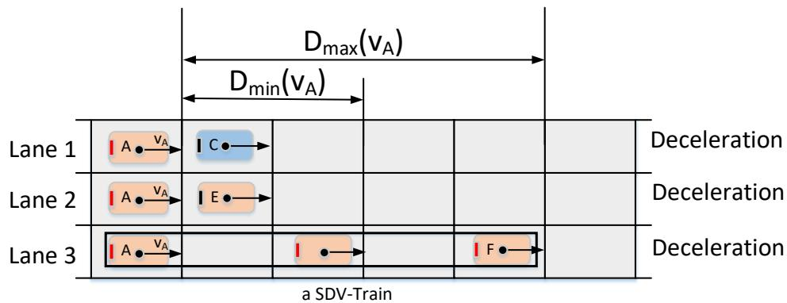
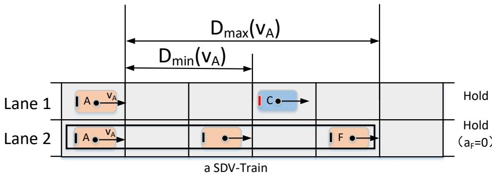
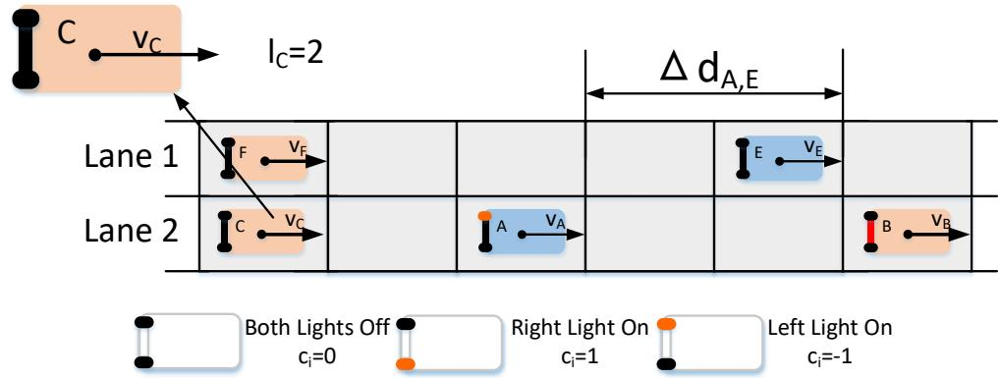
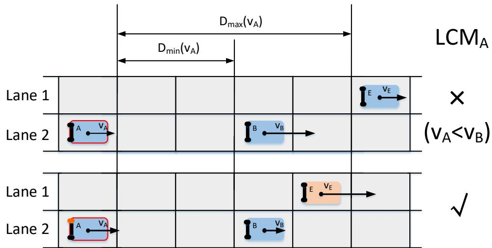
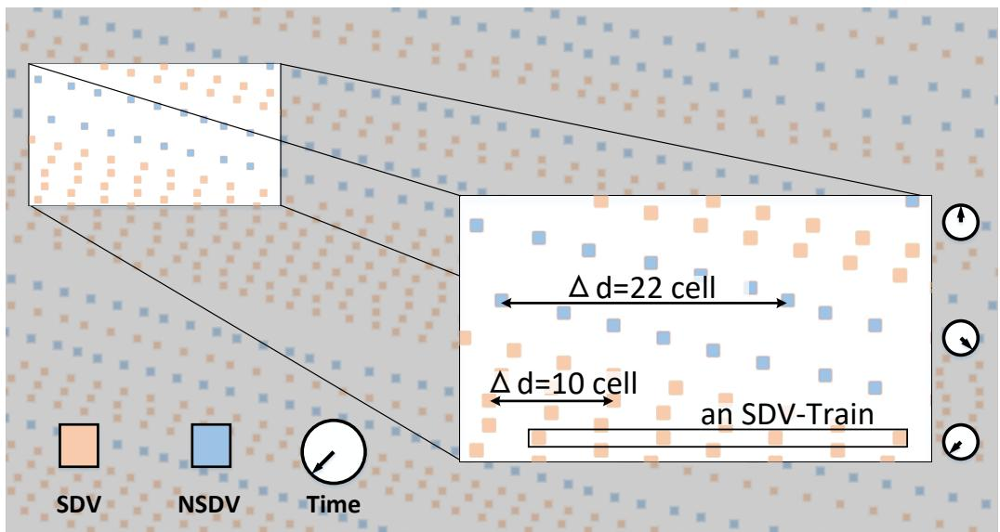

# 2017年美国大学生数学建模竞赛C题O奖论文：基于元胞自动机的自动驾驶车辆高速公路交通流模型

原件为竞赛论文。补充：文中的阅读练习及“参考解答”为整理时增加，原件图文保留出处。

# 2017年美国大学生数学建模竞赛C题O奖论文：基于元胞自动机的自动驾驶车辆高速公路交通流模型

## Highway Traffic Flow Model with Self-Driving Vehicles Based on Cellular Automata

### Summary

With the increasing lack of transportation capacity and the growth of self-driving vehicle(SDV) industry, an evaluation should be made to find out the influence on traffic when more and more nonself-driving-vehicles(NSDV) are replaced by SDVs while few studies were done on the interactions between SDVs and NSDVs and the cooperations among SDVs themselves.

We choose cellular automata(CA) model to evaluate this problem after a careful study and comparison of different kinds of traffic flow models in the past few decades. In order to take the relationships of SDVs and NSDVs into consideration, we improve the traditional CA model which emphasizes on status and rules of changes, by redesigning these two factors. Before building a CA model, discretization should be done first. By learning the average length, speed, acceleration of running vehicles on highway and the reaction time of human beings, the size of a cell and the time length of a turn are decided. After making assumptions and simplifying the problem, two interrelated CA models are covered in this paper to simulate the changeable traffic: the Following Model and the Multilane Traffic Model.

The Following Model is designed to simulate how a vehicle follows another in a single lane. Rules for NSDVs and SDVs are different from each other: For an NSDV, the driver’s reaction time and psychological characteristics are considered; For an SDV, the rules are based on the sharing of information with other SDVs and the joint decision making. Specifically, we create a new conception ’SDV-Train’ to simulate the cooperations among SDVs.

The Multilane Traffic Model is based on the Following Model. In this model, besides following, we try to find out when and how should a vehicle change a lane. Two main parameters are involved in this model: Lane-Changing Motivation (LCM) and Lane-Changing Secuirty (LCS). LCM depends on whether changing a lane can increase the speed and LCS shows the whether it is safe when lanechanging. Only when both LCM and LCS are satisfied, may a vehicle change its lane. Details of these two parameters vary between SDVs and NSDVs considering the huge difference between an automatic control system and a human driver. A two-step turning method is specially made for this model in correspondence with the real world.

After building and making improvements to the model, we write programs to simulate it and get huge volumes of data. We analyze and visualize the data using Matlab, showing strong correlations among three parameters: the average speed, the traffic flow and the percentage of the SDVs running on the road. The increasing number of SDVs has great influence on the traffic flow which almost triples when all the NSDVs are replaced by SDVs. Also, we find that a special lane for SDVs (SDV Lane) should be built when the percentage reaches a certain level.

Based on the correlations we get in analysis, we apply our model to the Great Seattle area by comparing the real data and the data we gain from simulations. We find that the lack of traffic capacity in this area is huge. Although adding SDVs to the street can reduce this lack, it is not a cure. We believe a comprehensive method should be applied in this area including setting a SDV Lane and broadening highways in some particularly narrow parts.

Keywords: Traffic Flow Model; Self-Driving Vehicle; Cellular Automata

知识点：[元胞自动机模型（Cellular Automata）及其应用](../../../topics/数学建模/yuanyao_zidongji.md)、[数学建模的基本步骤（问题分析、模型假设、建立、求解、检验、推广）](../../../topics/数学建模/jianmo_buzhou.md)、[问题重述与分析（Problem Restatement and Analysis）](../../../topics/数学建模/wenti_chongshu.md)

### Contents

1 Introduction 1
2 Simplifications and Assumptions of the Problem 1
2.1 Features of the Highway . . . . . . . . . . . . . . . . . . . . . . . . . . . . . . . . . . . . . . . . . . . . . . . . . . . . . . . . . . . . . . . . . . . . . . . . . . . . . . . . . . . . . . . . . . . . . . . . . . . . . . . . . . . . . . . . . . . . . . . . . ....... 2
2.2 Features of Vehicles . . . . . . . . . . . . . . . . . . . . . . . . . . . . . . . . . . . . . . . . . . . . . . . . . . . . . . . . . . . . . . . . . . . . . . . . . . . . . . . . . . . . . . . . . . . . . . . . . . . . . . . . . . . . . . . ....... 2
2.3 Special Features of NSDVs. . . . . . . . . . . . . . . . . . . . . . . . . . . . . . . . . . . . . . . . . . . . . . . . . . . . . . . . . . . . . . . . . . . . . . . . . . . . . . . . . . . . . . . . . . . . . . . . . . . . . . . . . . . . . .......

## 1 Introduction

Built in the 20th century, many highways were designed to meet the transportation demands at that time. With the boom of population, urbanization and economy, the need of transportation grows rapidly in the new century. Nowadays, highways in the Great Seattle area can no longer meet people’s need and traffic delays can be seen everywhere during peak hours. However, at this time building more roads or adding lanes in this area is extremely difficult and expensive. In order to increase the capacity of highways without increasing the number of lanes or roads, allowing self-driving vehicles (SDVs) to run on the road should be taken into consideration. A model is needed to evaluate SDVs’ influence on the traffic flow.

We proposed to decompose this problem into three parts:

1. Build a model that can simulate the traffic flow in different percentage of SDVs and non-self-driving vehicles (NSDVs), number of lanes and traffic volume.
2. Use the model to find the equilibria or tipping points and apply the model to the provided data.
3. Based on the data, decide whether there are some conditions where lanes should be dedicated to SDVs and how the policy should be changed.

Firstly, we use cellular automata (CA) to simulate the traffic flow when there is only one lane. This model is called the Following Model. In our model, we rule the way each cell behaves by simplifying the behaviors of vehicles in real life, like when a vehicle will slow down or speed up. We use different rules for SDVs and NSDVs in our model to simulate the cooperations among SDVs, interactions between SDVs and NSDVs, unpredictability of human-beings and other factors.

Based on the Following Model we built, we put separate parallel lanes together and add new rules to simulate the traffic flow on a multilane highway. This is the Multilane Traffic Model. After simplifying the behaviors of real vehicles’ changing lanes, we make rules on when and how a cell move across lanes. Both the motivation and the safety concern are considered. Furthermore, we make special rules to simulate human behaviors and cooperations among SDVs including the form of a chain of SDVs called the SDV-Train.

Secondly, using real-life parameters, we run the CA model and get a large number of data. By analyzing the data, we find several interesting features of the mixed traffic flow. The correlations among the average speed, the traffic flow and the percentage of SDVs are strong. These three parameters influence each other in their own way. When there are many lanes, the situation changes and more interesting phenomena are found including the relationships between the efficiency of each line and the percentage of SDVs. After comparison, we find out when and how to build a special lane for SDVs (SDV Lane).

Thirdly, we compared our data with real data in the Great Seattle area. We find that there is indeed a great lack of traffic capacity in this area. After changing NSDVs to SDVs, the traffic capacity increases and even triples but we believe the traffic situation in this area is still not abundant. More methods including broaden a few parts of the current highway and setting a SDV Lane should be taken into consideration.

## 2 Simplifications and Assumptions of the Problem

知识点：[数学建模的基本步骤（问题分析、模型假设、建立、求解、检验、推广）](../../../topics/数学建模/jianmo_buzhou.md)

### 2.1 Features of the Highway

1. **Straight Road**

   A highway in this model should be straight or its degree of curvature can be ignored [1]. A vehicle’s speed and other conditions does not change because of the shape of the road.

2. The number of lanes should remain constant for a long period.

3. The highway is in good condition and the traffic flow is not affected by the rough road.

4. No pedestrian, animal or any form of obstacle can be found on the highway so the traffic flow would not be blocked.

5. Weather changes and illumination difference during different time is not taken into consideration.

6. **Rules for SDV Lane**

   If a SDV Lane is set, all SDVs should run in this line while none of the NSDVs may run in it.

   Only one SDV Lane can be set in our model considering the width of the highway is limited.

   The SDV Lane will be placed on the edge of the road to prevent a separation of lanes for NSDVs.

7. The width of each lane is 12 feet.

8. The speed limit of all highways is 60 mph.

知识点：[数学建模的基本步骤（问题分析、模型假设、建立、求解、检验、推广）](../../../topics/数学建模/jianmo_buzhou.md)、[一般假设及其合理性说明（Assumptions and Justifications）](../../../topics/数学建模/jiaben_shezhi.md)、[文献综述与研究背景撰写方法](../../../topics/数学建模/wenxian_zongshu.md)

### 2.2 Features of Vehicles

1. In this model, only average length, speed, acceleration and other features of vehicles are used. Although there is a great diversity among different vehicles, this difference can be ignored and the result of the model would not be greatly affected.

2. All vehicles obey traffic laws. The violation of traffic laws does great harm to the driver’s health, public security as well as the speed of total traffic flow. As a result, these circumstances would not occur in our model:
    - a vehicle exceeds the speed limit;
    - a vehicle stops for no reason;
    - a vehicle runs in an emergency lane or on the shoulder for no reason;
    - a vehicle changes its lane but
        - its turning light is not turned on in advance;
        - the vehicle behind it shows its intention to change the lane;
    - two vehicles run side by side in one lane;
    - the distance between two vehicles in the same lane is too short.

3. Traffic accident is not taken into consideration. Details of its influence will be discussed in Section 9.2.

4. Average daily traffic flow is used in this model. Traffic flow varies in different days, so an average level should be used to simplify this model.

5. Horn is not used in our model. On highway, the influence of a horn is limited because the distance between two vehicles is too long for a complicated sound signal to be heard and understood clearly.

# 2017年美国大学生数学建模竞赛C题O奖论文：基于元胞自动机的自动驾驶车辆高速公路交通流模型

本文系对2017年美赛C题O奖论文（Team #55585）中关于元胞自动机模型构建部分的整理，重点梳理了非自动驾驶车辆（NSDV）与自动驾驶车辆（SDV）的特性对比、模型选择依据及基本参数设置。

## 一、NSDV与SDV的特殊特性分析

知识点：[一般假设及其合理性说明（Assumptions and Justifications）](../../../topics/数学建模/jiaben_shezhi.md)、[文献综述与研究背景撰写方法](../../../topics/数学建模/wenxian_zongshu.md)、[问题重述与分析（Problem Restatement and Analysis）](../../../topics/数学建模/wenti_chongshu.md)

### 1. NSDV（非自动驾驶车辆）的特殊性

#### 选择 1
**距离与速度估计的不确定性**

题干：与计算机系统相比，人类驾驶员更容易犯错，特别是在评估距离和速度时。因此，当人类驾驶员无法清晰估计距离，即使其他车辆处于最小安全距离之外，他们往往也会减速并选择不换道。

- **特点描述**：人类驾驶员倾向于保守驾驶，在感知不清时降低车速或避免变道。

#### 选择 2
**更长的反应时间**

题干：在高速公路上，与自动驾驶车辆相比，人类驾驶员需要更多的时间来减速和启动车辆。

- **特点描述**：人类生理反应延迟导致制动和启动过程较慢。

知识点：[数学建模的基本步骤（问题分析、模型假设、建立、求解、检验、推广）](../../../topics/数学建模/jianmo_buzhou.md)、[一般假设及其合理性说明（Assumptions and Justifications）](../../../topics/数学建模/jiaben_shezhi.md)

### 2. SDV（自动驾驶车辆）的特殊性

#### 选择 3
**极短的反应时间**

题干：SDV由运行速度快且能持续工作的计算机系统控制。借助现代技术，SDV能够轻易感知外部环境并在短时间内做出相应反应。

- **特点描述**：系统实时性强，感知与决策响应迅速。

#### 选择 4
**SDV之间的协同合作**

题干：SDV系统连接至互联网，道路上所有SDV的信息均可共享。利用更多信息，可以构建网络决策系统（参见相关研究）。

- **特点描述**：车路协同，信息共享支持群体决策。

#### 选择 5
**成熟的技术**

题干：自动驾驶技术已足够成熟，本模型假设SDV的引导、驾驶和决策系统不会发生故障。若SDV系统发生事故，该车辆将被标记为NSDV处理。

- **特点描述**：模型假设SDV功能完美，故障视为NSDV。

#### 选择 6
**NSDV与SDV的交互**

题干：如第3节所述，对于人类驾驶员而言，遇到的SDV与NSDV没有区别。但SDV比NSDV更少犯错，且不会给人类驾驶员带来额外麻烦。

- **特点描述**：从人类视角看，SDV表现优于NSDV，交互体验更佳。

## 二、模型的选择与基本设置

知识点：[一般假设及其合理性说明（Assumptions and Justifications）](../../../topics/数学建模/jiaben_shezhi.md)、[任务分解与目标明确](../../../topics/数学建模/renwu_fenjie.md)

### 1. 模型选择依据

题干：过去几十年间，随着交通发展，涌现了大量交通模拟模型，其中连续介质模型（Continuous Medium model）和元胞自动机模型（CA model）最为流行。Lighthill和Whitham最早提出连续介质模型概念，随后Richards也独立提出，故又称LWR模型 [4]。LWR模型主要关注交通流的宏观均匀性和稳定性。然而，本题需进一步讨论SDV间的协作以及SDV与NSDV间的反应，这使得LWR模型难以适用，因为它忽略了流中不同粒子间的相互作用。经过仔细比较，我们发现修改后的传统CA模型适用于本题。

在现实生活中，无论是人类驾驶员还是计算机系统，车辆的行为都取决于车辆自身状态及周围交通状况，这与元胞自动机（CA）的规则相似。CA最初由Stanislaw Ulam和John von Neumann于1940年代发现 [5]。其基本思想是：初始状态为一组具有特定状态的单元（cells），创建一套简单规则，使状态根据当前单元及其邻居的状态进行更新。通过多次迭代，CA模型可模拟复杂物体的运动。为使模型适用于SDV与NSDV的混合场景，我们对原始CA模型的状态和规则进行了调整。为了建立CA模型，首先需要对几乎所有变量进行离散化。

> [!NOTE]
> **核心高亮**：选择CA模型的原因在于其能更好地模拟微观粒子（车辆）间的相互作用，特别是针对混合交通流中的异构行为。

知识点：[元胞自动机模型（Cellular Automata）及其应用](../../../topics/数学建模/yuanyao_zidongji.md)

### 2. 离散化处理

题干：在我们的CA模型中，每辆车被视为一个具有自身状态的单元。此外，每条车道也被划分为包含车辆的单元，时间被划分为小单位（轮次/turns）。

#### 选择 1
**单元尺寸**

题干：美国车辆的平均长度略长于4米。由于每个单元代表一辆车，单元长度应与平均车长一致。为简化计算，我们设定：

$$
1 \text{ cell} = 4 \text{ m} \tag{3.1}
$$

#### 选择 2
**时间单位**

题干：Triggs, T. J. 和 Harris, W. G的研究结果表明，驾驶员的平均反应时间约为1.5秒 [2]。在CA模型的一轮（turn）中，车辆执行一次动作，因此1.5秒是CA模型时间单位的理想选择。

$$
1 \text{ turn} = 1.5 \text{ s} \tag{3.2}
$$

知识点：[元胞自动机模型（Cellular Automata）及其应用](../../../topics/数学建模/yuanyao_zidongji.md)

### 3. 基本参数设置

#### 选择 3
**速度限制**

题干：道路限速为60mph，根据公式(3.1)和(3.2)，相当于10个单元/轮次。由于CA模型是离散的，在本模型中，速度被视为从0到10的自然数。

- **计算逻辑**：$60 \text{ mph} \approx 10 \text{ cells/turn}$。
- **取值范围**：$v \in \{0, 1, ..., 10\}$。

#### 选择 4
**加速度**

题干：根据假设，车辆速度应逐步变化。在本模型中，速度每次只能改变1个单元。利用公式(3.1)和(3.2)，车辆加速度为 $2.67 \text{ m/s}^2$，符合日常经验。

- **推导**：$\Delta v = 1 \text{ cell/turn} = 4 \text{ m} / 1.5 \text{ s} \approx 2.67 \text{ m/s}^2$。

#### 选择 5
**最小安全跟车距离 (MinSFD)**

题干：车辆在高速行驶时不应过于接近前车以防止事故。最小安全跟车距离（MinSFD）的设计旨在确保以一定速度行驶的普通车辆能在碰撞前停下。

- **定义**：保证制动安全的最小间距。

## 三、模型细节与运动规则

题干：在我们的CA模型中，制定了规则来模拟车辆的运动。在所有类型的运动中，车辆行为的两种最重要类型是：**跟随（Following）**和**变道（Lane-changing）**。分别建立了“跟随模型”和“多车道交通模型”来模拟这两种行为。

知识点：[一般假设及其合理性说明（Assumptions and Justifications）](../../../topics/数学建模/jiaben_shezhi.md)、[模型参数的确定（基于数据拟合或实验选择）](../../../topics/数学建模/canshu_queding.md)、[元胞自动机模型（Cellular Automata）及其应用](../../../topics/数学建模/yuanyao_zidongji.md)

### 1. 跟随模型 (Following Model)

题干：跟随模型模拟高速公路上单车道的车流。已开发出大量单车道交通流模型，其中最著名的是NaSch (NS) 模型。Kai Nagel和Michael Schreckenberg于1992年为此构建了该CA模型 [6]。他们的模拟显示，随着车辆密度的增加，交通流会从层流过渡到起停波（start-stop waves）。在现实生活中，SDV的行为与非自动驾驶车辆不同，因此我们对NaSch模型的修改主要集中在SDV上。

- **基础模型**：NaSch模型（Nagel-Schreckenberg）。
- **改进重点**：针对SDV与NSDV的行为差异进行调整。

# 2017年美国大学生数学建模竞赛C题O奖论文：基于元胞自动机的自动驾驶车辆高速公路交通流模型

## 4.1.1 Variables

知识点：[一般假设及其合理性说明（Assumptions and Justifications）](../../../topics/数学建模/jiaben_shezhi.md)、[元胞自动机模型（Cellular Automata）及其应用](../../../topics/数学建模/yuanyao_zidongji.md)、[符号说明与术语定义（Nomenclature / Symbols and Definitions）](../../../topics/数学建模/fuhao_shuoming.md)

### 表 1: 模型中使用的主要变量

| Variable | Definition | Unit |
| :--- | :--- | :--- |
| $d_i$ | Distance between vehicle No. i and the start point | cell |
| $\Delta d_i$ | Distance between vehicle No. i and the vehicle ahead of it | cell |
| $v_i$ | Speed of vehicle No.i | cell/time step |
| $a_i$ | Whether vehicle No.i is accelerating or not | unitless |
| $b_i$ | Status of the back light of vehicle No.i | unitless |
| $t_i$ | Type of vehicle No.i | unitless |
| $D_{min}(v)$ | MinSFD between two vehicles when the latter one's speed is v | cell |
| $D_{max}(v)$ | Maximum distance between two vehicles when the latter one's speed is v and the action of the former one can be ignored | cell |
| $P_{1,i}$ | Possibility of a human driver to decelerate out of caution | unitless |

模型中使用的主要变量如表 4.1.1 和图 1 所示。具体而言，公式 (4.3) 分别展示了尾灯状态和车辆类型的函数：

$$
\begin{array}{l} b _ {i} = \left\{ \begin{array}{l l} 0, & \text { the   back   light   of   vehicle   No. } i \text { is   off } \\ 1, & \text { the   back   light   of   vehicle   No. } i \text { is   on } \end{array} \right. \\ t _ {i} = \left\{ \begin{array}{l l} 0, & \text { vehicle   No. } i \text { is   an   NSDV } \\ 1, & \text { vehicle   No. } i \text { is   an   SDV } \end{array} \right. \end{array}\tag{4.3}
$$

对于非自动驾驶车辆（NSDV），没有灯光信号显示其是否在加速，这一参数由 $a _ { i }$ 指示。然而，这些信息在自动驾驶车辆之间是共享的，如公式 (4.4) 所示：

$$
a _ {i} = \left\{ \begin{array}{l l} 0, & \text { vehicle   No. } i \text {   is   not   accelerating } \\ 1, & \text { vehicle   No. } i \text {   is   accelerating } \end{array} \right.\tag{4.4}
$$

知识点：[符号说明与术语定义（Nomenclature / Symbols and Definitions）](../../../topics/数学建模/fuhao_shuoming.md)、[数学建模的基本步骤（问题分析、模型假设、建立、求解、检验、推广）](../../../topics/数学建模/jianmo_buzhou.md)、[一般假设及其合理性说明（Assumptions and Justifications）](../../../topics/数学建模/jiaben_shezhi.md)

### 4.1.2 Following Rules for NSDVs

#### Deceleration

正如我们在第 2.4 节的第 1 部分和第 2 部分所讨论的，人类驾驶员需要更多的反应时间，并且有时出于谨慎选择减速以维持更长的跟车距离。在此跟随模型中，如果车辆 No. i 是非自动驾驶车辆（Non-Self-Driving），则为其设置了一个可能性函数 $P _ { 1 , i }$ 来模拟上述两个因素。对于 NSDV A，公式 (4.5) 展示了该函数，其中 B 代表位于 A 前方的第一辆车。

$$
P _ {1, A} = \left\{ \begin{array}{l l} P _ {1} 1, & b _ {B} = 1 \land \Delta d _ {A} > D _ {m i n} (v _ {A}) \land \Delta d _ {A} <   D _ {m a x} (v _ {A}) \\ P _ {1} 2, & b _ {B} = 0 \land \Delta d _ {A} > D _ {m i n} (v _ {A}) \land \Delta d _ {A} <   D _ {m a x} (v _ {A}) \\ P _ {1} 3, & v _ {A} = 0 \\ 0, & \text {other cases} \end{array} \right.\tag{4.5}
$$

在计算中，我们使用先前工作 [7] [8] 得到的结果：

$$
P _ {1} 1 = 0. 9 4, P _ {1} 2 = 0. 5 0, P _ {1} 3 = 0. 2 0\tag{4.6}
$$

简而言之，NSDV 在特定情况下有减速的概率。如图 2 中的车道 1 所示，对于 NSDV $\mathbf { A }$，在跟随模型的每一步都会给出一个介于 0 和 1 之间的随机数 R，且满足：

$$
P _ {1, A} \geqslant R \Rightarrow v _ {A} = v _ {A} - 1, b _ {A} = 1
$$

除了这种影响外，如果另一辆车在车辆 A 的最小安全跟随距离（MinSFD）内，A 必须减速并打开尾灯。即：

$$
\Delta d _ {A} \leqslant D _ {m i n} (v _ {A}) \Rightarrow v _ {A} = v _ {A} - 1, b _ {A} = 1
$$

这是图 2 中的车道 2。

#### Acceleration

如果 NSDV A 没有因为 $P _ { A }$ 而减速，并且车辆 B 满足以下任一条件：
– 距离较远，或
– 未减速且在 A 的 MinSFD 之外

## 4.1.3 Following Rules for SDVs

According to the discussion in part 1 and part 2 of Section 2.4, SDVs have short reaction time and they can cooperate with each other. Considering that an accident happens right in front of a straight line of vehicles, all vehicles should decelerate in order to keep the MinSFD. If they are controlled by human beings whose reaction time cannot be ignored, vehicles will decelerate one by one but with a delay. However, if all vehicles are self-driving ones, they can decelerate at the same time, thanks to the cooperating system. It is the same for the acceleration process, because $a_i$ can be known for all SDVs, which is mentioned in Section 4.1.1.

Another factor is that the way changes to calculate minimum safe following distance between two SDVs which one follows another closely, because all SDVs share the information of speed and other parameters of the SDVs in front of them, which is mentioned in part 2 of Section 2.4. As is also assumed in part 3 of Section 2.4, malfunction of the self-driving system is not taken into consideration in this model. The two adjacent SDVs can decelerate at the same time if emergency happens, so that the MinSFD for an SDV can be calculated following Eqn. (4.7), in which the Braking Distance of the former can be removed. No collision between SDVs will happen when all information is shared and decisions are made cooperatively.

$$
\begin{array}{l}
BrakingDistance_E = D_{min}(max(v_E - 2, 0)) \\
D_{min(SDV-SDV)}(v_A) = max \Big(D_{min}(v_A) - BrakingDistance_E + 1, 1\Big)
\end{array}\tag{4.7}
$$

In Eqn. (4.7) E is the SDV ahead of A.

With the change of $D_{min(SDV-SDV)}$, the distance between SDVs can be shortened and therefore a row of pure SDVs can be formed. When all the distances between two consecutive SDVs are their $D_{min(SDV-SDV)}$, this chain of SDVs can be called a SDV-Train. For an SDV A, if it is in an SDV-Train, let F be the SDV in the front of the train. The three vehicles in Lane 4 from Fig. 3 form a typical SDV-Train.

知识点：[数学建模的基本步骤（问题分析、模型假设、建立、求解、检验、推广）](../../../topics/数学建模/jianmo_buzhou.md)、[一般假设及其合理性说明（Assumptions and Justifications）](../../../topics/数学建模/jiaben_shezhi.md)、[模型参数的确定（基于数据拟合或实验选择）](../../../topics/数学建模/canshu_queding.md)

### Acceleration

An SDV accelerates under 4 conditions:

1. it follows a vehicle B, and their distance is longer than $D_{max}(v_A)$, that is:

$$
\Delta D_A \geqslant D_{\max}(v_A) \Rightarrow v_A = v_A + 1; b_A = 0; a_A = 1;
$$

which is the situation in Lane 1 in Fig. 3;

2. it follows an NSDV C, whose back light is off and their distance is longer than the MinSFD of A, that is:

$$
t_C = 0 \land b_C = 0 \land \Delta D_A \geqslant D_{min}(v_A) \Rightarrow v_A = v_A + 1; b_A = 0; a_A = 1;
$$

which is the situation in Lane 2 in Fig. 3;

3. it follows an SDV E, and their distance is longer than the $D_{min(SDV-SDV)}$ of A, that is:

$$
t_E = 1 \wedge \Delta D_A > D_{\min(SDV-SDV)}(v_A) \Rightarrow v_A = v_A + 1; b_A = 0; a_A = 1;
$$

which is the situation in Lane 3 in Fig. 3;

4. it is in a 'SDV-Train', and the first SDV F in train accelerates, that is:

$$
\Delta D_A = D_{\min(SDV-SDV)}(v_A) \wedge a_F = 1 \Rightarrow v_A = v_A + 1; b_A = 0; a_A = 1.
$$

which is the situation in Lane 4 in Fig. 3.

知识点：[数学建模的基本步骤（问题分析、模型假设、建立、求解、检验、推广）](../../../topics/数学建模/jianmo_buzhou.md)

### Deceleration

An SDV decelerates under 3 conditions:

1. it follows an NSDV C, and their distance is shorter than the MinSFD of A, that is:

$$
t_C = 0 \land \Delta D_A \leqslant D_{min}(v_A) \Rightarrow v_A = v_A - 1; b_A = 1; a_A = 0;
$$

which is the situation in Lane 1 in Fig. 4;

2. it follows an SDV E, and their distance is shorter than the $D_{min(SDV-SDV)}$ of A, that is:

$$
t_E = 1 \land \Delta D_A \leqslant D_{\min(SDV-SDV)}(v_A) \Rightarrow v_A = v_A - 1; b_A = 1; a_A = 0;
$$

which is the situation in Lane 2 in Fig. 4;

## 4.1.3 SDV 跟驰规则（续）

知识点：[元胞自动机模型（Cellular Automata）及其应用](../../../topics/数学建模/yuanyao_zidongji.md)

### 加速

3. 当 SDV 处于“SDV 列车”中，且列车首车 $F$ 减速时，即：

$$
\Delta D_{A} = D_{\min(SDV-SDV)}(v_{A}) \wedge b_{F} = 1 \Rightarrow v_{A} = v_{A} - 1; b_{A} = 1; a_{A} = 0.
$$

这正是图 4 中车道 3 的情形。

知识点：[数学建模的基本步骤（问题分析、模型假设、建立、求解、检验、推广）](../../../topics/数学建模/jianmo_buzhou.md)、[一般假设及其合理性说明（Assumptions and Justifications）](../../../topics/数学建模/jiaben_shezhi.md)、[符号说明与术语定义（Nomenclature / Symbols and Definitions）](../../../topics/数学建模/fuhao_shuoming.md)

### 保持

其他情况下，SDV 保持其速度：

$$
[\text{Other Circumstances}] \Rightarrow b_{A} = 0; a_{A} = 0.
$$

图 5 展示了两种不同的情形：

## 4.2 多车道交通流模型

在多车道高速公路上，车辆倾向于保持在自己的车道上，这与 4.1 节所述的跟驰模型相同。然而，在某些情况下，驾驶员会变换车道。多车道交通流模型在跟驰模型的基础上设计，以模拟这种换道行为 [9]。由于 SDV 之间相互协作并形成 SDV 列车，SDV 的换道规则与 NSDV 不同。

知识点：[数学建模的基本步骤（问题分析、模型假设、建立、求解、检验、推广）](../../../topics/数学建模/jianmo_buzhou.md)、[问题重述与分析（Problem Restatement and Analysis）](../../../topics/数学建模/wenti_chongshu.md)

### 4.2.1 变量

表 2：多车道交通流模型中使用的附加变量

| 变量 | 定义 | 单位 |
| --- | --- | --- |
| $\Delta d_{i,j}$ | 车辆 $i$ 与车辆 $j$ 之间的距离 | cell |
| $c_i$ | 车辆 $i$ 转向灯的状态 | 无量纲 |
| $l_i$ | 车辆 $i$ 所在车道的编号 | 无量纲 |
| $P_{2,i}$ | 车辆 $i$ 的人类驾驶员在条件允许时换道的概率 | 无量纲 |

除表 4.1.1 中列出的变量外，多车道交通流模型中使用的附加变量列于表 4.2.1 和图 6。具体而言，式 (4.8) 给出了车辆 $i$ 转向灯状态的函数：

$$
c_{i} = \left\{ \begin{array}{l l} 0, & \text{车辆 } i \text{ 的转向灯关闭} \\ 1, & \text{车辆 } i \text{ 的右转向灯开启} \\ -1, & \text{车辆 } i \text{ 的左转向灯开启} \end{array}\right. \tag{4.8}
$$

知识点：[数学建模的基本步骤（问题分析、模型假设、建立、求解、检验、推广）](../../../topics/数学建模/jianmo_buzhou.md)、[文献综述与研究背景撰写方法](../../../topics/数学建模/wenxian_zongshu.md)、[符号说明与术语定义（Nomenclature / Symbols and Definitions）](../../../topics/数学建模/fuhao_shuoming.md)

### 4.2.2 换道的一般规则

正如 2.2 节第 2 部分所假设的，驾驶员只在必要时换道：

1. 同车道前方车辆距离不远且行驶速度慢得多；
2. 相邻车道的交通状况更好。

这称为换道动机（Lane-Changing Motivation，LCM）。在满足 LCM 之后，当驾驶员想要换道时，应完成两个步骤：

1. 在条件允许时打开转向灯；
2. 在安全时换道。

在此过程中，必须考虑换道安全性（Lane-Changing Security，LCS）。简而言之，只有当 LCM 和 LCS 都满足时，车辆才可以换道。

知识点：[问题重述与分析（Problem Restatement and Analysis）](../../../topics/数学建模/wenti_chongshu.md)、[一般假设及其合理性说明（Assumptions and Justifications）](../../../topics/数学建模/jiaben_shezhi.md)、[多重网络/多层网络构建（Multiplex/Multi-layer Network）](../../../topics/数学建模/duoceng_wangluo.md)

### 4.2.3 NSDV 的换道规则

如图 6 所示，B 是 A 前方的车辆，C 是 A 后方的车辆，三者均在同一车道上。下文仅讨论左转，因为右转情形相同。E 和 F 均位于 A 的左侧车道，E 是前方车辆，F 是后方车辆。

**NSDV 的 LCM**

如 4.2.2 节所述，LCM 由两部分组成：

- B 的行驶速度比 A 慢且距离不远；
- E 的行驶速度更快或距离较远。

因此，

$$
LCM_{A} = \left(\Delta d_{A,B} < D_{\max}(v_{A}) \wedge v_{B} < v_{A}\right) \wedge \left(\Delta d_{A,E} > D_{\max}(v_{A}) \vee v_{E} > v_{A}\right) \tag{4.9}
$$

部分情形如图 7 所示。

**NSDV 的 LCS**

LCS 应考虑三个方面：

- B 和 E 不在 A 的 MinSFD 内；
- A 换道后不会进入 F 的 MinSFD 内；
- C 的左转向灯关闭。

即：

$$
LCS_{A} = \Delta d_{A,B} > D_{\min}(v_{A}) \wedge \Delta d_{A,E} > D_{\min}(v_{A}) \wedge \Delta d_{A,F} > D_{\min}(v_{F}) \wedge c_{C} \neq -1 \tag{4.10}
$$

部分情形如图 8 所示。

**换道可能性（Lane-Changing Possibility，LCP）**

# 2017年美国大学生数学建模竞赛C题O奖论文：基于元胞自动机的自动驾驶车辆高速公路交通流模型

本部分整理自《2017年美国大学生数学建模竞赛C题O奖论文》第 7 部分（共 10 部分），识别范围为第 14–16 页。内容涉及换道规则、模型仿真结果分析及数据可视化结论。

## 4.2.4 SDV的换道规则

与NSDV相比，SDV可以相互共享信息，因此SDV的换道规则需要调整。这些规则与4.1.3节中的规则几乎相同，但有以下区别：

知识点：[问题重述与分析（Problem Restatement and Analysis）](../../../topics/数学建模/wenti_chongshu.md)

### 计算 MinSFD 的变化

MinSFD的计算如公式(4.13)所示发生变化：

$$
D _ { m i n (A, B)} ^ {*} (v _ {A}) = \left\{ \begin{array}{l l} D _ {m i n (S D V - S D V)} (v _ {A}), & \text { both A and B are SDV } \\ D _ {m i n} (v _ {A}), & \text { other circumstances } \end{array} \right.\tag{4.13}
$$

知识点：[稳定性分析（Stability Analysis）](../../../topics/数学建模/wending_xing.md)、[确定模型的定点与稳定性分析](../../../topics/数学建模/dingdian_wending.md)、[模型验证方法概述（随机模型与确定性模型验证）](../../../topics/数学建模/moxing_yanzheng.md)

### SDV-Train的形成

SDV-Train可以形成，在这种情况下，整个列车可以同时换道；

知识点：[数学建模的基本步骤（问题分析、模型假设、建立、求解、检验、推广）](../../../topics/数学建模/jianmo_buzhou.md)、[任务分解与目标明确](../../../topics/数学建模/renwu_fenjie.md)

### LCP的缺失

SDV没有LCP（生理随机性概率）。

因此，对于SDV，公式(4.9)和公式(4.10)应修改为公式(4.14)和公式(4.15)：

$$
\begin{array}{r} L C M _ {A} = (\Delta d _ {A, B} < D _ {m a x} (v _ {A}) \land v _ {B} < v _ {A}) \land (\Delta d _ {A, E} > D _ {m a x} (v _ {A}) \lor v _ {E} > v _ {A}) \\ \forall c _ {B} = - 1 \land t _ {B} = 1 \lor c _ {G} = - 1 \end{array}\tag{4.14}
$$

$$
L C S _ {A} = \Delta d _ {A, B} > D _ {m i n (A, B)} ^ {*} (v _ {A}) \wedge \Delta d _ {A, E} > D _ {m i n (A, E)} ^ {*} (v _ {A}) \wedge \Delta d _ {A, F} > D _ {m i n (A, F)} ^ {*} (v _ {F}) \wedge (c _ {C} \neq - 1 \lor t _ {C} = 1)\tag{4.15}
$$

在公式(4.14)和公式(4.15)中，车辆B、C、E、F的定义与原文中一致。车辆G是A所在SDV-Train中的第一辆SDV。一些情况如图9和图10所示。SDV换道的两步程序如下：

$$
\text { STEP 1: } L C M \land L C S \Rightarrow c _ {A} = - 1;
$$

$$
\mathrm{STEP2:} L C M \wedge L C S \wedge c _ {A} = - 1 \Rightarrow r _ {A} = r _ {A} - 1; c _ {A} = 0.
$$

## 5 模型仿真结果的分析和讨论

根据我们的CA模型进行编程后，我们使用真实生活中的参数从仿真中获得了大量数据。使用Matlab和其他软件对数据进行计算和可视化，显示出以下许多良好特性：

知识点：[元胞自动机模型（Cellular Automata）及其应用](../../../topics/数学建模/yuanyao_zidongji.md)、[符号说明与术语定义（Nomenclature / Symbols and Definitions）](../../../topics/数学建模/fuhao_shuoming.md)、[模型验证方法概述（随机模型与确定性模型验证）](../../../topics/数学建模/moxing_yanzheng.md)

### 5.1 跟随模型的结果

图11展示了跟随模型仿真的结果之一，其中每个点代表一辆车，每条线代表不同时间的车道。相邻两条车道之间的时间差为一个回合。随着时间的推移，所有车辆以不同的速度向前行驶。我们可以发现，在此仿真中，两个NSV之间的距离远大于两个SDV之间的距离，这符合我们设定的MinSFD。仿真中还发现了SDV-Train，节省了道路空间并加快了交通流。

通过计算和总结数据，我们发现所有车辆的平均速度、SDV在所有车辆中的百分比以及整体交通流量之间存在强相关性，这在图12的三维图中有所展示。在该图中，每个数据点代表基于相同参数的6次仿真的平均值。

如图12所示，所有数据点拟合到一个连续平滑的曲面上，表明SDV的比例越高，所有车辆运行越快，交通流量越大，平均速度越低。这两个特征符合常识。另一个有趣的特征是，与交通流量相关的速度下降趋势受到SDV比例的强烈影响。其典型曲线如图13所示。此外，我们还可以发现，每个SDV比例都有一个最大交通流量，这在图14中有详细展示。

在图13中，我们可以清楚地看到SDV的比例对交通有很大影响。如蓝色曲线所示，只有当交通流量低于每小时200辆车时，平均速度才高于50mph。当交通流量约为每小时400辆车时，平均速度保持在15mph，如果所有车辆都是NSDV，更大的交通流量将无法通行。从绿色曲线我们可以看到，当SDV的比例增加时，情况发生了巨大变化。在90%的比例下，当交通流量高达每小时600辆车时，平均速度保持在50mph以上，最大交通流量约为每小时950辆车，是没有SDV时的两倍多。

知识点：[一般假设及其合理性说明（Assumptions and Justifications）](../../../topics/数学建模/jiaben_shezhi.md)、[确定模型的定点与稳定性分析](../../../topics/数学建模/dingdian_wending.md)、[模型优缺点分析（Strengths and Weaknesses）](../../../topics/数学建模/youque_dian.md)

### 5.2 Results of the Multilane Traffic Model

In Fig. 15 is one of the results of the Following Model where lane-changing is taken into consideration. This is a highway of 4 lanes. In section A of Fig. 15, an overtaking happens in the Multilane Traffic Model. This situation cannot happen in the Following Model according to our rules. In section B of Fig. 15, we can find that an SDV chooses to change its lane to form a longer SDV-Train. Lane-changing and overtaking occur when a vehicle wants to speed up, but whether their influence on the traffic flow is positive or not is complicated, which will be discussed afterwards.

Obviously, a highway with more lanes has a larger total traffic flow, which is shown in Fig. 16. The total flow is almost proportional to the number of lanes, which is in line with common sense. We can also find that more vehicles can travel through when more SDVs are on the road. This is the same as the results of the Following Model in Section 5.1.

The relative traffic flow per lane is interesting, which is shown in Fig. 17. In this figure, the y-axis shows the car flow per lane divided by this number of the situation when there is only 1 lane. We can find that before 50%, the efficiency of each lane decreases as the number of lanes increases. This phenomenon is corresponding to the study in Bridges and Transmission Line Structures [10], suggesting that the lane-changing and overtaking of a human driver interfere the fluency of the traffic flow, resulting in a slow down and the decrease of the lane efficiency. Lane-changing and overtaking happens more frequently when there are more lanes, so it is natural that the efficiency goes down as the number of lanes goes up.

In our study, the situation is a bit different from the result in Bridges and Transmission Line Structures [10] because SDVs are added on the road and their behaviors are different from those of NSDVs. As we can see in Fig. 17, the efficiency reaches its lowest when the percentage of SDVs is about 50%, suggesting that there are as many SDVs as NSDVs on the road when the efficiency is the lowest. This is mainly because the formation and collapse of SDV-Trains happen frequently when both SDVs and NSDVs try to change their lanes to gain more speed. Their motivations conflict with each other and these lead to a great interfere to the traffic flow. The form and reform of SDV-Trains take time and SDVs’ speed change a lot during these sections, which result in the decrease of the efficiency. This situation happens most frequently when the number of SDVs and that of NSDVs are almost the same, explaining the peak at 50%.

The reason for the rise of efficiency when the percentage of SDVs is higher than 50% is that NSDVs that interfere SDV-Trains will become fewer as the ratio of SDVs rises. When this percentage is close to 100%, almost all vehicles on the road are SDVs and a long SDV-Train can be formed even from the beginning to the end of the road. With the short MinSFD between SDVs in an SDV-Train, the efficiency raises rapidly and it is even higher than that of the situation when there is only one lane, because adjustments to form a longer SDV-Train are easily made on a multilane highway full of SDVs while no adjustment can be made on a single-lane road.

知识点：[多重网络/多层网络构建（Multiplex/Multi-layer Network）](../../../topics/数学建模/duoceng_wangluo.md)、[模型优缺点分析（Strengths and Weaknesses）](../../../topics/数学建模/youque_dian.md)、[数学建模的基本步骤（问题分析、模型假设、建立、求解、检验、推广）](../../../topics/数学建模/jianmo_buzhou.md)

### 5.3 SDV Lane

As shown in Fig. 18, the solid lines represent the relationships between average traffic flow and percentage of SDVs running on a multilane highway with 1 SDV Lane. When the percentage of SDVs is low, the flow is lower than that of the original one with the same number of lanes, because in this situation, the using rate of the SDV Lane is too low. Specifically, when the percentage is 0, the traffic flow equals to the flow of highway with one less lane as the SDV Lane is empty. When the percentage rises, the traffic flow increases and soon it is higher than that of the orginal one. After this point, the setting of a SDV Lane brings benefit to the transportation capacity. The fall of the curve when the percentage is high is reasonable because we assumed in Section 2.1 that all SDVs should run in only one SDV lane, resulting a traffic jam and a waste of space on the non-SDV Lanes.

知识点：[数学建模的基本步骤（问题分析、模型假设、建立、求解、检验、推广）](../../../topics/数学建模/jianmo_buzhou.md)、[一般假设及其合理性说明（Assumptions and Justifications）](../../../topics/数学建模/jiaben_shezhi.md)、[模型优缺点分析（Strengths and Weaknesses）](../../../topics/数学建模/youque_dian.md)

### 6 Appliance of the Model

We apply our model on Interstates 5, 90, 402 and State Route 520 by comparing the real average traffic flow and the results of simluations, as Fig. 19 and Fig. 20 show. In the figure, much higher than the red curve, the black curve represents the actual situation, one that represents the simulation without SDVs, indicating that the transportation need in the Great Seattle is way beyond the transportation capacity now. The rules for speed limit and the safe following distance cannot be followed as the figure suggest, which may result in serious traffic accidents even fatal ones.

In order to reduce traffic congestion and traffic accidents, changing from NSDVs to SDVs has been considered, which is shown in Fig. 19 and Fig. 20. As the green curve suggests, if all the vehicles are SDVs, the traffic capacity of these 4 roads can basically reach the need. This shows that the lack of traffic capacity can be reduced by not completely solved by SDVs and a vast varieties of different methods including broadening the road should be taken into consideration. From Fig. 19 and Fig. 20, we can find out that only a small part of the road has extremely high traffic flow, so broaden this few parts is feasible. Another way to enlarge the traffic capacity is to set a SDV Lane. Fig. 18 suggests that when the percentage of SDVs is larger than about 30%, a SDV Lane should be built to speed up the traffic.

## 7 Sensitivity Analysis

As the parameters in LCP of NSDVs which is mentioned in 4.12 may be hard to obtain or there might be some uncertainty, the choice of LCPs might influence the result of our model. Also, we need to find out whether our model specifically fit the situation where the speed limit is 60 mph by changing the maximum speed in our model to see whether the result will be thoroughly different. To test the robustness and specificity of our model, a sensitivity analysis is implemented, testing our model with various LCPs and speed limit. The analysis proves that our model does not behave randomly and has good sensitivity.

知识点：[敏感性分析方法（Sensitivity Analysis，单参数与多参数变动）](../../../topics/数学建模/minganxing_fenxi.md)、[模型验证方法概述（随机模型与确定性模型验证）](../../../topics/数学建模/moxing_yanzheng.md)、[一般假设及其合理性说明（Assumptions and Justifications）](../../../topics/数学建模/jiaben_shezhi.md)

### 7.1 Choice of the Parameters in LCP

The LCP shows the statistical randomness of a car driver's choice influenced by his or her psychological characteristics to change the lane when the condition permitted. Because the hardness to obtain the accurate LCP, we assume the $P_2^1$, $P_2^2$ and $P_2^3$ as 0.8, 0.4 and 0.1, in our model. By changing the parameters by 15%, our model produces the data of a 3-lane road in the following Tab. 3 which shows that the result will not be changed greatly by the choice of parameters in LCP reflecting the robustness of our model.

Table 3: the Influence of the Changing of the Parameters in LCP in 3-lane Road

| | $P_2^1$ | $P_2^2$ | $P_2^3$ | Changing Proportion | Average Time | Deviation of time |
|---|---|---|---|---|---|---|
| Origin | 80.0% | 40.0% | 10.0% | 0.0% | 405.5 | 0.0% |
| $P_2^1 \uparrow$ | 92.0% | 40.0% | 10.0% | +15.0% | 406.4 | +0.22% |
| $P_2^1 \downarrow$ | 68.0% | 40.0% | 10.0% | -15.0% | 405.1 | -0.10% |
| $P_2^2 \uparrow$ | 80.0% | 46.0% | 10.0% | +15.0% | 406.8 | +0.32% |
| $P_2^2 \downarrow$ | 80.0% | 34.0% | 10.0% | -15.0% | 404.3 | -0.30% |
| $P_2^3 \uparrow$ | 80.0% | 40.0% | 12.0% | +15.0% | 407.4 | +4.7% |
| $P_2^3 \downarrow$ | 80.0% | 40.0% | 8.0% | -15.0% | 402.3 | -7.9% |

知识点：[模型参数的确定（基于数据拟合或实验选择）](../../../topics/数学建模/canshu_queding.md)、[敏感性分析方法（Sensitivity Analysis，单参数与多参数变动）](../../../topics/数学建模/minganxing_fenxi.md)、[模型验证方法概述（随机模型与确定性模型验证）](../../../topics/数学建模/moxing_yanzheng.md)

### 7.2 Different Speed Limit

Speed limit is the maximum speed that a vehicle on the road can reach, as we assumed in part 2 of Section 2.2, no exceed speed is allowed. Different speed limit will show the unique character of different roads. In light traffic, the average time it takes for a car passing the roads should be changed by the speed limit. And in Tab. 4, we can find that our model performs quite well and shows great specificity to different kind of road, showing the specificity of our model.

Table 4: the Influence of the Changing of the Speed Limit

| the Speed Limit | Changing Proportion | Average Time(turns) | Deviation of Time |
|---|---|---|---|
| 10 cell/turn(Original) | 0.0% | 107.7 | 0.0% |
| 5 cell/turn | -50.0% | 204.3 | +89.7% |
| 15 cell/turn | +50.0% | 79.2 | -26.5% |

## 8 Conclusions

To find how the percentage of SDVs impacts on the traffic flow and whether a valid solution exists to increase capacity of highways to the most extent, we formulate a model based on CA with two parts: the Following Model and the Multilane Traffic Model. In the Following Model, we consider the difference between how SDVs and NSDVs gain, decide upon and react to information. Information sharing among SDVs and physiological characteristics of NSDVs are simulated. In the Multilane Traffic Model, when and how SDVs and NSDVs change a lane are discussed thoroughly and many situations in real life are taken into consideration. With the simulation by computers, we conclude some useful features and suggestions:

1. Traffic flow becomes larger as the percentage of SDVs grows. Thanks to the short reaction time and the coordination between SDVs, they can make the best choice to run faster. In terms of simulated data, the traffic flow almost triples when all NSDVs are replaced by SDVs.

2. Tipping points are found in the relationship of average speed and traffic flow. Equilibria are formed when traffic jam occur. The percentage of SDVs change the position of tipping points and equilibria.

3. When the percentage of SDVs comes up to 30%, it is more efficient to increase the capacity of highways to set up an SDV Lane.

4. The traffic flow in real life is much larger than the expected one, suggesting a huge lack of traffic capacity. Although the result gained from case of all SDVs can fairly satisfy it, we suggest that the government advocate SDVs.

## 9 Strengths and weaknesses

知识点：[敏感性分析方法（Sensitivity Analysis，单参数与多参数变动）](../../../topics/数学建模/minganxing_fenxi.md)、[模型优缺点分析（Strengths and Weaknesses）](../../../topics/数学建模/youque_dian.md)

### 9.1 Strengths

1. The statistical randomness of human mental states and the interactions between SDVs and NSDVs are taken into consideration;

2. Following and lane-changing rules are designed fully corresponding to the traffic rules while specially rules are made for SDVs to make full use of the coordination among them;

3. Our model is fairly robust to the changes in parameters based on sensitivity analysis, which means a slight change in parameters will not cause a significant change in the result;

4. The model is capable of simulating the situation in real life. The results also agree with common sense and life experience.

知识点：[模型优缺点分析（Strengths and Weaknesses）](../../../topics/数学建模/youque_dian.md)、[敏感性分析方法（Sensitivity Analysis，单参数与多参数变动）](../../../topics/数学建模/minganxing_fenxi.md)

### 9.2 Weaknesses

1. Some of our assumptions are highly ideal and not very scientific, such as the length of vehicles and the value of acceleration.

2. Factors involved in human judgments may be over-simplified.

3. The speed of a vehicle is discrete in our model and has limitations, which is not closely corresponding to the situation in real life.

4. We have ignored traffic accidents in this model. Although it happens at a very low rate, the occurrence of the accidents has its own effect on the traffic flow.

知识点：[模型优缺点分析（Strengths and Weaknesses）](../../../topics/数学建模/youque_dian.md)、[一般假设及其合理性说明（Assumptions and Justifications）](../../../topics/数学建模/jiaben_shezhi.md)

### 10 A Letter

To the Governor Office of Washington State:

Last century witnesses the glory of development in the Great Seattle area as the boom of population, urbanization and the growth of industry bring this area prosperity. However, the increase of transportation capacity in this area can no longer keep pace with the development of the economy, as broadening roads in a developed urban agglomeration is limited, resulting in long delays during peak hours on highways. As the technology of self-driving vehicles is continuously improved at a rapid speed nowadays, there is no wonder that in the near future vehicles with self-driving functions will be put into the market and will soon occupy the road. Considering this trend, our team develop a model showing how self-driving vehicles will change our road network.

Our model is based on cellular automata model which was first introduced into traffic by Kai Nagel and Michael Schreckenberg in 1992. We make several changes to this model because the interactions between self-driving ones and non-self-driving ones and the cooperations between the self-driving ones must be considered. This model can be divided into two parts: the Following Model and the Multilane Traffic Model.

We design the Following Model to simulate how a vehicle behaves when following another one. Self-driving ones’ control system run faster as human beings need time to react. Another difference between them is that the information can be shared among computers but human drivers can only get the information from nearby ones. These features are all considered in our Following Model. In this model, human mind’s psychological characteristics also have influences. An interesting thing of this model is that a chain of self-driving vehicles can form a train to save time.

The Multilane Traffic Model is designed based on the Following Model. In this model, we add features of lane-changing and overtaking. The motivation to change a lane and the safety of this action are carefully considered. With lane-changing, a train of pure self-driving vehicles is easier to form. However, changing lanes interferes the traffic flow and its influence is complicated.

After building and improving our models, we write programs to simulate it. We find strong connections among the average speed, the traffic flow and the percentage of self-driving vehicles, showing that auto systems do benefit our society. We think the state should invest more in technology companies especially in those developing self-driving technology. Researches on this should also be supported and funded by the state government.

After comparing the data with the real world, we find that the Great Seattle area really suffers from the lack of traffic capacity. Almost all parts of the roads are not wide enough for transportation needs, suggesting that overspeed and the neglect of safe following distance occur frequently. As the figure shows, although self-driving technology can triple the capacity, some of roads will still be jammed. The widening of highways or redesigning of the road-network in these area is an urgency for the state.

Another result we obtained from this model is when and how we should set lanes dedicated to self-driving ones. According to our data, we suggest that a special lane only for self-driving vehicles should be set up when more than 30% of vehicles running on the highway are equipped with welfdriving systems.

We hope our model can help you understand the influence of self-driving vehicles on the traffic flow. We believe the traffic conditions in Washington State will become better after the introduction of scientific and longtime policies. For more details please read our paper.

Team # 55585

Yours sincerely Team #55585

知识点：[元胞自动机模型（Cellular Automata）及其应用](../../../topics/数学建模/yuanyao_zidongji.md)、[任务分解与目标明确](../../../topics/数学建模/renwu_fenjie.md)、[模型优缺点分析（Strengths and Weaknesses）](../../../topics/数学建模/youque_dian.md)

### Reference

[1] H. T. Officials and A. A. O. S. H. Officials, “A policy on geometric design of highways and streets, 1994,” 2001.

[2] th., “Reaction time of drivers to road stimuli.,” Drivers, 1982.

[3] V. Bond and A. Thurlow, “Sae panel: Will people trust self-driving cars?,” Automotive News, 2013.

[4] M. Treiber and A. Kesting, The LighthillWhithamRichards Model. Springer Berlin Heidelberg, 2013.

[5] S. Wolfram and A. J. Mallinckrodt, “Cellular automata and complexity,” Computers in Physics, vol. 9, no. 1, p. 55, 1995.

[6] N. Kai and M. Schreckenberg, “A cellular automaton model for freeway traffic,” Journal of Physics I France, vol. 2, no. 12, pp. 2221–2229, 1992.

[7] W. Knospe, A. Schadschneider, M. Schreckenberg, and L. Santen, “Towards a realistic microscopic description of highway traffic,” Journal of Physics A General Physics, vol. 33, no. 48, p. L477, 2000.

[8] G. Hong-xia, The dynamical characteristics and nonlinear density waves with consideration of navigation. PhD thesis, Shanghai University, 2006.

[9] J. C. Deutsch, C. R. Santhosh-Kumar, M. Rickert, K. Nagel, M. Schreckenberg, and A. Latour, “Two lane traffic simulations using cellular automata,” Physica A Statistical Mechanics & Its Applications, vol. 231, no. 4, pp. 534–550, 1995.

[10] L. G. Jaeger and B. Bakht, “Multiple presence reduction factors for bridges,” in Bridges and Transmission Line Structures, 2015.

知识点：[元胞自动机模型（Cellular Automata）及其应用](../../../topics/数学建模/yuanyao_zidongji.md)、[数学建模的基本步骤（问题分析、模型假设、建立、求解、检验、推广）](../../../topics/数学建模/jianmo_buzhou.md)、[模型参数的确定（基于数据拟合或实验选择）](../../../topics/数学建模/canshu_queding.md)

### Appendices

Appendix A: Matlab Program for Visualization

Appendix B: C++ Program for Simulation

知识点：[数学建模的基本步骤（问题分析、模型假设、建立、求解、检验、推广）](../../../topics/数学建模/jianmo_buzhou.md)、[文献综述与研究背景撰写方法](../../../topics/数学建模/wenxian_zongshu.md)、[问题重述与分析（Problem Restatement and Analysis）](../../../topics/数学建模/wenti_chongshu.md)
