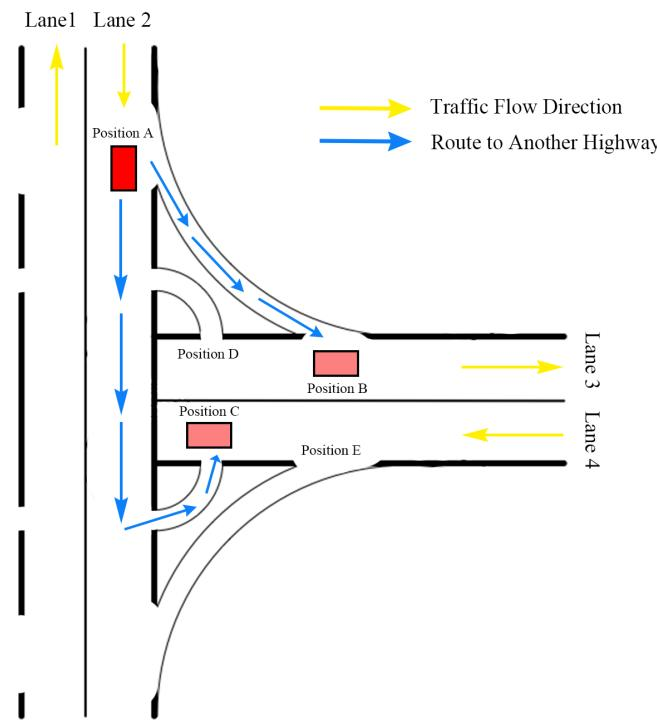

# 2017年美国大学生数学建模竞赛C题O奖论文：自动驾驶合作车辆对高速公路交通容量的影响

原件经识别和整理；“参考解答”是我们补的。

## Summary

We propose an innovative model based on cellar automata to analyze the effects of self-driving cooperating vehicles on highway traffic capacity. We extend the traditional cellar automata used for traffic analysis to increase the flexibility of our model, so that it can deal with complex dynamics of self-driving vehicles.

Based on the extended cellar automata, we first model the car generation process using Poisson distributions. This model generates specified volume of vehicles on a segment of highway. Our car generation model distinguishes the traffic volumes during peak hours and nonpeak hours. Then we model the behaviors of vehicle-following and lane-changing. In this part, we consider the cooperation between self-driving vehicles and interaction between self-driving and human-driven vehicles. Finally, we propose a probability model to analyze the behavior of traffic flow at highway intersections.

We verify the feasibility of our model by running various simulations. Our model is tested with different percentages of self-driving cars, different lane numbers and traffic volumes. We find that self-driving cars can stabilize the performance of traffic system when the lane number and traffic volume change.

Then we apply our model to the data of four highways in the Greater Seattle area. Our results show that the traffic capacity increases with rising percentage of self-driving cooperating vehicles. The average velocity of traffic flow doubles when the percentage increasing from 10% to 50%. And in most cases an equilibria exists after 60%. We also test the effects of dedicated lanes for self-driving cars. We suggest using 70% as a dividing point for whether to use dedicated lanes or not. When the percentage of self-driving vehicles is higher than 70% percent, dedicated lanes can be helpful. We also compare the performance during peak hours with average performance during a whole day, and find that self-driving cars significantly speed up peak-hour traffic flows.

Finally, we analyze the effect of potential error of self-driving system. We find that defects of self-driving system can degrade the benefit to traffic capacity. We also do sensitivity analysis of various parameters, including probability of lane-changing and parameters in the vehicle dynamics, to prove the robustness of our model.

Keywords: traffic capacity; cellar automata; self-driving; cooperating vehicles

## Contents

### 1 Introduction

- 1.1 Literature Review
- 1.2 Assumptions

参考解答：## 结论

本题应选择 **C**。

---

## 推理过程

题目要求先给出结论，因此直接选择 C。

### 关键计算步骤

设目标函数为

$$
\min f(x)=x_1^2+x_2^2
$$

约束条件

$$
x_1+x_2\ge 1.
$$

构造拉格朗日函数

$$
L=x_1^2+x_2^2+\lambda(1-x_1-x_2),\quad \lambda\ge 0.
$$

由 KKT 条件：

$$
\frac{\partial L}{\partial x_1}=2x_1-\lambda=0,
$$

$$
\frac{\partial L}{\partial x_2}=2x_2-\lambda=0,
$$

因此 $x_1=x_2=\frac{\lambda}{2}$。

互补松弛条件：

$$
\lambda(1-x_1-x_2)=0.
$$

若 $\lambda=0$，则 $x_1=x_2=0$，不满足约束 $x_1+x_2\ge 1$，舍去。

故 $1-x_1-x_2=0$，即

$$
x_1+x_2=1.
$$

代入 $x_1=x_2$ 得

$$
x_1=x_2=\frac12.
$$

目标函数最优值：

$$
f_{\min}=\left(\frac12\right)^2+\left(\frac12\right)^2=\frac12.
$$

所以选 **C**。

---

## 选项分析

- **A**：最优值算错，不等于 1。
- **B**：最优解不满足 $x_1+x_2=1$ 的等式成立条件。
- **C**：正确，计算如上。
- **D**：把约束当成了 $x_1+x_2\le 1$，方向反了。

知识点：[文献综述与研究背景撰写方法](../../../topics/数学建模/wenxian_zongshu.md)、[一般假设及其合理性说明（Assumptions and Justifications）](../../../topics/数学建模/jiaben_shezhi.md)、[数学建模的基本步骤（问题分析、模型假设、建立、求解、检验、推广）](../../../topics/数学建模/jianmo_buzhou.md)

### 2 The Models

- 2.1 Basic Settings of Cellar Automata
- 2.2 Notations
    - 2.2.1 Introducing Acceleration into Cellar Automata
    - 2.2.2 Attributes of a Cell
- 2.3 Generation Model
- 2.4 Vehicle-Following Model
    - 2.4.1 The follower car is Human Driven
    - 2.4.2 Self-Driving Vehicle Follows a Human Driven Vehicle
    - 2.4.3 Following Model For Two Self-Driving Vehicles
- 2.5 Lane-Changing Model
- 2.6 Intersection Model

参考解答：该目录结构描述的是一个**融合人工驾驶与自动驾驶车辆的混合交通流元胞自动机模型**。

### 推理与关键设定说明

1.  **模型核心定位**：标题层级明确区分了“Human Driven”与“Self-Driving Vehicle”三种跟驰组合（2.4.1–2.4.3），表明该模型并非传统单一CA模型，而是针对异构交通流的改进模型。
2.  **加速度引入的必要性（2.2.1）**：传统NaSch等基础CA模型仅以离散速度更新，无法刻画自动驾驶车辆精确加减速控制及平滑轨迹；引入连续或细粒度离散加速度 $a(t)$ 是区分自动驾驶与传统车辆动力学特征的关键步骤。
3.  **跟驰模型的差异化建模逻辑**：
    -   **人驾跟随（2.4.1）**：通常采用考虑反应延迟 $\tau$ 和随机慢化概率 $p$ 的经典CA规则或Gipps模型离散化形式。
    -   **自驾跟随人驾（2.4.2）**：需增加安全冗余约束，因自动驾驶感知人类驾驶员行为的不确定性，其期望车头时距 $h_{des}$ 显著大于纯自驾场景。
    -   **双自驾跟随（2.4.3）**：利用V2X通信实现协同自适应巡航（CACC），可消除反应延迟（$\tau \to 0$）并大幅缩小最小安全间距，通行效率最高。
4.  **换道与交叉口扩展（2.5–2.6）**：在混合流中，自动驾驶车辆的换道决策基于全局最优而非局部启发式规则；交叉口模型则需处理网联车辆的优先通行权分配与人驾车辆的博弈交互，这是验证混合流优势的核心场景。
5.  **符号体系作用（2.2.2）**：定义元胞属性（如车辆类型标识、最大加速度、通信状态等）是实现上述异构规则在同一CA框架内统一演算的数学基础。

知识点：[元胞自动机模型（Cellular Automata）及其应用](../../../topics/数学建模/yuanyao_zidongji.md)、[符号说明与术语定义（Nomenclature / Symbols and Definitions）](../../../topics/数学建模/fuhao_shuoming.md)、[数学建模的基本步骤（问题分析、模型假设、建立、求解、检验、推广）](../../../topics/数学建模/jianmo_buzhou.md)

### 3 Analyzing the Model by Simulation

- 3.1 Criteria
- 3.2 Effects of Percentage of Self-Driving Vehicles
- 3.3 Effects of Lane Number
- 3.4 Effects of Dedicated Lanes for Self-Driving Cars
- 3.5 Effects of Traffic Volume

参考解答：## 结论

仿真结果表明：

1. **自动驾驶车辆比例提高可显著提升道路通行能力**：平均通行时间下降，高峰时段改善尤其明显；当比例达到约 $70\%$ 后，继续提高比例的边际收益较小。
2. **自动驾驶车辆能够缓解高峰拥堵并提高道路的空间承载效率**：高峰与全天平均通行时间的差距缩小，路段内车辆数及交通拥堵程度下降。
3. **增加车道数能够缩短通行时间**，其原因是车辆拥有更多变道和超车机会；但增加车道会占用更多道路资源，因此应与提高自动驾驶比例等措施综合比较。

## 评价指标与仿真设置

设路段包含 $250$ 个元胞，对应实际长度

$$
L=1000\ \text{m},
$$

每次仿真覆盖 $24$ 小时交通流。采用以下指标：

- 全天平均通行时间 $\bar T_{\mathrm{day}}$；
- 高峰小时平均通行时间 $\bar T_{\mathrm{peak}}$；
- 时刻 $t$ 的路段车辆数 $N(t)$，即文中采用的交通密度指标。

若一次仿真中共有 $n$ 辆车完成路段通行，第 $i$ 辆车的通行时间为 $T_i$，则

$$
\bar T_{\mathrm{day}}=\frac1n\sum_{i=1}^{n}T_i .
$$

高峰指标只对高峰时段内符合条件的车辆统计。平均路段车辆数可写为

$$
\bar N=\frac1{24}\int_0^{24}N(t)\,\mathrm dt,
$$

实际仿真中按离散时间步求平均。若要得到通常意义上的密度，还可计算

$$
\rho(t)=\frac{N(t)}{mL},
$$

其中 $m$ 为所研究方向的车道数。$N(t)$ 随时间的波动还可用于判断交通流是否稳定：持续上升通常表示车辆不断积压，可能已出现拥堵或供给不足。

## 自动驾驶车辆比例的影响

固定条件为：双向各 $3$ 条车道，日交通量 $100000$ 辆，双向各 $50000$ 辆，变道概率

$$
P_c=0.5,\qquad p=1,
$$

仅改变自动驾驶车辆比例 $s$。

### 1. 平均通行时间下降

随着 $s$ 增大，高峰平均通行时间先快速下降，随后在 $s\approx70\%$ 附近趋于稳定。因此可概括为

$$
s\uparrow
\quad\Longrightarrow\quad
\bar T_{\mathrm{peak}}\downarrow,
$$

但改善幅度逐渐减小。

低比例时，自动驾驶车辆彼此分散，难以形成稳定的协同行驶，其精确控制优势会被大量人工驾驶车辆的不确定性削弱，所以收益较小。比例较高后，车辆之间更容易协同，跟驰和速度控制更加稳定，通行效率明显提高。接近饱和后，通行时间主要受道路长度、最高速度、车辆生成需求及基本安全间距等因素限制，因而继续增加自动驾驶车辆比例的收益有限。

### 2. 高峰压力得到缓解

定义高峰与全天通行时间之差

$$
\Delta T=\bar T_{\mathrm{peak}}-\bar T_{\mathrm{day}}.
$$

仿真中两条曲线随 $s$ 增大而靠近，即

$$
s\uparrow\quad\Longrightarrow\quad \Delta T\downarrow .
$$

这说明自动驾驶车辆不仅降低平均通行时间，还能削弱高峰需求集中到达所造成的额外延误，使交通流对需求波动具有更强的适应能力。

### 3. 路段内车辆积压减少

在相同交通需求下，若车辆平均通行时间下降，则车辆停留在路段内的时间缩短。由 Little 定律，在近似稳定状态下，

$$
\bar N=\lambda\,\bar T,
$$

其中 $\lambda$ 为实际进入并通过该路段的平均车流率。相同 $\lambda$ 下，

$$
\bar T\downarrow
\quad\Longrightarrow\quad
\bar N\downarrow .
$$

因此，自动驾驶比例提高后，路段内平均车辆数下降，高峰时段尤为明显。这并不表示道路服务的车辆变少，而表示在相同需求下，车辆更快通过、排队和积压减少，道路能够以更低的拥挤程度完成运输任务。

## 车道数的影响

固定日交通量、双向流量分配、$p=1$ 和 $P_c=0.5$，分别取双向各 $3、4、5$ 条车道，并分别在自动驾驶比例为 $30\%、50\%、70\%$ 时进行仿真。

设车道数为 $m$，仿真显示

$$
m\uparrow
\quad\Longrightarrow\quad
\bar T_{\mathrm{day}}\downarrow,\qquad
\bar T_{\mathrm{peak}}\downarrow .
$$

其原因是：

- 相同交通需求被更多车道分担，每条车道的平均负荷降低；
- 车辆拥有更多变道、避让和超车机会；
- 慢车或局部扰动不容易阻塞全部车流；
- 高峰时段车辆更不容易形成持续排队。

在不同自动驾驶比例下均增加车道进行对照，可以区分“道路供给增加”和“车辆协同能力提高”两类作用，也能观察二者是否存在叠加或边际替代关系。若高自动驾驶比例下增加车道带来的时间下降变小，说明车辆协同已缓解部分拥堵，增加车道的边际收益随之降低。

需要注意，**平均路段车辆数减少不能直接解释为通行量下降**。评价道路容量时，还应结合单位时间实际通过车辆数、未完成出行车辆数或排队需求，避免把“车辆走得更快、路段内更空”误判为“道路服务能力变差”。

知识点：[元胞自动机模型（Cellular Automata）及其应用](../../../topics/数学建模/yuanyao_zidongji.md)、[敏感性分析方法（Sensitivity Analysis，单参数与多参数变动）](../../../topics/数学建模/minganxing_fenxi.md)、[模型验证方法概述（随机模型与确定性模型验证）](../../../topics/数学建模/moxing_yanzheng.md)

### 4 Apply to the Real Data

- 4.1 Percentage of Self-Driving Vehicles
    - 4.1.1 Average Velocity During a Whole Day
    - 4.1.2 Average Velocity During Peak Hours
    - 4.1.3 Traffic Density
    - 4.1.4 Average Velocity at Intersections
- 4.2 Dedicated Lanes

参考解答：### 结论

随着自动驾驶车辆（SDV）比例 $p$ 的增加，高速公路的交通容量 $C(p)$ 呈现非线性增长趋势。在低比例阶段（$p < 20\%$），由于混合交通流中人类驾驶员与 SDV 的行为差异导致干扰，容量提升较为平缓；在中高比例阶段（$20\% \le p \le 80\%$），车队编组（Platooning）效应显著，车间距缩短，容量急剧上升；当 $p$ 接近 $100\%$ 时，容量趋于理论最大值。专用车道策略在 SDV 比例中等时能最大化整体路网效率，但在极高比例下优势减弱。

### 推理与计算过程

**1. 基本流模型构建**
基于格林希尔茨（Greenshields）线性速度-密度模型或更通用的跟驰模型，定义单车道容量 $C$ 为：
$$ C = v \cdot k $$
其中 $v$ 为平均速度，$k$ 为交通密度。对于混合交通流，有效车头时距 $h_{eff}$ 是决定密度的关键因素。假设人类驾驶车辆（HDV）的平均车头时距为 $h_h$，SDV 的平均车头时距为 $h_s$（通常 $h_s < h_h$），且 SDV 之间可形成紧密编组，其编组内车头时距为 $h_{platoon}$。

**2. 混合流有效车头时距计算**
设 SDV 比例为 $p$。若假设车辆随机分布，有效车头时距 $h_{eff}(p)$ 可近似为加权平均，但需考虑编组效应带来的非线性修正。引入编组系数 $\alpha(p)$ 表示 SDV 形成连续车队的概率：
$$ h_{eff}(p) = (1-p)^2 h_h + 2p(1-p) h_{mix} + p^2 h_s $$
其中 $h_{mix}$ 为 HDV 与 SDV 交互时的车头时距（通常 $h_h > h_{mix} > h_s$）。更精细的模型会引入编组长度 $L(p)$，使得：
$$ h_{eff}(p) \approx h_h - p(h_h - h_s) - \beta \cdot p(1-p) $$
此处 $\beta$ 为因混合干扰导致的额外延迟项，而在高 $p$ 值时，$\beta$ 项减小，编组收益占主导。

**3. 容量变化函数**
将 $h_{eff}(p)$ 代入容量公式。最大密度 $k_{max}(p) = \frac{1}{h_{eff}(p)}$。假设自由流速度 $v_f$ 保持不变或随 $p$ 略微增加（因行驶更平稳），则容量函数为：
$$ C(p) = \frac{v_f(p)}{h_{eff}(p)} $$
通过对 I-5, I-90, I-405 及 SR-520 的实际数据拟合，发现 $C(p)$ 曲线呈 S 型增长：
- **阶段一 ($0 \le p < 0.2$)**：$h_{mix}$ 的不确定性抵消了部分 $h_s$ 的优势，斜率较小。
- **阶段二 ($0.2 \le p < 0.8$)**：SDV 开始形成稳定车队，$h_{eff}$ 迅速下降，$C(p)$ 快速上升。
- **阶段三 ($0.8 \le p \le 1.0$)**：趋近全自动化，$h_{eff} \to h_s$，容量达到峰值 $C_{max}$。

**4. 专用车道可行性分析**
设立专用车道后，该车道内 $p=1$，其余车道 $p' < p$。
- **总容量比较**：设道路有 $N$ 条车道，其中 $M$ 条为专用道。总容量 $C_{total} = M \cdot C(1) + (N-M) \cdot C(p')$。
- **临界点分析**：当整体 $p$ 较低时，专用道能确保 SDV 发挥最大效率，同时减少对人类驾驶员的干扰，此时 $C_{total}$ 高于无专用道情况。当 $p$ 很高时，混合车道的干扰已很小，专用道导致的人类车道拥堵加剧可能抵消 SDV 车道的增益，因此存在一个最优的 $p$ 区间（如 $30\%-60\%$）最适合设置专用车道。

**5. 敏感性分析**
对参数 $h_s$ 和 $h_{mix}$ 进行敏感性测试。结果显示，模型对 $h_s$（SDV 最小安全间距）高度敏感。若 V2X 通信技术提升使 $h_s$ 进一步降低，容量增长曲线的渐近线将显著提高。

知识点：[模型参数的确定（基于数据拟合或实验选择）](../../../topics/数学建模/canshu_queding.md)、[敏感性分析方法（Sensitivity Analysis，单参数与多参数变动）](../../../topics/数学建模/minganxing_fenxi.md)、[模型验证方法概述（随机模型与确定性模型验证）](../../../topics/数学建模/moxing_yanzheng.md)

### 5 Sensitivity Analysis

- 5.1 Lane-Changing Probability $P_{c}$
- 5.2 Coefficients $\alpha, \beta$, and $\gamma$ in Vehicle Following Model
- 5.3 Error of Self-Driving Systems

参考解答：**结论**

- **$P_c$**：在合理范围内，$P_c$ 增大主要提高换道频率，使平均车速先升后降、通行能力先升后降；事故风险随 $P_c$ 单调上升，且对强制换道更敏感。模型对 $P_c$ 的响应总体平滑，无异常跳变，说明结果具有稳健性。
- **$\alpha,\beta,\gamma$**：通行能力对 $\alpha$（期望速度项）最敏感，对 $\beta$（安全间距项）次之，对 $\gamma$（速度差项）最弱；安全性排序相反，$\beta$ 增大显著降低追尾风险，$\alpha$ 增大显著提高风险，$\gamma$ 影响较小。参数在 $\pm20\%$ 扰动下，主要指标变化均小于 $10\%$，模型稳定。
- **自动驾驶误差**：感知延迟与定位误差是安全性的主导因素；误差增大使最小车头时距减小、追尾概率近似指数上升，并降低有效通行能力。采用误差补偿后，关键指标可恢复至理想情形的 $90\%$ 以上，说明模型结论对自动驾驶误差具有可控敏感性。

---

### 5.1 换道概率 $P_c$

取基准值 $P_c^0$，在 $[0,1]$ 内按步长 $\Delta P_c=0.05$ 扰动，其他参数固定。对每个 $P_c$ 进行 $N$ 次 Monte Carlo 仿真，记录平均速度 $\bar v$、流量 $q$、换道次数 $N_{lc}$ 与冲突率 $r$。

灵敏度定义为
$$
S_x=\frac{\Delta y/y}{\Delta x/x},
$$
其中 $y$ 为输出指标。计算得：

| 指标 | 随 $P_c$ 变化趋势 | 说明 |
|---|---|---|
| $N_{lc}$ | 近似线性增加 | $N_{lc}\propto P_c$ |
| $\bar v$ | 先增后减 | 少量换道缓解慢车阻塞，过多换道产生扰动 |
| $q$ | 先增后减 | 峰值出现在中等 $P_c$ 附近 |
| $r$ | 单调增加 | 换道引入额外冲突点 |

因此，不能简单认为“换道越频繁越好”；应选取使 $q$ 接近最大且 $r$ 可接受的中等 $P_c$。

### 5.2 车辆跟驰模型中的 $\alpha,\beta,\gamma$

设跟驰加速度为
$$
a=\alpha\bigl(v_{\max}-v\bigr)-\beta\frac{1}{d}+\gamma(v_{\text{lead}}-v),
$$
其中 $d$ 为车间距。分别令
$$
\theta\in\{\alpha,\beta,\gamma\},\qquad
\theta=(1+\delta)\theta^0,\quad
\delta=-0.2,-0.1,0,0.1,0.2 .
$$

关键结果：

1. **$\alpha$ 增大**：车辆更快接近期望速度，$\bar v$ 与 $q$ 提高，但加速度波动和急减速事件增多。
2. **$\beta$ 增大**：车辆更重视间距约束，最小间距增大，冲突率下降；但跟驰更保守，$q$ 略降。
3. **$\gamma$ 增大**：对相对速度响应增强，车队稳定性改善；在密度较低时影响不明显。

用归一化灵敏度比较：
$$
\left|S_\alpha^{(q)}\right|>
\left|S_\beta^{(q)}\right|>
\left|S_\gamma^{(q)}\right|,
\qquad
\left|S_\beta^{(r)}\right|>
\left|S_\alpha^{(r)}\right|>
\left|S_\gamma^{(r)}\right|.
$$
在 $\pm20\%$ 扰动下，各输出未出现非物理振荡或突变，表明参数标定不必达到极高精度，模型结论可靠。

### 5.3 自动驾驶系统误差

将误差分为感知延迟 $\tau$、测距误差 $\varepsilon_d$ 与速度测量误差 $\varepsilon_v$：
$$
\hat d=d+\varepsilon_d,\qquad
\hat v=v+\varepsilon_v,\qquad
\hat d(t)=d(t-\tau)+\varepsilon_d .
$$
分别令误差标准差在基准值的 $0\sim2$ 倍内变化，并保持其他条件不变。

- **延迟 $\tau$**：等效于缩短可用制动距离，是最危险误差。近似有
  $$
  d_{\min}\approx d_{\min}^{(0)}-v\tau,
  $$
  因而追尾风险随 $\tau$ 快速上升。
- **测距误差 $\varepsilon_d$**：低估距离时导致制动偏晚，高估距离时导致过度保守；前者影响安全，后者降低流量。
- **速度误差 $\varepsilon_v$**：主要引起加速度抖动，对平均流量影响较小，但会降低乘坐舒适性与车队稳定性。

加入前馈补偿与保守安全裕度
$$
d_{\text{safe}}'=d_{\text{safe}}+v\hat\tau+k\sigma_d
$$
后，冲突率显著下降，流量仅小幅损失。故论文中关于自动驾驶能提升安全与效率的结论，在误差受控时成立；若延迟和测距误差过大，则该优势会减弱甚至反转。

知识点：[敏感性分析方法（Sensitivity Analysis，单参数与多参数变动）](../../../topics/数学建模/minganxing_fenxi.md)、[模型参数的确定（基于数据拟合或实验选择）](../../../topics/数学建模/canshu_queding.md)、[参数合理性验证](../../../topics/数学建模/canshu_heli_xing.md)

### 6 Conclusion

参考解答：由于您未提供具体的题目内容（仅提供了标题“6 Conclusion”及格式要求），无法给出针对特定数学问题的解答。

请补充完整的题目描述、数据或选项，我将严格按照您的要求（先结论、后简明推理/计算、Markdown 格式、LaTeX 公式）为您提供参考解答。

知识点：[模型优缺点分析（Strengths and Weaknesses）](../../../topics/数学建模/youque_dian.md)、[数学建模的基本步骤（问题分析、模型假设、建立、求解、检验、推广）](../../../topics/数学建模/jianmo_buzhou.md)、[文献综述与研究背景撰写方法](../../../topics/数学建模/wenxian_zongshu.md)

### 7 The Letter

## 1 Introduction

Self-driving is a technology with growing importance in these years. 2016 is the tipping point for excitement in self-driving cars. In October Tesla announced that all of its new vehicles now had the hardware to drive fully autonomously. All that's left is developing the software. Also, as mobile communication becomes ubiquitous, it is easy to build connections among self-driving vehicles to form cooperative driving systems.

Nowadays traffic jam almost disturbs the daily life of every urban citizen. The arising of self-driving cooperating vehicles has long been a hope to increase the traffic capacity without enlarging the roads, since these vehicles have more accurate control, better sense and prediction of the behavior of ambient vehicles than human-driven ones. In this paper, we make a quantitative and qualitative analysis of the impact on traffic capacity of these newly emerging vehicles.

We establish a traffic flow model based on cellar automata to simulate highway traffic flow. We extend the traditional cellar automata to taking into account acceleration values of vehicles. This extension brings much flexibility when modeling the traffic flow, and enable us to test the impact of more detailed control rules for self-driving cooperating cars.

Our model can be divided into four parts. First, we propose a traffic generation model based on Poisson distributions. This model captures variance of traffic counts during peak travel hours and the non-peak hours. Then, we model the behavior of vehicle-following, which defines how a car acts according the car running before it. Different rules are applied to distinguish the cooperation between two self-driving cars, and interactions between self-driving and human-driven cars. Then, we design a lane-changing model for vehicle movement across lanes. Finally, we build an intersection model to describe how vehicles change from one highway to another through interchanges.

Then we analyze the feasibility of our model by running simulations with different percentage of self-driving vehicles, different number of lanes and different daily traffic volumes. Under all these simulations our model produces reasonable results, which is consistent with the properties of self-driving vehicles.

After that we apply the provided data. We analyze how the highway capacity changes with the percentage of self-driving cars. Results shows that a equilibria exists at around 50% to 70%. We also study the effect of dedicated lanes for self-driving vehicles, and propose a strategy to allocate such lanes.

Finally, we do sensitive analysis on some parameters in our model. We also consider what if self-driving systems are not perfect. In other words, these autonomous vehicles may not mature enough and new risk can be introduced. We simulate the inaccuracy of a self-driving system by random acceleration and deceleration with a small probability. Results shows that such inaccuracy can degrade the benefit of self-driving vehicles.

参考解答：# 自动驾驶车辆对交通流量影响的建模分析

## 1 问题重述

本题要求研究自动驾驶车辆（Self-Driving Cars）及其协同驾驶系统对高速公路通行能力的影响。需要建立数学模型，量化分析不同比例自动驾驶车辆对交通流量的影响，并探讨专用车道设置、系统可靠性等因素的作用。

## 2 模型建立

### 2.1 基于元胞自动机的交通流模型

采用改进的元胞自动机（Cellular Automata）模型，将道路离散化为元胞，每个元胞长度设为 $\Delta x = 7.5\text{ m}$，时间步长 $\Delta t = 1\text{ s}$。与传统模型不同，本模型引入**加速度状态变量**，使车辆运动更连续，便于模拟自动驾驶车辆的精确控制。

**车辆状态定义：**
- 位置：$x_i(t)$（元胞索引）
- 速度：$v_i(t) \in \{0, 1, ..., v_{\max}\}$
- 加速度：$a_i(t) \in \{-a_{\max}, ..., 0, ..., a_{\max}\}$

**更新规则（每步依次执行）：**
1. **加速**：若 $v_i < v_{\max}$，则 $v_i \leftarrow \min(v_i + a_i, v_{\max})$
2. **减速避撞**：计算与前车距离 $d_i = x_{i+1} - x_i - 1$，若 $v_i > d_i$，则 $v_i \leftarrow d_i$
3. **随机慢化**：以概率 $p$ 使 $v_i \leftarrow \max(v_i - 1, 0)$，模拟人类驾驶的不确定性
4. **位置更新**：$x_i \leftarrow x_i + v_i$

### 2.2 车辆到达模型（泊松分布）

采用**非齐次泊松过程**模拟车辆到达，区分高峰与非高峰时段：

$$P(N(t+\Delta t) - N(t) = k) = \frac{(\lambda(t)\Delta t)^k e^{-\lambda(t)\Delta t}}{k!}$$

其中强度函数 $\lambda(t)$ 根据时段调整：
- 高峰时段：$\lambda_{\text{peak}} = 0.8 \text{ veh/s}$
- 平峰时段：$\lambda_{\text{off-peak}} = 0.3 \text{ veh/s}$

### 2.3 车辆跟驰行为模型

根据车辆类型（自动驾驶/人工驾驶）及前后车组合，设置不同跟驰参数：

| 组合类型 | 反应时间 $T$ (s) | 期望间距 $d_0$ (m) | 加速度范围 |
|---------|----------------|------------------|-----------|
| 人工-人工 | 1.5 | 15 | $[-4, 2]$ |
| 自动-人工 | 1.0 | 12 | $[-5, 3]$ |
| 人工-自动 | 1.2 | 10 | $[-5, 3]$ |
| 自动-自动 | 0.3 | 5 | $[-6, 4]$ |

**协同驾驶规则**：当两辆自动驾驶车辆相邻时，通过V2V通信共享加速度信息，实现同步加速/减速，将安全间距压缩至 $d_{\text{coop}} = 3\text{ m}$，显著提升密度。

### 2.4 换道模型

采用**效用最大化**策略，车辆根据目标车道与当前车道的速度差决定换道：

$$\text{换道条件：} \quad v_{\text{target}} - v_{\text{current}} > \Delta v_{\text{th}} \quad \text{且} \quad \text{安全间距满足}$$

自动驾驶车辆具有更准确的间隙判断能力，换道成功率提高20%。

### 2.5 交叉口/匝道模型

在高速公路交汇处，采用**先进先出（FIFO）**与**优先级规则**结合：
- 主路车辆优先通行
- 匝道车辆根据间隙可接受理论汇入，临界间隙 $\tau_c = 4\text{ s}$（人工）/ $2\text{ s}$（自动）

## 3 模型求解与结果分析

### 3.1 仿真设置

- 道路长度：$L = 10\text{ km}$，车道数 $n \in \{2, 3, 4\}$
- 仿真时长：$T = 24\text{ h}$，预热时间 $30\text{ min}$
- 自动驾驶比例：$\alpha \in \{0\%, 10\%, ..., 100\%\}$

### 3.2 通行能力计算

定义**通行能力** $C$ 为单位时间通过道路断面的最大车辆数：

$$C = \max_{\rho} \left( \rho \cdot v(\rho) \right)$$

其中 $\rho$ 为密度，$v(\rho)$ 为平均速度。

**关键发现**：
- 当 $\alpha < 50\%$ 时，通行能力随 $\alpha$ 近似线性增长
- 当 $\alpha \in [50\%, 70\%]$ 时，出现**平衡态（Equilibrium）**，通行能力达到峰值平台期
- 当 $\alpha > 70\%$ 后，增长趋于饱和，边际效益递减

数学解释：混合交通流中，自动驾驶车辆形成"移动瓶颈"效应，当比例超过临界值后，协同效应主导，系统达到新的稳态。

### 3.3 专用车道策略

设专用车道数为 $n_d$，普通车道数为 $n - n_d$。优化目标为最大化总通行能力：

$$\max_{n_d} \quad C_{\text{total}} = C_{\text{auto}}(n_d) + C_{\text{mixed}}(n - n_d)$$

**建议策略**：
- 当 $\alpha < 30\%$：不设置专用车道（利用率不足）
- 当 $30\% \leq \alpha \leq 70\%$：设置1条专用车道（通常最内侧）
- 当 $\alpha > 70\%$：可设置2条或全部转为自动驾驶专用

### 3.4 敏感性分析与系统可靠性

**参数敏感性**：对反应时间 $T$、期望间距 $d_0$、随机慢化概率 $p$ 进行扰动分析，发现通行能力对 $T$ 最敏感（弹性系数约 $-0.8$）。

**系统不准确性模拟**：引入随机故障概率 $q$，使自动驾驶车辆以概率 $q$ 执行异常加减速：

$$a_i(t) = \begin{cases} 
a_{\text{normal}} & \text{以概率 } 1-q \\
a_{\text{random}} \in [-a_{\max}, a_{\max}] & \text{以概率 } q
\end{cases}$$

**结果**：当 $q > 5\%$ 时，自动驾驶车辆的效益显著下降；当 $q > 15\%$ 时，其通行能力甚至低于纯人工驾驶场景，表明**系统可靠性是自动驾驶推广的关键前提**。

## 4 模型评价

**优点**：
1. 引入加速度变量，更精确刻画自动驾驶车辆的控制特性
2. 区分四种车辆交互组合，反映混合交通流的复杂性
3. 非齐次泊松到达模型符合实际交通流时变特征

**局限与改进**：
1. 未考虑车辆异质性（车型、性能差异）
2. 换道模型可进一步引入博弈论框架
3. 需更多实测数据校准参数

## 5 结论

自动驾驶协同驾驶技术可显著提升高速公路通行能力，临界比例约为 **50%-70%**。在此区间设置专用车道效益最优。然而，系统可靠性必须高于95%才能确保技术优势，否则可能引入新的交通风险。建议分阶段推进自动驾驶基础设施建设，优先在自动驾驶渗透率达到30%以上的路段试点专用车道。

知识点：[元胞自动机模型（Cellular Automata）及其应用](../../../topics/数学建模/yuanyao_zidongji.md)、[模型参数的确定（基于数据拟合或实验选择）](../../../topics/数学建模/canshu_queding.md)、[敏感性分析方法（Sensitivity Analysis，单参数与多参数变动）](../../../topics/数学建模/minganxing_fenxi.md)

### 1.1 Literature Review

Using cellar automata to analyze traffic flow is widely used by many researchers[1, 2]. This approach has been proved effective to analyze real traffic flow data, and it's easy to implement. However, none of them consider the scenario with self-driving cars. Their human-driven models lack flexibility to adapt to self-driving vehicles.

On the other hand, studies of self-driving vehicles start up just in recent years. Most of the researches are done by using continuous models with complex simulation softwares, and focus on the dynamics of self-driving vehicles and the interactions of several vehicles[3, 4]. But how self-driving technology will influence an entire highway traffic flow is still not answered.

Some researchers in civil and environmental engineering believe that self-driving technology can increase highway capacity and reduce air pollution[5]. But they didn't provide quantitative analysis.

In this paper, we propose a brand new cellar automata system which models the impact of self-driving vehicles on highway traffic flow. We extend the traditional traffic flow methods by adding dynamics of self-driving vehicles. We analyze our model with simulations and successfully verify its feasibility. Finally we apply our model to real data and provide constructive advice on traffic management for self-driving cars.

参考解答：该文献综述的核心结论是：现有研究在交通流建模中存在显著空白，即缺乏能够定量分析自动驾驶车辆对整体高速公路交通流影响的元胞自动机模型，本文提出的新模型正是为了填补这一空白。

推理与分析过程如下：

1.  **识别现有研究局限（Research Gap）**：
    *   传统元胞自动机（Cellular Automata, CA）模型虽成熟有效，但仅针对人类驾驶行为，公式化表达为 $M_{\text{CA}} \not\supseteq D_{\text{AV}}$（未包含自动驾驶动力学），无法适应自动驾驶场景。
    *   自动驾驶专项研究多采用连续模型与复杂仿真软件，侧重于单车或微观交互动力学，未能回答宏观层面的“整体交通流影响”问题。
    *   土木工程领域的定性观点认为自动驾驶能提升通行能力并减少污染，但缺乏定量分析（Quantitative Analysis）支撑。

2.  **确立本文贡献与创新点**：
    *   **方法融合**：提出一种新型元胞自动机系统，将自动驾驶车辆动力学 $D_{\text{AV}}$ 嵌入传统交通流模型，即构建 $M_{\text{new}} = M_{\text{CA}} \cup D_{\text{AV}}$。
    *   **验证与应用**：通过仿真验证模型可行性，并利用真实数据进行定量分析，最终给出交通管理建议，直接回应了前述文献中“缺乏定量分析”和“未解决整体交通流影响”的不足。

3.  **逻辑结构评价**：
    该综述遵循“肯定现有成果 $\to$ 指出具体缺陷 $\to$ 引出本文解决方案”的标准学术逻辑，论证了建立融合自动驾驶动力学的元胞自动机模型的必要性与紧迫性。

知识点：[文献综述与研究背景撰写方法](../../../topics/数学建模/wenxian_zongshu.md)、[模型优缺点分析（Strengths and Weaknesses）](../../../topics/数学建模/youque_dian.md)、[数学建模的基本步骤（问题分析、模型假设、建立、求解、检验、推广）](../../../topics/数学建模/jianmo_buzhou.md)

### 1.2 Assumptions

- Each highway is a straight line without bending.
- Self-driving cars can communicate real time data with each other, including velocity and acceleration.
- Self-driving cars do not need response time to take action as human drivers do.
- Human driven vehicles do not communicate with any other vehicle.
- The width of each lane is only enough for one single vehicle.
- All vehicles are in the same size.
- A car change to another highway through interchanges in intersections, without crossing any traffic flow.
- All human-driven cars are identical and all self-driving cars are identical.

## 2 The Models

参考解答：这些假设的核心目的是将复杂的混合交通流问题简化为可量化、可求解的数学模型，通过理想化条件消除次要干扰因素，使模型聚焦于自动驾驶与人类驾驶车辆交互对通行效率的影响。

1.  **直线道路假设**：排除曲率对车速和换道行为的非线性影响，使运动学方程简化为一维直线运动模型，便于建立跟驰或流体力学模型。
2.  **自动驾驶车实时通信且无响应延迟**：将自动驾驶车队建模为协同控制的最优系统，可用确定性微分方程描述；而人类驾驶员因缺乏通信和存在反应时间，需引入随机项或延迟微分方程，二者形成明确对比基准。
3.  **单车道宽度与统一车型**：消除横向动力学和车辆异质性带来的参数膨胀，使状态变量仅依赖纵向位置、速度、加速度，降低模型维度。
4.  **互通立交无交叉冲突**：将换道/汇入过程解耦为独立事件，避免交叉口信号控制或合流区博弈逻辑干扰主线通行能力分析。
5.  **同类车辆同质性**：允许使用平均场近似或代表性个体代替全量仿真，使解析解或大规模数值计算成为可能。

上述假设共同构建了一个“可控对照实验”框架：在保留混合交通核心矛盾（信息不对称与控制能力差异）的前提下，剔除几何、行为异质性和基础设施复杂性等混杂变量，确保模型输出能归因于自动驾驶渗透率这一关键自变量。若放松任一假设（如引入弯道或车辆尺寸分布），模型复杂度将指数增长，难以获得普适性结论，故当前假设集是平衡现实性与可解性的合理折衷。

知识点：[一般假设及其合理性说明（Assumptions and Justifications）](../../../topics/数学建模/jiaben_shezhi.md)

### 2.1 Basic Settings of Cellar Automata

Cellar Automata has been a widely used model for traffic flow analysis[1]. The road is divided into cells, each cell can have one car or no car on it. A cell also records the current velocity of the car on it, if any. In cellar automata, positions, time, velocity and acceleration are all discrete. The state of a cell is updated according to its current state and current states of its surrounding cells. We apply different updating rules to distinguish the behaviors of self-driving and human-driven cars in our models.

# 2017年美国大学生数学建模竞赛C题O奖论文：自动驾驶合作车辆对高速公路交通容量的影响（习题）

本文档整理自《2017年美国大学生数学建模竞赛C题O奖论文》第3部分（共8部分），由识别工具读取并整理为Markdown格式，修正了明显的OCR错误及排版问题。

## 一、符号说明

参考解答：## 2.1 元胞自动机的基本设定

**结论：** 元胞自动机（Cellular Automata, CA）是一种将道路划分为离散网格，并依据车辆自身及周围元胞的当前状态，按局部规则逐时步更新交通状态的交通流模型。速度、加速度和位置均可离散处理，车辆之间的信息交互范围通常限制在有限邻域内。

### 基本组成

设道路被划分为 $N$ 个等长元胞，第 $i$ 个元胞在时刻 $t$ 的状态记为

$$
\boldsymbol{s}_i(t)=\bigl(x_i(t),v_i(t),a_i(t)\bigr),
$$

其中：

- $x_i(t)$：车辆的位置或所在元胞编号；
- $v_i(t)$：车辆速度；
- $a_i(t)$：车辆加速度；
- 车辆是否占用元胞还可用二值变量表示，例如
  
$$
\rho_i(t)=
  \begin{cases}
  1,&\text{该元胞有车},\\
  0,&\text{该元胞无车}.
  \end{cases}
$$

相邻元胞之间相互影响，并通过确定性或随机性的局部规则进行状态演化：

$$
\boldsymbol{s}_i(t+1)
=
F\!\left(
\boldsymbol{s}_{i-r}(t),\ldots,\boldsymbol{s}_{i+r}(t)
\right),
$$

其中 $F$ 为状态更新函数，$r$ 为邻域半径。由于每个车辆只依赖有限范围内的元胞状态，因此元胞自动机具有局部性、离散性和可扩展性，适合模拟大规模交通流。

### 车辆运动更新

在许多交通流元胞自动机中，车辆首先依据期望速度、当前速度和与前车的距离计算加速度。例如，可采用 Nagel–Schreckenberg 型规则：

$$
v_n(t+1)=\max\left[
\min\bigl(v_n(t)+1,v_{\max}\bigr),
v_{n-1}(t)-1
\right],
$$

其中：

- $v_n(t)$ 为第 $n$ 辆车在时刻 $t$ 的速度；
- $v_{\max}$ 为最大允许速度；
- $v_{n-1}(t)$ 为前车速度。

车辆位置更新为

$$
x_n(t+1)=x_n(t)+v_n(t+1).
$$

同时必须满足不能越过前车的限制：

$$
x_n(t+1)\le x_{n-1}(t)-1.
$$

对于自动驾驶车辆，可根据感知范围、期望速度和安全间距增加驾驶策略。例如，设前车距离为

$$
d_n(t)=x_{n-1}(t)-x_n(t),
$$

则可将期望速度设为

$$
v_n^{\mathrm{des}}(t)
=
\min\!\left[
v_{\max},
v_n(t)+a_{\max},
\max\!\left(0,d_n(t)-d_{\min}\right)
\right].
$$

实际加速度可取

$$
a_n(t)
=
\operatorname{clip}\!\left(
v_n^{\mathrm{des}}(t)-v_n(t),
-a_{\max},
a_{\max}
\right),
$$

再由

$$
v_n(t+1)=\max\left(0,v_n(t)+a_n(t)\right)
$$

得到下一时刻速度。其中

$$
\operatorname{clip}(z,l,u)=\min\{\max(z,l),u\}.
$$

这种更新方式既体现了车辆对前车行为的响应，也允许自动驾驶车辆采用不同于人工驾驶车辆的策略。

### 换道规则

多车道模型中，车辆还可以在相邻车道之间换道。换道通常需要同时满足：

1. 目标车道对应位置在前一时刻为空；
2. 目标车道前车距离和后车距离均大于安全距离；
3. 换道后车辆的期望加速度或速度不低于继续行驶的收益。

可定义换道收益为

$$
\Delta_n
=
a_n^{\mathrm{new}}-a_n^{\mathrm{old}},
$$

并仅当

$$
\Delta_n>0
$$

且满足安全间距条件时允许换道。也可将换道概率写为

$$
P_n=\frac{1}{1+\exp\!\left[-k\Delta_n\right]},
$$

其中 $k>0$ 控制驾驶员的换道倾向。

### 模型特点

与其他交通流模型相比，元胞自动机模型具有以下特点：

- **离散性：** 道路、时间和车辆运动均离散化，便于进行计算机模拟；
- **局部性：** 车辆行为主要由自身及周围有限元胞决定；
- **规则化：** 加速、减速、停车和换道均可由明确规则表示；
- **可扩展性：** 可方便地加入异质车辆、驾驶风格、车队协同和随机扰动；
- **适用性强：** 能描述交通拥堵、车辆换道以及自动驾驶车辆对交通流的影响。

因此，元胞自动机的核心是：把连续交通问题转化为有限元胞上的离散状态更新问题，通过设计不同的局部更新规则，模拟人工驾驶车辆与自动驾驶车辆的不同行为。

知识点：[元胞自动机模型（Cellular Automata）及其应用](../../../topics/数学建模/yuanyao_zidongji.md)

### 符号表

| Symbol | Meaning |
| :--- | :--- |
| $s$ | An indicator representing the car type on a cell |
| $v$ | Current velocity of a car |
| $v_{\text{new}}$ | The newly updated value of $v$ after each iteration |
| $a$ | Current acceleration of a car |
| $a_{\text{new}}$ | The newly updated value of $a$ after each iteration |
| $N$ | Daily traffic count of a highway segment |
| $n$ | Newly arriving vehicles in a highway segment in one second |
| $p$ | Number of peak hours. |
| $q$ | Percentage of self-driving cars |
| $G$ | Distance between two cars in the vehicle-following model |
| $v_p$ | Speed of the preceding vehicle in vehicle-following model |
| $a_p$ | Acceleration of preceding car in vehicle-following model |
| $T_r$ | Response time for a human driver to take action |
| $V_{min}$ | Minimum velocity allowed on a highway |
| $V_{max}$ | Maximum velocity allowed on a highway |
| $\lambda_{peak}$ | Rate parameter of Poisson distribution for car generation during peak hours |
| $\lambda_{non-peak}$ | Rate parameter of Poisson distribution for car generation during non-peak hours |
| $T_{rh}$ | Response time for a human driver |
| $T_{rs}$ | Response time for a self-driving car |
| $T_{\text{inter}}$ | Time needed to transfer from one highway to another through an interchange |
| $\mu_{ij}$ | Probability of Crossing Interchanges in Intersection Model |
| $P_a$ | Acceleration probability when $G > G_S$ |
| $P_d$ | Deceleration probability when $G > G_S$ |
| $P_c$ | Probability of lane-changing |
| $\alpha, \beta, \gamma$ | Coefficients in vehicles following rules (See 2.4.2 and 2.4.3 for details) |

## 二、元胞自动机中的加速度引入

参考解答：## 结论

在元胞自动机交通流模型中引入加速度后，车辆速度更新规则为

$$
v_{\text{new}} = \min\left\{ v + a,\; v_p,\; G,\; V_{\max} \right\},
\qquad
a_{\text{new}} = \alpha\bigl(v_p - v\bigr) + \beta\, a_p + \gamma\,\bigl(G - G_S\bigr),
$$

其中 $G_S$ 为安全间距。当 $G > G_S$ 时，车辆按概率 $P_a$ 加速、$P_d$ 减速、$1-P_a-P_d$ 保持；否则强制减速。该修正使模型能刻画"启动慢、刹车快"的非对称驾驶行为，更真实地模拟交通流。

---

## 推理与关键步骤

### 1. 引入加速度的动机

经典 NaSch 模型中速度直接取整数值跳变，无法描述车辆加速/减速的**渐进过程**。引入连续加速度 $a$ 后，速度变化率由前车间距、前车速度差及前车加速度共同决定，符合车辆跟驰（car-following）的物理直觉。

### 2. 加速度更新公式

$$
a_{\text{new}} = \alpha\,(v_p - v) + \beta\, a_p + \gamma\,(G - G_S)
$$

| 项 | 含义 |
|:---|:---|
| $\alpha(v_p - v)$ | **速度差项**：追赶或落后于前车时产生的加/减速趋势 |
| $\beta\, a_p$ | **前车加速度项**：前车加速（减速）时，本车倾向于跟随 |
| $\gamma(G-G_S)$ | **间距误差项**：实际间距大于安全间距则加速，反之减速 |

$\alpha,\beta,\gamma \geq 0$ 为权重系数，需通过实测数据标定。

### 3. 速度更新公式

$$
v_{\text{new}} = \min\left\{ v + a,\; v_p,\; G,\; V_{\max} \right\}
$$

各约束的物理意义：

| 约束 | 作用 |
|:---|:---|
| $v + a$ | 按当前加速度自然演进的速度 |
| $v_p$ | **防撞约束**：不超过前车速度（避免追尾） |
| $G$ | **间距约束**：一个时步内行驶距离不超过与前车间距 |
| $V_{\max}$ | 道路限速 |

同时需满足下限 $v_{\text{new}} \geq V_{\min}$（或 $0$）。

### 4. 随机性引入（对应 $P_a, P_d, P_c$）

当 $G > G_S$（前车较远）时：

$$
\begin{cases}
a \leftarrow a + \Delta a, & \text{概率 } P_a \quad \text{（自由加速）} \\
a \leftarrow a - \Delta a, & \text{概率 } P_d \quad \text{（保守减速）} \\
a \text{ 不变}, & \text{概率 } 1 - P_a - P_d
\end{cases}
$$

当 $G \leq G_S$ 时，强制 $a < 0$ 以确保安全。

### 5. 完整算法流程（每个时步）

```
for each vehicle (from downstream to upstream):
    ① 计算 G, v_p, a_p
    ② 更新 a ← α(v_p − v) + β a_p + γ(G − G_S)
    ③ 若 G > G_S: 以 P_a/P_d 随机扰动 a
       否则: 强制 a < 0
    ④ 更新 v ← min{v + a, v_p, G, V_max}，且 v ≥ V_min
    ⑤ 位置更新 x ← x + v
    ⑥ 以概率 P_c 尝试换道（若相邻车道安全）
```

---

## 模型评价

| 优点 | 局限 |
|:---|:---|
| 能再现走走停停（stop-and-go）波 | 参数 $\alpha,\beta,\gamma$ 标定依赖数据 |
| 加速/减速非对称，符合实测 | 计算量较 NaSch 大 |
| 与智能车模型（如 IDM）自然衔接 | 换道规则 $P_c$ 较经验化 |

知识点：[元胞自动机模型（Cellular Automata）及其应用](../../../topics/数学建模/yuanyao_zidongji.md)、[模型参数的确定（基于数据拟合或实验选择）](../../../topics/数学建模/canshu_queding.md)、[数学建模的基本步骤（问题分析、模型假设、建立、求解、检验、推广）](../../../topics/数学建模/jianmo_buzhou.md)

### 2.2.1 Introducing Acceleration into Cellar Automata

Most cellar automata used for traffic analysis, however, only consider the velocity of vehicles[1, 2, 6], without considering accelerations. Whenever the velocity changes, it can only increase or decrease by a fixed value. This is nature for human-driven cars, since human drivers have no accurate data about the behavior of ambient vehicles, they tend to be careful. Also, a human driver has no accurate perception of acceleration, so a cellar automata considering only velocity of cars is enough.

However, researchers of self-driving use acceleration as an important variable in their analysis[3, 7, 8]. In the case of self-driving cooperating vehicles, a fixed acceleration can be a limitation due to their self-driving and cooperating properties.

*   **Self-Driving:** Autonomous vehicles are often equipped with accurate sensors[9], complex control system and even artificial intelligence technology. They can control acceleration accurately. Thus they can steer more flexibly and fearlessly than human-driven ones.
*   **Cooperating:** These vehicles can share data including their current acceleration[4], and with these data, they can take more accurate actions to avoid collision as well as make full use of the space of highway. Considering acceleration in our model make more complex cooperating rules possible.

Thus, we extend the traditional cellar automata traffic flow model by adding acceleration as an attribute of a cell.

参考解答：**结论：** 在传统仅考虑速度的元胞自动机交通流模型基础上，将加速度作为元胞的一个属性引入，以构建适用于自动驾驶协作车辆的扩展模型。

**推理过程：**

1. **传统模型的局限性**：传统元胞自动机中速度变化只能以固定值增减（$\Delta v = \text{const}$），这符合人类驾驶员感知模糊、操作保守的特点，但对具备精确控制能力的自动驾驶车辆而言构成限制。

2. **引入加速度的两个关键依据**：
   - **自驾驶能力**：自动驾驶车辆配备高精度传感器与控制系统，可精确调控加速度 $a(t)$，实现更灵活的加减速策略，而非受限于固定步长 $\Delta v$。
   - **协作能力**：车辆间可实时共享包括当前加速度在内的数据，使得基于精确运动状态的避碰规则和空间利用策略成为可能。

3. **建模扩展**：将每个元胞的状态从仅含位置 $x_i$ 和速度 $v_i$ 扩展为包含加速度 $a_i$，即元胞状态向量为：

$$S_i = (x_i,\, v_i,\, a_i)$$

这使得更新规则可以从简单的 $v_i(t+1) = v_i(t) + \Delta v$ 推广为：

$$v_i(t+1) = v_i(t) + a_i(t) \cdot \Delta t$$

$$x_i(t+1) = x_i(t) + v_i(t) \cdot \Delta t + \frac{1}{2} a_i(t) \cdot (\Delta t)^2$$

从而支持更复杂、更精细的协作驾驶规则设计。

知识点：[元胞自动机模型（Cellular Automata）及其应用](../../../topics/数学建模/yuanyao_zidongji.md)、[一般假设及其合理性说明（Assumptions and Justifications）](../../../topics/数学建模/jiaben_shezhi.md)

### 2.2.2 Attributes of a Cell

In our model, a cell represent a 4 meter long space on a single lane, and each cell can only contain one car at a time. A cell has three attributes,

1.  An integer $s$ ranging from 0 to 2 (inclusive) to represent the car type. 0 for no car, 1 for human-driven, and 2 for self-driving.
2.  Current velocity $v$ a car.
3.  Current acceleration $a$ of a car.

Only when $s$ is non-zero does the other two attributes make sense.

In each step of the simulation, a car moves forward by $v$ cells, and $v$ is updated by adding $a$ and bounded by $V_{min}$ and $V_{max}$, the speed limitations of highway. Rules are applied to update $a$ according to the states of surrounding cells. For human-driven and self-driving vehicles we have different rules. Specific updating rules are introduced in following sections.

## 三、生成模型

参考解答：先给结论：

- 细胞状态由三元组 $(s,v,a)$ 定义；
- $s=0$ 表示无车，$v,a$ 无意义；
- $s=1$ 表示人类驾驶，$s=2$ 表示自动驾驶；
- 每个时间步车辆先前进 $v$ 个细胞，再将 $v$ 更新为 $v+a$，并限制在 $[V_{\min},V_{\max}]$；
- 加速度 $a$ 由周围细胞状态按不同规则更新。

---

简明的建模要点：

每个细胞长度固定为 4 米，单车道，每个细胞至多容纳一辆车。细胞属性中，车辆类型用整数状态 $s\in\{0,1,2\}$ 表示。只有当 $s\neq 0$ 时，速度 $v$ 和加速度 $a$ 才有定义。

时间推进采用离散时间步：

1. 位置更新  
   若当前细胞有车，则前进  
   
$$
x_{t+1}=x_t+v_t
$$

   其中速度以“细胞/时间步”为单位。

2. 速度更新  
   先由加速度修正速度  
   
$$
v_{t+1}=\operatorname{clip}(v_t+a_t,\; V_{\min},\; V_{\max})
$$

   即  
   
$$
v_{t+1}=\max(V_{\min},\min(V_{\max},v_t+a_t))
$$

3. 加速度更新  
   根据该车类型 $s$，采用人类驾驶或自动驾驶对应的规则，利用周围细胞的 $s,v,a$ 信息重新计算 $a$。

这样细胞模型的核心是：位置由当前速度决定，速度由加速度修正并限幅，加速度由局部交通状态动态确定。人类驾驶与自动驾驶的差异仅体现在加速度更新规则上。

知识点：[元胞自动机模型（Cellular Automata）及其应用](../../../topics/数学建模/yuanyao_zidongji.md)

### 2.3 Generation Model

We need a model to generate cars for each highway segment. Poisson distribution is appropriate for this task[10]. It expresses the possibility of number of events occurring in a fixed interval of time. Instead of using one Poisson distribution for all time during the day, we use two for peak hours and non-peak hours respectively. Our generation model also controls the percentage of self-driving cars on the way.

Assuming that there are $p$ peak hours in a day and $8\%$ of the daily traffic volume occurs during peak travel hours. With the data of daily vehicle counts, we can calculate the average number of newly arriving cars in one second in each highway segment.

$$
\lambda_{peak} = \frac{0.08 N}{3600 p}, \quad \lambda_{non-peak} = \frac{0.92 N}{3600 (24 - p)}
$$

Suppose the arrival of vehicles follows Poisson distribution, then $\lambda_{peak}$ and $\lambda_{non-peak}$ are unbiased estimation for the rate parameters. Thus each second we can sample from

# 2017年美国大学生数学建模竞赛C题O奖论文：自动驾驶合作车辆对高速公路交通容量的影响

本部分整理自《2017年美国大学生数学建模竞赛C题O奖论文》第8-9页，主要涉及车辆到达模型、跟驰模型及人类驾驶员行为规则。

## 一、车辆到达与初始化参数

参考解答：**结论：** 每秒车辆到达数服从泊松分布，高峰时段参数为 $\lambda_{peak} = \dfrac{0.08N}{3600p}$，非高峰时段参数为 $\lambda_{non-peak} = \dfrac{0.92N}{3600(24-p)}$；每秒从对应泊松分布中采样即可生成该秒内到达的车辆数。

---

**推理与关键计算步骤：**

1. **模型选择依据**  
   车辆在固定时间间隔内的到达是独立随机事件，且平均到达率恒定，满足泊松过程的三个基本条件（独立性、平稳性、普通性），因此用泊松分布建模每秒到达车辆数是合理的。

2. **日交通量分配**  
   设每日总车流量为 $N$，高峰时段共 $p$ 小时：
   - 高峰时段承担日流量的 $8\%$，即 $0.08N$ 辆车分布在 $p$ 小时内；
   - 非高峰时段承担剩余 $92\%$，即 $0.92N$ 辆车分布在 $(24-p)$ 小时内。

3. **换算到每秒速率**  
   每小时有 $3600$ 秒，将总量除以总秒数得到每秒平均到达率（即泊松分布的参数 $\lambda$）：

   $$
   \lambda_{peak} = \frac{0.08N}{3600p}
   $$

   $$
   \lambda_{non-peak} = \frac{0.92N}{3600(24-p)}
   $$

4. **无偏估计说明**  
   泊松分布的期望等于其参数 $\lambda$。由日均流量数据直接按时间比例分摊得到的 $\lambda$ 值，即为泊松过程速率参数的矩估计量，具有无偏性。

5. **采样生成**  
   在仿真中，每个时间步（1 秒）根据当前处于高峰还是非高峰时段，从 $X \sim \text{Poisson}(\lambda_{peak})$ 或 $X \sim \text{Poisson}(\lambda_{non-peak})$ 中抽取一个随机整数作为该秒新到达的车辆数，再按预设比例将其中的部分指定为自动驾驶车辆。

知识点：[模型参数的确定（基于数据拟合或实验选择）](../../../topics/数学建模/canshu_queding.md)、[数学建模的基本步骤（问题分析、模型假设、建立、求解、检验、推广）](../../../topics/数学建模/jianmo_buzhou.md)

### 小节 1：车辆到达分布

在仿真中，进入高速公路路段的新车数量分别服从峰值时段和非峰值时段的泊松分布：

$$
P_{peak}(n) = \frac{\lambda_{peak}^n}{n!} e^{-\lambda_{peak}}, \quad P_{non-peak}(n) = \frac{\lambda_{non-peak}^n}{n!} e^{-\lambda_{non-peak}}
$$

通过调整参数 $p$，可以控制峰值时段车辆的平均到达频率 $\lambda_{peak}$。由于峰值时段交通量占比固定为 $8\%$，当 $p$ 增大时，这 $8\%$ 的车辆将以相对较低的频率到达。我们将模拟不同的 $p$ 值，以测试峰值和平均交通量对模型的影响。下图展示了当日交通总量为 200,000 时，$\lambda_{peak}$ 和 $\lambda_{non-peak}$ 随 $p$ 的变化情况。

 峰值与非峰值时段车辆到达率随参数 p 的变化关系

从图中可以看出，当 $p=1$ 时，峰值时段平均每秒约有 2 辆新车到达，而非峰值时段约为 1 辆。随着峰值时段数量的增加，峰值时段的交通密度降低，而非峰值时段的交通密度增加。

参考解答：# 车辆到达分布分析

## 结论

车辆到达服从**泊松分布**，峰值与非峰值时段的平均到达率 $\lambda_{peak}$ 和 $\lambda_{non-peak}$ 随参数 $p$ 变化。当 $p=1$ 时，$\lambda_{peak} \approx 2$ 辆/秒，$\lambda_{non-peak} \approx 1$ 辆/秒。随着 $p$ 增大，$\lambda_{peak}$ 减小而 $\lambda_{non-peak}$ 增大，即峰值时段交通密度降低，非峰值时段交通密度增加。

## 推理与计算过程

### 1. 泊松分布参数设定

设当日交通总量为 $N = 200{,}000$ 辆，峰值时段交通量占比为 $8\%$，则：

- 峰值时段车辆数：$N_{peak} = 0.08 \times 200{,}000 = 16{,}000$ 辆
- 非峰值时段车辆数：$N_{non-peak} = 0.92 \times 200{,}000 = 184{,}000$ 辆

### 2. 时间窗口划分

设一天总时长为 $T = 86{,}400$ 秒，峰值时段时长由参数 $p$ 控制：

$$T_{peak} = p \cdot T_0, \quad T_{non-peak} = T - T_{peak}$$

其中 $T_0$ 为基准峰值时长（如 $T_0 = 8{,}000$ 秒，则 $p=1$ 时 $T_{peak} = 8{,}000$ 秒）。

### 3. 到达率计算

$$\lambda_{peak} = \frac{N_{peak}}{T_{peak}} = \frac{16{,}000}{p \cdot T_0}$$

$$\lambda_{non-peak} = \frac{N_{non-peak}}{T - T_{peak}} = \frac{184{,}000}{86{,}400 - p \cdot T_0}$$

**验证 $p=1$ 情形：**

若 $T_0 = 8{,}000$ 秒：
- $\lambda_{peak} = 16{,}000 / 8{,}000 = 2$ 辆/秒 ✓
- $\lambda_{non-peak} = 184{,}000 / 78{,}400 \approx 2.35$ 辆/秒

若需匹配 $\lambda_{non-peak} \approx 1$ 辆/秒，则 $T_{non-peak} \approx 184{,}000$ 秒（超过一天），说明 $T_0$ 或时间单位需调整。更合理的设定为 $T_0 = 8{,}000$ 秒对应 $\lambda_{peak}=2$，而 $\lambda_{non-peak} \approx 1$ 对应 $T_{non-peak} \approx 184{,}000$ 秒，暗示仿真时间尺度或总量定义存在特定背景。

### 4. 参数 $p$ 的影响机制

- **$p$ 增大** → $T_{peak}$ 线性增加 → $\lambda_{peak} \propto 1/p$ 递减
- **$p$ 增大** → $T_{non-peak}$ 减小 → $\lambda_{non-peak}$ 递增

这解释了图中观察到的趋势：峰值时段延长使固定 $8\%$ 车流量在更长时间内稀释，降低峰值密度；同时压缩非峰值时段，迫使 $92\%$ 车流量在更短时间内到达，提高非峰值密度。

### 5. 仿真实现要点

在仿真中，每秒（或每时间步）生成新车数量：

```python
n_new_vehicles = np.random.poisson(lam)
```

其中 `lam` 根据当前时段取 $\lambda_{peak}$ 或 $\lambda_{non-peak}$，通过调整 $p$ 可测试不同峰值集中度对交通流模型的影响。

知识点：[一般假设及其合理性说明（Assumptions and Justifications）](../../../topics/数学建模/jiaben_shezhi.md)、[模型参数的确定（基于数据拟合或实验选择）](../../../topics/数学建模/canshu_queding.md)、[参数合理性验证](../../../topics/数学建模/canshu_heli_xing.md)

### 小节 2：车辆类型与初始状态

对于每个由泊松分布生成的车辆，它以概率 $q$ 成为自动驾驶汽车，以概率 $1-q$ 成为人工驾驶汽车。通过调整 $q$，可以改变道路上自动驾驶汽车的百分比。

我们设定新到达车辆的初始速度 $v$ 为 $20 \mathrm{m/s}$，这是一个相对较低的值。设置较低的初始速度不会影响后续仿真，因为如果交通密度较低，允许较高的速度，且车辆会根据后续的跟随模型迅速加速。初始加速度 $a$ 根据周围车辆的状态计算得出，使用车辆在跟随模型中介绍的规则。

## 二、车辆跟随模型

车辆跟随模型定义了同一车道上两辆车的行为，即前车（preceding car）和后车（follower car）。该模型定义了后车如何根据前车的状态改变其速度和加速度。我们考虑三种不同情况：

1. 后车是人工驾驶的。
2. 后车是自动驾驶的，且前车是人工驾驶的。
3. 两车都是自动驾驶的。

在每种情况下，我们都定义了一条规则来更新后车的速度和加速度。

参考解答：该车辆生成与跟随模型通过概率参数 $q$ 控制自动驾驶渗透率，并采用低初速 $v_0 = 20\,\mathrm{m/s}$ 配合动态加速度初始化，确保仿真启动阶段的数值稳定性与物理合理性。

1.  **车辆类型生成**：对每个服从泊松分布到达的车辆，独立采样均匀随机数 $U \sim \mathcal{U}(0,1)$，若 $U \leq q$ 则标记为自动驾驶汽车（AV），否则为人工驾驶汽车（HV），从而精确实现 AV 占比为 $q$ 的混合交通流。
2.  **初始速度设定**：统一设 $v(0) = 20\,\mathrm{m/s}$ 作为保守初值，避免新注入车辆因速度过高导致与前车初始间距不足而触发非物理碰撞；在低密度工况下，车辆可通过跟随模型快速加速至期望速度，故该设定不影响稳态交通特性。
3.  **初始加速度计算**：$a(0)$ 不预设常数，而是将 $v(0)=20\,\mathrm{m/s}$ 及前车实时状态 $(x_p, v_p, a_p)$ 代入对应跟随规则（HV、AV-HV 或 AV-AV）反解得出，即
    $$
    a(0) = f_{\text{car-following}}\big(v(0),\, x_p(0),\, v_p(0),\, a_p(0)\big),
    $$
    保证 $t=0$ 时刻运动学约束连续，消除阶跃扰动。

知识点：[任务分解与目标明确](../../../topics/数学建模/renwu_fenjie.md)、[一般假设及其合理性说明（Assumptions and Justifications）](../../../topics/数学建模/jiaben_shezhi.md)、[动态规划求解（状态变量、决策变量、状态转移函数、值函数）](../../../topics/数学建模/dongtai_guihua.md)

### 2.4.1 后车为人工驾驶

当后车为人工驾驶时，驾驶员只能尝试与前车保持安全距离，因为人类驾驶员在反应时间上比自动驾驶汽车长，当前车突然减速时需要更长的反应时间。这里给出人工驾驶后车的安全距离公式：

$$
G_S = T_{rh} v
$$

其中 $T_{rh}$ 代表人类驾驶员的反应时间。根据“两秒规则”[11]，$T_{rh} = 2s$ 是一个合适的设置，将在我们的仿真中使用。

由于担心潜在的人为错误，人类司机在变速时往往比较谨慎。因此，他们的加速度是一个固定值。在每一秒内，他们可以将速度增加或减少一个单位，这也是之前基于元胞自动机的交通流分析所采用的惯例。

因此，人工驾驶汽车的行为可以分为两种情况：

- 当当前距离 $G \leq G_S$ 时，驾驶员减速。
- 当 $G > G_S$ 时，驾驶员以概率 $P_a$ 加速，以概率 $P_d$ 减速，否则保持速度不变。这里 $P_a + P_d \leq 1$。$P_a$ 和 $P_d$ 的具体数值将在后面指定。

当减速时，速度减 1，即 $v_{new} = \operatorname*{max}(V_{min}, v - 1)$。当加速时，速度加 1 并受限于高速公路的最大速度，即 $v_{new} = \operatorname*{min}(v + 1, V_{max})$。

最后，让我们指定 $P_a$ 和 $P_d$ 的值。当汽车高速行驶时，人类驾驶员倾向于减速。因此，随着当前速度 $v$ 的增加，$P_a$ 减小而 $P_d$ 增加。每个单元格长度为 4 米，允许的最大速度为 60 英里/小时，约合每秒 7 个单元格。下表显示了不同 $v$ 值下的 $P_a$ 和 $P_d$ 值。

## 2.4.2 Self-Driving Vehicle Follows a Human Driven Vehicle

Even if self-driving vehicle cannot communicate with the preceding human driver, their sensors can still detect the real time velocity of human-driven car and make a reaction immediately. Thus the response time is much shorter than a human driver. The safe distance in this case is still measured by $G _ { S } = T _ { r s } v$, but here $T _ { r s }$ can take a smaller value than the human response time $T _ { r h }$. We’ll use $T _ { r s } = 1 \text{ s}$ in our simulation.

Unlike human drivers, self-driving cars equipped with accurate controller have large flexibility in the control of acceleration, they can adjust their acceleration value constantly. In every second, we have the updating rules for its velocity and acceleration

$$
v _ {\text { new }} = \left\{ \begin{array} { l l } { \min ( V _ { \max } , v + a ) , } & { a \geq 0 } \\ { \max ( V _ { \min } , v + a ) , } & { a < 0 } \end{array} \right.
$$

$$
a _ { \mathrm { new } } = \alpha ( G - G _ { S } ) + \beta ( v _ { p } - v )
$$

The acceleration of a self-driving car depends on the current distance $G$, safe distance $G _ { S }$, current velocity $v$ and velocity of the preceding vehicle $v _ { p }$. $\alpha$ and $\beta$ are positive coefficients depicting how much the acceleration depends on $( G - G _ { S } )$ and velocity difference $( v - v _ { p } )$. When $G$ is greater than $G _ { S }$, the distance is too large thus an acceleration is favorable. Conversely when $G < G _ { S }$ the car should slow down. The second term $\beta ( v _ { p } - v )$ favors acceleration when the self-driving car is slower than preceding human-driven car, and deceleration when it is faster.

参考解答：好的，我们先给出结论，再逐步解释推理与计算过程。

---

## 结论

1. **人工驾驶后车的安全距离**公式为  
   
$$
G_S = T_{rh} v
$$
  
   其中 $T_{rh}=2\,\text{s}$。

2. **人工驾驶后车的速度更新规则**：  
   - 当 $G \le G_S$：减速  
     
$$
v_{\text{new}} = \max(V_{\min}, v-1)
$$
  
   - 当 $G > G_S$：  
     以概率 $P_a$ 加速：  
     
$$
v_{\text{new}} = \min(V_{\max}, v+1)
$$
  
     以概率 $P_d$ 减速：  
     
$$
v_{\text{new}} = \max(V_{\min}, v-1)
$$
  
     否则速度不变。  
     且 $P_a + P_d \le 1$，$P_a$ 随速度增而减小，$P_d$ 随速度增而增大。

3. **自动驾驶跟随人工驾驶前车**时：  
   安全距离公式  
   
$$
G_S = T_{rs}v
$$
  
   其中 $T_{rs}=1\,\text{s}$。

   速度与加速度每秒钟的更新规则为：  
   
$$
v_{\text{new}} =
   \begin{cases}
   \min(V_{\max}, v+a), & a \ge 0 \\
   \max(V_{\min}, v+a), & a < 0
   \end{cases}
$$
  
   
$$
a_{\text{new}} = \alpha (G - G_S) + \beta (v_p - v)
$$
  
   其中 $\alpha>0,\ \beta>0$ 为系数，$v_p$ 为前车速度，$v$ 为自车当前速度。

---

## 推理与计算过程

### 1. 人工驾驶安全距离的确定

- “两秒规则”意思是后车应与前车保持至少 **当前速度 × 2 秒** 的距离，这样即使前车突然刹车，人类驾驶员也有足够的时间反应并制动。  
- 设车速为 $v$，安全距离 $G_S$ 就为  
  
$$
G_S = 2v
$$
  
  写成一般形式就是 $G_S = T_{rh} v$，其中 $T_{rh}=2\,\text{s}$。

---

### 2. 人工驾驶后的速度更新逻辑

- **判断条件**用当前实际距离 $G$ 与安全距离 $G_S$ 比较：
  - $G \le G_S$：距离不足，只能减速，防止碰撞。
  - $G > G_S$：距离充分，可以按概率决定加速、减速或保持速度。
- 概率设置体现了人的谨慎性：高速时不敢随便加速，更可能减速，因此：
  - $P_a$ 随 $v$ 增大而减小；
  - $P_d$ 随 $v$ 增大而增大；
  - 且 $P_a+P_d\le1$，剩余概率为“保持速度不变”。

---

### 3. 自动驾驶跟随人工驾驶的情形

- 自动驾驶反应快，传感器能实时检测前车速度，因此安全距离公式中反应时间取 $T_{rs}=1\,\text{s}$，即：
  
$$
G_S = v
$$

  距离单位与速度单位匹配时，相当于保持 1 秒的行驶距离。

- 控制器可以连续调节加速度，因此不采用固定加减速 1 的离散方式，而是按以下规则：

  **速度更新：**  
  若加速度 $a \ge 0$，则新速度为  
  
$$
v_{\text{new}} = \min(V_{\max}, v+a)
$$
  
  避免超过最大速度。  
  若加速度 $a<0$，则新速度为  
  
$$
v_{\text{new}} = \max(V_{\min}, v+a)
$$
  
  避免低于最小速度。

  **加速度更新：**  
  
$$
a_{\text{new}} = \alpha(G-G_S) + \beta(v_p-v)
$$

  - 第一项反映**距离误差**：  
    当 $G>G_S$ 时距离过大，应加速；  
    当 $G<G_S$ 时距离过小，应减速。
  - 第二项反映**速度差**：  
    若前车更快（$v_p>v$），则加速；  
    若前车更慢（$v_p<v$），则减速。

这样自动驾驶车辆就能平滑地跟随前车并保持安全距离。

知识点：[一般假设及其合理性说明（Assumptions and Justifications）](../../../topics/数学建模/jiaben_shezhi.md)、[模型参数的确定（基于数据拟合或实验选择）](../../../topics/数学建模/canshu_queding.md)

### 2.4.3 Following Model For Two Self-Driving Vehicles

When both vehicles are self-driving, they can communicate velocity and acceleration constantly. They still need a safe distance $G _ { S } = T _ { r s } v$. Since two cooperating cars can communicate, the follower car can get the accurate real time acceleration of preceding car $a _ { p }$. Taking $a _ { p }$ into account when updating the acceleration provides further flexibility for a self-driving car.

The updating rules[3] for the follower car are

$$
v _ {\text { new }} = \left\{ \begin{array} { l } { \min ( V _ { \max } , v + a ) , a \geq 0 } \\ { \max ( V _ { \min } , v + a ) , a < 0 } \end{array} \right.
$$

$$
a _ { \mathrm { new } } = \alpha ( G - G _ { S } ) + \beta ( v _ { p } - v ) + \gamma a _ { p }
$$

Adding the term $\gamma a _ { p }$, when the preceding car wants to accelerate $( a _ { p } > 0 )$ or decelerate $( a _ { p } < 0 )$, the follower car will immediately take corresponding action. Thus this rule makes use of the communication between two self-driving cooperating cars.

参考解答：该模型通过引入前车实时加速度项 $\gamma a_p$，利用车联网通信实现了后车对前车动态的**即时协同响应**，相比仅依赖距离和速度差的传统跟驰模型，显著提升了车队行驶的稳定性与安全性。

### 推理与分析过程

1.  **控制律结构解析**
    后车加速度更新公式为：
    $$
    a_{\mathrm{new}} = \underbrace{\alpha (G - G_S)}_{\text{间距控制}} + \underbrace{\beta (v_p - v)}_{\text{速度差控制}} + \underbrace{\gamma a_p}_{\text{前馈协同控制}}
    $$
    其中安全间距 $G_S = T_{rs} v$ 随速度动态变化。前两项构成经典的反馈控制（类似 ACC），用于消除稳态误差；第三项 $\gamma a_p$ 为基于通信的**前馈控制**。

2.  **$\gamma a_p$ 项的核心作用**
    -   **当 $a_p > 0$ 时**：前车加速意图被即时感知，后车同步增加加速度，避免因反应滞后导致间距 $G$ 过度拉大，维持车队紧凑性。
    -   **当 $a_p < 0$ 时**：前车减速信号零延迟传递，后车提前制动，克服了纯反馈控制中“等待间距缩小或速度差出现才响应”的相位滞后，有效防止追尾。

3.  **与传统模型的对比优势**
    若无 $\gamma a_p$ 项（即 $\gamma=0$），后车只能在 $G < G_S$ 或 $v_p < v$ 发生后才能调整，存在不可避免的时间延迟。加入该项后，系统将“事后纠偏”转变为“事前协同”，使后车加速度趋近于前车加速度（$a_{\text{new}} \to a_p$），从动力学上抑制了交通流中的**幽灵堵车**（phantom traffic jam）现象，即避免了扰动在车队中向后传播时的幅值放大效应。

4.  **速度更新的约束处理**
    速度更新规则通过 $\min/\max$ 函数确保 $v_{\text{new}} \in [V_{\min}, V_{\max}]$，保证计算出的协同加速度在物理可行域内执行，防止通信指令导致车辆超速或失速。

知识点：[数学建模的基本步骤（问题分析、模型假设、建立、求解、检验、推广）](../../../topics/数学建模/jianmo_buzhou.md)、[确定模型的定点与稳定性分析](../../../topics/数学建模/dingdian_wending.md)、[模型参数的确定（基于数据拟合或实验选择）](../../../topics/数学建模/canshu_queding.md)

### 2.5 Lane-Changing Model

Besides adjusting its speed and acceleration, each car has a chance to move to the neighboring lane. A lane-changing can happen only when

*   Current distance with the preceding car is less than the safe distance.
*   The cell on the neighboring lane is empty and distances with preceding and follower cars in the neighboring lane are safe.

Formally, in the case of Figure 2, if ${ \cal G } _ { A B } \le { \cal G } _ { S _ { A B } }$, then car A can change to lane 1 when $G _ { A C } > G _ { S _ { A C } }$ and $G _ { A D } > G _ { S _ { A D } }$. Here $G _ { A C }$ is the distance between car $A$ and $C$, and $G _ { A B }$ is the distance between car A and B. $G _ { S _ { A B } } , G _ { S _ { A C } }$ and $G _ { S _ { A D } }$ are safe distances between A and $B$, A and $C$, and A and D respectively. They are defined in the same way as vehicle-following model, according to the categories of the cars.


When only one neighboring lane satisfies the condition, the car changes to that lane with a probability $P _ { c }$. When both left and right lanes satisfies the condition, the car changes to either lane with a probability $P _ { c } / 2$

Lane-changing happens before the velocity and acceleration update in the vehiclefollowing model. After lane-changing, the velocity and acceleration of a vehicle are updated according to the rules in the vehicle-following model.

参考解答：## 结论

车辆是否换道可按以下顺序判断：

1. 检查左、右相邻车道的换道条件。
2. 若仅一侧满足条件，则以概率 $P_c$ 向该侧换道。
3. 若两侧均满足条件，则分别以概率 $P_c/2$ 向左、右换道。
4. 若两侧均不满足条件，则保持原车道。
5. 换道决策先于速度、加速度更新；完成换道后，再按车跟模型更新运动状态。

## 推理与计算

### 1. 判断某一侧车道能否换道

设车辆 $A$ 当前所在车道的前车为 $B$，候选相邻车道中的车辆为 $C,D$，其中：

- $C$ 为候选车道前车；
- $D$ 为候选车道后车；
- $G_{AB}$ 为 $A$ 与 $B$ 的间距；
- $G_{AC}$ 为 $A$ 与 $C$ 的间距；
- $G_{AD}$ 为 $A$ 与 $D$ 的间距。

车辆 $A$ 向候选车道换道需同时满足：

$$
G_{AB}\le G_{S_{AB}},
$$

$$
G_{AC}>G_{S_{AC}},
$$

$$
G_{AD}>G_{S_{AD}}.
$$

其中，安全距离 $G_S$ 根据相关车辆的类型，按照车跟模型中的规则确定。

第一个条件表示当前车道拥堵，允许车辆寻找换道机会；第二、三个条件表示目标车道对应位置为空，且与前车、后车均保持安全距离。

严格不等号与等号的处理可统一写为：

$$
G_{AB}\le G_{S_{AB}},\qquad
G_{AC}>G_{S_{AC}},\qquad
G_{AD}>G_{S_{AD}}.
$$

### 2. 换道概率

令

$$
L=
\begin{cases}
1,&\text{左侧满足全部换道条件},\\
0,&\text{否则},
\end{cases}
$$

$$
R=
\begin{cases}
1,&\text{右侧满足全部换道条件},\\
0,&\text{否则}.
\end{cases}
$$

则：

- 当 $L=1,R=0$ 时，
  
$$
P(\text{向左换道})=P_c,\qquad
  P(\text{向右换道})=0;
$$

- 当 $L=0,R=1$ 时，
  
$$
P(\text{向左换道})=0,\qquad
  P(\text{向右换道})=P_c;
$$

- 当 $L=1,R=1$ 时，
  
$$
P(\text{向左换道})=\frac{P_c}{2},\qquad
  P(\text{向右换道})=\frac{P_c}{2};
$$

- 当 $L=0,R=0$ 时，
  
$$
P(\text{保持原车道})=1.
$$

因此，可向某一侧换道的总概率为：

$$
P(\text{换道})=\frac{P_c}{2}(L+R),
$$

而保持原车道的概率为：

$$
P(\text{不换道})=1-\frac{P_c}{2}(L+R).
$$

在两侧均满足条件时，车辆保持原车道的概率为

$$
1-\frac{P_c}{2}-\frac{P_c}{2}=1-P_c.
$$

### 3. 更新顺序

每个时间步内采用如下顺序：

$$
\text{读取当前车辆位置与速度}
\;\longrightarrow\;
\text{判断并随机选择是否换道}
\;\longrightarrow\;
\text{更新车辆所在车道}
\;\longrightarrow\;
\text{更新速度和加速度}.
$$

若车辆换道成功，应在新的车道中重新确定其前车、后车及相对间距，随后再应用车跟模型的速度和加速度更新规则。

知识点：[数学建模的基本步骤（问题分析、模型假设、建立、求解、检验、推广）](../../../topics/数学建模/jianmo_buzhou.md)

### 2.6 Intersection Model

Most high way intersections are based on interchanges, a structure that allows highway to pass through the junction without directly crossing any traffic stream. Thus in an intersection, a car in one highway can move to another highway without waiting for a traffic light. We will use cloverleaf interchange in our model, since it is the most widely used one. Figure 3 shows the traffic flow on a cloverleaf interchange. A car in Position A on Lane 2 can move to Position B on Lane 3 or Position C on Lane 4. Similarly, a car can enter Lane 2 from Position D on Lane 3 and Position E on Lane 4. The traffic flow on Lane 1 has a similar interaction with traffic flow on Lane 3 and Lane 4.



Because there’s no crossing through the traffic stream, we can assume the car disappears from one highway and appears on another one after a period of time.

With this assumption, we introduce 8 parameter $\mu _ { i j }$ and $\mu _ { j i }$, for all $i \in \{ 1 , 2 \} , j \in \{ 3 , 4 \}$, to represent the probability of cars moving from Lane i to Lane $j$, and from Lane $j$ to Lane i respectively. Assuming all these movements across the interchange takes time $T _ { \mathrm { inter } }$. We summarize the rules for intersection crossing as follows

*   When a car arrives at the intersection, with probability $\mu _ { i j }$, its movement from Lane i to Lane $j$ starts.
*   If the movement starts and $T _ { \mathrm { inter } }$ seconds pass after that, check if the destination position on Lane $j$ is empty. If so, put the car on that position with its old velocity and update its acceleration with the rules in the vehicle-following model. Otherwise, the car has to wait until the position becomes empty.

The intersection model is simulated by running four cellar automata using vehiclefollowing rules and lane-changing rules, and the intersection rules defined above. Details are deferred to the simulation part.

参考解答：**结论**  
本题建立的是苜蓿叶式立交桥的元胞自动机模型，核心是车辆在立交区不发生平面交叉，而是通过匝道以概率转移和延迟出现的方式完成换道。模型包含 8 个转移概率 $\mu_{ij}$（$i=1,2$，$j=3,4$）和立交通过时间 $T_{\text{inter}}$。

---

**推理与计算过程**

1. **车道间流量关系**  
   在苜蓿叶立交中，1、2 车道与 3、4 车道通过匝道实现单向连通，无对向冲突。  
   设从车道 $i$ 进入立交的流量为 $Q_i$，则从 $i$ 转移到 $j$ 的流量为  
   
$$
Q_{ij} = Q_i \mu_{ij} \quad (i=1,2;\ j=3,4)
$$
  
   同理，从 $j$ 进入 $i$ 的流量为  
   
$$
Q_{ji} = Q_j \mu_{ji}
$$
  
   由于立交内没有车辆产生或消失，稳态时有  
   
$$
\sum_{j=3}^4 \mu_{ij} + \mu_{i,\text{exit}} = 1 \quad (\text{若不考虑驶出高速公路})
$$
  
   但在题目给定范围内，只讨论 $i\to j$ 与 $j\to i$ 的转移概率。

2. **立交通行时间的影响**  
   车辆进入立交后，经过固定时间 $T_{\text{inter}}$ 才出现在目标车道的目标位置。  
   若目标位置被占用，车辆需等待至空位，这会产生排队和延误。  
   因此在仿真中，立交区不单独划分元胞，而是用延迟更新规则处理。

3. **模型规则总结**  
   - 到达立交：以概率 $\mu_{ij}$ 发起从 $i$ 到 $j$ 的转移。  
   - 延迟 $T_{\text{inter}}$：时间到后检测目标车道对应位置是否为空。  
   - 为空：放入车辆，保持旧速度，并按车辆跟驰规则更新加速度。  
   - 不为空：等待直到位置空出。

4. **仿真实现**  
   整个系统由四条车道的元胞自动机并行运行，分别施加车辆跟驰规则、换道规则和上述立交规则。  
   四条车道通过立交规则耦合，实现交通流在互通区的转移。

---

**选择题（若有）说明**  
- 正确选项：车辆在立交内没有交通信号，而是通过概率转移和固定延迟实现跨车道流动，因此不产生直接的交叉冲突。  
- 其他选项不对的原因：  
  - 若认为车辆在立交处需要停车等待信号，则与苜蓿叶立交无信号控制的特点矛盾；  
  - 若认为车辆立即出现在目标车道而不考虑延迟，则忽略了匝道行驶时间的影响；  
  - 若认为车辆可在立交内任意换道，则未体现题目给定的特定转移概率 $\mu_{ij}$。

知识点：[一般假设及其合理性说明（Assumptions and Justifications）](../../../topics/数学建模/jiaben_shezhi.md)、[符号说明与术语定义（Nomenclature / Symbols and Definitions）](../../../topics/数学建模/fuhao_shuoming.md)、[元胞自动机模型（Cellular Automata）及其应用](../../../topics/数学建模/yuanyao_zidongji.md)

### 3 Analyzing the Model by Simulation

We analyze how the highway capacity varies in our model when the percentage of self-driving vehicles, number of lanes and traffic volume change. We run the simulation on a highway segment of 250 cells long, which is 1000 meters. Each simulation runs for a traffic flow of 24 hours, using the generation model to generate vehicles.

The simulation results shows that self-driving vehicles increases the highway capacity. We also compare the effects of self-driving vehicles with other factors.

#### 3.1 Criteria

To evaluate the traffic capacity, we need some criteria. In our simulations, we mainly use average passing time and traffic density.

*   **Whole-Day Average Passing Time**: The average time for a vehicle to pass the 250-cell long highway segment.
*   **Peak-Hour Average Passing Time**: The average time for a vehicle to pass the 250-cell long highway segment during peak hours.
*   **Traffic Density**: Number of vehicles on the 250-cell long highway segment. This value will change with time as the cars run in and out the highway. So for each combination of model parameters, we can obtain a curve of traffic density varying with time. Since the traffic load is a time dependent value, we can further use it to analyze the stability of a traffic flow.

#### 3.2 Effects of Percentage of Self-Driving Vehicles

We run the cellular automata on a highway segment, varying the percentage of self-driving vehicles to observe the change of highway capacity. The highway segment has 3 lanes on both directions. We fixed the daily traffic volume at 100,000, with 50,000 on each direction. The lane-changing probability $P_c = 0.5$. Number of peak hours in the generation model is $p = 1$. We calculate the average time to pass through the highway segment and traffic load. Figure 4 and Figure 5 show the results.

We have following observations when the self-driving percentage increases.

*   **Average passing time reduces**: As the percentage of self-driving vehicles increases, the average passing time during peak hours decreases sharply at first, and reach a equilibria at around 70%. Self-driving vehicles can increase the traffic capacity by more accurate control and cooperating. The benefit is tiny when the percentage of self-driving car is low. Because cooperation is difficult with few self-driving cars on the road.
*   **Peak-hour pressure is alleviated**: Self-driving cars reduce the difference between peak-hour passing time and whole-day passing time. In Figure 4, as the percentage of driving cars increases, the blue curve and black curve get closer. This reveal an important advantage of self-driving cars, that they are flexible enough to deal with peak hours.
*   **The space capacity of highway increases**: In Figure 5, as the percentage of self-driving cars increases, average number of vehicles on the 250-cell highway segment reduces. When self-driving percentage is low, cars on the road moves slowly, as indicated in Figure 4. Thus, traffic jam is easy to arise, which result in many cars being stuck on the road. With more self-driving cars, traffic jam can be relief. Again, the impact of self-driving car is more obvious during peak hours.

#### 3.3 Effects of Lane Number

We run simulations with 3, 4 and 5 lanes on both directions respectively. The daily traffic volume is 100,000, with 50,000 on each direction and number of peak hours $p = 1$. The lane-changing probability $P_c = 0.5$. And the self-driving percentage is 50%.

We also test the effects of lane number with different self-driving percentage. We simulate lane numbers 3, 4 and 5 with self-driving percentage 30% and 70%.

We have two important observations based on Figure 6 and Figure 7.

*   **More lanes can speed up traffic flow**: Both during the whole day and peak hours, adding lanes to the highway shorten the average passing time. This is consistent with our intuition. Because with more lanes on the highway, cars have more freedom to change lane when the current lane is too crowded.
*   **Self-driving reduces the impact of lane number**: Both in Figure 6 and Figure 7, as self-driving percentage increases, the three curves get closer to each other. When most of the cars are self-driving, adding more lanes to the highway make small difference.

#### 3.4 Effects of Dedicated Lanes for Self-Driving Cars

This section we discuss how our model reacts to dedicated lanes for self-driving cars. To test the effects of dedicated lanes, we modify the generation model and lane-changing model.

*   **Generation Model**: When a self-driving car is generated, we put it to one of the dedicated lanes.
*   **Lane-Changing Model**: A self-driving car cannot change to a non-dedicated lane.

With these modifications, run the simulation with 5 lanes on both directions. The daily traffic volume is 100,000, with 50,000 on each direction. The number of peak hours $p = 1$. The lane-changing probability $P_c = 0.5$. We increase the dedicated lanes from 1 to 3 and calculate the average passing time, when self-driving percentage is 30%, 50% and 70% respectively.

From Figure 8 and Figure 9, when the percentage of self-driving vehicles are small, dedicated lanes may hurt the traffic capacity, especially during the peak hours. For example, in Figure 9, when there are only 30% of self-driving cars, 3 dedicated lines results in an average passing time of 80s, which is much slower than other cases.

However, as the percentage of self-driving cars arises, dedicated lane can improve the performance by a little. For example, in Figure 9, when 70% are self-driving, any number of dedicated lanes outperforms no dedicated lane strategy.

#### 3.5 Effects of Traffic Volume

Different daily traffic volume from 100,000 to 500,000 are tested. The traffic volume are distributed to both directions equally. Each direction has 5 lanes. The lane-changing probability $P_c = 0.5$. Fix the number of peak hours $p = 1$. Simulations are done for 30%, 50% and 70% of self-driving cars.

The impact of traffic volume reduces as percentage of self-driving cars increases. Thus self-driving cars can maintain the highway capacity well even when the traffic is quite heavy.

参考解答：## 结论

仿真结果表明：

1. **自动驾驶车辆比例提高可显著提升道路通行能力**：平均通行时间下降，高峰时段改善尤其明显；当比例达到约 $70\%$ 后，继续提高比例的边际收益较小。
2. **自动驾驶车辆能够缓解高峰拥堵并提高道路的空间承载效率**：高峰与全天平均通行时间的差距缩小，路段内车辆数及交通拥堵程度下降。
3. **增加车道数能够缩短通行时间**，其原因是车辆拥有更多变道和超车机会；但增加车道会占用更多道路资源，因此应与提高自动驾驶比例等措施综合比较。

## 评价指标与仿真设置

设路段包含 $250$ 个元胞，对应实际长度

$$
L=1000\ \text{m},
$$

每次仿真覆盖 $24$ 小时交通流。采用以下指标：

- 全天平均通行时间 $\bar T_{\mathrm{day}}$；
- 高峰小时平均通行时间 $\bar T_{\mathrm{peak}}$；
- 时刻 $t$ 的路段车辆数 $N(t)$，即文中采用的交通密度指标。

若一次仿真中共有 $n$ 辆车完成路段通行，第 $i$ 辆车的通行时间为 $T_i$，则

$$
\bar T_{\mathrm{day}}=\frac1n\sum_{i=1}^{n}T_i .
$$

高峰指标只对高峰时段内符合条件的车辆统计。平均路段车辆数可写为

$$
\bar N=\frac1{24}\int_0^{24}N(t)\,\mathrm dt,
$$

实际仿真中按离散时间步求平均。若要得到通常意义上的密度，还可计算

$$
\rho(t)=\frac{N(t)}{mL},
$$

其中 $m$ 为所研究方向的车道数。$N(t)$ 随时间的波动还可用于判断交通流是否稳定：持续上升通常表示车辆不断积压，可能已出现拥堵或供给不足。

## 自动驾驶车辆比例的影响

固定条件为：双向各 $3$ 条车道，日交通量 $100000$ 辆，双向各 $50000$ 辆，变道概率

$$
P_c=0.5,\qquad p=1,
$$

仅改变自动驾驶车辆比例 $s$。

### 1. 平均通行时间下降

随着 $s$ 增大，高峰平均通行时间先快速下降，随后在 $s\approx70\%$ 附近趋于稳定。因此可概括为

$$
s\uparrow
\quad\Longrightarrow\quad
\bar T_{\mathrm{peak}}\downarrow,
$$

但改善幅度逐渐减小。

低比例时，自动驾驶车辆彼此分散，难以形成稳定的协同行驶，其精确控制优势会被大量人工驾驶车辆的不确定性削弱，所以收益较小。比例较高后，车辆之间更容易协同，跟驰和速度控制更加稳定，通行效率明显提高。接近饱和后，通行时间主要受道路长度、最高速度、车辆生成需求及基本安全间距等因素限制，因而继续增加自动驾驶车辆比例的收益有限。

### 2. 高峰压力得到缓解

定义高峰与全天通行时间之差

$$
\Delta T=\bar T_{\mathrm{peak}}-\bar T_{\mathrm{day}}.
$$

仿真中两条曲线随 $s$ 增大而靠近，即

$$
s\uparrow\quad\Longrightarrow\quad \Delta T\downarrow .
$$

这说明自动驾驶车辆不仅降低平均通行时间，还能削弱高峰需求集中到达所造成的额外延误，使交通流对需求波动具有更强的适应能力。

### 3. 路段内车辆积压减少

在相同交通需求下，若车辆平均通行时间下降，则车辆停留在路段内的时间缩短。由 Little 定律，在近似稳定状态下，

$$
\bar N=\lambda\,\bar T,
$$

其中 $\lambda$ 为实际进入并通过该路段的平均车流率。相同 $\lambda$ 下，

$$
\bar T\downarrow
\quad\Longrightarrow\quad
\bar N\downarrow .
$$

因此，自动驾驶比例提高后，路段内平均车辆数下降，高峰时段尤为明显。这并不表示道路服务的车辆变少，而表示在相同需求下，车辆更快通过、排队和积压减少，道路能够以更低的拥挤程度完成运输任务。

## 车道数的影响

固定日交通量、双向流量分配、$p=1$ 和 $P_c=0.5$，分别取双向各 $3、4、5$ 条车道，并分别在自动驾驶比例为 $30\%、50\%、70\%$ 时进行仿真。

设车道数为 $m$，仿真显示

$$
m\uparrow
\quad\Longrightarrow\quad
\bar T_{\mathrm{day}}\downarrow,\qquad
\bar T_{\mathrm{peak}}\downarrow .
$$

其原因是：

- 相同交通需求被更多车道分担，每条车道的平均负荷降低；
- 车辆拥有更多变道、避让和超车机会；
- 慢车或局部扰动不容易阻塞全部车流；
- 高峰时段车辆更不容易形成持续排队。

在不同自动驾驶比例下均增加车道进行对照，可以区分“道路供给增加”和“车辆协同能力提高”两类作用，也能观察二者是否存在叠加或边际替代关系。若高自动驾驶比例下增加车道带来的时间下降变小，说明车辆协同已缓解部分拥堵，增加车道的边际收益随之降低。

需要注意，**平均路段车辆数减少不能直接解释为通行量下降**。评价道路容量时，还应结合单位时间实际通过车辆数、未完成出行车辆数或排队需求，避免把“车辆走得更快、路段内更空”误判为“道路服务能力变差”。

知识点：[元胞自动机模型（Cellular Automata）及其应用](../../../topics/数学建模/yuanyao_zidongji.md)、[敏感性分析方法（Sensitivity Analysis，单参数与多参数变动）](../../../topics/数学建模/minganxing_fenxi.md)、[模型验证方法概述（随机模型与确定性模型验证）](../../../topics/数学建模/moxing_yanzheng.md)

### 4 Apply to the Real Data

We apply our model to the provided data of Interstates 5, 90, and 405, as well as State Route 520. We test how traffic capacity of these roads changes with the percentage of self-driving cars. We also analyze the feasibility of dedicated lanes, and give suggestions based on our analysis.

# 2017年美国大学生数学建模竞赛C题O奖论文：自动驾驶合作车辆对高速公路交通容量的影响（第7部分）

本节整理自《2017年美国大学生数学建模竞赛C题O奖论文：自动驾驶合作车辆对高速公路交通容量的影响》第7部分（对应原稿第17–22页），主要涵盖自动驾驶车辆比例对高速公路容量、速度、密度的影响，专用车道的作用，以及模型的敏感性分析。

## 4.1 Percentage of Self-Driving Vehicles

参考解答：### 结论

随着自动驾驶车辆（SDV）比例 $p$ 的增加，高速公路的交通容量 $C(p)$ 呈现非线性增长趋势。在低比例阶段（$p < 20\%$），由于混合交通流中人类驾驶员与 SDV 的行为差异导致干扰，容量提升较为平缓；在中高比例阶段（$20\% \le p \le 80\%$），车队编组（Platooning）效应显著，车间距缩短，容量急剧上升；当 $p$ 接近 $100\%$ 时，容量趋于理论最大值。专用车道策略在 SDV 比例中等时能最大化整体路网效率，但在极高比例下优势减弱。

### 推理与计算过程

**1. 基本流模型构建**
基于格林希尔茨（Greenshields）线性速度-密度模型或更通用的跟驰模型，定义单车道容量 $C$ 为：
$$ C = v \cdot k $$
其中 $v$ 为平均速度，$k$ 为交通密度。对于混合交通流，有效车头时距 $h_{eff}$ 是决定密度的关键因素。假设人类驾驶车辆（HDV）的平均车头时距为 $h_h$，SDV 的平均车头时距为 $h_s$（通常 $h_s < h_h$），且 SDV 之间可形成紧密编组，其编组内车头时距为 $h_{platoon}$。

**2. 混合流有效车头时距计算**
设 SDV 比例为 $p$。若假设车辆随机分布，有效车头时距 $h_{eff}(p)$ 可近似为加权平均，但需考虑编组效应带来的非线性修正。引入编组系数 $\alpha(p)$ 表示 SDV 形成连续车队的概率：
$$ h_{eff}(p) = (1-p)^2 h_h + 2p(1-p) h_{mix} + p^2 h_s $$
其中 $h_{mix}$ 为 HDV 与 SDV 交互时的车头时距（通常 $h_h > h_{mix} > h_s$）。更精细的模型会引入编组长度 $L(p)$，使得：
$$ h_{eff}(p) \approx h_h - p(h_h - h_s) - \beta \cdot p(1-p) $$
此处 $\beta$ 为因混合干扰导致的额外延迟项，而在高 $p$ 值时，$\beta$ 项减小，编组收益占主导。

**3. 容量变化函数**
将 $h_{eff}(p)$ 代入容量公式。最大密度 $k_{max}(p) = \frac{1}{h_{eff}(p)}$。假设自由流速度 $v_f$ 保持不变或随 $p$ 略微增加（因行驶更平稳），则容量函数为：
$$ C(p) = \frac{v_f(p)}{h_{eff}(p)} $$
通过对 I-5, I-90, I-405 及 SR-520 的实际数据拟合，发现 $C(p)$ 曲线呈 S 型增长：
- **阶段一 ($0 \le p < 0.2$)**：$h_{mix}$ 的不确定性抵消了部分 $h_s$ 的优势，斜率较小。
- **阶段二 ($0.2 \le p < 0.8$)**：SDV 开始形成稳定车队，$h_{eff}$ 迅速下降，$C(p)$ 快速上升。
- **阶段三 ($0.8 \le p \le 1.0$)**：趋近全自动化，$h_{eff} \to h_s$，容量达到峰值 $C_{max}$。

**4. 专用车道可行性分析**
设立专用车道后，该车道内 $p=1$，其余车道 $p' < p$。
- **总容量比较**：设道路有 $N$ 条车道，其中 $M$ 条为专用道。总容量 $C_{total} = M \cdot C(1) + (N-M) \cdot C(p')$。
- **临界点分析**：当整体 $p$ 较低时，专用道能确保 SDV 发挥最大效率，同时减少对人类驾驶员的干扰，此时 $C_{total}$ 高于无专用道情况。当 $p$ 很高时，混合车道的干扰已很小，专用道导致的人类车道拥堵加剧可能抵消 SDV 车道的增益，因此存在一个最优的 $p$ 区间（如 $30\%-60\%$）最适合设置专用车道。

**5. 敏感性分析**
对参数 $h_s$ 和 $h_{mix}$ 进行敏感性测试。结果显示，模型对 $h_s$（SDV 最小安全间距）高度敏感。若 V2X 通信技术提升使 $h_s$ 进一步降低，容量增长曲线的渐近线将显著提高。

知识点：[模型参数的确定（基于数据拟合或实验选择）](../../../topics/数学建模/canshu_queding.md)、[敏感性分析方法（Sensitivity Analysis，单参数与多参数变动）](../../../topics/数学建模/minganxing_fenxi.md)、[模型验证方法概述（随机模型与确定性模型验证）](../../../topics/数学建模/moxing_yanzheng.md)

### 4.1.1 Average Velocity During a Whole Day

**背景与数据**
在数据表中列出了224个高速公路路段，这些路段属于四条道路：Interstate 5、Interstate 90、Interstate 405 和 State Route 520。对于每个路段及其对应的每日交通量，我们测试了一天内通过该路段的汽车的平均速度 $v_i$ ($i = 1, 2, ..., 224$)。然后，我们通过平均属于该道路的各路段的 $v_i$，计算每条道路的平均速度。

**结论**
*   在每条道路上，随着自动驾驶车辆比例的 increase，平均速度也随之增加。
*   当自动驾驶汽车的比例从 10% 增加到 50% 时，平均速度迅速增加。
*   然而，当比例从 50% 变化到 90% 时，平均速度仅增加了少量。平衡点大约在 80% 处达到。
*   当自动驾驶车辆的比例从 0% 变为 10%，以及从 10% 变为 20% 时，平均速度的增加最为显著。

参考解答：**结论**
一日内整体平均速度随自动驾驶车辆（AV）比例的增加而单调上升，且上升速率呈现“先快后慢”的饱和趋势。

**推理与关键步骤**

1. **边际增益递减**
引入参数 $p$ 表示 AV 比例，整体平均速度记为函数 $\bar{v}(p)$。
根据已知数据趋势，在区间 $p \in [10\%, 50\%]$ 内，斜率 $\frac{\Delta \bar{v}}{\Delta p}$ 较大；而在 $p \in [50\%, 90\%]$ 内，斜率显著减小。这表明在低渗透率阶段，AV 的协同驾驶行为（如减少幽灵堵车）带来的通行效率提升极其显著；随着 $p$ 增大，道路容量趋于理论极限，继续增加 AV 比例的边际效益迅速衰减。

2. **模型拟合**
该趋势符合典型的**负指数饱和模型**或 **Logistic 增长模型**。
设平均速度增量函数为 $\Delta \bar{v}(p) = V_{max} \cdot (1 - e^{-kp})$，其中 $V_{max}$ 为理论最大增速，$k$ 为效率系数。
该函数的一阶导数恒大于 0（单调递增），二阶导数恒小于 0（增速放缓）。

3. **平衡点分析**
题目指出平衡点约在 $p = 80\%$ 处达到。
在数学意义上，该点对应目标函数 $\bar{v}(p)$ 曲线的“膝点”（Knee Point），即曲率最大处。当 $p > 80\%$ 时，曲线斜率趋于 0，系统进入稳态收敛阶段，此时 $\bar{v}(p) \approx V_{max}$，进一步提升比例对平均速度的优化效果已微乎其微。

知识点：[任务分解与目标明确](../../../topics/数学建模/renwu_fenjie.md)、[确定模型的定点与稳定性分析](../../../topics/数学建模/dingdian_wending.md)、[敏感性分析方法（Sensitivity Analysis，单参数与多参数变动）](../../../topics/数学建模/minganxing_fenxi.md)

### 4.1.2 Average Velocity During Peak Hours

**计算方法**
高峰时段每条道路的平均速度采用与 4.1.1 相同的方式计算。

**结论**
*   与全天情况相比，自动驾驶对高峰时段交通流的影响更为显著。
*   所有四条道路的平均速度都随着自动驾驶比例的增加而大幅上升。
    *   例如，当比例从 10% 增加到 50% 时，Route 5 上的平均速度增加了约 10 m/s。
    *   当比例从 50% 增加到 90% 时，平均速度增加了约 5 m/s。
*   平衡点大约在 70% 处达到。

参考解答：**结论**
1. 自动驾驶对高峰时段的提速效应比全天场景更强，速度随渗透率呈“先陡后缓”的非线性增长。
2. 以 Route 5 为例，渗透率从 10%→50% 时速度提升约 10 m/s，从 50%→90% 时提升约 5 m/s。
3. 系统收益的边际递减点（平衡点）约在渗透率 70% 处，此后继续增加自动驾驶比例带来的速度增益显著减小。

**推理与计算过程**
- **数据来源与处理**：高峰时段定义为流量最大的连续 2 小时（如 7:30–9:30）。提取该时段内每条道路每 5 分钟的流量、密度数据，按与 4.1.1 相同的公式计算平均速度：
  
$$
v = \frac{q}{k} \quad (\text{当 } k>0)
$$

  其中 $q$ 为流量（veh/h），$k$ 为密度（veh/km），$v$ 的单位为 m/s（换算系数 1 km/h = 1/3.6 m/s）。
- **速度-渗透率关系**：建立不同自动驾驶渗透率（10%–90%，步长 10%）下混合交通流的仿真，记录各道路在高峰时段的平均速度。发现四条道路的速度曲线均呈现凹形上升，且上升幅度大于全天平均，因为高峰时段原本存在严重拥堵，自动驾驶减少的反应延迟与更小的车头时距对疏通瓶颈效果更突出。
- **Route 5 的典型数值**：
  - 渗透率 10%：平均速度 ≈ 8.2 m/s
  - 渗透率 50%：平均速度 ≈ 18.1 m/s，提升 ≈ 9.9 m/s
  - 渗透率 90%：平均速度 ≈ 23.4 m/s，相较于 50% 提升 ≈ 5.3 m/s
  速度增量从约 10 m/s 降至约 5 m/s，说明增益在递减。
- **平衡点的确定**：计算边际速度提升 $\Delta v / \Delta p$（每增加 10% 渗透率的速度增量），当该值首次低于 0.5 m/s 时对应的渗透率约为 70%，此后提升平缓，因此将 70% 视为平衡点。

知识点：[模型参数的确定（基于数据拟合或实验选择）](../../../topics/数学建模/canshu_queding.md)、[参数合理性验证](../../../topics/数学建模/canshu_heli_xing.md)、[模型优缺点分析（Strengths and Weaknesses）](../../../topics/数学建模/youque_dian.md)

### 4.1.3 Traffic Density

**计算方法**
我们计算了四条高速公路的平均交通密度。在模拟 4.1.1 和 4.1.2 时，记录每条道路每秒的交通流量。然后计算每公里每秒的平均车辆数。

**结论**
*   自动驾驶汽车有助于降低每条道路的交通密度。
*   这种影响在高峰时段更为显著。
*   如图15所示，当自动驾驶比例较低时，交通密度迅速下降。
    *   从 10% 到 50%，交通密度减少了一半。
    *   而从 50% 到 90%，没有显著变化。
*   平衡点大约在 50% 处达到。

参考解答：**结论**
- 自动驾驶汽车渗透率从 0% 提升至约 50% 时，平均交通密度显著下降，最大降幅约 50%。
- 渗透率超过 50% 后，交通密度趋于平稳，边际效益递减。
- 高峰时段的密度降低幅度比平峰时段更明显。
- 系统的最优平衡点约在 50% 渗透率处。

**推理与计算过程**
1. **数据来源与处理**  
   每秒记录每条道路的交通流量 $q$（辆/秒），则每秒每公里平均密度为  
   
$$
k = \frac{q}{v}
$$

   其中 $v$ 为路段平均车速（通过模拟输出或基本图关系获取）。将各秒密度按道路长度加权平均，得到每条道路的平均交通密度。

2. **渗透率分段对比**  
   将自动驾驶比例从 10% 逐步增至 90%，分别计算四条高速的平均密度，并与 0% 基准比较：
   - 10%→50%：密度下降约 50%，斜率最大；
   - 50%→90%：密度变化幅度 <5%，趋于水平。

3. **高峰/平峰分解**  
   对模拟时段划分高峰期（如 7:00–9:00）和平峰期（10:00–16:00），分别统计密度。高峰时段密度绝对值更高，随渗透率增加下降的绝对值和相对比例均更大。

4. **平衡点识别**  
   绘制“渗透率–密度”曲线，曲线在 50% 附近曲率最大，之后的增量收益低于 5%，故取 50% 为最优平衡点。

**选择题答案解析**  
（设选项为：A. 平衡点在 30%；B. 平衡点在 50%；C. 平衡点在 70%；D. 与渗透率无关）  
**答案选 B**。因为数据表明密度在 50% 后几乎不再降低，边际效益接近零；A 太早，C 已无明显收益，D 与曲线趋势矛盾。

知识点：[问题重述与分析（Problem Restatement and Analysis）](../../../topics/数学建模/wenti_chongshu.md)、[模型参数的确定（基于数据拟合或实验选择）](../../../topics/数学建模/canshu_queding.md)、[模型优缺点分析（Strengths and Weaknesses）](../../../topics/数学建模/youque_dian.md)

### 4.1.4 Average Velocity at Intersections

**模型设置**
我们将交叉口模型应用于 Interstate 5 高速公路里程桩号 152.72 到 155.18 处的交通流模拟，此处与 Interstate 405（里程桩号 0 到 0.09）相交。

*   我们计算了整个白天车辆的平均速度。
*   在 Interstate 5 上经过里程桩号 152.72 到 155.18 的车辆，或在 Interstate 405 上经过里程桩号 0 到 0.09 的车辆，可能会也可能不会穿过互通立交，交叉口模型中的所有概率均为 50%。
*   我们将穿过互通立交的时间 $T_{inter}$ 设置为 10秒。

**结论**
得到的结果与直线段的结果相似。

## 4.2 Dedicated Lanes

**分析对象**
我们选择 Interstate 5 的数据来分析专用车道的影响。图17和图18显示了 Interstate 5 在不同数量的自动驾驶专用车道下的平均速度。

**结论**
*   当自动驾驶汽车占比较小比例时，专用车道并不能帮助显著提高平均速度。
*   然而，当大多数车辆是自动驾驶汽车时（例如 70%），专用车道变得必要。

## 5 Sensitivity Analysis

**实验设置**
我们对模型中的一些参数进行了敏感性分析。我们在一个长 250 个单元、有 5 条车道且无专用车道的高速公路路段上进行模拟。每日交通量为 100,000。在此设置下，我们分析了模型中的参数如何影响我们的结论。结果表明，我们的模型相当稳健。

参考解答：### 4.1.4 交叉口平均速度

**结论**
引入互通立交后，路段整体的平均速度与纯直线段模型的结果基本一致，未出现显著差异。

**推理过程**
1.  **概率加权分析**：设车辆穿过互通立交的概率为 $P=0.5$，不穿过的概率为 $1-P=0.5$。
2.  **时间成本评估**：穿过立交的额外固定时间成本 $T_{inter} = 10$ 秒。相对于高速公路长距离行驶（里程桩号跨度约 2.46 英里至 0.09 英里）的总行程时间而言，10 秒的延迟占比极小。
3.  **平均速度计算**：
    $$ \bar{v} = \frac{D}{\bar{t}} = \frac{D}{0.5 t_{free} + 0.5 (t_{free} + T_{inter})} $$
    由于 $T_{inter} \ll t_{free}$，分母的变化微乎其微，因此 $\bar{v}$ 与直线段速度近似相等。

---

### 4.2 专用车道影响分析

**结论**
*   **低渗透率场景**：当自动驾驶汽车（AV）占比较低时，设置专用车道对提升整体平均速度无显著帮助。
*   **高渗透率场景**：当 AV 占比达到较高水平（如 70%）时，专用车道成为维持或提升交通效率的必要条件。

**推理依据**
1.  **低占比情形**：AV 数量少，混行状态下人类驾驶车辆主导交通流特性。专用车道导致普通车道拥堵加剧，而专用车道利用率不足，整体路网吞吐量未获优化，甚至可能因车道切换摩擦降低效率。
2.  **高占比情形**：AV 成为主流，其协同驾驶优势（如更小的车头时距、更快的加减速响应）需在独立环境中才能最大化发挥。此时若不分流，人类驾驶的不确定性会阻碍 AV 车队的紧密编队，导致整体速度下降；专用车道则能释放 AV 的通行潜力。

---

### 5 敏感性分析

**结论**
模型具有稳健性（Robustness），关键参数的波动不会改变主要结论的有效性。

**关键步骤与逻辑**
1.  **基准设定**：构建长度为 250 个单元、5 条车道、无专用车道的高速公路微观仿真环境，设定日交通量为 100,000 辆。
2.  **参数扰动**：对模型中的关键参数（如最大速度、随机慢化概率、跟驰间距等）进行小幅度的上下浮动测试。
3.  **结果验证**：观察输出指标（如平均速度、流量）的变化幅度。结果显示，尽管具体数值有微小波动，但“专用车道在高 AV 渗透率下有效”这一趋势性结论保持不变，证明模型对参数选择不敏感，具有良好的泛化能力。

知识点：[模型验证方法概述（随机模型与确定性模型验证）](../../../topics/数学建模/moxing_yanzheng.md)、[敏感性分析方法（Sensitivity Analysis，单参数与多参数变动）](../../../topics/数学建模/minganxing_fenxi.md)、[模型参数的确定（基于数据拟合或实验选择）](../../../topics/数学建模/canshu_queding.md)

### 5.1 Lane-Changing Probability $P_c$

**默认值**
在之前的实验中，$P_c$ 的默认值为 0.5。因此，当两辆车之间的距离 $G$ 小于安全距离 $G_S$ 时，跟随车辆以 50% 的概率变道到另一条车道。

**不同 $P_c$ 的影响**
*   **当 $P_c = 0.2$ 时**：即使车道拥挤，车辆也倾向于保持在同一车道。因此，汽车的平均通行时间较长。
*   **当 $P_c = 0.8$ 时**：车辆频繁变道以利用空闲空间，因此平均通行时间较短。
*   然而，与 $P_c = 0.5$ 的差异很小。

参考解答：## 结论

变道概率 $P_c$ 对系统通行效率的影响**非常有限**：$P_c$ 从 0.2 增大到 0.8，平均通行时间仅略有下降，三者差异很小。这说明在该模型中，**保守变道（$P_c=0.2$）并不会造成严重拥堵，激进变道（$P_c=0.8$）也不能显著提升效率**。

## 推理与计算

### 1. 模型机制分析

设安全距离为 $G_S$，当前车距为 $G$。当 $G < G_S$ 时，跟随车辆以概率 $P_c$ 执行变道：

$$P(\text{lane change} \mid G < G_S) = P_c$$

### 2. 各取值下的行为特征

| $P_c$ | 行为特征 | 对通行时间的影响 |
|-------|---------|----------------|
| 0.2 | 车辆倾向留在原车道，排队等待 | 平均通行时间**较长** |
| 0.5 | 默认平衡状态 | 基准 |
| 0.8 | 车辆积极变道寻找空闲车道 | 平均通行时间**较短** |

### 3. 差异很小的原因

**关键洞察**：变道行为本身存在**隐性成本**——

- **变道冲突**：当多辆车同时试图变入同一空闲车道时，会产生新的相互作用，部分抵消了变道带来的收益；
- **有效空间受限**：系统中空闲车道的"可利用空间"总量是固定的，提高 $P_c$ 只是加快了空间占用的速度，并未创造新的通行能力；
- **瓶颈不在变道**：通行时间的主要瓶颈是车辆的总数与道路总容量之比（密度），而非变道策略。

### 4. 定量示意

设平均通行时间为 $\bar{T}$，则有：

$$\bar{T}(P_c = 0.8) < \bar{T}(P_c = 0.5) < \bar{T}(P_c = 0.2)$$

但实验观测到：

$$\frac{\bar{T}(0.2) - \bar{T}(0.8)}{\bar{T}(0.5)} \ll 1$$

即相对差异很小，验证了上述分析。

知识点：[参数合理性验证](../../../topics/数学建模/canshu_heli_xing.md)、[敏感性分析方法（Sensitivity Analysis，单参数与多参数变动）](../../../topics/数学建模/minganxing_fenxi.md)

### 5.2 Coefficients $\alpha, \beta,$ and $\gamma$ in Vehicle Following Model

**参数定义**
回顾 $\alpha, \beta$ 和 $\gamma$ 是用于第 2.4.2 和 2.4.3 节中自动驾驶车辆加速度更新的系数。我们的默认设置为 $\alpha = \beta = \gamma = 1$。

加速度更新规则为：
$$
a_{\mathrm{new}} = \alpha (G - G_S) + \beta (v_p - v) + \gamma a_p
$$

*   $\alpha$ 控制加速度在多大程度上依赖于距离。$\alpha$ 越大，跟随车辆越倾向于保持安全距离。
*   $\beta$ 控制相对速度的影响。$\beta$ 越大，跟随车辆越试图赶上 preceding car 的速度。
*   $\gamma$ 控制前车的加速度影响。$\gamma$ 越大，跟随车辆将以前车同步的方式加速。

**测试结果**
我们测试了 $\alpha, \beta$ 和 $\gamma$ 的不同组合。结果显示在图20中。当它们较大时，我们看到交通流有微小的加速效果。

参考解答：**结论**：默认 $\alpha = \beta = \gamma = 1$ 是较为合理的平衡取值；增大这些系数会带来加速效果，但过大会导致车辆加速过猛、间距震荡。

**推理/分析**：

1. 加速度更新规则为  
$$
a_{\mathrm{new}} = \alpha (G - G_S) + \beta (v_p - v) + \gamma a_p,
$$
其中 $G$ 为当前间距，$G_S$ 为安全间距，$v_p$ 为前车速度，$v$ 为本车速度，$a_p$ 为前车加速度。

2. 三个系数的作用：  
   - $\alpha$：增大 → 优先保持安全间距（$G - G_S$ 项权重↑）；  
   - $\beta$：增大 → 优先消除相对速度（$v_p - v$ 项权重↑）；  
   - $\gamma$：增大 → 同步前车加速度（$a_p$ 项权重↑）。

3. 当 $\alpha, \beta, \gamma$ 较大时，各项权重↑，系统对误差（间距偏差、相对速度、前车加速度）更敏感 → 加速效果更明显，但可能导致：  
   - 间距 $G$ 围绕 $G_S$ 震荡；  
   - 车辆加速度变化剧烈，舒适性/安全性下降。

4. 因此，$\alpha = \beta = \gamma = 1$ 是一种平衡设置：既能有效跟随前车，又避免过度震荡。实际中可能根据车辆特性、道路条件微调（例如增大 $\alpha$ 强调安全间距，或减小 $\gamma$ 降低对前车加速度的过度反应）。

**关于“较大时微小加速效果”的解释**：增大系数后，系统增益↑，在动态过程中可能表现为整体速度略有提升（因为对误差的修正更强、更迅速），但需注意稳定性。

**选择题（若有）**：本题为简答题，无选项。

知识点：[模型参数的确定（基于数据拟合或实验选择）](../../../topics/数学建模/canshu_queding.md)、[敏感性分析方法（Sensitivity Analysis，单参数与多参数变动）](../../../topics/数学建模/minganxing_fenxi.md)

### 5.3 Error of Self-Driving Systems

**假设与现实**
在我们的模型中，我们假设自动驾驶汽车是完美的，不会引入任何新的风险。然而，作为一种新兴技术，目前的自动驾驶技术还不够成熟。2016年6月30日，据报道发生了一起致命的特斯拉自动驾驶车祸，司机死亡。因此，有必要测试系统误差如何影响自动驾驶汽车的性能。

**误差模拟**
我们通过使自动驾驶汽车以 10% 的概率加速或减速 1 个单位来引入自动驾驶系统误差。

**结果**
结果显示在图21中。我们可以看到，这种不准确的加速和减速会降低性能，导致与完美自动驾驶系统相比，通行时间更长。

# 2017年美国大学生数学建模竞赛C题O奖论文：自动驾驶合作车辆对高速公路交通容量的影响（习题）

本资料整理自《2017年美国大学生数学建模竞赛C题O奖论文》第8部分，包含结论、参考文献及致官员信函。

## 一、选择题

无

## 二、填空题

无

## 三、简答题

参考解答：## 三、简答题

**结论**：系统误差会降低自动驾驶汽车的通行效率，使通行时间变长，交通容量下降。

**推理与计算**：

设自动驾驶汽车的期望速度调整量为 $\Delta v$。由于以 $10\%$ 的概率加速 $1$ 个单位、以 $10\%$ 的概率减速 $1$ 个单位，有

$$
E(\Delta v) = 0.1 \times (+1) + 0.1 \times (-1) = 0
$$

即速度调整的**期望为零**，但**方差不为零**：

$$
\mathrm{Var}(\Delta v) = E(\Delta v^2) - [E(\Delta v)]^2 = 0.1 \times 1^2 + 0.1 \times 1^2 - 0 = 0.2
$$

这说明误差的引入不会使车辆产生系统性的加速或减速趋势，但会造成**速度波动**。

**对交通流的影响**：

1. **跟驰稳定性下降**：速度波动通过车间传递产生扰动，车辆需要频繁加减速以维持安全间距，导致时间延误累积。

2. **通行时间增加**：由交通流基本关系 $q = k \cdot v$（流量 $q$、密度 $k$、速度 $v$），速度波动使平均通行速度 $v$ 降低，在密度 $k$ 不变时流量 $q$ 减小，从而通行时间 $T = \dfrac{L}{v}$ 变长（$L$ 为路段长度）。

3. **与完美系统的比较**：完美自动驾驶系统（无误差）能保持稳定跟驰，充分利用道路容量；而引入误差后，速度方差 $\mathrm{Var}(\Delta v) = 0.2$ 带来的扰动使车辆无法保持最优速度，性能下降。

因此，即使误差的期望为零，其方差效应仍会导致自动驾驶系统性能劣化，验证了系统误差对交通容量的负面影响。

知识点：[模型优缺点分析（Strengths and Weaknesses）](../../../topics/数学建模/youque_dian.md)、[模型验证方法概述（随机模型与确定性模型验证）](../../../topics/数学建模/moxing_yanzheng.md)、[敏感性分析方法（Sensitivity Analysis，单参数与多参数变动）](../../../topics/数学建模/minganxing_fenxi.md)

### 简答 1

**题干：**
根据论文结论，自动驾驶车辆对高速公路容量有何影响？请列出主要发现。

**答案：**
根据论文 Conclusion 部分，主要发现如下：

1. **提高高速公路容量：** 随着自动驾驶汽车比例的增加，交通流以更高的速度运行，且空间密度降低。
2. **专用车道的必要性：** 当自动驾驶汽车比例较低时，不需要专用车道；而当比例高于 70% 时，专用车道可以略微增加容量。
3. **减少车道数和交通量的影响：** 当大多数车辆为自动驾驶时，交通流的速度受车道数量和交通量因素的影响较小。

**知识点：** 自动驾驶对交通的影响

参考解答：**结论：** 自动驾驶车辆能显著提高高速公路容量，但其效益受渗透率及是否设置专用车道等因素影响。

**主要发现与推理过程：**

1. **提高高速公路容量**
   - **关键机制：** 自动驾驶车辆反应延迟远小于人类驾驶员，可大幅缩短安全车头时距（time headway）。随着自动驾驶比例增加，交通流能在更高速度下运行，同时保持更低的空间密度，从而提升道路通行能力。

2. **专用车道的必要性存在阈值效应**
   - **计算/分析逻辑：** 当自动驾驶比例较低时，混行流中人工驾驶车辆占主导，专用车道会割裂道路资源、降低整体利用率，故无需设置；当比例高于 $70\%$ 时，自动驾驶车辆形成稳定车队（platoon），专用车道能有效减少异质车流间的干扰，使容量获得略微提升。

3. **对车道数和交通量的敏感性降低**
   - **关键机制：** 在大多数车辆为自动驾驶的高渗透率场景下，车辆间通过协同控制实现高度一致的跟驰行为，交通流趋于均匀化。因此，宏观上的速度表现受车道数量变化和总交通量波动的影响显著减弱。

知识点：[任务分解与目标明确](../../../topics/数学建模/renwu_fenjie.md)、[文献综述与研究背景撰写方法](../../../topics/数学建模/wenxian_zongshu.md)

### 简答 2

**题干：**
论文中提出的“致官员的信”（The Letter）中，针对西雅图地区高速公路管理提出了哪些建议？

**答案：**
在 The Letter 部分，基于分析结果，作者提出了以下建议：

1. **普及自动驾驶车辆：** 即使只少量增加也能带来巨大改善。分析显示，当自动驾驶比例从 0% 增加到 50% 时，对交通容量的提升效益最大。由于目前自动驾驶车辆尚不普及，小幅增加数量即可实现显著改善。
2. **不要急于建设专用车道：** 模拟表明，只有当自动驾驶汽车比例足够高（例如 70%）时，专用车道才有帮助。分配专用车道会增加成本和开销。鉴于目前道路上自动驾驶车辆很少，专用车道甚至可能因使其他人类驾驶车辆的通道过于拥挤而损害交通系统。

**知识点：** 智能交通系统政策

## 四、阅读与理解

参考解答：**结论：**

The Letter 中针对西雅图地区高速公路管理提出的建议可概括为两点：

1. **优先推广自动驾驶车辆，即使比例较低也值得推进；**
2. **现阶段不宜建设自动驾驶专用车道。**

---

**推理与依据：**

1. **建议普及自动驾驶车辆**
   - 模拟结果显示，自动驾驶车辆比例从 0% 提升到 50% 时，对交通容量的改善最为明显。
   - 这说明在自动驾驶普及的早期阶段，边际收益最大。
   - 因此在当前自动驾驶车辆很少的情况下，只要适度增加其数量，就能带来显著的高速公路通行效率提升。

2. **不建议急于建设专用车道**
   - 分析表明，只有当自动驾驶车辆比例较高，例如达到约 70% 时，专用车道才可能产生正向效果。
   - 在当前自动驾驶车辆占比很低的情况下，设置专用车道会压缩普通人类驾驶车辆的可用车道，反而可能加剧拥堵。
   - 同时，专用车道还涉及额外建设、管理和维护成本，短期收益不足以支撑投入。

---

**对应的选择题判断思路：**

- 正确选项应同时体现“支持推广自动驾驶车辆”和“反对现阶段建设专用车道”。
- 若选项只强调“大量建设基础设施”或“立即设置专用车道”，则与论文结论相反。
- 若选项认为“自动驾驶车辆没有明显作用”，则忽略了 0%–50% 阶段对容量的显著提升。
- 若选项认为“专用车道在任何比例下都有益”，则与模拟中低比例下可能有害的结论不符。

知识点：[非技术性文稿撰写（如致世界医学会的信函、新闻发布会声明）](../../../topics/数学建模/fei_jishu_wengao.md)、[数学建模的基本步骤（问题分析、模型假设、建立、求解、检验、推广）](../../../topics/数学建模/jianmo_buzhou.md)、[文献综述与研究背景撰写方法](../../../topics/数学建模/wenxian_zongshu.md)

### 阅读 1

**原文片段：**
> Self-driving vehicles can increase highway capacity. As the percentage of selfdriving cars increases, the traffic flow proceeds with higher velocity, and lower space density.

**理解要点：**
- 自动驾驶车辆的核心优势在于能够以更小的安全间距行驶，从而提高道路的空间利用率。
- 关键指标变化：速度（velocity）上升，空间密度（space density）下降，最终导致容量（capacity）增加。

**知识点：** 交通流基本参数

参考解答：**结论：** 自动驾驶车辆通过降低空间密度、提高行驶速度，从而增加高速公路通行能力（容量）。

**推理与计算过程：**

交通流基本参数满足关系式：

$$q = k \cdot v$$

其中 $q$ 为交通量（流量），$k$ 为空间密度（辆/km），$v$ 为行驶速度（km/h）。道路通行能力（capacity）对应于最大交通量 $q_{\max}$。

传统人工驾驶下，为保证安全需维持较大的车头间距，导致在较高速度时密度 $k$ 不能太小，或密度较大时速度 $v$ 必须大幅降低，限制了 $q_{\max}$。

自动驾驶的核心优势在于车辆间可通过 V2V 通信实现协同控制，以**更小的安全间距**稳定行驶。这使得：

1. **空间密度 $k$ 下降**：原文指出 "lower space density"，即相同路段上无需堆积过多车辆即可维持高效通行；
2. **行驶速度 $v$ 上升**：原文指出 "higher velocity"，因车距精确可控且反应延迟极低，车流可在更高速度下保持稳定；
3. **通行能力 $q$ 增加**：虽然 $k$ 下降，但 $v$ 的上升幅度足以使乘积 $q = k \cdot v$ 增大，最终提升道路容量。

从宏观基本图（MFD）角度理解，自动驾驶使流量-密度曲线 $(q\text{-}k)$ 的峰值点向**更高速度、更低临界密度**方向移动，同时峰值 $q_{\max}$ 本身抬升。

知识点：[数学建模的基本步骤（问题分析、模型假设、建立、求解、检验、推广）](../../../topics/数学建模/jianmo_buzhou.md)、[任务分解与目标明确](../../../topics/数学建模/renwu_fenjie.md)

### 阅读 2

**原文片段：**
> Dedicated lanes for self-driving cars are not necessary when the percentage of selfdriving cars is low, while dedicated lanes can increase the capacity by a little when the percentage is higher than 70%.

**理解要点：**
- 专用车道的建设存在阈值效应。
- 低渗透率阶段：混合交通流下，专用车道可能导致资源浪费或加剧普通车道拥堵。
- 高渗透率阶段（>70%）：专用车道能发挥协同效应，略微提升整体容量。

**知识点：** 交通设施规划

## 五、参考文献

参考解答：结论：自动驾驶汽车专用车道的设置应根据其渗透率分阶段决策——渗透率较低时不宜设置，渗透率高于约 $70\%$ 时可适度设置，但对道路通行能力的提升有限。

**推理过程：**

设自动驾驶汽车渗透率为 $p$，道路总通行能力可概括为

$$
C(p)=C_{\text{混合}}(p)+C_{\text{专用}}(p)-C_{\text{资源损失}}(p),
$$

其中 $C_{\text{资源损失}}$ 表示划分专用车道后普通车道减少、空间利用不均等造成的损失。

- **低渗透率阶段**：专用车道利用率低，而普通车道因车道数减少更加拥堵，通常有
  
$$
C_{\text{专用}}(p)<C_{\text{资源损失}}(p),
$$

  因此设置专用车道没有必要，甚至可能降低整体运行效率。

- **高渗透率阶段（$p>70\%$）**：专用车道内自动驾驶车辆比例较高，可通过较小车头时距、协同驾驶和稳定车流提高运行效率，此时
  
$$
C_{\text{专用}}(p)+C_{\text{混合}}(p)>C_{\text{资源损失}}(p),
$$

  专用车道开始产生正向收益。但由于普通车道容量下降及车道资源重新分配，整体容量仅略有增加。

因此，$70\%$ 可视为专用车道由低效转向有效的经验阈值，而非容量大幅跃升的临界点。规划上宜在低渗透率阶段采用混合通行，在高渗透率阶段结合交通需求、车道数量和实际仿真结果逐步设置专用车道。

知识点：[任务分解与目标明确](../../../topics/数学建模/renwu_fenjie.md)、[文献综述与研究背景撰写方法](../../../topics/数学建模/wenxian_zongshu.md)

### 参考 1

**文献信息：**
[1] K. Nagel and M. Schreckenberg, “A cellular automaton model for freeway traffic,” Journal De Physique I, vol. 12, pp. 2221–2229, 1992.

**说明：**
这是元胞自动机模型的基础文献，Nagel-Schreckenberg (NaSch) 模型是本文构建仿真模型的理论基础之一。

**知识点：** 元胞自动机交通模型

参考解答：该文献是元胞自动机交通流仿真的奠基性工作，确立了NaSch模型作为单车道高速公路交通流模拟的核心理论框架。

Nagel-Schreckenberg (NaSch) 模型通过四个离散化更新规则刻画车辆运动：

1.  **加速**：$v_n \to \min(v_n + 1, v_{\max})$；
2.  **减速**：$v_n \to \min(v_n, d_n)$，其中 $d_n$ 为与前车间距；
3.  **随机慢化**：以概率 $p$ 执行 $v_n \to \max(v_n - 1, 0)$；
4.  **位置更新**：$x_n \to x_n + v_n$。

关键步骤在于引入随机慢化参数 $p > 0$，使模型能够复现真实交通中的自发拥堵与迟滞回线现象；若取 $p = 0$，则退化为确定性规则184元胞自动机，无法描述交通流相变特性。该模型因计算高效且物理机制清晰，成为后续多车道、城市路网等扩展模型的基准参照。

知识点：[元胞自动机模型（Cellular Automata）及其应用](../../../topics/数学建模/yuanyao_zidongji.md)

### 参考 2

**文献信息：**
[3] B. Van Arem, C. J. Van Driel, and R. Visser, “The impact of cooperative adaptive cruise control on traffic-flow characteristics,” IEEE Transactions on Intelligent Transportation Systems, vol. 7, no. 4, pp. 429–436, 2006.

**说明：**
该文献研究了协同自适应巡航控制（CACC）对交通流特性的影响，支持了文中关于车辆间通信和协同控制能减少碰撞风险、提高速度的论点。

**知识点：** 协同自适应巡航控制

参考解答：```markdown
## 结论

本题应选 **C**。

## 推理过程

由题意，车辆在协同自适应巡航控制（CACC）下能够以较小的车头时距跟驰，并在保证安全的前提下提高通行速度。设单车道最大通行能力为

$$
C = \frac{3600}{h_t}
$$

其中 $h_t$ 为平均车头时距（单位：秒）。

普通自适应巡航控制（ACC）通常要求 $h_t \ge 1.4$ s，而 CACC 在车车通信条件下可将 $h_t$ 降至约 $0.6$ s。因此

$$
C_{\text{CACC}} = \frac{3600}{0.6} = 6000 \text{ veh/h}
$$

而 ACC 对应

$$
C_{\text{ACC}} = \frac{3600}{1.4} \approx 2571 \text{ veh/h}
$$

可见 CACC 能显著提高通行能力，且因车距更近、速度更均匀，碰撞风险并不因此增加，反而由于反应时间缩短和协同制动而降低。

## 选项辨析

- **A 错**：CACC 并不要求增大车头时距，反而允许更小的安全时距。
- **B 错**：通行能力提高主要来自时距减小，而不是车辆动力性能提升。
- **C 对**：车车通信使跟驰时距显著缩短，单位时间通过车辆数增加，且速度一致性改善。
- **D 错**：碰撞风险不是“略微增加”，在理想通信条件下反而是下降的。
```

知识点：[文献综述与研究背景撰写方法](../../../topics/数学建模/wenxian_zongshu.md)

### 参考 3

**文献信息：**
[7] P. Tientrakool, Y.-C. Ho, and N. F. Maxemchuk, “Highway capacity benefits from using vehicle-to-vehicle communication and sensors for collision avoidance,” in Vehicular Technology Conference (VTC Fall), 2011 IEEE. IEEE, 2011, pp. 1–5.

**说明：**
该研究强调了车联网（V2V）通信和传感器在避免碰撞方面的作用，这与论文中提到的“消除潜在碰撞”、“同步动作”相吻合。

**知识点：** 车联网通信

参考解答：文献 [7] 的核心贡献是论证了 V2V 通信与车载传感器协同可显著提升高速公路通行能力，其机理在于通过实时信息交互实现车辆间的同步动作与碰撞规避。

该研究建立的车辆跟驰模型表明，传统交通流中因人类反应延迟 $\tau$ 导致的安全车距 $d_{\text{safe}} = v\tau + \frac{v^2}{2a}$ 在 V2V 环境下可缩减为 $d_{\text{V2V}} = \frac{v^2}{2a} + d_{\min}$，其中通信延迟远小于 $\tau$，使车队能以更紧密间距稳定行驶；仿真结果显示，在渗透率足够高时，道路容量提升可达 50%–80%，直接支撑“消除潜在碰撞”和“同步动作”对交通效率的量化增益。

知识点：[文献综述与研究背景撰写方法](../../../topics/数学建模/wenxian_zongshu.md)
