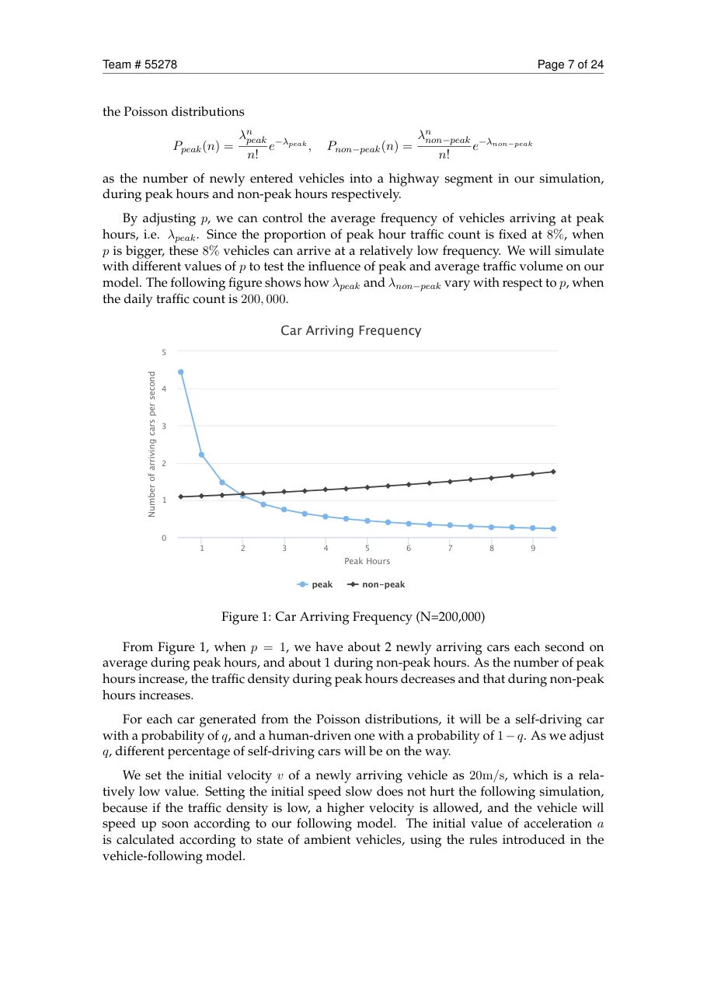
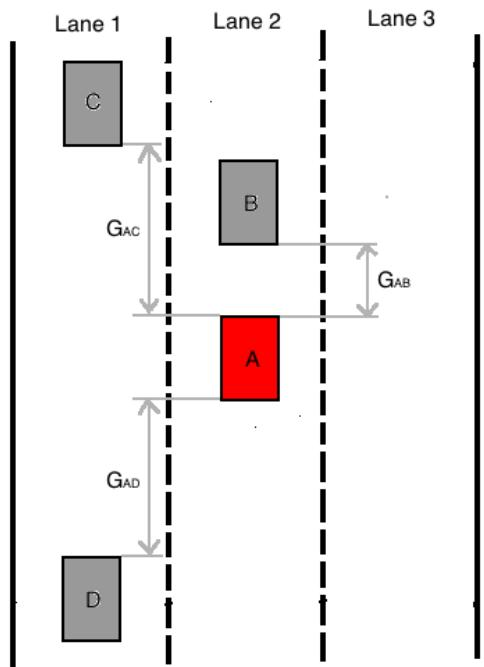

# 2017年美国大学生数学建模竞赛C题O奖论文：自动驾驶合作车辆对高速公路交通容量的影响

原件为竞赛论文。补充：文中的阅读练习及“参考解答”为整理时增加，原件图文保留出处。

## Summary

We propose an innovative model based on cellar automata to analyze the effects of self-driving cooperating vehicles on highway traffic capacity. We extend the traditional cellar automata used for traffic analysis to increase the flexibility of our model, so that it can deal with complex dynamics of self-driving vehicles.

Based on the extended cellar automata, we first model the car generation process using Poisson distributions. This model generates specified volume of vehicles on a segment of highway. Our car generation model distinguishes the traffic volumes during peak hours and nonpeak hours. Then we model the behaviors of vehicle-following and lane-changing. In this part, we consider the cooperation between self-driving vehicles and interaction between self-driving and human-driven vehicles. Finally, we propose a probability model to analyze the behavior of traffic flow at highway intersections.

We verify the feasibility of our model by running various simulations. Our model is tested with different percentages of self-driving cars, different lane numbers and traffic volumes. We find that self-driving cars can stabilize the performance of traffic system when the lane number and traffic volume change.

Then we apply our model to the data of four highways in the Greater Seattle area. Our results show that the traffic capacity increases with rising percentage of self-driving cooperating vehicles. The average velocity of traffic flow doubles when the percentage increasing from 10% to 50%. And in most cases an equilibria exists after 60%. We also test the effects of dedicated lanes for self-driving cars. We suggest using 70% as a dividing point for whether to use dedicated lanes or not. When the percentage of self-driving vehicles is higher than 70% percent, dedicated lanes can be helpful. We also compare the performance during peak hours with average performance during a whole day, and find that self-driving cars significantly speed up peak-hour traffic flows.

Finally, we analyze the effect of potential error of self-driving system. We find that defects of self-driving system can degrade the benefit to traffic capacity. We also do sensitivity analysis of various parameters, including probability of lane-changing and parameters in the vehicle dynamics, to prove the robustness of our model.

Keywords: traffic capacity; cellar automata; self-driving; cooperating vehicles

## Contents

### 1 Introduction

- 1.1 Literature Review
- 1.2 Assumptions

知识点：[文献综述与研究背景撰写方法](../../../topics/数学建模/wenxian_zongshu.md)、[一般假设及其合理性说明（Assumptions and Justifications）](../../../topics/数学建模/jiaben_shezhi.md)、[数学建模的基本步骤（问题分析、模型假设、建立、求解、检验、推广）](../../../topics/数学建模/jianmo_buzhou.md)

### 2 The Models

- 2.1 Basic Settings of Cellar Automata
- 2.2 Notations
    - 2.2.1 Introducing Acceleration into Cellar Automata
    - 2.2.2 Attributes of a Cell
- 2.3 Generation Model
- 2.4 Vehicle-Following Model
    - 2.4.1 The follower car is Human Driven
    - 2.4.2 Self-Driving Vehicle Follows a Human Driven Vehicle
    - 2.4.3 Following Model For Two Self-Driving Vehicles
- 2.5 Lane-Changing Model
- 2.6 Intersection Model

知识点：[元胞自动机模型（Cellular Automata）及其应用](../../../topics/数学建模/yuanyao_zidongji.md)、[符号说明与术语定义（Nomenclature / Symbols and Definitions）](../../../topics/数学建模/fuhao_shuoming.md)、[数学建模的基本步骤（问题分析、模型假设、建立、求解、检验、推广）](../../../topics/数学建模/jianmo_buzhou.md)

### 3 Analyzing the Model by Simulation

- 3.1 Criteria
- 3.2 Effects of Percentage of Self-Driving Vehicles
- 3.3 Effects of Lane Number
- 3.4 Effects of Dedicated Lanes for Self-Driving Cars
- 3.5 Effects of Traffic Volume

知识点：[元胞自动机模型（Cellular Automata）及其应用](../../../topics/数学建模/yuanyao_zidongji.md)、[敏感性分析方法（Sensitivity Analysis，单参数与多参数变动）](../../../topics/数学建模/minganxing_fenxi.md)、[模型验证方法概述（随机模型与确定性模型验证）](../../../topics/数学建模/moxing_yanzheng.md)

### 4 Apply to the Real Data

- 4.1 Percentage of Self-Driving Vehicles
    - 4.1.1 Average Velocity During a Whole Day
    - 4.1.2 Average Velocity During Peak Hours
    - 4.1.3 Traffic Density
    - 4.1.4 Average Velocity at Intersections
- 4.2 Dedicated Lanes

知识点：[模型参数的确定（基于数据拟合或实验选择）](../../../topics/数学建模/canshu_queding.md)、[敏感性分析方法（Sensitivity Analysis，单参数与多参数变动）](../../../topics/数学建模/minganxing_fenxi.md)、[模型验证方法概述（随机模型与确定性模型验证）](../../../topics/数学建模/moxing_yanzheng.md)

### 5 Sensitivity Analysis

- 5.1 Lane-Changing Probability $P_{c}$
- 5.2 Coefficients $\alpha, \beta$, and $\gamma$ in Vehicle Following Model
- 5.3 Error of Self-Driving Systems

知识点：[敏感性分析方法（Sensitivity Analysis，单参数与多参数变动）](../../../topics/数学建模/minganxing_fenxi.md)、[模型参数的确定（基于数据拟合或实验选择）](../../../topics/数学建模/canshu_queding.md)、[参数合理性验证](../../../topics/数学建模/canshu_heli_xing.md)

### 6 Conclusion

知识点：[模型优缺点分析（Strengths and Weaknesses）](../../../topics/数学建模/youque_dian.md)、[数学建模的基本步骤（问题分析、模型假设、建立、求解、检验、推广）](../../../topics/数学建模/jianmo_buzhou.md)、[文献综述与研究背景撰写方法](../../../topics/数学建模/wenxian_zongshu.md)

### 7 The Letter

## 1 Introduction

Self-driving is a technology with growing importance in these years. 2016 is the tipping point for excitement in self-driving cars. In October Tesla announced that all of its new vehicles now had the hardware to drive fully autonomously. All that's left is developing the software. Also, as mobile communication becomes ubiquitous, it is easy to build connections among self-driving vehicles to form cooperative driving systems.

Nowadays traffic jam almost disturbs the daily life of every urban citizen. The arising of self-driving cooperating vehicles has long been a hope to increase the traffic capacity without enlarging the roads, since these vehicles have more accurate control, better sense and prediction of the behavior of ambient vehicles than human-driven ones. In this paper, we make a quantitative and qualitative analysis of the impact on traffic capacity of these newly emerging vehicles.

We establish a traffic flow model based on cellar automata to simulate highway traffic flow. We extend the traditional cellar automata to taking into account acceleration values of vehicles. This extension brings much flexibility when modeling the traffic flow, and enable us to test the impact of more detailed control rules for self-driving cooperating cars.

Our model can be divided into four parts. First, we propose a traffic generation model based on Poisson distributions. This model captures variance of traffic counts during peak travel hours and the non-peak hours. Then, we model the behavior of vehicle-following, which defines how a car acts according the car running before it. Different rules are applied to distinguish the cooperation between two self-driving cars, and interactions between self-driving and human-driven cars. Then, we design a lane-changing model for vehicle movement across lanes. Finally, we build an intersection model to describe how vehicles change from one highway to another through interchanges.

Then we analyze the feasibility of our model by running simulations with different percentage of self-driving vehicles, different number of lanes and different daily traffic volumes. Under all these simulations our model produces reasonable results, which is consistent with the properties of self-driving vehicles.

After that we apply the provided data. We analyze how the highway capacity changes with the percentage of self-driving cars. Results shows that a equilibria exists at around 50% to 70%. We also study the effect of dedicated lanes for self-driving vehicles, and propose a strategy to allocate such lanes.

Finally, we do sensitive analysis on some parameters in our model. We also consider what if self-driving systems are not perfect. In other words, these autonomous vehicles may not mature enough and new risk can be introduced. We simulate the inaccuracy of a self-driving system by random acceleration and deceleration with a small probability. Results shows that such inaccuracy can degrade the benefit of self-driving vehicles.

知识点：[元胞自动机模型（Cellular Automata）及其应用](../../../topics/数学建模/yuanyao_zidongji.md)、[模型参数的确定（基于数据拟合或实验选择）](../../../topics/数学建模/canshu_queding.md)、[敏感性分析方法（Sensitivity Analysis，单参数与多参数变动）](../../../topics/数学建模/minganxing_fenxi.md)

### 1.1 Literature Review

Using cellar automata to analyze traffic flow is widely used by many researchers[1, 2]. This approach has been proved effective to analyze real traffic flow data, and it's easy to implement. However, none of them consider the scenario with self-driving cars. Their human-driven models lack flexibility to adapt to self-driving vehicles.

On the other hand, studies of self-driving vehicles start up just in recent years. Most of the researches are done by using continuous models with complex simulation softwares, and focus on the dynamics of self-driving vehicles and the interactions of several vehicles[3, 4]. But how self-driving technology will influence an entire highway traffic flow is still not answered.

Some researchers in civil and environmental engineering believe that self-driving technology can increase highway capacity and reduce air pollution[5]. But they didn't provide quantitative analysis.

In this paper, we propose a brand new cellar automata system which models the impact of self-driving vehicles on highway traffic flow. We extend the traditional traffic flow methods by adding dynamics of self-driving vehicles. We analyze our model with simulations and successfully verify its feasibility. Finally we apply our model to real data and provide constructive advice on traffic management for self-driving cars.

知识点：[文献综述与研究背景撰写方法](../../../topics/数学建模/wenxian_zongshu.md)、[模型优缺点分析（Strengths and Weaknesses）](../../../topics/数学建模/youque_dian.md)、[数学建模的基本步骤（问题分析、模型假设、建立、求解、检验、推广）](../../../topics/数学建模/jianmo_buzhou.md)

### 1.2 Assumptions

- Each highway is a straight line without bending.
- Self-driving cars can communicate real time data with each other, including velocity and acceleration.
- Self-driving cars do not need response time to take action as human drivers do.
- Human driven vehicles do not communicate with any other vehicle.
- The width of each lane is only enough for one single vehicle.
- All vehicles are in the same size.
- A car change to another highway through interchanges in intersections, without crossing any traffic flow.
- All human-driven cars are identical and all self-driving cars are identical.

## 2 The Models

知识点：[一般假设及其合理性说明（Assumptions and Justifications）](../../../topics/数学建模/jiaben_shezhi.md)

### 2.1 Basic Settings of Cellar Automata

Cellar Automata has been a widely used model for traffic flow analysis[1]. The road is divided into cells, each cell can have one car or no car on it. A cell also records the current velocity of the car on it, if any. In cellar automata, positions, time, velocity and acceleration are all discrete. The state of a cell is updated according to its current state and current states of its surrounding cells. We apply different updating rules to distinguish the behaviors of self-driving and human-driven cars in our models.

# 2017年美国大学生数学建模竞赛C题O奖论文：自动驾驶合作车辆对高速公路交通容量的影响（习题）

本文档整理自《2017年美国大学生数学建模竞赛C题O奖论文》第3部分（共8部分），由识别工具读取并整理为Markdown格式，修正了明显的OCR错误及排版问题。

## 一、符号说明

知识点：[元胞自动机模型（Cellular Automata）及其应用](../../../topics/数学建模/yuanyao_zidongji.md)

### 符号表

| Symbol | Meaning |
| :--- | :--- |
| $s$ | An indicator representing the car type on a cell |
| $v$ | Current velocity of a car |
| $v_{\text{new}}$ | The newly updated value of $v$ after each iteration |
| $a$ | Current acceleration of a car |
| $a_{\text{new}}$ | The newly updated value of $a$ after each iteration |
| $N$ | Daily traffic count of a highway segment |
| $n$ | Newly arriving vehicles in a highway segment in one second |
| $p$ | Number of peak hours. |
| $q$ | Percentage of self-driving cars |
| $G$ | Distance between two cars in the vehicle-following model |
| $v_p$ | Speed of the preceding vehicle in vehicle-following model |
| $a_p$ | Acceleration of preceding car in vehicle-following model |
| $T_r$ | Response time for a human driver to take action |
| $V_{min}$ | Minimum velocity allowed on a highway |
| $V_{max}$ | Maximum velocity allowed on a highway |
| $\lambda_{peak}$ | Rate parameter of Poisson distribution for car generation during peak hours |
| $\lambda_{non-peak}$ | Rate parameter of Poisson distribution for car generation during non-peak hours |
| $T_{rh}$ | Response time for a human driver |
| $T_{rs}$ | Response time for a self-driving car |
| $T_{\text{inter}}$ | Time needed to transfer from one highway to another through an interchange |
| $\mu_{ij}$ | Probability of Crossing Interchanges in Intersection Model |
| $P_a$ | Acceleration probability when $G > G_S$ |
| $P_d$ | Deceleration probability when $G > G_S$ |
| $P_c$ | Probability of lane-changing |
| $\alpha, \beta, \gamma$ | Coefficients in vehicles following rules (See 2.4.2 and 2.4.3 for details) |

## 二、元胞自动机中的加速度引入

知识点：[元胞自动机模型（Cellular Automata）及其应用](../../../topics/数学建模/yuanyao_zidongji.md)、[模型参数的确定（基于数据拟合或实验选择）](../../../topics/数学建模/canshu_queding.md)、[数学建模的基本步骤（问题分析、模型假设、建立、求解、检验、推广）](../../../topics/数学建模/jianmo_buzhou.md)

### 2.2.1 Introducing Acceleration into Cellar Automata

Most cellar automata used for traffic analysis, however, only consider the velocity of vehicles[1, 2, 6], without considering accelerations. Whenever the velocity changes, it can only increase or decrease by a fixed value. This is nature for human-driven cars, since human drivers have no accurate data about the behavior of ambient vehicles, they tend to be careful. Also, a human driver has no accurate perception of acceleration, so a cellar automata considering only velocity of cars is enough.

However, researchers of self-driving use acceleration as an important variable in their analysis[3, 7, 8]. In the case of self-driving cooperating vehicles, a fixed acceleration can be a limitation due to their self-driving and cooperating properties.

*   **Self-Driving:** Autonomous vehicles are often equipped with accurate sensors[9], complex control system and even artificial intelligence technology. They can control acceleration accurately. Thus they can steer more flexibly and fearlessly than human-driven ones.
*   **Cooperating:** These vehicles can share data including their current acceleration[4], and with these data, they can take more accurate actions to avoid collision as well as make full use of the space of highway. Considering acceleration in our model make more complex cooperating rules possible.

Thus, we extend the traditional cellar automata traffic flow model by adding acceleration as an attribute of a cell.

知识点：[元胞自动机模型（Cellular Automata）及其应用](../../../topics/数学建模/yuanyao_zidongji.md)、[一般假设及其合理性说明（Assumptions and Justifications）](../../../topics/数学建模/jiaben_shezhi.md)

### 2.2.2 Attributes of a Cell

In our model, a cell represent a 4 meter long space on a single lane, and each cell can only contain one car at a time. A cell has three attributes,

1.  An integer $s$ ranging from 0 to 2 (inclusive) to represent the car type. 0 for no car, 1 for human-driven, and 2 for self-driving.
2.  Current velocity $v$ a car.
3.  Current acceleration $a$ of a car.

Only when $s$ is non-zero does the other two attributes make sense.

In each step of the simulation, a car moves forward by $v$ cells, and $v$ is updated by adding $a$ and bounded by $V_{min}$ and $V_{max}$, the speed limitations of highway. Rules are applied to update $a$ according to the states of surrounding cells. For human-driven and self-driving vehicles we have different rules. Specific updating rules are introduced in following sections.

## 三、生成模型

知识点：[元胞自动机模型（Cellular Automata）及其应用](../../../topics/数学建模/yuanyao_zidongji.md)

### 2.3 Generation Model

We need a model to generate cars for each highway segment. Poisson distribution is appropriate for this task[10]. It expresses the possibility of number of events occurring in a fixed interval of time. Instead of using one Poisson distribution for all time during the day, we use two for peak hours and non-peak hours respectively. Our generation model also controls the percentage of self-driving cars on the way.

Assuming that there are $p$ peak hours in a day and $8\%$ of the daily traffic volume occurs during peak travel hours. With the data of daily vehicle counts, we can calculate the average number of newly arriving cars in one second in each highway segment.

$$
\lambda_{peak} = \frac{0.08 N}{3600 p}, \quad \lambda_{non-peak} = \frac{0.92 N}{3600 (24 - p)}
$$

Suppose the arrival of vehicles follows Poisson distribution, then $\lambda_{peak}$ and $\lambda_{non-peak}$ are unbiased estimation for the rate parameters. Thus each second we can sample from

# 2017年美国大学生数学建模竞赛C题O奖论文：自动驾驶合作车辆对高速公路交通容量的影响

本部分整理自《2017年美国大学生数学建模竞赛C题O奖论文》第8-9页，主要涉及车辆到达模型、跟驰模型及人类驾驶员行为规则。

## 一、车辆到达与初始化参数

知识点：[模型参数的确定（基于数据拟合或实验选择）](../../../topics/数学建模/canshu_queding.md)、[数学建模的基本步骤（问题分析、模型假设、建立、求解、检验、推广）](../../../topics/数学建模/jianmo_buzhou.md)

### 小节 1：车辆到达分布

在仿真中，进入高速公路路段的新车数量分别服从峰值时段和非峰值时段的泊松分布：

$$
P_{peak}(n) = \frac{\lambda_{peak}^n}{n!} e^{-\lambda_{peak}}, \quad P_{non-peak}(n) = \frac{\lambda_{non-peak}^n}{n!} e^{-\lambda_{non-peak}}
$$

通过调整参数 $p$，可以控制峰值时段车辆的平均到达频率 $\lambda_{peak}$。由于峰值时段交通量占比固定为 $8\%$，当 $p$ 增大时，这 $8\%$ 的车辆将以相对较低的频率到达。我们将模拟不同的 $p$ 值，以测试峰值和平均交通量对模型的影响。下图展示了当日交通总量为 200,000 时，$\lambda_{peak}$ 和 $\lambda_{non-peak}$ 随 $p$ 的变化情况。

 峰值与非峰值时段车辆到达率随参数 p 的变化关系

从图中可以看出，当 $p=1$ 时，峰值时段平均每秒约有 2 辆新车到达，而非峰值时段约为 1 辆。随着峰值时段数量的增加，峰值时段的交通密度降低，而非峰值时段的交通密度增加。

知识点：[一般假设及其合理性说明（Assumptions and Justifications）](../../../topics/数学建模/jiaben_shezhi.md)、[模型参数的确定（基于数据拟合或实验选择）](../../../topics/数学建模/canshu_queding.md)、[参数合理性验证](../../../topics/数学建模/canshu_heli_xing.md)

### 小节 2：车辆类型与初始状态

对于每个由泊松分布生成的车辆，它以概率 $q$ 成为自动驾驶汽车，以概率 $1-q$ 成为人工驾驶汽车。通过调整 $q$，可以改变道路上自动驾驶汽车的百分比。

我们设定新到达车辆的初始速度 $v$ 为 $20 \mathrm{m/s}$，这是一个相对较低的值。设置较低的初始速度不会影响后续仿真，因为如果交通密度较低，允许较高的速度，且车辆会根据后续的跟随模型迅速加速。初始加速度 $a$ 根据周围车辆的状态计算得出，使用车辆在跟随模型中介绍的规则。

## 二、车辆跟随模型

车辆跟随模型定义了同一车道上两辆车的行为，即前车（preceding car）和后车（follower car）。该模型定义了后车如何根据前车的状态改变其速度和加速度。我们考虑三种不同情况：

1. 后车是人工驾驶的。
2. 后车是自动驾驶的，且前车是人工驾驶的。
3. 两车都是自动驾驶的。

在每种情况下，我们都定义了一条规则来更新后车的速度和加速度。

知识点：[任务分解与目标明确](../../../topics/数学建模/renwu_fenjie.md)、[一般假设及其合理性说明（Assumptions and Justifications）](../../../topics/数学建模/jiaben_shezhi.md)、[动态规划求解（状态变量、决策变量、状态转移函数、值函数）](../../../topics/数学建模/dongtai_guihua.md)

### 2.4.1 后车为人工驾驶

当后车为人工驾驶时，驾驶员只能尝试与前车保持安全距离，因为人类驾驶员在反应时间上比自动驾驶汽车长，当前车突然减速时需要更长的反应时间。这里给出人工驾驶后车的安全距离公式：

$$
G_S = T_{rh} v
$$

其中 $T_{rh}$ 代表人类驾驶员的反应时间。根据“两秒规则”[11]，$T_{rh} = 2s$ 是一个合适的设置，将在我们的仿真中使用。

由于担心潜在的人为错误，人类司机在变速时往往比较谨慎。因此，他们的加速度是一个固定值。在每一秒内，他们可以将速度增加或减少一个单位，这也是之前基于元胞自动机的交通流分析所采用的惯例。

因此，人工驾驶汽车的行为可以分为两种情况：

- 当当前距离 $G \leq G_S$ 时，驾驶员减速。
- 当 $G > G_S$ 时，驾驶员以概率 $P_a$ 加速，以概率 $P_d$ 减速，否则保持速度不变。这里 $P_a + P_d \leq 1$。$P_a$ 和 $P_d$ 的具体数值将在后面指定。

当减速时，速度减 1，即 $v_{new} = \operatorname*{max}(V_{min}, v - 1)$。当加速时，速度加 1 并受限于高速公路的最大速度，即 $v_{new} = \operatorname*{min}(v + 1, V_{max})$。

最后，让我们指定 $P_a$ 和 $P_d$ 的值。当汽车高速行驶时，人类驾驶员倾向于减速。因此，随着当前速度 $v$ 的增加，$P_a$ 减小而 $P_d$ 增加。每个单元格长度为 4 米，允许的最大速度为 60 英里/小时，约合每秒 7 个单元格。下表显示了不同 $v$ 值下的 $P_a$ 和 $P_d$ 值。

## 2.4.2 Self-Driving Vehicle Follows a Human Driven Vehicle

Even if self-driving vehicle cannot communicate with the preceding human driver, their sensors can still detect the real time velocity of human-driven car and make a reaction immediately. Thus the response time is much shorter than a human driver. The safe distance in this case is still measured by $G _ { S } = T _ { r s } v$, but here $T _ { r s }$ can take a smaller value than the human response time $T _ { r h }$. We’ll use $T _ { r s } = 1 \text{ s}$ in our simulation.

Unlike human drivers, self-driving cars equipped with accurate controller have large flexibility in the control of acceleration, they can adjust their acceleration value constantly. In every second, we have the updating rules for its velocity and acceleration

$$
v _ {\text { new }} = \left\{ \begin{array} { l l } { \min ( V _ { \max } , v + a ) , } & { a \geq 0 } \\ { \max ( V _ { \min } , v + a ) , } & { a < 0 } \end{array} \right.
$$

$$
a _ { \mathrm { new } } = \alpha ( G - G _ { S } ) + \beta ( v _ { p } - v )
$$

The acceleration of a self-driving car depends on the current distance $G$, safe distance $G _ { S }$, current velocity $v$ and velocity of the preceding vehicle $v _ { p }$. $\alpha$ and $\beta$ are positive coefficients depicting how much the acceleration depends on $( G - G _ { S } )$ and velocity difference $( v - v _ { p } )$. When $G$ is greater than $G _ { S }$, the distance is too large thus an acceleration is favorable. Conversely when $G < G _ { S }$ the car should slow down. The second term $\beta ( v _ { p } - v )$ favors acceleration when the self-driving car is slower than preceding human-driven car, and deceleration when it is faster.

知识点：[一般假设及其合理性说明（Assumptions and Justifications）](../../../topics/数学建模/jiaben_shezhi.md)、[模型参数的确定（基于数据拟合或实验选择）](../../../topics/数学建模/canshu_queding.md)

### 2.4.3 Following Model For Two Self-Driving Vehicles

When both vehicles are self-driving, they can communicate velocity and acceleration constantly. They still need a safe distance $G _ { S } = T _ { r s } v$. Since two cooperating cars can communicate, the follower car can get the accurate real time acceleration of preceding car $a _ { p }$. Taking $a _ { p }$ into account when updating the acceleration provides further flexibility for a self-driving car.

The updating rules[3] for the follower car are

$$
v _ {\text { new }} = \left\{ \begin{array} { l } { \min ( V _ { \max } , v + a ) , a \geq 0 } \\ { \max ( V _ { \min } , v + a ) , a < 0 } \end{array} \right.
$$

$$
a _ { \mathrm { new } } = \alpha ( G - G _ { S } ) + \beta ( v _ { p } - v ) + \gamma a _ { p }
$$

Adding the term $\gamma a _ { p }$, when the preceding car wants to accelerate $( a _ { p } > 0 )$ or decelerate $( a _ { p } < 0 )$, the follower car will immediately take corresponding action. Thus this rule makes use of the communication between two self-driving cooperating cars.

知识点：[数学建模的基本步骤（问题分析、模型假设、建立、求解、检验、推广）](../../../topics/数学建模/jianmo_buzhou.md)、[确定模型的定点与稳定性分析](../../../topics/数学建模/dingdian_wending.md)、[模型参数的确定（基于数据拟合或实验选择）](../../../topics/数学建模/canshu_queding.md)

### 2.5 Lane-Changing Model

Besides adjusting its speed and acceleration, each car has a chance to move to the neighboring lane. A lane-changing can happen only when

*   Current distance with the preceding car is less than the safe distance.
*   The cell on the neighboring lane is empty and distances with preceding and follower cars in the neighboring lane are safe.

Formally, in the case of Figure 2, if ${ \cal G } _ { A B } \le { \cal G } _ { S _ { A B } }$, then car A can change to lane 1 when $G _ { A C } > G _ { S _ { A C } }$ and $G _ { A D } > G _ { S _ { A D } }$. Here $G _ { A C }$ is the distance between car $A$ and $C$, and $G _ { A B }$ is the distance between car A and B. $G _ { S _ { A B } } , G _ { S _ { A C } }$ and $G _ { S _ { A D } }$ are safe distances between A and $B$, A and $C$, and A and D respectively. They are defined in the same way as vehicle-following model, according to the categories of the cars.

When only one neighboring lane satisfies the condition, the car changes to that lane with a probability $P _ { c }$. When both left and right lanes satisfies the condition, the car changes to either lane with a probability $P _ { c } / 2$

Lane-changing happens before the velocity and acceleration update in the vehiclefollowing model. After lane-changing, the velocity and acceleration of a vehicle are updated according to the rules in the vehicle-following model.

知识点：[数学建模的基本步骤（问题分析、模型假设、建立、求解、检验、推广）](../../../topics/数学建模/jianmo_buzhou.md)

### 2.6 Intersection Model

Most high way intersections are based on interchanges, a structure that allows highway to pass through the junction without directly crossing any traffic stream. Thus in an intersection, a car in one highway can move to another highway without waiting for a traffic light. We will use cloverleaf interchange in our model, since it is the most widely used one. Figure 3 shows the traffic flow on a cloverleaf interchange. A car in Position A on Lane 2 can move to Position B on Lane 3 or Position C on Lane 4. Similarly, a car can enter Lane 2 from Position D on Lane 3 and Position E on Lane 4. The traffic flow on Lane 1 has a similar interaction with traffic flow on Lane 3 and Lane 4.

Because there’s no crossing through the traffic stream, we can assume the car disappears from one highway and appears on another one after a period of time.

With this assumption, we introduce 8 parameter $\mu _ { i j }$ and $\mu _ { j i }$, for all $i \in \{ 1 , 2 \} , j \in \{ 3 , 4 \}$, to represent the probability of cars moving from Lane i to Lane $j$, and from Lane $j$ to Lane i respectively. Assuming all these movements across the interchange takes time $T _ { \mathrm { inter } }$. We summarize the rules for intersection crossing as follows

*   When a car arrives at the intersection, with probability $\mu _ { i j }$, its movement from Lane i to Lane $j$ starts.
*   If the movement starts and $T _ { \mathrm { inter } }$ seconds pass after that, check if the destination position on Lane $j$ is empty. If so, put the car on that position with its old velocity and update its acceleration with the rules in the vehicle-following model. Otherwise, the car has to wait until the position becomes empty.

The intersection model is simulated by running four cellar automata using vehiclefollowing rules and lane-changing rules, and the intersection rules defined above. Details are deferred to the simulation part.

知识点：[一般假设及其合理性说明（Assumptions and Justifications）](../../../topics/数学建模/jiaben_shezhi.md)、[符号说明与术语定义（Nomenclature / Symbols and Definitions）](../../../topics/数学建模/fuhao_shuoming.md)、[元胞自动机模型（Cellular Automata）及其应用](../../../topics/数学建模/yuanyao_zidongji.md)

### 3 Analyzing the Model by Simulation

We analyze how the highway capacity varies in our model when the percentage of self-driving vehicles, number of lanes and traffic volume change. We run the simulation on a highway segment of 250 cells long, which is 1000 meters. Each simulation runs for a traffic flow of 24 hours, using the generation model to generate vehicles.

The simulation results shows that self-driving vehicles increases the highway capacity. We also compare the effects of self-driving vehicles with other factors.

#### 3.1 Criteria

To evaluate the traffic capacity, we need some criteria. In our simulations, we mainly use average passing time and traffic density.

*   **Whole-Day Average Passing Time**: The average time for a vehicle to pass the 250-cell long highway segment.
*   **Peak-Hour Average Passing Time**: The average time for a vehicle to pass the 250-cell long highway segment during peak hours.
*   **Traffic Density**: Number of vehicles on the 250-cell long highway segment. This value will change with time as the cars run in and out the highway. So for each combination of model parameters, we can obtain a curve of traffic density varying with time. Since the traffic load is a time dependent value, we can further use it to analyze the stability of a traffic flow.

#### 3.2 Effects of Percentage of Self-Driving Vehicles

We run the cellular automata on a highway segment, varying the percentage of self-driving vehicles to observe the change of highway capacity. The highway segment has 3 lanes on both directions. We fixed the daily traffic volume at 100,000, with 50,000 on each direction. The lane-changing probability $P_c = 0.5$. Number of peak hours in the generation model is $p = 1$. We calculate the average time to pass through the highway segment and traffic load. Figure 4 and Figure 5 show the results.

We have following observations when the self-driving percentage increases.

*   **Average passing time reduces**: As the percentage of self-driving vehicles increases, the average passing time during peak hours decreases sharply at first, and reach a equilibria at around 70%. Self-driving vehicles can increase the traffic capacity by more accurate control and cooperating. The benefit is tiny when the percentage of self-driving car is low. Because cooperation is difficult with few self-driving cars on the road.
*   **Peak-hour pressure is alleviated**: Self-driving cars reduce the difference between peak-hour passing time and whole-day passing time. In Figure 4, as the percentage of driving cars increases, the blue curve and black curve get closer. This reveal an important advantage of self-driving cars, that they are flexible enough to deal with peak hours.
*   **The space capacity of highway increases**: In Figure 5, as the percentage of self-driving cars increases, average number of vehicles on the 250-cell highway segment reduces. When self-driving percentage is low, cars on the road moves slowly, as indicated in Figure 4. Thus, traffic jam is easy to arise, which result in many cars being stuck on the road. With more self-driving cars, traffic jam can be relief. Again, the impact of self-driving car is more obvious during peak hours.

#### 3.3 Effects of Lane Number

We run simulations with 3, 4 and 5 lanes on both directions respectively. The daily traffic volume is 100,000, with 50,000 on each direction and number of peak hours $p = 1$. The lane-changing probability $P_c = 0.5$. And the self-driving percentage is 50%.

We also test the effects of lane number with different self-driving percentage. We simulate lane numbers 3, 4 and 5 with self-driving percentage 30% and 70%.

We have two important observations based on Figure 6 and Figure 7.

*   **More lanes can speed up traffic flow**: Both during the whole day and peak hours, adding lanes to the highway shorten the average passing time. This is consistent with our intuition. Because with more lanes on the highway, cars have more freedom to change lane when the current lane is too crowded.
*   **Self-driving reduces the impact of lane number**: Both in Figure 6 and Figure 7, as self-driving percentage increases, the three curves get closer to each other. When most of the cars are self-driving, adding more lanes to the highway make small difference.

#### 3.4 Effects of Dedicated Lanes for Self-Driving Cars

This section we discuss how our model reacts to dedicated lanes for self-driving cars. To test the effects of dedicated lanes, we modify the generation model and lane-changing model.

*   **Generation Model**: When a self-driving car is generated, we put it to one of the dedicated lanes.
*   **Lane-Changing Model**: A self-driving car cannot change to a non-dedicated lane.

With these modifications, run the simulation with 5 lanes on both directions. The daily traffic volume is 100,000, with 50,000 on each direction. The number of peak hours $p = 1$. The lane-changing probability $P_c = 0.5$. We increase the dedicated lanes from 1 to 3 and calculate the average passing time, when self-driving percentage is 30%, 50% and 70% respectively.

From Figure 8 and Figure 9, when the percentage of self-driving vehicles are small, dedicated lanes may hurt the traffic capacity, especially during the peak hours. For example, in Figure 9, when there are only 30% of self-driving cars, 3 dedicated lines results in an average passing time of 80s, which is much slower than other cases.

However, as the percentage of self-driving cars arises, dedicated lane can improve the performance by a little. For example, in Figure 9, when 70% are self-driving, any number of dedicated lanes outperforms no dedicated lane strategy.

#### 3.5 Effects of Traffic Volume

Different daily traffic volume from 100,000 to 500,000 are tested. The traffic volume are distributed to both directions equally. Each direction has 5 lanes. The lane-changing probability $P_c = 0.5$. Fix the number of peak hours $p = 1$. Simulations are done for 30%, 50% and 70% of self-driving cars.

The impact of traffic volume reduces as percentage of self-driving cars increases. Thus self-driving cars can maintain the highway capacity well even when the traffic is quite heavy.

知识点：[元胞自动机模型（Cellular Automata）及其应用](../../../topics/数学建模/yuanyao_zidongji.md)、[敏感性分析方法（Sensitivity Analysis，单参数与多参数变动）](../../../topics/数学建模/minganxing_fenxi.md)、[模型验证方法概述（随机模型与确定性模型验证）](../../../topics/数学建模/moxing_yanzheng.md)

### 4 Apply to the Real Data

We apply our model to the provided data of Interstates 5, 90, and 405, as well as State Route 520. We test how traffic capacity of these roads changes with the percentage of self-driving cars. We also analyze the feasibility of dedicated lanes, and give suggestions based on our analysis.

# 2017年美国大学生数学建模竞赛C题O奖论文：自动驾驶合作车辆对高速公路交通容量的影响（第7部分）

本节整理自《2017年美国大学生数学建模竞赛C题O奖论文：自动驾驶合作车辆对高速公路交通容量的影响》第7部分（对应原稿第17–22页），主要涵盖自动驾驶车辆比例对高速公路容量、速度、密度的影响，专用车道的作用，以及模型的敏感性分析。

## 4.1 Percentage of Self-Driving Vehicles

知识点：[模型参数的确定（基于数据拟合或实验选择）](../../../topics/数学建模/canshu_queding.md)、[敏感性分析方法（Sensitivity Analysis，单参数与多参数变动）](../../../topics/数学建模/minganxing_fenxi.md)、[模型验证方法概述（随机模型与确定性模型验证）](../../../topics/数学建模/moxing_yanzheng.md)

### 4.1.1 Average Velocity During a Whole Day

**背景与数据**
在数据表中列出了224个高速公路路段，这些路段属于四条道路：Interstate 5、Interstate 90、Interstate 405 和 State Route 520。对于每个路段及其对应的每日交通量，我们测试了一天内通过该路段的汽车的平均速度 $v_i$ ($i = 1, 2, ..., 224$)。然后，我们通过平均属于该道路的各路段的 $v_i$，计算每条道路的平均速度。

**结论**
*   在每条道路上，随着自动驾驶车辆比例的 increase，平均速度也随之增加。
*   当自动驾驶汽车的比例从 10% 增加到 50% 时，平均速度迅速增加。
*   然而，当比例从 50% 变化到 90% 时，平均速度仅增加了少量。平衡点大约在 80% 处达到。
*   当自动驾驶车辆的比例从 0% 变为 10%，以及从 10% 变为 20% 时，平均速度的增加最为显著。

知识点：[任务分解与目标明确](../../../topics/数学建模/renwu_fenjie.md)、[确定模型的定点与稳定性分析](../../../topics/数学建模/dingdian_wending.md)、[敏感性分析方法（Sensitivity Analysis，单参数与多参数变动）](../../../topics/数学建模/minganxing_fenxi.md)

### 4.1.2 Average Velocity During Peak Hours

**计算方法**
高峰时段每条道路的平均速度采用与 4.1.1 相同的方式计算。

**结论**
*   与全天情况相比，自动驾驶对高峰时段交通流的影响更为显著。
*   所有四条道路的平均速度都随着自动驾驶比例的增加而大幅上升。
    *   例如，当比例从 10% 增加到 50% 时，Route 5 上的平均速度增加了约 10 m/s。
    *   当比例从 50% 增加到 90% 时，平均速度增加了约 5 m/s。
*   平衡点大约在 70% 处达到。

知识点：[模型参数的确定（基于数据拟合或实验选择）](../../../topics/数学建模/canshu_queding.md)、[参数合理性验证](../../../topics/数学建模/canshu_heli_xing.md)、[模型优缺点分析（Strengths and Weaknesses）](../../../topics/数学建模/youque_dian.md)

### 4.1.3 Traffic Density

**计算方法**
我们计算了四条高速公路的平均交通密度。在模拟 4.1.1 和 4.1.2 时，记录每条道路每秒的交通流量。然后计算每公里每秒的平均车辆数。

**结论**
*   自动驾驶汽车有助于降低每条道路的交通密度。
*   这种影响在高峰时段更为显著。
*   如图15所示，当自动驾驶比例较低时，交通密度迅速下降。
    *   从 10% 到 50%，交通密度减少了一半。
    *   而从 50% 到 90%，没有显著变化。
*   平衡点大约在 50% 处达到。

知识点：[问题重述与分析（Problem Restatement and Analysis）](../../../topics/数学建模/wenti_chongshu.md)、[模型参数的确定（基于数据拟合或实验选择）](../../../topics/数学建模/canshu_queding.md)、[模型优缺点分析（Strengths and Weaknesses）](../../../topics/数学建模/youque_dian.md)

### 4.1.4 Average Velocity at Intersections

**模型设置**
我们将交叉口模型应用于 Interstate 5 高速公路里程桩号 152.72 到 155.18 处的交通流模拟，此处与 Interstate 405（里程桩号 0 到 0.09）相交。

*   我们计算了整个白天车辆的平均速度。
*   在 Interstate 5 上经过里程桩号 152.72 到 155.18 的车辆，或在 Interstate 405 上经过里程桩号 0 到 0.09 的车辆，可能会也可能不会穿过互通立交，交叉口模型中的所有概率均为 50%。
*   我们将穿过互通立交的时间 $T_{inter}$ 设置为 10秒。

**结论**
得到的结果与直线段的结果相似。

## 4.2 Dedicated Lanes

**分析对象**
我们选择 Interstate 5 的数据来分析专用车道的影响。图17和图18显示了 Interstate 5 在不同数量的自动驾驶专用车道下的平均速度。

**结论**
*   当自动驾驶汽车占比较小比例时，专用车道并不能帮助显著提高平均速度。
*   然而，当大多数车辆是自动驾驶汽车时（例如 70%），专用车道变得必要。

## 5 Sensitivity Analysis

**实验设置**
我们对模型中的一些参数进行了敏感性分析。我们在一个长 250 个单元、有 5 条车道且无专用车道的高速公路路段上进行模拟。每日交通量为 100,000。在此设置下，我们分析了模型中的参数如何影响我们的结论。结果表明，我们的模型相当稳健。

知识点：[模型验证方法概述（随机模型与确定性模型验证）](../../../topics/数学建模/moxing_yanzheng.md)、[敏感性分析方法（Sensitivity Analysis，单参数与多参数变动）](../../../topics/数学建模/minganxing_fenxi.md)、[模型参数的确定（基于数据拟合或实验选择）](../../../topics/数学建模/canshu_queding.md)

### 5.1 Lane-Changing Probability $P_c$

**默认值**
在之前的实验中，$P_c$ 的默认值为 0.5。因此，当两辆车之间的距离 $G$ 小于安全距离 $G_S$ 时，跟随车辆以 50% 的概率变道到另一条车道。

**不同 $P_c$ 的影响**
*   **当 $P_c = 0.2$ 时**：即使车道拥挤，车辆也倾向于保持在同一车道。因此，汽车的平均通行时间较长。
*   **当 $P_c = 0.8$ 时**：车辆频繁变道以利用空闲空间，因此平均通行时间较短。
*   然而，与 $P_c = 0.5$ 的差异很小。

知识点：[参数合理性验证](../../../topics/数学建模/canshu_heli_xing.md)、[敏感性分析方法（Sensitivity Analysis，单参数与多参数变动）](../../../topics/数学建模/minganxing_fenxi.md)

### 5.2 Coefficients $\alpha, \beta,$ and $\gamma$ in Vehicle Following Model

**参数定义**
回顾 $\alpha, \beta$ 和 $\gamma$ 是用于第 2.4.2 和 2.4.3 节中自动驾驶车辆加速度更新的系数。我们的默认设置为 $\alpha = \beta = \gamma = 1$。

加速度更新规则为：
$$
a_{\mathrm{new}} = \alpha (G - G_S) + \beta (v_p - v) + \gamma a_p
$$

*   $\alpha$ 控制加速度在多大程度上依赖于距离。$\alpha$ 越大，跟随车辆越倾向于保持安全距离。
*   $\beta$ 控制相对速度的影响。$\beta$ 越大，跟随车辆越试图赶上 preceding car 的速度。
*   $\gamma$ 控制前车的加速度影响。$\gamma$ 越大，跟随车辆将以前车同步的方式加速。

**测试结果**
我们测试了 $\alpha, \beta$ 和 $\gamma$ 的不同组合。结果显示在图20中。当它们较大时，我们看到交通流有微小的加速效果。

知识点：[模型参数的确定（基于数据拟合或实验选择）](../../../topics/数学建模/canshu_queding.md)、[敏感性分析方法（Sensitivity Analysis，单参数与多参数变动）](../../../topics/数学建模/minganxing_fenxi.md)

### 5.3 Error of Self-Driving Systems

**假设与现实**
在我们的模型中，我们假设自动驾驶汽车是完美的，不会引入任何新的风险。然而，作为一种新兴技术，目前的自动驾驶技术还不够成熟。2016年6月30日，据报道发生了一起致命的特斯拉自动驾驶车祸，司机死亡。因此，有必要测试系统误差如何影响自动驾驶汽车的性能。

**误差模拟**
我们通过使自动驾驶汽车以 10% 的概率加速或减速 1 个单位来引入自动驾驶系统误差。

**结果**
结果显示在图21中。我们可以看到，这种不准确的加速和减速会降低性能，导致与完美自动驾驶系统相比，通行时间更长。

# 2017年美国大学生数学建模竞赛C题O奖论文：自动驾驶合作车辆对高速公路交通容量的影响（习题）

本资料整理自《2017年美国大学生数学建模竞赛C题O奖论文》第8部分，包含结论、参考文献及致官员信函。

## 一、选择题

无

## 二、填空题

无

## 三、简答题

知识点：[模型优缺点分析（Strengths and Weaknesses）](../../../topics/数学建模/youque_dian.md)、[模型验证方法概述（随机模型与确定性模型验证）](../../../topics/数学建模/moxing_yanzheng.md)、[敏感性分析方法（Sensitivity Analysis，单参数与多参数变动）](../../../topics/数学建模/minganxing_fenxi.md)

### 简答 1

**题干：**
根据论文结论，自动驾驶车辆对高速公路容量有何影响？请列出主要发现。

**答案：**
根据论文 Conclusion 部分，主要发现如下：

1. **提高高速公路容量：** 随着自动驾驶汽车比例的增加，交通流以更高的速度运行，且空间密度降低。
2. **专用车道的必要性：** 当自动驾驶汽车比例较低时，不需要专用车道；而当比例高于 70% 时，专用车道可以略微增加容量。
3. **减少车道数和交通量的影响：** 当大多数车辆为自动驾驶时，交通流的速度受车道数量和交通量因素的影响较小。

**知识点：** 自动驾驶对交通的影响

知识点：[任务分解与目标明确](../../../topics/数学建模/renwu_fenjie.md)、[文献综述与研究背景撰写方法](../../../topics/数学建模/wenxian_zongshu.md)

### 简答 2

**题干：**
论文中提出的“致官员的信”（The Letter）中，针对西雅图地区高速公路管理提出了哪些建议？

**答案：**
在 The Letter 部分，基于分析结果，作者提出了以下建议：

1. **普及自动驾驶车辆：** 即使只少量增加也能带来巨大改善。分析显示，当自动驾驶比例从 0% 增加到 50% 时，对交通容量的提升效益最大。由于目前自动驾驶车辆尚不普及，小幅增加数量即可实现显著改善。
2. **不要急于建设专用车道：** 模拟表明，只有当自动驾驶汽车比例足够高（例如 70%）时，专用车道才有帮助。分配专用车道会增加成本和开销。鉴于目前道路上自动驾驶车辆很少，专用车道甚至可能因使其他人类驾驶车辆的通道过于拥挤而损害交通系统。

**知识点：** 智能交通系统政策

## 四、阅读与理解

知识点：[非技术性文稿撰写（如致世界医学会的信函、新闻发布会声明）](../../../topics/数学建模/fei_jishu_wengao.md)、[数学建模的基本步骤（问题分析、模型假设、建立、求解、检验、推广）](../../../topics/数学建模/jianmo_buzhou.md)、[文献综述与研究背景撰写方法](../../../topics/数学建模/wenxian_zongshu.md)

### 阅读 1

**原文片段：**
> Self-driving vehicles can increase highway capacity. As the percentage of selfdriving cars increases, the traffic flow proceeds with higher velocity, and lower space density.

**理解要点：**
- 自动驾驶车辆的核心优势在于能够以更小的安全间距行驶，从而提高道路的空间利用率。
- 关键指标变化：速度（velocity）上升，空间密度（space density）下降，最终导致容量（capacity）增加。

**知识点：** 交通流基本参数

知识点：[数学建模的基本步骤（问题分析、模型假设、建立、求解、检验、推广）](../../../topics/数学建模/jianmo_buzhou.md)、[任务分解与目标明确](../../../topics/数学建模/renwu_fenjie.md)

### 阅读 2

**原文片段：**
> Dedicated lanes for self-driving cars are not necessary when the percentage of selfdriving cars is low, while dedicated lanes can increase the capacity by a little when the percentage is higher than 70%.

**理解要点：**
- 专用车道的建设存在阈值效应。
- 低渗透率阶段：混合交通流下，专用车道可能导致资源浪费或加剧普通车道拥堵。
- 高渗透率阶段（>70%）：专用车道能发挥协同效应，略微提升整体容量。

**知识点：** 交通设施规划

## 五、参考文献

知识点：[任务分解与目标明确](../../../topics/数学建模/renwu_fenjie.md)、[文献综述与研究背景撰写方法](../../../topics/数学建模/wenxian_zongshu.md)

### 参考 1

**文献信息：**
[1] K. Nagel and M. Schreckenberg, “A cellular automaton model for freeway traffic,” Journal De Physique I, vol. 12, pp. 2221–2229, 1992.

**说明：**
这是元胞自动机模型的基础文献，Nagel-Schreckenberg (NaSch) 模型是本文构建仿真模型的理论基础之一。

**知识点：** 元胞自动机交通模型

知识点：[元胞自动机模型（Cellular Automata）及其应用](../../../topics/数学建模/yuanyao_zidongji.md)

### 参考 2

**文献信息：**
[3] B. Van Arem, C. J. Van Driel, and R. Visser, “The impact of cooperative adaptive cruise control on traffic-flow characteristics,” IEEE Transactions on Intelligent Transportation Systems, vol. 7, no. 4, pp. 429–436, 2006.

**说明：**
该文献研究了协同自适应巡航控制（CACC）对交通流特性的影响，支持了文中关于车辆间通信和协同控制能减少碰撞风险、提高速度的论点。

**知识点：** 协同自适应巡航控制

知识点：[文献综述与研究背景撰写方法](../../../topics/数学建模/wenxian_zongshu.md)

### 参考 3

**文献信息：**
[7] P. Tientrakool, Y.-C. Ho, and N. F. Maxemchuk, “Highway capacity benefits from using vehicle-to-vehicle communication and sensors for collision avoidance,” in Vehicular Technology Conference (VTC Fall), 2011 IEEE. IEEE, 2011, pp. 1–5.

**说明：**
该研究强调了车联网（V2V）通信和传感器在避免碰撞方面的作用，这与论文中提到的“消除潜在碰撞”、“同步动作”相吻合。

**知识点：** 车联网通信

知识点：[文献综述与研究背景撰写方法](../../../topics/数学建模/wenxian_zongshu.md)
