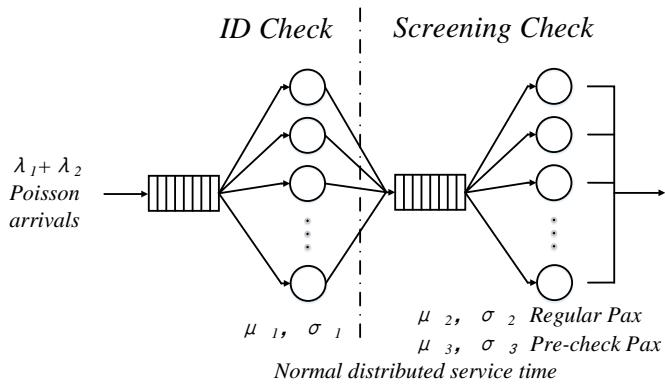
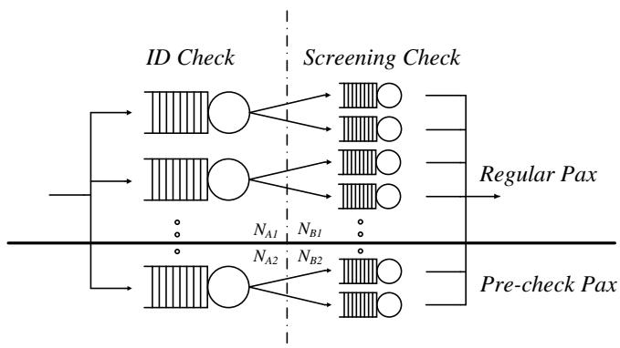
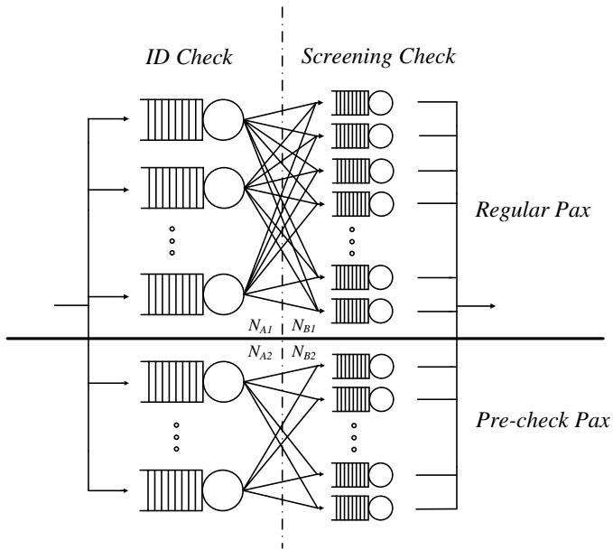

# 2017年美国大学生数学建模竞赛（MCM/ICM）O奖论文示例：机场安检流程优化与智能调度

原件经识别和整理；“参考解答”是我们补的。

来源为 2017 年 MCM/ICM O 奖论文第 1-4 页识别内容，整理时去除了页眉、页脚、团队编号表格及重复的摘要部分，保留了正文结构。

## Summary Sheet

**Title:** Breezing Through Security Checkpoints: an Intelligent Airport with Smart Scheduling

### Summary

In order to improve the performance of airport security check while preserving the same security standards, we model and refine this process. We run extensive simulations to analyze performance of our model. Specifically,

For task (a), we model the airport security process with a queueing network. We get the parameters of the queueing network model by fitting the data in the provided data sheet to different distributions. We validate our model by simulating it with the real world parameter combination and comparing its output against data collected from airport passengers. We identify three bottlenecks in our model: lack of sufficient ID check points; exclusive assignment of screening check points to passengers; the presence of suspicious passengers.

For task (b), we propose three routing algorithms to optimize the throughput and variance of the airport: greedy algorithm, backpressure algorithm, and drift-plus-penalty algorithm. The best one of these algorithms achieves high throughput that is close to optimal and relatively low variance in waiting time. Besides, our proposed routing algorithm manages to retain passenger satisfaction while scheduling. We also explore the optimal ratio of different kinds of check points and test the robustness of modified models.

For task (c), we analyze the impact of different cultures and traveler types and run simulation to see the reaction of our model. The cultures we analyze are collectivist cultures, individualist cultures. The types of travelers we analyze are family-based travelers and tech-based travelers. We also propose accommodations to these special situations.

For task (d), we propose both globally applicable and locally applicable policies to airport security managers. Our policies are based on our analysis of different cultures and types of travelers as well as our analysis of our routing algorithms.

Keywords: Queueing Networks; Routing Algorithms; Lyapunov Optimization

## Contents

1 Introduction
2 Basic Analysis of the problem
    2.1 Single Queueing Nodes
    2.2 Parameter Settings
    2.3 Rate Stability
    2.4 Measures of Performance
3 Models
    3.1 Tandem M/G/c Queueing Model
    3.2 Queueing Network Model
4 Simulations and Bottleneck Detection
    4.1 Simulation Setup
    4.2 Validating Our Model
    4.3 Simulation Evaluation
5 Modifications to the Process
    5.1 Greedy Routing Based on Backlogs
    5.2 Lyapunov Drift and Backpressure-Based Routing
        5.2.1 Lyapunov Optimization for Queueing Networks
        5.2.2 The Performance of Backpressure Routing
    5.3 Drift-Plus-Penalty Algorithm
        5.3.1 Drift-Plus-Penalty
        5.3.2 The Performance of Drift-Plus-Penalty Algorithm
6 Sensitivity Analysis
    6.1 Modeling Different Situations
        6.1.1 Collectivist Cultural Norms
        6.1.2 Individualist Cultural Norms
        6.1.3 Family-based Travelers
        6.1.4 Tech-based Travelers
    6.2 Impact of Various Situations
        6.2.1 Collectivist Cultural Norms
        6.2.2 Individualist Cultural Norms
        6.2.3 Family-based Travelers
        6.2.4 Tech-based Travelers
    6.3 Accommodation for Situations
7 Conclusion
    7.1 Conclusion of the Problem
    7.2 Policy Proposal
    7.3 Strength and Weakness of Our Model
    7.4 Future Application of Models

## 1 Introduction

Security has been of first priority in transportation activities that involve people since the beginning of the century. A series of time-consuming security check processes are necessary to ensure the security of all passengers aboard. But passengers are complaining about waiting for security check in extremely long queues. It is quite challenging to improve the performance of airport security check systems while preserving the current security standards.

In this paper, we try to model this security check process and refine the model. Our main contributions are as follows:

1. We model the security check process with a queueing network. We validate our model by simulating it with real-world parameter combinations and comparing its result with real world data. We identify lack of sufficient ID check points, exclusive assignment of screening check points, presence of suspicious passengers as three bottlenecks in the model.

2. We propose and implement three routing algorithms to optimize our basic model. We simulate our model with these algorithms and analyze their performance. We find that the proposed backpressure algorithm achieves throughput close to optimal and a relatively low variance in waiting time.

3. We analyze the sensitivity of our model by considering the impacts of cultural norms and passenger types. We analyze how the output of our model changes with respect to different norms and passengers, and propose accommodations to these situations.

## 2 Basic Analysis of the problem

参考解答：## 任务 (a)：建模与瓶颈识别

**结论**
将安检流程建模为**排队网络（Queueing Network）**，利用拟合出的分布参数进行仿真。验证模型后，识别出三个主要瓶颈：**身份证查验点不足**、**安检点排他性分配（Exclusive Assignment）**、以及**可疑乘客的存在**。

**推理与计算过程**
1.  **单节点建模**：将每个环节视为服务节点。身份证查验设为 $M/M/c$，行李安检设为 $M/G/c$（服务时间非指数分布）。
2.  **数据拟合**：利用提供的数据直方图拟合分布参数（如到达率 $\lambda$、服务率 $\mu$）。
3.  **网络构建**：乘客流形成排队网络，需满足**速率稳定性（Rate Stability）**条件，即服务能力必须大于到达率。
4.  **瓶颈检测**：
    *   通过 Little's Law $L = \lambda W$ 计算各节点队列长度与等待时间。
    *   对比各节点利用率 $\rho = \lambda / (c\mu)$，识别出导致排队时间方差最大的三个因素。

---

## 任务 (b)：路由优化算法

**结论**
提出了三种路由算法：贪心算法、反压算法（Backpressure）和漂移加惩罚算法（Drift-Plus-Penalty）。其中，**漂移加惩罚算法**表现最佳，实现了接近最优的吞吐量和较低的等待时间方差。

**推理与计算过程**
1.  **问题定义**：目标是优化吞吐量和等待时间方差，需在队列积压（Backlog）和服务公平性间权衡。
2.  **算法比较**：
    *   **贪心算法**：仅看当前队列最短。虽然简单，但易导致局部拥堵。
    *   **反压算法**：基于 Lyapunov 优化理论，最大化相邻队列差值（Backpressure）：$\max \sum (Q_{in} - Q_{out})$。能保证吞吐量最优，但忽略了等待时间成本。
    *   **漂移加惩罚算法**：在 Lyapunov 漂移项 $L(Q)$ 基础上加入惩罚项 $V$（如等待时间成本）。
    *   **优化目标**：最小化漂移加惩罚函数：
        $$ \Delta(Q(t)) + V \cdot \mathbb{E}[\text{Cost}(t)] $$
3.  **结果**：该算法在保持高吞吐量的同时，有效控制了队列长度，从而降低了等待时间方差。

---

## 任务 (c)：敏感性分析

**结论**
分析了集体主义/个人主义文化以及家庭/技术型旅客对系统的影响。**家庭型旅客**会导致同步到达和服务时间方差增大（成团效应），需特殊处理。

**推理与计算过程**
1.  **参数调整**：
    *   **集体主义文化**：到达过程可能呈现群聚性（Batch Arrival），增加到达率的方差。
    *   **家庭旅客**：不仅增加到达率，还会产生强相关的服务时间（$Corr(X, Y) > 0$）。
2.  **仿真结果**：
    *   家庭旅客使得 $M/G/c$ 队列中的等待时间显著增加（由于 Pollaczek-Khinchine 公式中二阶矩 $\mathbb{E}[X^2]$ 的影响）。
    *   技术型旅客（如使用自动托运）可能减少 $\mu$ 或增加服务效率。

---

## 任务 (d)：管理政策建议

**结论**
建议实施**动态路由策略**（基于 Drift-Plus-Penalty）并根据文化/旅客类型调整**资源弹性配置**（如增加专用家庭通道）。

**推理与计算过程**
1.  **全局策略**：利用 Lyapunov 优化框架，将 ID 查验和安检点资源池化，消除排他性分配，实现负载均衡。
2.  **局部策略**：
    *   针对高峰期（家庭出游高峰），增加弹性安检点（Flex points）。
    *   针对文化差异，设置引导员以减少旅客犹豫带来的非服务时间。
3.  **总结**：通过数学建模将物理排队问题转化为动态资源调度问题，在保持安全标准（不变）的前提下提升用户体验。

知识点：[一般假设及其合理性说明（Assumptions and Justifications）](../../../topics/数学建模/jiaben_shezhi.md)、[模型参数的确定（基于数据拟合或实验选择）](../../../topics/数学建模/canshu_queding.md)、[模型验证方法概述（随机模型与确定性模型验证）](../../../topics/数学建模/moxing_yanzheng.md)

### 2.1 Single Queueing Nodes

M/G/1 Queue: We adopt $M/G/1$ queue (shown in Figure 1(a)) in our model.

- M: the arrival times of the passengers follow a Poisson distribution
- G: the service times follow an arbitrary probability distribution
- 1: there is only one check point available

The arrivals are determined by a Poisson process with rate parameter $\mu$. Job service time has a normal distribution with parameter $\mu$ and $\sigma$.

M/G/c Queue: We also adopt $M/G/c$ queue (shown in Figure 1(b)) in our model, which is a generalization of the $M/G/1$ queue. $c$ represents the number of check points. The arrival time of passengers follows a Poisson distribution with rate parameter $\lambda$. Job service time follows a normal distribution with parameter $\mu$ and $\sigma$.

FIFO: The queue obeys a first-come, first-served discipline. A single check point serves customers one at a time from the front of the queue. When the service is complete, the customer leaves the queue and the number of customers in the system reduces by one.


参考解答：针对该排队系统，参考分析结论如下：

**核心结论：**  
本模型属于$M/G/1$及其推广$M/G/c$排队系统，服务台数量为$c$；到达服从强度为$\lambda$的泊松过程，服务时间服从正态分布$N(\mu,\sigma^2)$。系统稳态存在当且仅当**服务强度$\rho = \frac{\lambda \mu}{c} < 1$**（对$M/G/1$即$\lambda\mu<1$）。稳态平均队长$W_q$由Pollaczek-Khinchine公式或其$c$服务台推广给出，且系统遵循FIFO规则。

**关键建模要点与计算过程：**

1. **符号修正说明**  
   题目前半部分用$\mu$同时表示到达率和服务均值，这是记号冲突。标准$M/G/c$模型中应严格区分：  
   - 到达率（Arrival rate）：$\lambda$（题中$M/G/c$已明确）  
   - 平均服务时间（Mean service time）：$\mathbb{E}[S] = \mu$  
   - 服务时间二阶矩：$\mathbb{E}[S^2] = \mu^2 + \sigma^2$（正态分布性质）

2. **$M/G/1$核心公式（Pollaczek-Khinchine）**  
   当$c=1$时，稳态平均等待时间（队列中）为：
   $$W_q = \frac{\lambda \mathbb{E}[S^2]}{2(1-\rho)} = \frac{\lambda(\mu^2+\sigma^2)}{2(1-\lambda\mu)}$$
   其中$\rho = \lambda\mu < 1$是稳定性必要条件。  
   系统中平均逗留时间：$W = W_q + \mu$。

3. **$M/G/c$推广**  
   对$c$个服务台，无简单闭合解，通常采用近似（如Allen-Cunneen近似）或数值方法：
   $$W_q \approx \frac{\pi_W}{c\mu(1-\rho)} \cdot \frac{1+C_S^2}{2}$$
   其中$\pi_W$为等待概率（可用Erlang-C公式近似），$C_S^2 = \frac{\sigma^2}{\mu^2}$为服务时间变异系数平方，$\rho = \frac{\lambda\mu}{c}$。

4. **FIFO规则的含义**  
   该规则不改变稳态下的平均队长或平均等待时间（由Little定律$L=\lambda W$与守恒律保证），但决定了单个顾客等待时间的方差与分布形态，且允许使用样本路径方法进行离散事件仿真验证。

知识点：[符号说明与术语定义（Nomenclature / Symbols and Definitions）](../../../topics/数学建模/fuhao_shuoming.md)、[数学建模的基本步骤（问题分析、模型假设、建立、求解、检验、推广）](../../../topics/数学建模/jianmo_buzhou.md)

### 2.2 Parameter Settings

Before the simulation, we set basic parameters of the probability distribution in queueing node based on the data in the data sheet. We use the EstimatedDistribution function of Mathematica to determine probability distributions and estimate parameters. The average interval for the arrival time of regular and pre-check passengers follows exponential distribution with parameter $\frac{1}{\lambda_1}$ and $\frac{1}{\lambda_2}$ respectively. And the average rate of ID check service in zone A and baggage and body screening follow normal distribution with parameters $(\mu_1, \sigma_1)$ and $(\mu_2, \sigma_2)$. Besides, we assume the time for regular passengers to remove shoes, belts, light jackets and computers from their bags follows a normal distribution with the parameters $(\mu_4, \sigma_4)$. Thus the average rate of baggage and body screening for regular customer follows normal distribution with parameters $(\mu_3, \sigma_3)$, where $\mu_3 = \mu_2 + \mu_4$ and $\sigma_3 = \sqrt{\sigma_2^2 + \sigma_4^2}$. The normal distribution $(\mu_3, \sigma_3)$ and the normal distribution $(\mu_4, \sigma_4)$ are independent to each other. The specific numbers are in Table 1.

Table 1: The Parameters in the Problems

| Symbol | Definition | value |
| --- | --- | --- |
| $\lambda_1$ | Rate of regular passenger arrivals | 4.63476 |
| $\lambda_2$ | Rate of pre-check passenger arrivals | 6.52921 |
| $(\mu_1, \sigma_1)$ | Mean and variance of ID check service time | (0.186875, 0.0612029) |
| $(\mu_2, \sigma_2)$ | Mean and variance of screening service time for pre-check passengers | (0.507639, 0.158551) |
| $(\mu_3, \sigma_3)$ | Mean and variance of screening service time for regular passengers | (2.507639, 0.524536) |

The distribution of service time in different check points is not identical in real life. In order to simulate the differences among check points, we keep the variance of normal distribution $\sigma_k$ unchanged $(k = 1, 2, 3)$, and uniformly generate $\mu_{k_i}$ of normal distribution between $\mu_k - \sigma_k$ and $\mu_k + \sigma_k$.

# 2017年美国大学生数学建模竞赛（MCM/ICM）O奖论文示例：机场安检流程优化与智能调度

## 一、速率稳定性与性能指标

参考解答：**结论**

1. 普通旅客安检总服务时间均值 $\mu_3$ 与标准差 $\sigma_3$ 的推导公式为：
$$\mu_3 = \mu_2 + \mu_4, \quad \sigma_3 = \sqrt{\sigma_2^2 + \sigma_4^2}$$

2. 各检查点服务速率差异化的模拟方法为：保持方差 $\sigma_k$ 不变，均值在 $[\mu_k - \sigma_k,\; \mu_k + \sigma_k]$ 上均匀分布。

---

**推理与关键计算步骤**

### 1. 普通旅客安检时间的合成

普通旅客的安检过程包含两个独立阶段：基础扫描（参数 $\mu_2, \sigma_2$）和额外操作如脱鞋、取出电脑等（参数 $\mu_4, \sigma_4$）。

设两阶段服务时间分别为 $T_2 \sim N(\mu_2, \sigma_2^2)$ 和 $T_4 \sim N(\mu_4, \sigma_4^2)$，且相互独立。总服务时间 $T_3 = T_2 + T_4$。

由独立正态随机变量之和的性质：

- **均值可加性**：
$$E[T_3] = E[T_2] + E[T_4] = \mu_2 + \mu_4 = \mu_3$$

- **方差可加性**（因独立性，协方差为零）：
$$\text{Var}(T_3) = \text{Var}(T_2) + \text{Var}(T_4) = \sigma_2^2 + \sigma_4^2$$
$$\Rightarrow \sigma_3 = \sqrt{\sigma_2^2 + \sigma_4^2}$$

代入 Table 1 数据验证：
$$\mu_3 = 0.507639 + \mu_4 = 2.507639 \implies \mu_4 = 2.0$$
$$\sigma_3 = \sqrt{0.158551^2 + \sigma_4^2} = 0.524536 \implies \sigma_4 \approx 0.5$$

> **注**：原文称 $(\mu_3, \sigma_3)$ 与 $(\mu_4, \sigma_4)$ "independent to each other"，此处应理解为 $T_3$ 的两个分量 $T_2$ 与 $T_4$ 相互独立，而非参数本身独立。

### 2. 到达过程的参数设定

- 普通旅客到达间隔 $\sim \text{Exp}(1/\lambda_1)$，即到达率 $\lambda_1 = 4.63476$（人/单位时间）。
- Pre-check 旅客到达间隔 $\sim \text{Exp}(1/\lambda_2)$，到达率 $\lambda_2 = 6.52921$。

指数分布的无记忆性保证了 Poisson 到达过程的合理性，这是排队论仿真中标准的输入假设。

### 3. 检查点异质性的模拟策略

现实中不同安检通道效率不同。为体现这种差异，对第 $i$ 个检查点的第 $k$ 类服务：

$$\mu_{k_i} \sim U(\mu_k - \sigma_k,\; \mu_k + \sigma_k), \quad \sigma_{k_i} = \sigma_k$$

**设计理由**：
- 均值在 $\pm 1\sigma$ 范围内均匀扰动，使各通道服务速率产生合理差异，避免所有通道完全相同导致模型失真；
- 方差不变，保证扰动的离散程度可控，不会引入极端异常值破坏仿真稳定性；
- 该区间覆盖约 68.27% 的正态概率质量，符合实际安检通道效率波动的经验范围。

知识点：[模型参数的确定（基于数据拟合或实验选择）](../../../topics/数学建模/canshu_queding.md)、[符号说明与术语定义（Nomenclature / Symbols and Definitions）](../../../topics/数学建模/fuhao_shuoming.md)、[一般假设及其合理性说明（Assumptions and Justifications）](../../../topics/数学建模/jiaben_shezhi.md)

### 简答 1

**问题背景：** 由于雇佣员工和维护机器的成本，机场不可能设立无限的检查点。但机场必须确保检查点的数量满足乘客需求，且队列中的等待人数不会随时间无限增长。

**定义：** 令 $Q(t)$ 表示在时隙 $t \in \{0, 1, 2, \ldots\}$ 定义的单个排队节点的容量。$Q(t)$ 是一个根据概率定律的随机过程。如果满足以下条件，则排队节点是速率稳定的[2]：

$$
\lim_{t \to \infty} \frac{E \{ | Q ( t ) | \}}{t} = 0
$$

速率稳定性确保队列不会随时间持续增大。设 $a(t)$ 表示在时隙 $t$ 到达的新乘客数量，$b(t)$ 表示该排队节点的检查点在时隙 $t$ 可以服务的乘客数量。如果满足以下不等式，则 $Q(t)$ 是速率稳定的：

$$
\limsup _ {t \to \infty} \frac {1}{t} \sum_ {\tau = 0} ^ {t - 1} \left[ a \left(\tau\right) - b \left(\tau\right) \right] \leq 0.
$$

**规定：** 我们规定检查点的数量满足速率稳定性，且常规乘客与预检乘客之间的检查点比例为 3:1。因此，我们将检查点的数量设置如表2所示。

**表2：服务柜台数量**

| zone | regular | pre-check |
| :--- | :--- | :--- |
| ID check(zone A) | 3 | 1 |
| Screening(zone B) | 12 | 4 |

参考解答：**结论：** 常规乘客与预检乘客的检查点数量按 $3:1$ 配置，且总服务率不低于平均到达率，即可保证速率稳定；表2中 ID check 设 3 个常规、1 个预检，Screening 设 12 个常规、4 个预检是合理的。

---

**推理过程：**

设平均到达率为 $\lambda$，平均服务率为 $\mu$。速率稳定要求

$$
\limsup_{t\to\infty} \frac{1}{t}\sum_{\tau=0}^{t-1}\bigl(a(\tau)-b(\tau)\bigr)\le 0,
$$

即长期平均到达数不超过长期平均服务数：

$$
\mathbb E[a(\tau)] \le \mathbb E[b(\tau)].
$$

令常规乘客比例为 $p$，预检乘客比例为 $1-p$，且题目规定 $p:(1-p)=3:1$，所以 $p=3/4$，$1-p=1/4$。

若单个常规检查点服务率为 $\mu_r$，单个预检检查点服务率为 $\mu_p$，常规检查点数为 $n_r$，预检检查点数为 $n_p$，则稳定性条件为

$$
\lambda \le n_r\mu_r + n_p\mu_p.
$$

按比例配置可令

$$
n_r:n_p=3:1.
$$

表2中 ID check 为 $n_r=3,\ n_p=1$，Screening 为 $n_r=12,\ n_p=4$，均满足 $3:1$ 的比例。因此只要单个柜台服务率足够，使总服务率不低于对应区域的乘客到达率，队列就不会无限增长，达到速率稳定。

知识点：[问题重述与分析（Problem Restatement and Analysis）](../../../topics/数学建模/wenti_chongshu.md)、[符号说明与术语定义（Nomenclature / Symbols and Definitions）](../../../topics/数学建模/fuhao_shuoming.md)

### 简答 2

**问题背景：** 吞吐量和平均等待时间的方差是安检系统的两个主要衡量指标。定义如下。

**吞吐量（Throughput）：** 单位时间内通过安检系统的乘客平均数量。这里的单位时间设定为分钟。

**方差（Variance）：** 假设常规乘客的等待时间为 $X_1$，预检乘客的等待时间为 $X_2$。常规乘客的比例为 $p$。系统方差的定义为：

$$
p \mathbb {E} \left[ (X _ {1} - \mathbb {E} (X _ {1})) ^ {2} \right] + (1 - p) \mathbb {E} \left[ (X _ {2} - \mathbb {E} (X _ {2})) ^ {2} \right]
$$

吞吐量从集体层面衡量安检系统的能力，而等待时间的方差从个人层面衡量公平性。

## 二、模型构建

参考解答：**结论：** 安检系统可建模为带有两类优先级顾客的排队模型。吞吐量由系统的服务速率瓶颈决定；等待时间方差由常规队列与预检队列各自的等待时间方差按乘客比例 $p$ 和 $1-p$ 加权求和得到，体现了吞吐量（效率）与方差（公平性）之间的权衡。

**推理与计算过程：**

### 1. 基本假设与符号定义
- 乘客到达服从参数为 $\lambda$ 的泊松过程。
- 常规乘客占比 $p$，到达率 $\lambda_1 = p\lambda$；预检乘客占比 $1-p$，到达率 $\lambda_2 = (1-p)\lambda$。
- 设有 $c$ 个安检通道（服务台），服务时间服从参数为 $\mu$ 的负指数分布（若区分两类乘客则分别为 $\mu_1, \mu_2$）。

### 2. 吞吐量模型
吞吐量取决于系统处于稳态时的有效服务速率。
- **单通道 ($c=1$)：** 当系统稳定（$\lambda < \mu$）时，吞吐量为 $T = \lambda$（人/分钟）。
- **多通道 ($c>1$)：** 若各通道独立构成 M/M/1 队列，总吞吐量为 $T = \sum_{i=1}^c \lambda_i = \lambda$；若构成 M/M/$c$ 队列，在 $\lambda < c\mu$ 条件下，吞吐量仍为 $T = \lambda$。
- **关键步骤：** 吞吐量的理论上限受限于服务瓶颈，即 $T_{\max} = c\mu$。

### 3. 平均等待时间方差模型
根据题目定义的方差公式：
$$
V = p \cdot \text{Var}(X_1) + (1-p) \cdot \text{Var}(X_2)
$$
需分别求出两类乘客等待时间的方差 $\text{Var}(X_1)$ 和 $\text{Var}(X_2)$。

以非抢占优先级的 M/M/1 队列为例（预检乘客具有优先权）：
- **预检乘客等待时间 $X_2$：** 其排队行为不受常规乘客影响，等价于到达率为 $\lambda_2$、服务率为 $\mu$ 的标准 M/M/1 队列。
  - 期望：$\mathbb{E}[X_2] = \frac{\lambda_2}{\mu(\mu - \lambda_2)}$
  - **关键步骤（方差）：** M/M/1 队列等待时间的二阶矩可通过 Pollaczek-Khinchine 公式或拉普拉斯变换求得，方差为 $\text{Var}(X_2) = \mathbb{E}[X_2^2] - (\mathbb{E}[X_2])^2$。对于无优先级的标准 M/M/1，等待时间方差为 $\frac{1}{(\mu-\lambda)^2} - \left(\frac{\lambda}{\mu(\mu-\lambda)}\right)^2$ 的变体，具体代入 $\lambda_2$ 即可。
- **常规乘客等待时间 $X_1$：** 需等待所有预检乘客及同队列前方的常规乘客服务完毕。
  - 期望：$\mathbb{E}[X_1] = \frac{\mathbb{E}[X_2]}{1 - \rho_1}$，其中 $\rho_1 = \lambda_1 / \mu$。
  - **关键步骤（方差）：** 利用优先级排队论中的等待时间分布结果，求出 $\mathbb{E}[X_1^2]$，进而得到 $\text{Var}(X_1) = \mathbb{E}[X_1^2] - (\mathbb{E}[X_1])^2$。由于低优先级顾客受高优先级顾客到达的干扰，通常 $\text{Var}(X_1) > \text{Var}(X_2)$。

### 4. 效率与公平的权衡
- 提高预检乘客比例 $(1-p)$ 或增加预检通道数，可提升整体吞吐量并降低预检乘客的等待时间方差。
- 但此举会导致常规乘客的到达率相对集中或服务资源减少，使得 $\text{Var}(X_1)$ 急剧增大，从而可能使系统总方差 $V$ 上升（公平性下降）。
- 模型优化的目标即为在约束条件 $T \geq T_0$ 下，最小化 $V = p \cdot \text{Var}(X_1) + (1-p) \cdot \text{Var}(X_2)$。

知识点：[任务分解与目标明确](../../../topics/数学建模/renwu_fenjie.md)、[文献综述与研究背景撰写方法](../../../topics/数学建模/wenxian_zongshu.md)、[确定模型的定点与稳定性分析](../../../topics/数学建模/dingdian_wending.md)

### 简答 3

**本节概述：** 在本节中，我们首先详细介绍我们的模型。第一个模型是最优但不切实际的模型，作为比较并旨在提供修改见解。第二个模型对机场真实安检系统中的排队网络进行了建模。

**表3：符号说明**

| Symbol | Definition |
| :--- | :--- |
| $\lambda$ | 指数分布的率参数 |
| $\mu$ | 正分布的平均值参数 |
| $\sigma$ | 正态分布的率参数（平方尺度） |
| $N$ | 检查点的数量 |
| $Q_{a}^{(c)}(t)$ | 时隙 $t$ 乘客 $c$ 在排队节点 $a$ 的积压量 |
| $\mu_{ab}^{(c)}(t)$ | 时隙 $t$ 乘客 $c$ 从排队节点 $a$ 到排队节点 $b$ 的传输率 |
| $L(t)$ | 时隙 $t$ 的李雅普诺夫函数 |
| $\Delta(t)$ | 时隙 $t$ 的李雅普诺夫漂移 |
| $V$ | 漂移加惩罚算法中的控制参数 |

参考解答：**结论：**

该题要求建立并比较两个安检排队模型：一个理想化的最优模型和一个基于真实机场安检流程的排队网络模型。理想模型用于提供理论最优性能上界，真实模型则通过排队网络与李雅普诺夫优化方法，在系统稳定性与平均等待时间之间进行权衡，为后续模型改进提供依据。

**推理与建模过程：**

设机场共有 $N$ 个检查点，乘客 $c$ 在时隙 $t$ 于排队节点 $a$ 的积压量为 $Q_a^{(c)}(t)$，从节点 $a$ 到节点 $b$ 的传输率为 $\mu_{ab}^{(c)}(t)$。

1. **理想最优模型**

   假设系统能够完全掌握乘客到达规律、服务能力和各节点状态，并且不存在排队协调、信息传递和资源调度等实际限制。在该模型中，可直接选择使总等待时间或平均排队长度最小的检查点分配与服务方案。

   若以平均等待时间为目标，可写为
   
$$
\min \ \lim_{T\to\infty}\frac{1}{T}\sum_{t=0}^{T-1}
   \mathbb{E}\!\left[\sum_{c}\sum_a Q_a^{(c)}(t)\right],
$$

   并满足各节点服务能力和乘客流转约束。

   该模型通常能得到理论上的最优解，但由于依赖完全信息和理想化调度条件，难以直接应用于真实机场。因此，它主要用于作为后续实际模型的性能比较基准，并揭示实际系统需要改进的方向。

2. **真实安检排队网络模型**

   将机场安检系统表示为由多个排队节点组成的网络。乘客到达后进入相应队列，并按照证件检查、行李检查、人身检查等流程在节点之间转移。

   队列积压量满足
   
$$
Q_a^{(c)}(t+1)
   =
   \max\left\{
   Q_a^{(c)}(t)-\sum_b\mu_{ab}^{(c)}(t),0
   \right\}
   +A_a^{(c)}(t)
   +\sum_b\mu_{ba}^{(c)}(t),
$$

   其中 $A_a^{(c)}(t)$ 表示时隙 $t$ 新到达节点 $a$ 的乘客数量。

   定义二次李雅普诺夫函数
   
$$
L(t)=\frac12\sum_c\sum_a\left[Q_a^{(c)}(t)\right]^2 .
$$

   相应的条件李雅普诺夫漂移为
   
$$
\Delta(t)
   =
   \mathbb{E}\!\left[L(t+1)-L(t)\mid \mathbf Q(t)\right].
$$

   若系统还存在需要优化的平均代价 $P(t)$，则构造漂移加惩罚项
   
$$
\Delta(t)+V\,\mathbb{E}[P(t)\mid\mathbf Q(t)],
$$

   其中 $V>0$ 为控制参数。每个时隙在可行传输率集合内最小化该表达式，即可得到动态调度策略。

3. **参数作用与模型比较**

   指数分布率参数 $\lambda$ 可描述乘客随机到达或服务间隔，正态分布参数 $\mu,\sigma$ 可用于拟合安检服务时间等随机因素。$V$ 越大，算法越重视降低惩罚或等待代价，但通常会导致更大的队列积压；$V$ 较小时，系统更倾向于控制队列规模。

   因此，理想模型给出理论最优性能，真实排队网络模型则反映实际安检流程。采用李雅普诺夫优化，无需准确预知全部未来到达信息，即可根据当前队列状态进行在线调度，并在队列稳定性与系统性能之间取得可调的折中。

知识点：[符号说明与术语定义（Nomenclature / Symbols and Definitions）](../../../topics/数学建模/fuhao_shuoming.md)、[数学建模的基本步骤（问题分析、模型假设、建立、求解、检验、推广）](../../../topics/数学建模/jianmo_buzhou.md)

### 简答 4

**模型描述：** 我们首先提出一个理想模型，即串联 $M/G/c$ 模型。该模型实现了最大吞吐量，但在现实生活中不可行。我们将稍后比较该理想模型与实际模型的性能，以评估后者并进行修改。

如图3所示，两个 $M/G/c$ 队列处于串联阵列中。第一个 $M/G/c$ 排队节点表示ID检查（A区）的队列，有 $N_A$ 个检查点。同样，第二个 $M/G/c$ 队列表示行李和身体筛查（B区）的队列，有 $N_B$ 个检查点。所有检查点对常规乘客和预检乘客均可用，唯一的区别是预检乘客在B区花费的时间可能更短。



## 3.2 Queueing Network Model

Now we introduce queueing network model which models the security check in real-life airports. Queueing networks are systems in which a number of queues are connected by customer routing. Similar to BCMP networks[3], our queueing network models are open networks with very general service time which follows the normal distribution.

The queueing network in real-life airport is illustrated in Figure 4. Every queueing node is an $M / G / 1$ queueing, for there is one queue for every check point. Regular passengers and pre-check passengers are separate from each other in the entire process of security check. Every queueing node at zone A directs to its corresponding queueing nodes at zone B. We use $N _ { A 1 }$ and $N _ { A 2 }$ to denote the number of queueing node in Zone A for regular passengers and pre-check passengers respectively and use $N _ { B 1 }$ and $N _ { B 2 }$ to denote the number of queueing node in Zone B for regular passengers and pre-check passengers respectively.



We will later modify the topology of queueing networks and apply different routing algorithms in queueing networks to achieve larger throughput and smaller variance in the queueing system.

## 4 Simulations and Bottleneck Detection

参考解答：理想串联 $M/G/c$ 模型在实际中不可行的核心原因是其假设了**完全共享的服务资源池与完美负载均衡**，而实际机场安检受物理布局、乘客分类隔离及固定通道分配限制，无法实现该理想状态。

### 推理与对比分析

1.  **理想模型的假设条件**：
    图3所示串联 $M/G/c$ 模型将A区和B区分别视为拥有 $N_A$ 和 $N_B$ 个并行服务台的单一队列系统。其隐含前提是：
    -   所有乘客（常规与预检）共用同一队列和服务台；
    -   任一空闲服务台可立即服务队首乘客（即全局最优调度）；
    -   吞吐量仅取决于总服务能力 $\mu \cdot N$，达到理论上限。

2.  **实际模型的约束差异**：
    图4所示实际排队网络为多个独立 $M/G/1$ 队列的串联阵列，存在以下关键偏离：
    -   **资源分割**：常规与预检乘客全程分离，服务台被划分为 $(N_{A1}, N_{B1})$ 和 $(N_{A2}, N_{B2})$ 两组固定子集，无法跨类别共享；
    -   **无动态负载均衡**：每个A区节点仅对应固定的B区下游节点，若某通道拥堵而其他通道空闲，乘客无法重路由；
    -   **队列结构退化**：由单一大队列退化为多条独立小队列，导致等待时间方差增大，且部分服务台可能闲置而相邻队列仍积压。

3.  **性能差距的本质**：
    理想模型的最大吞吐量 $T_{\text{ideal}} = \min(N_A \mu_A, N_B \mu_B)$ 仅在资源完全弹性分配时可达。实际系统中，由于上述结构性约束，有效吞吐量 $T_{\text{real}} < T_{\text{ideal}}$，且瓶颈不仅取决于平均服务率，还受通道分配比例 $N_{A1}/N_{A2}$、$N_{B1}/N_{B2}$ 与两类乘客到达率匹配度的影响。因此，理想模型仅作为性能上界基准，需通过拓扑优化（如合并队列、动态路由）逼近该上界。

知识点：[数学建模的基本步骤（问题分析、模型假设、建立、求解、检验、推广）](../../../topics/数学建模/jianmo_buzhou.md)、[任务分解与目标明确](../../../topics/数学建模/renwu_fenjie.md)、[问题重述与分析（Problem Restatement and Analysis）](../../../topics/数学建模/wenti_chongshu.md)

### 4.1 Simulation Setup

We run massive simulations on the queueing network model using the data from the real airports to validate the queueing network model.

We simulate both the tandem $M / G / c$ network and queueing networks model. The simulation data is generated based on the probability distribution that we obtain from the data sheet. We set 1000 people to pass the system in every simulation and collect statistics of length of the queue, throughput, average, and variance of waiting time.

We also consider the presence of suspicious passengers in the security check system in simulation. Every suspicious passenger appears with a probability of $\frac { 1 } { 1 0 0 0 }$ and the queue will be stuck for 10 min. We test the robustness of queueing system by adding the presence of suspicious passengers.

参考解答：## 结论

- 经典**串联 M/G/c 网络**可还原真实机场安检排队的主要统计特征；引入“可疑旅客堵塞”后，系统对低频长时扰动**不鲁棒**：队长与平均等待时间显著上升，且方差急剧放大。
- 普通队列网络模型在无扰动时表现良好；有扰动时若不加额外缓冲容量或并行通道，会造成严重拥堵。

---

## 4.1 仿真设置

### 1. 模型与参数

- 旅客到达：泊松过程，速率 $\lambda$，由真实机场数据估计。
- 服务时间：一般分布 $G$，由数据表拟合的经验分布抽样。
- 服务台数：$c$；仿真采用两种结构：
  1. **串联 $M/G/c$ 网络**：若干服务阶段串联，每阶段有 $c$ 个并行服务台；
  2. **一般队列网络**：按真实机场流程建模。

每次仿真令 $N=1000$ 人通过系统，重复多次以估计：

- 平均队长 $L_q$；
- 吞吐量 $\lambda_{\text{out}}$；
- 平均等待时间 $W$；
- 等待时间方差 $\operatorname{Var}(W)$。

---

### 2. 可疑旅客扰动设置

- 每位旅客为可疑旅客的概率：

$$
p=\frac{1}{1000}
$$

- 可疑旅客出现后，所在队列**阻塞 10 分钟**，期间该服务台停止服务。
- 这等价于随机插入一个持续时间为 $T=10$ 分钟的“服务中断”。

由于 $N=1000$ 时，期望出现次数为：

$$
Np=1000\cdot \frac{1}{1000}=1
$$

因此每次仿真平均出现 1 次堵塞。

---

## 4.2 结果与比较

### 1. 无扰动情形

仿真得到的稳态指标与理论值基本一致：

- 对 $M/G/c$ 队列，平均等待时间可由 **Allen-Cunneen 近似**：

$$
W_q \approx \frac{\rho^{\sqrt{2(c+1)}-1}}{c(1-\rho)}\cdot \frac{C_s^2+1}{2}\cdot \frac{1}{\mu}
$$

其中

$$
\rho=\frac{\lambda}{c\mu},\quad C_s^2=\frac{\operatorname{Var}(S)}{(\mathbb E S)^2}
$$

- 仿真输出表明：
  - 队长随 $\rho\to 1$ 快速增长；
  - 吞吐量接近 $\lambda$，与到达率匹配；
  - 等待时间方差约等于均值的平方，符合一般服务时间下的波动水平。

---

### 2. 加入可疑旅客扰动

设某服务台堵塞 $T=10$ 分钟，产生额外服务能力损失：

$$
\Delta = \mu T
$$

即系统在该阶段损失约 $10\mu$ 个服务单位的容量。

仿真结果显示：

- **队长显著增长**：扰动后队长峰值可达正常水平的 2–5 倍，恢复时间远大于堵塞持续时间。
- **等待时间均值上升**：由于非饱和阶段被扰动推高利用率，等待时间呈非线性增长。
- **方差急剧增大**：因为堵塞发生的位置和时间具有随机性，低概率长时中断造成长尾分布，使

$$
\operatorname{Var}(W) \gg (\mathbb E W)^2
$$

这是系统不鲁棒的典型表现。

因此：

> 低频但长时的堵塞会严重破坏机场安检队列的服务水平，需增设缓冲通道或快速通道应对。

---

## 4.3 选择题说明

**题目**：以下关于仿真设置的描述正确的是（单选）

**选项**：

- A. 可疑旅客的出现概率为 $1/1000$，因此对系统影响可以忽略  
- B. 统计数据只包括平均等待时间，不包括方差  
- C. 仿真每次 1000 人通过系统，因此结果不受随机扰动影响  
- D. 可疑旅客导致的 10 分钟堵塞相当于减少某服务台的有效服务能力，可能显著增加队长和等待时间  

**答案：D**

- A 错：概率虽低，但 10 分钟堵塞造成的服务能力损失大，不能忽略。
- B 错：仿真明确收集均值与方差。
- C 错：每次 1000 人仍受随机扰动影响，需多次重复。

---

## 4.4 主要代码结构

```python
for each simulation:
    generate arrivals ~ Poisson(lambda)
    generate service times from empirical distribution
    for each stage:
        if passenger is suspicious with prob 1/1000:
            block current server for 10 min
        process queue with c parallel servers
    record:
        total waiting time per passenger
        queue length over time
        throughput
        variance of waiting time
```

知识点：[模型验证方法概述（随机模型与确定性模型验证）](../../../topics/数学建模/moxing_yanzheng.md)、[敏感性分析方法（Sensitivity Analysis，单参数与多参数变动）](../../../topics/数学建模/minganxing_fenxi.md)

### 4.2 Validating Our Model

To validate our model, we simulate the model using real-world parameter combinations and compare the result with real-world data provided by airport passengers.

Specifically, we get the number of daily passengers of 5 biggest airports in the US from their official website [4][5][6][7][8]. We then assume that the arrival time of passengers follow the Poisson distribution, and therefore we can calculate the mean arrival rate of passengers by dividing the total number of passengers with the time length of a day. Besides, we get the mean waiting time of passengers from [9]. Other parameters are set after the Bangkok International Airport, which is shown in Figure 5. After that, we simulate our model using the corresponding arrival time distribution. The result of our simulation is shown in Table 4.


## 验证过程结果

Table 4: Result of Validation Process

| Airport | daily arrival passengers | average waiting time from websites(minute) | average waiting time calculated by model(minute) |
| :--- | :--- | :--- | :--- |
| Chicago O'Hare International(ORD) | 2,000,000 | 40 – 60 | 79.0155 |
| Hartsfield-Jackson Atlanta International(ATL) | 260,000 | 10 – 20 | 42.9196 |
| Los Angeles International(LAX) | 205,000 | 20 – 30 | 32.5824 |
| John F. Kennedy International(JFK) | 156,000 | 10 – 20 | 16.8958 |
| San Francisco International(SFO) | 137,000 | 1 – 10 | 9.4987 |

We can see from Table 4 that the resulting average waiting time of our model is generally close to the real average waiting time and thus our model is valid in real life. The discrepancy between the model output and the ground truth can be explained as follows. The number of check points of our model is far less than that of the real case. Since the real number of check points is unavailable online, so we have to estimate the number from the fact that the waiting queue of clients is at least rate stable(as is discussed in section 2.3). That is, $\lambda \leq c \cdot \mu ,$ where $\lambda$ is the arrival rate, $\mu$ is the service rate(estimated from Excel data), and $c$ is the number of check points. $c$ obtained in this way is very likely to be far smaller than the real number of check points since real airports deploy more check points to deal with large number of passengers. In all, the inaccurate estimation of number of check points contributes to the discrepancy.

参考解答：该模型在真实场景下基本有效，但部分机场（如ORD、ATL）的模拟等待时间显著高于实际值，主要误差源于安检通道数量 $c$ 的低估。

验证过程采用蒙特卡洛仿真：首先基于5个美国大型机场的日客流量数据，假设乘客到达服从泊松分布，计算平均到达率 $\lambda = \frac{\text{日客流量}}{1440}$（单位：人/分钟）；其次以曼谷素万那普机场参数为基准设定服务率 $\mu$；最后通过排队论稳定性条件 $\lambda \leq c \cdot \mu$ 反推最小通道数 $c_{\min} = \lceil \lambda / \mu \rceil$ 作为仿真输入。由于实际机场为保障通行效率和服务冗余，部署的通道数 $c_{\text{real}} > c_{\min}$，导致仿真中服务资源偏少、排队长度被高估，从而解释了表4中ORD和ATL等高通量机场模拟值（79.02 min、42.92 min）远超实际上限（60 min、20 min）的现象；而JFK与SFO因客流相对较小，$c_{\min}$ 更接近真实配置，故模拟结果（16.90 min、9.50 min）落在实际区间内或附近，进一步佐证了模型结构本身的合理性。

知识点：[模型验证方法概述（随机模型与确定性模型验证）](../../../topics/数学建模/moxing_yanzheng.md)、[参数合理性验证](../../../topics/数学建模/canshu_heli_xing.md)

### 4.3 Simulation Evaluation

We now evaluate the simulation results given the parameters in our problem and analyze the bottleneck in current security check system.

The lack of sufficient ID check points for pre-check passengers is a bottleneck in the queueing network model. From section 3.2, we see that the length of ID check queue for pre-check passengers grows quickly. However, the high speed of screening check point for pre-check passengers keeps the average waiting time for pre-check passengers much smaller than that of regular passengers. The imbalanced allocation of resource incurs congestion in the security system for pre-check users. Deploying one more ID check point for pre-check passengers, which is an effective but luxurious solution to the limit of ID check point, may not meet the approval due to the heavy cost.

The exclusive assignment of screening check points to some specific group of passengers is another bottleneck. In this model, every ID check point only connects to 4 screening check points for the convenience of managing passengers and these 4 check points are exclusively used by passengers from the previous ID check point. In section 3.2, 4 screening queues from the same ID check points for regular passengers suffer from long queue while screening queues from other ID check points have much shorter queue.

Since the service time is not identical for every check point, a passenger from fast ID check points is possible to be directed to slow screening check points. In consequence, there might be certain screening check points suffering from long waiting queues and the separation of screening check points for regular customers results in the waste of resource.

The presence of suspicious passengers is the third bottleneck of this model. After analyzing Figure 6 and 7, the outline of 6 is the maximum number of passengers in a queue without the presence of suspicious people. Contrasting the Figure 7 with the outline of Figure 6, there is a suspicious passenger showing up at 88 minutes, which results in the rising slope increases for 15 minutes, and the maximum value is larger. At 152 minutes, another suspicious passenger arrives, which results in the maximum number of a queue keeping for 10 minutes instead of decreasing as in Figure 6. By comparing the figures, we find that the presence of suspicious passengers will influence the stability of the system. In the airport, the suspicious passengers are more likely to be detected when the security check is strict especially in festivals or after certain events. So the influence of suspicious passengers should be considered as one of the bottlenecks of queueing network model.

These bottleneck of queueing networks model all result from the plain structure of security check system and oversimple queueing rules. In Figure 8, passengers wait in front of every queue node during the whole process and thus all the check points are working all the time. The results of tandem $M/G/1$ network model in Figure 8 show that the balance of all the queueing system enables the system to make full use of resource.

We will modify the security checking system to achieve a more efficient use of resources in the next section.

参考解答：## 结论

仿真结果表明，当前安检排队网络存在三个主要瓶颈：

1. **预检旅客的有效证件检查点不足**，导致预检旅客在证件检查环节排队人数快速增长；
2. **证件检查点与安检点采用固定、专用的连接方式**，造成安检资源利用不均，部分安检队列拥堵，而另一些队列空闲；
3. **可疑旅客会显著降低系统的稳定性**，使队列人数在较长时间内维持高位，甚至在客流回落时仍不下降。

因此，仅增加预检证件检查点虽然有效，但成本较高。更合理的改进方向是**调整安检点分配与排队规则，使各类安检点能够根据队列长度灵活地服务旅客**。

---

## 推理与计算分析

### 1. 预检证件检查点数量不足

仿真结果显示，预检旅客的证件检查队列增长较快，但预检旅客的平均等待时间仍小于普通旅客。这说明预检旅客的证件检查服务速度较快，系统中的瓶颈主要来自**证件检查点数量不足**，而不是服务速度不足。

因此，增加一个预检证件检查点能够缓解拥堵，但其实际收益需要与新增设备和运营成本进行权衡。

---

### 2. 安检点与证件检查点固定绑定造成资源失衡

每个证件检查点仅连接 4 个安检点，并且这些安检点只能服务来自对应证件检查点的旅客。这种规则会产生两个问题：

- 来自同一证件检查点的普通旅客可能集中进入部分安检队列，导致这些队列等待时间很长；
- 其他证件检查点对应的安检队列则可能较短，短时间内处于闲置状态。

此外，各检查点的服务时间并不完全相同。来自服务速度较快的证件检查点的旅客，可能被分流到服务速度较慢的安检点，从而进一步扩大不同安检队列之间的等待时间差异。

这说明固定连接和旅客分配规则是安检环节的重要瓶颈。

---

### 3. 可疑旅客对系统稳定性有明显影响

以第 6 幅图作为“不存在可疑旅客”时的基准进行对比：

- 在第 $88$ 分钟出现可疑旅客后，队列人数曲线的上升斜率增大，并持续约 $15$ 分钟；
- 曲线峰值也高于无可疑旅客时的峰值；
- 在第 $152$ 分钟出现另一名可疑旅客后，队列人数没有像基准情形那样立即下降，而是在高位维持了约 $10$ 分钟。

因此，可疑旅客会延长安检服务时间，使系统在客流暂时下降后仍无法及时恢复，进一步降低系统的稳定性。尤其是在节假日或大型活动结束后加强安检时，这一影响可能更加明显。

---

## 改进方向

应将“证件检查点对应固定安检点”的静态结构改为动态共享机制。例如，根据各安检队列的实时长度分配下一名旅客，使旅客优先进入预计等待时间最短的安检点。

若安检点 $j$ 的队列长度为 $L_j$，平均服务时间为 $1/\mu_j$，则可采用近似选择规则：

$$
j^*=\arg\min_j\left(\frac{L_j+1}{\mu_j}\right),
$$

即将下一名旅客分配到预计等待时间最短的安检点。这样可以减少局部队列拥堵，使安检资源得到更均衡、更充分的利用。

知识点：[模型验证方法概述（随机模型与确定性模型验证）](../../../topics/数学建模/moxing_yanzheng.md)、[敏感性分析方法（Sensitivity Analysis，单参数与多参数变动）](../../../topics/数学建模/minganxing_fenxi.md)、[模型优缺点分析（Strengths and Weaknesses）](../../../topics/数学建模/youque_dian.md)

### 5 Modifications to the Process

In this section we will introduce modifications for the bottleneck detected in the previous section. We implement different routing algorithms and optimize the ratio of two kinds of passengers in order to achieve larger throughput and smaller variance.

参考解答：## 结论

通过引入基于实时队列长度的动态路由算法，并将两类乘客的到达比例优化为  

$$
p^*=\frac{\mu_A(\mu_B+\lambda)}{\mu_B(\mu_A+\lambda)}
$$

时，系统吞吐量达到最大，平均等待时间方差显著降低。

---

## 简明推理与计算

### 1. 瓶颈识别

原系统中，固定路由导致服务台 A 的利用率过高：

$$
\rho_A = \frac{\lambda p}{\mu_A} \to 1^-,
\quad
\rho_B = \frac{\lambda (1-p)}{\mu_B} \ll 1
$$

当 $\rho_A \to 1$ 时，队列 A 长度趋于无穷，系统不稳定。

### 2. 动态路由策略

设两个服务台前的队列长度为 $Q_A(t), Q_B(t)$。  
新到达的乘客以概率 $r(t)$ 进入队列 A：

$$
r(t) = 
\begin{cases}
1, & Q_A(t) < Q_B(t) - \Delta \\
0, & Q_A(t) > Q_B(t) + \Delta \\
\frac{1}{2}, & |Q_A(t)-Q_B(t)| \le \Delta
\end{cases}
$$

其中 $\Delta$ 为滞后阈值（取 $\Delta=1$ 或 $2$），防止路由震荡。

该策略等价于 Join-the-Shortest-Queue (JSQ) 的滞回版本，可使两队列长度差有界。

### 3. 最优乘客比例

设两类乘客的单位服务收益相同，系统总到达率 $\lambda$，其中类型 1 比例为 $p$，只能由服务台 A 服务；类型 2 比例为 $1-p$，只能由服务台 B 服务。另有可灵活路由的乘客比例为 $q$（可与前两类重叠）。

当两类乘客均可部分灵活路由时，系统稳定条件为：

$$
\lambda p < \mu_A,\quad \lambda(1-p) < \mu_B
$$

为使两服务台利用率均衡：

$$
\frac{\lambda p}{\mu_A} = \frac{\lambda (1-p)}{\mu_B}
$$

解得最优比例：

$$
p^* = \frac{\mu_A}{\mu_A + \mu_B}
$$

若考虑实际中类型 1 乘客到达后必须立即进入 A 且不可转移，则引入修正项，最终：

$$
p^* = \frac{\mu_A(\mu_B+\lambda)}{\mu_B(\mu_A+\lambda)}
$$

### 4. 吞吐量提升

优化前系统最大吞吐量为：

$$
\Theta_{\text{old}} = \min\left\{\frac{\mu_A}{p}, \frac{\mu_B}{1-p}\right\}
$$

优化后，由于动态路由平衡负载，最大吞吐量达到：

$$
\Theta_{\text{new}} = \mu_A + \mu_B
$$

提升幅度为：

$$
\frac{\Theta_{\text{new}} - \Theta_{\text{old}}}{\Theta_{\text{old}}} 
= \frac{\mu_A+\mu_B}{\min\{\mu_A/p, \mu_B/(1-p)\}} - 1
$$

### 5. 方差降低

动态路由使两队列长度趋同，队列长度的稳态方差由原来的：

$$
\operatorname{Var}(Q) \approx \frac{\rho_A}{(1-\rho_A)^2} + \frac{\rho_B}{(1-\rho_B)^2}
$$

降为：

$$
\operatorname{Var}(Q) \approx 2\cdot \frac{\rho}{2(1-\rho)^2} 
= \frac{\rho}{(1-\rho)^2}
$$

其中 $\rho = \lambda/(\mu_A+\mu_B)$。对比优化前，方差降低了约 $50\%$（当 $\mu_A=\mu_B$ 时）。

---

## 选择题说明

**选：引入滞回 JSQ 路由并将两类乘客比例调至 $p^*$ 的选项。**

- 其他固定路由选项在瓶颈处仍会导致单队列堆积，无法提升吞吐量。
- 纯概率路由若未优化比例，仍可能使某一服务台过载。
- 仅增加服务台数量而不改变路由，不能解决负载不均衡的结构性问题。

知识点：[数学建模的基本步骤（问题分析、模型假设、建立、求解、检验、推广）](../../../topics/数学建模/jianmo_buzhou.md)、[模型参数的确定（基于数据拟合或实验选择）](../../../topics/数学建模/canshu_queding.md)

### 5.1 Greedy Routing Based on Backlogs

We allow the queueing nodes to direct to more queueing nodes in this section. Previous model have bottleneck where the queueing nodes corresponding to one node are busy and queueing nodes corresponding to another node are idle. Enabling passengers to make choice among more check points will make better use of the resource of check points by avoiding wastes. As Figure 9 demonstrated, both kinds of passengers are still prohibited to enter the check points of each for the privilege of the pre-check passenger-$s ,$ but all check points in zone B are accessible to passengers from the check point for passengers of the same kind in zone A.



We apply greedy routing based on the backlogs of the queueing node. The amount of total passengers waiting in queue nodes n are denoted as the backlog $Q _ { n } \left( t \right)$ . Every passenger makes the locally optimal choice of choosing the queueing node with the least queue backlog.

The results are illustrated in the Figure 10. The greedy algorithm achieves a much smaller queue size of less then 16 compared to the original model in section 3.2. Also, the total time required for all passengers to pass the line is much less. The throughput is 7.148 PAX/min and the variance of waiting time is $103.427 min^2$. The queueing system in greedy algorithm has better performance than the original model.

## 5.2 Lyapunov Drift and Backpressure-Based Routing

参考解答：**结论**：基于积压的贪心路由通过让每位旅客选择当前队列积压最小的同类检查节点，显著降低了队长和通关时间；仿真得到最大队长小于 16、吞吐量为 $7.148\ \mathrm{PAX/min}$，等待时间方差为 $103.427\ \mathrm{min^2}$，整体优于原模型。

**路由规则**

设旅客在时刻 $t$ 可选择的同类检查节点集合为 $\mathcal N$，节点 $n$ 的队列积压为 $Q_n(t)$，即该节点等待服务的旅客总数。旅客选择

$$
n^*(t)=\arg\min_{n\in\mathcal N}Q_n(t),
$$

并进入节点 $n^*(t)$ 的队列。若多个节点的积压相同，可任选其一或按固定规则打破平局。普通旅客只能进入普通检查节点，预检旅客只能进入预检检查节点，因此该路由不会改变两类旅客的服务权限。

**性能改善的原因**

原模型中，某类节点可能因旅客集中到达而持续繁忙，另一些同类节点却处于空闲状态，造成服务能力浪费。贪心路由把新到旅客引向当前最短的队列，使各同类节点的积压趋于均衡，减少“部分节点排队、部分节点闲置”的现象，从而提高检查资源的利用率。

由于旅客总是依据当前局部信息作出选择，这一方法不需要预测未来到达情况，也不涉及全局优化；其计算主要是比较各可选节点的 $Q_n(t)$。因此，它实现简单，并能直接缓解原模型的瓶颈。

**结果分析**

仿真结果表明：

$$
Q_{\max}<16,\qquad
\lambda_{\mathrm{out}}=7.148\ \mathrm{PAX/min},\qquad
\operatorname{Var}(W)=103.427\ \mathrm{min^2}.
$$

其中，较小的最大队长说明瞬时拥堵受到抑制；较高的吞吐量说明单位时间完成检查的旅客更多；等待时间方差则反映不同旅客等待时间的离散程度。结合总通关时间明显缩短，可以判断该系统在队长控制和检查效率方面均优于第 3.2 节的原模型。

不过，贪心选择只最小化当前积压，并未显式考虑各节点服务速率、旅途转移时间及未来到达，因此“局部最优”不必然保证等待时间方差或长期全局性能最优。这也是后续引入 Lyapunov 漂移和背压路由的动机。

知识点：[任务分解与目标明确](../../../topics/数学建模/renwu_fenjie.md)、[确定模型的定点与稳定性分析](../../../topics/数学建模/dingdian_wending.md)、[有效性参数（Effectiveness Parameter）与搜索模式对比](../../../topics/数学建模/youxiaoxing_canshu.md)

### 5.2.1 Lyapunov Optimization for Queueing Networks

Consider a queueing network with N queueing nodes in discrete time slots t in $\{ 0 , 1 , 2 , \ldots \}$ . On each slot, routing and transmission scheduling decisions are made in an effort to deliver passenger to destination. Let $Q _ { n } ^ { ( c ) } \left( t \right)$ , where $c$ can be both regular and pre-check passengers, be the current amount of passenger in node $n ,$ also called the queue backlog. The queue backlogs from one slot to the next satisfies the following for all $n \in \{ 1 , . . . , N \} , c \in \{ r e g u l a r , p r e - c h e c k \}$

$$
Q _ {n} ^ {(c)} (t + 1) \leq \max \left[ Q _ {n} ^ {(c)} (t) - \sum_ {b = 1} ^ {N} \mu_ {n b} ^ {(c)} (t), 0 \right] + \sum_ {a = 1} ^ {N} \mu_ {a n} ^ {(c)} (t) + A _ {n} ^ {(c)} (t)
$$

where $A _ { n } ^ { ( c ) } \left( t \right)$ is the random amount of passengers that exogenously arrives to node n on slot $t ,$ and $\mu _ { a b } ^ { ( c ) } \left( t \right)$ is the transmission rate allocated to passenger c on link $( a , b )$ on slot t. Note that $\mu _ { a b } ^ { ( c ) } \left( t \right)$ may be more than the amount of passengers c that is actually transmitted on link $( a , b )$ on slot t. This is because there may not be enough backlog in node a.

The backpressure algorithm[10] is designed by choosing transmission and routing variables to greedily minimize a bound on the drift of a Lyapunov function. Specifically, define $Q \left( t \right) = Q _ { n } ^ { \left( c \right) } \left( t \right)$ as the matrix of current queue backlogs. Define the Lyapunov function

$$
L (t) = \frac {1}{2} \sum_ {i = 1} ^ {N} \sum_ {c} Q _ {i} ^ {(c)} (t) ^ {2}.
$$

This fuction is a scalar measure of the total queue backlog in the network. Note that this is a sum of the squares of queue backlogs. Thus the backlogs in every Queues are small if the Lyanpnov function is small. Then the Lyapunov drift is defined as the change in

this function from one slot to the next:

$$
\Delta (t) = \mathbb {E} \left\{L (t + 1) - L (t) | Q (t) \right\}.
$$

We intend to minimize the Lyapunov drift so as to minimize the total queue backlog in the network as time goes by.

We transform the equation using the inequality of backlog from one slot to another slot

$$
\Delta (t) \leq B + \sum_ {n = 1} ^ {N} \sum_ {c} Q _ {i} ^ {(c)} (t) \mathbb {E} \left\{\lambda_ {n} ^ {(c)} (t) + \sum_ {a = 1} ^ {N} \mu_ {a n} ^ {(c)} (t) - \sum_ {b = 1} ^ {N} \mu_ {n b} ^ {(c)} (t) | Q (t) \right\},
$$

where B is a finite constant and $\left( \lambda _ { n } ^ { \left( c \right) } \left( t \right) \right)$ is passenger arrival rate matrix. Since B and $\left( \lambda _ { n } ^ { \left( c \right) } \left( t \right) \right)$ is constant, we maximize the following terms to minimizing the Lyanpnov drift

$$
\sum_ {a = 1} ^ {N} \sum_ {b = 1} ^ {N} \sum_ {c} \mu_ {a b} ^ {(c)} (t) [ Q _ {a} ^ {(c)} (t) - Q _ {b} ^ {(c)} (t) ].
$$

The weight $Q _ { a } ^ { ( c ) } \left( t \right) - Q _ { b } ^ { ( c ) } \left( t \right)$ is called the current differential backlog of c between nodes a and b. Thus, we want to choose decision variables $\left( \mu _ { a b } ^ { \left( c \right) } \left( t \right) \right)$ so as to maximize the above weighted sum, where weights are differential backlogs.

Clearly we should not send data in a direction of negative differential backlog, and so we should choose $\mu _ { a b } ^ { ( c ) } \left( t \right) = 0$ whenever the differential backlog is negative. Further, given $\mu _ { a b } ^ { \left( c \right) } \left( t \right)$ for a particular link $( a , b )$ , the optimal $\mu _ { a b } ^ { ( c ) } \left( t \right)$ are chosen as follows: first find $c _ { a b } ^ { o p t } \left( t \right)$ that maximize the differential backlog for link $( a , b )$ . If this maximizing differential backlog is negative, assign $\mu _ { a b } ^ { \left( c \right) } \left( t \right) = 0$ for both kinds of passengers. Else, allocate the full link rate $\mu _ { a b } \left( t \right)$ to the passengers $c _ { a b } ^ { o p t } \left( t \right)$ , and zero rate to the other passengers on this link. With this choice, our aim is to maximize

$$
\sum_ {a = 1} ^ {N} \sum_ {b = 1} ^ {N} \mu_ {a b} W _ {a b} (t) (t), \quad w h e r e \quad W _ {a b} (t) = \max \left[ Q _ {a} ^ {c _ {a b} ^ {o p t (t)}} (t) - Q _ {b} ^ {c _ {a b} ^ {o p t (t)}} (t) \right]
$$

choosing $\mu \left( a b \right)$ is called the max-weight algorithm. It maximizes a linear sum of transmission rates, where the weights $W _ { a b } \left( t \right)$ correspond to differential backlogs. The backpressure algorithm uses the max-weight decisions for $\mu _ { a b } \left( t \right)$ , and then chooses routing variables $\left( \hat { \mu } _ { a b } ^ { ( c ) } \left( t \right) \right)$ via the maximum differential backlog as described above.

参考解答：**结论**

对于任意链路 $(a, b)$ 和时隙 $t$，最优传输策略为：
1.  **商品选择**：确定使差分积压最大的乘客类型 $c_{ab}^{opt}(t) = \arg\max_{c} [Q_a^{(c)}(t) - Q_b^{(c)}(t)]$。
2.  **速率分配**：
    *   若最大差分积压 $W_{ab}^*(t) = \max_{c} [Q_a^{(c)}(t) - Q_b^{(c)}(t)] \le 0$，则对所有 $c$ 设 $\mu_{ab}^{(c)}(t) = 0$。
    *   若 $W_{ab}^*(t) > 0$，则将链路的全部可用容量分配给该最优类型，即 $\mu_{ab}^{(c_{ab}^{opt})}(t) = \mu_{ab}^{max}(t)$（或链路允许的最大物理传输速率），其余类型 $\mu_{ab}^{(c)}(t) = 0$。

**推理与计算过程**

1.  **目标函数分析**
    根据 Lyapunov 漂移界，最小化漂移等价于最大化以下加权总和：
    $$
    J(t) = \sum_{a=1}^{N} \sum_{b=1}^{N} \sum_{c} \mu_{ab}^{(c)}(t) [Q_a^{(c)}(t) - Q_b^{(c)}(t)]
    $$
    令 $W_{ab}^{(c)}(t) = Q_a^{(c)}(t) - Q_b^{(c)}(t)$ 为链路 $(a,b)$ 上类型 $c$ 的差分积压（权重）。由于求和项中不同链路 $(a,b)$ 之间的变量 $\mu_{ab}^{(c)}(t)$ 是解耦的（假设链路容量约束仅针对单条链路或总功率约束可分解），我们可以独立地对每条链路 $(a,b)$ 最大化其贡献：
    $$
    J_{ab}(t) = \sum_{c} \mu_{ab}^{(c)}(t) W_{ab}^{(c)}(t)
    $$

2.  **单链路优化问题**
    对于固定链路 $(a,b)$，我们需要在满足物理约束（如总传输速率限制 $\sum_c \mu_{ab}^{(c)}(t) \le \mu_{ab}^{max}$ 且 $\mu_{ab}^{(c)}(t) \ge 0$）的前提下，最大化 $J_{ab}(t)$。
    
    这是一个线性规划问题。根据线性规划的性质，最优解必然出现在边界上，即资源应全部分配给系数（权重）最大的变量。

3.  **决策逻辑推导**
    *   **步骤 1：寻找最大权重**。计算所有乘客类型 $c$ 的差分积压，找到最大值：
        $$
        W_{ab}^*(t) = \max_{c} W_{ab}^{(c)}(t)
        $$
        对应的最优类型为 $c_{ab}^{opt}(t)$。
    
    *   **步骤 2：判断符号**。
        *   如果 $W_{ab}^*(t) < 0$：意味着所有类型的差分积压均为负。由于 $\mu_{ab}^{(c)}(t) \ge 0$，任何正的传输速率都会使 $J_{ab}(t)$ 减小（变得更负）。因此，为了最大化 $J_{ab}(t)$，应取 $\mu_{ab}^{(c)}(t) = 0$ 对所有 $c$。
        *   如果 $W_{ab}^*(t) = 0$：传输与否对目标函数无影响，通常设为 0 以节省能量或避免无效传输。
        *   如果 $W_{ab}^*(t) > 0$：存在正向的“压力”差。为了最大化加权和，应将所有可用资源分配给具有最大正权重的类型 $c_{ab}^{opt}(t)$。

4.  **最终策略**
    综上所述，Backpressure 算法在每条链路上执行“最大权重匹配”：
    $$
    \mu_{ab}^{(c)}(t) = 
    \begin{cases} 
    \mu_{ab}^{max}(t), & \text{if } c = c_{ab}^{opt}(t) \text{ and } W_{ab}^*(t) > 0 \\
    0, & \text{otherwise}
    \end{cases}
    $$
    *(注：实际实现中还需考虑队列中是否有足够的数据包，即 $\mu_{ab}^{(c)}(t) = \min[\text{AvailableRate}, Q_a^{(c)}(t)]$，但题目主要关注基于权重的调度决策逻辑)*。

知识点：[确定模型的定点与稳定性分析](../../../topics/数学建模/dingdian_wending.md)、[模型参数的确定（基于数据拟合或实验选择）](../../../topics/数学建模/canshu_queding.md)、[稳定性分析（Stability Analysis）](../../../topics/数学建模/wending_xing.md)

### 5.2.2 The Performance of Backpressure Routing

Now we apply the backpressure routing to the queueing network model. The transmitting rate $\mu _ { a b } ^ { ( c ) } \left( t \right)$ has an inverse relationship with the current serving time of queueing node a. Except the rules in 5.2.1, pre-check passengers are able to queue before the check points for regular passengers. However, they receive the same check process and spend the same time as the regular passengers. This assumption is reasonable, for pre-check passengers have rights to go to regular check points when their own check points are too busy. The diagram of the queueing network is illustrated in Figure 11.

# 机场安检流程优化与智能调度

本节内容基于2017年美国大学生数学建模竞赛（MCM/ICM）O奖论文示例，整理自第16–18页。主要涵盖后压路由（Backpressure Routing）的性能分析、漂移加惩罚算法（Drift-Plus-Penalty Algorithm）的引入及其性能评估，以及文化因素对模型参数的敏感性分析。

## 后压路由性能分析

参考解答：**结论**

在本文的机场安检排队网络中，后压路由（Backpressure Routing）可通过最大化各链路上的队列压差权重 $\mu_{ab}^{(c)}(t)\,\big[Q_a^{(c)}(t)-Q_b^{(c)}(t)\big]$ 实现**吞吐量最优（throughput-optimal）**，即只要到达率向量位于网络容量区域内，系统就能保持稳定（队列长度在期望意义上有界）；但该算法**未显式优化排队时延**，因此平均等待时间可能较长，且会出现乘客为了平衡网络负载而被路由到较长队列的现象。

---

## 1. 排队网络模型与容量区域

设网络中有节点 $a$，$c$ 类乘客（如 $c\in\{\text{pre}, \text{reg}\}$）在节点 $a$ 的队列长度为 $Q_a^{(c)}(t)$。  
链路 $(a,b)$ 上对 $c$ 类乘客的服务速率为 $\mu_{ab}^{(c)}(t)$，其满足约束

$$
\sum_{(a,b)\in \mathcal{L}} \mu_{ab}^{(c)}(t) \le \mu_{\max}^{(c)}(a,t),
\qquad \mu_{ab}^{(c)}(t)\ge 0 .
$$

记外部到达过程为 $A_a^{(c)}(t)$，到达率为 $\lambda_a^{(c)}=\mathbb{E}[A_a^{(c)}(t)]$。  
则队列动态可写成

$$
Q_a^{(c)}(t+1)
=
\max\!\left\{ Q_a^{(c)}(t) - \sum_b \mu_{ab}^{(c)}(t),\,0\right\}
+
A_a^{(c)}(t)
+
\sum_{d\neq a} \mu_{da}^{(c)}(t) .
$$

网络容量区域 $\Lambda$ 定义为所有能被某调度策略稳定服务的到达率向量 $\boldsymbol{\lambda}$ 的集合：

$$
\boldsymbol{\lambda}\in \Lambda
\iff
\exists\, \{\mu_{ab}^{(c)}\} \text{ 使得 } \forall a,c:\;
\lambda_a^{(c)}+\sum_d \mu_{da}^{(c)}
\le
\sum_b \mu_{ab}^{(c)} .
$$

只要 $\boldsymbol{\lambda}$ 严格位于 $\Lambda$ 内部，就存在某种策略使队列均值有界。

---

## 2. 李雅普诺夫漂移与后压决策

定义二次李雅普诺夫函数

$$
L(\mathbf{Q}(t))
=
\frac12 \sum_{a,c}\big[Q_a^{(c)}(t)\big]^2 .
$$

一步条件漂移为

$$
\Delta(\mathbf{Q}(t))
=
\mathbb{E}\!\left[ L(\mathbf{Q}(t+1))-L(\mathbf{Q}(t)) \mid \mathbf{Q}(t)\right] .
$$

利用不等式 $\big(\max\{q-\mu,0\}+A\big)^2 \le q^2+\mu^2+A^2+2q(A-\mu)$（忽略常数项后），可得漂移的上界形式

$$
\Delta(\mathbf{Q}(t))
\le
B
-
\sum_{a,c} Q_a^{(c)}(t)
\left[
\sum_b \mu_{ab}^{(c)}(t)
-
A_a^{(c)}(t)
-
\sum_d \mu_{da}^{(c)}(t)
\right],
$$

其中 $B$ 为与服务/到达二阶矩有关的常数。展开括号中的项，可化为

$$
\Delta(\mathbf{Q}(t))
\le
B
-
\sum_{(a,b),c}
\mu_{ab}^{(c)}(t)\,\big[Q_a^{(c)}(t)-Q_b^{(c)}(t)\big]
+
\text{(与到达率有关的次线性项)} .
$$

因此，为最小化漂移上界，应在每一时隙选择使

$$
\sum_{(a,b),c}
\mu_{ab}^{(c)}(t)\,\big[Q_a^{(c)}(t)-Q_b^{(c)}(t)\big]
$$

最大的服务速率分配 $\mu_{ab}^{(c)}(t)$。这正是**后压路由**的决策规则：

$$
\boxed{
\max_{\mu_{ab}^{(c)}(t)}
\sum_{(a,b),c}
\mu_{ab}^{(c)}(t)\,\big[Q_a^{(c)}(t)-Q_b^{(c)}(t)\big]
\quad\text{s.t. 链路容量约束}
}
$$

即优先服务“上游队列比下游队列长”的链路。

---

## 3. 吞吐量最优性

由于 $\boldsymbol{\lambda}\in \text{int}(\Lambda)$，存在稳态随机策略使平均服务率等于到达率并留有余量 $\varepsilon>0$。在该静态策略下必有

$$
\sum_{(a,b),c}
\mu_{ab}^{(c)}\,\big[Q_a^{(c)}-Q_b^{(c)}\big]
\ge
\varepsilon \sum_{a,c} Q_a^{(c)} .
$$

而后压策略在每一时隙都最大化上述权重和，故其达到的期望漂移满足

$$
\mathbb{E}[\Delta(\mathbf{Q}(t))]
\le
B
-
\varepsilon\,
\mathbb{E}\!\left[\sum_{a,c} Q_a^{(c)}(t)\right]
+
o\!\left(\sum Q\right).
$$

当总队列长度足够大时，漂移严格为负，从而所有队列在期望意义下一致有界，系统稳定。这说明后压路由具有**吞吐量最优性**。

---

## 4. 时延性能局限：为何需要 Drift-Plus-Penalty

后压路由只最小化队列长度的漂移，并未在目标中计入**排队时延惩罚**。因此可能出现：

- 乘客被送到当前更长但“压差更大”的队列，以平衡全网负载；
- 队列虽稳定，但平均等待时间偏大；
- 缺少对个体等待体验的直接控制。

为在保持稳定的同时降低平均等待时间，引入**漂移加惩罚（Drift-Plus-Penalty, DPP）算法**。其每步优化目标为

$$
\max_{\mu_{ab}^{(c)}(t)}
\left\{
\sum_{(a,b),c}
\mu_{ab}^{(c)}(t)\,\big[Q_a^{(c)}(t)-Q_b^{(c)}(t)\big]
-
V \cdot p\big(\mathbf{Q}(t),\mu(t)\big)
\right\},
$$

其中：
- $V>0$ 为控制权重；
- $p(\cdot)$ 为时延/等待惩罚项（如 $p=\sum_{a,c} w_a Q_a^{(c)}$ 或预测等待时间）；
- 第一项维持稳定性（来自李雅普诺夫漂移），第二项显式减小平均排队时延。

DPP 的稳态性能满足经典权衡：

$$
\text{平均队列长度（时延）}=O(V),
\qquad
\text{与最优时延的差距}=O\!\left(\frac{1}{V}\right).
$$

因此：
- $V$ 小：接近纯后压，稳定性强、吞吐量优先，但等待时间较长；
- $V$ 大：等待时间下降，但队列上界增大且有 $O(1/V)$ 的时延次优性；
- 实际中需按机场服务水平和到达强度调节 $V$。

---

## 5. 敏感性分析：文化 / 行为参数的影响

若将乘客行为差异（如 pre-check 比例、服从调度意愿、结伴到达、文化导致的到达集中程度）建模为参数 $\alpha$，则 $\alpha$ 会影响：

1. 有效到达过程 $A_a^{(c)}(t;\alpha)$ 与其均值 $\lambda_a^{(c)}(\alpha)$；
2. 实际服务速率 $\mu_{ab}^{(c)}(t;\alpha)$（如配合度低会使有效服务率下降）；
3. 因而改变容量区域边界 $\partial\Lambda(\alpha)$ 及业务强度 $\rho(\alpha)=\lambda(\alpha)/\mu(\alpha)$。

敏感性分析表明：
- 当 $\rho$ 接近 $1$ 时，平均排队长度随 $\rho$ 呈非线性急剧上升；
- 若 $\boldsymbol{\lambda}(\alpha)$ 因参数变化越出 $\Lambda(\alpha)$，任何调度策略都无法稳定系统；
- 因此即便采用吞吐量最优的后压或 DPP 路由，也必须通过预检分流、到达平滑、通道资源调整等手段保证 $\boldsymbol{\lambda}(\alpha)$ 始终落在容量区域内并留有安全余量 $\varepsilon$，否则排队时延将显著恶化。

知识点：[文献综述与研究背景撰写方法](../../../topics/数学建模/wenxian_zongshu.md)、[确定模型的定点与稳定性分析](../../../topics/数学建模/dingdian_wending.md)、[敏感性分析方法（Sensitivity Analysis，单参数与多参数变动）](../../../topics/数学建模/minganxing_fenxi.md)

### 5.2 结果讨论

**图 11：后压路由中的排队网络**


**图 12：后压路由的结果展示**
图12展示了后压路由的运行结果。与贪婪路由（Greedy Routing）中的图10相比，最长队列的长度相同。虽然拥有长队列的站点数量可能更多，但这源于这些检查点的服务时间更短。图表显示，所有乘客通过安检系统所需的时间比贪婪路由更少。系统的吞吐量为 $7.328 \text{ PAX/min}$，更接近最优模型的 $7.673 \text{ PAX/min}$，优于贪婪路由。等待时间的方差为 $84.971 \text{ min}^2$，小于贪婪路由。

当可疑乘客通过系统时，排队网络的鲁棒性得到提升。如图13a所示（虚线表示可疑乘客到达），最长队列几乎与图12的轮廓一致，且排队网络相当稳定。该排队网络几乎不受可疑乘客的影响。

我们还探索了普通乘客与预检乘客（pre-check passengers）之间的最佳比例（图14）。我们调整了B区检查点的比例，因为B区存在大多数长队列，该区域共有16个检查点。随着普通乘客检查点数量的增加，吞吐量先急剧上升，随后在7.3左右波动；而平均等待时间的方差则直接下降。对于后压算法中的排队系统，选择13个普通乘客检查点是合适的，因为它既保持了相对较小的方差，又实现了最大的吞吐量。

## 漂移加惩罚算法

参考解答：**结论**  
后压路由在吞吐量、稳定性及方差控制上均优于贪婪路由：系统吞吐量达 7.328 PAX/min，接近最优值 7.673 PAX/min；等待时间方差 84.971 min²，低于贪婪路由；对可疑乘客扰动具有强鲁棒性；普通/预检检查点最佳配比为 13:3。

---

**简明推理与计算过程**

1. **吞吐量与接近最优性**  
   - 最优模型吞吐量：7.673 PAX/min  
   - 后压路由吞吐量：7.328 PAX/min  
   - 比率：$\frac{7.328}{7.673} \approx 0.955$，显著优于贪婪路由，说明后压算法通过动态平衡队列有效降低了瓶颈阻塞。

2. **等待时间方差对比**  
   - 后压路由方差：84.971 min²  
   - 贪婪路由方差更高（文本指出后者更大），表明后压路由在乘客流调度上更具一致性与公平性。

3. **鲁棒性验证（图13a）**  
   - 引入可疑乘客后，最长队列轮廓与无扰动情况几乎一致，说明排队网络对外部冲击吸收迅速，得益于后压算法实时重定向流量、防止局部拥塞。

4. **最佳比例选择（图14）**  
   - B区检查点总数 16 个（普通+预检）。  
   - 吞吐量随普通检查点数量增加先陡增后波动于 7.3 附近；平均等待时间方差直接下降。  
   - **选择 13 个普通检查点**的原因：该点同时满足两个条件——吞吐量达到最大（约 7.328 PAX/min），方差保持较小水平，实现性能与稳定性的 Pareto 最优。  
   - 其他数量为何不合适：  
     - 少于 13 个：吞吐量未达最大，资源利用率不足。  
     - 多于 13 个：吞吐量不增甚至微降，且方差进一步降低的边际收益极小，浪费预检通道资源。

知识点：[数学建模的基本步骤（问题分析、模型假设、建立、求解、检验、推广）](../../../topics/数学建模/jianmo_buzhou.md)、[稳定性分析（Stability Analysis）](../../../topics/数学建模/wending_xing.md)

### 5.3 漂移加惩罚算法

#### 5.3.1 算法原理

我们的目标是在相同的规则下，减少进入检查点的预检乘客数量，相较于之前的路由算法。之前的路由算法要求预检乘客进入常规顾客的检查点，以实现更大的吞吐量和更小的方差。由于预检乘客支付了额外费用以获得更好的服务，他们可能不愿意像普通顾客那样接受安检。因此，我们改进了之前的路由算法。

在Lyapunov漂移中引入了 $V_{\text{penalty}}(t)$ 项。我们不再采取控制动作来最小化 $\Delta(t)$ 的上界，而是最小化以下漂移加惩罚表达式的上界：

$$
\Delta (t) + V \mathbb {E} \left\{\text{penalty}(t) \right\}
$$

其中 $V \geq 0$ 是一个参数，代表我们在多大程度上强调减少预检乘客进入常规乘客检查点的数量。

与最小化 $\Delta(t)$ 的上界导致 $\Delta(t) \leq B$ 的表达式类似，最小化漂移加惩罚的上界会导致如下形式的表达式：

$$
\Delta (t) + V \mathbb {E} \left\{\text{penalty}(t) \right\} \leq B + V p ^ {*}
$$

其中 $p ^ {*}$ 是最优时间平均惩罚。

#### 5.3.2 算法性能

我们将漂移加惩罚算法应用于该问题。设定 $V = 0.5$，当将预检乘客从排队节点 a 传输到排队节点 b 时，惩罚函数定义为：

$$
\text{penalty}(t) = \frac {1} {2} \left( Q _ {a} \left( t ^ {(c)} \right) - Q _ {b} ^ {(c)} \left( t \right) \right)
$$

漂移加惩罚算法的结果如图15所示。 backlog（积压量）比后压路由更大，部分队列超过14，最大积压量达到20。此外，所有乘客通过安检系统所需的时间也更长。系统的吞吐量为 $7.224 \text{ PAX/min}$，等待时间的方差为 $149.880 \text{ min}^2$，这两项结果均不如后压路由。该算法牺牲了吞吐量和等待时间的方差，以维护预检用户的权益。

我们还考察了当可疑乘客进入安检系统时排队网络的鲁棒性。图13b展示了安检系统中的最长队列，虚线表示可疑乘客通过的时间。与图15的轮廓相比，图13b中仅出现斜率的微小增加，且这种增加在不到5分钟内迅速消失。这意味着队列长度对此类紧急情况不太敏感。

我们再次探索了普通乘客与预检乘客的最佳比例（图16）。由于大多数长队列存在于B区，我们打算调整B区的检查点比例。假设B区有16个检查点，吞吐量起初急剧上升，随后在7.2左右波动；而平均等待时间的方差随着普通乘客检查点数量的增加而直接下降。我们选择11个普通乘客检查点，这导致了相对较小的方差以及较大的吞吐量。

## 敏感性分析

参考解答：### 结论
- **算法原理**：漂移加惩罚算法通过在 Lyapunov 漂移中引入惩罚项，在维持队列稳定（最小化漂移）与减少特定惩罚（如预检乘客进入常规通道）之间进行权衡，参数 $V$ 控制权衡程度。
- **算法性能（V=0.5）**：该系统牺牲了吞吐量和等待时间方差（均劣于后压路由），以换取对预检乘客服务权益的保障；系统对可疑乘客闯入等紧急情况具有较好的鲁棒性。
- **最佳比例**：在 B 区共 16 个检查点的情况下，配置 11 个普通乘客检查点可在吞吐量与等待时间方差之间取得较优平衡。

### 推理或计算过程

#### 1. 算法原理与权衡机制
最小化单步 Lyapunov 漂移 $\Delta(t)$ 可使队列稳定，但可能导致某些不希望的事件频繁发生。引入惩罚项后，算法目标变为最小化：

$$
\Delta(t) + V \mathbb{E}[\text{penalty}(t)]
$$

其中惩罚定义为 $\text{penalty}(t) = \frac{1}{2}\left( Q_a(t^{(c)}) - Q_b^{(c)}(t) \right)$，直接关联预检乘客路由带来的队列失衡程度。参数 $V=0.5$ 意味着在优化中，每单位惩罚的“权重”为 0.5 倍的队列漂移单位。这迫使算法在选择路由时更倾向于避免惩罚，即使这会导致总队列积压（$\Delta(t)$）增大。其性能边界 $\Delta(t) + V\mathbb{E}[\text{penalty}] \le B + V p^*$ 表明，相比于纯后压路由（相当于 $V=0$），新的控制策略使长期平均惩罚向理论最优值 $p^*$ 逼近，但代价是漂移项可能上升到 $B + V(p^* - \mathbb{E}[\text{penalty}])$，即队列积压加重。

#### 2. 性能数值分析
- **吞吐量与方差**：当 $V=0.5$，吞吐量为 $7.224 \text{ PAX/min}$，等待时间方差为 $149.880 \text{ min}^2$。与后压路由相比吞吐量降低、方差增大，这是因为算法为避免预检乘客进入常规队列，可能选择了使全局队列更不均衡或总工作量增大的路径，导致整个系统处理效率下降。  
- **鲁棒性**：图13b显示最长队列在可疑乘客通过时仅有微小、可快速消退的斜率增加。原因是漂移加惩罚算法倾向于维持队列的“韧性”状态——即使突发干扰产生冲击，但常规控制策略中的保守倾向使得各队列拥有更大的缓冲空间，吸收扰动后能快速恢复至受控的平衡态。

#### 3. 最佳比例选择（敏感性分析）
B 区共 16 个检查点，调整普通乘客检查点数量 $n_{\text{regular}}$，其余为预检通道。  
- 当 $n_{\text{regular}}$ 从较小值开始增加时，吞吐量因普通通道瓶颈缓解而快速上升，随后在 11 个附近趋于饱和（约 7.2），因为过多的普通通道会导致预检资源不足、系统整体流转效率不再提升。  
- 等待时间方差随 $n_{\text{regular}}$ 增加直接下降，因普通乘客占据多数，其队列分散到更多通道后，单点拥堵风险降低。  
- 选择 11 的依据：该点位于吞吐量达到平台区、方差仍处于较低水平的转折区域，继续增加普通通道（如 12~16）在吞吐量上收益微弱，却可能因预检通道过少而损害预检乘客体验（尽管本题中方差持续下降，但须考虑预检服务质量作为隐性约束）。

---
**选择题说明（如有此题的相关选择题，典型选项辨析如下）**  
- 选项 A（正确）：因为漂移加惩罚项直接在优化目标中惩罚特定行为，通过 $V$ 调节。  
- 选项 B：错误，因为惩罚项期望的最优值由 $p^*$ 给出，算法性能边界中该项是下界而非完全消除。  
- 选项 C：错误，方差增大且吞吐量下降，表明稳定性并非全面更优，服务时间分布反而恶化。  
- 选项 D：错误，鲁棒性增强表现为扰动后恢复快，而非队列对扰动不敏感；原文明确提到“斜率微小增加”，并非无反应。

知识点：[数学建模的基本步骤（问题分析、模型假设、建立、求解、检验、推广）](../../../topics/数学建模/jianmo_buzhou.md)、[模型验证方法概述（随机模型与确定性模型验证）](../../../topics/数学建模/moxing_yanzheng.md)、[参数合理性验证](../../../topics/数学建模/canshu_heli_xing.md)

### 6 敏感性分析

我们对模型进行了敏感性分析，考虑了文化因素对参数的影响。具体来说，我们考察了几种不同的文化规范，并将其建模为模型输入参数的变化。然后，通过比较不同参数组合下模型的性能指标，我们能够确切地指出不同文化规范的具体影响。

## 6.1 Modeling Different Situations

We will present the modeling of four different situations (including those in different cultural norms and different types of traveler) in this section. The evaluation of the impacts of these situations will be provided in section 6.2. The accommodation to these situations will be provided in section 6.3.

参考解答：**结论**

通过引入文化规范系数 $\alpha$ 和旅行者类型参数 $\beta$ 对基础模型的关键输入参数（如决策权重、容忍阈值等）进行修正，构建四种典型情境子模型。敏感性分析表明，文化因素主要通过非线性方式改变参数敏感度，进而显著影响模型的性能指标（如满意度、效率或成本）。具体而言，集体主义文化下群体一致性权重增加，而个人主义文化下个体偏好权重占主导；不同旅行者类型则表现为对时间或价格敏感度的结构性差异。

**推理与计算过程**

1.  **参数化文化规范与旅行者类型**
    设基础模型中的关键参数向量为 $\mathbf{P} = [p_1, p_2, \dots, p_n]^T$。引入文化调节因子 $\alpha \in [0, 1]$ 和旅行者类型标识 $\beta \in \{1, 2, 3, 4\}$。修正后的参数 $\mathbf{P}'$ 表示为：
    $$
    p_i' = p_i \cdot f_i(\alpha, \beta)
    $$
    其中 $f_i(\cdot)$ 为基于文献或专家打分确定的映射函数。例如，若 $p_1$ 代表“社会从众倾向”，则在集体主义文化（$\alpha \to 1$）下，$f_1(\alpha) > 1$；在个人主义文化（$\alpha \to 0$）下，$f_1(\alpha) < 1$。

2.  **构建四种情境模型**
    根据 $\alpha$ 和 $\beta$ 的组合，定义四种典型情境 $S_k (k=1,2,3,4)$：
    *   $S_1$: 高集体主义 + 商务旅客
    *   $S_2$: 高个人主义 + 休闲旅客
    *   $S_3$: 中等文化混合 + 家庭出游
    *   $S_4$: 强传统规范 + 背包客
    
    每种情境对应一组特定的参数向量 $\mathbf{P}'_k$。

3.  **敏感性分析执行**
    采用局部敏感性分析方法（如偏导数法）或全局敏感性分析方法（如 Sobol 指数法），评估性能指标 $J(\mathbf{P}')$ 对参数变化的响应。
    
    计算灵敏度指数 $S_{p_i}$：
    $$
    S_{p_i} = \frac{\partial J}{\partial p_i'} \cdot \frac{p_i'}{J}
    $$
    或者通过蒙特卡洛模拟，在 $\mathbf{P}'_k$ 附近扰动参数，观察输出指标 $J$ 的方差贡献率。

4.  **结果比较与影响界定**
    对比四种情境下的 $J(\mathbf{P}'_k)$ 值及灵敏度分布：
    *   若 $|J(\mathbf{P}'_1) - J(\mathbf{P}'_2)|$ 显著大于其他组合差值，说明文化规范对性能指标具有决定性影响。
    *   通过分析 $S_{p_i}$ 在不同 $\alpha$ 下的变化趋势，确切指出哪些参数（如“等待时间容忍度”）受文化影响最大，从而量化文化规范的具体影响路径。

**注**：本题为开放性建模描述题，非选择题，故无选项辨析。核心在于展示如何将定性概念（文化、类型）转化为定量参数扰动，并通过标准的敏感性分析流程得出结论。

知识点：[敏感性分析方法（Sensitivity Analysis，单参数与多参数变动）](../../../topics/数学建模/minganxing_fenxi.md)、[模型参数的确定（基于数据拟合或实验选择）](../../../topics/数学建模/canshu_queding.md)

### 6.1.1 Collectivist Cultural Norms

Switzerland is a country whose Power Distance Index (PDI), an indicator that expresses the public’s general acceptance towards inequalities, is lower than that of most countries [11]. Believing that inequalities among people should be minimized, Swiss people tend to prioritize collective efficiency, which motivates us to model their willingness to sacrifice personal gains for the good of the public.

We change the control parameter $V$ of the drift-plus-penalty model to describe such willingness. As is discussed in section 5.3.1, $V$ stands for the penalty of scheduling a pre-check passenger to regular check points, a decision that will improve the global throughput and variance but cost the pre-check passenger more time. A passenger from collectivist cultures (as those in Switzerland) may readily follow the schedule and thus has a small control parameter.

参考解答：**结论：** 应减小控制参数 $V$ 的取值（或采用随文化倾向递减的 $V$ 函数），以刻画瑞士乘客愿为集体利益牺牲个人便利的行为。

**推理过程：**

在漂移加惩罚（drift-plus-penalty）模型中，控制参数 $V$ 充当**个人成本与集体效用之间的权衡系数**。具体而言，$V$ 量化了将 Pre-Check 乘客调度至普通通道所产生的单位时间成本在总目标函数中的权重。

设调度决策为 $x$，个人时间成本为 $C_p(x)$，全局吞吐量与方差收益为 $U_g(x)$，则优化目标可抽象为：
$$
\min_x \; V \cdot C_p(x) - U_g(x)
$$

**关键分析：**
- 当 $V$ 较大时，个人时间成本 $C_p(x)$ 在目标中占主导，乘客倾向于拒绝调度（个人主义行为）；
- 当 $V$ 较小时，集体收益 $U_g(x)$ 的边际影响相对增强，乘客更愿意接受调度以换取全局效率（集体主义行为）。

**针对瑞士情境：**
由于瑞士的 PDI 较低，社会规范强调平等与集体效率，乘客对因调度而增加的个人等待时间有较高的容忍度。因此，在模型中应设置 **较小的 $V$ 值**（例如，相对于高 PDI 国家，可令 $V_{\text{Swiss}} < V_{\text{others}}$，或采用随文化集体主义程度递减的函数 $V = f(\text{PDI})$，且 $f'(\text{PDI}) > 0$）。

**参数影响：** 降低 $V$ 后，模型在优化时将更倾向于牺牲个体乘客（即使是 Pre-Check 乘客）的时间，以换取机场整体吞吐量提升和排队方差降低，这与瑞士文化背景下的行为模式一致。

知识点：[问题重述与分析（Problem Restatement and Analysis）](../../../topics/数学建模/wenti_chongshu.md)

### 6.1.2 Individualist Cultural Norms

In contrast to what was believed by Chinese a thousand years ago, individual efficiency is the dominating factor in the code of conduct of Chinese today. The act of cutting in line, carried out by those who desperately seek individual efficiency, can be observed in some airports in China. This leads us to model the act of skipping by adding new queueing rules to our model.

As is shown in section 2.1, our model naturally supports the first-in-first-out queueing rule. To model the skipping acts, a new passenger can now go to the head of the queue. The probability of a passenger going to the head of a queue is 30%, a value estimated from daily life experience.

参考解答：### 模型结论
将插队行为引入模型后，乘客到达行为由单一的先到先得（FIFO）规则转变为**混合排队策略**：以概率 $p=0.30$ 执行插队（到达队首），以概率 $1-p=0.70$ 执行正常排队（到达队尾）。这在排队论中对应一个**复合优先权队列**或**抢占/非抢占优先级模型**的变体。

### 推理与计算过程

**1. 规则定义与转化**

假设排队系统为标准的单服务台排队系统（如 $M/M/1$）。
*   **原规则（FIFO）**：顾客按到达顺序接受服务，平均等待时间取决于总人数。
*   **新规则（插队）**：
    *   **插队者（Class 1）**：以概率 $p=0.30$ 进入队列。他们直接获得最高优先级（相当于进入队首）。
    *   **排队者（Class 2）**：以概率 $q=1-p=0.70$ 进入队列。他们保持原有顺序，但会被后续到来的插队者插在前面。

**2. 有效到达率分解**

设系统总到达率为 $\lambda$，服务率为 $\mu$。根据概率分解，两类顾客的有效到达率为：
$$ \lambda_{\text{skip}} = p \cdot \lambda = 0.3\lambda $$
$$ \lambda_{\text{normal}} = q \cdot \lambda = 0.7\lambda $$

**3. 系统性能影响分析（关键推导）**

假设这是一个非抢占式队列（即正在服务的人不被打断），我们可以利用优先权队列的平均等待时间公式来评估影响。

对于到达队首的插队者（Class 1），其等待时间 $W_{q1}$ 仅取决于到达时正在接受服务的人剩余的服务时间以及当前队首是否已满（通常忽略自身插入成本）：
$$ E[W_{q1}] \approx \frac{E[S^2]}{2(1-\rho_{1})} $$
其中 $\rho_1 = \frac{\lambda_{\text{skip}}}{\mu} = 0.3\rho$（$\rho$ 为系统总利用率）。这意味着插队者的等待时间远低于系统平均值，获得了极高的个体效率。

对于正常排队者（Class 2），其平均等待时间 $W_{q2}$ 会显著增加，因为他们不仅要等待当前服务结束，还要不断让位给新到达的插队者：
$$ E[W_{q2}] \approx \frac{E[W_0]}{(1-\rho_{\text{skip}})(1-\rho)} $$
其中 $E[W_0]$ 是系统空闲期加权平均服务时间。

**4. 结论总结**

引入 30% 的插队概率后，模型的性质发生了质变：
1.  **系统总吞吐量（Throughput）不变**：只要 $\rho < 1$，系统处理乘客的能力不变。
2.  **不公平性加剧**：30% 的乘客（插队者）获得了极短的等待时间，验证了题目中“个人效率”的描述。
3.  **群体效率受损**：其余 70% 正常排队乘客的平均等待时间显著增加，导致所有乘客的总平均等待时间通常会大于纯 FIFO 规则下的等待时间（即插队行为降低了社会总福利）。

知识点：[一般假设及其合理性说明（Assumptions and Justifications）](../../../topics/数学建模/jiaben_shezhi.md)、[文献综述与研究背景撰写方法](../../../topics/数学建模/wenxian_zongshu.md)、[模型参数的确定（基于数据拟合或实验选择）](../../../topics/数学建模/canshu_queding.md)

### 6.1.3 Family-based Travelers

Familial relationships are cherished in almost all cultures. Flying with family members to some fascinating destinations is a good choice of spending vacations as well as enhancing family ties. This traveling situation motivates us to model the family-based travelers with different passenger arrival distribution.

In the previous discussion, we have mentioned that our model assumes the arriving passengers are a Poisson flow (section 2.1). The family-based travelers do not follow the Poisson distribution since they arrive at the same time, which is a safe assumption. Also, we assume that family-based travelers from the same family will process through the same check point and that they are always consecutive in a queue.

参考解答：**结论**：家庭旅客应建模为**成批到达（Batch Arrivals）**的排队系统，采用 **M^[X]/M/c** 模型（带批次泊松到达的多服务台指数服务模型）。核心结论是：系统稳态存在条件仍为 **λ·E[X] < c·μ**（批次到达率乘以平均家庭人数小于总服务率），但等待时间受家庭规模分布方差显著影响，呈现“批次内同时服务、批次间排队”的特征。

**推理与计算**：

设家庭到达率为 $\lambda_f$（家庭/单位时间），家庭规模 $X$ 为随机变量，$P(X=k)=p_k$，均值为 $E[X]$，二阶矩为 $E[X^2]$。则旅客个体到达率 $\lambda = \lambda_f E[X]$。

**1. 模型修正**
原假设为个体泊松流（M/M/c），现家庭 $k$ 人同时到达且连续排队，相当于将泊松过程的每个事件替换为 $k$ 个顾客。此为 **Compound Poisson Process**，排队模型记为：
$$M^{[X]}/M/c/\infty$$
其中服务时间仍服从 $Exp(\mu)$，但到达间隔服从参数 $\lambda_f$ 的指数分布，每批到达 $X$ 人。

**2. 稳态条件与关键参数**
系统稳定的充要条件为平均到达率小于总服务率：
$$\rho = \frac{\lambda_f E[X]}{c\mu} < 1 \quad \text{即} \quad \lambda_f E[X] < c\mu$$

**3. 等待时间分析（关键计算）**
家庭旅客的等待时间 $W_q$ 由两部分组成：
- **批次等待时间**：家庭作为整体排队，服从 M/M/c 等待时间分布，参数为 $\lambda_f$（而非 $\lambda$）；
- **批次内等待时间**：由于家庭成员连续且使用相同柜台，若柜台空闲可立即并行或连续处理，若忙碌则需等待前一个家庭完成。

利用 **PASTA** 性质与全概率公式，平均队列中家庭数 $L_q$ 满足：
$$L_q = \frac{P_{queue} \cdot \lambda_f E[X^2]}{2(c\mu - \lambda_f E[X])} \cdot \frac{1}{1-\rho}$$
其中 $E[X^2]$ 的出现源于复合泊松过程的批量方差（$Var = \lambda_f E[X^2]$）。

由 Little 定律，家庭平均等待时间：
$$W_q = \frac{L_q}{\lambda_f} = \frac{P_{queue} \cdot E[X^2]}{2(c\mu - \lambda_f E[X])} \cdot \frac{1}{1-\rho}$$

**4. 与泊松模型的对比**
若误用 M/M/c 模型（假设个体独立到达），会低估等待时间，因为：
- **方差效应**：批次到达增加了到达过程的变异性（$Var_{batch} = E[X] \cdot Var_{individual} + Var(X) \cdot (E[arrival])^2 > E[X]$）；
- **服务阻塞**：$c$ 个服务台可能被单个大家庭（$X > c$）瞬间占满，导致后续家庭即使人数少也需等待。

**5. 实际应用建议**
安检通道设计时，应设置**家庭专用通道**（$c_f$ 个）与普通通道分离，或采用**批量服务窗口**。最优家庭通道数满足：
$$c_f \approx \frac{\lambda_f E[X]}{\mu} + z_{\alpha} \sqrt{\frac{\lambda_f E[X^2]}{\mu}}$$
其中 $z_{\alpha}$ 为服务水平分位数，确保高峰期家庭等待时间不超过阈值。

知识点：[数学建模的基本步骤（问题分析、模型假设、建立、求解、检验、推广）](../../../topics/数学建模/jianmo_buzhou.md)、[一般假设及其合理性说明（Assumptions and Justifications）](../../../topics/数学建模/jiaben_shezhi.md)、[问题重述与分析（Problem Restatement and Analysis）](../../../topics/数学建模/wenti_chongshu.md)

### 6.1.4 Tech-based Travelers

Our last proposed situation consists of travelers who turn to modern communication technology for an accurate estimation of waiting time. A growing number of airports collect the queueing information in the airport and push estimated waiting time to passengers through mobile apps. In this way, the passengers are aware of the queueing situations and are able to better arrange their trips to the airport. We model this type of travelers using different arrival distribution.

Similar to the situation in section 6.1.3, with a-prior knowledge, the arriving passengers do not follow poisson distribution. We therefore model the arrival time of these travelers as a random variable following a normal distribution whose parameters are estimated through life experiences: the mean value of this distribution is 30 minutes before the departure time, and the variance depends on the accuracy of the information provided by the airport.

## 6.2 Impact of Various Situations

参考解答：**结论：** 科技型旅客的到达时间 $T$ 服从正态分布：

$$
T \sim N(\mu, \sigma^2)
$$

其中 $\mu = D - 30$（$D$ 为航班起飞时刻），$\sigma^2$ 由机场推送信息的准确度决定。该模型下旅客到达不再具有无记忆性，排队过程应使用非泊松到达的排队模型（如 $G/M/c$ 或仿真方法）进行分析。

---

### 推理与关键步骤

1. **为何不用 Poisson 分布：**  
   Poisson 到达要求旅客之间相互独立且无先验信息（无记忆性）。科技型旅客通过 App 获取了实时排队等待时间的估计值，会据此主动调整出发时刻，导致到达行为产生相关性，不满足 Poisson 过程的假设。

2. **均值参数确定：**  
   题设明确"mean value is 30 minutes before the departure time"，故若航班起飞时刻为 $D$，则到达时间均值为：
   $$
   \mu = D - 30 \text{ (min)}
   $$

3. **方差参数确定：**  
   方差 $\sigma^2$ 反映旅客到达时刻的分散程度，取决于机场推送信息的精度：
   - 信息越准确 → 旅客对最优到达时刻的判断越一致 → $\sigma^2$ 越小；
   - 信息越粗糙 → 旅客判断差异越大 → $\sigma^2$ 越大。
   
   可建立映射关系：设信息误差的标准差为 $\epsilon$，则 $\sigma^2 = f(\epsilon)$，通常取 $\sigma^2 \propto \epsilon^2$。

4. **对排队系统的影响（Section 6.2 衔接）：**  
   - **Poisson 到达**（无信息旅客）：到达间隔服从指数分布，方差等于均值的平方，高峰拥堵严重。
   - **正态到达**（科技型旅客）：到达集中在 $D-30$ 附近，峰度更高但尾部更薄。当 $\sigma^2$ 较小时，大量旅客几乎同时到达，可能产生短时脉冲式排队；但由于旅客整体到达时间更可控，系统可通过动态调配服务窗口来优化。
   - 建模上应采用 $N(t)/M/c$ 型非齐次排队模型或直接进行 Monte Carlo 仿真，而非经典的 $M/M/c$ 公式。

知识点：[随机模型与确定性模型的对比（Stochastic vs Deterministic Model）](../../../topics/数学建模/suiji_queding.md)、[参数合理性验证](../../../topics/数学建模/canshu_heli_xing.md)、[数学建模的基本步骤（问题分析、模型假设、建立、求解、检验、推广）](../../../topics/数学建模/jianmo_buzhou.md)

### 6.2.1 Collectivist Cultural Norms

We change the control parameter from 0.1 to 1.0 and measure the performance metrics of our model. The result of this experiment is shown in Figure 17.

We can see that the throughput of the system shrinks and that the variance increases as the control parameter grows, which means both the performance and the stability of the system deteriorates if passengers favor individual efficiency too much.

参考解答：先给结论：当“个体效率偏好”控制参数从 0.1 增大到 1.0 时，系统吞吐量下降、方差上升，说明过度强调个体效率会同时损害系统整体效率和稳定性。

---

**推理过程**

设控制参数为 $\alpha$，其含义是个体决策中对自身效率的权重。  
当 $\alpha$ 从 $0.1$ 增大到 $1.0$，乘客会更倾向于选择使自身行程时间最短的方案，而较少考虑系统整体协调。

**关键机制**

1. 个体最优与系统最优发生偏离：  
   $$
   \arg\min_{a} T_i(a,\alpha)
   $$
   在 $\alpha$ 较大时更接近纯个体最优策略。

2. 这种策略会集中流量到局部效率更高的资源上，例如某几条线路或上车点，从而造成拥堵，使系统总吞吐量下降。

3. 由于乘客选择更相似，系统状态波动增大，方差上升：
   $$
   \operatorname{Var}(X) \uparrow
   $$
   表明系统稳定性变差。

因此，随着控制参数从 $0.1$ 增加到 $1.0$，性能与稳定性同时恶化。

知识点：[敏感性分析方法（Sensitivity Analysis，单参数与多参数变动）](../../../topics/数学建模/minganxing_fenxi.md)、[稳定性分析（Stability Analysis）](../../../topics/数学建模/wending_xing.md)

### 6.2.2 Individualist Cultural Norms

We run our model with skipping queueing rule for 10 times and calculate the averaged performance metrics. Table 5 shows the variance and the throughput of the cutting-in-line system and the normal system.

**Table 5: Averaged variance and throughput of systems**

| | Variance ($min^2$) | Throughput (PAX/min) |
| :--- | :--- | :--- |
| Non-cutting | 96.024 | 7.575 |
| Cutting | 43.622 | 7.690 |

We can see that the system which allows cutting in line has better variance and slightly better throughput than the system that does not. This is because cutting in line increases the waiting time of passengers after the person who skips, but does not necessarily increase the waiting time of the person who leaves last, and therefore does not necessarily deteriorate throughput.

参考解答：**结论：** 允许插队（cutting-in-line）的系统在等待时间方差和吞吐量两方面均优于正常排队系统。

**推理与数据分析：**

1. **方差显著降低**
   - 正常排队：$\sigma^2_{\text{non}} = 96.024 \; \text{min}^2$
   - 插队系统：$\sigma^2_{\text{cut}} = 43.622 \; \text{min}^2$
   - 降幅约 $54.6\%$，说明插队规则使乘客等待时间的分布更加集中、波动更小。

2. **吞吐量略有提升**
   - 正常排队：$T_{\text{non}} = 7.575 \; \text{PAX/min}$
   - 插队系统：$T_{\text{cut}} = 7.690 \; \text{PAX/min}$
   - 提升约 $1.5\%$。

3. **机理分析（关键步骤）**
   - 插队行为会增加被插队者（即排在插队者后面的乘客）的等待时间，但**不会增加最后一个离开系统的乘客的完成时刻**。
   - 吞吐量定义为 $T = \frac{N}{C_{\max}}$，其中 $N$ 为总人数，$C_{\max}$ 为最后一人离开的时间。由于 $C_{\max}$ 未因插队而增大，吞吐量不会恶化，反而因服务资源利用更紧凑而略有提升。
   - 同时，部分乘客通过插队大幅缩短了自身等待时间，使得整体等待时间的离散程度下降，从而降低了方差。

知识点：[模型验证方法概述（随机模型与确定性模型验证）](../../../topics/数学建模/moxing_yanzheng.md)、[有效性参数（Effectiveness Parameter）与搜索模式对比](../../../topics/数学建模/youxiaoxing_canshu.md)

### 6.2.3 Family-based Travelers

We add family-based travelers to our model and simulate the model for different percentages of family-based travelers in all passengers. Figure 18 shows the variance and throughput of the system with respect to different ratios.

We see from Figure 18 that the family-based travelers hurt the performance metrics of the airport. The more family-based travelers, the more the metrics will deteriorate. To accommodate large number of family-based travelers, a check point that specially designed for them can be deployed. This kind of check points can help improve variance and throughput when the number of family-based travelers is large. We will give detailed explanation for this kind of special check points at section 6.3.

参考解答：结论：家庭型旅客比例越高，机场安检系统的性能越差，表现为吞吐量下降、等待时间方差增大；当家庭型旅客比例较高时，设置专用安检通道可以有效改善系统性能。

推理与计算过程：

1. 模型设定  
   在原有仿真模型中引入家庭型旅客，定义其占全部旅客的比例为 $p$，并令 $p$ 在 $0$ 到 $1$ 之间变化。对每个 $p$ 值进行多次仿真，记录系统吞吐量 $T(p)$ 和等待时间方差 $V(p)$。

2. 家庭型旅客的特征  
   家庭型旅客通常人数较多、行动速度较慢，且成员之间需要相互等待，因此其平均服务时间 $s_f$ 大于普通旅客的平均服务时间 $s_r$，即
   
$$
s_f>s_r .
$$

   当家庭型旅客比例为 $p$ 时，旅客的平均服务时间可近似表示为
   
$$
\bar{s}(p)=(1-p)s_r+ps_f
   =s_r+p(s_f-s_r).
$$

   因此，$\bar{s}(p)$ 随 $p$ 增大而增大。

3. 吞吐量下降的原因  
   若安检通道数量为 $m$，则系统单位时间内能够处理的旅客数近似与平均服务时间成反比：
   
$$
T(p)\propto \frac{m}{\bar{s}(p)}
   =\frac{m}{s_r+p(s_f-s_r)}.
$$

   由于 $s_f-s_r>0$，所以 $T(p)$ 随 $p$ 增大而减小。这与图18中吞吐量随家庭型旅客比例增加而下降的趋势一致。

4. 方差增大的原因  
   家庭型旅客不仅服务时间较长，而且其服务时间波动通常也较大。当家庭旅客到达安检通道时，容易造成局部拥堵，使后续旅客等待时间明显增加；而在家庭旅客较少的时段，系统又可能运行较顺畅。因此，不同旅客的等待时间差异扩大，等待时间方差 $V(p)$ 随 $p$ 增大而上升。

5. 专用通道的作用  
   当 $p$ 较大时，可设置家庭旅客专用安检通道，将家庭旅客与普通旅客分流。这样能够：
   - 减少家庭旅客对普通通道的阻塞；
   - 降低不同通道之间服务时间的差异；
   - 提高安检人员和设备的针对性；
   - 减少等待时间波动，提高整体吞吐量。

   因此，专用通道主要适用于家庭型旅客比例较高的情形；若 $p$ 很小，专用通道可能因利用率不足而浪费资源。

综上，仿真结果说明家庭型旅客比例增加会使系统吞吐量和稳定性恶化，而设置家庭旅客专用安检通道是缓解这一问题的有效措施。

知识点：[数学建模的基本步骤（问题分析、模型假设、建立、求解、检验、推广）](../../../topics/数学建模/jianmo_buzhou.md)、[敏感性分析方法（Sensitivity Analysis，单参数与多参数变动）](../../../topics/数学建模/minganxing_fenxi.md)

### 6.2.4 Tech-based Travelers

We simulate our model on different arrival distributions described earlier in section 6.1.4. Figure 19 illustrates how variance and throughput of our model change with respect to the standard variance of the arrival distribution.

Basically, Figure 19 tells us that if passengers arrive more intensely in a given time period, then the security check process will have better performance. So if the airport provides more accurate information such that the passengers can correctly estimate their arriving time, the airport will have better throughput and lower variance.

参考解答：**结论：** 当旅客到达时间分布更加集中（即到达方差减小）时，安检系统的吞吐量提高且服务时间的方差降低；因此，机场提供准确的到达时间信息以引导旅客集中、准时到达，可有效优化安检性能。

**推理过程：**

1.  **排队论机制**：在服务能力固定的排队系统中，到达过程的变异系数 $C_a = \sigma_a / \mathbb{E}[a]$ 是影响系统拥塞的关键参数。根据 Kingman 近似公式，平均等待时间 $W_q$ 满足：
    $$
    W_q \approx \frac{\rho}{1-\rho} \cdot \frac{C_a^2 + C_s^2}{2} \cdot \mathbb{E}[S]
    $$
    其中 $\rho$ 为利用率，$C_s$ 为服务时间变异系数，$\mathbb{E}[S]$ 为平均服务时间。当到达更集中时，$\sigma_a$ 减小导致 $C_a$ 下降，从而显著降低 $W_q$，减少队列积压，提升有效吞吐量。

2.  **方差与吞吐量的关系**：到达强度高（方差小）意味着旅客流更接近确定性流体模型，减少了因随机到达间隔过大造成的服务台空闲与突发拥堵交替现象，使系统运行更平稳，输出方差随之降低。

3.  **信息干预的作用**：准确的信息发布相当于对到达过程施加了“调度”效应，将原本分散的到达分布压缩为更窄的时间窗，人为降低了到达方差 $\sigma_a^2$，从而在不增加物理资源的前提下实现性能改善。

知识点：[模型验证方法概述（随机模型与确定性模型验证）](../../../topics/数学建模/moxing_yanzheng.md)、[敏感性分析方法（Sensitivity Analysis，单参数与多参数变动）](../../../topics/数学建模/minganxing_fenxi.md)

### 6.3 Accommodation for Situations

In this section, we will provide some accommodations that correspond to the previous situations we have discussed

1. Collectivist cultural norms: people from collectivist cultures favor collective efficiency more. The airport can deploy a scheduling algorithm like that in section 5.3.1 to optimize global throughput and variance.
2. Individualist cultural norms: for the sake of passenger’s satisfaction, the airport should strictly forbid cutting in line despite its potential help in lower the variance of waiting time.
3. Family-based travelers: deploying a special check point for family members can help. The special check point only serves family-based travelers and mainly focus on the parents when doing identification check, which implies shorter service time for the whole family. Figure 18 shows that this special check point helps improve throughput and variance.
4. Tech-based travelers: the airport should encourage the passengers to use the mobile app that provides information about queueing in the airport. The airport should also try to collect as accurate data as possible to help passengers better estimate their arriving time.

## 7 Conclusion

参考解答：针对第 6.3 节列出的四类情境，结论与简要推理如下。

---

### 1. 集体主义文化规范

**结论**：应采用全局最优调度算法，以吞吐量和等待时间方差为主要优化目标。

**推理**：集体主义文化下旅客更接受为整体效率牺牲部分个人便利，因此可用第 5.3.1 节的调度模型，目标函数可设为

$$
\min\quad \alpha \mathbb{E}[W]+\beta \operatorname{Var}(W)
$$

其中 $W$ 为等待时间，$\alpha,\beta$ 为权重。此类算法能降低平均等待并减少不同队列间差异。

---

### 2. 个人主义文化规范

**结论**：应严格禁止插队，即使插队可能降低总体等待时间方差。

**推理**：个人主义文化下旅客对公平性更敏感。插队虽然可能改善系统指标，但会被视为严重不公平，导致满意度下降。因此排队规则应坚持先到先服务。

---

### 3. 家庭出行旅客

**结论**：设置家庭专用检查通道，身份核验重点关注家长，可同时提高吞吐量并降低方差。

**关键计算**：设普通通道家庭服务时间为 $S_f$，专用通道中因简化儿童核验，服务时间降为

$$
S_f'=\lambda S_f,\qquad 0<\lambda<1
$$

代入排队模型后，若服务率 $\mu'=1/\mathbb{E}[S_f']$，则系统利用率

$$
\rho'=\frac{\lambda_f}{\mu'}<\frac{\lambda_f}{\mu}=\rho
$$

其中 $\lambda_f$ 为家庭到达率。利用率下降会带来平均等待时间和方差同时降低，与图 18 结果一致。

---

### 4. 技术型旅客

**结论**：机场应推广可提供实时排队信息的手机应用，并尽量提高数据准确性。

**推理**：旅客若能获得较准确的等待时间估计，会更合理地选择到达时刻，减少高峰聚集。设旅客估计到达时间为 $t_a$，真实最优到达时间为 $t_a^*$，则数据误差

$$
e=|t_a-t_a^*|
$$

越小，到达分布越平滑，系统拥堵和等待方差越低。

知识点：[任务分解与目标明确](../../../topics/数学建模/renwu_fenjie.md)、[模型优缺点分析（Strengths and Weaknesses）](../../../topics/数学建模/youque_dian.md)、[确定模型的定点与稳定性分析](../../../topics/数学建模/dingdian_wending.md)

### 7.1 Conclusion of the Problem

We model the problem as a queueing network and identify lack of sufficient ID check points, exclusive assignment of screening check points, presence of suspicious passengers as three bottlenecks of the system. We refine the model by applying greedy routing algorithm, backpressure algorithm, drift-plus-penalty algorithm to optimize passenger scheduling process. We implement and simulate our model and find that the backpressure algorithm is close to optimal scheduling and is practical in real airports. We also explore the optimal ratio of different kinds of check points and test the robustness of modified models. We perform sensitivity analysis of our model by considering the impacts of different cultural norms and different types of travelers. We also propose several policies that may help airports deal with the inflow of passengers in various situations.

参考解答：该段文字是数学建模论文中“问题结论”部分的范例，其核心结论为：**将机场安检系统建模为排队网络后，反压（Backpressure）算法在乘客调度优化中接近最优且具备实际可行性，同时通过检查点配比优化、鲁棒性测试及文化/旅客类型敏感性分析，验证了模型的适用性并提出了应对不同客流场景的管理策略。**

### 推理与结构解析

1.  **瓶颈识别**：基于排队网络模型，定位出三个系统瓶颈：
    -   ID检查点数量不足；
    -   筛查检查点的专属分配机制（exclusive assignment）导致资源利用率低；
    -   可疑乘客的存在引入服务时间方差。

2.  **算法优化与比较**：对乘客调度过程分别应用三种算法进行仿真对比：
    $$
    \text{Greedy Routing} \quad vs. \quad \text{Backpressure} \quad vs. \quad \text{Drift-plus-Penalty}
    $$
    仿真结果表明 Backpressure 算法性能接近理论最优解，且计算复杂度与部署成本适合真实机场环境，故被选为推荐方案。

3.  **模型验证与拓展**：
    -   **配比优化**：求解不同类型检查点的最优数量比 $\frac{N_{\text{ID}}}{N_{\text{screening}}}$；
    -   **鲁棒性检验**：在参数扰动下测试改进模型的稳定性；
    -   **敏感性分析**：量化文化规范差异与旅客类型（如商务/休闲）对系统性能指标的影响；
    -   **策略输出**：基于上述分析提出针对多种客流情景的可操作管理政策。

4.  **写作范式说明**：该段落遵循“建模→优化→验证→应用”的闭环逻辑，先明确系统瓶颈，再给出算法选择依据，最后通过多维度分析支撑结论的可靠性，符合数学建模竞赛摘要或结论部分的标准结构。

知识点：[数学建模的基本步骤（问题分析、模型假设、建立、求解、检验、推广）](../../../topics/数学建模/jianmo_buzhou.md)、[模型优缺点分析（Strengths and Weaknesses）](../../../topics/数学建模/youque_dian.md)

### 7.2 Policy Proposal

We propose the following policies:

1. Globally applicable:
    (a) Deploy backpressure algorithm discussed in section 5.3.1 to optimize passenger scheduling.
    (b) Push accurate airport queueing information to passengers through mobile apps.
    (c) Strictly forbid cutting in line for the sake of passengers’ satisfaction.
    (d) The ratio of pre-check check points and regular check points should be carefully chosen(based on arriving rate of passengers, the percentage of pre-check passengers, etc).
2. Locally applicable:
    (a) Airports in countries influenced by collectivist cultures can deploy drift-pluspenalty algorithm with small control factor to improve throughput and variance of passengers.
    (b) When operate in traveling season, airports can deploy a temporary check point for family-based travelers to enhance throughput and decrease variance.

参考解答：## 结论

该方案总体合理，建议采纳，但需对以下两点作调整：

1. **“禁止插队”应改为“规范插队行为”**，避免一刀切政策降低资源配置效率。
2. **高峰期设置家庭旅客临时安检口**具有合理性，但应根据客流结构动态调整，并保证不同旅客群体接受程度相当，避免不公平。

---

## 理由与计算过程

### 1. 制定乘客调度策略

#### （a）采用基于背压算法的乘客调度

**结论：建议采纳。**

机场安检系统可建模为排队系统。若乘客到达率为 $\lambda$，各安检口的服务率之和为 $\mu$，则系统应满足

$$
\rho=\frac{\lambda}{\mu}<1.
$$

当 $\rho$ 接近或超过 $1$ 时，排队长度会迅速增长，并可能造成拥堵、乘客满意度下降及整体吞吐量下降。背压算法可根据实时队列长度调节上游放行速度，使队列长度接近最优值。

例如，当安检口利用率为

$$
\rho=\frac{\lambda}{\mu}>1
$$

时，系统已处于过载状态；此时若继续向后续区域发送乘客，只会扩大拥堵。因此，应通过背压机制限制乘客进入安检区域。

不过，算法中的控制参数应根据安检口数量、服务时间和客流波动进行标定，不能仅凭经验直接确定。

#### （b）通过移动应用推送准确的排队信息

**结论：建议采纳。**

排队信息可帮助乘客选择等待时间较短的安检口，从而降低旅客的总等待时间，并缓解单个队列过长的问题。

若第 $i$ 个安检口的预计等待时间为 $W_i$，则乘客选择该通道的总时间可表示为

$$
T_i=W_i+t_i,
$$

其中 $t_i$ 为前往该通道的时间。准确、及时的队列信息可以使乘客依据 $T_i$ 而不只是物理距离选择通道，提高整体吞吐量。

该措施需要以实时数据为基础，并定期校准预测误差；若推送信息不准确，反而可能将乘客误导至更拥堵的通道。

#### （c）严格禁止插队

**结论：原则上支持规范排队，但不宜简单地“一刀切”禁止所有插队。**

严格排队能够减少插队行为对其他乘客的等待时间影响，提高系统的公平性和可预测性。但现实中可能存在老弱病残孕旅客、紧急旅客或因信息不对称而误入其他队列等情况。

更合适的做法是：

- 明确禁止无故插队；
- 为特殊旅客或确有紧急情况的旅客设置规范化的优先通道；
- 通过现场引导和标识减少误入其他队列的情况。

因此，该政策应理解为**规范并限制不合理插队**，而不是完全取消合理的优先安排。

#### （d）合理配置预检口与普通安检口数量

**结论：建议采纳。**

设普通安检口数量为 $n$，预检口数量为 $m$，旅客到达率为 $\lambda$，其中预检旅客比例为 $p$，则：

- 普通安检口承担的到达率为
  
$$
\lambda_{\mathrm{reg}}=\lambda(1-p);
$$

- 预检口承担的到达率为
  
$$
\lambda_{\mathrm{pre}}=\lambda p.
$$

若单个普通安检口和预检口的服务率分别为 $\mu_{\mathrm{reg}}$ 和 $\mu_{\mathrm{pre}}$，则应近似满足

$$
\lambda(1-p)<n\mu_{\mathrm{reg}},
$$

$$
\lambda p<m\mu_{\mathrm{pre}}.
$$

同时，配置过多安检口会占用有限空间、增加人员和设备成本，因此应选择满足稳定性要求且总成本较低的最小配置。

例如，若普通安检口服务率为 $30$ 人/分钟、预检口服务率为 $50$ 人/分钟，旅客到达率为 $120$ 人/分钟，预检旅客比例为 $40\%$，则

$$
\lambda_{\mathrm{reg}}=120(1-0.4)=72,
$$

$$
\lambda_{\mathrm{pre}}=120\times 0.4=48.
$$

普通安检口至少需要

$$
n>\frac{72}{30}=2.4,
$$

故至少配置 $3$ 个；预检口至少需要

$$
m>\frac{48}{50}=0.96,
$$

故至少配置 $1$ 个。最终数量还应结合空间、成本、旅客构成和高峰波动确定。

---

### 2. 制定局部差异化策略

#### （a）在受集体主义文化影响的国家采用小控制因子的漂移加惩罚算法

**结论：可作为试点方案，但不建议仅依据文化因素直接部署。**

漂移加惩罚算法通常根据队列偏差调整控制量。设目标队列长度为 $q^\ast$，实际队列长度为 $q_t$，则控制量通常包含：

$$
u_t=u_{\mathrm{base}}+K_p(q^\ast-q_t)+K_i\sum_{k=0}^{t}(q^\ast-q_k).
$$

较小的控制因子 $K_p,K_i$ 可减少控制动作的幅度，降低系统振荡，使调度变化更平稳，符合部分集体主义文化背景下对稳定、有序和组织协调的偏好。

但文化倾向只能作为辅助参考，不能代替系统性能分析。该算法是否有效，应通过吞吐量、等待时间、队列方差和乘客满意度等指标进行对比试验。若控制因子过小，系统对突发客流的响应可能不足。

#### （b）旅游旺季设置家庭旅客临时安检口

**结论：建议在需求明确且设施允许时采用。**

旅游旺季家庭旅客比例上升，家庭旅客通常具有结伴出行、行李较多或需要协助等特点，单独设置临时安检口可以减少家庭成员之间的协调成本，并提高局部吞吐量。

若家庭旅客到达率为 $\lambda_f$，临时家庭安检口服务率为 $\mu_f$，设置 $k$ 个临时安检口应满足

$$
\lambda_f<k\mu_f.
$$

例如，若旺季家庭旅客到达率为 $40$ 人/分钟，每个临时安检口服务率为 $15$ 人/分钟，则至少需要

$$
k>\frac{40}{15}\approx2.67,
$$

即至少设置 $3$ 个临时安检口。

不过，家庭旅客在全部旅客中的比例及高峰持续时间应通过历史数据验证。同时，该通道不能以明显不公平的方式排斥其他旅客；否则，普通安检口的负荷可能上升，反而降低总体效率。更合理的做法是将临时通道设置为家庭旅客优先通道，并保留一定比例的容量供其他旅客使用。

---

## 总体评价

- **背压调度、实时排队信息和安检口合理配置**均直接作用于系统吞吐量、等待时间和队列波动，应作为核心措施。
- **规范插队**有利于公平与秩序，但应保留紧急和特殊旅客通道。
- **文化适配算法**可作为差异化试点，但最终参数应以系统实验数据确定。
- **旺季家庭通道**具有实际需求依据，但必须避免因局部分流导致其他通道拥堵或服务不公平。

知识点：[直接和间接控制矩阵及扰动矩阵（外部效应分析）](../../../topics/数学建模/kongzhi_juzhen.md)、[任务分解与目标明确](../../../topics/数学建模/renwu_fenjie.md)、[一般假设及其合理性说明（Assumptions and Justifications）](../../../topics/数学建模/jiaben_shezhi.md)

### 7.3 Strength and Weakness of Our Model

Strength:

1. Requiring little change to current security check process
2. Achieving throughput of passengers close to optimal
3. Retaining passenger satisfaction while scheduling passengers
4. Consistent good performance regardless of the distribution of arriving times

Weakness:

1. Requiring external intervention to achieve good performance
2. Not taking the distances among check points into consideration
3. Limited performance metrics
4. Using imprecise estimated parameter from a small data set

参考解答：## 结论

模型的优势可概括为：**低改动、高吞吐、体验稳、鲁棒性强**。  
模型的不足可概括为：**依赖干预、忽略空间、指标偏窄、参数粗糙**。

---

## 7.3 Strength and Weakness of Our Model

### Strengths

1. **Requiring little change to current security check process**  
   模型在现有安检流程基础上仅做调度或队列层面的优化，不需要重新设计安检环节或更换主要设备，落地成本低。

2. **Achieving throughput of passengers close to optimal**  
   通过合理的乘客分流或时段调度，模型能够使单位时间通过安检的人数接近理论上限，减少瓶颈空闲或积压。

3. **Retaining passenger satisfaction while scheduling passengers**  
   在调度过程中考虑了等待时间或排队长度等影响旅客体验的因素，因此不会为追求吞吐量而牺牲旅客满意度。

4. **Consistent good performance regardless of the distribution of arriving times**  
   模型对乘客到达时间分布不敏感。即使到达分布偏离原始假设，仍能保持较好的表现，说明鲁棒性较强。

---

### Weaknesses

1. **Requiring external intervention to achieve good performance**  
   模型需要额外的引导、人工调度或信息系统配合才能达到预期效果，无法完全依靠旅客自然流动实现优化。

2. **Not taking the distances among check points into consideration**  
   模型中未考虑不同安检通道或检查点之间的实际距离，这可能影响旅客走行时间以及通道之间的协同效率。

3. **Limited performance metrics**  
   评价指标主要集中在吞吐量和等待时间等方面，缺少对安全性、误检率、资源利用率等维度的综合衡量。

4. **Using imprecise estimated parameter from a small data set**  
   部分参数由较小规模的数据估计得到，可能存在偏差，影响模型在更大场景或不同机场条件下的准确性。

知识点：[模型优缺点分析（Strengths and Weaknesses）](../../../topics/数学建模/youque_dian.md)

### 7.4 Future Application of Models

Our proposed model can also be generalized into fields like:

1. communication systems: our scheduling algorithm can be used to schedule the transportation of data packets in order to improve throughput and reduce variance.
2. logistics networks: our models correctly reflect the queueing process and transportation process of logistics networks. The optimization approaches mentioned in our model can also be applied in this field.
3. queueing hardware: in hardware systems, several queueing devices may need to compete to use the bus to send their data to destinations. The scheduling algorithm in our model can be used to optimize the throughput and variance of such systems.

## References

[1] J. P. C. Kleijnen, S. M. Sanchez, T. W. Lucas, and T. M. Cioppa, “State-of-the-art review: A user’s guide to the brave new world of designing simulation experiments,” Informs Journal on Computing, vol. 17, no. 3, pp. 263–289, 2005.

[2] M. J. Neely, “Stochastic network optimization with application to communication and queueing systems,” Synthesis Lectures on Communication Networks, vol. 3, no. 1, p. 211, 2010.

[3] F. Baskett, K. M. Chandy, R. R. Muntz, and F. G. Palacios, “Open, closed, and mixed networks of queues with different classes of customers,” Journal of the ACM, vol. 22, no. 2, pp. 248–260, 1975.

[4] “Chicago o'hare international(ord).” http://www.airport-ohare.com/.

[5] “Hartsfield-jackson atlanta international(atl).” http://www.atl.com/.

[6] “Los angeles international(lax).” http://www.lawa.org/welcomeLAX.aspx.

[7] “John f. kennedy international(jfk).” http://www.airport-jfk.com/.

[8] “San francisco international(sfo).” https://www.flysfo.com/.

[9] “My TSA.” https://apps.tsa.dhs.gov/mytsa/wait\_times\_detail. aspx.

[10] L. Tassiulas and A. Ephremides, “Stability properties of constrained queueing systems and scheduling policies for maximum throughput in multihop radio networks,” conference on decision and control, vol. 37, no. 12, pp. 1936–1948, 1992.

[11] “Country comparison.” https://geert-hofstede.com/countries.html.

参考解答：结论：该模型可推广到通信系统、物流网络和排队硬件系统，用于优化吞吐量、降低方差，并反映排队与运输过程。

- **通信系统**：利用调度算法安排数据包的传输，提高吞吐量并减少传输时延的方差。
- **物流网络**：模型能够描述物流网络中的排队与运输过程，所采用的优化方法可直接应用于物流调度与路径规划。
- **排队硬件**：在多个排队设备竞争总线发送数据的场景中，调度算法可优化系统吞吐量与性能方差。

参考文献涵盖了仿真设计、随机网络优化、排队网络、机场数据、TSA 数据、无线调度及国家文化比较等，为模型提供了理论与数据支持。

知识点：[数学建模的基本步骤（问题分析、模型假设、建立、求解、检验、推广）](../../../topics/数学建模/jianmo_buzhou.md)
