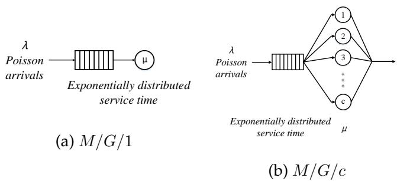
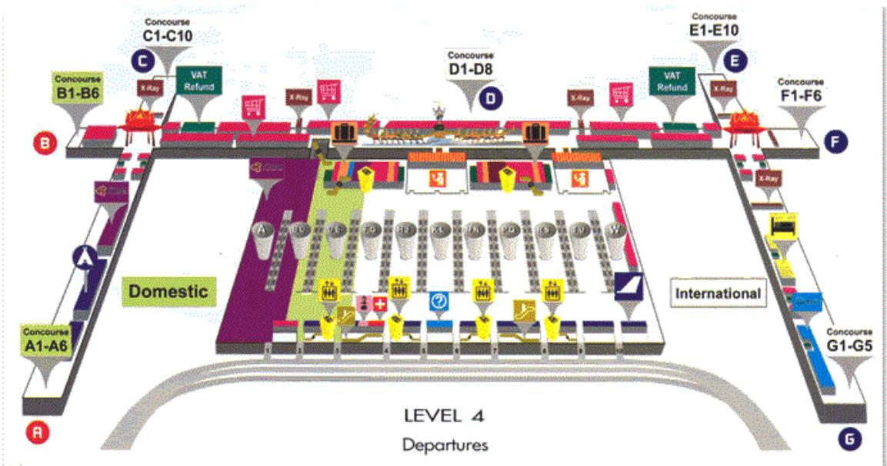
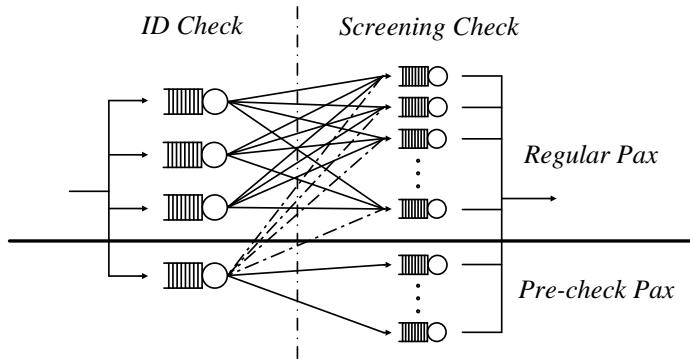

# 2017年美国大学生数学建模竞赛（MCM/ICM）O奖论文示例：机场安检流程优化与智能调度

原件为竞赛论文。补充：文中的阅读练习及“参考解答”为整理时增加，原件图文保留出处。

来源为 2017 年 MCM/ICM O 奖论文第 1-4 页识别内容，整理时去除了页眉、页脚、团队编号表格及重复的摘要部分，保留了正文结构。

## Summary Sheet

**Title:** Breezing Through Security Checkpoints: an Intelligent Airport with Smart Scheduling

### Summary

In order to improve the performance of airport security check while preserving the same security standards, we model and refine this process. We run extensive simulations to analyze performance of our model. Specifically,

For task (a), we model the airport security process with a queueing network. We get the parameters of the queueing network model by fitting the data in the provided data sheet to different distributions. We validate our model by simulating it with the real world parameter combination and comparing its output against data collected from airport passengers. We identify three bottlenecks in our model: lack of sufficient ID check points; exclusive assignment of screening check points to passengers; the presence of suspicious passengers.

For task (b), we propose three routing algorithms to optimize the throughput and variance of the airport: greedy algorithm, backpressure algorithm, and drift-plus-penalty algorithm. The best one of these algorithms achieves high throughput that is close to optimal and relatively low variance in waiting time. Besides, our proposed routing algorithm manages to retain passenger satisfaction while scheduling. We also explore the optimal ratio of different kinds of check points and test the robustness of modified models.

For task (c), we analyze the impact of different cultures and traveler types and run simulation to see the reaction of our model. The cultures we analyze are collectivist cultures, individualist cultures. The types of travelers we analyze are family-based travelers and tech-based travelers. We also propose accommodations to these special situations.

For task (d), we propose both globally applicable and locally applicable policies to airport security managers. Our policies are based on our analysis of different cultures and types of travelers as well as our analysis of our routing algorithms.

Keywords: Queueing Networks; Routing Algorithms; Lyapunov Optimization

## Contents

1 Introduction
2 Basic Analysis of the problem
    2.1 Single Queueing Nodes
    2.2 Parameter Settings
    2.3 Rate Stability
    2.4 Measures of Performance
3 Models
    3.1 Tandem M/G/c Queueing Model
    3.2 Queueing Network Model
4 Simulations and Bottleneck Detection
    4.1 Simulation Setup
    4.2 Validating Our Model
    4.3 Simulation Evaluation
5 Modifications to the Process
    5.1 Greedy Routing Based on Backlogs
    5.2 Lyapunov Drift and Backpressure-Based Routing
        5.2.1 Lyapunov Optimization for Queueing Networks
        5.2.2 The Performance of Backpressure Routing
    5.3 Drift-Plus-Penalty Algorithm
        5.3.1 Drift-Plus-Penalty
        5.3.2 The Performance of Drift-Plus-Penalty Algorithm
6 Sensitivity Analysis
    6.1 Modeling Different Situations
        6.1.1 Collectivist Cultural Norms
        6.1.2 Individualist Cultural Norms
        6.1.3 Family-based Travelers
        6.1.4 Tech-based Travelers
    6.2 Impact of Various Situations
        6.2.1 Collectivist Cultural Norms
        6.2.2 Individualist Cultural Norms
        6.2.3 Family-based Travelers
        6.2.4 Tech-based Travelers
    6.3 Accommodation for Situations
7 Conclusion
    7.1 Conclusion of the Problem
    7.2 Policy Proposal
    7.3 Strength and Weakness of Our Model
    7.4 Future Application of Models

## 1 Introduction

Security has been of first priority in transportation activities that involve people since the beginning of the century. A series of time-consuming security check processes are necessary to ensure the security of all passengers aboard. But passengers are complaining about waiting for security check in extremely long queues. It is quite challenging to improve the performance of airport security check systems while preserving the current security standards.

In this paper, we try to model this security check process and refine the model. Our main contributions are as follows:

1. We model the security check process with a queueing network. We validate our model by simulating it with real-world parameter combinations and comparing its result with real world data. We identify lack of sufficient ID check points, exclusive assignment of screening check points, presence of suspicious passengers as three bottlenecks in the model.

2. We propose and implement three routing algorithms to optimize our basic model. We simulate our model with these algorithms and analyze their performance. We find that the proposed backpressure algorithm achieves throughput close to optimal and a relatively low variance in waiting time.

3. We analyze the sensitivity of our model by considering the impacts of cultural norms and passenger types. We analyze how the output of our model changes with respect to different norms and passengers, and propose accommodations to these situations.

## 2 Basic Analysis of the problem

知识点：[一般假设及其合理性说明（Assumptions and Justifications）](../../../topics/数学建模/jiaben_shezhi.md)、[模型参数的确定（基于数据拟合或实验选择）](../../../topics/数学建模/canshu_queding.md)、[模型验证方法概述（随机模型与确定性模型验证）](../../../topics/数学建模/moxing_yanzheng.md)

### 2.1 Single Queueing Nodes

M/G/1 Queue: We adopt $M/G/1$ queue (shown in Figure 1(a)) in our model.

- M: the arrival times of the passengers follow a Poisson distribution
- G: the service times follow an arbitrary probability distribution
- 1: there is only one check point available

The arrivals are determined by a Poisson process with rate parameter $\mu$. Job service time has a normal distribution with parameter $\mu$ and $\sigma$.

M/G/c Queue: We also adopt $M/G/c$ queue (shown in Figure 1(b)) in our model, which is a generalization of the $M/G/1$ queue. $c$ represents the number of check points. The arrival time of passengers follows a Poisson distribution with rate parameter $\lambda$. Job service time follows a normal distribution with parameter $\mu$ and $\sigma$.

FIFO: The queue obeys a first-come, first-served discipline. A single check point serves customers one at a time from the front of the queue. When the service is complete, the customer leaves the queue and the number of customers in the system reduces by one.

知识点：[符号说明与术语定义（Nomenclature / Symbols and Definitions）](../../../topics/数学建模/fuhao_shuoming.md)、[数学建模的基本步骤（问题分析、模型假设、建立、求解、检验、推广）](../../../topics/数学建模/jianmo_buzhou.md)

### 2.2 Parameter Settings

Before the simulation, we set basic parameters of the probability distribution in queueing node based on the data in the data sheet. We use the EstimatedDistribution function of Mathematica to determine probability distributions and estimate parameters. The average interval for the arrival time of regular and pre-check passengers follows exponential distribution with parameter $\frac{1}{\lambda_1}$ and $\frac{1}{\lambda_2}$ respectively. And the average rate of ID check service in zone A and baggage and body screening follow normal distribution with parameters $(\mu_1, \sigma_1)$ and $(\mu_2, \sigma_2)$. Besides, we assume the time for regular passengers to remove shoes, belts, light jackets and computers from their bags follows a normal distribution with the parameters $(\mu_4, \sigma_4)$. Thus the average rate of baggage and body screening for regular customer follows normal distribution with parameters $(\mu_3, \sigma_3)$, where $\mu_3 = \mu_2 + \mu_4$ and $\sigma_3 = \sqrt{\sigma_2^2 + \sigma_4^2}$. The normal distribution $(\mu_3, \sigma_3)$ and the normal distribution $(\mu_4, \sigma_4)$ are independent to each other. The specific numbers are in Table 1.

Table 1: The Parameters in the Problems

| Symbol | Definition | value |
| --- | --- | --- |
| $\lambda_1$ | Rate of regular passenger arrivals | 4.63476 |
| $\lambda_2$ | Rate of pre-check passenger arrivals | 6.52921 |
| $(\mu_1, \sigma_1)$ | Mean and variance of ID check service time | (0.186875, 0.0612029) |
| $(\mu_2, \sigma_2)$ | Mean and variance of screening service time for pre-check passengers | (0.507639, 0.158551) |
| $(\mu_3, \sigma_3)$ | Mean and variance of screening service time for regular passengers | (2.507639, 0.524536) |

The distribution of service time in different check points is not identical in real life. In order to simulate the differences among check points, we keep the variance of normal distribution $\sigma_k$ unchanged $(k = 1, 2, 3)$, and uniformly generate $\mu_{k_i}$ of normal distribution between $\mu_k - \sigma_k$ and $\mu_k + \sigma_k$.

# 2017年美国大学生数学建模竞赛（MCM/ICM）O奖论文示例：机场安检流程优化与智能调度

## 一、速率稳定性与性能指标

知识点：[模型参数的确定（基于数据拟合或实验选择）](../../../topics/数学建模/canshu_queding.md)、[符号说明与术语定义（Nomenclature / Symbols and Definitions）](../../../topics/数学建模/fuhao_shuoming.md)、[一般假设及其合理性说明（Assumptions and Justifications）](../../../topics/数学建模/jiaben_shezhi.md)

### 简答 1

**问题背景：** 由于雇佣员工和维护机器的成本，机场不可能设立无限的检查点。但机场必须确保检查点的数量满足乘客需求，且队列中的等待人数不会随时间无限增长。

**定义：** 令 $Q(t)$ 表示在时隙 $t \in \{0, 1, 2, \ldots\}$ 定义的单个排队节点的容量。$Q(t)$ 是一个根据概率定律的随机过程。如果满足以下条件，则排队节点是速率稳定的[2]：

$$
\lim_{t \to \infty} \frac{E \{ | Q ( t ) | \}}{t} = 0
$$

速率稳定性确保队列不会随时间持续增大。设 $a(t)$ 表示在时隙 $t$ 到达的新乘客数量，$b(t)$ 表示该排队节点的检查点在时隙 $t$ 可以服务的乘客数量。如果满足以下不等式，则 $Q(t)$ 是速率稳定的：

$$
\limsup _ {t \to \infty} \frac {1}{t} \sum_ {\tau = 0} ^ {t - 1} \left[ a \left(\tau\right) - b \left(\tau\right) \right] \leq 0.
$$

**规定：** 我们规定检查点的数量满足速率稳定性，且常规乘客与预检乘客之间的检查点比例为 3:1。因此，我们将检查点的数量设置如表2所示。

**表2：服务柜台数量**

| zone | regular | pre-check |
| :--- | :--- | :--- |
| ID check(zone A) | 3 | 1 |
| Screening(zone B) | 12 | 4 |

知识点：[问题重述与分析（Problem Restatement and Analysis）](../../../topics/数学建模/wenti_chongshu.md)、[符号说明与术语定义（Nomenclature / Symbols and Definitions）](../../../topics/数学建模/fuhao_shuoming.md)

### 简答 2

**问题背景：** 吞吐量和平均等待时间的方差是安检系统的两个主要衡量指标。定义如下。

**吞吐量（Throughput）：** 单位时间内通过安检系统的乘客平均数量。这里的单位时间设定为分钟。

**方差（Variance）：** 假设常规乘客的等待时间为 $X_1$，预检乘客的等待时间为 $X_2$。常规乘客的比例为 $p$。系统方差的定义为：

$$
p \mathbb {E} \left[ (X _ {1} - \mathbb {E} (X _ {1})) ^ {2} \right] + (1 - p) \mathbb {E} \left[ (X _ {2} - \mathbb {E} (X _ {2})) ^ {2} \right]
$$

吞吐量从集体层面衡量安检系统的能力，而等待时间的方差从个人层面衡量公平性。

## 二、模型构建

知识点：[任务分解与目标明确](../../../topics/数学建模/renwu_fenjie.md)、[文献综述与研究背景撰写方法](../../../topics/数学建模/wenxian_zongshu.md)、[确定模型的定点与稳定性分析](../../../topics/数学建模/dingdian_wending.md)

### 简答 3

**本节概述：** 在本节中，我们首先详细介绍我们的模型。第一个模型是最优但不切实际的模型，作为比较并旨在提供修改见解。第二个模型对机场真实安检系统中的排队网络进行了建模。

**表3：符号说明**

| Symbol | Definition |
| :--- | :--- |
| $\lambda$ | 指数分布的率参数 |
| $\mu$ | 正分布的平均值参数 |
| $\sigma$ | 正态分布的率参数（平方尺度） |
| $N$ | 检查点的数量 |
| $Q_{a}^{(c)}(t)$ | 时隙 $t$ 乘客 $c$ 在排队节点 $a$ 的积压量 |
| $\mu_{ab}^{(c)}(t)$ | 时隙 $t$ 乘客 $c$ 从排队节点 $a$ 到排队节点 $b$ 的传输率 |
| $L(t)$ | 时隙 $t$ 的李雅普诺夫函数 |
| $\Delta(t)$ | 时隙 $t$ 的李雅普诺夫漂移 |
| $V$ | 漂移加惩罚算法中的控制参数 |

知识点：[符号说明与术语定义（Nomenclature / Symbols and Definitions）](../../../topics/数学建模/fuhao_shuoming.md)、[数学建模的基本步骤（问题分析、模型假设、建立、求解、检验、推广）](../../../topics/数学建模/jianmo_buzhou.md)

### 简答 4

**模型描述：** 我们首先提出一个理想模型，即串联 $M/G/c$ 模型。该模型实现了最大吞吐量，但在现实生活中不可行。我们将稍后比较该理想模型与实际模型的性能，以评估后者并进行修改。

如图3所示，两个 $M/G/c$ 队列处于串联阵列中。第一个 $M/G/c$ 排队节点表示ID检查（A区）的队列，有 $N_A$ 个检查点。同样，第二个 $M/G/c$ 队列表示行李和身体筛查（B区）的队列，有 $N_B$ 个检查点。所有检查点对常规乘客和预检乘客均可用，唯一的区别是预检乘客在B区花费的时间可能更短。

## 3.2 Queueing Network Model

Now we introduce queueing network model which models the security check in real-life airports. Queueing networks are systems in which a number of queues are connected by customer routing. Similar to BCMP networks[3], our queueing network models are open networks with very general service time which follows the normal distribution.

The queueing network in real-life airport is illustrated in Figure 4. Every queueing node is an $M / G / 1$ queueing, for there is one queue for every check point. Regular passengers and pre-check passengers are separate from each other in the entire process of security check. Every queueing node at zone A directs to its corresponding queueing nodes at zone B. We use $N _ { A 1 }$ and $N _ { A 2 }$ to denote the number of queueing node in Zone A for regular passengers and pre-check passengers respectively and use $N _ { B 1 }$ and $N _ { B 2 }$ to denote the number of queueing node in Zone B for regular passengers and pre-check passengers respectively.

We will later modify the topology of queueing networks and apply different routing algorithms in queueing networks to achieve larger throughput and smaller variance in the queueing system.

## 4 Simulations and Bottleneck Detection

知识点：[数学建模的基本步骤（问题分析、模型假设、建立、求解、检验、推广）](../../../topics/数学建模/jianmo_buzhou.md)、[任务分解与目标明确](../../../topics/数学建模/renwu_fenjie.md)、[问题重述与分析（Problem Restatement and Analysis）](../../../topics/数学建模/wenti_chongshu.md)

### 4.1 Simulation Setup

We run massive simulations on the queueing network model using the data from the real airports to validate the queueing network model.

We simulate both the tandem $M / G / c$ network and queueing networks model. The simulation data is generated based on the probability distribution that we obtain from the data sheet. We set 1000 people to pass the system in every simulation and collect statistics of length of the queue, throughput, average, and variance of waiting time.

We also consider the presence of suspicious passengers in the security check system in simulation. Every suspicious passenger appears with a probability of $\frac { 1 } { 1 0 0 0 }$ and the queue will be stuck for 10 min. We test the robustness of queueing system by adding the presence of suspicious passengers.

知识点：[模型验证方法概述（随机模型与确定性模型验证）](../../../topics/数学建模/moxing_yanzheng.md)、[敏感性分析方法（Sensitivity Analysis，单参数与多参数变动）](../../../topics/数学建模/minganxing_fenxi.md)

### 4.2 Validating Our Model

To validate our model, we simulate the model using real-world parameter combinations and compare the result with real-world data provided by airport passengers.

Specifically, we get the number of daily passengers of 5 biggest airports in the US from their official website [4][5][6][7][8]. We then assume that the arrival time of passengers follow the Poisson distribution, and therefore we can calculate the mean arrival rate of passengers by dividing the total number of passengers with the time length of a day. Besides, we get the mean waiting time of passengers from [9]. Other parameters are set after the Bangkok International Airport, which is shown in Figure 5. After that, we simulate our model using the corresponding arrival time distribution. The result of our simulation is shown in Table 4.

## 验证过程结果

Table 4: Result of Validation Process

| Airport | daily arrival passengers | average waiting time from websites(minute) | average waiting time calculated by model(minute) |
| :--- | :--- | :--- | :--- |
| Chicago O'Hare International(ORD) | 2,000,000 | 40 – 60 | 79.0155 |
| Hartsfield-Jackson Atlanta International(ATL) | 260,000 | 10 – 20 | 42.9196 |
| Los Angeles International(LAX) | 205,000 | 20 – 30 | 32.5824 |
| John F. Kennedy International(JFK) | 156,000 | 10 – 20 | 16.8958 |
| San Francisco International(SFO) | 137,000 | 1 – 10 | 9.4987 |

We can see from Table 4 that the resulting average waiting time of our model is generally close to the real average waiting time and thus our model is valid in real life. The discrepancy between the model output and the ground truth can be explained as follows. The number of check points of our model is far less than that of the real case. Since the real number of check points is unavailable online, so we have to estimate the number from the fact that the waiting queue of clients is at least rate stable(as is discussed in section 2.3). That is, $\lambda \leq c \cdot \mu ,$ where $\lambda$ is the arrival rate, $\mu$ is the service rate(estimated from Excel data), and $c$ is the number of check points. $c$ obtained in this way is very likely to be far smaller than the real number of check points since real airports deploy more check points to deal with large number of passengers. In all, the inaccurate estimation of number of check points contributes to the discrepancy.

知识点：[模型验证方法概述（随机模型与确定性模型验证）](../../../topics/数学建模/moxing_yanzheng.md)、[参数合理性验证](../../../topics/数学建模/canshu_heli_xing.md)

### 4.3 Simulation Evaluation

We now evaluate the simulation results given the parameters in our problem and analyze the bottleneck in current security check system.

The lack of sufficient ID check points for pre-check passengers is a bottleneck in the queueing network model. From section 3.2, we see that the length of ID check queue for pre-check passengers grows quickly. However, the high speed of screening check point for pre-check passengers keeps the average waiting time for pre-check passengers much smaller than that of regular passengers. The imbalanced allocation of resource incurs congestion in the security system for pre-check users. Deploying one more ID check point for pre-check passengers, which is an effective but luxurious solution to the limit of ID check point, may not meet the approval due to the heavy cost.

The exclusive assignment of screening check points to some specific group of passengers is another bottleneck. In this model, every ID check point only connects to 4 screening check points for the convenience of managing passengers and these 4 check points are exclusively used by passengers from the previous ID check point. In section 3.2, 4 screening queues from the same ID check points for regular passengers suffer from long queue while screening queues from other ID check points have much shorter queue.

Since the service time is not identical for every check point, a passenger from fast ID check points is possible to be directed to slow screening check points. In consequence, there might be certain screening check points suffering from long waiting queues and the separation of screening check points for regular customers results in the waste of resource.

The presence of suspicious passengers is the third bottleneck of this model. After analyzing Figure 6 and 7, the outline of 6 is the maximum number of passengers in a queue without the presence of suspicious people. Contrasting the Figure 7 with the outline of Figure 6, there is a suspicious passenger showing up at 88 minutes, which results in the rising slope increases for 15 minutes, and the maximum value is larger. At 152 minutes, another suspicious passenger arrives, which results in the maximum number of a queue keeping for 10 minutes instead of decreasing as in Figure 6. By comparing the figures, we find that the presence of suspicious passengers will influence the stability of the system. In the airport, the suspicious passengers are more likely to be detected when the security check is strict especially in festivals or after certain events. So the influence of suspicious passengers should be considered as one of the bottlenecks of queueing network model.

These bottleneck of queueing networks model all result from the plain structure of security check system and oversimple queueing rules. In Figure 8, passengers wait in front of every queue node during the whole process and thus all the check points are working all the time. The results of tandem $M/G/1$ network model in Figure 8 show that the balance of all the queueing system enables the system to make full use of resource.

We will modify the security checking system to achieve a more efficient use of resources in the next section.

知识点：[模型验证方法概述（随机模型与确定性模型验证）](../../../topics/数学建模/moxing_yanzheng.md)、[敏感性分析方法（Sensitivity Analysis，单参数与多参数变动）](../../../topics/数学建模/minganxing_fenxi.md)、[模型优缺点分析（Strengths and Weaknesses）](../../../topics/数学建模/youque_dian.md)

### 5 Modifications to the Process

In this section we will introduce modifications for the bottleneck detected in the previous section. We implement different routing algorithms and optimize the ratio of two kinds of passengers in order to achieve larger throughput and smaller variance.

知识点：[数学建模的基本步骤（问题分析、模型假设、建立、求解、检验、推广）](../../../topics/数学建模/jianmo_buzhou.md)、[模型参数的确定（基于数据拟合或实验选择）](../../../topics/数学建模/canshu_queding.md)

### 5.1 Greedy Routing Based on Backlogs

We allow the queueing nodes to direct to more queueing nodes in this section. Previous model have bottleneck where the queueing nodes corresponding to one node are busy and queueing nodes corresponding to another node are idle. Enabling passengers to make choice among more check points will make better use of the resource of check points by avoiding wastes. As Figure 9 demonstrated, both kinds of passengers are still prohibited to enter the check points of each for the privilege of the pre-check passenger-$s ,$ but all check points in zone B are accessible to passengers from the check point for passengers of the same kind in zone A.

We apply greedy routing based on the backlogs of the queueing node. The amount of total passengers waiting in queue nodes n are denoted as the backlog $Q _ { n } \left( t \right)$ . Every passenger makes the locally optimal choice of choosing the queueing node with the least queue backlog.

The results are illustrated in the Figure 10. The greedy algorithm achieves a much smaller queue size of less then 16 compared to the original model in section 3.2. Also, the total time required for all passengers to pass the line is much less. The throughput is 7.148 PAX/min and the variance of waiting time is $103.427 min^2$. The queueing system in greedy algorithm has better performance than the original model.

## 5.2 Lyapunov Drift and Backpressure-Based Routing

知识点：[任务分解与目标明确](../../../topics/数学建模/renwu_fenjie.md)、[确定模型的定点与稳定性分析](../../../topics/数学建模/dingdian_wending.md)、[有效性参数（Effectiveness Parameter）与搜索模式对比](../../../topics/数学建模/youxiaoxing_canshu.md)

### 5.2.1 Lyapunov Optimization for Queueing Networks

Consider a queueing network with N queueing nodes in discrete time slots t in $\{ 0 , 1 , 2 , \ldots \}$ . On each slot, routing and transmission scheduling decisions are made in an effort to deliver passenger to destination. Let $Q _ { n } ^ { ( c ) } \left( t \right)$ , where $c$ can be both regular and pre-check passengers, be the current amount of passenger in node $n ,$ also called the queue backlog. The queue backlogs from one slot to the next satisfies the following for all $n \in \{ 1 , . . . , N \} , c \in \{ r e g u l a r , p r e - c h e c k \}$

$$
Q _ {n} ^ {(c)} (t + 1) \leq \max \left[ Q _ {n} ^ {(c)} (t) - \sum_ {b = 1} ^ {N} \mu_ {n b} ^ {(c)} (t), 0 \right] + \sum_ {a = 1} ^ {N} \mu_ {a n} ^ {(c)} (t) + A _ {n} ^ {(c)} (t)
$$

where $A _ { n } ^ { ( c ) } \left( t \right)$ is the random amount of passengers that exogenously arrives to node n on slot $t ,$ and $\mu _ { a b } ^ { ( c ) } \left( t \right)$ is the transmission rate allocated to passenger c on link $( a , b )$ on slot t. Note that $\mu _ { a b } ^ { ( c ) } \left( t \right)$ may be more than the amount of passengers c that is actually transmitted on link $( a , b )$ on slot t. This is because there may not be enough backlog in node a.

The backpressure algorithm[10] is designed by choosing transmission and routing variables to greedily minimize a bound on the drift of a Lyapunov function. Specifically, define $Q \left( t \right) = Q _ { n } ^ { \left( c \right) } \left( t \right)$ as the matrix of current queue backlogs. Define the Lyapunov function

$$
L (t) = \frac {1}{2} \sum_ {i = 1} ^ {N} \sum_ {c} Q _ {i} ^ {(c)} (t) ^ {2}.
$$

This fuction is a scalar measure of the total queue backlog in the network. Note that this is a sum of the squares of queue backlogs. Thus the backlogs in every Queues are small if the Lyanpnov function is small. Then the Lyapunov drift is defined as the change in

this function from one slot to the next:

$$
\Delta (t) = \mathbb {E} \left\{L (t + 1) - L (t) | Q (t) \right\}.
$$

We intend to minimize the Lyapunov drift so as to minimize the total queue backlog in the network as time goes by.

We transform the equation using the inequality of backlog from one slot to another slot

$$
\Delta (t) \leq B + \sum_ {n = 1} ^ {N} \sum_ {c} Q _ {i} ^ {(c)} (t) \mathbb {E} \left\{\lambda_ {n} ^ {(c)} (t) + \sum_ {a = 1} ^ {N} \mu_ {a n} ^ {(c)} (t) - \sum_ {b = 1} ^ {N} \mu_ {n b} ^ {(c)} (t) | Q (t) \right\},
$$

where B is a finite constant and $\left( \lambda _ { n } ^ { \left( c \right) } \left( t \right) \right)$ is passenger arrival rate matrix. Since B and $\left( \lambda _ { n } ^ { \left( c \right) } \left( t \right) \right)$ is constant, we maximize the following terms to minimizing the Lyanpnov drift

$$
\sum_ {a = 1} ^ {N} \sum_ {b = 1} ^ {N} \sum_ {c} \mu_ {a b} ^ {(c)} (t) [ Q _ {a} ^ {(c)} (t) - Q _ {b} ^ {(c)} (t) ].
$$

The weight $Q _ { a } ^ { ( c ) } \left( t \right) - Q _ { b } ^ { ( c ) } \left( t \right)$ is called the current differential backlog of c between nodes a and b. Thus, we want to choose decision variables $\left( \mu _ { a b } ^ { \left( c \right) } \left( t \right) \right)$ so as to maximize the above weighted sum, where weights are differential backlogs.

Clearly we should not send data in a direction of negative differential backlog, and so we should choose $\mu _ { a b } ^ { ( c ) } \left( t \right) = 0$ whenever the differential backlog is negative. Further, given $\mu _ { a b } ^ { \left( c \right) } \left( t \right)$ for a particular link $( a , b )$ , the optimal $\mu _ { a b } ^ { ( c ) } \left( t \right)$ are chosen as follows: first find $c _ { a b } ^ { o p t } \left( t \right)$ that maximize the differential backlog for link $( a , b )$ . If this maximizing differential backlog is negative, assign $\mu _ { a b } ^ { \left( c \right) } \left( t \right) = 0$ for both kinds of passengers. Else, allocate the full link rate $\mu _ { a b } \left( t \right)$ to the passengers $c _ { a b } ^ { o p t } \left( t \right)$ , and zero rate to the other passengers on this link. With this choice, our aim is to maximize

$$
\sum_ {a = 1} ^ {N} \sum_ {b = 1} ^ {N} \mu_ {a b} W _ {a b} (t) (t), \quad w h e r e \quad W _ {a b} (t) = \max \left[ Q _ {a} ^ {c _ {a b} ^ {o p t (t)}} (t) - Q _ {b} ^ {c _ {a b} ^ {o p t (t)}} (t) \right]
$$

choosing $\mu \left( a b \right)$ is called the max-weight algorithm. It maximizes a linear sum of transmission rates, where the weights $W _ { a b } \left( t \right)$ correspond to differential backlogs. The backpressure algorithm uses the max-weight decisions for $\mu _ { a b } \left( t \right)$ , and then chooses routing variables $\left( \hat { \mu } _ { a b } ^ { ( c ) } \left( t \right) \right)$ via the maximum differential backlog as described above.

知识点：[确定模型的定点与稳定性分析](../../../topics/数学建模/dingdian_wending.md)、[模型参数的确定（基于数据拟合或实验选择）](../../../topics/数学建模/canshu_queding.md)、[稳定性分析（Stability Analysis）](../../../topics/数学建模/wending_xing.md)

### 5.2.2 The Performance of Backpressure Routing

Now we apply the backpressure routing to the queueing network model. The transmitting rate $\mu _ { a b } ^ { ( c ) } \left( t \right)$ has an inverse relationship with the current serving time of queueing node a. Except the rules in 5.2.1, pre-check passengers are able to queue before the check points for regular passengers. However, they receive the same check process and spend the same time as the regular passengers. This assumption is reasonable, for pre-check passengers have rights to go to regular check points when their own check points are too busy. The diagram of the queueing network is illustrated in Figure 11.

# 机场安检流程优化与智能调度

本节内容基于2017年美国大学生数学建模竞赛（MCM/ICM）O奖论文示例，整理自第16–18页。主要涵盖后压路由（Backpressure Routing）的性能分析、漂移加惩罚算法（Drift-Plus-Penalty Algorithm）的引入及其性能评估，以及文化因素对模型参数的敏感性分析。

## 后压路由性能分析

知识点：[文献综述与研究背景撰写方法](../../../topics/数学建模/wenxian_zongshu.md)、[确定模型的定点与稳定性分析](../../../topics/数学建模/dingdian_wending.md)、[敏感性分析方法（Sensitivity Analysis，单参数与多参数变动）](../../../topics/数学建模/minganxing_fenxi.md)

### 5.2 结果讨论

**图 11：后压路由中的排队网络**

**图 12：后压路由的结果展示**
图12展示了后压路由的运行结果。与贪婪路由（Greedy Routing）中的图10相比，最长队列的长度相同。虽然拥有长队列的站点数量可能更多，但这源于这些检查点的服务时间更短。图表显示，所有乘客通过安检系统所需的时间比贪婪路由更少。系统的吞吐量为 $7.328 \text{ PAX/min}$，更接近最优模型的 $7.673 \text{ PAX/min}$，优于贪婪路由。等待时间的方差为 $84.971 \text{ min}^2$，小于贪婪路由。

当可疑乘客通过系统时，排队网络的鲁棒性得到提升。如图13a所示（虚线表示可疑乘客到达），最长队列几乎与图12的轮廓一致，且排队网络相当稳定。该排队网络几乎不受可疑乘客的影响。

我们还探索了普通乘客与预检乘客（pre-check passengers）之间的最佳比例（图14）。我们调整了B区检查点的比例，因为B区存在大多数长队列，该区域共有16个检查点。随着普通乘客检查点数量的增加，吞吐量先急剧上升，随后在7.3左右波动；而平均等待时间的方差则直接下降。对于后压算法中的排队系统，选择13个普通乘客检查点是合适的，因为它既保持了相对较小的方差，又实现了最大的吞吐量。

## 漂移加惩罚算法

知识点：[数学建模的基本步骤（问题分析、模型假设、建立、求解、检验、推广）](../../../topics/数学建模/jianmo_buzhou.md)、[稳定性分析（Stability Analysis）](../../../topics/数学建模/wending_xing.md)

### 5.3 漂移加惩罚算法

#### 5.3.1 算法原理

我们的目标是在相同的规则下，减少进入检查点的预检乘客数量，相较于之前的路由算法。之前的路由算法要求预检乘客进入常规顾客的检查点，以实现更大的吞吐量和更小的方差。由于预检乘客支付了额外费用以获得更好的服务，他们可能不愿意像普通顾客那样接受安检。因此，我们改进了之前的路由算法。

在Lyapunov漂移中引入了 $V_{\text{penalty}}(t)$ 项。我们不再采取控制动作来最小化 $\Delta(t)$ 的上界，而是最小化以下漂移加惩罚表达式的上界：

$$
\Delta (t) + V \mathbb {E} \left\{\text{penalty}(t) \right\}
$$

其中 $V \geq 0$ 是一个参数，代表我们在多大程度上强调减少预检乘客进入常规乘客检查点的数量。

与最小化 $\Delta(t)$ 的上界导致 $\Delta(t) \leq B$ 的表达式类似，最小化漂移加惩罚的上界会导致如下形式的表达式：

$$
\Delta (t) + V \mathbb {E} \left\{\text{penalty}(t) \right\} \leq B + V p ^ {*}
$$

其中 $p ^ {*}$ 是最优时间平均惩罚。

#### 5.3.2 算法性能

我们将漂移加惩罚算法应用于该问题。设定 $V = 0.5$，当将预检乘客从排队节点 a 传输到排队节点 b 时，惩罚函数定义为：

$$
\text{penalty}(t) = \frac {1} {2} \left( Q _ {a} \left( t ^ {(c)} \right) - Q _ {b} ^ {(c)} \left( t \right) \right)
$$

漂移加惩罚算法的结果如图15所示。 backlog（积压量）比后压路由更大，部分队列超过14，最大积压量达到20。此外，所有乘客通过安检系统所需的时间也更长。系统的吞吐量为 $7.224 \text{ PAX/min}$，等待时间的方差为 $149.880 \text{ min}^2$，这两项结果均不如后压路由。该算法牺牲了吞吐量和等待时间的方差，以维护预检用户的权益。

我们还考察了当可疑乘客进入安检系统时排队网络的鲁棒性。图13b展示了安检系统中的最长队列，虚线表示可疑乘客通过的时间。与图15的轮廓相比，图13b中仅出现斜率的微小增加，且这种增加在不到5分钟内迅速消失。这意味着队列长度对此类紧急情况不太敏感。

我们再次探索了普通乘客与预检乘客的最佳比例（图16）。由于大多数长队列存在于B区，我们打算调整B区的检查点比例。假设B区有16个检查点，吞吐量起初急剧上升，随后在7.2左右波动；而平均等待时间的方差随着普通乘客检查点数量的增加而直接下降。我们选择11个普通乘客检查点，这导致了相对较小的方差以及较大的吞吐量。

## 敏感性分析

知识点：[数学建模的基本步骤（问题分析、模型假设、建立、求解、检验、推广）](../../../topics/数学建模/jianmo_buzhou.md)、[模型验证方法概述（随机模型与确定性模型验证）](../../../topics/数学建模/moxing_yanzheng.md)、[参数合理性验证](../../../topics/数学建模/canshu_heli_xing.md)

### 6 敏感性分析

我们对模型进行了敏感性分析，考虑了文化因素对参数的影响。具体来说，我们考察了几种不同的文化规范，并将其建模为模型输入参数的变化。然后，通过比较不同参数组合下模型的性能指标，我们能够确切地指出不同文化规范的具体影响。

## 6.1 Modeling Different Situations

We will present the modeling of four different situations (including those in different cultural norms and different types of traveler) in this section. The evaluation of the impacts of these situations will be provided in section 6.2. The accommodation to these situations will be provided in section 6.3.

知识点：[敏感性分析方法（Sensitivity Analysis，单参数与多参数变动）](../../../topics/数学建模/minganxing_fenxi.md)、[模型参数的确定（基于数据拟合或实验选择）](../../../topics/数学建模/canshu_queding.md)

### 6.1.1 Collectivist Cultural Norms

Switzerland is a country whose Power Distance Index (PDI), an indicator that expresses the public’s general acceptance towards inequalities, is lower than that of most countries [11]. Believing that inequalities among people should be minimized, Swiss people tend to prioritize collective efficiency, which motivates us to model their willingness to sacrifice personal gains for the good of the public.

We change the control parameter $V$ of the drift-plus-penalty model to describe such willingness. As is discussed in section 5.3.1, $V$ stands for the penalty of scheduling a pre-check passenger to regular check points, a decision that will improve the global throughput and variance but cost the pre-check passenger more time. A passenger from collectivist cultures (as those in Switzerland) may readily follow the schedule and thus has a small control parameter.

知识点：[问题重述与分析（Problem Restatement and Analysis）](../../../topics/数学建模/wenti_chongshu.md)

### 6.1.2 Individualist Cultural Norms

In contrast to what was believed by Chinese a thousand years ago, individual efficiency is the dominating factor in the code of conduct of Chinese today. The act of cutting in line, carried out by those who desperately seek individual efficiency, can be observed in some airports in China. This leads us to model the act of skipping by adding new queueing rules to our model.

As is shown in section 2.1, our model naturally supports the first-in-first-out queueing rule. To model the skipping acts, a new passenger can now go to the head of the queue. The probability of a passenger going to the head of a queue is 30%, a value estimated from daily life experience.

知识点：[一般假设及其合理性说明（Assumptions and Justifications）](../../../topics/数学建模/jiaben_shezhi.md)、[文献综述与研究背景撰写方法](../../../topics/数学建模/wenxian_zongshu.md)、[模型参数的确定（基于数据拟合或实验选择）](../../../topics/数学建模/canshu_queding.md)

### 6.1.3 Family-based Travelers

Familial relationships are cherished in almost all cultures. Flying with family members to some fascinating destinations is a good choice of spending vacations as well as enhancing family ties. This traveling situation motivates us to model the family-based travelers with different passenger arrival distribution.

In the previous discussion, we have mentioned that our model assumes the arriving passengers are a Poisson flow (section 2.1). The family-based travelers do not follow the Poisson distribution since they arrive at the same time, which is a safe assumption. Also, we assume that family-based travelers from the same family will process through the same check point and that they are always consecutive in a queue.

知识点：[数学建模的基本步骤（问题分析、模型假设、建立、求解、检验、推广）](../../../topics/数学建模/jianmo_buzhou.md)、[一般假设及其合理性说明（Assumptions and Justifications）](../../../topics/数学建模/jiaben_shezhi.md)、[问题重述与分析（Problem Restatement and Analysis）](../../../topics/数学建模/wenti_chongshu.md)

### 6.1.4 Tech-based Travelers

Our last proposed situation consists of travelers who turn to modern communication technology for an accurate estimation of waiting time. A growing number of airports collect the queueing information in the airport and push estimated waiting time to passengers through mobile apps. In this way, the passengers are aware of the queueing situations and are able to better arrange their trips to the airport. We model this type of travelers using different arrival distribution.

Similar to the situation in section 6.1.3, with a-prior knowledge, the arriving passengers do not follow poisson distribution. We therefore model the arrival time of these travelers as a random variable following a normal distribution whose parameters are estimated through life experiences: the mean value of this distribution is 30 minutes before the departure time, and the variance depends on the accuracy of the information provided by the airport.

## 6.2 Impact of Various Situations

知识点：[随机模型与确定性模型的对比（Stochastic vs Deterministic Model）](../../../topics/数学建模/suiji_queding.md)、[参数合理性验证](../../../topics/数学建模/canshu_heli_xing.md)、[数学建模的基本步骤（问题分析、模型假设、建立、求解、检验、推广）](../../../topics/数学建模/jianmo_buzhou.md)

### 6.2.1 Collectivist Cultural Norms

We change the control parameter from 0.1 to 1.0 and measure the performance metrics of our model. The result of this experiment is shown in Figure 17.

We can see that the throughput of the system shrinks and that the variance increases as the control parameter grows, which means both the performance and the stability of the system deteriorates if passengers favor individual efficiency too much.

知识点：[敏感性分析方法（Sensitivity Analysis，单参数与多参数变动）](../../../topics/数学建模/minganxing_fenxi.md)、[稳定性分析（Stability Analysis）](../../../topics/数学建模/wending_xing.md)

### 6.2.2 Individualist Cultural Norms

We run our model with skipping queueing rule for 10 times and calculate the averaged performance metrics. Table 5 shows the variance and the throughput of the cutting-in-line system and the normal system.

**Table 5: Averaged variance and throughput of systems**

| | Variance ($min^2$) | Throughput (PAX/min) |
| :--- | :--- | :--- |
| Non-cutting | 96.024 | 7.575 |
| Cutting | 43.622 | 7.690 |

We can see that the system which allows cutting in line has better variance and slightly better throughput than the system that does not. This is because cutting in line increases the waiting time of passengers after the person who skips, but does not necessarily increase the waiting time of the person who leaves last, and therefore does not necessarily deteriorate throughput.

知识点：[模型验证方法概述（随机模型与确定性模型验证）](../../../topics/数学建模/moxing_yanzheng.md)、[有效性参数（Effectiveness Parameter）与搜索模式对比](../../../topics/数学建模/youxiaoxing_canshu.md)

### 6.2.3 Family-based Travelers

We add family-based travelers to our model and simulate the model for different percentages of family-based travelers in all passengers. Figure 18 shows the variance and throughput of the system with respect to different ratios.

We see from Figure 18 that the family-based travelers hurt the performance metrics of the airport. The more family-based travelers, the more the metrics will deteriorate. To accommodate large number of family-based travelers, a check point that specially designed for them can be deployed. This kind of check points can help improve variance and throughput when the number of family-based travelers is large. We will give detailed explanation for this kind of special check points at section 6.3.

知识点：[数学建模的基本步骤（问题分析、模型假设、建立、求解、检验、推广）](../../../topics/数学建模/jianmo_buzhou.md)、[敏感性分析方法（Sensitivity Analysis，单参数与多参数变动）](../../../topics/数学建模/minganxing_fenxi.md)

### 6.2.4 Tech-based Travelers

We simulate our model on different arrival distributions described earlier in section 6.1.4. Figure 19 illustrates how variance and throughput of our model change with respect to the standard variance of the arrival distribution.

Basically, Figure 19 tells us that if passengers arrive more intensely in a given time period, then the security check process will have better performance. So if the airport provides more accurate information such that the passengers can correctly estimate their arriving time, the airport will have better throughput and lower variance.

知识点：[模型验证方法概述（随机模型与确定性模型验证）](../../../topics/数学建模/moxing_yanzheng.md)、[敏感性分析方法（Sensitivity Analysis，单参数与多参数变动）](../../../topics/数学建模/minganxing_fenxi.md)

### 6.3 Accommodation for Situations

In this section, we will provide some accommodations that correspond to the previous situations we have discussed

1. Collectivist cultural norms: people from collectivist cultures favor collective efficiency more. The airport can deploy a scheduling algorithm like that in section 5.3.1 to optimize global throughput and variance.
2. Individualist cultural norms: for the sake of passenger’s satisfaction, the airport should strictly forbid cutting in line despite its potential help in lower the variance of waiting time.
3. Family-based travelers: deploying a special check point for family members can help. The special check point only serves family-based travelers and mainly focus on the parents when doing identification check, which implies shorter service time for the whole family. Figure 18 shows that this special check point helps improve throughput and variance.
4. Tech-based travelers: the airport should encourage the passengers to use the mobile app that provides information about queueing in the airport. The airport should also try to collect as accurate data as possible to help passengers better estimate their arriving time.

## 7 Conclusion

知识点：[任务分解与目标明确](../../../topics/数学建模/renwu_fenjie.md)、[模型优缺点分析（Strengths and Weaknesses）](../../../topics/数学建模/youque_dian.md)、[确定模型的定点与稳定性分析](../../../topics/数学建模/dingdian_wending.md)

### 7.1 Conclusion of the Problem

We model the problem as a queueing network and identify lack of sufficient ID check points, exclusive assignment of screening check points, presence of suspicious passengers as three bottlenecks of the system. We refine the model by applying greedy routing algorithm, backpressure algorithm, drift-plus-penalty algorithm to optimize passenger scheduling process. We implement and simulate our model and find that the backpressure algorithm is close to optimal scheduling and is practical in real airports. We also explore the optimal ratio of different kinds of check points and test the robustness of modified models. We perform sensitivity analysis of our model by considering the impacts of different cultural norms and different types of travelers. We also propose several policies that may help airports deal with the inflow of passengers in various situations.

知识点：[数学建模的基本步骤（问题分析、模型假设、建立、求解、检验、推广）](../../../topics/数学建模/jianmo_buzhou.md)、[模型优缺点分析（Strengths and Weaknesses）](../../../topics/数学建模/youque_dian.md)

### 7.2 Policy Proposal

We propose the following policies:

1. Globally applicable:
    (a) Deploy backpressure algorithm discussed in section 5.3.1 to optimize passenger scheduling.
    (b) Push accurate airport queueing information to passengers through mobile apps.
    (c) Strictly forbid cutting in line for the sake of passengers’ satisfaction.
    (d) The ratio of pre-check check points and regular check points should be carefully chosen(based on arriving rate of passengers, the percentage of pre-check passengers, etc).
2. Locally applicable:
    (a) Airports in countries influenced by collectivist cultures can deploy drift-pluspenalty algorithm with small control factor to improve throughput and variance of passengers.
    (b) When operate in traveling season, airports can deploy a temporary check point for family-based travelers to enhance throughput and decrease variance.

知识点：[直接和间接控制矩阵及扰动矩阵（外部效应分析）](../../../topics/数学建模/kongzhi_juzhen.md)、[任务分解与目标明确](../../../topics/数学建模/renwu_fenjie.md)、[一般假设及其合理性说明（Assumptions and Justifications）](../../../topics/数学建模/jiaben_shezhi.md)

### 7.3 Strength and Weakness of Our Model

Strength:

1. Requiring little change to current security check process
2. Achieving throughput of passengers close to optimal
3. Retaining passenger satisfaction while scheduling passengers
4. Consistent good performance regardless of the distribution of arriving times

Weakness:

1. Requiring external intervention to achieve good performance
2. Not taking the distances among check points into consideration
3. Limited performance metrics
4. Using imprecise estimated parameter from a small data set

知识点：[模型优缺点分析（Strengths and Weaknesses）](../../../topics/数学建模/youque_dian.md)

### 7.4 Future Application of Models

Our proposed model can also be generalized into fields like:

1. communication systems: our scheduling algorithm can be used to schedule the transportation of data packets in order to improve throughput and reduce variance.
2. logistics networks: our models correctly reflect the queueing process and transportation process of logistics networks. The optimization approaches mentioned in our model can also be applied in this field.
3. queueing hardware: in hardware systems, several queueing devices may need to compete to use the bus to send their data to destinations. The scheduling algorithm in our model can be used to optimize the throughput and variance of such systems.

## References

[1] J. P. C. Kleijnen, S. M. Sanchez, T. W. Lucas, and T. M. Cioppa, “State-of-the-art review: A user’s guide to the brave new world of designing simulation experiments,” Informs Journal on Computing, vol. 17, no. 3, pp. 263–289, 2005.

[2] M. J. Neely, “Stochastic network optimization with application to communication and queueing systems,” Synthesis Lectures on Communication Networks, vol. 3, no. 1, p. 211, 2010.

[3] F. Baskett, K. M. Chandy, R. R. Muntz, and F. G. Palacios, “Open, closed, and mixed networks of queues with different classes of customers,” Journal of the ACM, vol. 22, no. 2, pp. 248–260, 1975.

[4] “Chicago o'hare international(ord).” http://www.airport-ohare.com/.

[5] “Hartsfield-jackson atlanta international(atl).” http://www.atl.com/.

[6] “Los angeles international(lax).” http://www.lawa.org/welcomeLAX.aspx.

[7] “John f. kennedy international(jfk).” http://www.airport-jfk.com/.

[8] “San francisco international(sfo).” https://www.flysfo.com/.

[9] “My TSA.” https://apps.tsa.dhs.gov/mytsa/wait\_times\_detail. aspx.

[10] L. Tassiulas and A. Ephremides, “Stability properties of constrained queueing systems and scheduling policies for maximum throughput in multihop radio networks,” conference on decision and control, vol. 37, no. 12, pp. 1936–1948, 1992.

[11] “Country comparison.” https://geert-hofstede.com/countries.html.

知识点：[数学建模的基本步骤（问题分析、模型假设、建立、求解、检验、推广）](../../../topics/数学建模/jianmo_buzhou.md)
