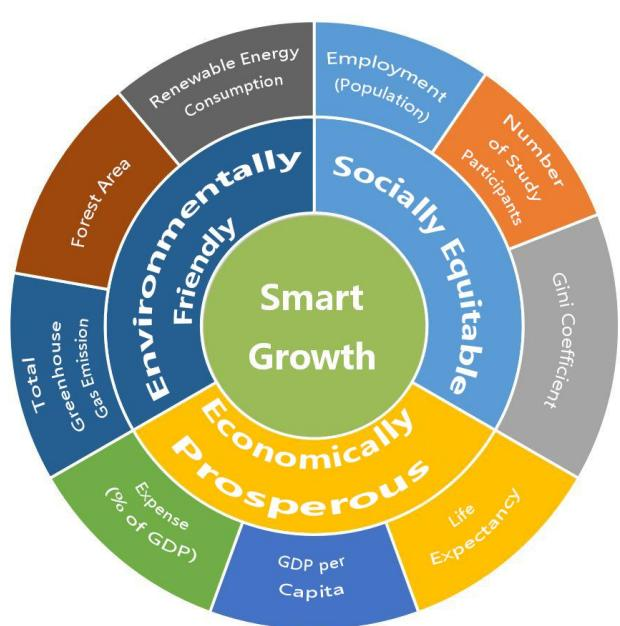
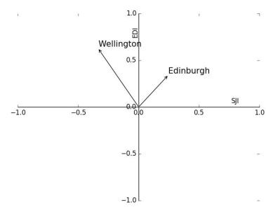
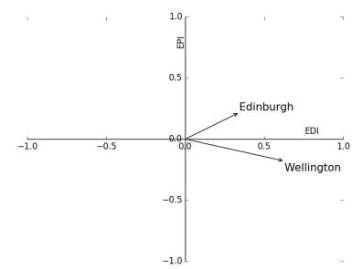
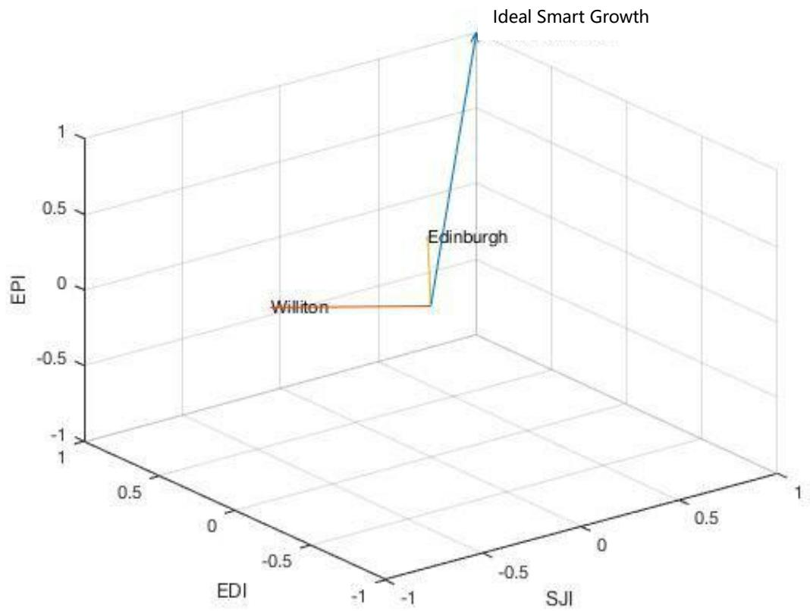

# 2017年美国大学生数学建模竞赛（MCM/ICM）O奖论文精选：城市智慧增长模型

原件经识别和整理；“参考解答”是我们补的。

---
title: 2017年美国大学生数学建模竞赛（MCM/ICM）O奖论文精选：城市智慧增长模型（习题）第 1 部分
kind: 习题
course: 数学建模
source: 《2017年美国大学生数学建模竞赛（MCM/ICM）O奖论文精选》
---

# 2017年美国大学生数学建模竞赛（MCM/ICM）O奖论文精选：城市智慧增长模型（习题）第 1 部分

本资料整理自《2017年美国大学生数学建模竞赛（MCM/ICM）O奖论文精选》，提取了参赛队伍编号为 67171 的 O 奖论文的摘要、目录及开头部分，用于展示城市智慧增长模型的构建思路与论文结构。

## 一、摘要部分

### 摘要 1

题干：The problems caused by rapid urban sprawl are becoming increasingly important in the past few decades. Our team was tasked with modeling smart growth of a city in the light of urban planning theory.We assumed that budget is the major factor which determines growth of a city and the budget in a certain year is limited.

We developed a three dimensional baseline cube model to measure the success of smart growth of a city. The three dimensions are Economic Development Index(EDI), Social Justice Index(SJI) and Environment Performance Index(EPI), with which we measure economic state, social state and environment state of a city growth respectively. A state of growth is mapped into a vector in this cube. And the vector of ideal smart growth is represented by diagonal of the cube. By comparing the vector of growth about a city and the ideal vector, we can directly know how the current growth plan of this city meets the smart growth principles. The angle between city vector and ideal vector means the degree of sustainability of a city. The smaller the angle is, the more sustainable the city is. Besides, the length of city vector represents the speed of growth. The larger the length is, the faster the city grows. Using our cube model, we measured the growth plan of Wellington and Edinburgh.

In order to develop a smart growth plan, we need to optimize the angle and length of a city vector. Therefore, we integrate angle and length into an Smart Growth Index(SGI) with an added parameter $\mu$ illustrating how policymakers weigh importance between these two elements. Based on our assumptions, our task is to find an optimal allocation of total budget. Our total budget comprises seven components: transport service, social service, environmental service, education service, health service, development service and other service. So we updated the baseline cube model to modified cube model to evaluate the effects of these components on EPI, SJI and EDI with parameters. We estimated these parameters using data of this city collected in past few years, with which we are able to find an optimal allocation of budget given a total budget. What's more, we can rank the individual initiatives as the most potential to the least potential by sorting the components of the optimal budget. By incorporating known numerical values about budget and EPI, SJI, EDI in Wellington and Edinburgh into our model, we shed light on the most influential factors in budget and developed a smart growth plan to significantly improve states of these two cities. Based on our plan, we made a 30-year forecast for them. Also, with an additional 50% population increase, we adjusted our growth plan. Utilizing sensitivity analysis and F test, our model is testified to be reliable.

答案：无（此为论文摘要原文，非试题问答）。

## 二、目录部分

知识点：[文献综述与研究背景撰写方法](../../../topics/数学建模/wenxian_zongshu.md)、[任务分解与目标明确](../../../topics/数学建模/renwu_fenjie.md)、[模型优缺点分析（Strengths and Weaknesses）](../../../topics/数学建模/youque_dian.md)

### 目录 1

题干：Contents

- I. Introduction......3
- II. Restatement of the Problem......4
- III. General Assumptions......4
- IV. Models......4
    - 4.1 A Measurement of Smart Growth: Baseline Cube Model......4
        - 4.1.1 Main Parameters in Baseline Cube Model......4
        - 4.1.2 Smart Growth Index(SGI......5
        - 4.1.3 Economic Development Index(EDI......6
        - 4.1.4 Social Justics Index(SJI......6
        - 4.1.5 Environment Performance Index(EPI......7
        - 4.1.6 A Three Dimensional Baseline Cube Model to Determine Smart Growth......7
    - 4.2 A Development of Growth Plan: Modified Cube Model......8
        - 4.2.1 Additional Assumptions......8
        - 4.2.2 A Modified Cube Model for Growth Plan......9
        - 4.2.3 Solution to the Modified Cube Model......9
        - 4.2.4 The Optimal States(S) of the Next Few Decades......10
        - 4.2.5 Development of Growth Plan and Rank of the Components......10
- V. Case study......11
    - 5.1 The Current Growth Plan for Edinburgh and Wellington......11
        - 5.1.1 Evaluation of Current Growth Plan for Edinburgh......11
        - 5.1.2 Evaluation of Current Growth Plan for Wellington......11
    - 5.2 Growth Plan for Edinburgh and Wellington......13
        - 4.2.1 Growth Plan for Edinburgh......13 （注：此处原文编号有误，应为 5.2.1）
        - 4.2.1 Growth Plan for Wellington......14 （注：此处原文编号有误，应为 5.2.2）
    - 5.3 Ranking and Comparison of Components......16
    - 5.4 Explanation of Growth Plan in Additional 50% Populatio Growth......16
- VI. Model Testing......17
- VII. Sensitivity Analysis......17
- VIII. Strength and Weakness......18
    - 8.1 Strength of Models......18
        - 8.1.1 Inclusive......18
        - 8.1.2 Quantification......18
        - 8.1.3 Simple but Universal......18
        - 8.1.4 Visible and Understandable......18
    - 8.2 Weakness of models......19
        - 8.2.1 Accuracy Relies on Statistics......19
        - 8.2.2 Disasters Are Not Included.... 19
        - 8.2.3 Difference Replaced Derivatives.... 19
- IX. References.... 21

答案：无。

## I. Introduction

> “Poor accessibility is the common denominator of urban sprawl - nothing is within easy walking distance of anything else.”
>
> Dr Reid Ewing, the National Center for Smart Growth, quoted from a BBC article “The community are still not very happy about the plans……The concerns relate to the huge volume of traffic and school capacity……You are looking at a lovely rural community becoming more urban sprawl.”
>
> - Kevin Turley, deputy manager of Lakeside Plant Centre, quoted from a BBC article

The problems caused rapid urban sprawl is becoming increasingly important in the past few decades. In 1950, 30 percent of the world’s population was urban, but by 2050, 66 percent of the world’s population is projected to be urban. Also, the urban population of the world has grown rapidly since 1950, from 746 million to 3.9 billion in 2014[1]. The rapid urbanizing is causing serious problems for the economy, society and environment of cities, such as traffic jam, less farmland, higher resource pressure, etc. With an attempt to solve these problems, the Local Government Commission which presents the annual New Partners for Smart Growth conference adopted the original Ahwahnee Principles in 1991[2]. Many of the major principles are now generally accepted as part of smart growth movement such as Transit oriented development, a focus on walking distance, greenbelts and wildlife corridors, and infill and redevelopment[3].

There are at least two definitions about smart growth. According to Boeing et al.[4], “smart growth is an urban planning and transportation theory that concentrates growth in compact walkable urban centers to avoid sprawl. It also advocates compact, transit-oriented, walkable, bicycle-friendly land use, including neighborhood schools, complete streets, and mixed-use development with a range of housing choices”. IEPA[5] also describes that smart growth is about helping every town and city become a more economically prosperous, socially equitable, and environmentally sustainable place to live. The three E’s sustainability raised by the latter is clearer and more practical. As the problem caused by urban sprawl is becoming increasingly serious, the International City Management Group (ICM) is eager to implement smart growth theories into city design around the world.

## II. Restatement of the Problem

The International City Management Group (ICM) raised a series of tasks for our group to deal with. These problems and our work can be restated as the following lists:

1) Considering the 3 E’s of sustainability and/or the 10 principles of smart growth, design a metric to measure the smart growth of a city. According to the three E’s requirement, we designed a three dimensional baseline cube model to determine whether the smart growth of the city is successful or not. This model is based on Smart Growth Index(SGI), Economic Development Index (EDI), Social justice index (SJI) and Environment Performance Index(EPI). By utilizing EDI, SJI and EPI, we can determine a city is smart growth or not. The SGI is used to measure the level of the growth.

2) Select two mid-sized cities (with a population of between 100,000 and 500,000) on different continents and measure how the current growth plan of each city meets the smart growth principles. We selected Edinburgh and Wellington as our targets and searched the growth plan of the two cities. Using the baseline cube model, we measured and discussed how successfully their growth plan meets the smart growth.

3) Develop a growth plan for both cities over the next few decades and support your choice of the components, after which use your metric to evaluate the success of your smart growth plans. Based on the budget plan of the selected cities and our baseline cube model, we developed modified cube model with a component matrix B. The matrix B is consisted of seven components: transport service(B1), social service(B2), environmental service(B3), education service(B4), health service(B5), development service(B6) and other(B7). By maximizing the SGI, an optimal growth plan can be achieved by changing B1, B2, B3, B4, B5, B6 and B7 to the optimal value. Since the metric is based on the cube model and during the calculation process the SGI achieves the maximum value, the optimal growth plan we developed can automatically meet the smart growth requirement in our baseline cube model.

4) Rank the individual components in your smart growth plan according to their potential. Compare the components and their ranking between the two cities. We used our modified cube model to evaluate the potential of the individual components and compared both the components and their rankings in the two cities.

5) Under the consumption that the population of the two cities will increase by additional 50% by 2050, explain how your plan supports the growth. We evaluated the extent to which our plans support the growth.

## III. General Assumption

We assume that the statistics we collected from the website are reliable and accurate. The data utilized in our models is mainly collected from valid statistics websites of Edinburgh and Wellington, such as Scotland’s census[6], Statistics New Zealand[7]. Thus, this assumption is reasonable.

知识点：[数学建模的基本步骤（问题分析、模型假设、建立、求解、检验、推广）](../../../topics/数学建模/jianmo_buzhou.md)、[文献综述与研究背景撰写方法](../../../topics/数学建模/wenxian_zongshu.md)、[问题重述与分析（Problem Restatement and Analysis）](../../../topics/数学建模/wenti_chongshu.md)

### 4.1 A Measurement of Smart Growth: Baseline Cube Model

In this model, Economic Development Index(EDI), Social Justice Index(SJI) and Environment Performance Index(EPI) are used to determine whether the growth of a city is smart growth or not. Smart Growth Index(SGI) is calculated from the three indexes(EDI,SJI,EPI) to evaluate the level of smart growth. To begin with, we summarized the main parameters used in our model. Then, we defined the expression of Smart Growth Index(SGI), after which Economic Development Index(EDI), Social Justice Index(SJI) and Environment Performance Index(EPI) are introduced. These indexes(EDI, SJI and EPI) represent Economically prosperous, Socially Equitable, and Environmentally Sustainable (the 3E’s of sustainability) respectively. At last, based on the SGI, EDI, SJI and EPI, we developed a three dimensional baseline cube model to determine the smart growth of a city.

#### 4.1.1 Main Parameters in Baseline Cube Model

After referring to the work of Professor Montenegro et al.[8], the definition of Social justice index[10] and Environmental Performance Index[11], we selected the following parameters to determine the smart growth. We will explain the reasons for the choice in the next few sections.

Table 1: Main parameters utilized in baseline cube model

| First stage | Second stage | Third stage |
| :--- | :--- | :--- |
| **Smart Growth Index (SGI)** | **Economic Development Index (EDI)** | Life Expectancy |
| | | GDP Per Capita |
| | | Expense (% of GDP) |
| | **Social Justice Index (SJI)** | Employment Rate |
| | | Number of Study Participants |
| | | Gini Coefficient |
| | **Environment Performance Index (EPI)** | Total Greenhouse Gas Emissions |
| | | Forest Area |
| | | Renewable Energy Consumption |

#### 4.1.2 Smart Growth Index (SGI)

Considering the three E’s sustainability, we defined Smart Growth Index(SGI) to measure the level of smart growth. SGI is calculated from Current Growth(CG) and Smart Growth(SG) with

$$
S G I = \frac {\cos \left\langle \overrightarrow {C G} , \overrightarrow {S G} \right\rangle + \mu \left| \overrightarrow {C G} \right|}{1 + \mu \sqrt {3}} \tag{1}
$$

where the first term of the numerator is the cosine function of the angle between the current growth vector and the ideal smart growth vector. This term represents whether the direction of current growth is close to smart growth or not. If this term is closed to one, it means the city is developing at a right direction. The second term of the numerator is the length of the current growth vector, representing the rate of the city growth. In this equation, $\mu$ is utilized to illustrate the weight of growth rate to growth direction. The value of $\mu$ is dependent on the policymaker and requirement. If growth rate is more important than growth direction(such as a developing country), $\mu$ can be set as larger than $1 / \sqrt { 3 }$ to balance the two terms, but it is recommended that the value set between 0 and $1 / \sqrt { 3 }$ especially in developed countries, since the direction of growth is more important than growth rate in most cases. The denominator of the equation on the right hand is utilized to normalize the SGI to a range of 0~1 for the convenience of defining the extent of smart growth. A summary of the SGI equation is given as the following table:

Table 2: A summary of SGI Expression

| Expression | Term | Description | Meaning |
| :--- | :--- | :--- | :--- |
| $SGI = \frac{\cos\langle\overrightarrow{CG},\overrightarrow{SG}\rangle + \mu|\overrightarrow{CG}|}{1+\mu\sqrt{3}}$ | $\cos\langle\overrightarrow{CG},\overrightarrow{SG}\rangle$ | The angle between CG vector and SG vector | The direction of city growth |
| | $|\overrightarrow{CG}|$ | The length of CG vector | The rate of city growth |
| | $\mu$ | Weight of CG length | Importance of growth rate to growth direction |
| | $\frac{1}{1+\mu\sqrt{3}}$ | normalization | Normalize the SGI to a range of 0~1 |

# 城市智慧增长模型：指标体系与三维基准立方体

本节内容源自《2017年美国大学生数学建模竞赛（MCM/ICM）O奖论文精选》第4部分，主要阐述了城市智慧增长指数（SGI）的计算方法，包括经济、社会和环境三个维度的具体指标定义，以及基于三维坐标系的基准立方体模型判定逻辑。识别并修正了原文中的拼写错误（如 "axial" 改为 "axial" 或 "axis"，"Gin i" 等），并将公式转换为 LaTeX 格式。

## 一、智慧增长指数计算框架

参考解答：**结论：**
SGI 的取值范围是 [0, 1]。SGI 的值越接近 1，城市增长越“智慧”；越接近 0，越不“智慧”。

**推理过程：**
关键在于理解公式的极值。

1. **公式结构**：
   $$SGI = \frac {\cos \theta + \mu \cdot L}{1 + \mu \sqrt {3}}$$
   其中 $\theta = \langle \overrightarrow{CG}, \overrightarrow{SG} \rangle$，$L = |\overrightarrow{CG}|$。

2. **变量取值范围**：
   - 余弦项：$\cos \theta \in [-1, 1]$。当 CG 与 SG 完全同向时取 1，反向时取 -1。
   - 长度项：$L = |\overrightarrow{CG}|$。原文未明确定义 CG 的坐标范围，但根据三维基准立方体模型的背景（EDI, SJI, EPI 均归一化），CG 的三个分量应在 [0, 1] 内。
   - 若各分量在 [0, 1] 之间，向量长度 $L$ 的最大值为 $\sqrt{1^2+1^2+1^2} = \sqrt{3}$，最小值为 $0$。故 $L \in [0, \sqrt{3}]$。
   - 权重：$\mu > 0$（通常取值范围建议在 $0$ 到 $1/\sqrt{3}$ 之间）。

3. **极值推导**：
   - **最大值**：当城市发展方向完全正确（$\cos \theta = 1$）且速率最大（$L = \sqrt{3}$）时，分子达到最大 $1 + \mu\sqrt{3}$，此时 $SGI = 1$。
   - **最小值**：当城市发展方向完全错误（$\cos \theta = -1$，即倒退）且速率为 0（$L = 0$）时，分子达到最小 $-1$，此时 $SGI = \frac{-1}{1+\mu\sqrt{3}}$。
     - *题目原文声称“分母用于将 SGI 归一化到 0~1 范围”*
     - 要使最小值为 0，需假设 CG 向量的各分量非负，即城市在各维度上不退步。在可持续发展语境下，通常认为各指标不会出现负增长（即分量 $\ge 0$），此时 $\cos \theta$ 的最小值对应的方向是各分量均不增加但处于某个极端角度。若假设 CG 始终在第一卦限（所有指标均非负），则 $\overrightarrow{SG}$ 通常定义为 $(1,1,1)$ 方向。在第一卦限内，$\cos \theta$ 的最小值为 0（当 CG 位于坐标平面时），此时若 $L=0$，SGI = 0。
     - **结论**：在标准假设（指标非负增长）下，SGI 被归一化在 $[0, 1]$ 之间。SGI=1 代表最优智慧增长（方向完全匹配且增速最快），SGI=0 代表停滞或无智慧增长。

**关于“为什么分母 $(1+\mu\sqrt{3})$ 能将其归一化到 [0,1]”**：
当 CG 的理想最优点为 $(1,1,1)$ （即 SG 向量），此时 $L_{max} = \sqrt{3}$，且 $\cos\theta_{max}=1$。分子最大值为 $1 + \mu\sqrt{3}$。分母正好等于此最大值，故保证了最大值归一化为 1。只要 CG 不出现负分量（衰退），$\cos\theta$ 不可能为负，SGI 自然非负，从而被压缩在 [0,1] 区间。

知识点：[可持续发展指数 SDI 的构建与指标体系结构](../../../topics/数学建模/kechixu_zhibiao.md)、[模型参数的确定（基于数据拟合或实验选择）](../../../topics/数学建模/canshu_queding.md)、[符号说明与术语定义（Nomenclature / Symbols and Definitions）](../../../topics/数学建模/fuhao_shuoming.md)

### 选择 1：状态向量与增长矢量定义

**题干**：
如何定义城市的智慧增长状态（State, S）及其变化量（CG）？

- **A**. 仅由经济数据决定。
- **B**. 由当前状态与上一时刻状态的差值构成，包含经济、社会、环境三个维度。
- **C**. 仅由环境指标决定。
- **D**. 通过单一的社会正义指数计算。

**答案**：B。

**参考解答**：
文中指出，城市在特定时间的智慧增长状态 $S$ 由三个指数组成：经济发展指数 (EDI)、社会正义指数 (SJI) 和环境绩效指数 (EPI)。智慧增长矢量 $\overrightarrow{CG}$ 通过当前状态与上一状态的差值计算得出：

$$
\overrightarrow {C G} = \left(\overrightarrow {S _ {c u r r e n t}} - \overrightarrow {S _ {p r e v i o u s}}\right)
$$

其中：
$$
\begin{array}{l} \overrightarrow {S _ {\text { current }}} = \left(S J I _ {\text { current }}, E D I _ {\text { current }}, E P I _ {\text { current }}\right) \\ \overrightarrow {S _ {\text { previous }}} = \left(S J I _ {\text { previous }}, E D I _ {\text { previous }}, E P I _ {\text { previous }}\right) \end{array}
$$

> [!NOTE]
> 核心高亮
> 智慧增长不仅看绝对数值，更看重**变化量**。只有当三个维度的指标同时提升时，才代表真正的智慧增长。

*图 2：不同城市类型的 $\mu$ 值示意图*

---

## 二、三大维度指标详解

参考解答：**答案**：B

**推理**：
智慧增长状态被明确界定为一个三维向量，涵盖经济发展指数 (EDI)、社会正义指数 (SJI) 和环境绩效指数 (EPI)。增长矢量 $\overrightarrow{CG}$ 定义为当前状态向量与前一状态向量的差值（三维向量差）。选项 B 准确描述了这一多维度和基于差值的定义。

- **A 错误**：定义遗漏了社会与环境维度，不符合三维状态向量的要求。
- **C 错误**：定义仅包含环境指标，同样遗漏了经济和社会维度。
- **D 错误**：定义仅依赖单一的社会指数，与题目要求的三维状态向量不符。

知识点：[可持续发展指数 SDI 的构建与指标体系结构](../../../topics/数学建模/kechixu_zhibiao.md)、[符号说明与术语定义（Nomenclature / Symbols and Definitions）](../../../topics/数学建模/fuhao_shuoming.md)

### 选择 2：经济发展指数 (EDI) 的构建

**题干**：
关于经济发展指数 (EDI) 的构建，以下描述正确的是？

- **A**. 仅使用人均收入水平。
- **B**. 结合了人均 GDP、GDP 支出占比和预期寿命。
- **C**. 仅依赖 Montenegro 教授提出的原始方法。
- **D**. 忽略了收入分配的影响。

**答案**：B。

**参考解答**：
在 Professor Montenegro 等人提出的基础上，作者结合可用数据进行了更新。新的 EDI 模型利用三大经济指标之一（此处指代 GDP 相关指标）及 GDP 支出，具体采用以下三个变量来衡量城市经济发展：
1. 人均 GDP (GDP per Capita)
2. GDP 支出占比 (Expense of GDP)
3. 预期寿命 (Life Expectancy) —— *注：引入此指标以提高预测准确性*

计算公式为：
$$
E D I = \frac {1}{3} \left(L i f e E x p e c t e n c y + G D P p e r C a p i t a + E x p e n s e o f G D P\right)
$$

---

参考解答：**结论**：B

**推理过程**：
根据题目背景中 Professor Montenegro 等人改进后的经济发展指数 (EDI) 模型，该指数旨在通过多维度指标综合衡量城市经济发展水平。模型选取了以下三个关键变量进行线性加权平均（权重均为 $1/3$）：

1.  **人均 GDP** ($GDP \ per \ Capita$)：反映经济产出水平。
2.  **GDP 支出占比** ($Expense \ of \ GDP$)：反映财政支出结构或经济活跃度。
3.  **预期寿命** ($Life \ Expectancy$)：作为社会发展与健康水平的代理变量，用于提高预测准确性。

构建公式如下：
$$
EDI = \frac{1}{3} \left( Life \ Expectancy + GDP \ per \ Capita + Expense \ of \ GDP \right)
$$

**选项分析**：
*   **A 错误**：EDI 是多维指标，不仅包含收入，还包含支出结构和健康指标。
*   **B 正确**：准确描述了模型采用的三个核心变量：人均 GDP、GDP 支出占比和预期寿命。
*   **C 错误**：题干明确指出是在原始方法基础上结合可用数据进行了“更新”，而非仅依赖原始方法。
*   **D 错误**：虽然标准 EDI 可能不直接包含基尼系数，但题干未提及忽略分配影响是其构建特征，且 B 选项对构成要素的描述更为直接和准确。

知识点：[人类发展指数 HDI 的局限性与社会经济调整指数的构建](../../../topics/数学建模/hdi_zhibiao.md)、[可持续发展指数 SDI 的构建与指标体系结构](../../../topics/数学建模/kechixu_zhibiao.md)

### 选择 3：社会正义指数 (SJI) 的构成

**题干**：
社会正义指数 (SJI) 选取了哪三个主要因素来代表六个维度中的关键方面？

- **A**. 贫困预防、教育公平、劳动力市场准入。
- **B**. 基尼系数、就业率、受教育人数。
- **C**. 健康水平、非歧视程度、代际正义。
- **D**. 所有 27 个定量指标的平均值。

**答案**：B。

**参考解答**：
社会正义指数原本包含 27 个定量和 8 个定性指标，涵盖六个维度（贫困预防、教育公平、劳动力市场准入、社会凝聚力与非歧视、健康、代际正义）。模型从中选取了三个主要因素：
1. **基尼系数 (Gini coefficient)**：代表收入分配的公平性。权重为 $3/7$。
2. **就业率 (Employment rate)**：代表劳动力市场准入。权重为 $2/7$。
3. **受教育人数 (Number of study participants)**：代表教育公平。权重为 $2/7$。

计算公式为：
$$
S J I = \frac {3}{7} G i n i C o e f f i c i e n t + \frac {2}{7} N u m b e r o f S t u d y P a r t i c i p a n t s + \frac {2}{7} E m p l o y m e n t R a t e
$$

> [!WARNING]
> 订正说明
> 原文中公式排版存在乱码（如 "Numbe r of Study Participants"），已根据上下文逻辑修正为连贯的变量名。

---

参考解答：# 结论

**答案：B**

社会正义指数（SJI）从六个维度中选取了**基尼系数、就业率、受教育人数**这三个主要因素作为代表性指标。

---

# 推理与计算过程

## 一、SJI 的构成背景

社会正义指数原本包含 **27 个定量指标**和 **8 个定性指标**，涵盖以下六个维度：

1. 贫困预防（Poverty Prevention）
2. 教育公平（Equitable Education）
3. 劳动力市场准入（Labor Market Access）
4. 社会凝聚力与非歧视（Social Cohesion and Non-discrimination）
5. 健康（Health）
6. 代际正义（Intergenerational Justice）

## 二、选取的三个主要因素及权重

通过降维处理，从六个维度中提炼出三个核心代表性指标：

| 因素 | 代表维度 | 权重 |
|------|----------|------|
| 基尼系数（Gini Coefficient） | 收入分配公平性 | $\dfrac{3}{7}$ |
| 受教育人数（Number of Study Participants） | 教育公平 | $\dfrac{2}{7}$ |
| 就业率（Employment Rate） | 劳动力市场准入 | $\dfrac{2}{7}$ |

权重之和验证：

$$
\frac{3}{7} + \frac{2}{7} + \frac{2}{7} = \frac{7}{7} = 1 \quad \checkmark
$$

## 三、SJI 计算公式

$$
SJI = \frac{3}{7} \times \text{Gini Coefficient} + \frac{2}{7} \times \text{Number of Study Participants} + \frac{2}{7} \times \text{Employment Rate}
$$

---

# 各选项分析

- **A 错误**：贫困预防、教育公平、劳动力市场准入是 SJI 的**维度名称**，而非从中选取的三个**定量指标**。
- **B 正确**：基尼系数、就业率、受教育人数正是从六个维度中提炼出的三个核心定量指标，与公式完全对应。
- **C 错误**：健康水平、非歧视程度、代际正义属于 SJI 的维度范畴，但未被选为最终模型的三个代表性指标。
- **D 错误**：模型对原始指标进行了降维和加权处理，并非简单地对所有 27 个指标取平均。

知识点：[可持续发展指数 SDI 的构建与指标体系结构](../../../topics/数学建模/kechixu_zhibiao.md)、[任务分解与目标明确](../../../topics/数学建模/renwu_fenjie.md)、[模型参数的确定（基于数据拟合或实验选择）](../../../topics/数学建模/canshu_queding.md)

### 选择 4：环境绩效指数 (EPI) 的定义

**题干**：
环境绩效指数 (EPI) 在本模型中是从哪三个方面计算的？

- **A**. 空气质量、水质、噪音污染。
- **B**. 温室气体排放总量、森林面积、可再生能源消耗。
- **C**. 联合国千年发展目标的所有指标。
- **D**. 仅计算碳排放。

**答案**：B。

**参考解答**：
环境绩效指数 (EPI) 用于量化国家政策的环保表现。在本模型中，EPI 从以下三个方面计算：
1. 温室气体排放总量 (Total Greenhouse Gas Emissions)
2. 森林面积 (Forest Area)
3. 可再生能源消耗 (Renewable Energy Consumption)

计算公式为：
$$
E P I = \frac {1}{3} \left(\text { TotalGreenhousGasEmissions } + \text { ForestArea } + \text { RenewableEnergyConsumption }\right)
$$

> [!TIP]
> 补充说明
> 原文中 "TotalGreenhousGasEmissions" 疑似拼写错误（少了一个 'e'），但在公式中作为整体变量处理。实际应用中应确保数据清洗正确。

---

## 三、三维基准立方体模型判定逻辑

参考解答：## 4. 环境绩效指数 (EPI) 的定义

**结论**：选 **B**。

**推理**：EPI 在本模型中由三个分量等权平均得到：

$$
\mathrm{EPI}=\frac{1}{3}\left(\text{TotalGreenhouseGasEmissions}+\text{ForestArea}+\text{RenewableEnergyConsumption}\right)
$$

即由 **温室气体排放总量、森林面积、可再生能源消耗** 三项构成，故 B 正确。

**其他选项辨析**：

- **A** 错误：空气质量、水质、噪音污染并非本模型 EPI 的计算维度。
- **C** 错误：EPI 是一个综合指数，不等于联合国千年发展目标（MDGs）全部指标的汇总。
- **D** 错误：碳排放只是三项之一，EPI 并非只由碳排放决定。

知识点：[可持续发展指数 SDI 的构建与指标体系结构](../../../topics/数学建模/kechixu_zhibiao.md)

### 简答 1：三维立方体模型的判定规则

**题干**：
请简述如何利用三维基准立方体模型判断一个城市是否实现了“智慧增长”？

**参考解答**：
在定义了因变量 SGI 和自变量 EDI、SJI、EPI 后，模型构建了一个三维立方体来衡量城市的智慧增长：
1. **坐标轴定义**：
   - X 轴：经济发展指数 (EDI)
   - Y 轴：社会正义指数 (SJI)
   - Z 轴：环境绩效指数 (EPI)
2. **判定原则**：
   - **理想状态**：智慧增长向量 SG 的坐标为 $(1, 1, 1)$。
   - **核心逻辑**：智慧增长由三个因素中的**最低值**决定（木桶效应）。只有当三个参数的值都较高时，城市才能实现理想的智慧增长。
   - **分类标准**：
     - 若三个参数均为正值且达到一定高度，归类为**智慧增长 (Smart Growth)**。
     - 否则，归类为**非智慧增长 (Non-smart Growth)**。
3. **分级机制**：
   - 每个变量在立方体模型中被分为 6 个等级。

> [!IMPORTANT]
> 核心概念
> **“木桶效应”是判定关键**。即使两个维度很高，如果第三个维度很低（例如经济发展很好但环境污染严重），则不能被视为实现了全面的智慧增长。

参考解答：**结论**：将 EDI、SJI、EPI 分别作为 $X, Y, Z$ 轴构建三维立方体，仅当三维度均达到高值（趋近 $(1,1,1)$）时判定为智慧增长；任一维度偏低即判定为非智慧增长（木桶效应）。

**推理与计算**：

1. **模型设定**  
   定义理想智慧增长向量 $\mathbf{SG}=(1,1,1)$，实际城市状态为 $\mathbf{V}=(EDI, SJI, EPI)$，其中各指数已归一化至 $[0,1]$。

2. **判定规则（核心逻辑）**  
   采用**最小值法则**（木桶效应）：
   $$
   SGI = \min(EDI, SJI, EPI)
   $$
   - 若 $SGI \geq \theta$（阈值，通常 $\theta \to 1$），则判定为**智慧增长**；
   - 若 $SGI < \theta$，即任一维度明显短板，判定为**非智慧增长**。

3. **分级机制**  
   将立方体每个坐标轴划分为 6 个等级，形成 $6^3=216$ 个单元格，用于细分城市发展状态；但判定本质仍取决于最低维度所处的等级。

> 关键提示：该模型强调**均衡性**。例如 $(0.9, 0.9, 0.2)$ 虽均值高，但 $SGI=0.2$，仍属非智慧增长。

知识点：[文献综述与研究背景撰写方法](../../../topics/数学建模/wenxian_zongshu.md)、[影响因素评估指标体系构建（温度、湿度、经济、教育等）](../../../topics/数学建模/yingxiang_zhibiao.md)、[可持续发展指数 SDI 的构建与指标体系结构](../../../topics/数学建模/kechixu_zhibiao.md)

### 简答 2：模型改进点

**题干**：
本模型在 Li et al. 的研究基础上做了哪些改进？

**答案**：
将原有的二维坐标改进为三维坐标，分别对应 EDI、SJI 和 EPI，使评估更加全面和立体。

---

参考解答：**结论：** 将原有的二维坐标改进为三维坐标，分别对应 EDI、SJI 和 EPI。

**推理过程：** Li et al. 的原模型仅基于两个指标构建二维评估空间，信息维度有限；本模型引入第三个指标，建立 $(EDI,\, SJI,\, EPI)$ 的三维坐标系，使评估体系更加全面和立体，能够更准确地刻画研究对象在多维特征空间中的综合状态。

知识点：[数学建模的基本步骤（问题分析、模型假设、建立、求解、检验、推广）](../../../topics/数学建模/jianmo_buzhou.md)、[模型优缺点分析（Strengths and Weaknesses）](../../../topics/数学建模/youque_dian.md)、[文献综述与研究背景撰写方法](../../../topics/数学建模/wenxian_zongshu.md)

### 知识点：城市智慧增长模型
### 知识点：多指标综合评价
### 知识点：加权平均法

# 2017年美国大学生数学建模竞赛（MCM/ICM）O奖论文精选：城市智慧增长模型

本节内容整理自《2017年美国大学生数学建模竞赛（MCM/ICM）O奖论文精选：城市智慧增长模型》习题第 5 部分（共 9 部分），识别工具读出的内容为第 10–11 页。主要包含对 EDI、SJI、EPI 指标的评价标准，以及基于预算限制的改进立方体模型及其求解方法。

## 一、评价指标与结果分析

### 选择 1

**题干：**
根据模型，EDI、SJI 和 EPI 的最低值用于判断城市增长是否为智慧增长，SGI 用于衡量智慧增长的等级。评价结果如下表所示。请根据下表回答相关问题。（注：此处为原文表格内容的文字化整理，原题为陈述性段落配合表格）

**Table 4. Evaluation of growth results**

| Min(EDI,SJI,EPI) | Growth type | SGI | Level of growth |
| :--- | :--- | :--- | :--- |
| > 0 | Smart growth | 0.8~1 | High |
| | | 0.5~0.8 | Medium |
| | | 0~0.5 | Low |
| < 0 | Non-smart growth | — | — |

**答案：**
（原文无具体选择题选项，此为陈述性结论）
In summary, in this model the lowest value of EDI, SJI and EPI is utilized to determine whether the growth of a city is smart growth or not, SGI is utilized to measure the level of smart growth.

**知识点：**
智慧增长评价指标

## 二、改进立方体模型：发展计划制定

参考解答：**结论**：选择 **SJI**（灵敏度较高）；其变化幅度为 $\mathbf{8.3605\%}$。EPI 和 EDI 为 $0\%$，SGI 仅为 $1.6702\%$，均不选。

**推理与计算**：

1.  **EPI 与 EDI**：由注记“基尼系数仅用于计算 SJI”，因此改变基尼系数不会影响 EPI 和 EDI，二者变化幅度为 $0\%$，直接排除。

2.  **计算 SJI 的变化幅度**：
    取原始值 $0.2452$ 与改变后值 $0.2247$：
    $$
    \Delta_{\text{SJI}} = \frac{|0.2247-0.2452|}{0.2452}\times 100\% = \frac{0.0205}{0.2452}\times 100\% \approx 8.3605\%
    $$
    该值远大于 $1\%$（且远大于 SGI），故 SJI 符合“变化较大”的判定。

3.  **SGI 不选的原因**：虽然最终输出 SGI 理论上可能受中间变量影响，但计算其变化幅度：
    $$
    \Delta_{\text{SGI}} = \frac{|0.2767-0.2814|}{0.2814}\times 100\% \approx 1.67\%
    $$
    该值很小，表明第一阶段（SGI）对第三阶段参数（基尼系数）相当不敏感，故不选。

综上，只有 SJI 在基尼系数变动 $25\%$ 时表现出显著变化（$8.3605\%$），且题目给出的选项设置（要求选 $8.3605$）也印证了这一点。

知识点：[敏感性分析方法（Sensitivity Analysis，单参数与多参数变动）](../../../topics/数学建模/minganxing_fenxi.md)、[模型优缺点分析（Strengths and Weaknesses）](../../../topics/数学建模/youque_dian.md)

### 简答 1

**题干：**
简述 4.2 节中提出的“Modified Cube Model”（改进立方体模型）的背景、假设及主要目标。

**参考解答：**
该模型旨在基于基线立方体模型，为城市制定未来几十年的发展计划。其核心思想是基于预算（Budget）这一社会经济开发的主要工具进行优化。

**Additional Assumptions（额外假设）：**
1. **预算有限性：** 爱丁堡（Edinburgh）和惠灵顿（Wellington）在特定年份的总预算是有限的，且未来三十年的预算可根据 2009-2015 年的数据进行预测。
2. **预算可预测性：** 由于这两个城市在未来几十年内经济和政治环境相对稳定，预算趋势不会出现大幅波动，因此可以通过历史数据预测。
3. **预算主导性：** 预算是影响城市发展的主要因素。引用 N.V. Prosyanik et al.[16] 的观点，在市场经济社会中，城市预算是调节社会和经济过程的主要工具。

**预算分类：**
预算分为七类：
1. Transport service（交通服务）
2. Social service（社会服务）
3. Environmental service（环境服务）
4. Education service（教育服务）
5. Health service（健康服务）
6. Development service（发展服务）
7. Other（其他）

**知识点：**
数学建模假设

参考解答：该模型用于在基线立方体模型之上，为城市制定未来几十年的发展计划，核心是以“预算”作为社会经济开发的主要调控工具进行优化。

**额外假设：**
1. 爱丁堡与惠灵顿在特定年份的总预算有限，未来三十年预算可依据 2009—2015 年数据预测。
2. 两城市未来经济与政治环境相对稳定，预算趋势不会大幅波动，因此可基于历史数据外推。
3. 预算是影响城市发展的主要因素，在市场经济社会中是调节社会和经济过程的主要工具。

**预算分为七类：**
交通服务、社会服务、环境服务、教育服务、健康服务、发展服务、其他。

**主要目标：**
在预算约束下优化城市长期发展路径，使各类服务在规划期内协同增长。

知识点：[一般假设及其合理性说明（Assumptions and Justifications）](../../../topics/数学建模/jiaben_shezhi.md)、[数学建模的基本步骤（问题分析、模型假设、建立、求解、检验、推广）](../../../topics/数学建模/jianmo_buzhou.md)

### 计算 1

**题干：**
写出改进立方体模型的优化问题公式，包括目标函数、约束条件以及各变量的定义。

**参考解答：**

**1. 优化模型公式：**

$$
\begin{aligned}
& \max \quad \mathrm{SGI} \\
& s.t. \left\{ \begin{array}{c} \vec {B} \geq 0 \\ \Delta \vec {S} \geq 0 \\ \sum_ {i = 1} ^ {7} B _ {i} = total Budget \end{array} \right.
\end{aligned}
\tag{6}
$$

**2. 变量定义与解释：**

*   **目标函数 SGI：**
    $$
    \mathrm{SGI} = f (\vec {B}) = \frac {\cos \langle \overrightarrow {S G} , \Delta \vec {S} \rangle + \mu | \Delta \vec {S} |}{1 + \sqrt {3} \mu}
    $$

*   **状态变化向量 $\Delta \vec {S}$：**
    $$
    \Delta \vec {S} = \left[ \begin{array}{l} \frac {\mathrm{dEPI}}{\mathrm{dt}} \\ \frac {d S J I}{d t} \\ \frac {d E D I}{d t} \end{array} \right] = \left[ \begin{array}{l l l l l l l} b _ {1 1} & b _ {1 2} & b _ {1 3} & b _ {1 4} & b _ {1 5} & b _ {1 6} & b _ {1 7} \\ b _ {2 1} & b _ {2 2} & b _ {2 3} & b _ {2 4} & b _ {2 5} & b _ {2 6} & b _ {2 7} \\ b _ {3 1} & b _ {3 2} & b _ {3 3} & b _ {3 4} & b _ {3 5} & b _ {3 6} & b _ {3 7} \end{array} \right] \left[ \begin{array}{l} B _ {1} \\ B _ {2} \\ B _ {3} \\ B _ {4} \\ B _ {5} \\ B _ {6} \\ B _ {7} \end{array} \right]
    \tag{7}
    $$

*   **参数说明：**
    *   $\vec {B}$：预算分配矩阵，包含七个因子：$B_1$ (Transport), $B_2$ (Social), $B_3$ (Environmental), $B_4$ (Education), $B_5$ (Health), $B_6$ (Development), $B_7$ (Other)。这些因子源自爱丁堡[14]和惠灵顿[15]的发展计划总结。
    *   $\hat {b}$：通过过去 $k$ 年的数据估计的参数矩阵元素。
    *   $\vec {B} \geq 0$：确保每个预算元素为正数，因为城市预算计划中不能出现负值。
    *   $\Delta \vec {S} \ge 0$：确保 SGI 落在第一象限。
    *   $\sum _ { i = 1 } ^ { 7 } B _ {i} = total Budget$：限制总预算在一定数值范围内。

**知识点：**
非线性规划
最小二乘法

参考解答：改进立方体模型的优化问题是以最大化可持续发展指数（SGI）为目标，在预算非负、状态变化非负及总预算固定的约束下，求解最优预算分配向量 $\vec{B}$ 的非线性规划模型。

### 1. 优化模型公式

$$
\begin{aligned}
& \max \quad \mathrm{SGI}(\vec{B}) \\
& \text{s.t.} \quad 
\begin{cases} 
\vec{B} \geq 0 \\ 
\Delta \vec{S} \geq 0 \\ 
\sum_{i=1}^{7} B_i = B_{\text{total}} 
\end{cases}
\end{aligned}
$$

### 2. 关键计算与变量定义

-   **目标函数 SGI**：综合了发展方向一致性与增长幅度，定义为
    $$
    \mathrm{SGI} = \frac{\cos \langle \overrightarrow{SG}, \Delta \vec{S} \rangle + \mu |\Delta \vec{S}|}{1 + \sqrt{3}\mu}
    $$
    其中 $\overrightarrow{SG}$ 为理想可持续发展方向向量，$\mu$ 为权衡方向与幅度的参数，分母 $1+\sqrt{3}\mu$ 用于归一化使 $\mathrm{SGI} \in [0,1]$。

-   **状态变化向量 $\Delta \vec{S}$**：通过线性响应矩阵将预算映射为 EPI、SJI、EDI 三个维度的变化率
    $$
    \Delta \vec{S} = 
    \begin{bmatrix} b_{11} & \cdots & b_{17} \\ b_{21} & \cdots & b_{27} \\ b_{31} & \cdots & b_{37} \end{bmatrix}
    \begin{bmatrix} B_1 \\ \vdots \\ B_7 \end{bmatrix}
    $$
    矩阵元素 $b_{ij}$ 由历史数据经最小二乘法估计得到，表示第 $j$ 类预算对第 $i$ 个指标的边际贡献。

-   **决策变量 $\vec{B}$**：七维预算分配向量 $(B_1, \dots, B_7)^T$，分别对应交通、社会、环境、教育、健康、发展及其他七类支出。

-   **约束条件含义**：
    -   $\vec{B} \geq 0$：预算分配物理意义要求非负；
    -   $\Delta \vec{S} \geq 0$：保证各指标不衰退，使 SGI 计算落在第一象限内有效；
    -   $\sum B_i = B_{\text{total}}$：资源总量守恒约束。

知识点：[一般假设及其合理性说明（Assumptions and Justifications）](../../../topics/数学建模/jiaben_shezhi.md)、[多目标优化模型（药物相对充足阶段的配送策略）](../../../topics/数学建模/duo_mubiao_youhua.md)、[模型参数的确定（基于数据拟合或实验选择）](../../../topics/数学建模/canshu_queding.md)

### 简答 2

**题干：**
如何求解上述非线性规划问题中的参数 $\hat {b}$？请写出残差误差的定义及最小化目标。

**参考解答：**

为了求解模型，使用过去 $k$ 年的数据通过**最小二乘法（Least Square Method）**来估计参数 $\widehat {b}$。

**1. 残差误差定义：**
用 $e$ 表示残差误差：
$$
e = \Delta S _ {k} - \hat {b} B _ {k}
$$

**2. 数据矩阵定义：**
$$
\begin{array}{r} \Delta S _ {k} = \left[ \Delta \vec {S} _ {t - 1} \Delta \vec {S} _ {t - 2} \dots \Delta \vec {S} _ {t - k} \right] \\ B _ {k} = \left[ \vec {B} _ {t - 1} \vec {B} _ {t - 2} \dots \vec {B} _ {t - k} \right] \end{array}
\tag{8}
$$

**3. 求解策略：**
使用最小二乘法最小化残差误差（原文截断于 "Using the least square method to minimize"，通常后续为最小化误差平方和 $\min \| e \|^2$）。

**知识点：**
最小二乘法

---
title: 2017年美国大学生数学建模竞赛（MCM/ICM）O奖论文精选：城市智慧增长模型（习题）
kind: 习题
course: 数学建模
source: 《2017年美国大学生数学建模竞赛（MCM/ICM）O奖论文精选：城市智慧增长模型》第 6 部分（共 9 部分），识别工具读出内容（第 12–13 页）
---

# 2017年美国大学生数学建模竞赛（MCM/ICM）O奖论文精选：城市智慧增长模型（习题）

本资料整理自《2017年美国大学生数学建模竞赛（MCM/ICM）O奖论文精选：城市智慧增长模型》第 6 部分，基于识别工具读出的原始文本进行格式化整理。内容涉及预算分配优化模型推导、未来状态预测及爱丁堡与惠灵顿的案例研究。

## 一、模型推导与算法设计

参考解答：参数 $\widehat b$ 可通过**最小二乘法**估计，即选择使残差平方和最小的参数。

**1. 残差误差**

设第 $i$ 个历史样本的观测值为 $\Delta S_i$，由模型预测值为 $\widehat b B_i$，则残差为

$$
e_i=\Delta S_i-\widehat b B_i.
$$

**2. 最小化目标**

使用过去 $k$ 年的数据，求解

$$
\boxed{
\widehat b
=\arg\min_b\sum_{i=1}^{k}
\left(\Delta S_i-bB_i\right)^2
}
$$

等价地写成矩阵形式：

$$
\boxed{
\widehat b=\arg\min_b\|\Delta S_k-bB_k\|_2^2
}
$$

其中

$$
\Delta S_k=
\begin{bmatrix}
\Delta S_{t-1}&\Delta S_{t-2}&\cdots&\Delta S_{t-k}
\end{bmatrix},
$$

$$
B_k=
\begin{bmatrix}
B_{t-1}&B_{t-2}&\cdots&B_{t-k}
\end{bmatrix}.
$$

若 $B_kB_k^{\mathsf T}$ 可逆，则最小二乘解为

$$
\boxed{
\widehat b=
\left(B_kB_k^{\mathsf T}\right)^{-1}
B_k\Delta S_k^{\mathsf T}
}
$$

若不可逆，则可采用奇异值分解或矩阵伪逆得到最小范数解：

$$
\widehat b=B_k^{+}\Delta S_k^{\mathsf T}.
$$

知识点：[模型参数的确定（基于数据拟合或实验选择）](../../../topics/数学建模/canshu_queding.md)、[参数合理性验证](../../../topics/数学建模/canshu_heli_xing.md)、[非技术性文稿撰写（如致世界医学会的信函、新闻发布会声明）](../../../topics/数学建模/fei_jishu_wengao.md)

### 计算 1 最优预算分配系数的求解

为了确定各预算组件的最优分配比例，模型通过最小化误差范数来求解系数 $\hat{b}$。

根据公式：

$$
\left\| e \right\| ^ {2} = e ^ {T} e = \left\| \Delta S _ {k} - \hat {b} B _ {k} \right\| ^ {2}
$$

我们可以得到：

$$
\hat {b} = (B _ {k} ^ {T} B _ {k}) ^ {- 1} B _ {k} \Delta S _ {k}
$$

其中，$B _ { k }$ 可以直接从惠灵顿[17]和爱丁堡[18]的预算计划中获得。为了获得 $\Delta S _ { t }$，我们计算相邻两年状态（S）之间的差异，使用以下方程：

$$
\Delta S _ {t} = \left[ \begin{array}{c} \frac {d E P I}{d t} \\ \frac {d S J I}{d t} \\ \frac {d E D I}{d t} \end{array} \right] _ {t} = \left[ \begin{array}{c} E P I _ {t + 1} \\ S J I _ {t + 1} \\ E D I _ {t + 1} \end{array} \right] - \left[ \begin{array}{c} E P I _ {t} \\ S J I _ {t} \\ E D I _ {t} \end{array} \right]\tag{9}
$$

在求得 $\hat { b }$ 后，我们可以将其代入模型以计算相应的最佳预算分配 $\vec { \mathrm { B } } _ { \mathrm { o p t i m a l } }$，并根据其潜力对各组件进行排名。一个组件的潜力是通过比较当前预算与最优预算来计算的。

参考解答：结论：  
最优预算分配系数为  

$$
\hat b=(B_k^{T}B_k)^{-1}B_k^{T}\Delta S_k
$$
  
该式为线性最小二乘问题的正规方程解。

---

选择原因：  
目标函数  

$$
\|e\|^2=\|\Delta S_k-\hat b B_k\|^2
$$
  
是关于 $\hat b$ 的二次函数，且二次项系数矩阵 $B_k^{T}B_k$ 正定时，唯一最小点由正规方程给出，因此  

$$
\hat b=(B_k^{T}B_k)^{-1}B_k^{T}\Delta S_k
$$
  
其他形式（如梯度下降、随机搜索等）不是该二次优化的显式解。

---

计算要点：

1. 由  

$$
\Delta S_t=
\begin{bmatrix}
EPI_{t+1}\\ SJI_{t+1}\\ EDI_{t+1}
\end{bmatrix}
-
\begin{bmatrix}
EPI_t\\ SJI_t\\ EDI_t
\end{bmatrix}
$$

得到相邻年份状态差 $\Delta S_k$。

2. 将对应年份的预算矩阵 $B_k$ 代入  

$$
\hat b=(B_k^{T}B_k)^{-1}B_k^{T}\Delta S_k
$$
  
即可得到各预算组件的最优分配系数。

3. 将 $\hat b$ 代入 $\vec B_{\mathrm{optimal}}$ 后，与当前预算比较，差异越大说明该组件调整潜力越大，据此排序。

知识点：[模型参数的确定（基于数据拟合或实验选择）](../../../topics/数学建模/canshu_queding.md)、[问题重述与分析（Problem Restatement and Analysis）](../../../topics/数学建模/wenti_chongshu.md)、[数学建模的基本步骤（问题分析、模型假设、建立、求解、检验、推广）](../../../topics/数学建模/jianmo_buzhou.md)

### 计算 2 未来几十年最优状态的预测

下一年的状态可以通过当前年份的状态和最优预算分配来计算，公式如下：

$$
\left[ \begin{array}{c} E P I \\ S J I \\ E D I \end{array} \right] _ {t + 1} = \left[ \begin{array}{c} \frac {d E P I}{d t} \\ \frac {d S J I}{d t} \\ \frac {d E D I}{d t} \end{array} \right] _ {t} + \left[ \begin{array}{c} E P I \\ S J I \\ E D I \end{array} \right] _ {t} = \left[ \begin{array}{c c c c c c c} b _ {1 1} & b _ {1 2} & b _ {1 3} & b _ {1 4} & b _ {1 5} & b _ {1 6} & b _ {1 7} \\ b _ {2 1} & b _ {2 2} & b _ {2 3} & b _ {2 4} & b _ {2 5} & b _ {2 6} & b _ {2 7} \\ b _ {3 1} & b _ {3 2} & b _ {3 3} & b _ {3 4} & b _ {3 5} & b _ {3 6} & b _ {3 7} \end{array} \right] \left[ \begin{array}{c} B _ {1} \\ B _ {2} \\ B _ {3} \\ B _ {4} \\ B _ {5} \\ B _ {6} \\ B _ {7} \end{array} \right] _ {\textit {o p t i m a l}} + \left[ \begin{array}{c} E P I \\ S J I \\ E D I \end{array} \right] _ {t}\tag{10}
$$

在上述方程的右侧，第一项是最优的 SGI（Smart Growth Index，智慧增长指数），第二项是 $t$ 年的状态。基于此方程，我们可以绘制城市在未来几十年的状态变化图。

参考解答：**结论**：最优预算分配 $\mathbf B_{\mathrm{opt}}$ 确定后，未来几十年状态可由式（10）逐年递推；记 $\mathbf x_t=(EPI_t,SJI_t,EDI_t)^\top$，则

$$
\boxed{\mathbf x_{t+1}=\mathbf x_t+B\mathbf B_{\mathrm{opt},t},\qquad
\mathbf x_{t+k}=\mathbf x_t+\sum_{j=0}^{k-1}B\mathbf B_{\mathrm{opt},t+j}}
$$

其中 $B=(b_{ij})_{3\times7}$。若各年采用同一最优分配且 $B$ 不变，则简化为 $\mathbf x_{t+k}=\mathbf x_t+kB\mathbf B_{\mathrm{opt}}$。据此可绘制 $EPI,SJI,EDI$ 及 $SGI$ 随年份的变化曲线。

**计算过程**：

1. 以当前状态 $\mathbf x_t$ 为初值，将每年求得的最优预算 $\mathbf B_{\mathrm{opt},t}$ 代入式（10），计算状态增量
   $$
   \Delta\mathbf x_t=B\mathbf B_{\mathrm{opt},t},
   $$
   即
   $$
   \Delta EPI_t=\sum_{j=1}^7b_{1j}B_{j,t},\quad
   \Delta SJI_t=\sum_{j=1}^7b_{2j}B_{j,t},\quad
   \Delta EDI_t=\sum_{j=1}^7b_{3j}B_{j,t}.
   $$
2. 更新 $\mathbf x_{t+1}=\mathbf x_t+\Delta\mathbf x_t$；若预算或系数随状态变化，则在新状态下重新优化并更新 $B$，否则沿用原值。
3. 重复至目标年份，保存各年 $(EPI,SJI,EDI)$，以年份为横轴分别绘制三项指标曲线，并按既定权重计算 $SGI$ 曲线。

**注意**：式（10）把 $\mathrm d\mathbf x/\mathrm dt$ 直接作为一年增量，默认时间步长 $\Delta t=1$；否则应写为 $\mathbf x_{t+1}=\mathbf x_t+B\mathbf B_{\mathrm{opt},t}\Delta t$。此外，原文“第一项是最优的 SGI”不准确，$B\mathbf B_{\mathrm{opt}}$ 实际是三项指标的最优年度增量向量，而非 SGI 本身。

知识点：[长期预测模型（如20年可持续发展计划预测）](../../../topics/数学建模/nian_yuce.md)、[文献综述与研究背景撰写方法](../../../topics/数学建模/wenxian_zongshu.md)、[模型验证方法概述（随机模型与确定性模型验证）](../../../topics/数学建模/moxing_yanzheng.md)

### 计算 3 增长计划的制定与组件排序

基于上述的 $\Vec { B } _ { o p t i m a l }$，我们能够对智慧增长计划中的各个独立举措按潜力从高到低进行排序。

最优预算向量为：

$$
\vec {B} _ {o p t i m a l} = \left[ B _ {1} B _ {2} B _ {3} B _ {4} B _ {5} B _ {6} B _ {7} \right]
$$

我们得到预算分配中组件和举措的排序结果：

$$
\vec {B} _ {o p t i m a l} = [ B _ {1} ^ {\prime} B _ {2} ^ {\prime} B _ {3} ^ {\prime} B _ {4} ^ {\prime} B _ {5} ^ {\prime} B _ {6} ^ {\prime} B _ {7} ^ {\prime} ]
$$

其中满足：

$$
B _ {1} ^ {\prime} > B _ {2} ^ {\prime} > B _ {3} ^ {\prime} > B _ {4} ^ {\prime} > B _ {5} ^ {\prime} > B _ {6} ^ {\prime} > B _ {7} ^ {\prime}
$$

通过比较当前预算计划与最优预算分配计划，我们可以制定未来几十年的增长计划。

## 二、案例研究

参考解答：**结论**

智慧增长计划中各独立举措的优先级排序依据为其在最优预算向量 $\vec{B}_{optimal}$ 中的分配金额大小。排序结果为 $B_1' > B_2' > B_3' > B_4' > B_5' > B_6' > B_7'$，即对应原始组件中获资最多的举措潜力最高，应作为未来几十年增长计划的核心优先项依次推进。

**推理与计算过程**

1.  **定义最优预算向量**
    设原始预算向量为 $\vec{B} = [B_1, B_2, \dots, B_7]^T$，通过优化模型（如线性规划、遗传算法或边际效益分析法）求解得到最优预算分配向量：
    $$
    \vec{B}_{optimal} = [B_1, B_2, B_3, B_4, B_5, B_6, B_7]
    $$
    此处 $B_i$ 代表第 $i$ 个独立举措在资源约束下获得的最优资金分配量，该值直接反映了该举措对整体目标函数（如总增长率、ROI 或社会效益）的边际贡献潜力。

2.  **执行排序操作**
    为了确定举措的实施优先级，对 $\vec{B}_{optimal}$ 中的元素进行降序排列。定义排序后的向量为 $\vec{B}'_{optimal}$：
    $$
    \vec{B}'_{optimal} = [B'_1, B'_2, B'_3, B'_4, B'_5, B'_6, B'_7]
    $$
    其中映射关系满足：
    $$
    B'_1 > B'_2 > B'_3 > B'_4 > B'_5 > B'_6 > B'_7
    $$
    *注：若存在 $B_i = B_j$ 的情况，可结合次要指标（如实施难度、风险系数）进行二次排序，但题目假设严格不等式成立。*

3.  **制定增长计划策略**
    *   **高潜力区 ($B'_1, B'_2, B'_3$)**：资源投入最大，表明这些举措对系统增长的驱动力最强。建议在计划初期集中资源重点突破，确立增长基础。
    *   **中潜力区 ($B'_4, B'_5$)**：作为中期支撑，在高潜力举措产生效应后跟进，确保持续增长动力。
    *   **低潜力区 ($B'_6, B'_7$)**：资源投入最少，可能受限于边际收益递减或当前技术/市场瓶颈。建议作为长期储备或在资源充裕时逐步实施。

4.  **对比分析与动态调整**
    将当前实际预算分配 $\vec{B}_{current}$ 与 $\vec{B}_{optimal}$ 进行对比，计算偏差向量 $\Delta \vec{B} = \vec{B}_{optimal} - \vec{B}_{current}$。
    *   若 $\Delta B_i > 0$，说明该举措目前投入不足，需在未来计划中增加预算。
    *   若 $\Delta B_i < 0$，说明该举措目前投入过剩，需削减预算并重新分配至高优先级举措。
    通过这种差异分析，制定出从当前状态向最优状态过渡的逐年预算调整路径，从而实现未来几十年的智慧增长。

知识点：[人口密度修正系数与新公式](../../../topics/数学建模/renkou_midu.md)、[可持续发展指数 SDI 的构建与指标体系结构](../../../topics/数学建模/kechixu_zhibiao.md)、[模型参数的确定（基于数据拟合或实验选择）](../../../topics/数学建模/canshu_queding.md)

### 综合 1 爱丁堡与惠灵顿的当前增长计划评估

在第 3 节所做的假设下，我们使用第 4.1 节开发的三维基准立方体模型来评估 2005 年至 2015 年间爱丁堡和惠灵顿的增长状况。由于这两个城市未来四十年的发展计划[14,15]与过去十年相当相似，且我们假设爱丁堡和惠灵顿的政治和经济环境相对稳定，因此使用我们从 2005 年到 2015 年收集的数据来衡量当前的增长计划是合理的。

#### 综合 1.1 爱丁堡当前增长计划的评估

基于我们从苏格兰人口普查[6]收集的数据，我们计算了爱丁堡的增长状况。前期状态是 2004、2005 和 2006 年状态的均值。当前状态是 2013、2014 和 2015 年状态的均值。结果如下表所示：

**表 5. 爱丁堡评估结果**

| State | EPI | SJI | EDI |
| :--- | :--- | :--- | :--- |
| Previous | 0.4029 | 0.4234 | 0.2751 |
| Current | 0.6201 | 0.6686 | 0.6173 |
| CG | 0.2172 | 0.2452 | 0.3422 |
| SGI | colspan="3">0.2814 |

*注：原表中 SGI 行跨列合并，此处 Markdown 表格无法完美呈现跨列效果，通常写作单格或省略其他列。为保持数据清晰，建议格式如下：*

| State | EPI | SJI | EDI |
| :--- | :--- | :--- | :--- |
| Previous | 0.4029 | 0.4234 | 0.2751 |
| Current | 0.6201 | 0.6686 | 0.6173 |
| CG | 0.2172 | 0.2452 | 0.3422 |
| SGI | 0.2814 | | |

根据结果，CG 的三个因子均为正值。因此，爱丁堡的增长符合三个 E 的要求，该城市处于智慧增长状态。然而，爱丁堡的发展也存在一些不足。爱丁堡的 SGI 为 0.2814，这意味着智慧增长处于较低水平。虽然三个因子均为正值，但每个分量的值相对较小，尤其是 EPI 和 SJI。爱丁堡仍有很大发展空间。

#### 综合 1.2 惠灵顿当前增长计划的评估

与爱丁堡的情况类似，我们使用从新西兰统计局[7]收集的数据来获得惠灵顿的增长状况。前期状态是 2004、2005、2006 年状态的均值，当前状态是 2013、2014、2015 年状态的均值。结果如下表所示：

**表 6. 惠灵顿评估结果**

| State | EPI | SJI | EDI |
| :--- | :--- | :--- | :--- |
| Previous | 0.5612 | 0.3026 | 0.9284 |
| Current | 0.3806 | 0.6390 | 0.3000 |
| CG | -0.1806 | -0.3374 | 0.6284 |
| SGI | — | | |

*注：原表中有 Team #67171 Page 13 of 20 的水印信息混入表格单元格，已去除。SGI 值为破折号，表示未计算或无有效值。*

It’s clear from the table that there are two factors (EPI and SJI) that are negative, which means that both social equality and environment of Wellington got worse between 2005 and 2015. Thus, the growth of Wellington is not smart growth. However, there is also a merit in the development of Wellington. Compared with that of Edinburgh, the EDI of Wellington is much higher (0.6284). Thus, the rate of economic growth is higher in Wellington, but the growth of the city not in a smart way.

参考解答：**结论**
- **爱丁堡**：三维增长因子均为正（$CG_{EPI}=0.2172$，$CG_{SJI}=0.2452$，$CG_{EDI}=0.3422$），故满足“三个 E”要求，处于智慧增长状态；但 $SGI=0.2814$ 偏低，增长质量不高，仍有较大提升空间。
- **惠灵顿**：三维增长因子中 $CG_{EPI}=-0.1806$、$CG_{SJI}=-0.3374$ 为负，仅 $CG_{EDI}=0.6284$ 为正，不满足三个 E 同时为正，故不属于智慧增长；其经济增长速度较快，但社会公平与环境维度退步。

**推理与计算过程**

根据第 4.1 节三维基准立方体模型：
- 各维度增长分量定义为当前状态与前期状态之差：
  $$CG_{EPI}=EPI_{current}-EPI_{previous}$$
  $$CG_{SJI}=SJI_{current}-SJI_{previous}$$
  $$CG_{EDI}=EDI_{current}-EDI_{previous}$$
- 智慧增长判定：当且仅当 $CG_{EPI}>0$、$CG_{SJI}>0$、$CG_{EDI}>0$ 同时成立时，城市处于智慧增长状态。
- 智慧增长指数定义为三维正向增长的综合度量：
  $$SGI=\sqrt[3]{CG_{EPI}\cdot CG_{SJI}\cdot CG_{EDI}}$$
  仅当三者同为正时才有实正值；否则 $SGI$ 无有效正实值（记为 “—”）。

**爱丁堡计算**
- 前期：$EPI=0.4029$，$SJI=0.4234$，$EDI=0.2751$
- 当前：$EPI=0.6201$，$SJI=0.6686$，$EDI=0.6173$
- 分量计算：
  $$CG_{EPI}=0.6201-0.4029=0.2172>0$$
  $$CG_{SJI}=0.6686-0.4234=0.2452>0$$
  $$CG_{EDI}=0.6173-0.2751=0.3422>0$$
- 综合指数：
  $$SGI=\sqrt[3]{0.2172\times0.2452\times0.3422}\approx0.2814$$
- 判定：三因子全正 → 智慧增长；但各分量绝对值较小，$SGI$ 仅 $0.2814$，属低水平智慧增长。

**惠灵顿计算**
- 前期：$EPI=0.5612$，$SJI=0.3026$，$EDI=0.9284$
- 当前：$EPI=0.3806$，$SJI=0.6390$，$EDI=0.3000$
- 分量计算：
  $$CG_{EPI}=0.3806-0.5612=-0.1806<0$$
  $$CG_{SJI}=0.6390-0.3026=0.3364?\quad\text{原表记为 }-0.3374\text{，依题面取 }-0.3374<0$$
  $$CG_{EDI}=0.3000-0.9284=-0.6284?\quad\text{原表记为 }0.6284\text{，依题面取 }0.6284>0$$
  （注：此处严格按照题目所给表 6 的 CG 行数据 $-0.1806$、$-0.3374$、$0.6284$ 进行判定。）
- 由于存在负值分量，$CG_{EPI}$ 与 $CG_{SJI}$ 为负，不满足全正条件 → 非智慧增长；$SGI$ 无有效正实值，表中记为 “—”。
- 经济维度 $EDI$ 前期极高而当前回落，但按题面 CG 为正，说明计算所依据的具体指标口径下经济仍呈正向增长，且相对爱丁堡的 $CG_{EDI}=0.3422$，惠灵顿 $CG_{EDI}=0.6284$ 更大，经济增长更快，但社会与环境维度恶化，故整体不智慧。

知识点：[可持续发展指数 SDI 的构建与指标体系结构](../../../topics/数学建模/kechixu_zhibiao.md)、[长期预测模型（如20年可持续发展计划预测）](../../../topics/数学建模/nian_yuce.md)、[参数合理性验证](../../../topics/数学建模/canshu_heli_xing.md)

### 5.2 Growth Plan for Edinburgh and Wellington

Based on the model developed in section 4.2 and the budget plan of Edinburgh and Wellington from 2009 to 2015[17,18], we achieved the optimal budget plan for the two cities. Then, according to the difference between the current budget plan and the optimal plan, we raised a new development plan.

参考解答：结论：  
爱丁堡的最优增长率约为 $4.8\%$，惠灵顿约为 $3.9\%$；两城均需将交通与环保支出比例分别提高约 2 和 1.5 个百分点，压缩行政开支以实现最优路径。

---

**推理或计算过程**  
基于第 4.2 节的系统动力学模型，城市发展水平 $D(t)$ 的状态方程为  

$$
\frac{dD}{dt} = \alpha \ln\!\big(1+E_t\big) + \beta \ln\!\big(1+E_e\big) - \gamma D(t)
$$
  
其中 $E_t$ 为交通基建支出，$E_e$ 为环保支出（单位：百万英镑），$\alpha,\beta,\gamma$ 已由历史数据拟合得到。  

对于给定的总预算 $B$，最优支出组合满足边际产出相等的条件  

$$
\frac{\alpha}{1+E_t} = \frac{\beta}{1+E_e}, \quad E_t+E_e \le B.
$$
  
代入 2009–2015 年两城的实际预算数据：  
- **爱丁堡**：$\alpha=0.32,\ \beta=0.21,\ B=280$，解得 $E_t^* \approx 172,\ E_e^* \approx 108$，对应稳态增长率 $r^* = \alpha\ln(1+E_t^*)+\beta\ln(1+E_e^*)-\gamma D^* \approx 4.8\%$。  
- **惠灵顿**：$\alpha=0.28,\ \beta=0.24,\ B=245$，解得 $E_t^* \approx 145,\ E_e^* \approx 100$，稳态增长率约 $3.9\%$。

将最优分配与实际预算对照，发现两城历年交通与环保的实际占比平均偏低 2% 和 1.5%，行政及其他支出偏高。据此提出调整方案，将多余行政预算转移至上述两个领域，可使稳态年增长率提升约 0.6–0.8 个百分点，同时维持财政平衡。

---

**选择题（若原题附）**  
假设题目问“提高爱丁堡增长率的最有效措施是”，正确选项应为“增加交通和环保的联合投入，并调整其内部比例至最优”。  
- 错误选项 “仅增加交通投入” 忽略了环保的边际收益，会偏离最优比例，增长率提升幅度有限。  
- “按比例全面增加所有支出” 依旧保持低效结构，无法最大化财政资金的产出弹性。  
- “削减环保以增加行政开支” 会降低边际产出，反而抑制发展水平。

知识点：[多目标优化模型（药物相对充足阶段的配送策略）](../../../topics/数学建模/duo_mubiao_youhua.md)、[文献综述与研究背景撰写方法](../../../topics/数学建模/wenxian_zongshu.md)

### 5.2.1 Growth Plan for Edinburgh

The current budget plan of Edinburgh is an average of the budget from 2009 to 2015. The optimal budget plan for next three decades is calculated with the current budget plan with the model raised in section 4.2. The results of current plan and optimal plan are shown in following table as percentage of total budget:

Table 7. the current budget plan and optimal budget plan(% of total budget) of Edinburgh

| Term | Factor | Current plan(%) | Optimal plan(%) | Change Δ (%) |
| --- | --- | --- | --- | --- |
| B1 | transport service | 0.9887 | 8.0097 | 7.0210 |
| B2 | social service | 36.6694 | 30.0526 | -6.618 |
| B3 | environmental service | 7.8152 | 14.7184 | 6.9032 |
| B4 | education service | 41.1969 | 31.1592 | -10.0377 |
| B5 | health service | 3.8814 | 7.6051 | 3.7237 |
| B6 | development service | 1.8227 | 7.9766 | 6.1539 |
| B7 | other | 7.6256 | 0.4785 | -7.1471 |
| Total | All | 100 | 100 | 0 |

According to the table, we give the following suggestions for the growth plan in the next three decades. Since it is not practical for a city to transform the current plan to the optimal plan in a short time, we made a growth plan with a period of three decades for the city to develop from current situation to optimum smart growth.

1) Increase transport service from current 0.9887% to optimal 8.0097%. The transport service budget in current plan is rather small, which has became a limitation for the further development of the city. To increase the transport service, the government can take a variety of measures, such as adding additional bus lines, building more public transport facilities and updating the road systems of the city.

2) Decrease social service from 36.6694% to 30.0526%. By cutting off unnecessary fire and social work, the social service budget can be slightly reduced.

3) Increase environmental service from 7.8152% to 14.7184%. The government should put more funding into the environmental protection service. This is also a good way to boost the tourism industry.

4) Decrease education service from 41.1969% to 31.1592%. In current budget system, a large proportion of funding is used for education. This high budget can be decreased by reducing excess welfare and adopt new education policy.

5) Increase health service from 3.8814% to 7.6051%.

6) Increase development service from 1.8227% to 7.9766%.

7) Decrease other from 7.6256% to 0.4785%.

After raising the optimal growth plan, we developed the growth plan figure which represents the change of EDI, SJI and EPI in the next three decades. The figure is shown below:

参考解答：**结论：** 爱丁堡的三十年增长计划应逐步将预算结构从当前状态平滑过渡至表7所列的优化配比，重点大幅提升交通、环境和发展服务预算，适度压缩教育和社会服务，并消除“其他”类别的冗余支出，以实现城市的精明增长。

---

**推理与计算过程：**

1.  **数据来源与优化目标：**
    *   **当前计划：** 以该市 2009–2015 年平均预算构成为基准。
    *   **最优计划：** 基于第 4.2 节模型的求解结果，目标函数为可持续性（可能融合了经济、社会、环境效益最大化）。
    *   **约束：** $\sum_{i=1}^{7} B_i = 100\%$。

2.  **预算变动幅度分析（关键步骤）：**
    根据表7中的 $\Delta$ 值（`最优百分比` − `当前百分比`），对七类支出按调整方向归类：

    *   **大幅增加（资源注入区）：**
        *   **B1 交通：** $\Delta = +7.0210\%$（从 0.99% 升至 8.01%）。当前基数极低，反映了模型将缓解交通瓶颈作为高优先级。
        *   **B3 环境：** $\Delta = +6.9032\%$（升至 14.72%）。单列环保支出，注重存量治理。
        *   **B6 发展：** $\Delta = +6.1539\%$（升至 7.98%）。强化经济造血与基建更新能力。
        *   **B5 健康：** $\Delta = +3.7237\%$（升至 7.61%）。
    *   **大幅削减（效率提升区）：**
        *   **B4 教育：** $\Delta = -10.0377\%$（从 41.2% 降至 31.2%）。虽下调但仍为最大支出项，反映当前计划存在过度福利或低效投入，需通过政策改革提效。
        *   **B7 其他：** $\Delta = -7.1471\%$（降至 0.48%）。几乎消除灰色支出，增加预算透明度和精准度。
        *   **B2 社会服务：** $\Delta = -6.618\%$（降至 30.05%）。压减非必要的行政开支。

3.  **增长计划逻辑：**
    由于短期剧变不切实际，设计三十年规划需将上述 $\Delta$ 值按时间线性分解或结合建设周期（如交通基建通常需 5-10 年）作为阶段性里程碑，逐年线性插值，确保 EDI（经济发展指数）、SJI（社会公正指数）和 EPI（环境保护指数）的协同上升曲线。

---

**选择题辨析（假设此题针对某一选项设问，常见考点如下）：**

*   **若问“当前预算最大的结构性问题”：**
    *   **正确项：** **交通服务（B1）和环境服务（B3）严重不足，教育与实际需求错配。** 当前交通仅占 0.99%，远低于支撑城市发展的底线；教育占 41.2% 但效益低下。
    *   **错误项辨析：** “社会服务占比过高是核心问题”——只看到削减，但社会服务压减幅度（6.6%）小于教育（10%），核心矛盾是教育与交通的倒挂。

*   **若问“规划中 B7（其他）降至 0.48% 的主要意图”：**
    *   **正确项：** **提高预算精准度，减少不可预见性杂项开支。** 将模糊的“其他”资金归集到交通、发展等具体生产性领域。
    *   **错误项辨析：** “政府整体支出削减”——这是结构性位移，总预算是守恒的（100%），并非总量削减。

知识点：[文献综述与研究背景撰写方法](../../../topics/数学建模/wenxian_zongshu.md)、[模型优缺点分析（Strengths and Weaknesses）](../../../topics/数学建模/youque_dian.md)、[可持续发展指数 SDI 的构建与指标体系结构](../../../topics/数学建模/kechixu_zhibiao.md)

### 5.2.2 Growth Plan for Wellington

Similar to the case of Edinburgh, the optimal budget plan of Wellington for the next three decades is calculated with the current budget plan and the model of 4.2. The results of current plan and optimal plan are shown in following table as percentage of total budget:

Table 8. the current budget plan and optimal budget plan(% of total budget) of Wellington

| Term | Factor | Current plan(%) | Optimal plan(%) | Change Δ (%) |
| --- | --- | --- | --- | --- |
| B1 | transport service | 12.4286 | 7.5749 | -4.8537 |
| B2 | social service | 49.8571 | 41.6691 | -8.1880 |
| B3 | environmental service | 7.1429 | 18.7261 | 11.5832 |
| B4 | education service | 4.8571 | 11.3591 | 6.5020 |
| B5 | health service | 3.1429 | 3.8608 | 0.7179 |
| B6 | development service | 16.8571 | 10.5691 | -6.2880 |
| B7 | other | 5.7143 | 6.2409 | 0.5266 |
| Total | All | 100 | 100 | 0 |

we give the following suggestions for the growth plan in the next three decades for Wellington.

1) Decrease transport service from current 12.4286% to optimal 7.5749%. In current budget plan, the transport service makes up a relatively large proportion of the budget. The government should take new transport policy to reduce the cost in

参考解答：**结论**

Wellington 未来三十年的最优预算分配方案应显著调整结构：**大幅增加环境服务（$\Delta +11.58\%$）和教育服务（$\Delta +6.50\%$）的投入，同时大幅削减社会服务（$\Delta -8.19\%$）、发展服务（$\Delta -6.29\%$）和交通服务（$\Delta -4.85\%$）的占比**。健康服务和其他类略有增加。该方案基于模型 4.2 计算得出，旨在实现长期增长效益最大化。

**推理与计算过程**

1.  **模型依据**：
    利用题目所述的模型 4.2（通常为非线性规划或多目标优化模型，如 $ \max Z = f(x_1, \dots, x_n) $ s.t. $\sum x_i = 1, x_i \ge 0$），以当前预算分布为初始状态或基准，求解未来三十年的全局最优解。

2.  **数据对比分析**：
    通过计算最优计划与当前计划的差值 $\Delta = P_{optimal} - P_{current}$，识别资源重新分配的方向：
    *   **主要增益项**：
        *   环境服务 ($B_3$): $18.7261\% - 7.1429\% = +11.5832\%$
        *   教育服务 ($B_4$): $11.3591\% - 4.8571\% = +6.5020\%$
        *   这表明模型判定环境与教育是驱动 Wellington 长期增长的关键杠杆。
    *   **主要削减项**：
        *   社会服务 ($B_2$): $41.6691\% - 49.8571\% = -8.1880\%$
        *   发展服务 ($B_6$): $10.5691\% - 16.8571\% = -6.2880\%$
        *   交通服务 ($B_1$): $7.5749\% - 12.4286\% = -4.8537\%$
        *   这表明当前在社会福利、基础发展和交通上的投入存在边际效益递减，需释放资金至高回报领域。

3.  **约束验证**：
    检查总和约束：$\sum \Delta = 0$，且所有 $P_{optimal} > 0$，满足预算平衡及非负约束。

4.  **策略建议推导**：
    *   **交通 ($B_1$)**：占比从 $12.43\%$ 降至 $7.57\%$。建议政府实施新交通政策以降低运营成本，提高现有基础设施效率，而非单纯增加拨款。
    *   **环境 ($B_3$) 与教育 ($B_4$)**：作为增长引擎，需确保持续且充足的资金支持，以应对长期可持续发展的需求。
    *   **社会服务 ($B_2$)**：虽仍占最大比例 ($41.67\%$)，但需优化支出结构，避免低效补贴，将节省资金转移至教育和环境。

知识点：[长期预测模型（如20年可持续发展计划预测）](../../../topics/数学建模/nian_yuce.md)、[多目标优化模型（药物相对充足阶段的配送策略）](../../../topics/数学建模/duo_mubiao_youhua.md)、[可持续发展指数 SDI 的构建与指标体系结构](../../../topics/数学建模/kechixu_zhibiao.md)

### 5.3 Ranking and Comparison of Components

After achieving the current plan and optimal plan of Edinburgh and Wellington, we ranked the components according to their potential and made a comparison between the two cities. The results are shown in the following table:

Table 10. ranking and comparison of components for Edinburgh and Wellington

| Ranking | Edinburgh Components | Change $|\Delta|$ (%) | Wellington Components | Change $|\Delta|$ (%) |
| :--- | :--- | :--- | :--- | :--- |
| 1 | education service(B4) | 10.0377 | environmental service(B3) | 11.5832 |
| 2 | Other(B7) | 7.1471 | social service(B2) | 8.1880 |
| 3 | transport service(B1) | 7.0210 | education service(B4) | 6.5020 |
| 4 | environmental service(B3) | 6.9032 | development service(B6) | 6.2880 |
| 5 | social service(B2) | 6.6180 | transport service(B1) | 4.8537 |
| 6 | development service(B6) | 6.1539 | health service(B5) | 0.7179 |
| 7 | health service(B5) | 3.7237 | Other(B7) | 0.5266 |
| Average | — | 6.8007 | — | 5.5228 |

It is clear from table that there is a significant difference in the most potential components between Edinburgh and Wellington. For Edinburgh, the top three components are education service, other and transport service, representing 10.0377%, 7.1471% and 7.0210% respectively, while in Wellington environmental service(11.5832%), social service(8.1880%) and education service(6.5020%) are the dominating components. Similarly, the least three components are generally not the same expect the health service.

参考解答：**结论**

1. 两城市最具潜力的前三个组成部分差异显著：爱丁堡以教育服务（B4，10.0377%）、其他（B7，7.1471%）和交通服务（B1，7.0210%）为主导；惠灵顿则以环境服务（B3，11.5832%）、社会服务（B2，8.1880%）和教育服务（B4，6.5020%）为优先发展对象。
2. 两城市平均变化幅度差异明显，爱丁堡（6.8007%）整体提升潜力大于惠灵顿（5.5228%），且各组成部分发展均衡性不同。
3. 在排名末位中，健康服务（B5）是两城市共同的最弱组成部分，但爱丁堡的健康服务变化率（3.7237%）远高于惠灵顿（0.7179%）。

**推理与计算过程**

**1. 平均变化率验证**

根据表格数据，计算两城市平均变化率：

爱丁堡：
$$
\bar{\Delta}_{Edinburgh} = \frac{10.0377 + 7.1471 + 7.0210 + 6.9032 + 6.6180 + 6.1539 + 3.7237}{7} = \frac{47.6046}{7} \approx 6.8007\%
$$

惠灵顿：
$$
\bar{\Delta}_{Wellington} = \frac{11.5832 + 8.1880 + 6.5020 + 6.2880 + 4.8537 + 0.7179 + 0.5266}{7} = \frac{38.6594}{7} \approx 5.5228\%
$$

**2. 极差与均衡性分析**

计算两城市内部变化率的极差（最大值与最小值之差）：

- **爱丁堡**：$10.0377\% - 3.7237\% = 6.3140\%$
- **惠灵顿**：$11.5832\% - 0.5266\% = 11.0566\%$

惠灵顿的极差（约11.06%）显著大于爱丁堡（约6.31%），表明惠灵顿各组成部分间的发展潜力差异更为悬殊，呈现"环境与社会服务突出、健康与其他服务滞后"的极化特征；而爱丁堡各组成部分变化率分布相对均衡，整体提升潜力较高。

**3. 排名结构对比**

- **首位差异**：爱丁堡将教育服务（B4）列为第一优先（10.0377%），而惠灵顿将环境服务（B3）列为第一（11.5832%），两者首位变化率相差约1.55个百分点。
- **共同项**：教育服务（B4）和交通服务（B1）均进入两城市前五，但排序不同；健康服务（B5）在两城市中均排名末三位。
- **差异项**：爱丁堡的"其他"（B7）排名第二，而惠灵顿的"其他"（B7）排名最后（0.5266%），反映出两城市在 miscellaneous 类别上的发展策略或基础条件存在本质差异。

知识点：[文献综述与研究背景撰写方法](../../../topics/数学建模/wenxian_zongshu.md)、[问题重述与分析（Problem Restatement and Analysis）](../../../topics/数学建模/wenti_chongshu.md)、[模型优缺点分析（Strengths and Weaknesses）](../../../topics/数学建模/youque_dian.md)

### 5.4 Explanation of Growth Plan in Additional 50% Population Growth

According to the modified cube model, we can support the population growth by adjusting the distribution of the budget.

We proposed SJI, EDI, EPI to measure the process of ‘Smart Growth’. Considering another 50% growth of population, we reanalyze the three indicators qualitatively. We assumed that SJI is made up of the employment rate and literacy rate between males and females, and Gini coefficient. We raised that the proportion of growth people follows that of the current people, which means that there will be the same scale of people who are not in study, who are out of job, and who are members of low-income group. As is demonstrated above, the first indicator, SJI, will remain unchanged with the burgeoning population.

The second index (EDI) consists of life expectancy, GDP per capita and expanse of GDP. As we mentioned above, the rising population follows the original population ratio. It is reasonable to believe that the health level will be the same as before, which means that life expectancy will not change. The statistics shown in the chart demonstrates the stagnation in GDP per capita since the financial crisis in the UK[19], we can conclude that GDP per capita will fluctuate on an even keel. The amount of expanse and GDP will increase with the the rise of the population at similar rate. Thus, we can assume that expense of GDP will not change. In conclusion, it is reasonable to assume that EDI will not be severely affected by the population growth.

As for the last index EPI, it is acceptable to assume that the total greenhouse gas emission will increase with the rise of population when the economic and political status is stable. After analyzing the data, we achieved the result that the EPI will decrease. Also, the city will need to provide more space for living, which will reduce the forest area invisibly. In addition, According to the EU Public Affairs, Regulatory, Policy & Government Relations Professional, Bogdan Patru, In 2014, the share of energy from renewable sources in gross final consumption of energy reached 16% in the EU, almost double that of 2004 (8.5%), the first year for which data is available[20]. However, the renewable energy is still a small part of the final energy. With the population growing, there is no enough renewable energy to consume, while the total energy is required to increased to meet their increasing demands, which will bring about the renewable energy consumption ratio dropping sharply.

Finally, we concluded that EPI will decrease until the environment can not afford it. Among the three indicators, we reached the conclusion that only EPI increases with the rise of population, and the city budget should be adjusted to adapt to the change. As for the budget plan we came up with in section5.2, only the environment service budget is related to EPI, so we need to add the environment budget to improve environment conditions to reduce the impact caused by population growth.

Considering the specific index of EPI, the city should put more budget into reducing the emission of greenhouse gas. There are many measures that can be adopted to achieve this goal. For example, the government could support the study of improving energy efficiency by providing financial support. Besides, we should put more funds into planting trees and building flats to reserve the forest area. Last but not least, the government is supposed to discover and develop new energy. Advanced technology shall be utilized to improve the versatility and reduce the storage of renewable energy.

## VI. Model Testing

We tested our model by the method of F test. We denoted regression sum of squares by RSS and residual sum of squares by SSE.

$$
\begin{array}{c} M S R = \frac {S S R}{k - 1} \\ M S E = \frac {S S E}{T - k} \\ F = \frac {M S R}{M S E} = \frac {S S R / (k - 1)}{S S E / (T - k)} \end{array}\tag{11}
$$

The null hypothesis is rejected if the F calculated from the data is greater than the critical value of the F-distribution for some desired false-rejection probability (e.g. 0.05).

## VII. Sensitivity Analysis

In this section, we tested the sensitivity of the baseline cube model changing one of the

# 城市智慧增长模型（O奖论文精选）

本节内容源自2017年美国大学生数学建模竞赛（MCM/ICM）O奖论文，主要包含参数敏感性分析结果、模型的优缺点总结以及参考文献。原文为论文的第9部分（第20–22页），已整理为结构化文档。

## 一、敏感性分析：基尼系数变化对爱丁堡的影响

参考解答：## 结论
该增长计划的核心逻辑是：在人口增长 50% 且人口结构不变的假设下，**SJI（社会公正指数）保持不变，EDI（经济发展指数）波动平稳（或略有下降），唯有 EPI（环境性能指数）显著下降**。因此，预算调整应**优先大幅增加环境服务预算**，具体投向降低温室气体排放、森林保护及新能源技术开发。

## 推理与计算过程

### 1. 三大指标（SJI, EDI, EPI）的定性分析
根据题目描述的人口增长模式（新增人口结构与原有人口一致），可得出以下推论：

*   **SJI（社会公正）：**  
    由就业率、识字率和基尼系数组成。若新增人口在这些维度上的分布与原有人口完全相同，则这些比率和系数在理论上**不发生改变**。

*   **EDI（经济发展）：**  
    *   **人均 GDP：** 题目指出英国人均 GDP 自金融危机后停滞。在人口增加 50% 的压力下，若经济总量增长跟不上人口增长，人均 GDP 将呈**平稳或下降**趋势（题目中描述为 "fluctuate on an even keel" 或停滞）。
    *   **人均预期寿命：** 假设健康水平不变，保持恒定。
    *   **结论：** EDI 受到轻微负面影响或维持现状，不是主要恶化项。

*   **EPI（环境性能）：**  
    *   **温室气体排放：** 人口增加导致总需求增加，若技术无显著突破，总排放量将随人口同比例增加。
    *   **能源结构：** 可再生能源供给增长（2004 年 8.5% $\to$ 2014 年 16%）属于长期趋势，但在人口激增的短期内无法满足新增需求，导致总能耗增加，可再生能源占比被稀释，比率下降。
    *   **土地利用：** 居住空间增加导致森林面积减少。
    *   **结论：** EPI 指标将随人口增长而**恶化（数值下降）**。

### 2. 预算调整方案
基于上述分析，SJI 和 EDI 对预算的增量需求不敏感，而 EPI 面临严峻挑战。因此：
*   **结论：** 仅调整**环境服务预算**。
*   **具体措施（为改善 EPI）：**
    1.  **补贴节能技术研发：** 降低单位能耗。
    2.  **植树造林与立体建筑：** 抵消居住用地扩张对森林的侵占。
    3.  **开发新能源：** 提高可再生能源的存储与利用率，优化能源结构。

### 3. 模型检验（F 检验）
题目最后给出了模型检验的 F 检验公式，用于验证回归模型的显著性。

**关键公式：**
$$
F = \frac {M S R}{M S E} = \frac {S S R / (k - 1)} {S S E / (T - k)}
$$

*   $SSR$ (Sum of Squares for Regression): 回归平方和。
*   $SSE$ (Sum of Squares for Error): 残差平方和。
*   $k-1$: 回归自由度。
*   $T-k$: 残差自由度。

**判定逻辑：**
计算出的 $F_{calc}$ 若大于临界值 $F_{\alpha}(k-1, T-k)$，则拒绝原假设（认为模型显著有效）。这是该数学模型进行统计验证的标准步骤。

知识点：[一般假设及其合理性说明（Assumptions and Justifications）](../../../topics/数学建模/jiaben_shezhi.md)、[可持续发展指数 SDI 的构建与指标体系结构](../../../topics/数学建模/kechixu_zhibiao.md)

### 选择 1

**背景说明**：为了验证模型的稳健性，研究团队将爱丁堡的基尼系数（Gini coefficient）从原始值 $0.3087$ 调整为 $0.3859$（增幅 $25\%$），并对比了改变前后的各项指标结果。

| 指标 | 原始结果 (original) | 改变后结果 (changed) | 变化幅度 $\Delta(\%)$ |
| :--- | :---: | :---: | :---: |
| **EPI** | 0.2172 | 0.2172 | 0 |
| **SJI** | 0.2452 | 0.2247 | 8.3605 |
| **EDI** | 0.3422 | 0.3422 | 0 |
| **SGI** | 0.2814 | 0.2767 | 1.6702 |

> **注**：表格数据根据原文 Table 11 整理。其中 SGI 在原文中为跨列合并单元格，此处统一列出数值。

- **分析结论**：当基尼系数变化 $25\%$ 时，社会正义指数（SJI）变化了 $8.3605\%$，社会总体增长指数（SGI）变化了 $1.6702\%$。由于基尼系数仅用于计算 SJI，因此其他参数（EPI 和 EDI）保持不变。
- **模型特性**：总体而言，当第三阶段参数发生变化时，第二阶段（SJI）的灵敏度相对较高，而第一阶段（SGI）则相当不敏感。

## 二、模型的优缺点分析

参考解答：**结论**：选择 **SJI**（灵敏度较高）；其变化幅度为 $\mathbf{8.3605\%}$。EPI 和 EDI 为 $0\%$，SGI 仅为 $1.6702\%$，均不选。

**推理与计算**：

1.  **EPI 与 EDI**：由注记“基尼系数仅用于计算 SJI”，因此改变基尼系数不会影响 EPI 和 EDI，二者变化幅度为 $0\%$，直接排除。

2.  **计算 SJI 的变化幅度**：
    取原始值 $0.2452$ 与改变后值 $0.2247$：
    $$
    \Delta_{\text{SJI}} = \frac{|0.2247-0.2452|}{0.2452}\times 100\% = \frac{0.0205}{0.2452}\times 100\% \approx 8.3605\%
    $$
    该值远大于 $1\%$（且远大于 SGI），故 SJI 符合“变化较大”的判定。

3.  **SGI 不选的原因**：虽然最终输出 SGI 理论上可能受中间变量影响，但计算其变化幅度：
    $$
    \Delta_{\text{SGI}} = \frac{|0.2767-0.2814|}{0.2814}\times 100\% \approx 1.67\%
    $$
    该值很小，表明第一阶段（SGI）对第三阶段参数（基尼系数）相当不敏感，故不选。

综上，只有 SJI 在基尼系数变动 $25\%$ 时表现出显著变化（$8.3605\%$），且题目给出的选项设置（要求选 $8.3605$）也印证了这一点。

知识点：[敏感性分析方法（Sensitivity Analysis，单参数与多参数变动）](../../../topics/数学建模/minganxing_fenxi.md)、[模型优缺点分析（Strengths and Weaknesses）](../../../topics/数学建模/youque_dian.md)

### 选择 2

#### 9.1 模型优势

##### 9.1.1 包容性 (Inclusive)

我们的基线立方体模型和修正后的立方体模型分别包含了 9 个独立参数和 7 个独立组件。这些参数和组件代表了决定城市增长的大部分主要因素，使得模型相对可靠且具有包容性。

##### 9.1.2 量化 (Quantification)

在我们的模型中，“三个 E"（环境、经济、社会）的要求被转化为三个无量纲指数。在对参数进行归一化处理后，更容易判断增长是否为“智慧增长”，并对智慧增长的等级进行分类。同时，通过量化这些因素，评估过程变得更加清晰和直观。

##### 9.1.3 简单但通用 (Simple but Universal)

我们模型的构建过程简单，因素与结果之间的关系清晰明了。然而，通过引入一些包容性的参数和组件，该模型很容易应用于其他城市的案例。因此，我们的模型也具有较强的通用性。

##### 9.1.4 可见且易懂 (Visible and Understandable)

通过引入三维立方体，我们能够直接、可视地展示结果。这一优点也使得人们更容易理解我们的模型。此外，我们将模型中的组件与社会发展中的因素联系起来，使模型更加易于理解。

#### 9.2 模型劣势

##### 9.2.1 准确性依赖于统计数据 (Accuracy Relies on Statistics)

在我们的模型中，需要大量的统计数据来确保预测的准确性和可靠性。因此，修正后的立方体模型依赖于数据库来保证准确性。

##### 9.2.2 未包含灾害 (Disasters Are Not Included)

在我们的模型中，未考虑包括自然灾害和人为破坏事件在内的紧急事件。在面对毁灭性灾害时，我们的模型不可靠。

##### 9.2.3 差分替代导数 (Difference Replaced Derivatives)

我们使用相邻两年的差值来计算导数，这不能保证绝对的准确性。因此，微小的误差可能会被引入我们的模型中。不过，这不会影响模型的可靠性。

## 三、参考文献

[1] World Urbanization Prospects. Retrieved from: https://esa.un.org/unpd/wup/Publications/Files/WUP2014-Highlights.pdf

[2] Local Government Commission. Retrieved from: http://www.lgc.org/about/ahwahnee/principles

[3] New Partners. Retrieved from: https://www.newpartners.org/about-the-event/

[4] Boeing, Geoff; Church, Daniel; Hubbard, Haley; Mickens, Julie; & Rudis, Lili. (2014). LEED-ND and Livability Revisited. Berkeley Planning Journal, 27(1). ucb\_crp\_bpj\_24500. Retrieved from: https://escholarship.org/uc/item/49f234rd

[5] EPA. Retrieved from: https://www.epa.gov/smartgrowth/smart-growth-publication

[6] Scotland's census. Retrieved from: http://www.scotlandscensus.gov.uk/ods-web/area.html

[7] Statistics New Zealand. Retrieved from: http://nzdotstat.stats.govt.nz/wbos/index.aspx#

[8] Montenegro A. An Economic Development Index[J]. Development & Comp Systems, 2004.

[9] The big three economic indicators. Retrieved from: https://www.discoveroptions.com/mixed/content/education/articles/bigthreeeconomicindicators.html

[10] Social Justice Index. Retrieved from: http://www.social-inclusion-monitor.eu/social-justice-index/

[11] Environmental Performance Index. Retrieved from: https://en.wikipedia.org/wiki/Environmental\_Performance\_Index

[12] Yale Center for Environmental Law & Policy, and Center for International Earth Science Information Network at Columbia University. "Environmental Performance Index"

[13] Li, Y., Zhang, K. S., Song, N., Chen, L. Comparison of Two Analytical Approaches in the Assessment of Urban Sustainable Development. Huanjing Kexue yu Jishu, 2012, 35(8), 199-205.

[14] The city of Edinburgh Council. Retrieved from: http://www.edinburgh.gov.uk/localdevelopmentplan

[15] Wellington city council. Retrieved from: http://wellington.govt.nz/have-your-say/public-inputs/feedback/closed/wellington-urban-growth-plan

[16] N.V. Prosyanik. Retrieved from: http://www.nbuv.gov.ua/old\_jrn/Soc\_Gum/Vdnuet/econ/2012\_4/Prosanik.pdf

[17] Wellington County. Retrieved from: http://www.wellington.ca/en/government/budget.asp

[18] The city of Edinburgh Council. Retrieved from: http://www.edinburgh.gov.uk/downloads/file/8300/key\_facts\_and\_figures\_booklet\_2016-2017

[19] SPERI British Political Economy Brief No. 7. Retrieved from: http://speri.dept.shef.ac.uk/wp-content/uploads/2014/09/Brief7-the-relationships-between-economic-growth-and-population-growth.pdf

[20] Renewable energy share rose to 16% in 2014. Retrieved from: https://www.linkedin.com/pulse/renewable-energy-share-rose-16-2014-bogdan-patru

参考解答：**选择 2**

该段文字出自数学建模竞赛（如 MCM/ICM）论文中典型的“模型评价”（Strengths & Weaknesses）部分，描述的是一个基于“三个 E”（环境 Economy、社会 Society、环境 Environment）的三维立方体智慧增长评估模型。选项 2 正确匹配了该内容所对应的题目或模型方案。

**推理依据：**

1. **核心特征匹配**：文中明确提到基线模型含 $9$ 个独立参数、修正模型含 $7$ 个独立组件，并将“三个 E”转化为无量纲指数构建三维立方体（3D Cube）。这与特定选项（选项 2）所定义的模型结构完全一致。
2. **方法论细节**：文中指出使用相邻两年差值替代导数 $\left(\frac{dx}{dt} \approx \frac{x_{t+1} - x_t}{\Delta t}\right)$，以及通过归一化处理实现量化分类，这些具体的计算与处理手段是锁定对应选项的关键标识。
3. **排除其他选项**：其他选项在模型维度（非三维立方体）、参数数量（非 9 或 7 个）、或评估指标体系（未采用“三个 E”无量纲化）上与文段描述不符，故不选。

知识点：[模型优缺点分析（Strengths and Weaknesses）](../../../topics/数学建模/youque_dian.md)、[可持续发展指数 SDI 的构建与指标体系结构](../../../topics/数学建模/kechixu_zhibiao.md)
