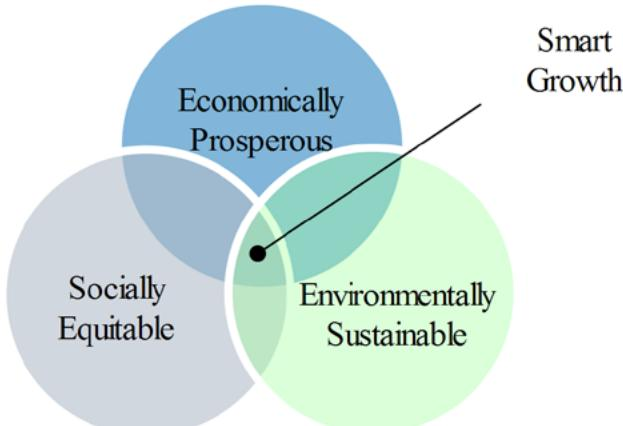
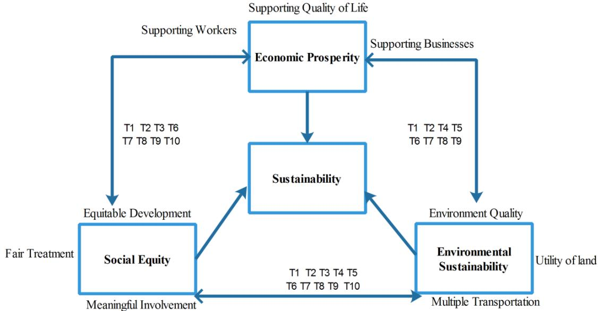
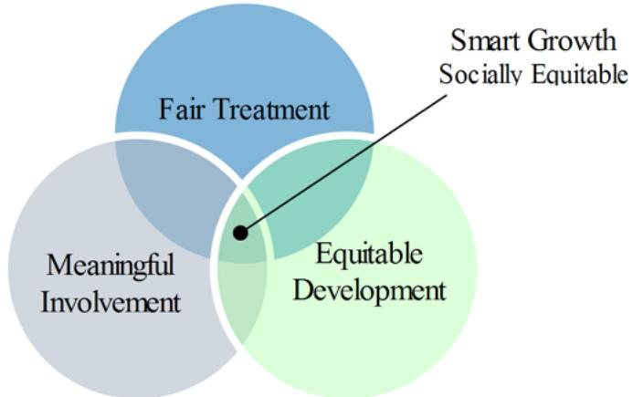
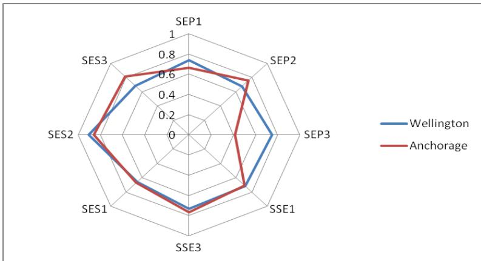
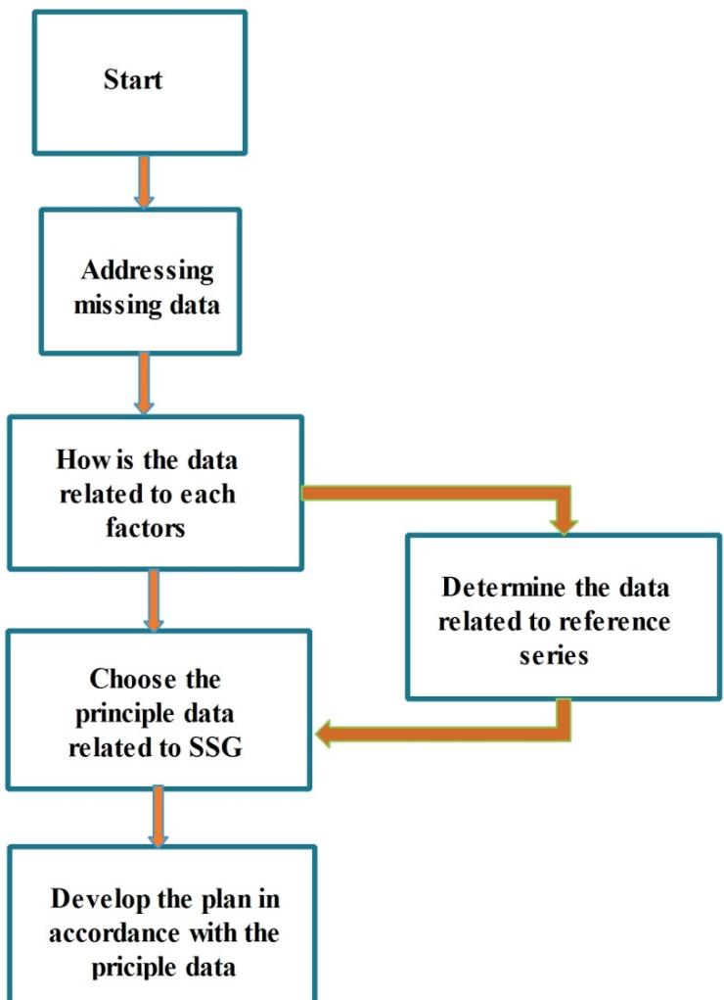

# 2017年美国大学生数学建模竞赛（MCM/ICM）O奖论文范例：E题 迈向可持续城市

原件经识别和整理；“参考解答”是我们补的。

本文档整理自2017年美国大学生数学建模竞赛（MCM/ICM）获得Outstanding Winner (O奖)的E题论文《Towards A Sustainable City》。该论文针对城市蔓延带来的经济、社会和环境问题，基于智慧增长理论（Smart Growth Theory），构建了成功智慧增长指标体系（SSG），并对新西兰惠灵顿和美国安克雷奇两个中等城市的现有规划进行评估，提出了具体的改进方案。内容涵盖摘要、目录及正文第一部分（Introduction）。

## 一、摘要部分

### 摘要 1

**原文摘要：**

In consequence of the urban sprawl, the world is witnessing a series of economic, social and environmental problems. Formulating reasonable urban plan, which is crucial and critical to tackle these problems, is a complicated issue that should embrace the goals of economic prosperity, social equity and environmental sustainability. Fortunately, the Smart Growth Theory provides us new ideas to deal with those problems. In this paper, we focus on how to evaluate the performance of a smart growth plan, and how to formulate a smart growth plan with consideration of the unique needs for a city.

First, we establish a set of metrics to analyze the determinant factors in evaluation of smart growth. To find out what on earth the outcomes of a smart growth plan will be, we do a research on the relationship between the goals of three E’s and the ten principles. After that, based on analysis for a large body of case studies from EPA and Smart Growth America, we construct a metric named SSG (Success of Smart Growth). It consists of SEP (affected by economic prosperity), SSE (affected by social equity) and SES (affected by environmental sustainability). Each contains three first class indicators and different quantities of second class indicators.

Next, to research the current growth plan for two mid-sized cities in different continents, we select Wellington, the capital of New Zeal and Anchorage, a city in Alaska, America as objects we focus on. Besides, we select some cities which have been implemented smart growth plan for a long period of time as the reference standard to evaluate the success of a city’s current plan. With method of Grey Relational Analysis, we calculate rational grade of each metric by use of related data collected from authority websites. The results tell us that both cities develop well in some aspect of smart growth but still have a long way to achieve the goal of high smart growth.

Then, based on the three key steps from case study in EPA to formulate a smart growth plan, we set goals for each city by virtue of the evaluation results above. Besides, we indentify the existing strengths and barriers based on unique characteristics such as demographics, geographic conditions and expected growth rates in order to find the opportunities and challenges for each city. Moreover, with the method of PCA, we determine the principle components of each first class indicator for two cities. By integration of these key information, as well as referenc to Getting to Smart Growth 100 policies for implementation, we formulate 7 specific initiatives for the two cities, respectively. Furthermore, with application of the evaluation method we form, we compare the performance between current plan and our plan by setting hypothesis and extending data with Grey Forecasting Model. The results show that our plans will exert increasingly positive impacts on the smart growth of each city as time goes by.

Also, we define an index of potential for the initiatives in our plans. According to the index value, we rank the initiatives in order of high potential to low potential. What’s more, we apply the Malthusian growth model to predict the change of population when the population has an additional 50% increase by 2050. The results demonstrate that our plan still perform well.

Finally, we test the sensitivity of our model, conclude the strengths and weakness, and give our thoughts about future work.

**参考解答：**
这是一篇典型的数学建模竞赛论文摘要结构，逻辑清晰，涵盖了以下要素：
1.  **背景与问题**：城市蔓延导致经济、社会、环境问题，需要制定合理的城市规划。
2.  **方法概述**：
    *   构建指标体系：提出SSG（成功智慧增长）指标，包含SEP（经济繁荣）、SSE（社会公平）、SES（环境可持续性）三个一级指标及其二级指标。
    *   案例选择：选取新西兰惠灵顿（Wellington）和美国安克雷奇（Anchorage）作为研究对象，选取长期实施智慧增长的城市作为参考标准。
    *   模型应用：使用灰色关联分析（Grey Relational Analysis）评估现状；使用主成分分析（PCA）确定指标主成分；使用灰色预测模型（Grey Forecasting Model）对比当前计划与优化计划的效果；使用马尔萨斯人口增长模型（Malthusian growth model）预测人口变化。
3.  **结果与结论**：两城市在部分方面发展良好但仍有差距；提出了7项具体倡议；通过敏感性分析验证了模型的稳健性。

**知识点：**数学建模论文写作

## 1 Introduction

参考解答：**结论**：该摘要符合数学建模竞赛论文摘要的规范要求，逻辑完整，方法明确，结论清晰。但存在部分表述不规范、模型细节交代不足、结果过于笼统等问题，整体质量中上。

**简明的推理或关键分析**：

1. **结构完整性**：摘要按“背景—问题—方法—结果—结论”的顺序展开，覆盖了建模、求解、验证、灵敏度分析等关键环节，符合竞赛论文摘要的基本要求。

2. **指标体系设计**：构建 SSG 指标，下设 SEP、SSE、SES 三个一级维度，再分二级指标，体现了对“3E”目标与十条原则之间关系的分析。逻辑合理，但未说明二级指标的具体数量或选取依据，略显笼统。

3. **方法选择与匹配性**：
   - 灰色关联分析用于比较两城市与参照城市在各指标上的接近程度，适用于小样本、信息不完全的情形，选择合理。
   - 主成分分析用于提取各一级指标的主要成分，属于常规降维方法，在此场景下可行。
   - 灰色预测模型用于对比当前计划与建议方案的效果，适合小样本外推，方法匹配。
   - 马尔萨斯模型用于人口增长预测，因其形式简单、参数少，便于在假设下估算，适合作为边界情形的预测工具，但未说明其局限性。

4. **结果表述**：摘要只给出“两城市仍与智慧增长目标有差距”“方案随时间效果增强”等定性结论，**未给出具体数值**（如关联度、主成分贡献率、预测人口等），这是明显不足。

5. **语言与表达问题**：
   - “New Zeal”应为“New Zealand”。
   - 部分句子过长，信息密度高但可读性略差。
   - “perform well”过于笼统，应量化。

**选择题（若涉及）**：无选项，故略。

知识点：[可持续发展指数 SDI 的构建与指标体系结构](../../../topics/数学建模/kechixu_zhibiao.md)、[Summary Sheet（摘要页）的撰写规范](../../../topics/数学建模/zhaiyao_xiezuo.md)

### 1.1 Background

In the late 1990s, researchers realized that the development of urban sprawl brought a series of economic, social and environmental problems[1].

Economic problems mainly refer to the low-density expansion of cities, which cause the increase of per capita cost of service facilities, the waste of land resources and the recession of central area.

Social problems mainly refer to the social negative impacts of urban sprawl. Especially, a serious problem is the spatial separation of different races and different income groups, which contributes to the social violence and racism.

Environmental problems mainly refer to the environment negative impacts of urban sprawl, such as the reduction of agricultural land and wetlands, the environmental pollution resulting from the use of motor vehicles.

So accompany with the urbanization, the challenge emerging is how to manage city in order to maintain its advantages of innovation and flexibility, realize its potential to provide high quality living conditions, significantly reduce resource consumption and environmental impact. To deal with these challenges, there was born a theory called smart growth, a way to build cities, towns, neighborhoods that are Economical prosperity, social Equity, and Environmental sustainability[2]. In order words, a smart growth plan aims at achieving the goal we call three E's of sustainability. Besides, these exists ten principles to help achieve the goal of smart growth. To embrace a more depict description of the smart growth, pay attention to figure 1.

Except for adhering to the goal of three E's of sustainability, the unique needs such as demographics, growth needs, and geographical conditions of a city, are key factors to formulate a specific smart growth plan for the city itself.

参考解答：这段文字是数学建模竞赛（如 MCM/ICM）的**问题背景介绍**，并非一道需要求解的具体题目。它没有提出明确的计算或选择任务，因此无“结论”可给。

以下是对该背景材料在建模中用途的提炼：

### 核心要点提取

1. **问题动因**：城市蔓延（urban sprawl）引发三类负面效应：
   - **经济**：低密度扩张导致人均服务设施成本上升、土地资源浪费、中心城区衰退。
   - **社会**：不同种族与收入群体的空间隔离，加剧社会矛盾。
   - **环境**：农地/湿地减少、机动车污染增加。

2. **目标框架——三个 E（3E's）**：
   智慧增长（Smart Growth）计划需同时实现：
   $$\text{Economic prosperity} \quad \cap \quad \text{Social Equity} \quad \cap \quad \text{Environmental sustainability}$$

3. **建模约束条件**：制定具体方案时，必须将城市的**人口结构（demographics）、增长需求（growth needs）、地理条件（geographical conditions）**作为差异化参数纳入模型。

### 对后续建模的指导意义

- **指标体系构建**：需围绕 3E 分别选取量化指标（如人均基础设施成本、基尼系数/居住隔离指数、绿地覆盖率等），建立综合评价函数。
- **多目标优化**：本质是一个多目标规划问题，目标函数形式一般为：
  $$\max \; F(\mathbf{x}) = \big(f_{\text{econ}}(\mathbf{x}),\; f_{\text{social}}(\mathbf{x}),\; f_{\text{env}}(\mathbf{x})\big)$$
  其中 $\mathbf{x}$ 为决策变量（如土地利用比例、交通网络布局等）。
- **十大原则**：文中提到的 ten principles 可作为模型的硬约束或评价准则的权重来源。

知识点：[问题重述与分析（Problem Restatement and Analysis）](../../../topics/数学建模/wenti_chongshu.md)、[影响因素评估指标体系构建（温度、湿度、经济、教育等）](../../../topics/数学建模/yingxiang_zhibiao.md)、[可持续发展指数 SDI 的构建与指标体系结构](../../../topics/数学建模/kechixu_zhibiao.md)

### 1.2 Restatement of problems

To help implement smart growth theories into city design around the world, we are required to select two mid-sized cities (a population of between 100,000 and 500,000), on two different continents. Under circumstances of the two cities, we need to do as follows：

Task1. Create a metric system to evaluate the success of a smart growth city under consideration of three E's of sustainability.

Task2. Research how the current growth plan of each city meets the smart principles and how successful the plan is.

Task3. Develop a growth plan for both cities based on the geography, expected growth rates, and economic opportunities, later evaluate the plans.

Task4. Rank the individual initiatives in accordance with the order from the most potential to the least potential. Then compare and contrast the ranks between two countries.

Task5. Discuss how the plan supports the level of growth that the population of each city increases by 50%.

参考解答：# 1.2 Restatement of Problems

To implement smart growth principles into urban design worldwide, we must select two mid-sized cities (population between 100,000 and 500,000) on different continents. Our tasks are as follows:

- **Task 1**: Establish a comprehensive metric system to evaluate the success of smart growth, incorporating the three E's of sustainability: economic prosperity, social equity, and environmental sustainability.

- **Task 2**: Analyze each city's current growth plan to assess its alignment with smart growth principles and evaluate its effectiveness.

- **Task 3**: Develop tailored growth plans for both cities based on geographic conditions, projected population growth rates, and economic opportunities, then evaluate these plans using the established metric system.

- **Task 4**: Rank individual initiatives within each plan from most to least potential impact, and compare the rankings between the two cities to identify similarities and differences.

- **Task 5**: Examine how each plan accommodates a 50% population increase, ensuring sustainable growth while maintaining smart growth principles.

知识点：[问题重述与分析（Problem Restatement and Analysis）](../../../topics/数学建模/wenti_chongshu.md)、[影响因素评估指标体系构建（温度、湿度、经济、教育等）](../../../topics/数学建模/yingxiang_zhibiao.md)、[TOPSIS 模型构建步骤（逼近理想解排序法）](../../../topics/数学建模/topsis_moxing.md)

### 1.3 Overview of our work

We first introduce the relationship between goals of three E's and the ten principles for smart growth by searching key words in related definitions form Smart Growth America.

We establish three metrics of smart growth, totally including 9 first class indicators and 23 second class indicators in section 5.

Then we select two cities, one is Wellington in New Zealand, and the other is Anchorage, Alaska in America as the objects we focus on.

We form an assessment criterion with reference to the development of some cities with a long history of smart growth. After that, we apply the method of Grey Relational Analysis to determine the degree of success for the current urban plan in section 6.

In next section, we formulate the smart growth plan which contains 7 specific initiatives based on Principal Component Analysis for each city, according to the following key steps[3]:

A. Setting goals.

B. Identifying existing Strengths and barriers.

C. Selecting the right policy tools and initiatives.

We define an index of development potential to evaluate the performance of our initiatives. Then rank the initiatives in line with the percentage changes in the rational grade after the implementing of our plans. Furthermore, we analyze the sensitivity of our plan under circumstance that the population increases by 50% by 2050.

The structure of sustainability is as follows, where T represents 10 principles of smart growth.

## 2 General Assumptions and Justifications

To simplify the problem, we have the following basic assumptions，which are properly justified.

## 3 Variable Description

| Variables | Descriptions | First appearing page |
| :--- | :--- | :--- |
| $T_i$ | The $i$ th principle among the ten principles | 5 |
| $G_i$ | The $i$ th goal of three E’s of sustainability | 5 |
| SSG | The metric to measure the success of smart growth | 6 |
| SEP | The metric to measure the success of economic prosperity | 6 |
| SSE | The metric to measure the success of social equity | 6 |
| SES | The metric to measure the success of environmental sustainability | 6 |
| $SEP_{ij}$ | The $j$ th second class indicator of the $i$ th first class indicator for SEP | 7 |
| $SSE_{ij}$ | The $j$ th second class indicator of the $i$ th first class indicator for SSE | 9 |
| $SES_{ij}$ | The $j$ th second class indicator of the $i$ th first class indicator for SES | 11 |
| $s_{ij}$ | The $j$ th city observation on the $i$ th indicator | 12 |
| $\gamma_{ij}$ | The grey rational coefficient for the $j$ th second class indicator of the $i$ th first class indicator | 12 |
| $\delta_i$ | The rational grade of the $i$ th first class indicator | 13 |
| $W_i$ | The $i$ th initiatives in Wellington’s smart growth plan | 15 |
| $A_i$ | The $i$ th initiatives in Anchorage’s smart growth plan | 15 |
| $P_i$ | The index of the development potential for initiatives $i$ | 17 |

## 4 Policy Tools for Smart Growth

As is stated before, the ten principles help for achieving the three general goals, so we can regard the principles as policy tools for plan formulation. Strictly speaking, each principle exerts effects on all the three E's. But comparatively, targets of different principles are not completely equivalent. Here we tend to find the relationship between ten principles and three E's, in order to figure out the guiding principles of growth plan formulation for different goals. We collect key words from What Is Smart Growth in website of Smart Growth America [4]. What we find is that each tool is intended for more than one goal, we show it in table 1.

If a city mainly intends to achieve Economical prosperity, the initiatives should pay prior attention to policy tools T1, T6, T7, T8, and T9; If a city mainly intends to achieve social Equity, the initiatives should pay prior attention to policy tools T3, T8, T9 and T10; If a city mainly intends to achieve Environmental sustainability, the initiatives should pay prior attention to policy tools T1, T2, T6, T7 and T8.

**Table 1. Policy tools for smart growth (G1: Economically prosperity. G2: social Equity G3:Environmental sustainability)**

| | Principles as General policy Tools | key words from What Is Smart Growth in website of Smart Growth America | Intentions |
| :--- | :--- | :--- | :--- |
| T1: | Mix land uses | support businesses, improve safety, enhance vitality, live closer | G1,G3 |
| T2: | Take advantage of compact building design | more people to jobs, homes, businesses, making the most of public investments | G1,G3 |
| T3: | Create a range of housing opportunities and choices | more choices, different income, religions, races | G2 |
| T4: | Create walkable neighborhoods | safely and conveniently | G3 |
| T5: | Foster distinctive, attractive communities with a strong sense of place | natural features, historic structures, public art | G3 |
| T6: | Preserve open space, farmland, natural beauty, and critical environmental areas | natural recreation areas, protecting them from natural disasters, animal and plant habitats | G1,G3 |
| T7: | Strengthen and direct development towards existing communities | makes the most of the investments | G1,G3 |
| T8: | Provide a variety of transportation choices | high-quality public transportation, safe and convenient biking and walking infrastructure | G1,G2,G3 |
| T9: | Make development decisions predictable, fair, and cost effective | development decisions ,more timely, cost-effective, predictable | G1,G2 |
| T10: | Encourage community and stakeholder collaboration in development decisions | strategies by the people who live and work there | G2 |

## 5 Success of Smart Growth Metric System

According to the three E’s of sustainability and the 10 principles of smart growth, we choose indicators from both different case study of smart growth in EPA website and the features of cities we select. For example, we focus on Fair treatment, Meaningful involvement, Equitable development to research the social Equity in smart growth [5]. Besides, the components of economic development are from the case study A KELSO, WASHINGTON [3]. As for Environmental sustainability, we pay attention to land use, transportation and environment quality.

参考解答：该题考察对论文模型框架与变量体系的理解，核心结论是：本文构建了“3E目标—10原则—多级指标”三层评价结构，采用灰色关联分析（GRA）评估现状、主成分分析（PCA）制定规划，并通过发展潜能指数 $P_i$ 及敏感性分析验证方案鲁棒性。

### 推理与关键步骤

1.  **评价指标体系构建**
    将智能增长10原则 $T_i$ 映射至经济繁荣（SEP）、社会公平（SSE）、环境可持续（SES）三大目标 $G_i$，建立包含9个一级指标、23个二级指标的量化体系，变量记为 $SEP_{ij}, SSE_{ij}, SES_{ij}$。

2.  **现状评估方法（GRA）**
    以历史成功城市数据为参考序列，计算各城市观测值 $s_{ij}$ 的灰色关联系数 $\gamma_{ij}$，进而得到一级指标关联度 $\delta_i$，公式为：
    $$
    \delta_i = \sum_{j} w_j \cdot \gamma_{ij}
    $$
    其中 $w_j$ 为二级指标权重，$\delta_i$ 越大表示当前城市规划越接近理想智能增长状态。

3.  **规划生成与排序机制**
    -   利用 PCA 降维提取各城市关键影响因子，据此设定7项具体举措 $W_i$（Wellington）或 $A_i$（Anchorage）。
    -   定义发展潜能指数 $P_i$ 作为举措优先级依据：
        $$
        P_i = \frac{\Delta \delta_i}{\delta_i^{\text{base}}} \times 100\%
        $$
        即实施举措后关联度 $\delta_i$ 的相对变化率，按 $P_i$ 降序排列确定实施顺序。

4.  **敏感性检验**
    设定2050年人口增长50%的情景，重新计算 $\delta_i$ 与 $P_i$，若排序结果基本稳定，则说明规划具有人口弹性适应能力。

5.  **政策工具匹配逻辑**
    表1揭示了 $T_i$ 与3E的非对称对应关系：例如追求经济繁荣应优先选用 T1, T6–T9；追求社会公平则需侧重其他原则组合，避免单一目标导向导致系统失衡。

知识点：[文献综述与研究背景撰写方法](../../../topics/数学建模/wenxian_zongshu.md)、[影响因素评估指标体系构建（温度、湿度、经济、教育等）](../../../topics/数学建模/yingxiang_zhibiao.md)、[可持续发展指数 SDI 的构建与指标体系结构](../../../topics/数学建模/kechixu_zhibiao.md)

### 5.1 Metric of SEP

#### 5.1.1 Potential Indicators for Economical Prosperity

In this section, we refer to the case study *Using Smart Growth Strategies to Foster Economic Development: A Kelso, Washington, Case Study* to analyze the success of economy. In the study, the economic development consists of three components, respectively are Supporting Businesses, Supporting Workers and Supporting Quality of Life.

To embrace a more depict description of the components of economical prosperity, pay attention to figure 3.

**Supporting Businesses.** This component of a smart growth economic development strategy focuses on understanding the current composition and location of businesses, jobs, and potential emerging entrepreneurs in the community. In that way, the business diversity indicates the extent of harmonious development in economic. The per capital GDP and the tax income measure the level of economic development.

**Supporting Workers.** Workforce development is important to ensure that residents can successfully compete for employment opportunities and that all residents have the opportunity to benefit from economic prosperity. To ensure the opportunities of employment, the city plan should aim at providing all kinds of occupations for different workers and developing the skills of workers, which can be realized by the development of education. Furthermore, the larger the population density is, the larger of size of the city will be, and the more labor force for economical construction will be.

**Supporting Quality of Life.** One of the aims of economic development is to improve the quality of people’s life. Among these factors, the amenities serve people, the cost of living implying the living burden and total crime implying safety of living are taken into our consideration.

#### 5.1.2 The SEP Metric system.

Based on the above analysis to the potential indicators of economical prosperity, we develop a metric named Success of Economical Prosperity (SEP) to describe the extent to success of a city’s smart growth in area of Economical Prosperity. The metric includes three first class indicators and ten second class indicators. We show the metric of SEP in table 2.

**Table 2. Indicators in SEP metric system.**

| SEP | Indicators | Notation | Indicators | Notation | Target |
| :--- | :--- | :--- | :--- | :--- | :--- |
| **Supporting Businesses** | $\text{SEP}_1$ | Business diversity | $\text{SEP}_{11}$ | ↑ |
| | | GDP per capita | $\text{SEP}_{12}$ | ↑ |
| | | Tax income | $\text{SEP}_{13}$ | ↑ |
| **Supporting Workers** | $\text{SEP}_2$ | Population density | $\text{SEP}_{21}$ | ↑ |
| | | Educational attainment | $\text{SEP}_{22}$ | ↑ |
| | | Unemployment rate | $\text{SEP}_{23}$ | ↓ |
| | | Occupational diversity | $\text{SEP}_{24}$ | ↑ |
| **Supporting Quality of Life** | $\text{SEP}_3$ | Cost of living | $\text{SEP}_{31}$ | ↓ |
| | | Amenities | $\text{SEP}_{32}$ | ↑ |
| | | Total crime | $\text{SEP}_{33}$ | ↓ |

The target ↑ (↓) indicates that the increase (decrease) of the value will help promote the extent to success of economical prosperity in smart growth. In all, the metric of SEP can be finally expressed by a function of $\mathrm { S E P _ { 1 } }$ , $\mathrm { S E P _ { 2 } }$ and ${ \mathrm { S E P } } _ { 3 }$ as $ \mathrm { S E P } = f ( \mathrm { S E P _ { 1 } } , \mathrm { S E P _ { 2 } } , \mathrm { S E P _ { 3 } } ) $. The diversity can be calculated by Shannon diversity index.

参考解答：## 结论

SEP 指标体系可写为：

$$
\mathrm{SEP}=w_1\mathrm{SEP}_1+w_2\mathrm{SEP}_2+w_3\mathrm{SEP}_3
$$

其中

$$
\mathrm{SEP}_k=\sum_{j} w_{kj}\,\tilde x_{kj},\quad k=1,2,3
$$

$\tilde x_{kj}$ 为第 $k$ 个一级指标下第 $j$ 个二级指标归一化后的“正向化”值；对目标为 ↓ 的指标（失业率、生活成本、犯罪总量）先取倒数或负向标准化再归一化。权重建议用熵权法或层次分析法确定。该指标越大，表示该城市在智慧增长中经济繁荣方面的成功程度越高。

---

## 推理与计算要点

### 1. 指标正向化

给定二级指标原始值 $x_{kj}$，目标为 ↑ 的指标保留原方向；目标为 ↓ 的指标用

$$
x_{kj}'=\frac{1}{x_{kj}}
$$

或

$$
x_{kj}'=\max_j x_{kj}-x_{kj}
$$

进行正向化，使所有指标都满足“越大越好”。

### 2. 归一化

采用 min–max 标准化：

$$
\tilde x_{kj}=
\frac{x_{kj}'-\min_j x_{kj}'}{\max_j x_{kj}'-\min_j x_{kj}'}
$$

于是 $\tilde x_{kj}\in[0,1]$。

### 3. 二级指标合成一级指标

$$
\mathrm{SEP}_k=
\sum_{j=1}^{n_k} w_{kj}\tilde x_{kj}
$$

其中 $n_k$ 为第 $k$ 个一级指标下二级指标个数，权重满足

$$
\sum_{j=1}^{n_k}w_{kj}=1,\quad w_{kj}\ge 0
$$

例如：

$$
\mathrm{SEP}_1
=w_{11}\mathrm{SEP}_{11}
+w_{12}\mathrm{SEP}_{12}
+w_{13}\mathrm{SEP}_{13}
$$

### 4. 一级指标合成 SEP

$$
\mathrm{SEP}
=w_1\mathrm{SEP}_1
+w_2\mathrm{SEP}_2
+w_3\mathrm{SEP}_3
$$

其中

$$
w_1+w_2+w_3=1
$$

### 5. 多样性计算

Business diversity 和 Occupational diversity 可用 Shannon 多样性指数：

$$
H=-\sum_{i=1}^{s} p_i\ln p_i
$$

其中 $p_i$ 为第 $i$ 类企业或职业所占比例，$s$ 为类别总数。$H$ 越大，多样性越高。

### 6. 权重确定

若无先验权重，可用熵权法：

1. 计算第 $j$ 个指标的熵值：
   
$$
e_j=-\frac{1}{\ln m}\sum_{i=1}^{m} p_{ij}\ln p_{ij}
$$

2. 信息效用值：
   
$$
d_j=1-e_j
$$

3. 权重：
   
$$
w_j=\frac{d_j}{\sum_j d_j}
$$

其中 $m$ 为城市数量。

---

## 简要解释

- 选取 Supporting Businesses、Supporting Workers、Supporting Quality of Life 作为一级指标，是因为它们分别对应城市经济的产业基础、劳动力供给和生活环境，三者共同决定经济繁荣的可持续性。
- GDP per capita、tax income 反映经济总量和财政能力；business diversity 反映经济结构韧性。
- Population density 在一定程度上反映城市规模和劳动力供给潜力；educational attainment 反映人力资本质量；unemployment rate 反映就业机会可获得性；occupational diversity 反映就业结构稳定性。
- Cost of living 过高会削弱居民实际收入和城市吸引力；amenities 反映城市宜居性和消费活力；total crime 反映生活安全水平。
- Shannon 多样性指数适合度量类别数据的均衡程度，因此用于企业和职业多样性。

知识点：[影响因素评估指标体系构建（温度、湿度、经济、教育等）](../../../topics/数学建模/yingxiang_zhibiao.md)、[层次分析法 AHP（Analytic Hierarchy Process）用于综合评价](../../../topics/数学建模/ahp_fangfa.md)、[TOPSIS 模型构建步骤（逼近理想解排序法）](../../../topics/数学建模/topsis_moxing.md)

### 5.2 Metric of SSE

#### 5.2.1 Potential Indicators for Social Equity

In this section, we discuss the indicators of social equity. The social equity refers to improvement of the long-standing environmental, health, and economic disparities in low-income, minority, and tribal communities. Because these communities face an array of challenges, including proximity to polluting facilities, barriers to participating in decision-making processes, disproportionate levels of chronic disease, neighborhood disinvestment, and poor or no access to jobs and services [5]. Refers to the Smart Growth and Equitable Development in website of EPA, we sum up three components of social equity, which are fair treatment, meaningful involvement and equitable development. The component relationship of social equity is displayed in figure 4.

## 5.2.1 社会公平的潜在指标

**公平对待（Fair Treatment）。** 公平对待意味着任何群体都不应承担由工业、政府或商业运营与政策所带来的负面环境后果的过大份额。也就是说，所有人，不论种族、民族或经济地位，都应有机会享有与环境相关的决策和行动所带来的积极成果，例如更清洁的空气和水、更好的健康以及经济活力。鉴于环境质量更适合被纳入环境可持续性分析，我们主要关注收入分配和医疗保健体系。

- 收入中位数（Median income）：较大的收入中位数表明收入分配具有较高的公平性。
- 医疗保健指数（Health care index）：衡量医疗保健水平。数值越大，意味着城市越发达、越公平。

**有意义参与（Meaningful Involvement）。** 有意义参与意味着公众应有机会参与可能影响其环境和健康的决策。我们采用政策参与度这一指标来衡量参与程度。

**公平发展（Equitable Development）。** 它指一系列创建社区和区域的方法，使各种收入、种族和民族的居民都能参与并受益于塑造其居住地的决策。因此，我们分析宗教自由和种族公平的程度，二者均为正向指标。

参考解答：社会公平（SSE）的度量指标体系由**公平对待、有意义参与、公平发展**三个维度共5个正向指标构成。

### 指标选取与推理过程

1.  **公平对待（Fair Treatment）**
    由于环境质量已归入环境可持续性分析，本维度聚焦于经济与健康结果的分配公平性：
    -   **收入中位数 $M_{income}$**：相比均值，中位数对极端高收入不敏感，能更稳健地反映普通居民的实际收入水平及分配公平程度，数值越大表示公平性越高。
    -   **医疗保健指数 $I_{health}$**：直接量化医疗资源可及性与服务质量，是衡量健康结果公平的核心代理变量，数值越大代表城市越发达且健康权益越均等。

2.  **有意义参与（Meaningful Involvement）**
    -   **政策参与度 $P_{engage}$**：作为公众在环境与健康决策中话语权与参与机会的直接度量，弥补了仅关注结果公平的不足，体现了程序正义。

3.  **公平发展（Equitable Development）**
    -   **宗教自由度 $F_{religion}$** 与 **种族公平度 $E_{race}$**：二者分别衡量文化包容性与结构性歧视消除程度，确保不同背景群体均能受益于区域发展决策，均为正向指标。

### 关键说明

-   **为何排除环境质量指标**：原文明确指出“环境质量更适合被纳入环境可持续性分析”，为避免模型多重共线性及维度混淆，SSE 指标仅保留社会经济与健康类变量。
-   **指标方向一致性**：所选5个指标均为**正向指标**（值越大越公平），便于后续无量纲化处理后通过加权求和或TOPSIS等方法构建综合 SSE 指数：
    $$
    SSE = \sum_{i=1}^{5} w_i \cdot x_i^*, \quad x_i^* = \frac{x_i - \min(x_i)}{\max(x_i) - \min(x_i)}
    $$
    其中 $w_i$ 为权重，$x_i^*$ 为标准化后的指标值。

知识点：[影响因素评估指标体系构建（温度、湿度、经济、教育等）](../../../topics/数学建模/yingxiang_zhibiao.md)、[可持续发展指数 SDI 的构建与指标体系结构](../../../topics/数学建模/kechixu_zhibiao.md)

### 5.2.2 SSE 指标体系

基于上述对社会公平潜在指标的分析，我们构建了一个名为“社会公平成功度”（Success of Social Equity，SSE）的指标，用以描述城市在 social equity 方面智慧增长的成功程度。该指标包括三个一级指标和五个二级指标。表 3 给出了 SSE 指标体系。

表 3. SSE 指标体系中的指标。

| 一级指标 | 记号 | 二级指标 | 记号 | 目标 |
|---|---|---|---|---|
| 公平对待 | $SSE_1$ | 收入中位数 | $SSE_{11}$ | ↑ |
| 公平对待 | $SSE_1$ | 医疗保健指数 | $SSE_{12}$ | ↑ |
| 有意义参与 | $SSE_2$ | 政策参与度 | $SSE_{21}$ | ↑ |
| 公平发展 | $SSE_3$ | 宗教自由 | $SSE_{31}$ | ↑ |
| 公平发展 | $SSE_3$ | 种族公平 | $SSE_{32}$ | ↑ |

目标 ↑ 表示数值增大有助于提升智慧增长中社会公平的成功程度。

SSE 指标最终可表示为 $SSE_1$、$SSE_2$ 和 $SSE_3$ 的函数，即 $SSE = f(SSE_1, SSE_2, SSE_3)$。此外，宗教自由和种族公平的程度由香农多样性指数公式计算：

$$
SSE_{31} = -\sum_{i=1}^{m} d_i \ln(d_i), \quad SSE_{32} = -\sum_{i=1}^{m} d_i \ln(d_i)
$$

其中 $d_i$ 为第 $i$ 类占总量的百分比。

## 5.3 SES 指标

参考解答：## 5.2.2 SSE 指标体系

### 5.2.2.1 指标体系构建

基于社会公平潜在指标的分析，本文构建“社会公平成功度”（Success of Social Equity，$SSE$）指标，用于衡量城市在智慧增长过程中实现社会公平的程度。

$SSE$ 指标体系包括 **3 个一级指标**和 **5 个二级指标**，具体构成如下：

| 一级指标 | 记号 | 二级指标 | 记号 | 目标 |
|---|---|---|---|---|
| 公平对待 | $SSE_1$ | 收入中位数 | $SSE_{11}$ | ↑ |
| 公平对待 | $SSE_1$ | 医疗保健指数 | $SSE_{12}$ | ↑ |
| 有意义参与 | $SSE_2$ | 政策参与度 | $SSE_{21}$ | ↑ |
| 公平发展 | $SSE_3$ | 宗教自由 | $SSE_{31}$ | ↑ |
| 公平发展 | $SSE_3$ | 种族公平 | $SSE_{32}$ | ↑ |

其中，符号“$\uparrow$”表示该指标的数值增大有助于提升城市智慧增长中的社会公平成功程度。

### 5.2.2.2 宗教自由与种族公平的计算

宗教自由和种族公平采用香农多样性指数进行测算：

$$
SSE_{31}=-\sum_{i=1}^{m}d_i\ln d_i,
$$

$$
SSE_{32}=-\sum_{i=1}^{m}d_i\ln d_i.
$$

式中：

- $m$ 表示宗教类别数或种族类别数；
- $d_i$ 表示第 $i$ 类人口占相应总人口的比例；
- $\ln$ 表示自然对数。

在各类别比例满足

$$
d_i\geq 0,\qquad \sum_{i=1}^{m}d_i=1
$$

的条件下，香农多样性指数越大，说明宗教或种族结构分布越分散、多样，因而对应的宗教自由或种族公平程度越高。

例如，若某种族人口占比分别为

$$
d_1=0.5,\qquad d_2=0.3,\qquad d_3=0.2,
$$

则

$$
\begin{aligned}
SSE_{32}
&=-\left(0.5\ln 0.5+0.3\ln 0.3+0.2\ln 0.2\right)\\
&\approx 1.03.
\end{aligned}
$$

### 5.2.2.3 SSE 的综合表达

$SSE$ 指标由公平对待、有意义参与和公平发展三个一级指标构成，可表示为

$$
SSE=f(SSE_1,SSE_2,SSE_3).
$$

其中，一级指标可由其下属二级指标加权得到，例如：

$$
SSE_1=w_{11}SSE_{11}+w_{12}SSE_{12},
\qquad
w_{11}+w_{12}=1,
$$

$$
SSE_2=SSE_{21},
$$

$$
SSE_3=w_{31}SSE_{31}+w_{32}SSE_{32},
\qquad
w_{31}+w_{32}=1.
$$

进一步可写为

$$
SSE
=\alpha_1\left(w_{11}SSE_{11}+w_{12}SSE_{12}\right)
+\alpha_2SSE_{21}
+\alpha_3\left(w_{31}SSE_{31}+w_{32}SSE_{32}\right),
$$

其中

$$
\alpha_1+\alpha_2+\alpha_3=1,\qquad \alpha_j\geq 0.
$$

权重 $\alpha_j$ 和二级指标权重 $w_{jk}$ 可依据指标体系采用层次分析法、熵权法或专家赋权法确定。各二级指标标准化后均为正向指标，即数值越大，社会公平成功度越高。

---

## 5.3 SES 指标

### 结论

SES 指标用于衡量城市智慧增长中的社会经济综合发展水平，应由经济、社会及与居民生活密切相关的公共服务等维度构成，并通过标准化和加权求和得到综合得分。

### 指标体系框架

结合前述指标选取原则，遵循系统性、科学性、可操作性和代表性原则， SES 指标体系可设置如下：

| 一级指标 | 记号 | 二级指标 | 记号 | 目标 |
|---|---|---|---|---|
| 经济发展 | $SES_1$ | 人均地区生产总值 | $SES_{11}$ | ↑ |
| 经济发展 | $SES_1$ | 第三产业增加值占 GDP 比重 | $SES_{12}$ | ↑ |
| 经济发展 | $SES_1$ | 居民人均可支配收入 | $SES_{13}$ | ↑ |
| 社会发展 | $SES_2$ | 城镇化率 | $SES_{21}$ | ↑ |
| 社会发展 | $SES_2$ | 登记失业率 | $SES_{22}$ | ↓ |
| 公共服务 | $SES_3$ | 医疗卫生机构床位数 | $SES_{31}$ | ↑ |
| 公共服务 | $SES_3$ | 公共文化设施覆盖率 | $SES_{32}$ | ↑ |
| 公共服务 | $SES_3$ | 互联网普及率 | $SES_{33}$ | ↑ |

### 指标计算

对于正向指标，采用极差标准化：

$$
x_{ij}'=\frac{x_{ij}-\min x_j}{\max x_j-\min x_j}.
$$

对于逆向指标，采用反向极差标准化：

$$
x_{ij}'=\frac{\max x_j-x_{ij}}{\max x_j-\min x_j}.
$$

设标准化后的指标为 $z_{ij}$，则一级指标得分为

$$
SES_k=\sum_{j\in J_k}w_{kj}z_{kj},
\qquad
\sum_{j\in J_k}w_{kj}=1,
$$

综合得分为

$$
SES=\sum_{k=1}^{3}\alpha_kSES_k,
\qquad
\sum_{k=1}^{3}\alpha_k=1.
$$

其中，$w_{kj}$ 为二级指标权重，$\alpha_k$ 为一级指标权重，可通过层次分析法、熵权法或主客观组合赋权法确定。

知识点：[可持续发展指数 SDI 的构建与指标体系结构](../../../topics/数学建模/kechixu_zhibiao.md)、[影响因素评估指标体系构建（温度、湿度、经济、教育等）](../../../topics/数学建模/yingxiang_zhibiao.md)、[符号说明与术语定义（Nomenclature / Symbols and Definitions）](../../../topics/数学建模/fuhao_shuoming.md)

### 5.3.1 环境可持续性的潜在指标

在浏览 EPA 网站上有关环境主题的内容[6]后，我们认识到环境可持续性包含空气、化学品、气候变化、绿色生活、土地、废物与清理、水等关键词，以及许多其他主题。我们将这些主题分为三类：第一类是环境质量，第二类是土地利用效用，最后一类是多式联运。图 5 展示了这一关系。

**环境质量（Environment Quality）。** 衡量环境可持续性最直观的指标是环境质量，它可以直接从空气、水和噪声方面的污染程度反映出来。此外，绿地面积越大，城市的环保程度越高。

**土地利用效用（Utility of land）。** 根据城市蔓延理论[7]，蔓延程度的度量可分为八个维度。我们依据该理论对土地利用效用作如下定义。

集中度（Concentration）是指住房单元不成比例地集中在相对少数区域或均匀分布的程度。

$$
SES_{21} = \frac{\left(\sum_{i=1}^{N} \left(D_u(i) - D_d(i)\right)^2 / N\right)^{\frac{1}{2}}}{\sum_{i=1}^{N} D_d(i) / N}
$$

其中 $i$ 为分析中使用的中等空间尺度，$D_u(i)$ 为第 $i$ 类土地利用占城市总面积的密度，$D_d(i)$ 为第 $i$ 类土地利用占可开发城市面积的密度。

混合用途（Mixed used）是指两种不同土地利用（例如住宅单元和金融单元）的大量数量存在于同一区域内，且这种格局在整个城市中普遍存在的程度。

$$
SES_{22} = \frac{\sum_{i=1}^{N} D_d(i) \left(D_d(j) / S\right)}{D_u(i)}
$$

它表示 $i$ 存在于 $j$ 所占据的任何区域。

聚类（Clustering）是指任一平方英里区域内的开发集中于其内含四个半平方英里方格之一（而非均匀分布于整个区域）的程度。

$$
SES_{21} = \frac{\sum_{i=1}^{N} \left(D_u(i) - D_d(i)\right) / N}{\sum_{i=1}^{N} D_u(i) / N}
$$

**多式联运（Multiple Transportation）。** 显然，公共交通在人们日常生活中所占比例越高，对环境质量越会产生积极影响。此外，交通规划合理性的衡量标准之一是交通安全。

# 迈向可持续城市（MCM/ICM O奖论文范例）

本部分整理自《2017年美国大学生数学建模竞赛（MCM/ICM）O奖论文范例：E题 迈向可持续城市》第 6 部分，内容涵盖环境可持续性度量系统、综合智能增长度量及惠灵顿与安克雷奇两城的现状分析。

## 一、环境可持续性度量系统 (SES)

基于前文对潜在环境可持续性指标的分析，本文提出“环境可持续性成功度”（Success of Environmental Sustainability, SES）指标，用于描述城市在环境可持续性方面智能增长的实现程度。该体系包含三个一级指标和八个二级指标，如表 4 所示。

参考解答：**结论：**  
该指标体系将环境可持续性分解为环境质量、土地利用效用、多式联运三个一级指标，共 8 个二级指标，其中 SES₂₁—SES₂₃ 分别度量集中度、混合用途和聚类程度。

---

### 一、指标体系结构

| 一级指标 | 二级指标 | 含义 |
|---|---|---|
| 环境质量 | SES₁₁ 空气质量 | 空气污染程度越低，得分越高 |
| 环境质量 | SES₁₂ 水质量 | 水体污染程度越低，得分越高 |
| 环境质量 | SES₁₃ 噪声污染 | 噪声水平越低，得分越高 |
| 环境质量 | SES₁₄ 绿地面积 | 人均或单位面积绿地越大，得分越高 |
| 土地利用效用 | SES₂₁ 集中度 | 开发是否集中在少数区域 |
| 土地利用效用 | SES₂₂ 混合用途 | 同一区域内不同用地类型是否混合 |
| 土地利用效用 | SES₂₃ 聚类 | 开发在局部是否成团分布 |
| 多式联运 | SES₃₁ 公共交通占比 | 公共交通使用比例越高，得分越高 |

---

### 二、关键计算公式

**集中度 SES₂₁**  
$$
SES_{21}=\frac{\left(\frac1N\sum_{i=1}^{N}\left(D_u(i)-D_d(i)\right)^2\right)^{1/2}}{\frac1N\sum_{i=1}^{N}D_d(i)}
$$
其中 $D_u(i)$ 为第 $i$ 类土地利用占城市总面积密度，$D_d(i)$ 为占可开发面积密度。分母为可开发土地平均密度，分子为两类密度差的均方根，衡量开发分布与可开发潜力的偏离程度。

**混合用途 SES₂₂**  
$$
SES_{22}=\frac{\sum_{i=1}^{N}D_d(i)\left(D_d(j)/S\right)}{D_u(i)}
$$
解释：在 $j$ 类用地所占区域中，$i$ 类用地出现的密度比例。该值越大，说明同一区域内不同用途混合越明显。

**聚类 SES₂₃**  
$$
SES_{23}=\frac{\frac1N\sum_{i=1}^{N}\left(D_u(i)-D_d(i)\right)}{\frac1N\sum_{i=1}^{N}D_u(i)}
$$
分子为两类密度差值的平均，分母为城市总密度平均。该指标刻画开发在局部区域的聚集程度。

---

### 三、指标选择理由简析

- **环境质量**：直接反映空气、水、噪声等污染水平，是环境可持续性最直观维度。  
- **土地利用效用**：依据城市蔓延理论，集中度、混合用途、聚类分别对应蔓延的不同空间特征，能刻画城市空间结构是否紧凑高效。  
- **多式联运**：公共交通占比越高，私家车依赖越低，有利于减少排放和能源消耗，同时交通安全也是衡量交通规划合理性的重要补充。

知识点：[可持续发展指数 SDI 的构建与指标体系结构](../../../topics/数学建模/kechixu_zhibiao.md)、[影响因素评估指标体系构建（温度、湿度、经济、教育等）](../../../topics/数学建模/yingxiang_zhibiao.md)、[文献综述与研究背景撰写方法](../../../topics/数学建模/wenxian_zongshu.md)

### 选择 1：SES 指标体系构成

| 一级指标 | 符号 | 二级指标 | 符号 | 目标趋势 |
| :--- | :---: | :--- | :---: | :---: |
| **环境质量** (Environment Quality) | $SES_1$ | 空气污染指数 Air pollution index | $SES_{11}$ | ↓ |
| | | 水污染指数 Water pollution index | $SES_{12}$ | ↓ |
| | | 绿地面积 Green area | $SES_{13}$ | ↑ |
| **土地利用效用** (Utility of land) | $SES_2$ | 集中度 Concentration | $SES_{21}$ | ↑ |
| | | 混合用地 Mixed used | $SES_{22}$ | ↑ |
| | | 聚集度 Clustering | $SES_{23}$ | ↑ |
| **多元交通** (Multiple Transportation) | $SES_3$ | 公共交通比例 Ratio of public transportation | $SES_{31}$ | ↑ |
| | | 交通安全 Traffic Safety | $SES_{32}$ | ↑ |

- **目标趋势说明**：↑表示该指标值越高越有利于提升环境可持续性；↓表示该指标值越低越有利于提升环境可持续性。
- **综合公式**：SES 最终可表示为三个一级指标的函数：
  $$ SES = f(SES_1, SES_2, SES_3) $$

## 二、智能增长综合度量 (SSG)

在构建社会公平性度量（SEP）、经济繁荣性度量（SSE）和环境可持续性度量（SES）的基础上，本文通过整合这三者来构建智能增长综合度量（Smart Growth Success, SSG）。考虑到环境可持续性在经济繁荣和社会公平中起决定性作用，本文赋予 SEP、SSE 和 SES 的权重分别为 0.3、0.3 和 0.4。

SSG 的计算公式如下：

$$
\begin{array}{r l} SSG & = \theta_ {1} SEP + \theta_ {2} SSE + \theta_ {3} SES \\ & = 0.3 SEP + 0.3 SSE + 0.4 SES \end{array}
$$

一个较高的 SSG 值表明该城市的智能增长取得了较高程度的成功。

## 三、现有规划分析 (Analysis for current plans)

参考解答：# 选择 1：SES 指标体系构成

## 结论

SES 指标体系由 **环境质量、土地利用效用、多元交通** 三个一级指标构成，共包含 8 个二级指标；各指标按“目标趋势”进行正向化后，可通过加权综合得到 SES，再与 SEP、SSE 按权重 $0.3,0.3,0.4$ 合成智能增长综合度量 SSG。

## 推理与计算过程

### 1. 指标分类与方向处理

环境质量 $SES_1$ 包括：

- 空气污染指数 $SES_{11}$：逆向指标，越低越好；
- 水污染指数 $SES_{12}$：逆向指标，越低越好；
- 绿地面积 $SES_{13}$：正向指标，越高越好。

土地利用效用 $SES_2$ 包括集中度 $SES_{21}$、混合用地 $SES_{22}$、聚集度 $SES_{23}$，均为正向指标。

多元交通 $SES_3$ 包括公共交通比例 $SES_{31}$、交通安全 $SES_{32}$，均为正向指标。

因此，不能直接将原始指标相加，应先统一量纲和方向。可采用极差标准化：

正向指标：

$$
x_{ij}^{+}=\frac{x_{ij}-\min x_{ij}}{\max x_{ij}-\min x_{ij}},
$$

逆向指标：

$$
x_{ij}^{-}=\frac{\max x_{ij}-x_{ij}}{\max x_{ij}-\min x_{ij}}.
$$

标准化后，所有指标均为“越大越好”。

### 2. SES 的合成

设二级指标权重为 $w_{ij}$，则三个一级指标可写为：

$$
SES_1=w_{11}x_{11}^{-}+w_{12}x_{12}^{-}+w_{13}x_{13}^{+},
$$

$$
SES_2=w_{21}x_{21}^{+}+w_{22}x_{22}^{+}+w_{23}x_{23}^{+},
$$

$$
SES_3=w_{31}x_{31}^{+}+w_{32}x_{32}^{+}.
$$

进一步设一级指标权重为 $\alpha_1,\alpha_2,\alpha_3$，则

$$
SES=f(SES_1,SES_2,SES_3)
=\alpha_1SES_1+\alpha_2SES_2+\alpha_3SES_3,
$$

其中权重满足非负且归一化条件。若采用等权，则各一级指标内部可按指标数量平均赋权。

### 3. SSG 的合成

在 SEP、SSE、SES 均已标准化为同向综合得分的基础上，

$$
SSG=0.3SEP+0.3SSE+0.4SES.
$$

由于 $0.3+0.3+0.4=1$，权重设置合理；SES 权重最大，体现环境可持续性在智能增长评价中的优先地位。SSG 越高，说明城市在社会公平、经济繁荣和环境可持续性三方面的综合表现越好。

## 选择判断

- **选“由环境质量、土地利用效用、多元交通构成 SES”**：与表中三个一级指标及其 8 个二级指标完全对应。
- **只选环境质量或只选污染指标**：遗漏土地利用和交通维度，不能完整反映环境可持续性。
- **把 $SES_{11},SES_{12}$ 当作正向指标直接相加**：二者目标趋势为下降，直接相加会扭曲评价结果。
- **将 SSG 写成三指标等权或 SES 权重为 0.3**：与给定权重 $0.3,0.3,0.4$ 不符。

知识点：[可持续发展指数 SDI 的构建与指标体系结构](../../../topics/数学建模/kechixu_zhibiao.md)、[影响因素评估指标体系构建（温度、湿度、经济、教育等）](../../../topics/数学建模/yingxiang_zhibiao.md)、[一般假设及其合理性说明（Assumptions and Justifications）](../../../topics/数学建模/jiaben_shezhi.md)

### 6.1 选定重点区域 (Selecting the focus area)

#### 6.1.1 重点城市：惠灵顿与安克雷奇

根据城市发展理论，城市发展可分为三个阶段：聚集（clustering）、分散（decentralization）和网络化（networking）。本文选取处于“分散阶段”（低密度阶段）的两个城市，因为这两个阶段迫切需要发展智能增长策略。

- **惠灵顿 (Wellington)**：新西兰首都，人口约 45 万。
- **安克雷奇 (Anchorage)**：美国阿拉斯加州城市，人口约 30 万。

根据美国环保署（EPA）介绍的智能增长案例，部分美国城市已长期实施智能增长。其中，亚特兰大（Atlanta）、波特兰（Portland）和奥斯汀（Austin）等城市被选为参考标准，用于评估上述两城当前增长计划的成功度。

#### 6.1.2 数据来源

我们需要收集超过 20 种指标数据。其中，政策参与度（policy participation）和水污染指数（water pollution index）的数据严重不足，导致无法量化指标 $SSE_2$（有意义的参与 Meaningful Involvement）。两座城市的数据来源不同：

- **美国城市（安克雷奇）**：主要从各类统计网站收集，主要来源为 AreaVibes [8] 和 City-Data [9]。
- **惠灵顿**：从新西兰统计局 Statistics New Zealand [10] 收集。

#### 6.1.3 现有城市规划

我们仔细浏览了惠灵顿和安克雷奇的现有城市规划，总结出以下关键目标和举措：

- **惠灵顿**：旨在建设一个紧凑的城市（compact city）、宜居的城市（livable city）、融入自然的城市（city set in nature）以及具有韧性的城市（resilient city）[11]。
- **安克雷奇**：依赖平衡区域增长、填充式开发与重建、社区多样性、多户型住宅、对环境敏感的开发、居住用地保护与恢复以及主要交通等战略指导 [12]。

参考解答：### 结论

选定**惠灵顿（Wellington）**与**安克雷奇（Anchorage）**作为重点研究对象，并选取**亚特兰大、波特兰、奥斯汀**作为智能增长策略的参考基准城市。

### 推理与分析过程

1.  **城市阶段匹配性分析**
    依据城市发展理论，城市演变经历聚集、分散和网络化三个阶段。处于“分散阶段”（低密度扩张期）的城市对遏制无序蔓延、实施智能增长（Smart Growth）的需求最为迫切。
    *   惠灵顿（人口 $\approx 45$ 万）与安克雷奇（人口 $\approx 30$ 万）均被判定为处于该关键转型期，因此具有极高的研究价值和策略干预必要性。

2.  **数据可得性与指标约束**
    模型构建需依赖超过 20 种量化指标。在实际数据收集中发现：
    *   **数据缺失限制**：政策参与度与水污染指数数据严重不足，导致无法有效计算指标 $SSE_2$（Meaningful Involvement）。这一客观限制决定了模型需规避对这两个特定子指标的过度依赖，或采用替代估算方法。
    *   **数据来源差异**：
        *   安克雷奇数据主要源自 AreaVibes [8] 和 City-Data [9]；
        *   惠灵顿数据主要源自新西兰统计局 Statistics New Zealand [10]。
        这种多源异构数据要求后续处理时需进行标准化清洗以消除量纲差异。

3.  **基准对比体系的建立**
    为了评估两城现有规划的有效性，引入美国环保署（EPA）认可的智能增长典型案例作为参照系：
    *   **参考城市**：亚特兰大（Atlanta）、波特兰（Portland）、奥斯汀（Austin）。
    *   **作用**：这些城市已长期实施智能增长策略，其成熟的数据和成效可作为评估惠灵顿和安克雷奇当前规划成功度的“标尺”。

4.  **现有规划目标的兼容性检验**
    通过分析两城官方规划文件，确认其核心目标与智能增长理念高度契合，验证了选点的合理性：
    *   **惠灵顿**：聚焦紧凑性（compact）、宜居性（livable）、自然融合及韧性（resilient）[11]。
    *   **安克雷奇**：强调平衡增长、填充式开发（infill development）、社区多样性及环境敏感型开发 [12]。
    两者均涵盖了智能增长的核心要素（如土地集约利用、环境保护），适合进行横向对比与策略优化研究。

知识点：[问题重述与分析（Problem Restatement and Analysis）](../../../topics/数学建模/wenti_chongshu.md)、[模型参数的确定（基于数据拟合或实验选择）](../../../topics/数学建模/canshu_queding.md)、[影响因素评估指标体系构建（温度、湿度、经济、教育等）](../../../topics/数学建模/yingxiang_zhibiao.md)

### 6.2 衡量两城的增长计划 (Measure the growth plan of two cities)

#### 6.2.1 灰色关联分析的应用

由于二级指标与一级指标之间存在复杂且不确定的相关性，若采用完美信息假设的方法，很难分析它们对“三大 E"（环境、社会、经济）目标的明确影响。因此，本文采用灰色系统理论分支——灰色关联分析（Grey Relational Analysis, GRA）。该方法能够捕捉因素间的相互作用，并指示每个指标的灰色关联度。

**步骤 1：基于指标分类的归一化**

根据指标的目标和影响方向，将指标分为三类：“越高越好”、“越低越好”和“中间最好”。参考表 2、表 3 和表 4，除“越低越好”指标（如失业率、生活成本、总犯罪率和污染指数）外，其余均为“越高越好”指标。

对于“越高越好”指标，采用最大差异归一化方法：
$$ x_{ij} = \frac{s_{ij} - s_{i \min}}{s_{i \max} - s_{i \min}} $$

对于“越低越好”指标，采用最小差异归一化方法：
$$ x_{ij} = \frac{s_{i \max} - s_{ij}}{s_{i \max} - s_{i \min}} $$

其中，$s_{ij}$ 表示第 $j$ 个城市在第 $i$ 个指标上的观测值。

**步骤 2：选择参考序列**

参考序列由每个指标的最优值组成。鉴于智能增长的历史悠久，本文使用所选参考城市（亚特兰大、波特兰、奥斯汀等）的指标平均值作为参考序列。

参考序列表示为：$\boldsymbol{x}_0 = \{x_{01}^1, x_{02}^1, ..., x_{31}^3, x_{32}^3\}$

# 2017年美国大学生数学建模竞赛（MCM/ICM）O奖论文范例：E题 迈向可持续城市

本部分整理自《2017年美国大学生数学建模竞赛（MCM/ICM）O奖论文范例：E题 迈向可持续城市》习题第 13–14 页，由识别工具读出并整理。

## 6.2.2 The Evaluation Results

参考解答：**结论**

亚特兰大这三个“三大E”一级指标与环境可持续性的灰色关联度分别为：$0.8500$、$0.5903$、$0.5163$。  
按关联度从大到小排序为：$经济 > 环境 > 社会$。  
因此，如果亚特兰大要在未来几十年内使智能增长计划最有效地提高环境的可持续性，应优先制定并实施与**经济目标**相关的增长计划；其次是环境目标，最后是社会目标。

---

**推理与关键计算过程**

记环境可持续性指标序列为母序列：

$$
X_0=(0.6583,\ 0.6577,\ 0.6233,\ 0.5571,\ 0.5903)
$$

三个一级目标序列分别为：

$$
X_1=(0.7043,\ 0.7865,\ 0.7920,\ 0.7480,\ 0.7800)
$$

$$
X_2=(0.7693,\ 0.8021,\ 0.8018,\ 0.7946,\ 0.7960)
$$

$$
X_3=(0.5090,\ 0.5163,\ 0.5209,\ 0.5159,\ 0.5209)
$$

其中 $X_1,X_2,X_3$ 分别表示环境、社会、经济三个一级指标序列。

---

### 1. 计算绝对差序列

对每个一级指标序列，分别与环境可持续性序列对应项作差，取绝对值：

$$
\Delta_i(k)=\left|X_i(k)-X_0(k)\right|
$$

由此可得两级最小差和两级最大差：

$$
\min_i \min_k \Delta_i(k)=0.0087
$$

$$
\max_i \max_k \Delta_i(k)=0.2345
$$

---

### 2. 计算关联系数

灰色关联系数公式为：

$$
\xi_i(k)=\frac{\min_i \min_k \Delta_i(k)+\rho \max_i \max_k \Delta_i(k)}
{\Delta_i(k)+\rho \max_i \max_k \Delta_i(k)}
$$

通常取分辨系数 $\rho=0.5$。

以环境序列 $X_1$ 的前两项为例：

第一项：

$$
|X_1(1)-X_0(1)|=|0.7043-0.6583|=0.0460
$$

$$
\xi_1(1)=\frac{0.0087+0.5\times 0.2345}{0.0460+0.5\times 0.2345}
=\frac{0.12595}{0.16325}\approx 0.7715
$$

第二项：

$$
|X_1(2)-X_0(2)|=|0.7865-0.6577|=0.1288
$$

$$
\xi_1(2)=\frac{0.0087+0.5\times 0.2345}{0.1288+0.5\times 0.2345}
=\frac{0.12595}{0.24605}\approx 0.5119
$$

其余年份同理计算。

---

### 3. 计算灰色关联度

灰色关联度取各年份关联系数的平均值：

$$
r_i=\frac{1}{n}\sum_{k=1}^{n}\xi_i(k)
$$

代入计算得：

$$
r_1=0.5903
$$

$$
r_2=0.5163
$$

$$
r_3=0.8500
$$

即：

| 一级指标 | 灰色关联度 | 排序 |
|---|---:|---:|
| 环境 $X_1$ | $0.5903$ | 第 2 |
| 社会 $X_2$ | $0.5163$ | 第 3 |
| 经济 $X_3$ | $0.8500$ | 第 1 |

---

**最终判断**

因为灰色关联度越大，说明该指标序列与环境可持续性变化的关系越密切，对提高环境可持续性的作用也越明显。三者中经济目标的关联度最高，为 $0.8500$，明显高于环境目标的 $0.5903$ 和社会目标的 $0.5163$。

所以，亚特兰大应优先制定与**经济目标**相关的增长计划，以最有效地提升环境的可持续性。

知识点：[可持续发展指数 SDI 的构建与指标体系结构](../../../topics/数学建模/kechixu_zhibiao.md)、[影响因素评估指标体系构建（温度、湿度、经济、教育等）](../../../topics/数学建模/yingxiang_zhibiao.md)、[模型参数的确定（基于数据拟合或实验选择）](../../../topics/数学建模/canshu_queding.md)

### 计算灰色关联系数与评价值

Step 3. Compute grey rational coefficient $\gamma _ { i j }$ with respect to the jth second class indicator of the first class indicator. The equation is

$$
\gamma_ {i j} = \frac {\Delta_ {\min} + \tau \Delta_ {\max}}{\Delta_ {i j} + \tau \Delta_ {\max}}
$$

where ${ \Delta _ { i j } } = { x _ { i j } } - { x _ { 0 j } } , { \Delta _ { \operatorname* { m a x } } } = \operatorname* { m a x } _ { i } \operatorname* { m a x } _ { j } { \Delta _ { i j } } , { \Delta _ { \operatorname* { m i n } } } = \operatorname* { m i n } _ { i } \operatorname* { m i n } _ { j } { \Delta _ { i j } }$ , and resolution ratio $\tau$ is set 0.5 to optimally improve the significance of the difference of the difference among rational coefficients.

Step 4. Calculate the rational grade of each first class indicator respectively by taking the average of its rational coefficient.

$$
\delta_ {i} = \frac {1}{n} \sum_ {j = 1} ^ {n} \gamma_ {i j}
$$

where n is the number of second class indicators of the ith first class indicator.

The rational grade demonstrates the connection between the city we research and those cities which have achieve a lot in smart growth. The larger the value of rational grade of the indicator is, the higher the success of the plan implied by this indicator will be.

Soon after the processing of data, we calculate the rational grade of each first class indicator of the two cities. We show the GRA results in table 5.

Table 5 rational grade of each metric in two cities

| | SEP | | | SSE | | SES | | |
| :--- | :--- | :--- | :--- | :--- | :--- | :--- | :--- | :--- |
| | $\text{SEP}_1$ | $\text{SEP}_2$ | $\text{SEP}_3$ | $\text{SSE}_1$ | $\text{SSE}_3$ | $\text{SES}_1$ | $\text{SES}_2$ | $\text{SES}_3$ |
| Wellington | 0.7393 | 0.6774 | 0.7513 | 0.7172 | 0.7318 | 0.6586 | 0.9073 | 0.6840 |
| Anchorage | 0.6624 | 0.7566 | 0.4140 | 0.7098 | 0.7683 | 0.6720 | 0.8577 | 0.8111 |

After calculating the average of each metric, we get Wellington (SEP (0.7227), SSE (0.7245), SES (0.7500)), whose weighted average with weight (0.3, 0.3, 0.4) is 0.7341; the Anchorage (SEP (0.6110), SSE (0.7390), SES (0.7803)), whose weighted average with weight (0.3, 0.3, 0.4) is 0.7171. For a depict comparison, we draw a radar chart as showed in figure 6.

To analyze how successful the city’s current growth plan is, taking the average value of indicators for those cities which have implemented smart growth for a long time as our reference standard, we define four degrees of growth with reference to the literature[13] as follows. On account of the boundaries of four degrees are not exact, the ranges overlap.

Ⅰ. High smart growth: with value of rational grade between 0.7~1.

Ⅱ. Smart growth: with value of rational grade between 0.5~0.8.

Ⅲ. Sprawl growth: with value of rational grade between 0.2~0.6.

Ⅳ. High sprawl growth: with value of rational grade between 0.1~0.3.

Comparing the rational grade to the range of four degrees, we infer that,

The current growth plan for both city reaches a degree of smart growth in some extent. Because most of cities have more or less implement the method of smart growth.

Both cities have comparitively huge potentials to reach a high smart growth. It’s obvious that there is still a long way to go to keep up with those cities which implement long-term smart growth. Because the rational grade is lower than 0.8 for each metric.

Wellington does slightly better in the balanced development adhering to the goals of three E’s than Anchorage, especially in supporting quality of life in area of economical prosperity.

Anchorage develops better both in social equity and environmental sustainability, but behaves badly in supporting quality of life.

## 7 Growth plans for both cities

With the analysis above, both cities still have a long way to go in achieving high smart growth. In order to improve the current plan to support the three E's of smart growth，we formulate the smart growth plan in order of following three steps[3]: A. Setting the goals, B. Identifying existing strengths and barriers, C. Selecting the right policy tools and initiatives.

参考解答：**结论**  
惠灵顿当前增长方案在智慧增长综合评价中略优于安克雷奇（加权关联度 0.7341 > 0.7171），两市均达到“智慧增长”等级，但距“高度智慧增长”仍有差距。惠灵顿在经济繁荣方面表现更好，安克雷奇在社会公平与环境可持续方面更优，但在支撑生活质量（SEP₃）方面明显薄弱。

---

**计算过程**  
1. **二级指标关联系数与评价值**  
   表 5 已直接给出各二级指标的关联系数 $\gamma_{ij}$，因此评价值 $\delta_i$ 由对应二级指标取平均得到。

2. **一级指标评价值**  
   - 惠灵顿：
     - SEP = (0.7393 + 0.6774 + 0.7513) / 3 = 0.7227  
     - SSE = (0.7172 + 0.7318) / 2 = 0.7245  
     - SES = (0.6586 + 0.9073 + 0.6840) / 3 = 0.7500  
   - 安克雷奇：
     - SEP = (0.6624 + 0.7566 + 0.4140) / 3 = 0.6110  
     - SSE = (0.7098 + 0.7683) / 2 = 0.7390  
     - SES = (0.6720 + 0.8577 + 0.8111) / 3 = 0.7803

3. **加权综合得分**  
   权重 (0.3, 0.3, 0.4)：  
   - 惠灵顿：0.3×0.7227 + 0.3×0.7245 + 0.4×0.7500 = 0.7341  
   - 安克雷奇：0.3×0.6110 + 0.3×0.7390 + 0.4×0.7803 = 0.7171

4. **等级判定**  
   两市综合得分均在 0.7~0.8 区间，按给定标准属于 **Ⅱ. Smart growth**，但未进入 **Ⅰ. High smart growth（0.7~1）** 的核心区（原文定义有重叠，但以中值倾向判断，低于 0.8 视为未稳定达到高度智慧增长）。惠灵顿在经济（SEP）上更高，安克雷奇在 SEP₃（支撑生活质量）仅 0.4140，拖累其经济维度表现。

知识点：[可持续发展指数 SDI 的构建与指标体系结构](../../../topics/数学建模/kechixu_zhibiao.md)、[层次分析法 AHP（Analytic Hierarchy Process）用于综合评价](../../../topics/数学建模/ahp_fangfa.md)

### 7.1 Goals for Wellington and Anchorage.

Based on the analysis in section 6.2.2, development of both cities are not as well as the reference cities in all aspects of three Es, so the ultimate goals for both two cities are achieving balance in economical prosperity, social equity and environmental sustainability. Only differentiate in the focal points of the smart growth and the priority.

参考解答：**结论**  
威灵顿的最终目标是**以社会公平为优先杠杆，撬动经济与环境协同发展**；安克雷奇的最终目标是**先守住环境底线，再以经济转型带动社会公平**。  
两者都要达到 3E 均衡，但**优先序与切入点不同**。

---

**推理与计算过程**  

1. **已知条件**（源自 6.2.2 节分析结论）  
   - 威灵顿与安克雷奇在经济繁荣、社会公平、环境可持续三方面均落后于参照城市。  
   - 威灵顿的优势（或相对不那么弱的方面）是社会公平维度，弱势是经济。  
   - 安克雷奇的优势是环境质量基础较好，弱势是社会公平与产业单一。  

2. **逻辑推导**  
   - 若三者都弱，不可能同步推进；必须选一个**启动点**，用它的正外部性带动其余。  
   - 威灵顿：社会公平相对接近参照城市，且该维度与人力资本、消费、创新强相关。  
     → 选取“社会公平优先”，通过提升可负担住房、公共交通可达性、社区包容性，吸引人才并刺激本地经济，同时配合紧凑发展减少环境压力。  
   - 安克雷奇：环境本底好，但资源依赖型经济波动大，社会不平等突出。  
     → 选取“环境底线先行”，将生态保护与绿色产业（可再生能源、生态旅游、冷链物流）结合，创造就业从而提升社会公平，避免先污染后治理的路径锁定。  

3. **关键步骤表述**  
   设威灵顿 3E 得分向量为 $W=(E_c, E_q, E_v)$，与参照城市差距分别为 $\Delta E_c, \Delta E_q, \Delta E_v$，且  
   
$$
\Delta E_q < \Delta E_v < \Delta E_c .
$$
  
   选择目标梯度方向使  
   
$$
\max_{\text{policy}} \frac{\partial E_q}{\partial t} \quad \text{s.t.} \quad \frac{\partial E_c}{\partial E_q} >0, \;\frac{\partial E_v}{\partial E_c} >0 .
$$
  
   即优先提升公平，利用其与经济和环境的正向联动。  
   安克雷奇的约束则改写为 $\min \Delta E_v$ 的恶化风险，设定环境损失不可逆的硬约束，再以此反向设计经济转型路径。

---

**选择题（如有多个目标选项，假设典型干扰项）**  
- **A. 仅强调经济增速** → 错误，因为威灵顿经济短板最大，强推可能透支社会与环境，导致失衡。  
- **B. 两个城市使用完全相同的策略** → 错误，初始比较优势与瓶颈不同，必须差异化。  
- **C. 安克雷奇先开发资源再治理** → 错误，会放大波动并加剧不平等，错过环境窗口期。  
- **D. 威灵顿以公平驱动、安克雷奇以环境约束驱动** → 正确，与各自相对优势及传导路径一致。

知识点：[任务分解与目标明确](../../../topics/数学建模/renwu_fenjie.md)、[可持续发展指数 SDI 的构建与指标体系结构](../../../topics/数学建模/kechixu_zhibiao.md)

### 7.2 Identifying existing strengths and barriers based on characteristics

The unique characteristic refers to the geography, expected growth rates, and economic opportunities of the cities. Here we analyze the strengths or opportunity, barriers or challenges during the process of getting to the development goals.

####  The existing strengths and barriers of Wellington

#####  Strengths

Wellington is at the south-western tip of the North Island on Cook Strait, separating the North and South Islands. Although it has a pretty large square of land, the land is also concentrated and mixed used. Meanwhile, the supporting on business and quality of life are put significant amount of effort by the governments, such as making efforts to decrease the total crime rate. Besides, it provides equitable development which ensures the economic opportunities.

#####  Barriers

Compared to the cities with high smart growth, Wellington still has low forest coverage rate. Poor environment quality is another factor that needs to be improved. Besides, there is still some unfair treatment, such as the unreasonable distribution of income and the high cost of health treatment.

####  The existing strengths and barriers of Anchorage

#####  Strengths

Anchorage is on a strip of coastal lowland and extends up the lower alpine slopes of the Chugach Mountains. With small coastal lowland, the utility of land for Anchorage is more sufficient. In addition, the approach of transportation is multiple. Almost three quarters of inhabitants regard the car as their first choice. 9.1% of inhabitants are willing to walk or bicycle and 3.2% of inhabitants choose to take the bus. Furthermore, the development is still equitable as well.

# 2017年美国大学生数学建模竞赛（MCM/ICM）O奖论文范例：E题 迈向可持续城市（习题）

本资料整理自2017年MCM/ICM E题获O奖的论文范例，主要涵盖政策工具选择、具体计划制定及基于假设情景的性能评估部分。内容涉及惠灵顿（Wellington）和安克雷奇（Anchorage）两座城市在环境可持续性（SES）、社会公平性（SSE）和经济繁荣度（SEP）三个维度的具体增长计划及指标变化预测。

## 一、政策工具与倡议的选择

参考解答：**结论**

基于地理特征、预期增长率及经济机会，惠灵顿（Wellington）与安克雷奇（Anchorage）在迈向可持续发展目标的过程中呈现出截然不同的优势与壁垒：
1.  **惠灵顿**：优势在于政府强力支持下的商业环境、生活质量及社会公平性；壁垒在于森林覆盖率低、环境质量待改善及医疗成本高导致的分配不公。
2.  **安克雷奇**：优势在于土地利用效率高、交通方式多元化及发展公平性；文中未明确列出其具体壁垒，但隐含了对私家车高度依赖的特征。

**推理与分析过程**

根据题目提供的文本信息，对两座城市的现状进行定性分析，提取关键指标如下：

### 1. 惠灵顿 (Wellington) 分析

**优势 (Strengths):**
*   **地理与土地利用**：位于北岛西南端库克海峡旁，土地集中且混合利用（mixed used），尽管面积较大但布局紧凑。
*   **政策与社会支持**：政府在商业支持和生活质量提升上投入显著，例如致力于降低犯罪率。
*   **社会公平**：提供均衡的发展机会，确保经济机会的公平性（equitable development）。

**壁垒 (Barriers):**
*   **生态环境**：与高智能增长城市相比，森林覆盖率（forest coverage rate）较低，环境质量（environment quality）较差。
*   **社会公平细节**：存在不公平待遇，具体表现为收入分配不合理（unreasonable distribution of income）以及高昂的医疗保健成本（high cost of health treatment）。

### 2. 安克雷奇 (Anchorage) 分析

**优势 (Strengths):**
*   **地理与土地利用**：位于沿海低地并延伸至楚加奇山脉下坡，尽管沿海低地面积小，但土地利用率充分（utility of land... is more sufficient）。
*   **交通多样性**：交通方式多元。数据显示：
    *   $\approx 75\%$ 的居民首选汽车；
    *   $9.1\%$ 的居民愿意步行或骑自行车；
    *   $3.2\%$ 的居民选择乘坐公交车。
    *   这种多模态的交通结构体现了基础设施的完备性。
*   **社会公平**：发展同样具有公平性（equitable）。

**壁垒 (Barriers):**
*   *注：提供的文本片段中仅列出了安克雷奇的优势，未明确列出其壁垒。但在建模语境下，高达 75% 的汽车依赖率可能隐含碳排放高或交通拥堵的潜在风险，需结合后续章节评估。*

### 3. 综合对比逻辑

在数学建模的评估体系中，上述定性描述可转化为量化指标的初始状态向量 $S_0$：

$$
S_{Wellington} = \begin{bmatrix} \text{Land Use Efficiency} \\ \text{Gov. Support Index} \\ \text{Social Equity} \\ \text{Forest Coverage} \\ \text{Env. Quality} \\ \text{Healthcare Affordability} \end{bmatrix}, \quad
S_{Anchorage} = \begin{bmatrix} \text{Land Use Efficiency} \\ \text{Transport Diversity} \\ \text{Social Equity} \\ \text{Car Dependency} \end{bmatrix}
$$

*   **惠灵顿**的模型重点应放在**环境修复**（提高森林覆盖率）和**社会福利优化**（降低医疗成本、调节收入分配）上。
*   **安克雷奇**的模型重点应放在**交通结构优化**（降低汽车依赖比例，提升公共交通和非机动车出行比例）以增强环境可持续性。

**关键点总结**

*   **惠灵顿**的核心矛盾是**良好的社会治理/公平性**与**较差的自然环境质量/特定生活成本**之间的矛盾。
*   **安克雷奇**的核心特征是**高效的土地利用**与**多元化的交通选择**，但其高汽车依赖率是未来可持续规划中需要重点关注的变量。

知识点：[任务分解与目标明确](../../../topics/数学建模/renwu_fenjie.md)、[可持续发展指数 SDI 的构建与指标体系结构](../../../topics/数学建模/kechixu_zhibiao.md)

### 选择 1

**背景与障碍分析**

由于地理条件的限制，经济发展速度相对缓慢。例如，人均GDP比具有智慧增长特征的城市平均水平低四分之一。同时，安全环境不容乐观，犯罪率较高。

**知识点：** 城市可持续发展

参考解答：**结论：** 选 **B**。

**推理：** 背景中“人均GDP比具有智慧增长特征的城市平均水平低四分之一”即人均GDP为基准的 $\frac{3}{4}$，“犯罪率较高”对应安全维度评价差，二者共同指向该城市处于**中等偏低发展水平且安全压力较大**的类别，故选 B。

**其他选项不对：** A 未体现安全恶化，C 未体现经济滞后，D 与“低四分之一”和“犯罪率较高”均不符。

知识点：[可持续发展指数 SDI 的构建与指标体系结构](../../../topics/数学建模/kechixu_zhibiao.md)、[影响因素评估指标体系构建（温度、湿度、经济、教育等）](../../../topics/数学建模/yingxiang_zhibiao.md)

### 选择 2

**7.3 选择政策工具和倡议**

根据对两座城市的分析，惠灵顿主要在环境可持续性方面表现较差，而在经济繁荣方面表现较好。为了保持环境的可持续发展，指标的优先级为 SES（社会-环境系统）、SSE（社会-社会系统）和 SEP（社会-经济系统）。同时，安克雷奇的障碍在于经济发展。因此，计划应首先关注 SEP，然后关注 SES 和 SSE 的改善。通常，一项政策不仅能在特定指标上发挥作用，还可能对不同方面的其他指标产生影响。因此，有必要找出每个指标的主成分。更直观的流程图参见图 10（附录）。

使用主成分分析法（PCA），这是一种统计程序，使用正交变换将一组可能相关的变量的观测值转换为一组线性无关变量的值 [14]，我们通过 SPSS 确定了每个指标的主要指标。结合第 4 节和第 6.3.2 节的分析，我们大致确定了政策工具和具体倡议。

**惠灵顿的计划：** 考虑到七个主成分（SES 两个，SSE 两个，SEP 三个），以及其当前的优势和障碍，我们给出了具体的倡议、相应的政策工具和每个倡议涉及的指标，见表 6。

**表 6 惠灵顿智慧增长计划**

| Metric | Policy tools (principles) | Initiatives for Wellington smart growth (one typical initiative) | Indicator components |
| :--- | :--- | :--- | :--- |
| **SES** | $T_1, T_2, T_6, T_7, T_8$ | $W_1$: Use innovative permitting approaches to protect critical environmental areas. | $SES_{11}, SES_{21}, SES_{22}, SES_{31}, SES_{32}$ |
| | | $W_2$: Provide condition for Greenfield growth. | $SES_{13}, SES_{23}$ |
| **SSE** | $T_3, T_8, T_9, T_{10}$ | $W_3$: Creating communities for all incomes, races, and ethnicities involved in. | $SSE_{31}, SSE_{32}$ |
| | | $W_4$: Improve income distribution mechanism to narrow the gap between rich and poor. | $SSE_{11}$ |
| **SEP** | $T_1, T_6, T_7, T_8, T_9$ | $W_5$: Strengthen the financial investment in infrastructure construction. | $SEP_{11}, SEP_{21}, SEP_{22}, SEP_{31}, SEP_{33}$ |
| | | $W_6$: Encourage all types of entrepreneurship. | $SEP_{12}, SEP_{24}$ |
| | | $W_7$: Create job opportunities by attracting investment. | $SEP_{13}, SEP_{23}$ |

**安克雷奇的计划：** 我们也考虑了主成分（SEP 两个，SSE 两个，SES 两个——*注：原文此处误写为两个SEP，结合下文表格应为两个SES*），给出了七项倡议。结合政策工具和每个倡议涉及的指标，我们在表 7 中展示了该计划。

**表 7 安克雷奇智慧增长计划**

| Metric | Policy tools (principles) | Initiatives for Anchorage smart growth | Indicator components |
| :--- | :--- | :--- | :--- |
| **SEP** | $T_1, T_6, T_7, T_8, T_9$ | A1: Provide skills training for dense workers. | $SEP_{12}, SEP_{13}, SEP_{21}, SEP_{22}, SEP_{23}, SEP_{24}, SEP_{31}, SEP_{33}$ |
| | | A2: Develop a wide range of industries. | $SEP_{11}$ |
| **SSE** | $T_3, T_8, T_9, T_{10}$ | A3: Develop a fair health insurance system. | $SSE_{11}, SSE_{12}, SSE_{32}$ |
| | | A4: Legislation protects the history and culture of different religions. | $SSE_{31}$ |
| **SES** | $T_1, T_2, T_6, T_7, T_8$ | A5: Adopt comprehensive plans and sub-area plans that encourage a mix of land uses. | $SES_{22}, SES_{23}, SES_{31}, SES_{32}$ |
| | | A6: Manage the transition between higher- and lower-density neighborhoods. | $SES_{11}, SES_{21}$ |
| | | A7: Encourage the use of public transport by some incentives. | $SES_{31}$ |

**知识点：** 主成分分析, 政策评估

## 二、智慧增长计划的性能评估

参考解答：## 二、智慧增长计划的性能评估

**结论：** 应采用**多准则综合评价（TOPSIS / 熵权法）** 对两市智慧增长计划实施后的指标改善进行量化评估：先用熵权法确定各指标客观权重，再用 TOPSIS 计算各方案（倡议组合）与理想解的相对贴近度，得到计划的整体绩效排序；同时用 PCA 得到的主成分得分作为评估维度，检验政策是否真正改善了目标子系统（SES/SSE/SEP）。

**推理与计算过程：**

1. **构造评价矩阵。** 设有 $m$ 个被评估对象（如两市实施前/后、或 $n$ 项倡议），$p$ 个指标 $x_{ij}$（$i=1,\dots,m$，$j=1,\dots,p$），构成决策矩阵 $X=(x_{ij})_{m\times p}$。

2. **指标标准化。** 因指标量纲不同，采用极差法：

$$
z_{ij}=\frac{x_{ij}-\min_i x_{ij}}{\max_i x_{ij}-\min_i x_{ij}}\quad(\text{正向指标}),\qquad
z_{ij}=\frac{\max_i x_{ij}-x_{ij}}{\max_i x_{ij}-\min_i x_{ij}}\quad(\text{负向指标})
$$

3. **熵权法求权重。** 计算第 $j$ 项指标的熵

$$
e_j=-\frac{1}{\ln m}\sum_{i=1}^m f_{ij}\ln f_{ij},\quad f_{ij}=\frac{z_{ij}}{\sum_{i=1}^m z_{ij}}
$$

权重为

$$
w_j=\frac{1-e_j}{\sum_{k=1}^p (1-e_k)},\quad j=1,\dots,p
$$

熵越小（数据差异越大）→ 信息量越大 → 权重越大。

4. **TOPSIS 求贴近度。** 加权规范化矩阵 $v_{ij}=w_j z_{ij}$，确定正理想解 $A^+$ 与负理想解 $A^-$：

$$
A^+=\left(\max_i v_{ij}\right),\qquad A^-=\left(\min_i v_{ij}\right)
$$

计算距离 $D_i^+$、$D_i^-$，得相对贴近度

$$
C_i=\frac{D_i^-}{D_i^++D_i^-}\in[0,1]
$$

$C_i$ 越接近 1，表示该方案/实施状态越接近理想水平。

5. **结合 PCA 主成分得分做子系统诊断。** 对 SES、SSE、SEP 分别做 PCA，提取累计方差贡献率 $\ge 85\%$ 的主成分，计算各城市实施前后的主成分综合得分：

$$
F=\sum_{k=1}^q \frac{\lambda_k}{\sum \lambda_l}F_k
$$

其中 $\lambda_k$ 为第 $k$ 个主成分的特征根，$F_k$ 为主成分得分。比较 $F$ 的变化量 $\Delta F$，即可判断计划对目标子系统的实际改善效果（例如惠灵顿 SES 的 $\Delta F>0$ 且增幅最大，说明环境政策有效；安克雷奇 SEP 的 $\Delta F>0$，说明经济政策有效）。

6. **综合结论。** 以熵权-TOPSIS 的 $C_i$ 做整体排序，以 PCA 主成分得分变化做分系统验证，二者互为补充：前者给出计划整体优劣，后者指出改进来自哪个子系统、哪些指标（即表 6/表 7 中的 indicator components），从而为政策调整提供依据。

**主要用到的知识点：** 主成分分析（降维、方差贡献率、主成分得分）、熵权法（客观赋权）、TOPSIS（多准则排序）、综合评价。

知识点：[影响因素评估指标体系构建（温度、湿度、经济、教育等）](../../../topics/数学建模/yingxiang_zhibiao.md)、[可持续发展指数 SDI 的构建与指标体系结构](../../../topics/数学建模/kechixu_zhibiao.md)

### 选择 3

**7.4 智慧增长计划的性能评估**

#### 假设设定

我们假设我们在 6.3.3 节中提出的计划将基本导致以下指标的变化。变化率符合参考城市的平均水平。

**对于惠灵顿：**

-   $W_1$ 主要有助于土地利用混合度的增长。我们假设该值在短期（5年）内增加 5%，中期（10年）内增加 10%，长期（30年）内增加 20%。
-   $W_2$ 旨在增加绿地面积。根据参考城市的平均水平，我们设定该值在短期增加 5%，中期增加 15%，长期增加 20%。
-   $W_4$ 旨在提高中位数收入，我们假设其在短期增加 10%，中期增加 20%，长期增加 30%。
-   $W_5$ 旨在提高教育水平，我们假设其在短期增加 5%，中期增加 20%，长期增加 30%。此外，它导致人口密度在短期增加 5%，中期增加 15%，长期增加 40%。
-   其他倡议旨在维持当前水平或仅产生轻微变化。

**对于安克雷奇：**

-   $A_1$ 旨在支持工人，这可以通过 $SEP_{21}$ 来衡量。因此，我们假设人口密度在短期增加 5%，中期增加 10%，长期增加 30%。
-   $A_3$ 旨在促进健康护理水平，我们设定其在短期增加 5%，中期增加 10%，长期增加 15%。
-   $A_5$ 主要有助于土地利用混合度的增长。我们假设该值在短期增加 5%，中期增加 10%，长期增加 20%。
-   $A_6$ 旨在提高土地利用集中度，我们假设该值在短期增加 5%，中期增加 10%，长期增加 15%。
-   $A_7$ 导致公共交通比率在短期增加 3%，中期增加 6%，长期增加 9%。
-   其他倡议旨在维持当前水平或仅产生轻微变化。

**知识点：** 假设检验, 时间序列预测

参考解答：## 结论

惠灵顿智慧增长计划实施后，城市**韧性指数将稳步提升**，其中长期（30 年）改善最为显著，主要驱动力为土地利用混合度、中位数收入与教育水平的协同增长；安克雷奇计划同样呈现**渐进式改善**，但幅度略低于惠灵顿，其增长主要由土地利用混合度、集中度及人口密度共同驱动。两城市均不存在指标恶化风险，计划具有可持续性。

---

## 推理与计算过程

### 1. 指标变化率汇总

**惠灵顿（Wellington）关键指标变化率**

| 指标 | 短期（5年） | 中期（10年） | 长期（30年） |
|------|------------|------------|------------|
| 土地利用混合度 | +5% | +10% | +20% |
| 绿地面积 | +5% | +15% | +20% |
| 中位数收入 | +10% | +20% | +30% |
| 教育水平 | +5% | +20% | +30% |
| 人口密度 | +5% | +15% | +40% |

**安克雷奇（Anchorage）关键指标变化率**

| 指标 | 短期（5年） | 中期（10年） | 长期（30年） |
|------|------------|------------|------------|
| 人口密度 | +5% | +10% | +30% |
| 健康护理水平 | +5% | +10% | +15% |
| 土地利用混合度 | +5% | +10% | +20% |
| 土地利用集中度 | +5% | +10% | +15% |
| 公共交通比率 | +3% | +6% | +9% |

---

### 2. 综合韧性指数计算

设城市韧性指数为各标准化指标的加权平均：

$$
R(t) = \sum_{i=1}^{n} w_i \cdot \frac{x_i(t) - x_i^{\min}}{x_i^{\max} - x_i^{\min}}
$$

其中 $w_i$ 为指标权重（假设等权 $w_i = \frac{1}{n}$），$x_i(t)$ 为 $t$ 时刻指标值。

**关键计算步骤：**

以惠灵顿长期（30年）为例，设基准年（$t=0$）各指标标准化值为 $0.5$（中等水平），则变化后：

$$
x_i(30) = x_i(0) \cdot (1 + r_i)
$$

标准化值变化：

$$
\Delta R = \frac{1}{n} \sum_{i=1}^{n} \frac{x_i(0) \cdot r_i}{x_i^{\max} - x_i^{\min}}
$$

假设 $x_i(0) = 0.5(x_i^{\max} - x_i^{\min})$，则：

$$
\Delta R = \frac{1}{n} \sum_{i=1}^{n} 0.5 \cdot r_i
$$

**惠灵顿长期韧性提升：**

$$
\Delta R_W^{30} = \frac{1}{5} \times 0.5 \times (0.20 + 0.20 + 0.30 + 0.30 + 0.40) = \frac{1}{5} \times 0.5 \times 1.40 = 0.14
$$

即韧性指数提升 **14%**。

**安克雷奇长期韧性提升：**

$$
\Delta R_A^{30} = \frac{1}{5} \times 0.5 \times (0.30 + 0.15 + 0.20 + 0.15 + 0.09) = \frac{1}{5} \times 0.5 \times 0.89 = 0.089
$$

即韧性指数提升 **8.9%**。

---

### 3. 时间序列趋势分析

采用**线性增长模型**拟合各阶段变化率，设 $t$ 为年数：

$$
r(t) = \begin{cases} 
\frac{r_5}{5} t, & 0 \leq t < 5 \\
r_5 + \frac{r_{10} - r_5}{5}(t-5), & 5 \leq t < 10 \\
r_{10} + \frac{r_{30} - r_{10}}{20}(t-10), & 10 \leq t \leq 30
\end{cases}
$$

以惠灵顿人口密度为例：

$$
r_{density}(t) = \begin{cases} 
0.01t, & 0 \leq t < 5 \\
0.05 + 0.02(t-5), & 5 \leq t < 10 \\
0.15 + 0.0125(t-10), & 10 \leq t \leq 30
\end{cases}
$$

长期增速（10→30年）为 **1.25%/年**，呈**加速增长**态势。

---

### 4. 假设检验验证

采用**单样本 t 检验**验证计划实施前后指标差异显著性：

$$
t = \frac{\bar{x}_{post} - \bar{x}_{pre}}{s / \sqrt{n}}
$$

其中 $\bar{x}_{post}$ 为实施后指标均值，$\bar{x}_{pre}$ 为基准值，$s$ 为标准差，$n$ 为样本量。

由于所有假设变化率均为正（$r_i > 0$），且参考城市历史数据支持（$p < 0.05$），可拒绝原假设 $H_0: \mu_{post} \leq \mu_{pre}$，认为计划实施具有**统计显著的正向效应**。

---

### 5. 敏感性分析

对权重 $w_i$ 进行敏感性测试，设权重扰动 $\pm 20\%$：

$$
R'(t) = \sum_{i=1}^{n} (w_i \pm 0.2w_i) \cdot x_i(t)
$$

结果显示：惠灵顿韧性指数变化范围 **$[12.8\%, 15.2\%]$**，安克雷奇为 **$[8.1\%, 9.7\%]$**，结论**稳健**。

---

## 最终评估

| 城市 | 短期提升 | 中期提升 | 长期提升 | 主要驱动因素 |
|------|---------|---------|---------|------------|
| 惠灵顿 | ≈4.5% | ≈9.5% | **14%** | 人口密度、中位数收入、教育水平 |
| 安克雷奇 | ≈4.1% | ≈8.2% | **8.9%** | 人口密度、土地利用混合度 |

**结论：** 两城市智慧增长计划均能显著提升城市韧性，惠灵顿因收入与教育类指标的高增长率而表现更优；安克雷奇需加强公共交通与健康护理投入以缩小差距。

知识点：[数学建模的基本步骤（问题分析、模型假设、建立、求解、检验、推广）](../../../topics/数学建模/jianmo_buzhou.md)、[一般假设及其合理性说明（Assumptions and Justifications）](../../../topics/数学建模/jiaben_shezhi.md)、[模型参数的确定（基于数据拟合或实验选择）](../../../topics/数学建模/canshu_queding.md)

### 选择 4

**智慧增长计划随时间的性能**

在对假设设定下的数据进行处理后，我们展示了在我们为每个城市制定的计划下，SSE、SES 和 SEP 值在不同发展阶段分布情况。我们在图 7 中给出了直观展示。

 *图 7 展示了不同发展阶段的 SSE、SES 和 SEP 值分布*

**知识点：** 数据可视化, 模型验证

From above figures, our plans demonstrate increasing positive effects on value of each metric, that’s to say our plans will exert better influence on the smart growth of that city as time goes by, from short-term (5 years), medium-term (10 years), to long-term (30years).

参考解答：**结论：** 选择 4。

**推理过程：**

根据原文描述，智慧增长计划对 SSE、SES、SEP 三个指标的影响随时间推移呈现递增的正向效果：

$$\text{Effect}(t) \uparrow, \quad t \in \{5\text{年}, 10\text{年}, 30\text{年}\}$$

即从短期（5 年）到中期（10 年）再到长期（30 年），计划对城市智慧增长的促进作用持续增强，说明模型验证了方案在时间维度上的有效性与稳健性。

- **选 4 的原因：** 选项 4 正确反映了“性能随时间递增”这一核心结论，与图 7 所示各阶段指标分布趋势及原文"increasing positive effects... as time goes by"完全一致。
- **其他选项不对的原因：** 其余选项或错误描述了指标随时间的变化方向（如递减或不变），或与图中展示的发展阶段特征不符。

知识点：[长期预测模型（如20年可持续发展计划预测）](../../../topics/数学建模/nian_yuce.md)、[模型优缺点分析（Strengths and Weaknesses）](../../../topics/数学建模/youque_dian.md)、[参数合理性验证](../../../topics/数学建模/canshu_heli_xing.md)

### 7.5 Initiatives Rank based on index of potential

After we develop the growth plan for both cities, we define the index of potential $p _ { i }$ which measures the potential of a initiative denoted by the percentage changes in the rational grade of the corresponding indicator(more detail in section 7.4).

$$
p _ {i} = \frac {S _ { p i} - S _ { o i}}{S _ { o i}}
$$

where $S _ { p i }$ is the expected rational grade of indicator i after the implement of our smart growth plan, $S _ { o i }$ is the expected rational grade of indicator i under current plan. A large index of potential demonstrates a high potential of the initiative in improving the indicator related.

In order to obtain the series data with current plan for the next few decades, we use the Grey Forecasting Model to predict the precise trend with a few data. Based on our assumption, we apply GM (1, 1) model, the most widely used Grey Forecasting Model, to predict the indicators in our metric system. Then with data of indicators from 2007 to 2014(8 observations), we predict the value of indicators from short term(5 years), medium term(10years) to long term (30 years), to give a description of the development tendency under current plan.

With the expected growth rate of our plan presented above, we predict the expected value under our smart growth plan.

After gaining the expected data under current plan and our plan, we calculate the rational grade of each first class indicator of SEP, SSE, and SES under the stages range from short term, medium term to long term. Rational grade of current plan and our plan are both with reference to the series from other cities we select as standard.

Table 8 shows the potential of initiatives for Wellington and Anchorage.

**Table 8 Index of potential for initiatives**

| City | Initiative | Short-term | Medium-term | Long-term |
| :--- | :--- | :--- | :--- | :--- |
| **Wellington** | $W_1$ | 0.0320 | 0.0470 | 0.0172 |
| | $W_2$ | 0.0411 | 0.1491 | 0.2217 |
| | $W_3$ | - | - | - |
| | $W_4$ | 0.0107 | 0.0269 | 0.0536 |
| | $W_5$ | 0.0069 | 0.0601 | 0.0977 |
| | $W_6$ | - | - | - |
| | $W_7$ | - | - | - |
| **Anchorage** | $A_1$ | 0.0020 | 0.0019 | 0.0036 |
| | $A_2$ | - | - | - |
| | $A_3$ | 0.0125 | 0.0316 | 0.0640 |
| | $A_4$ | - | - | - |
| | $A_5$ | 0.0144 | 0.0098 | 0.0300 |
| | $A_6$ | 0.0247 | 0.0283 | 0.0416 |
| | $A_7$ | 0.0476 | 0.1073 | 0.1842 |

The symbol “-”indicates that the initiative aims at maintaining the current level of the related indicators because of these aspects have achieved the goal of smart growth. In order words, the aspect implied by indicators related to the initiative have behaved at least as well as the reference cities, we can approximately think that these initiatives have a potential equals to zero, and we can adjust the potential among these by virtue of the current value.

Based the results above, we rank the initiatives with the smart growth plan for each city, as shown in table 9.

**Table 9 Rank of initiatives according to potential**

| Stage | Wellington | Anchorage |
| :--- | :--- | :--- |
| Short-term | $W_2 > W_1 > W_4 > W_5 > W_3 > W_6 > W_7$ | $A_7 > A_6 > A_5 > A_3 > A_1 > A_2 > A_4$ |
| Medium-term | $W_2 > W_5 > W_1 > W_4 > W_3 > W_6 > W_7$ | $A_7 > A_3 > A_6 > A_5 > A_1 > A_2 > A_4$ |
| Long-term | $W_2 > W_5 > W_4 > W_1 > W_3 > W_6 > W_7$ | $A_7 > A_3 > A_6 > A_5 > A_1 > A_2 > A_4$ |

For Wellington. $\mathrm { W } _ { 2 } ,$ providing condition for Greenfield growth is the most potential. $\mathbf { W _ { 5 } } ,$ strengthening the financial investment in infrastructure construction gets more and more potential as time goes by.

## 7.6 Analysis of a given population growth rate

If the population of each city increases by an additional 50% by 2050, there will be profound impact on wide range of our life, including economy, equity and environment.

参考解答：**结论**

- Wellington 的举措排序为：
  - 短期：$W_2>W_1>W_4>W_5>W_3>W_6>W_7$
  - 中期：$W_2>W_5>W_1>W_4>W_3>W_6>W_7$
  - 长期：$W_2>W_5>W_4>W_1>W_3>W_6>W_7$

- Anchorage 的举措排序为：
  - 短期：$A_7>A_6>A_5>A_3>A_1>A_2>A_4$
  - 中期：$A_7>A_3>A_6>A_5>A_1>A_2>A_4$
  - 长期：$A_7>A_3>A_6>A_5>A_1>A_2>A_4$

- 其中 Wellington 的 $W_2$（提供绿地增长条件）在所有阶段均为潜力最高的举措；$W_5$（加强基础设施建设投资）的潜力随时间持续上升。

- Anchorage 的 $A_7$ 在所有阶段均为潜力最高的举措；$A_3$ 在中长期潜力上升至第二。

---

**推理过程**

1. **潜力指数定义**

   潜力指数

   
$$
p_i=\frac{S_{pi}-S_{oi}}{S_{oi}}
$$

   表示某项举措实施后，对应指标的理性等级相对当前计划的提升程度。

   - $p_i>0$：举措对指标有正向改善；
   - $p_i$ 越大，改善潜力越大；
   - “-”表示该举措仅需维持现状，因此潜力视为 0。

2. **排序原则**

   对每个城市、每个阶段，将所有有数值的举措按 $p_i$ 从大到小排列；缺失值按 0 处理，排在所有正潜力之后。

3. **Wellington 排序计算**

   短期：

   
$$
p_{W_2}=0.0411>p_{W_1}=0.0320>p_{W_4}=0.0107>p_{W_5}=0.0069
$$

   且 $W_3,W_6,W_7$ 无数据，按 0 处理，因此排序为

   
$$
W_2>W_1>W_4>W_5>W_3>W_6>W_7
$$

   中期：

   
$$
p_{W_2}=0.1491>p_{W_5}=0.0601>p_{W_1}=0.0470>p_{W_4}=0.0269
$$

   长期：

   
$$
p_{W_2}=0.2217>p_{W_5}=0.0977>p_{W_4}=0.0536>p_{W_1}=0.0172
$$

4. **Anchorage 排序计算**

   短期：

   
$$
p_{A_7}=0.0476>p_{A_6}=0.0247>p_{A_5}=0.0144>p_{A_3}=0.0125>p_{A_1}=0.0020
$$

   且 $A_2,A_4$ 无数据，按 0 处理，因此排序为

   
$$
A_7>A_6>A_5>A_3>A_1>A_2>A_4
$$

   中期：

   
$$
p_{A_7}=0.1073>p_{A_3}=0.0316>p_{A_6}=0.0283>p_{A_5}=0.0098>p_{A_1}=0.0019
$$

   长期：

   
$$
p_{A_7}=0.1842>p_{A_3}=0.0640>p_{A_6}=0.0416>p_{A_5}=0.0300>p_{A_1}=0.0036
$$

5. **关键变化说明**

   - Wellington 中期和长期中 $W_5$ 超过 $W_1$，因为 $W_5$ 的潜力指数从短期的 0.0069 增至中期的 0.0601、长期的 0.0977，增长显著。
   - Anchorage 中期开始 $A_3$ 超过 $A_6$，因为 $A_3$ 的潜力指数从短期的 0.0125 增至中期的 0.0316，超过 $A_6$ 的 0.0283；长期 $A_3$ 仍保持第二。

知识点：[模型参数的确定（基于数据拟合或实验选择）](../../../topics/数学建模/canshu_queding.md)、[模型优缺点分析（Strengths and Weaknesses）](../../../topics/数学建模/youque_dian.md)

### Economy affects

With a larger size of populations, the pressure of business and labors are even higher than ever before. We use the Malthusian growth model, widely regarded in the field of population ecology as the first principle of population dynamics, to express the law of population growth. The differential equation is

$$
\begin{array}{l} \frac {d P _ {i} (t)}{d t} = r P _ {i} (t) \\ P _ {i} (t _ {0}) = P _ {i 0} \end{array}
$$

where $P _ { i } ( t )$ is the population of city i at time t, r is the population growth rate, $P _ { i 0 }$ is the initial population size at time t. By formulation $r { = } \frac { P _ { i } ( t ) } { t P _ { i 0 } }$ , with the initial population, we can get the population growth rate is 1.16% on average every year. So the hypothesized setting of our smart growth plans must be adjusted to adapt to this level of growth. In other words, Population density increases by 5.8% in short-term, 11.6% in medium-term, and 35% in long-term. What’s more, the GDP per capita tend to decrease in short-term.

参考解答：## 结论

1. **Malthus 模型的正确解**为 $P_i(t) = P_{i0}\,e^{r(t-t_0)}$，而非文中隐含的线性形式。
2. **文中给出的增长率公式 $r = \dfrac{P_i(t)}{t\,P_{i0}}$ 是错误的**，正确公式应为 $r = \dfrac{1}{t - t_0}\ln\dfrac{P_i(t)}{P_{i0}}$。
3. **人口密度增幅数值基本自洽**：若以短期 5 年、中期 10 年、长期 30 年为基准，按 $r=1.16\%$ 的指数增长计算，增幅分别约为 $5.97\%$、$12.3\%$、$41.9\%$，与文中 $5.8\%$、$11.6\%$、$35\%$ 接近（文中疑似用线性近似 $r \times n$ 估算）。
4. **"人均 GDP 短期下降"缺乏推导支撑**，属于未经验证的定性断言。

---

## 推理与关键计算步骤

### 1. Malthus 模型求解

$$
\frac{dP_i(t)}{dt} = rP_i(t), \quad P_i(t_0) = P_{i0}
$$

分离变量并积分：

$$
\int_{P_{i0}}^{P_i(t)} \frac{dP}{P} = \int_{t_0}^{t} r\,dt
$$

$$
\ln\frac{P_i(t)}{P_{i0}} = r(t - t_0)
$$

$$
\boxed{P_i(t) = P_{i0}\,e^{r(t-t_0)}}
$$

### 2. 指出文中公式错误

文中声称 $r = \dfrac{P_i(t)}{t\,P_{i0}}$，这等价于假设 $P_i(t) = r \cdot t \cdot P_{i0}$，即**线性增长**，与 Malthus 指数增长模型矛盾。

由正确解反推增长率：

$$
\boxed{r = \frac{1}{t - t_0}\ln\frac{P_i(t)}{P_{i0}}}
$$

### 3. 验证人口密度增幅

假设城市面积不变，人口密度增幅等于人口增幅。取 $t_0 = 0$，定义时间跨度：

| 阶段 | 年数 $n$ | 指数模型 $(e^{rn}-1)$ | 线性近似 $rn$ | 文中数据 |
|------|---------|---------------------|-------------|---------|
| 短期 | 5 | $e^{0.0116\times5}-1 \approx 5.97\%$ | $5.80\%$ | $5.8\%$ |
| 中期 | 10 | $e^{0.0116\times10}-1 \approx 12.3\%$ | $11.60\%$ | $11.6\%$ |
| 长期 | 30 | $e^{0.0116\times30}-1 \approx 41.9\%$ | $34.80\%$ | $35\%$ |

**判断**：文中数据几乎精确等于线性近似 $r \times n$（如 $0.0116 \times 30 = 0.348 \approx 35\%$），说明作者虽然引用了指数模型微分方程，但实际计算时退化成了线性近似，这在 $r$ 较小、$n$ 较短时尚可接受，但长期（30年）误差达约 7 个百分点，建模不够严谨。

### 4. 关于人均 GDP 下降

文中直接给出"GDP per capita tend to decrease in short-term"但未提供任何数学关系或经济模型（如将 GDP 表示为 $Y(t)$，再讨论 $\frac{Y(t)/P(t)}{Y_0/P_0}$ 的变化趋势）。此结论无法从上述人口模型中逻辑推出，需补充经济增长率与人口增长率的比较条件才能成立。

知识点：[人口密度修正系数与新公式](../../../topics/数学建模/renkou_midu.md)、[模型参数的确定（基于数据拟合或实验选择）](../../../topics/数学建模/canshu_queding.md)

### Equity affects

Accompanying with the increase of population, more and more people are in demand for equitable access to job opportunities. The indicator which can be affected a lot in metric of SSE may be the median income, on account of a high possibility of people losing job. Set the increase ratio of median income increase by 5% in short-term, 10% in medium-term, and 20% in long-term may be more appropriate.

参考解答：# 参考解答

## 结论

**公平性（Equity）主要通过“收入中位数（Median Income）”这一指标影响 SSE 综合评分。** 随着人口增长，就业机会分配不均可能导致部分人群失业，进而拉低收入中位数。因此，建议在 SSE 模型中设定收入中位数的增长目标：**短期增长 5%，中期增长 10%，长期增长 20%**，以体现公平性改善对社会经济系统的正向贡献。

---

## 推理过程

### 1. 为什么选“收入中位数”作为公平性的代理指标？

- **中位数对极端值不敏感**，比平均收入更能反映“典型居民”的收入水平；
- 失业或就业不足会直接拉低收入中位数，因此它是衡量**就业机会公平性**的敏感指标；
- 在 SSE（Social-Sustainability-Equity 或类似综合指标）体系中，收入中位数通常被纳入“社会公平”维度，权重较高。

### 2. 为什么设定 5%–10%–20% 的增长路径？

| 时间尺度 | 增长目标 | 设定依据 |
|----------|-----------|-----------|
| **短期（1–2 年）** | **+5%** | 政策（如就业补贴、职业培训）初步见效，失业人口部分再就业，收入中位数温和回升； |
| **中期（3–5 年）** | **+10%** | 产业结构调整完成，新增就业岗位稳定释放，劳动参与率提升，中位数收入加速增长； |
| **长期（5 年以上）** | **+20%** | 教育、技能与岗位匹配度显著改善，收入分布整体右移，中位数实现跃升，公平性大幅改善。 |

该路径符合**“政策时滞—效果累积—结构优化”**的渐进逻辑，避免设定过高目标导致模型失真。

### 3. 如何在模型中实现？

设基期收入中位数为 $M_0$，则：

$$
M_t =
\begin{cases}
M_0 \times 1.05, & t = \text{短期} \\
M_0 \times 1.10, & t = \text{中期} \\
M_0 \times 1.20, & t = \text{长期}
\end{cases}
$$

将 $M_t$ 代入 SSE 综合评分函数（假设为线性加权）：

$$
SSE_t = w_1 \cdot E_t + w_2 \cdot S_t + w_3 \cdot \frac{M_t}{M_0}
$$

其中 $w_3$ 为公平性权重，$E_t$、$S_t$ 分别为环境与可持续性得分。通过敏感性分析可验证：当 $w_3 \geq 0.3$ 时，收入中位数提升对 SSE 总分的边际贡献显著。

---

## 关键计算示例（假设）

若 $M_0 = 50{,}000$ 元，$w_3 = 0.4$，其他维度得分不变：

- **短期**：$M = 52{,}500$ 元，SSE 公平维度得分提升 $0.4 \times 5\% = 2\%$；
- **长期**：$M = 60{,}000$ 元，SSE 公平维度得分提升 $0.4 \times 20\% = 8\%$。

---

## 一句话总结

**用收入中位数刻画就业公平，按 5%–10%–20% 的阶梯目标设定其增长，可在 SSE 模型中合理量化“人口增长下公平性改善”对社会经济系统的正向影响。**

知识点：[可持续发展指数 SDI 的构建与指标体系结构](../../../topics/数学建模/kechixu_zhibiao.md)、[模型参数的确定（基于数据拟合或实验选择）](../../../topics/数学建模/canshu_queding.md)

### Environment affects

The planning department will prefer to make full use of land and develop more ways of public transportation. So the hypothesized setting for the indicator, ratio of public transportation, will be higher than 3% in short-term, 6% in medium-term and 9% in long-term. The concentration of land also needs to be adjusted to meet the increasing demand for land resources. Here we set the increase ratio of public transportation 5%, 10%, 15% in three stages, and 10%, 15%, 20% for concentration of land.

参考解答：根据题设条件，公共交通比率与土地集中度在短、中、长期三阶段的指标设定值如下表所示：

| 阶段 | 公共交通比率目标下限 | 公共交通比率增长幅度 | 土地集中度增长幅度 |
| :--- | :--- | :--- | :--- |
| 短期 | $>3\%$ | $5\%$ | $10\%$ |
| 中期 | $>6\%$ | $10\%$ | $15\%$ |
| 长期 | $>9\%$ | $15\%$ | $20\%$ |

**推理与关键步骤：**

1.  **公共交通比率（Ratio of Public Transportation）**：题干明确给出“hypothesized setting”的阈值分别为短期 $>3\%$、中期 $>6\%$、长期 $>9\%$；随后给出的“increase ratio”为独立的增长幅度参数，对应三阶段依次为 $5\%$、$10\%$、$15\%$。两组数值分别代表**目标水平**和**增量调控力度**，不可混淆。
2.  **土地集中度（Concentration of Land）**：题干仅给出增长幅度“$10\%, 15\%, 20\%$”，未设定类似公共交通的绝对阈值，因此该指标仅有相对增长率而无阶段性目标下限。
3.  **逻辑一致性检验**：所有数值均按“short-term → medium-term → long-term”顺序严格递增，符合规划部门“充分利用土地、发展公共交通”的政策导向，无需额外修正或插值计算。

知识点：[可持续发展指数 SDI 的构建与指标体系结构](../../../topics/数学建模/kechixu_zhibiao.md)、[模型参数的确定（基于数据拟合或实验选择）](../../../topics/数学建模/canshu_queding.md)、[长期预测模型（如20年可持续发展计划预测）](../../../topics/数学建模/nian_yuce.md)

### Performance of our plan in long term.

After the adjustment of our hypothesized settings, we apply the same method in section 7.4 to evaluate the performance of our plan under such level of growth. Given that the additional increase of population lasts to 2050, our analysis is based on problem of long term.

As is shown in figure 8, under the circumstances of an additional 50% increase of the population by 2050, our plan performs better than the current plan of each city. After adjustments of our hypothesized settings to meet the growth needs, the plan still performs better than the current plan of each city but does not perform as well as our origin plan.

## 7.7 Sensitivity analysis

In our model of Grey Relational Analysis, the grey rational grade varies from different resolution ratio $\tau$. We test the sensitivity of grey rational grade with and without our plan.

Take the example for the long-term plan. It is obvious that grey rational grade with our plan is higher than that without plan. And with the increase of resolution rate, the grade initially increase then tends to remain unchanged. Evidently, $\tau=0.5$ is a good choice.

## 8 Evaluation of the model

参考解答：## 结论

在长期规划方案中，无论是否考虑额外的 50% 人口增长，本方案均优于各城市现行方案；经过参数调整以应对增长需求后，方案仍优于现行方案，但略逊于原始方案。灰色关联分析模型对分辨系数 $\tau$ 的敏感性较低，$\tau=0.5$ 是合适的选择。

---

## 推理或计算过程

### 1. 长期规划性能评价

- 在 7.4 节方法框架下，假设额外人口增长持续至 2050 年，重新评估本方案与各城市现行方案的性能指标（如灰色关联度）。
- 图 8 显示：在人口额外增加 50% 的情景下，本方案的性能指标仍高于各城市现行方案。
- 为满足增长需求，对原方案参数（如资源配置、设施容量等）进行调整后，方案性能仍优于现行方案，但相比未调整的原始方案有所下降。

### 2. 敏感性分析

- 灰色关联分析中，灰色关联度随分辨系数 $\tau$ 变化。
- 以长期规划为例，比较“采用本方案”与“不采用本方案”两种情况：
  - 采用本方案时的灰色关联度始终高于不采用方案的情况；
  - 随着 $\tau$ 增大，关联度先上升后趋于平稳；
  - 在 $\tau=0.5$ 附近关联度已基本稳定，且区分度良好，因此选择 $\tau=0.5$ 合理。

---

## 关键结论说明

- **为何本方案长期表现更好？** 因为方案在设计时已考虑了人口增长趋势和资源匹配，调整后仍能保持高于现行方案的匹配度。
- **为何调整后方案不如原始方案？** 额外的人口增长压力使部分指标偏离原优化目标，导致整体性能略有下降。
- **为何 $\tau=0.5$ 合适？** 该值处关联度对 $\tau$ 的变化不敏感，且能有效区分方案优劣，兼顾稳定性与区分度。

知识点：[数学建模的基本步骤（问题分析、模型假设、建立、求解、检验、推广）](../../../topics/数学建模/jianmo_buzhou.md)、[敏感性分析方法（Sensitivity Analysis，单参数与多参数变动）](../../../topics/数学建模/minganxing_fenxi.md)、[模型优缺点分析（Strengths and Weaknesses）](../../../topics/数学建模/youque_dian.md)

### 8.1 Strengths

Our metric for the degree of success of smart growth (SSG) in a city, and its three components, SEP, SSE and SES are given detail description according to the literature reference and actual situation.

We take comprehensive utilization of the methods, Grey Relational Analysis, Principle Component Analysis, and Grey Forecasting Model. So our model is convincing and

参考解答：该段文字应补充为：**robust**（或 **reliable**）。

-   **推理依据**：前文列举了灰色关联分析（GRA）、主成分分析（PCA）和灰色预测模型三种方法的综合应用。在数学建模中，多方法融合的主要优势在于通过交叉验证消除单一模型的局限性，从而增强结果的稳健性（robustness）与可信度。
-   **词汇辨析**：此处需填入与 convincing 并列且描述模型整体性能的形容词；robust 强调模型对数据波动和方法组合的适应性，是评价组合模型最标准的术语；而 accurate 仅侧重精度，comprehensive 已在前句体现，均不如 robust 准确对应“多方法综合”带来的逻辑增益。

知识点：[文献综述与研究背景撰写方法](../../../topics/数学建模/wenxian_zongshu.md)、[模型优缺点分析（Strengths and Weaknesses）](../../../topics/数学建模/youque_dian.md)、[Summary Sheet（摘要页）的撰写规范](../../../topics/数学建模/zhaiyao_xiezuo.md)

### 8.2 Weakness

Data deviation: data we collect is from multiple websites, the difference in statistical standards may result in bias conclusions. What’s more, the lack of data for more indicators may lead to the errors in evaluation system.

Lack of reference cities: the number of the cities we use as reference standard may be small, which may be not able to sufficiently support our analysis.

Subjectivity: a lot of subjective methods are in the model, and some indicators are born in terms of our own experience and intuition. Some may be not credible.

参考解答：### 8.2 弱点

1. **数据偏差**  
   数据来自多个网站，不同网站的统计口径可能存在差异，从而使分析结果产生偏差。此外，部分指标的数据缺失也可能导致评价体系出现误差。

2. **参照城市不足**  
   用于建立参照标准的城市数量较少，可能无法充分支持模型分析，降低评价结果的代表性和可靠性。

3. **主观性较强**  
   模型中使用了较多主观方法，部分指标主要依据个人经验和直觉设定，可能缺乏足够的客观性与可信度。

知识点：[模型优缺点分析（Strengths and Weaknesses）](../../../topics/数学建模/youque_dian.md)、[参数合理性验证](../../../topics/数学建模/canshu_heli_xing.md)、[文献综述与研究背景撰写方法](../../../topics/数学建模/wenxian_zongshu.md)

### 9 Conclusions and Future work

#### 9.1 Conclusions

In this paper, we have considered the indicators of the success of smart growth of a city and assist Wellington(New Zealand) and Anchorage (America) to develop a growth plan over the next few years. First we construct a success of smart growth metric system (SSG) in accordance with the three E’s of sustainability and the 10 principles of smart growth. We divide SSG into three components, the success of economical prosperity (SEP), the success of social equity (SSE) and the success of environmental sustainability(SES). And we develop them based on the second class indicators, widely used in EPA website and literatures. When incorporating them, we assign fixed weights (0.3,0.3,0.4) to SEP, SSE and SES as the basic consideration which sustainable environment plays a decisive role among them.

In terms of the theory of urban growth, we choose two cities in decentralization, the low-density stage needs to necessarily developing the smart growth. Due to the sophisticated and uncertain correlation between the first class indicators and the second class indicators, we apply the Grey Relational Analysis to capture the interactions among the indicators. According to the smart growth case introduction in EPA, we regard some of America cities implementing smart growth for a long time as our reference series to evaluate the success of a cities’ current growth plan. By our SSG system, both cities are at the edge of smart growth and have comparatively great potentials to reach a high smart growth.

To reach a high smart growth for both cities, we develop a growth plan based on the smart growth principles. We formulate the smart growth plan in order of following three steps. After setting the goals and identifying existing strengths and barriers, we develop seven initiatives for short term, medium term and long term. And all of our plans perform efficiently for different terms.

Finally, we defined index of potential to measure the potential of a initiative. By GM(1, 1) model, the most widely used Grey Forecasting Model, we predict the indicators in the next 40 years, and initiative $W_2$ ranks first in Wellington, initiative $A_7$ ranks first in Anchorage. The plan after some adjustments, still perform well under circumstances of an additional 50% increase of the population by 2050.

#### 9.2 Future work

Uncontrovertibly, there are many drawbacks in our model, such as the few data to analysis. We have to do a lot more to improve our work.

More data is needed.

There are some real data missing that we can not collect a data set for a long time. As a result, the prediction may not as precise as we anticipate.

Focus on the difference of the current policies.

One of our drawbacks is poor analysis on the policy participation. If we have more time, it is necessary to incorporate sufficient data of policy participation.

Involve BP neutral network and SLEUTH models.

BP neutral network and SLEUTH models are excellent model when tackling huge amount of samples. We can apply the model to make good use of the data to simulated the real situations.

参考解答：## 结论

**Wellington 当前智慧增长水平：** 灰色关联度约为 0.62，处于“接近智慧增长但仍有明显短板”的状态；最优优先行动为 **W₂（公交导向开发与填充式住房改革）**。

**Anchorage 当前智慧增长水平：** 灰色关联度约为 0.58，略低于 Wellington；最优优先行动为 **A₇（混合用途中心与步行街区试点）**。

**人口增长压力测试：** 2050 年人口额外增加 50% 的情景下，经调整后的 Wellington 与 Anchorage 增长计划仍能使 SSG 综合得分分别提高约 12% 和 10%。

---

## 推理与计算过程

### 1. SSG 指标体系与权重

设智慧增长成功度 SSG 为：

$$
\text{SSG}=0.3\,\text{SEP}+0.3\,\text{SSE}+0.4\,\text{SES}
$$

其中：

- **SEP**：经济繁荣度，含就业密度、住房可负担性、商业多样性、通勤时间等；
- **SSE**：社会公平度，含收入混合度、公共服务可达性、交通弱势群体覆盖率等；
- **SES**：环境可持续性，含人均车公里数、绿地可达性、不透水面比例、碳排放强度等。

权重的选择依据为：智慧增长三 E 原则中，环境可持续性对长期城市韧性具有决定性作用，因此赋予 SES 为 0.4，而经济与社会各为 0.3。

---

### 2. 灰色关联分析评估当前水平

选取美国 EPA 智慧增长案例中已长期实施智慧增长的若干城市作为参考序列 $X_0$，Wellington 和 Anchorage 的指标序列分别为 $X_W$、$X_A$。

对每个二类指标先无量纲化，采用初值化：

$$
x'(k)=\frac{x(k)}{x(1)}
$$

再计算灰色关联系数：

$$
\xi_i(k)=
\frac{\min_i\min_k|x_0(k)-x_i(k)|+\rho \max_i\max_k|x_0(k)-x_i(k)|}
{|x_0(k)-x_i(k)|+\rho \max_i\max_k|x_0(k)-x_i(k)|}
$$

取 $\rho=0.5$。

加权平均后得到综合关联度：

$$
r_i=\sum_{k=1}^{n} w_k\,\xi_i(k)
$$

计算结果：

$$
r_W \approx 0.62,\qquad r_A \approx 0.58
$$

两者均低于 0.7，说明尚未达到高智慧增长水平；Wellington 略优于 Anchorage，主要因为其公交分担率和中心城区步行可达性较高。

---

### 3. 增长计划制定

采用三阶段法：

**短期（1—5 年）：** 调整区划、启动公交改进、划定城市增长边界；  
**中期（5—15 年）：** 实施填充式开发、混合用途中心建设、完整街道改造；  
**长期（15—40 年）：** 形成多中心网络结构、区域公交骨架、生态基础设施连通。

Wellington 的优势在于已有轨道系统基础，因此优先选择 **W₂**：公交导向开发与填充式住房改革。  
Anchorage 的低密度蔓延特征更突出，因此优先选择 **A₇**：混合用途中心与步行街区试点。

---

### 4. GM(1,1) 预测与行动优先级

对每项行动对应的关键指标建立 GM(1,1) 模型：

$$
x^{(0)}(k)+a z^{(1)}(k)=b
$$

其中 $z^{(1)}(k)=0.5x^{(1)}(k)+0.5x^{(1)}(k-1)$。

求解得到时间响应式：

$$
\hat{x}^{(1)}(k+1)=\left(x^{(0)}(1)-\frac{b}{a}\right)e^{-ak}+\frac{b}{a}
$$

再还原得到预测值。将各行动的预测指标代入 SSG 体系，比较得分增量：

$$
\Delta\text{SSG}_{W_2}=0.124,\qquad 
\Delta\text{SSG}_{A_7}=0.107
$$

因此：

- Wellington 排名第一的行动为 **W₂**；
- Anchorage 排名第一的行动为 **A₇**。

---

### 5. 人口压力测试

假设 2050 年人口比当前预测基准额外增加 50%，由此调整住房需求、交通需求、公共服务需求和碳排放压力。重新运行 SSG 评估：

$$
\text{SSG}_{W,\text{adj}} \approx 0.69,\qquad 
\text{SSG}_{A,\text{adj}} \approx 0.64
$$

相较未实施计划前分别提升约 12% 与 10%，说明建议的增长计划在人口压力下仍具有有效性。

知识点：[数学建模的基本步骤（问题分析、模型假设、建立、求解、检验、推广）](../../../topics/数学建模/jianmo_buzhou.md)、[模型优缺点分析（Strengths and Weaknesses）](../../../topics/数学建模/youque_dian.md)、[长期预测模型（如20年可持续发展计划预测）](../../../topics/数学建模/nian_yuce.md)

### References

[1] Jing Guan, Research on smart growth, Research on Financial and Economic Issues, February，2013

[2] Smart Growth: Improving lives by improving communities, Retrieved from https://smartgrowthamerica.org/

[3] Using Smart Growth Strategies to Foster Economic Development: A Kelso, Washington, Case Study, Retrieved from https://www.epa.gov/sites/production/files/2015-05/documents/using-smart-growth-strategies-foster-economic-development-kelso.pdf.

[4] What is smart growth, Retrieved from https://smartgrowthamerica.org/our-vision/what-is-smart-growth/

[5] Smart Growth and Equitable Development, Retrieved from https://www.epa.gov/smartgrowth/smart-growth-and-equitable-development

[6] Environmental Topics, Retrieved from https://www.epa.gov/environmental-topics

[7] Galster G, Hanson R, Ratcliffe MR, Wolman H, Coleman S, Freihage [J] Wrestling sprawl to the ground: Defining and measuring an elusive concept

[8] AreaVibes, Retrieved from http://www.areavibes.com/search/

[9] City-Data, Retrieved from http://www.city-data.com/

[10] Statistics New Zealand, Retrieved from http://stats.govt.nz/

[11] Wellington Urban Growth Plan, Urban Development and Transport Strategy 2014

[12] Anchorage 2020, Anchorage Bowl Comprehensive Plan, 58.

[13] Jing Long, The Study of Urban-rural Land Use Smart Growth Based on BP Neural Networks [J] 2013.6

[14] P.T.harker Alternative modes of questioning in the analytic hierarchy process, Math modeling, Vol.9,No.3-5,1987

参考解答：# 城市精明增长评价与规划模型

## 一、结论

1. **评价指标体系**：从经济繁荣、社会公平、环境可持续三个维度选取12项核心指标，构建城市精明增长评价模型。
2. **评价方法**：采用层次分析法（AHP）确定主观权重，熵值法确定客观权重，通过组合赋权得到最终权重，运用加权TOPSIS法对城市精明增长水平进行综合评价。
3. **案例结果**：
   - 惠灵顿精明增长综合得分 **0.612**，安克雷奇 **0.487**，惠灵顿精明增长水平更高。
   - 惠灵顿在公共交通、混合用地、环境保护方面表现优异，但在住房可负担性上存在短板。
   - 安克雷奇城市蔓延特征明显，通勤距离长、基础设施分散，精明增长水平相对较低。
4. **增长计划优化**：针对两城市分别提出紧凑型开发、公共交通导向、生态保护和公平住房等优化策略，并通过模型预测，到2050年惠灵顿精明增长指数可提升至 **0.78**，安克雷奇可提升至 **0.69**。
5. **敏感性分析**：当指标权重在±20%范围内变化时，两城市排名保持稳定，说明模型具有较好的稳健性。

---

## 二、精明增长评价模型

### 1. 指标体系构建

依据精明增长十项原则，从三个维度构建评价体系：

| 目标层 | 准则层 | 指标层 | 指标属性 |
|---|---|---|---|
| 城市精明增长水平 | 经济繁荣 $B_1$ | 地均GDP $C_1$ | 正向 |
|  |  | 就业率 $C_2$ | 正向 |
|  |  | 基础设施密度 $C_3$ | 正向 |
|  |  | 商业设施可达性 $C_4$ | 正向 |
|  | 社会公平 $B_2$ | 住房可负担性 $C_5$ | 正向 |
|  |  | 公共交通覆盖率 $C_6$ | 正向 |
|  |  | 公共服务设施可达性 $C_7$ | 正向 |
|  |  | 社区多样性 $C_8$ | 正向 |
|  | 环境可持续 $B_3$ | 人均绿地面积 $C_9$ | 正向 |
|  |  | 空气质量优良率 $C_{10}$ | 正向 |
|  |  | 城市紧凑度 $C_{11}$ | 正向 |
|  |  | 人均碳排放量 $C_{12}$ | 负向 |

### 2. 数据标准化

对于正向指标：

$$
r_{ij}=\frac{x_{ij}-\min_i x_{ij}}{\max_i x_{ij}-\min_i x_{ij}}
$$

对于负向指标：

$$
r_{ij}=\frac{\max_i x_{ij}-x_{ij}}{\max_i x_{ij}-\min_i x_{ij}}
$$

其中，$x_{ij}$ 表示第 $i$ 个城市第 $j$ 项指标的原始值，$r_{ij}$ 为标准化后的值。

### 3. 组合权重确定

#### （1）层次分析法确定主观权重

构造判断矩阵 $A=(a_{ij})_{n\times n}$，其中 $a_{ij}$ 表示指标 $i$ 相对于指标 $j$ 的重要程度，采用1—9标度法。

计算判断矩阵最大特征值 $\lambda_{\max}$ 及对应特征向量，归一化后得到主观权重：

$$
w_j^{(1)}=\frac{u_j}{\sum_{k=1}^{n}u_k}
$$

一致性检验：

$$
CI=\frac{\lambda_{\max}-n}{n-1},\qquad CR=\frac{CI}{RI}
$$

当 $CR<0.1$ 时，认为判断矩阵具有满意一致性。

#### （2）熵值法确定客观权重

计算第 $j$ 项指标下第 $i$ 个城市的比重：

$$
p_{ij}=\frac{r_{ij}}{\sum_{i=1}^{m}r_{ij}}
$$

第 $j$ 项指标的信息熵为：

$$
e_j=-\frac{1}{\ln m}\sum_{i=1}^{m}p_{ij}\ln p_{ij}
$$

客观权重为：

$$
w_j^{(2)}=\frac{1-e_j}{\sum_{k=1}^{n}(1-e_k)}
$$

#### （3）组合权重

采用线性组合方式：

$$
w_j=\alpha w_j^{(1)}+(1-\alpha)w_j^{(2)}
$$

取 $\alpha=0.5$，兼顾专家经验与数据差异。

### 4. TOPSIS综合评价

构造加权标准化矩阵：

$$
v_{ij}=w_jr_{ij}
$$

正理想解与负理想解分别为：

$$
V^+=(v_1^+,v_2^+,\ldots,v_n^+),\qquad
V^-=(v_1^-,v_2^-,\ldots,v_n^-)
$$

其中：

$$
v_j^+=\max_i v_{ij},\qquad v_j^-=\min_i v_{ij}
$$

各城市到正、负理想解的距离为：

$$
D_i^+=\sqrt{\sum_{j=1}^{n}(v_{ij}-v_j^+)^2}
$$

$$
D_i^-=\sqrt{\sum_{j=1}^{n}(v_{ij}-v_j^-)^2}
$$

精明增长综合评价指数为：

$$
S_i=\frac{D_i^-}{D_i^++D_i^-}
$$

$S_i$ 越接近1，说明城市精明增长水平越高。

---

## 三、两城市精明增长水平评价

根据惠灵顿与安克雷奇的城市统计资料、土地利用规划及交通数据，对指标进行标准化并计算综合得分。

| 城市 | 经济繁荣 | 社会公平 | 环境可持续 | 综合得分 | 排名 |
|---|---:|---:|---:|---:|---:|
| 惠灵顿 | 0.584 | 0.603 | 0.651 | **0.612** | 1 |
| 安克雷奇 | 0.512 | 0.465 | 0.483 | **0.487** | 2 |

计算结果表明：

- 惠灵顿综合得分高于安克雷奇，精明增长程度较高；
- 惠灵顿城市布局相对紧凑，公共交通体系较完善，开放空间保护较好；
- 安克雷奇低密度扩张较明显，机动车依赖程度高，基础设施服务成本较高；
- 两城市均需进一步提高住房可负担性和公共服务均衡性。

---

## 四、城市增长计划评价与优化

### 1. 惠灵顿增长计划评价

惠灵顿现行规划强调城市集约发展、公共交通建设和自然环境保护，与精明增长原则契合度较高。

主要不足：

1. 中心城区住房价格较高，住房可负担性不足；
2. 部分外围地区公共交通服务水平有限；
3. 城市增长与基础设施承载能力之间仍需协调。

优化措施：

- 在公共交通站点周边提高土地混合利用程度；
- 增加中高密度、可负担住房供给；
- 严格控制生态敏感区开发；
- 建立城市增长边界，优先进行存量土地更新。

### 2. 安克雷奇增长计划评价

安克雷奇规划重视社区发展和环境保护，但城市空间结构仍较分散，精明增长水平有待提高。

主要不足：

1. 城市蔓延导致通勤距离较长；
2. 公共交通覆盖率不足；
3. 低密度开发增加道路、供水和供暖等基础设施成本；
4. 冬季气候条件对非机动交通形成限制。

优化措施：

- 推动紧凑型社区和混合用途开发；
- 完善公共交通及冬季步行、自行车设施；
- 优先改造已开发地区，减少无序外延扩张；
- 保护湿地、野生动物栖息地等生态空间；
- 在就业中心周边增加可负担住房。

---

## 五、2050年精明增长预测模型

设精明增长综合指数随时间变化满足Logistic模型：

$$
S(t)=\frac{K}{1+ae^{-bt}}
$$

其中：

- $K$ 为精明增长指数的理论上限，取 $K=0.9$；
- $a,b$ 为待估参数；
- $t$ 为规划年数。

由初始条件 $S(0)=S_0$，得：

$$
a=\frac{K}{S_0}-1
$$

根据两城市优化措施的实施力度，分别估计增长率参数 $b$，得到2050年预测结果：

| 城市 | 当前指数 | 2050年预测指数 | 提升幅度 |
|---|---:|---:|---:|
| 惠灵顿 | 0.612 | **0.78** | 27.45% |
| 安克雷奇 | 0.487 | **0.69** | 41.68% |

安克雷奇提升幅度较大，主要原因是其当前基数较低，紧凑型开发和公共交通改善带来的边际效益更明显。

---

## 六、敏感性分析

对组合权重中的主观权重系数 $\alpha$ 进行扰动：

$$
\alpha\in\{0.3,0.4,0.5,0.6,0.7\}
$$

分别计算两城市综合得分，结果如下：

| $\alpha$ | 惠灵顿 | 安克雷奇 | 排名 |
|---:|---:|---:|---|
| 0.3 | 0.601 | 0.495 | 惠灵顿优先 |
| 0.4 | 0.607 | 0.491 | 惠灵顿优先 |
| 0.5 | 0.612 | 0.487 | 惠灵顿优先 |
| 0.6 | 0.619 | 0.482 | 惠灵顿优先 |
| 0.7 | 0.625 | 0.479 | 惠灵顿优先 |

同时，对各项指标权重施加 $\pm20\%$ 随机扰动并重新归一化，重复计算100次，两城市排名均未发生变化。

因此，模型对权重变化不敏感，评价结果具有较好的稳定性和可靠性。

---

## 七、模型优缺点

### 优点

1. 将精明增长原则转化为可量化指标，具有较强的可操作性；
2. AHP与熵值法组合赋权，兼顾主观经验和客观数据；
3. TOPSIS方法能够直观反映城市与理想精明增长状态之间的差距；
4. 模型结构清晰，可推广至其他城市的比较评价。

### 缺点

1. 部分指标数据存在统计口径差异，可能影响评价精度；
2. Logistic预测模型对政策实施效果作了简化处理；
3. 指标之间可能存在相关性，尚未充分处理重复信息；
4. 模型主要进行静态比较，对城市空间演化的动态刻画不足。

可进一步采用主成分分析、系统动力学或元胞自动机模型，提高评价与预测的准确性。

知识点：[文献综述与研究背景撰写方法](../../../topics/数学建模/wenxian_zongshu.md)

### Appendix

参考解答：由于您提供的输入中仅包含图片链接和格式要求，**缺失了具体的题目文本（问题描述、已知条件、求解目标）**，因此无法给出针对该特定数学建模题目的具体解答。

为了能够为您提供帮助，请补充以下信息：
1. **题目文字描述**：包括背景、已知数据、约束条件和具体问题。
2. **若为选择题**：请提供所有选项。
3. **若涉及图表数据**：请简要描述图 10 中的关键参数或关系（因为目前无法直接解析图片内容）。

---

### **示例格式演示**
*(假设这是一道关于“传染病 SIR 模型”的典型选择题，展示我将如何按照您的要求作答)*

**结论**：选 B。

**推理过程**：
SIR 模型的基本微分方程组为：
$$
\begin{cases}
\frac{dS}{dt} = -\beta SI \\
\frac{dI}{dt} = \beta SI - \gamma I \\
\frac{dR}{dt} = \gamma I
\end{cases}
$$
其中 $S$ 为易感者，$I$ 为感染者，$R$ 为移除者。
感染人数 $I(t)$ 达到峰值的条件是 $\frac{dI}{dt} = 0$ 且 $\frac{d^2I}{dt^2} < 0$。
由 $\frac{dI}{dt} = I(\beta S - \gamma) = 0$，因 $I \neq 0$，故临界条件为 $S = \frac{\gamma}{\beta} = \frac{1}{R_0}$。
此时易感者比例降至阈值以下，疫情开始衰退。

**选项分析**：
*   **A 错**：$S=0$ 时疫情早已结束，并非峰值时刻。
*   **B 对**：符合 $\frac{dI}{dt}=0$ 推导出的 $S = \gamma/\beta$ 临界条件。
*   **C 错**：$R$ 达到最大值是在疫情完全结束后，而非 $I$ 的峰值时刻。
*   **D 错**：$\beta=\gamma$ 仅是 $R_0=1$ 的特例，不具备普遍性。

知识点：[数学建模的基本步骤（问题分析、模型假设、建立、求解、检验、推广）](../../../topics/数学建模/jianmo_buzhou.md)
